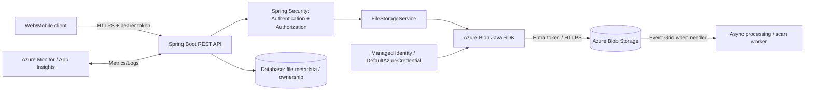
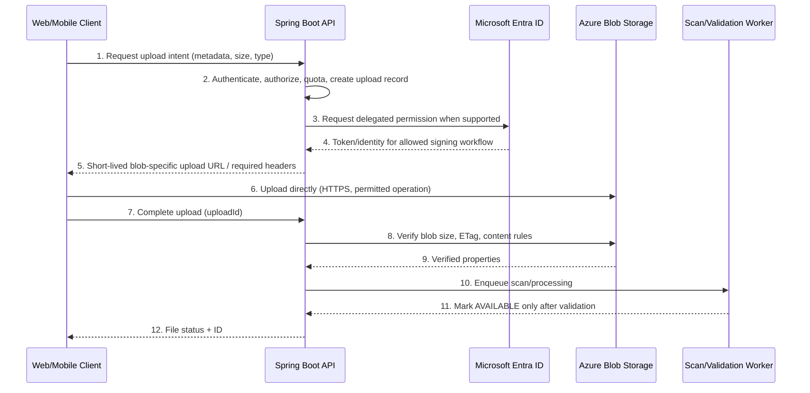
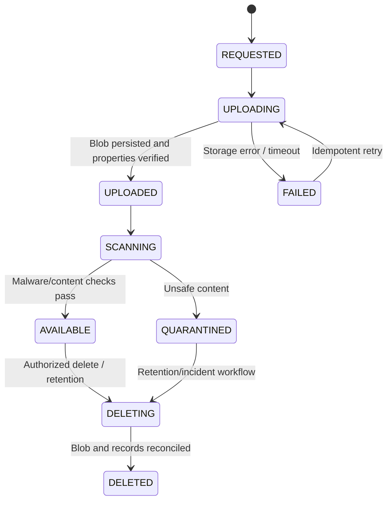
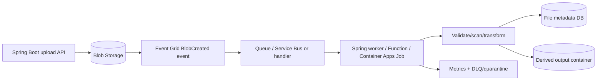
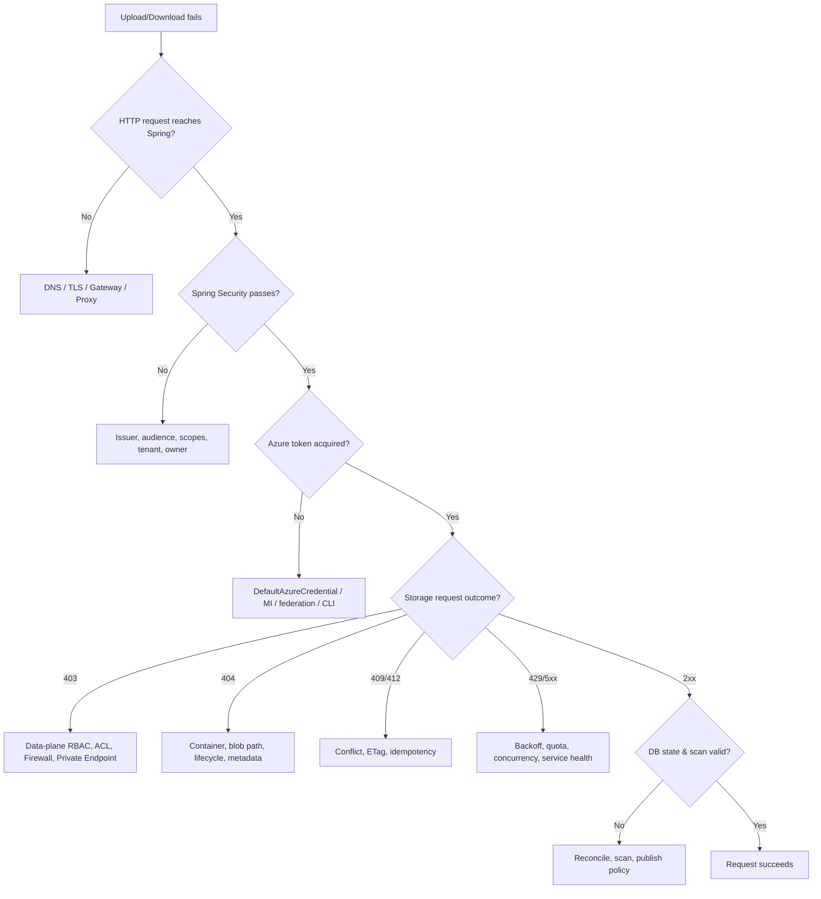

# Integrating Blob Storage into a Spring Boot Application

A Spring Boot application frequently needs to receive documents, product images, report files, or user-uploaded attachments. Storing these files directly on the application container's local directory risks data loss when containers are replaced or scaled out; multiple instances do not automatically share a filesystem; and backups, permissions, and external access become hard to govern. **Azure Blob Storage** provides managed object storage so Java apps can store, read, and manage files over HTTPS while leveraging Microsoft Entra ID, Azure RBAC, data lifecycle rules, and Azure redundancy/storage features.

The goal of this lesson is to build **a clean storage layer in Spring Boot**: accepting REST API requests, verifying identity and permissions, generating safe blob names, using the **Azure Storage Blob SDK for Java** to upload/download, and returning proper responses. It also explains choosing between **streaming through the app** vs. **direct client uploads using SAS/user delegation** for large files or high traffic.

This lesson belongs to the **Spring Boot on Azure** chapter of the `CLOUD_PROVIDERS_AZURE` module. Related topics include subscriptions/resource groups, Microsoft Entra ID, virtual networking, compute (App Service, Container Apps, AKS), storage services, security, monitoring, and cost control. This lesson focuses on **architecture and code integrating Spring Boot with Blob Storage**; it does not provision Azure resources automatically or replace environment-specific IAM, networking, and backup governance.

> **Technical scope:** Examples illustrate Spring Boot 3.x, Java 17+, and modern Azure SDK releases. API names, overloads, and dependencies can change across `azure-storage-blob`, `azure-identity`, and Spring Security/Boot versions; pin and test your actual versions. Code is provided for learning and adaptation, **not as proof it was executed against a live subscription**. All account/container/resource names are illustrative.

## Learning Objectives

After this lesson, you can:

1. Explain the differences between Blob Storage, local filesystems, and storing metadata in a database.
2. Distinguish **storage account, container, blob, blob name, metadata, tags, and access tiers**.
3. Configure the **Azure SDK for Java** as Spring Beans with dependency injection instead of instantiating clients per request.
4. Use **`DefaultAzureCredential`/managed identity** and assign least-privilege Azure data-plane RBAC.
5. Build upload and download REST endpoints with **size limits, authentication, authorization, safe blob naming, and streaming**.
6. Understand MIME types, checksums/ETags, overwrite policies, versioning, soft delete, and idempotency.
7. Choose between **backend-proxied upload/download** and **direct-to-Blob** via scoped URLs/credentials.
8. Handle errors, retries, throttling, network failures, partial uploads, and state consistency between Blob and database.
9. Design tenant/user isolation, protect sensitive files, and prevent path traversal/IDOR.
10. Monitor latency, capacity, operations, errors, data lifecycle, and estimate costs.
11. Write unit and integration tests, including unauthorized-access test cases.
12. Build a production operations checklist across App Service, Functions, Container Apps, or AKS.

## 1. Overall Architecture



Design two distinct flows:

**Upload:** Client sends file → API authenticates and authorizes → enforces size/type limits → generates server-controlled blob ID and path → streams upload to Storage → writes metadata/status to database → returns file ID (never returning account keys).

**Download:** Client sends file ID → API authenticates → verifies ownership/tenant/scope → resolves blob mapping or builds path from trusted identity → reads Blob via SDK → streams response with safe headers.

For large files, the backend can issue **short-lived upload authorization** directly to the client and receive a completion callback/verification rather than proxying every byte. This saves backend CPU and bandwidth yet requires strict SAS, CORS, content validation, and completion workflows.

### 1.1. Who Does What?

| Component | Responsibility | What not to do |
|---|---|---|
| **Spring Controller** | HTTP contract, authentication, input limits, status codes. | Hard-code storage account keys or trust client-supplied filenames as paths. |
| **Storage Service** | Store/read/delete blobs, attach metadata, handle SDK errors/retries. | Decide user permissions based on whether a blob URL exists. |
| **Authorization layer** | Determine user/tenant/ownership/scopes. | Trust a tenant ID from the request body without verification. |
| **Blob Storage** | Persist bytes/metadata, enforce Storage data-plane access. | Know end-user app accounts when the API uses one shared managed identity. |
| **Metadata DB** | Store file ID, owner, scan status, source, retention, business links. | Assume a DB transaction commits atomically with a Blob upload. |
| **Async worker** | Virus/content scanning, thumbnails/OCR, event processing. | Mark a file safe before checks complete. |

### 1.2. Blobs Are Not Local Container Disk Folders

Azure Blob Storage exposes an object-storage interface. In standard Blob accounts, a "folder" inside a blob name like `users/123/avatar.png` is largely a **prefix convention**; in accounts with hierarchical namespace enabled (ADLS Gen2), paths also carry directory/filesystem API semantics. Never assume `/` in a blob name means the Azure SDK manages a full POSIX filesystem like `/var/app/uploads`.

## 2. Core Blob Storage Concepts

| Concept | Meaning | Example |
|---|---|---|
| **Storage account** | Azure resource hosting Storage services, region, redundancy, network, IAM. | `stappfileslab` |
| **Blob service endpoint** | Target URL for Blob API calls. | `https://stappfileslab.blob.core.windows.net` |
| **Container** | Scope grouping blobs with configurable access and lifecycle rules. | `attachments` |
| **Blob** | Object containing bytes and properties. | PDF `invoice.pdf` |
| **Blob name** | Identifier of a blob within a container, optionally with folder-like prefixes. | `tenants/t-a/users/u-1/83f...` |
| **Blob type** | Block, append, or page blob depending on workload. | File uploads via SDK typically use **block blobs**. |
| **Properties/HTTP headers** | Size, ETag, Last-Modified, Content-Type, etc. | `application/pdf` |
| **Metadata** | Key/value pairs stored as blob metadata. | `ownerId`, `uploadRunId` (set by server). |
| **Blob index tags** | Tags for filtering/querying per service capabilities. | `classification=internal` |
| **ETag** | Resource version validator for concurrency control. | Opaque token used in `If-Match`. |
| **Blob versioning** | Retains prior blob versions on overwrite when enabled. | Retrieve older versions as needed. |
| **Soft delete** | Enables recovery of deleted blobs/versions within a retention window. | Does not replace a backup/DR strategy. |
| **Access tier** | Storage tier matched to access frequency and billing. | Hot/Cool/Cold/Archive per account/region/feature. |

**An Azure Storage account and container are not created automatically by instantiating a `BlobClient` builder.** Provision resources via reviewed IaC/Portal/CLI rather than letting Spring Boot auto-create production containers at startup when the service only needs data read/write rights.

### 2.1. A Blob Name Is Not the User's Filename

A user might upload `../../hr/salary.csv` or `same-name.pdf`. If the backend uses `MultipartFile.getOriginalFilename()` directly as the blob name and accesses it by that path, it risks cross-tenant leaks, overwrites, filename exposure, and URL-parsing bugs. **Blob names should be server-generated**, such as a UUID under a prefix derived from verified identity. Keep the original filename, if truly needed, only as **sanitized display metadata**, never as an authorization key.

### 2.2. Private Container or Public Container?

For internal documents, invoices, or images containing personal data, default to a **private container** with anonymous public access disabled per policy. The API uses managed identity to access Storage; end users hold no direct permissions by default. When using direct downloads/SAS, grant **short-lived, narrow, single-file** permissions with an incident revocation plan.

Never store account keys or long-lived SAS tokens in frontend JavaScript, mobile bundles, source code, Git, or application logs.

## 3. Choosing the Integration Approach in Spring Boot

Two common paths exist:

| Option | Pros | Things to consider |
|---|---|---|
| **Plain Azure Storage Blob SDK** | Explicit control over clients, streaming, ETags, metadata, and SDK APIs. | Manual Bean setup, exception mapping, and part of lifecycle management. |
| **Spring Cloud Azure integration/starter** | Integrates Spring properties, credential/config binding, and versioned abstractions. | Must verify starter/version compatibility, auto-config, and runtime permissions. |

This lesson uses the **plain Azure SDK inside Spring Boot** to make boundaries explicit. A project using Spring Cloud Azure can leverage its starter, but never mix **two conflicting client/credential setups** where you are unsure which Bean gets injected. Either way, principles for identity/authorization, input limits, retries, and retention stay identical.

### 3.1. MVC or WebFlux Architecture?

- **Spring MVC + blocking Azure `BlobClient`:** straightforward request/response handling with `MultipartFile` and `StreamingResponseBody`. Budget thread pools and concurrent streams carefully.
- **Spring WebFlux + `BlobAsyncClient`:** fits reactive streams and backpressure in end-to-end reactive architectures; never call blocking SDKs on event-loop threads.
- **Direct-to-Blob for large uploads:** generally better than pushing every byte through the application tier, especially with many clients or mobile networks.

**Never combine Servlet `MultipartFile` with WebFlux `Flux<DataBuffer>` assuming they compose seamlessly**. Code examples below use **Spring MVC**.

## 4. Maven Dependencies and Version Management

For Spring Boot 3.x / Java 17+, add the matching dependencies:

```xml
<!-- Dependency snippet; assumes project uses Spring Boot parent/BOM. -->
<dependencyManagement>
  <dependencies>
    <dependency>
      <groupId>com.azure</groupId>
      <artifactId>azure-sdk-bom</artifactId>
      <version>YOUR_TESTED_AZURE_SDK_BOM_VERSION</version>
      <type>pom</type>
      <scope>import</scope>
    </dependency>
  </dependencies>
</dependencyManagement>

<dependencies>
  <dependency>
    <groupId>org.springframework.boot</groupId>
    <artifactId>spring-boot-starter-web</artifactId>
  </dependency>
  <dependency>
    <groupId>org.springframework.boot</groupId>
    <artifactId>spring-boot-starter-security</artifactId>
  </dependency>
  <dependency>
    <groupId>org.springframework.boot</groupId>
    <artifactId>spring-boot-starter-oauth2-resource-server</artifactId>
  </dependency>
  <dependency>
    <groupId>com.azure</groupId>
    <artifactId>azure-identity</artifactId>
  </dependency>
  <dependency>
    <groupId>com.azure</groupId>
    <artifactId>azure-storage-blob</artifactId>
  </dependency>
</dependencies>
```

`YOUR_TESTED_AZURE_SDK_BOM_VERSION` is a **required placeholder**—replace it with a real BOM version compatible with your Spring Boot, JDK, and Azure SDK versions. This is not a complete `pom.xml`. Pin versions and test on SDK upgrades, as upload APIs, options, policies, and Azure Identity chain behavior can change.

### 4.1. Why Include Spring Security?

A Spring Boot API cannot protect data merely with hard-to-guess UUIDs or the managed identity's permissions. An API running under **one Azure principal** can read every blob granted to that principal, yet **User A must never fetch User B's files**. Spring Security / OAuth2 Resource Server validates the API's JWTs so the app can **authorize by owner/tenant** before calling Blob Storage.

## 5. Application Configuration and Environment

Example `application.yml`:

```yaml
app:
  blob:
    endpoint: "https://<storage-account>.blob.core.windows.net"
    container: "attachments"

spring:
  servlet:
    multipart:
      max-file-size: 20MB
      max-request-size: 22MB
  security:
    oauth2:
      resourceserver:
        jwt:
          issuer-uri: "https://login.microsoftonline.com/<tenant-id>/v2.0"
```

On Azure, pass endpoint, container, and issuer via **App Service settings, Container Apps configuration, Kubernetes ConfigMaps, or deployment environment variables**. Never commit tenant/client secrets needlessly. An `issuer-uri` is only **part** of validating an access token; you must also validate **this API's audience**, scopes/roles, and tenant policies, especially in multi-tenant APIs.

### 5.1. Environment Variable for Endpoint

Keep Spring config externalized:

```yaml
app:
  blob:
    endpoint: "${AZURE_BLOB_ENDPOINT}"
    container: "${AZURE_BLOB_CONTAINER:attachments}"
```

`AZURE_BLOB_ENDPOINT` is an **application-defined variable**, not a built-in credential source. `DefaultAzureCredential` uses its own identity sources. In some environments, `AZURE_CLIENT_ID` selects a user-assigned/workload identity; do not confuse endpoints with identities.

### 5.2. Multipart and Total Request Limits

`spring.servlet.multipart.max-file-size` and `max-request-size` enforce **Spring multipart limits**, yet you still need limits at the **reverse proxy, API gateway, and WAF**, plus timeouts and storage quotas. Never trust client-reported `Content-Length` headers; measure actual sizes and enforce hard caps. On oversized payloads, Spring may throw **before reaching the controller**; map it to HTTP 413 with a clear message.

### 5.3. Containers Should Exist Before the App Starts

IaC should provision:

- Resource group, Storage account, and private container.
- Managed identity on the compute host.
- Data-plane role assignment at the right scope.
- Network rules, Private Endpoints, and Private DNS if used.
- Soft delete, versioning, retention, logging, and monitoring.
- App settings for endpoints/container—never account keys.

The application **needs neither a Storage account key nor permission to create containers** just to upload files into an existing container.

## 6. Spring `@Configuration`: `BlobServiceClient` and `BlobContainerClient`

```java
package example.files;

import com.azure.core.credential.TokenCredential;
import com.azure.identity.DefaultAzureCredentialBuilder;
import com.azure.storage.blob.BlobContainerClient;
import com.azure.storage.blob.BlobServiceClient;
import com.azure.storage.blob.BlobServiceClientBuilder;
import org.springframework.beans.factory.annotation.Value;
import org.springframework.context.annotation.Bean;
import org.springframework.context.annotation.Configuration;

@Configuration
public class AzureBlobConfiguration {

    @Bean
    public TokenCredential azureCredential() {
        return new DefaultAzureCredentialBuilder().build();
    }

    @Bean
    public BlobServiceClient blobServiceClient(
        TokenCredential azureCredential,
        @Value("${app.blob.endpoint}") String endpoint) {

        return new BlobServiceClientBuilder()
            .endpoint(endpoint)
            .credential(azureCredential)
            .buildClient();
    }

    @Bean
    public BlobContainerClient fileContainer(
        BlobServiceClient service,
        @Value("${app.blob.container}") String containerName) {

        // Do not create containers or relax public access at startup.
        return service.getBlobContainerClient(containerName);
    }
}
```

**Notes:**

- `DefaultAzureCredentialBuilder().build()` only constructs the credential object; **it has not fetched a real token yet**. Identity failures usually surface on the first Storage call.
- Reuse `BlobServiceClient` and `BlobContainerClient` Beans across requests; avoid rebuilding credentials/clients per upload.
- Local dev can use Azure CLI login; production uses managed/workload identity per host and SDK setup.
- If production **must only** use one MI, consider an explicit `ManagedIdentityCredentialBuilder` so the chain cannot fall back to an unintended `EnvironmentCredential` or developer credential.
- Timeouts, retries, telemetry, and HTTP client pools can be tuned on the client builder per your SDK version.
- Creating a `BlobContainerClient` does not verify that the container exists or the principal holds permissions—verify via a controlled data-plane request.

## 7. `DefaultAzureCredential` and Blob Permissions

### 7.1. Local Development

```bash
az login --tenant "<tenant-id>"
az account set --subscription "<lab-subscription-id>"
az account show -o json
```

When running locally with `AzureCliCredential` in your SDK version, Azure Identity can pick up this login session. However, `DefaultAzureCredential` tries `EnvironmentCredential`, IDE credentials, or other sources first; `az account show` **does not prove** the SDK picked the CLI identity. When verifying, use safe diagnostics or an explicit `AzureCliCredential` in a local-only profile.

### 7.2. Production Managed Identity

On supported App Service/Functions/Container Apps/AKS/VMs:

1. Enable/attach a system-assigned or user-assigned managed identity.
2. Copy the identity's **principal/object ID** for RBAC assignment; use the client ID when selecting a user-assigned MI.
3. Assign `Storage Blob Data Contributor` on the **target container** if the app uploads, reads, and deletes per design. For read-only apps, `Storage Blob Data Reader` suffices.
4. Configure firewalls, Private Endpoints/Private DNS, and outbound routing from the compute host.
5. Deploy and test from the real runtime rather than relying on a developer's laptop permissions.
6. Never grant subscription `Owner` just to resolve a 403.

**Control plane vs. data plane:** `Reader` or `Contributor` at the resource group level does not automatically grant Blob data-plane read/write access. `Storage Blob Data Contributor` grants broader permissions than read-only, so scope and evaluate carefully. ADLS Gen2 ACLs, deny assignments, and policies can also affect effective permissions.

### 7.3. Why Can an Account With a Valid Token Still Be Denied?

`DefaultAzureCredential` **acquires a token**, it does not grant permission on the blob. When Storage returns HTTP 403, the SDK **does not fall back to another Azure CLI identity** once a token was acquired. Inspect the **actual principal, Storage RBAC, networking, container name, path, and policies**.

## 8. File Identification and Path Control

A minimal design where **each user owns their own files**:

```text
container: attachments

blob name:
tenants/<validated-tenant-id>/users/<validated-user-oid>/<server-generated-uuid>
```

Never accept `tenant-id`, `user-oid`, or a full path from the user's query or body. The server extracts identity from the validated JWT, verifies mandatory claims, and generates the UUID itself. Normalize GUIDs/tokens from trusted sources and **reject** requests missing required identity claims.

**Multi-tenant apps must validate JWT issuer, audience, and tenant allowlists**; checking `tid` and `oid` on an arbitrary JWT is insufficient. Azure OAuth2 tokens also distinguish delegated user tokens from app-only tokens; this example targets user endpoints with delegated access and approved scopes.

### 8.1. API File ID Differs from Blob Name

The REST API returns `fileId = UUID`. The real blob name is built from `tenantId/userOid/fileId` or looked up in a database. Users **never need to see** internal account, container, or prefix names. For group-shared documents, **owner paths alone cannot govern all read rights**; use a metadata DB + ACL/tenant membership checks before returning files.

### 8.2. A UUID Is Not Authorization

Even though UUIDs are hard to guess, **knowing a file ID does not grant download permission**. Verify tenant/owner or access rights against an authoritative metadata record. For files with personal data or contracts, never echo unsanitized original filenames into `Content-Disposition`.
## 9. Spring Security: JWT Validation and Endpoint Authorization

Before adding upload/download controllers, the API must verify **access tokens issued specifically for this API** and enforce what callers can invoke. This example uses Microsoft Entra ID with a **single-tenant API** and delegated scopes `files.read` and `files.write`; callers from other tenants are rejected by default.

```java
package example.files;

import org.springframework.context.annotation.Bean;
import org.springframework.context.annotation.Configuration;
import org.springframework.security.config.Customizer;
import org.springframework.security.config.annotation.method.configuration.EnableMethodSecurity;
import org.springframework.security.config.annotation.web.builders.HttpSecurity;
import org.springframework.security.config.http.SessionCreationPolicy;
import org.springframework.security.oauth2.server.resource.web.BearerTokenAuthenticationFilter;
import org.springframework.security.web.SecurityFilterChain;

@Configuration
@EnableMethodSecurity
public class ApiSecurityConfiguration {

    @Bean
    SecurityFilterChain securityFilterChain(HttpSecurity http)
            throws Exception {
        http
            // Only suitable for stateless APIs using Bearer Authorization headers,
            // without session cookies for authentication.
            .csrf(csrf -> csrf.disable())
            .sessionManagement(session ->
                session.sessionCreationPolicy(SessionCreationPolicy.STATELESS))
            .authorizeHttpRequests(auth ->
                auth.anyRequest().authenticated())
            .oauth2ResourceServer(oauth ->
                oauth.jwt(Customizer.withDefaults()));
        return http.build();
    }
}
```

`@EnableMethodSecurity` activates `@PreAuthorize`. Without method security enabled, controller authorization annotations **may be silently ignored**. Disabling CSRF applies strictly to stateless APIs that **never** use browser cookies or sessions for auth. If the app also serves cookie-authenticated UIs, design CSRF protection carefully rather than copying this blindly.

### 9.1. JWT Audience Must Match This API

Configuring `issuer-uri` alone does not guarantee the API accepts only tokens meant for it. Validate that `aud` matches the registered API client ID or Application ID URI and the right tenant/issuer. Example audience validation in Spring Security:

```java
package example.files;

import org.springframework.beans.factory.annotation.Value;
import org.springframework.context.annotation.Bean;
import org.springframework.context.annotation.Configuration;
import org.springframework.security.oauth2.core.*;
import org.springframework.security.oauth2.jwt.*;

@Configuration
public class JwtValidationConfiguration {
    @Bean
    JwtDecoder jwtDecoder(
            @Value("${app.security.issuer}") String issuer,
            @Value("${app.security.audience}") String audience) {

        NimbusJwtDecoder decoder =
            NimbusJwtDecoder.withIssuerLocation(issuer).build();

        OAuth2TokenValidator<Jwt> standard =
            JwtValidators.createDefaultWithIssuer(issuer);

        OAuth2TokenValidator<Jwt> correctAudience = jwt ->
            jwt.getAudience().contains(audience)
                ? OAuth2TokenValidatorResult.success()
                : OAuth2TokenValidatorResult.failure(
                    new OAuth2Error("invalid_token",
                        "Access token has incorrect audience", null));

        decoder.setJwtValidator(
            new DelegatingOAuth2TokenValidator<>(standard, correctAudience));
        return decoder;
    }
}
```

Add trusted configuration from deployment settings:

```yaml
app:
  security:
    issuer: "https://login.microsoftonline.com/<tenant-id>/v2.0"
    audience: "api://<registered-api-client-id>"
```

**Verify that `audience` matches the exact `aud` claim emitted by Entra ID**, which may be the API client ID or Application ID URI depending on your app registration. This is a **single-tenant template**, not a full multi-tenant implementation; multi-tenant apps must enforce issuer/tenant allowlists, consent, and per-tenant user permissions.

In apps accepting **app-only tokens** instead of delegated user tokens, `oid` may denote a service principal; design separate authorization rather than treating it as a user uploading a personal file. The personal-file examples below require a **delegated user token**.

### 9.2. Distinguish User Permissions from Managed Identity Permissions

```text
HTTP request:
  User JWT (Spring API audience)     -> Spring Security
  Delegated scope files.write        -> @PreAuthorize

Outbound request:
  App managed identity               -> Blob SDK TokenCredential
  Storage Blob Data Contributor      -> Azure Storage data plane
```

These two tokens can represent **different principals** and target **different audiences**. Never pass the HTTP user's token directly as the backend Blob SDK credential; on-behalf-of delegation is a separate architecture requiring end-to-end validation. This example uses the **application managed identity** to call Blob Storage.

## 10. Constructing Safe Blob Paths from Validated JWTs

A clean layout for **personal files** scopes prefixes by `tid` (tenant ID) and `oid` (user object ID), both read from a **signature-, issuer-, and audience-verified JWT**, never from the request body.

```java
package example.files;

import java.util.Locale;
import java.util.UUID;
import org.springframework.security.access.AccessDeniedException;
import org.springframework.security.oauth2.jwt.Jwt;
import org.springframework.stereotype.Component;

@Component
public final class BlobPathPolicy {
    private static final String GUID =
        "[0-9a-fA-F]{8}-[0-9a-fA-F]{4}-[0-9a-fA-F]{4}-"
        + "[0-9a-fA-F]{4}-[0-9a-fA-F]{12}";

    public String personalFilePath(Jwt jwt, UUID fileId) {
        String tenant = jwt.getClaimAsString("tid");
        String owner = jwt.getClaimAsString("oid");

        if (tenant == null || !tenant.matches(GUID)
                || owner == null || !owner.matches(GUID)) {
            // Fail closed; never silently fall back to sub/UPN/email instead of oid.
            throw new AccessDeniedException(
                "Validated tenant and user object IDs required");
        }

        return "tenants/" + tenant.toLowerCase(Locale.ROOT)
            + "/users/" + owner.toLowerCase(Locale.ROOT)
            + "/" + fileId;
    }
}
```

This mechanism has **clear limitations that must be stated**:

- It serves **one user's private files** only—it does not support group or org sharing.
- `oid` comes from a verified delegated user token and may not exist in every token type; reject when absent.
- For guest users, tenant/object ID mapping must follow your app's identity-mapping and authorization policies.
- For shared documents, use database metadata records (`fileId,tenantId,ownerId,allowedPrincipals,status`) and an authorization service before touching Blob Storage.
- The Storage MI can read the whole container; **the app layer is responsible** for never returning another user's blob.

**Omitting original filenames or arbitrary paths from the API** prevents many traversal and overwrite bugs, yet **it does not replace** authorization testing and negative request handling.

## 11. `FileStorageService`: Uploading with Server-Generated UUIDs

Using the blocking `BlobContainerClient` Bean registered earlier:

```java
package example.files;

import com.azure.storage.blob.BlobClient;
import com.azure.storage.blob.BlobContainerClient;
import java.io.IOException;
import java.io.InputStream;
import java.util.UUID;
import org.springframework.http.HttpStatus;
import org.springframework.security.oauth2.jwt.Jwt;
import org.springframework.stereotype.Service;
import org.springframework.web.multipart.MultipartFile;
import org.springframework.web.server.ResponseStatusException;

@Service
public class FileStorageService {
    private static final long MAX_FILE_BYTES = 20L * 1024 * 1024;

    private final BlobContainerClient container;
    private final BlobPathPolicy pathPolicy;

    public FileStorageService(
            BlobContainerClient container,
            BlobPathPolicy pathPolicy) {
        this.container = container;
        this.pathPolicy = pathPolicy;
    }

    public UUID uploadPersonalFile(Jwt identity, MultipartFile file)
            throws IOException {

        if (file == null || file.isEmpty()) {
            throw new ResponseStatusException(
                HttpStatus.BAD_REQUEST, "File must not be empty");
        }
        if (file.getSize() > MAX_FILE_BYTES) {
            throw new ResponseStatusException(
                HttpStatus.PAYLOAD_TOO_LARGE, "File is too large");
        }

        // Never use file.getOriginalFilename() as the Blob key.
        UUID id = UUID.randomUUID();
        String path = pathPolicy.personalFilePath(identity, id);
        BlobClient target = container.getBlobClient(path);

        // false: do not overwrite an existing blob at the same path.
        try (InputStream input = file.getInputStream()) {
            target.upload(input, file.getSize(), false);
        }

        return id;
    }

    public BlobClient personalBlob(Jwt identity, UUID fileId) {
        return container.getBlobClient(
            pathPolicy.personalFilePath(identity, fileId));
    }
}
```

### 11.1. Why Does the Example Return `application/octet-stream` on Download?

Uploaded files carry `file.getContentType()` or `.pdf`/`.html` names **declared by the client**, which can be spoofed or malicious. The example protects by default via **attachment download** and `application/octet-stream`. Apps needing inline image/PDF previews must enforce **MIME allowlists, magic-byte inspection, malware scanning, CSP, `Content-Disposition`, and dedicated rendering policies** instead of trusting upload headers.

### 11.2. Practical Size Boundaries

`20 MiB` is a **lab threshold**. Servlet multipart resolvers often buffer uploads to temp disk before invoking your service; this code **does not guarantee zero-copy or 100% end-to-end streaming from the client**. Size multipart caps, proxy/gateway timeouts, ephemeral temp disk, concurrency, and network bandwidth. For multi-GB files, prefer direct-to-Blob resumable block uploads.

### 11.3. No Antivirus / Quarantine in This Code Yet

`uploadPersonalFile` demonstrates **writing bytes into a private container**, not certifying file safety. In production, typically:

- Upload into a **quarantine container** accessible only to scanners/workers.
- Persist metadata `status=PENDING_SCAN`.
- Scan for malware, file signatures, and content policies using approved scanners.
- Transition to `AVAILABLE` and permit downloads only once scans pass.
- Handle timeouts, scanner outages, false positives, retention, and deletion policies.

If your app allows immediate download post-upload as in this lab snippet, **state clearly that this is a sample limitation** and never serve untrusted files without inspection.

## 12. REST Controller: Upload and Download via Spring MVC

```java
package example.files;

import com.azure.storage.blob.BlobClient;
import com.azure.storage.blob.models.BlobProperties;
import java.io.IOException;
import java.util.UUID;
import org.springframework.http.*;
import org.springframework.security.access.prepost.PreAuthorize;
import org.springframework.security.core.annotation.AuthenticationPrincipal;
import org.springframework.security.oauth2.jwt.Jwt;
import org.springframework.web.bind.annotation.*;
import org.springframework.web.multipart.MultipartFile;
import org.springframework.web.servlet.mvc.method.annotation.StreamingResponseBody;

@RestController
@RequestMapping("/api/files")
public class FileController {
    private final FileStorageService storage;

    public FileController(FileStorageService storage) {
        this.storage = storage;
    }

    public record UploadedFile(String fileId) {}

    @PostMapping(
        consumes = MediaType.MULTIPART_FORM_DATA_VALUE,
        produces = MediaType.APPLICATION_JSON_VALUE)
    @PreAuthorize("hasAuthority('SCOPE_files.write')")
    public ResponseEntity<UploadedFile> upload(
            @AuthenticationPrincipal Jwt jwt,
            @RequestPart("file") MultipartFile file) throws IOException {

        UUID id = storage.uploadPersonalFile(jwt, file);
        return ResponseEntity.status(HttpStatus.CREATED)
            .body(new UploadedFile(id.toString()));
    }

    @GetMapping("/{fileId}")
    @PreAuthorize("hasAuthority('SCOPE_files.read')")
    public ResponseEntity<StreamingResponseBody> download(
            @AuthenticationPrincipal Jwt jwt,
            @PathVariable UUID fileId) {

        BlobClient blob = storage.personalBlob(jwt, fileId);
        BlobProperties properties = blob.getProperties();

        StreamingResponseBody body = output ->
            blob.downloadStream(output);

        return ResponseEntity.ok()
            .contentType(MediaType.APPLICATION_OCTET_STREAM)
            .contentLength(properties.getBlobSize())
            .header(HttpHeaders.CONTENT_DISPOSITION,
                    "attachment; filename=\"" + fileId + ".bin\"")
            .header(HttpHeaders.CACHE_CONTROL, "private, no-store")
            .header("X-Content-Type-Options", "nosniff")
            .body(body);
    }
}
```

**Prerequisites for this code:**

- Spring Resource Server JWT validates issuer/audience, and Spring Method Security is enabled.
- Entra app registration emits delegated scopes `files.read` and `files.write`, mapped to `SCOPE_...` by Spring Security.
- The Blob container exists, and the runtime holds data-plane permissions and network access.
- Applies only to **personal files** under `tid/oid`. Does not support group sharing or service-principal uploads.
- `Content-Disposition` uses only the server-generated UUID, never client-supplied filenames.
- Handle `BlobStorageException`/`MaxUploadSizeExceededException` and prevent SDK error details from leaking in production.
- `StreamingResponseBody` runs I/O on Spring MVC's executor. **Configure a bounded `TaskExecutor` suited to real load** instead of unbounded streams; response headers may be committed before the backend finishes reading the blob.

### 12.1. Streaming Downloads and Mid-Stream Failures

`blob.getProperties()` checks resource existence and size before sending headers; however, if `downloadStream(output)` loses connectivity to Azure mid-transfer, HTTP headers and partial bytes are already on the wire. At that point **you cannot cleanly switch to a JSON 500 response**. Clients must detect truncated downloads (via `Content-Length`/checksums) and retry or issue range downloads per policy.

For large media/files, HTTP `Range` / `206 Partial Content` requires explicit `Range`/`Content-Range` handling and SDK range reads; **this sample does not implement range/resume**. Never set a `Content-Length` that mismatches the actual payload after compression or transformation.

### 12.2. Preventing Insecure Direct Object Reference (IDOR)

Here, the client sends only a `UUID`; the app builds the prefix from the **authenticated JWT**. Even if an attacker guesses another user's UUID, queries stay confined to the caller's prefix and cannot read the other user's file. However, if you later add a "share file" feature, **never** drop the prefix policy and call `container.getBlobClient(requestedPath)`. Enforce authoritative metadata records, permission checks, and cross-tenant negative tests.

### 12.3. Testing the HTTP Contract

Lab test requests with a valid OAuth token targeting the Spring API:

```bash
# Pass TOKEN via a secure environment variable; never print to logs.
curl -X POST "https://<app-host>/api/files" \
  -H "Authorization: Bearer <access-token-for-the-api>" \
  -F "file=@./sample.txt"

# After upload returns fileId:
curl "https://<app-host>/api/files/<file-id>" \
  -H "Authorization: Bearer <access-token-for-the-api>" \
  -o downloaded.bin
```

This is **illustrative syntax**, containing no real tokens or endpoints. Never paste access tokens into shared terminal histories or CI logs. In some PowerShell versions `curl` is an alias; use `curl.exe` or native PowerShell equivalents.

## 13. Deliberate HTTP Error Mapping from the Azure SDK

An API must never return raw error messages exposing storage account names, internal URLs, request headers, or stack traces to end users.

| Failure | Meaning | API HTTP behavior |
|---|---|---|
| Missing multipart or empty file | Invalid request contract. | `400 Bad Request`. |
| File exceeds size cap | Payload too large. | `413 Payload Too Large`. |
| Missing/wrong-audience JWT | Unauthenticated / invalid token. | `401 Unauthorized`. |
| Valid user token missing scope/owner permission | Unauthorized. | `403 Forbidden` or `404` if policy hides existence. |
| Blob absent in authorized prefix | Not found. | `404 Not Found`. |
| Duplicate blob ID with `overwrite=false` | Conflict. | `409 Conflict` (very rare with UUIDs). |
| Storage returns 403 to app MI | **Infrastructure/config error** between API and Storage, not missing user scope. | Typically `502/503` + alert; do not blame the user's permissions. |
| Storage timeout/503/429 | Infrastructure/backpressure. | `503 Service Unavailable`/`502` with bounded retries. |
| Upload succeeds yet DB metadata commit fails | Inconsistent state. | Use reconciliation runbook; never treat upload as a DB transaction. |

A `@RestControllerAdvice` maps exceptions like `MaxUploadSizeExceededException` to 413, `BlobStorageException` with status 404 to 404, and Storage 403/5xx errors to backend errors with internal trace correlation. **Never pass every Storage 403 straight through as a user 403**, as that hides MI/RBAC misconfigurations. Never leak raw Azure SDK exceptions to clients.

### 13.1. Example Handler for Multipart Limit

```java
package example.files;

import org.springframework.http.*;
import org.springframework.web.bind.annotation.*;
import org.springframework.web.multipart.MaxUploadSizeExceededException;

@RestControllerAdvice
public class FileApiErrors {

    @ExceptionHandler(MaxUploadSizeExceededException.class)
    ResponseEntity<ProblemDetail> tooLarge(
            MaxUploadSizeExceededException error) {
        ProblemDetail problem = ProblemDetail.forStatus(
            HttpStatus.PAYLOAD_TOO_LARGE);
        problem.setTitle("File too large");
        problem.setDetail("The uploaded file exceeds the configured limit");
        return ResponseEntity.status(HttpStatus.PAYLOAD_TOO_LARGE)
            .body(problem);
    }
}
```

In production, add mappings for `BlobStorageException`, `AccessDeniedException`, request validation, and typed domain errors. This snippet handles **one error class** for illustration. Remember streaming failures after headers are committed cannot be converted into a normal `ProblemDetail` response.
## 14. Large Files: Direct Upload/Download with Scoped Permissions

For files of a few dozen MB, proxying through Spring MVC works well when traffic is modest and immediate content inspection is needed. Yet for **videos, backups, multi-GB archives, or thousands of concurrent uploads**, routing every byte through App Service consumes bandwidth, threads, temp disk, timeouts, and socket connections.

An alternative architecture lets the **client transfer directly to Blob Storage**, while Spring Boot handles authorization and issues a **short-lived**, tightly scoped upload permission.



### 14.1. What Is a SAS?

A **Shared Access Signature (SAS)** is a signed token/URI granting time-bounded, resource-scoped access to Storage. SAS types and signing methods vary; for Blob Storage with Microsoft Entra ID, evaluate **user delegation SAS** signed with a **user delegation key** obtained via an authorized Entra identity, rather than signing SAS tokens with long-lived storage account keys.

A SAS remains a **bearer capability**: anyone holding the URL/token can exercise the signed permissions until expiry under allowed conditions. Never write SAS URLs into logs, analytics, browser histories, public URL shares, or untrusted domains.

### 14.2. SAS Permissions Must Be Narrow

Creating an upload intent might return metadata like:

```json
{
  "uploadId": "ad9e9c6a-f587-4b55-8b52-5a3865de8b04",
  "blobName": "pending/tenant-demo/user-demo/ad9e9c6a-f587-4b55-8b52-5a3865de8b04",
  "expiresAtUtc": "2026-11-20T10:15:00Z",
  "allowedMethod": "PUT",
  "requiredHeaders": {
    "x-ms-blob-type": "BlockBlob"
  }
}
```

This is **illustrative metadata**, not a real SAS URL. In production, include the short-lived scoped URI or credential properly; never grant container-wide `read/write/delete/list` when a user should upload **one blob**. Storage supports distinct SAS scopes/methods, so ensure your SDK/API grants the exact permissions required for `Put Blob` or multi-request block uploads.

**Safety policy:**

- Generate blob names server-side; never let clients pick containers or paths freely.
- Restrict operations (e.g., create/write) and keep lifetimes short.
- Enforce HTTPS-only, sensible start/expiry times, and recommended clock-skew tolerances.
- Never let clients pick another tenant's file via query parameters.
- Use user delegation SAS where supported, granting the **SAS-signing principal** least privilege and governing `generateUserDelegationKey`.
- Implement **completion verification** checking file replacement, size limits, and scan status before publishing.
- Configure tight Storage CORS (specific origins, methods, headers); never use `*` carelessly with credentials.
- Maintain an incident revocation plan; do not assume every issued SAS can be revoked instantaneously with a single toggle.
- Never sign SAS tokens with a storage account key in code solely for convenience when managed identity offers a safer option.

### 14.3. Distinguish the API's JWT from a Blob SAS

The JWT targets the Spring API audience and goes to the backend. The SAS is a capability verified by Storage when the client talks directly to Blob Storage. They **never replace each other**:

```text
Browser → Spring API: Authorization: Bearer <API access token>
Browser → Blob:       HTTPS request with scoped SAS URL
Spring API → Blob:    Managed identity TokenCredential
```

Never forward the API JWT as a query parameter on a Blob URL, and never let the frontend hold the backend managed identity's tokens or permissions.

### 14.4. Is Direct Download Appropriate?

For large files and authenticated users, the backend can check ACLs in the metadata DB and return a **blob-scoped, read-only SAS** or use a proxy/CDN pattern. However:

- Anyone given the link can use it until it expires; weigh data sensitivity.
- Never issue long-lived SAS URLs or allow public caching on private documents.
- When instant access revocation is mandatory, streaming through an authenticated gateway/proxy is safer.
- `Content-Disposition`, response header overrides, caching policies, and antivirus status still apply.
- For media streaming/range requests, support byte ranges properly so the app does not become a bottleneck.

### 14.5. Should You Choose Proxy or Direct-to-Blob?

| Criterion | Spring Boot proxy | Direct-to-Blob |
|---|---|---|
| Initial setup | Simpler; one API controls the stream. | Adds upload intent, SAS, CORS, and completion flow. |
| Backend load | App holds connections and bandwidth end-to-end. | Offloads byte transfer from backend. |
| Inspection before Storage write | Can validate parts in-stream; still requires scanning. | Needs quarantine + post-upload verification. |
| Large files / resume | Must build timeouts and chunking/ranges yourself. | Can leverage client block upload/resume per SDK and permissions. |
| Instant revocation | Backend enforces permissions on every request. | Issued SAS remains valid until expiry under its conditions. |
| URL protection | No SAS ever sent to browser. | SAS must be treated as a short-lived secret. |
| Cost / bottlenecks | Higher app egress, threads, and compute. | Direct Storage I/O; Storage operations/egress still incur cost. |

Never assume "direct upload is always cheapest"; evaluate file sizes, traffic, network egress, scanning, CDN, private networking, and service SLAs.

## 15. ETags, Concurrency, Overwrites, and Idempotency

A classic mistake is reusing the same blob name across uploads so concurrent callers overwrite each other. Under concurrent requests, design **who may replace which version**.

### 15.1. Non-Overwriting Uploads

```java
// BlobClient built from a server-generated path.
try (InputStream input = file.getInputStream()) {
    target.upload(input, file.getSize(), false);
}
```

`false` instructs the SDK not to overwrite an existing blob in this call. With server-generated UUIDs, collisions are rare, yet errors still need intentional handling. If a client retries an HTTP POST after the server finished uploading but dropped the response, the API may mint a **new UUID** and store two identical blobs. **Non-overwrite alone does not make an API idempotent.**

### 15.2. Business-Layer `Idempotency-Key`

Suppose the client sends a unique random `Idempotency-Key` per upload intent:

```text
Key: tenant-id + user-id + client-idempotency-key

Server:
  1. Verify identity and input contract.
  2. Atomic create/get upload intent in DB with unique key.
  3. Use stable server-generated blob ID for that intent.
  4. Upload/verify or return existing result if already committed.
  5. Persist status and original request fingerprint.
  6. Reject same key reused with different payload/size.
```

Never use the original filename as an idempotency key; two distinct uploads named `report.pdf` are valid. Never generate a fresh `UUID.randomUUID()` on every retry expecting zero duplicates. Combine checksums/ETags and business record state for reconciliation.

### 15.3. ETags Are Opaque Tokens

When updating the contents of a **named blob**, use HTTP conditional requests such as `If-Match` against the previously read ETag to prevent lost updates:

```text
T1. Client A reads ETag="vX"  (illustrative value)
T2. Client B replaces blob, ETag becomes "vY"
T3. Client A attempts replace with If-Match: "vX"
T4. Storage rejects mismatch (typically 412)
T5. App reports conflict and triggers refresh/logical retry
```

ETags **are not comparable numbers**. Use the `BlobRequestConditions`/upload options API supported by your SDK version; never replace this with `getProperties → unconditional overwrite`, which has a race window between the two requests.

### 15.4. Versioning and Soft Delete Are Different

- **Versioning** preserves previous blob versions on replacement when enabled; check tier/account support and storage cost.
- **Soft delete** retains deleted states for recovery within a retention period.
- **Snapshots** capture point-in-time read-only views per service mechanics.
- **Immutable storage / legal hold** prevents edits/deletes per policy and strict rules; never enable without understanding retention obligations.

None of these features **create an atomic transaction between Blob Storage and Azure SQL/PostgreSQL**, nor do they replace cross-region DR/backups or legal/PII deletion workflows.

## 16. Synchronizing Blobs and the Metadata Database

Most applications need more than raw bytes. An `uploaded_files` table might store:

| Field | Example | Purpose |
|---|---|---|
| `file_id` | UUID | Public-facing API identifier. |
| `tenant_id` | Tenant Object ID | Partitioning / authorization. |
| `owner_oid` | Principal Object ID | Ownership. |
| `blob_container` | `attachments` | Internal location. |
| `blob_name` | `tenants/.../<uuid>` | Never exposed directly to users. |
| `original_name_safe` | `invoice-nov.pdf` | Sanitized display name only. |
| `content_type_verified` | `application/pdf` | Inspected result, not solely client header. |
| `size_bytes` | `123456` | Quotas and verification. |
| `sha256` | hash | Dedup/integrity per policy. |
| `etag` | Opaque value | Conditional writes / consistency. |
| `scan_status` | `PENDING/AVAILABLE/QUARANTINED` | Gates download access. |
| `created_at_utc` | timestamp | Lifecycle / auditing. |
| `retention_until` | timestamp | Compliance and deletion schedule. |

### 16.1. No Built-In Cross-Resource Transaction

Suppose:

```text
1. Blob upload succeeds.
2. App writes PostgreSQL row.
3. Database times out or rolls back.
Result: Blob exists, yet the DB knows nothing about it.
```

Or:

```text
1. DB inserts row status=PENDING.
2. Blob upload fails.
Result: DB holds a record pointing to a missing Blob.
```

Both happen in production. **Azure Blob uploads never commit atomically with JDBC/JPA transactions.** You need a state machine, idempotency, retries, and reconciliation.

### 16.2. Recommended State Machine



Persist every transition durably with clear ownership. Transition to `AVAILABLE` only after the blob exists, size/checksum match, policy scans pass, and the DB record commits. **Never treat a `201 Created` upload response as proof the file passed security scanning.**

### 16.3. Reconciliation Job

A scheduled job can:

1. Find upload intents stuck in `UPLOADING` past timeout.
2. Fetch `BlobProperties` for authorized blobs.
3. Compare expected size, ETag/checksum, and metadata.
4. If complete and valid, advance into scanning.
5. Otherwise, retry/resume or mark `FAILED` per policy.
6. Clean up orphaned blobs lacking DB records after a grace period.
7. Flag or clean DB records pointing to nonexistent blobs with auditing.
8. Never blindly delete blobs holding active leases, ongoing scans, or legal holds.

Never run a production job that "deletes every Blob missing a DB record" without a grace period, clear ownership, and dry-run verification—it could wipe blobs owned by another system.

### 16.4. Transactional Outbox for File Processing Events

After upload and DB state update, the app can insert an **outbox event** inside the same DB transaction as the file record, then have a worker publish to Service Bus/Event Grid or enqueue scanning. This prevents a DB commit from losing the scan notification. Still, event delivery remains **at-least-once**, so workers need idempotency keyed by `fileId/scanVersion`.

No single transaction spans PostgreSQL, Blob Storage, and Service Bus. An outbox supports **reliable publication and reconciliation**, not cross-service exactly-once delivery.

## 17. Deletion, Retention, and Versioning in the Application

A `DELETE` operation should pass authorization, policy checks, and DB state transitions before deleting the Blob:

```text
DELETE /api/files/{fileId}
  -> Authenticate + authorize owner/role
  -> Check retention/legal hold and associations
  -> Mark DELETING in DB
  -> Execute Blob delete with approved options/conditions
  -> Mark DELETED, purge cache/derived versions as required
  -> Audit request and outcome
```

**Do not just call `blobClient.delete()` and wipe DB metadata unconditionally.** Blobs may be soft-deleted or versioned, while copies live in CDNs, thumbnails, search indexes, or backups per policy. Deletions must honor legal holds and retention rules—never retry past immutability or legal holds.

### 17.1. Blob Metadata Is Not a Business Database

Blob metadata and tags help technical tracing and filtering, yet they do not replace complex authorization/ownership models or transactional business workflows. If a user changes departments or group memberships, never rely on an `allowed_groups` tag stamped at initial upload instead of evaluating authoritative permissions.

### 17.2. Access Tiers and Lifecycle

| Tier / strategy | Best fit | Warning |
|---|---|---|
| **Hot** | Frequently accessed files needing low latency. | Storage cost per GB is higher than cooler tiers. |
| **Cool/Cold** | Infrequently read data still needing online access per feature. | Higher access fees, early-deletion penalties, and minimum retention days apply. |
| **Archive** | Rarely read data where restore latency is acceptable. | Requires rehydration; unsuitable for instant API downloads. |
| **Lifecycle rules** | Tier transitions or deletions by age/prefix/tags where supported. | Does not replace compliance retention, legal holds, or derived copies. |

Never apply a rule moving every file to Archive after 7 days if the app promises users instant downloads. Verify account type, redundancy, region, tier support, and current pricing before enabling.
## 18. Asynchronous File Processing with Event Grid and Workers

Many apps run post-upload work: generating thumbnails, OCR, malware scanning, metadata extraction, or notifications. Never hold the upload HTTP request open for minutes to run these tasks.

### 18.1. Event-Driven Pattern



When a Blob is created or modified, **Azure Event Grid** emits supported events (such as `BlobCreated`) to subscribers. Event subscriptions, filters, and delivery targets are configured in Azure. Receiving an event **does not mean the file passed security scanning or its DB status is `AVAILABLE`**.

### 18.2. Event Delivery Is Not Exactly-Once

Expect:

- Redelivery when handlers error, time out, or fail to acknowledge.
- **Out-of-order** delivery across rapid uploads or versions.
- Workers crashing after generating a thumbnail yet before updating state.
- Blobs deleted or replaced before a worker reads them.
- Poison events landing in queues/DLQs requiring operator intervention.

Workers must deduplicate by **file ID + version/ETag or event identity**, act only on valid state transitions, and verify the live blob. Event `subject`/`url` fields are external pipeline inputs; validate against an **account/container/prefix allowlist** and authoritative DB metadata before reading—never let arbitrary event URLs trigger SSRF.

### 18.3. Idempotent Event Worker Pseudocode

```text
onBlobCreated(event):
    assert event.account/container are trusted
    fileId = lookupVerifiedFileId(event.subject)
    record = DB.get(fileId)
    if record == null or record.status in [DELETED, QUARANTINED]:
        doNotPublishAsAvailable()
        return

    currentBlob = storage.getProperties(record.blobName)
    if currentBlob.etag != record.expectedEtag:
        reconcileOrScheduleCorrectVersion()
        return

    if record.scanStatus == PASSED for this ETag:
        return  # replay safe

    claimScanJobAtomically(fileId, ETag)
    result = scanContentWithoutLeakingSecrets()
    commitScanResultIfEtagStillMatches(result)
    if result.safe:
        mark AVAILABLE
    else:
        quarantineAndAlert
```

This is **architectural pseudocode**, not a specific Azure SDK API. When scan workers inspect content before release, download APIs must check DB status and reject `PENDING_SCAN`. The earlier `FileStorageService` lab code **omits DB/scanning** and must not be mistaken for a complete production-safe system.

### 18.4. Avoiding Event Loops

If a worker writes thumbnails into the same container/prefix as source uploads, Event Grid can fire another event for the thumbnail. Filter by prefix/blob type/metadata and write derived outputs to a **separate container** or explicitly guard against processing outputs as inputs.

## 19. Performance and Scalability

### 19.1. Potential Bottlenecks

| Component | Risk | Mitigation |
|---|---|---|
| Servlet multipart parser | Temp disk, memory, request body size. | Multipart limits, temp storage quotas, rate limits. |
| Spring MVC thread pool | Concurrent uploads/downloads pinning threads. | Bounded concurrency, tuned async executor, direct uploads. |
| Azure Blob SDK | HTTP connections, timeouts, upload block sizes. | Client reuse, HTTP pooling, SDK parallel transfer tuning. |
| Blob Storage throughput | Hot prefixes/workloads, account limits, 429/503. | Load tests, backoff, scaling per account and workload. |
| App Service / Container Apps | CPU, network bandwidth, outbound sockets, autoscaling. | Monitor p95/concurrency, pick appropriate compute SKU. |
| Scanner / OCR workers | Queue backlog, CPU/memory, poison files. | Worker autoscaling, DLQ/quarantine, resource limits. |
| Metadata database | Indexes, locks, unique constraints. | Idempotency keys, short transactions, connection pooling. |
| Slow client networks | Retries, partial uploads, timeouts. | Chunked/direct uploads with resume and verification. |

### 19.2. Blocking SDK and Request Threads

`BlobClient` is a synchronous API suited to Spring MVC when request rates and thread pools are bounded. `StreamingResponseBody` frees the servlet thread via Spring MVC async processing, yet **a worker/executor thread still streams the bytes**. Servers and proxies may also buffer responses; measure real memory and temp disk usage.

With Spring WebFlux, use `BlobAsyncClient` and reactive request/response bodies with proper backpressure—**never call blocking `BlobClient` on a Reactor event-loop thread** pretending it is non-blocking.

### 19.3. Parallel Uploads and Chunk Size

The Azure Storage SDK supports **parallel transfer / block uploads** with configurable block size, concurrency, and thresholds depending on version. Higher concurrency is not always faster: it raises memory usage, outbound sockets, throttling risk, and cost. Use the upload options supported by your **exact Java SDK version**, measure latency/CPU/cost, and enforce caps.

Files of a few KB need no complex block tuning. Very large files need multi-block uploads, block-list commits, and resume logic; with direct client uploads, ensure SAS permissions cover the required block operations with tight expiration.

### 19.4. Safe Retries by Operation

Transient errors like 429, 500/502/503, connection resets, or timeouts warrant retries per SDK policy. However:

- **403 missing permissions** cannot be fixed by infinite retries.
- **409/412 precondition failed** signals a conflict requiring business handling rather than blind retries.
- **POST uploads** can generate two distinct UUIDs if a client retries after a response timeout; enforce application-layer idempotency keys.
- **Deletes** may treat 404 as already deleted per business policy, while distinguishing "never existed" from "deleted in an earlier request."
- **Streaming downloads** failing mid-body cannot safely resume inline into the same broken stream at an arbitrary offset.

### 19.5. Measuring End-to-End Latency

A sample breakdown:

```text
Client sends request to Spring API        :   25 ms
AuthN/AuthZ + quota/metadata lookup       :   15 ms
Stream upload to Azure Blob Storage       : 1500 ms
Read BlobProperties/checksum (if needed)  :   40 ms
DB status commit                          :   25 ms
Return JSON response                      :   15 ms
----------------------------------------------------
Total                                       1620 ms
```

These numbers are **educational illustrations**, not Azure SLAs. In workflows requiring malware scanning, the time between `201/202` upload acceptance and `AVAILABLE` status may span seconds or minutes. Define separate SLOs per state.

## 20. Testing Spring Boot + Azure Blob Storage

Separate **unit tests**, **emulator/contract tests**, and **real Azure integration tests**, since no single layer replaces the others.

### 20.1. Unit Tests Without Azure

With an injected `BlobContainerClient`, use Mockito to verify path generation and overwrite policy:

```java
package example.files;

import static org.junit.jupiter.api.Assertions.*;
import static org.mockito.ArgumentMatchers.*;
import static org.mockito.Mockito.*;

import com.azure.storage.blob.BlobClient;
import com.azure.storage.blob.BlobContainerClient;
import java.util.UUID;
import org.junit.jupiter.api.Test;
import org.springframework.mock.web.MockMultipartFile;
import org.springframework.security.oauth2.jwt.Jwt;

class FileStorageServiceTest {

    @Test
    void uploadUsesServerGeneratedBlobNameAndNoOverwrite() throws Exception {
        BlobContainerClient container = mock(BlobContainerClient.class);
        BlobClient blob = mock(BlobClient.class);
        when(container.getBlobClient(anyString())).thenReturn(blob);

        FileStorageService service =
            new FileStorageService(container, new BlobPathPolicy());

        String tenant = "11111111-1111-4111-8111-111111111111";
        String user = "22222222-2222-4222-8222-222222222222";
        Jwt jwt = Jwt.withTokenValue("unit-test-not-real-token")
            .header("alg", "none")
            .claim("tid", tenant)
            .claim("oid", user)
            .build();

        MockMultipartFile file = new MockMultipartFile(
            "file", "anything.pdf", "application/pdf",
            new byte[] {1, 2, 3});

        UUID fileId = service.uploadPersonalFile(jwt, file);

        verify(container).getBlobClient(
            "tenants/" + tenant + "/users/" + user + "/" + fileId);
        verify(blob).upload(any(java.io.InputStream.class), eq(3L), eq(false));
    }
}
```

**This is a unit test**: the fake `Jwt` does not validate real tokens, and the mocked Blob SDK makes zero network calls, tests zero Azure permissions, and exercises neither gateway multipart limits nor response streaming. Use matching `spring-boot-starter-test`/Mockito versions and run the tests in your project to verify dependencies and method overloads.

### 20.2. Spring MockMvc for API and Security

Test these HTTP cases:

- Missing JWT → `401`.
- Valid JWT without `files.write` → `403` on POST.
- JWT with `files.read` only → download allowed, upload rejected.
- Valid JWT missing `tid`/`oid` → fail closed.
- User A's JWT with User B's file ID → cannot read User B's file.
- Empty file → `400`; oversized file → `413`.
- Wrong multipart field name or content type → appropriate error.
- Blob backend returns 404/403/503 → API returns contract-compliant error without leaking internal details.

Configure proper test **JWT decoders/audience/scopes** or Spring Security test helpers. A controller test mocking `FileStorageService` while bypassing security filters and method security **proves nothing about authorization**.

### 20.3. Azurite Emulator Is Helpful Within Limits

**Azurite** emulates a subset of Azure Storage APIs locally for upload, download, listing, and deletion tests. However:

- Not every Azure Storage feature matches production behavior.
- **Managed identity/Entra RBAC, Private Endpoints, lifecycle rules, Event Grid, soft delete/versioning, and complex policies** are not fully replicated by Azurite.
- Emulators typically rely on dev connection strings/keys, whereas production code should use `DefaultAzureCredential`/managed identity.
- Keep Azurite test configuration strictly **scoped to local/test profiles** so emulator connection strings or account keys never leak into production.

Keep production Beans using Entra credentials while swapping in an Azurite-compatible `BlobServiceClient` solely in the **emulator test profile**. Never treat passing unit/Azurite tests as passing production RBAC or Private DNS tests.

### 20.4. Integration Testing on Real Azure Resources

In an **approved lab subscription/resource group**, provision a private container and a dedicated managed identity:

1. Assign the least-privilege data-plane role to the lab identity.
2. Run the app from the target Azure hosting environment.
3. Upload a 1 KiB synthetic file, read it back, and verify bytes/checksum.
4. Re-upload to the same blob ID with `overwrite=false` to verify conflict handling.
5. Attempt cross-user/cross-tenant reads and confirm denial.
6. Verify an identity lacking the write role can read but cannot upload.
7. Test account firewall/Private Endpoint behavior per supported model.
8. Verify timeouts/retries under controlled fault conditions.
9. Delete and restore blobs in the lab if permitted by policy.
10. Record principal IDs, SDK versions, resource scopes, and outcomes—never raw tokens.

**Never use real customer data/PII or alter production RBAC/networking** for tests.

## 21. Monitoring and Structured Logging

A healthy upload system means more than HTTP 201s. It must guarantee **files remain retrievable, confidential, unorphaned, and within budget**.

### 21.1. Key Metrics

| Category | Metrics | Usage |
|---|---|---|
| **HTTP** | Requests/sec, p50/p95/p99 latency, 4xx/5xx, request sizes. | Measure load, multipart caps, and UX. |
| **Blob** | Upload/download duration, success/failure, Storage status/error codes. | Separate Storage vs. app failures. |
| **Security** | 401/403 by route, cross-tenant attempts, principal auth failures. | Detect misconfigurations or attacks. |
| **Data correctness** | Blob-size mismatches, orphan counts, DB-vs-Blob reconciliation. | Catch inconsistent states. |
| **Processing** | `PENDING_SCAN` backlog, scan errors/latency, quarantine count. | Prevent releasing unscanned files. |
| **Availability** | Endpoint/network errors, 429/503 rates, retry rates. | Autoscale, backoff, and capacity planning. |
| **Cost** | Storage capacity, transactions, egress, app CPU/threads, log ingestion. | Forecasting and optimization. |
| **Lifecycle** | Deleted/expired files, retention violations, failed deletes. | Compliance and data hygiene. |

Azure Monitor/Storage metrics surface service telemetry, whereas `orphan_count` and `scan_status` are **business/custom metrics** you emit yourself. Never assume Azure emits custom app metrics automatically.

### 21.2. Sample Structured Log

```json
{
  "service": "files-api",
  "operation": "upload",
  "correlationId": "req-fake-072",
  "tenantScope": "tenant-demo",
  "fileId": "b88ea89c-3510-4cdd-8f80-55046fc790ca",
  "status": "UPLOADED",
  "sizeBytes": 4096,
  "durationMs": 236,
  "storageStatus": 201
}
```

**Illustrative data only, not real telemetry.** Never log raw bytes, sensitive original filenames, emails, tokens, SAS URLs, connection strings, account keys, or full request headers. Even file IDs can sometimes correlate users; restrict log access and retention.

### 21.3. Azure Monitor and Application Insights

Spring Boot integrates with OpenTelemetry/Actuator and Azure Monitor/Application Insights via supported agents/exporters. Choose per your stack and version, ensuring:

- Correlation IDs propagate across API → Blob SDK → workers/Service Bus.
- `Authorization` headers and file contents are never logged.
- Sampling never drops critical **business audits**; keep file state/DB events as durable audit sources.
- Alert on error budgets and backlogs rather than merely zero requests.
- Distinguish Storage 403s (runtime MI failure) from app-level 403s (user missing scope).

### 21.4. SLOs per User Experience

A file may upload in 2 seconds yet take 30 seconds to scan. If the app promises "files are available right away," define whether "right away" means **post-upload** or **post-scan**. For example:

```text
POST /api/files (within 20 MiB cap):
  Upload accepted within measured p95 target.

PENDING_SCAN -> AVAILABLE:
  Freshness SLO measured from upload commit to scan completion.

GET /api/files/{id}:
  p95 time-to-first-byte + successful full-transfer ratio.
```

This is a **sample SLO template to measure**, not a guaranteed Azure SLA. With Archive storage, retrieval latency does not fit synchronous API downloads—separate a restore workflow.

## 22. Cost and Tier Selection by Workload

Costs span multiple services, not just stored gigabytes:

| Cost item | Drivers | Guidance |
|---|---|---|
| Storage capacity | Volume, redundancy, tier, snapshots/versions. | Match retention to data class; avoid unbounded copies. |
| Storage operations | Block uploads, reads, list calls, metadata, deletes, lifecycle. | Batch/cap unnecessary calls; never list entire containers per request. |
| Data transfer | Network egress and cross-region traffic. | Enforce data locality; use direct download/CDN where suitable. |
| Compute | App Service/Container Apps/AKS CPU, memory, concurrency. | Use direct-to-Blob for large files and sensible autoscale. |
| Scan/transform | Malware scanning, thumbnails, OCR jobs. | Trigger selectively by file type with queues and idempotency. |
| Metadata DB | Queries, transactions, indexes, storage. | Store necessary business metadata with proper indexes. |
| Observability | Log ingestion, retention, tracing. | Deliberate redaction and sampling. |
| Private networking | Private Endpoints and associated network charges where applicable. | Plan networking around requirements rather than opening public access. |

### 22.1. Sample Capacity Estimate

Suppose 3,000 uploads/day averaging 4 MiB retained for 30 days:

```text
3,000 × 4 MiB ≈ 12,000 MiB ~ 11.7 GiB/day
30 days ≈ 351.6 GiB of new data, excluding versioning/replication

Also include:
  metadata, block transactions, download reads,
  redundancy, scan outputs, egress, database, compute, logs.
```

These are **illustrative quantities**, not a price quote. Versioning, soft delete, and backups increase stored volume; rates vary by Azure region, SKU, redundancy, and tier. Use the Azure Pricing Calculator and Cost Management to forecast and verify, tagging resources by environment and owner.

### 22.2. Why Must You Avoid Listing Entire Containers?

A "list user files" endpoint must never call `container.listBlobs()` on every request and filter by tenant prefix in Java memory. That burns transactions, latency, and exposes broad metadata to the app layer. Use a **per-user/tenant metadata DB** or **server-side prefix listing** where appropriate, enforcing pagination and authorization at scale rather than returning every blob in one call.
## 23. Symptom-Based Troubleshooting

| Symptom | Possible cause | Resolution |
|---|---|---|
| Spring Boot starts, yet first upload fails auth. | `DefaultAzureCredentialBuilder.build()` deferred token fetch; no valid credential source. | Check redacted Azure Identity logs, tenant/MI/CLI config, and runtime environment. |
| Works locally, returns 403 on App Service. | Local CLI user had permissions; app MI lacks Storage data-plane role. | Check principal ID, assign exact role/scope, wait for propagation. |
| App MI has role, yet Storage still returns 403. | Firewall, Private Endpoint, deny policy, or ADLS ACL. | Inspect error code, DNS/VNet/routing, and permissions. |
| Spring API returns 401. | Missing/invalid JWT issuer, audience, signature, or expiry. | Check Spring Security resource server config, API registration, and token claims. |
| Spring API returns 403 before calling Blob. | JWT lacks `files.read`/`files.write` or `tid`/`oid`. | Check scopes/claims/method security; never grant Storage Owner as a fix. |
| POST file fails with 413. | Multipart limit or reverse proxy limit exceeded. | Align Spring/proxy/gateway limits; move large files to direct-to-Blob. |
| Blob created as `../../...`. | Backend used original filename directly. | Generate server-side ID and prefix from identity; sanitize display names. |
| Two uploads overwrite each other. | Reused same blob name with `overwrite=true`/unconditional replace. | Use unique IDs, conditional writes, and ETag/`If-Match` on updates. |
| Client retry creates duplicate files. | Each request minted a new UUID with no idempotency key. | Track upload intent + unique business key + replay-safe commit. |
| Download serves wrong Content-Type / inline HTML. | Trusted client upload header with unrestricted inline rendering. | Default to attachment/`octet-stream`; validate MIME/magic bytes for previews. |
| Download truncates mid-stream. | Network reset/timeout or stream error after headers committed. | Verify `Content-Length`/checksums, range/resume policies, and backend limits. |
| DB shows `AVAILABLE` yet Blob is missing. | DB commit out of sync with Blob upload, or out-of-band deletion. | Run reconciliation job, enforce state transitions, and alert. |
| Blob exists with no DB record. | Upload succeeded before DB rollback or app crash. | Reconcile orphans after grace period; never delete blindly. |
| Unscanned file can be downloaded. | Upload marked `AVAILABLE` immediately, or download skips status check. | Enforce quarantine, scanning workflow, and metadata DB checks. |
| Event Grid/worker processes duplicates. | At-least-once delivery, retries, or worker crashes. | Enforce idempotency on `fileId` + ETag, plus DLQ/quarantine. |
| Deleted blob still has versions/backups. | Versioning/soft delete/retention active. | Review lifecycle, restore, compliance policies, and derived copies. |
| Latency climbs under concurrent downloads. | Proxied streams pin threads, bandwidth, or pools. | Bound executors, measure p95, consider direct downloads/CDN. |
| CORS error on direct client upload. | Storage CORS missing origin/method/headers; SAS lacks permissions. | Tighten CORS policy; verify HTTP methods and SAS permissions. |
| SAS URL still works after user access revoked. | SAS is a time-bounded bearer capability independent of user JWTs. | Keep SAS lifetimes short, plan revocation, or proxy when instant revocation is required. |
| Azurite PASSES yet production fails. | Emulator does not fully simulate MI/RBAC/networking. | Run integration tests against real Azure resources using runtime identity. |

### 23.1. Client-to-Storage Diagnostic Flowchart



**Never grant Azure subscription `Owner` to fix a Spring 401**, and never make a container public to bypass missing `files.write` permissions. Pinpoint the **exact failing layer**.

### 23.2. Incident Example: Storage 403 from Wrong Principal

Locally, a developer ran `az login` and held `Storage Blob Data Contributor`. The production App Service used a different managed identity lacking that role. When 403 occurred:

1. Capture the request correlation ID and target resource endpoint.
2. Identify the runtime's actual principal—not `az account show` on a laptop.
3. Compare the App Service system-assigned MI principal ID against Storage role assignments.
4. Verify container scope and network rules.
5. Grant only the minimum required role, wait for propagation, and retry cleanly.
6. Document root cause, remediation evidence, and alert thresholds.

Never add a storage account key fallback in `application.yml`, as that masks IAM bugs and widens risk.

## 24. Controlled Hands-On Lab: Spring Boot File Upload/Download

This is a **learner lab guide**, not resources provisioned or commands run while authoring this lesson. Work only within approved subscriptions, synthetic data, and approved budgets/quotas.

### 24.1. Resource Preparation

Assumptions:

```text
Resource group:           rg-files-lab
Storage account:          stappfileslab
Blob container:           attachments (private)
Spring Boot app:          api-files-lab
Entra API registration:   files-api-lab
Scopes:                   files.read, files.write
Runtime identity:         system-assigned managed identity on App Service
Role assignment:          Storage Blob Data Contributor on lab container
Data:                     synthetic text file, zero PII
```

Verify region, Storage SKU/capabilities, managed identity, and networking. For local lab testing, grant the developer identity the data-plane role on the lab container per security procedure.

### 24.2. Inspecting Account and Container (Read-Only CLI)

```bash
az login --tenant "<lab-tenant-id>"
az account set --subscription "<lab-subscription-id>"

RG="rg-files-lab"
ACCOUNT="stappfileslab"
CONTAINER="attachments"

az storage account show \
  --resource-group "$RG" \
  --name "$ACCOUNT" \
  --query "{name:name,location:location,allowBlobPublicAccess:allowBlobPublicAccess,isHnsEnabled:isHnsEnabled}" \
  --output json

az storage container list \
  --account-name "$ACCOUNT" \
  --auth-mode login \
  --query "[].name" \
  --output table
```

`az storage container list --auth-mode login` requires data-plane permissions and network reachability. Holding only management-plane `Reader` does not guarantee listing containers or reading data. These commands **neither create nor delete containers**.

### 24.3. Configuring the Lab Spring Boot App

1. Create a Java 17+ Spring Boot project with the dependencies from section 4.
2. Supply endpoint and container via app settings; never hard-code account keys.
3. Configure JWT issuer/audience for the lab Entra app registration and scopes.
4. Enable method security and wire `AzureBlobConfiguration`, `BlobPathPolicy`, `FileStorageService`, and `FileController`.
5. Grant the exact data-plane role to the local/hosting identity.
6. Boot Spring Boot and exercise a request; instantiating the Blob client Bean **does not replace** verifying live network/role access.

### 24.4. Uploading and Downloading a Dummy File

Suppose `sample.txt` contains only `Hello from lab`, using an access token issued for the Spring API:

```bash
# Illustrative commands; never paste token placeholders into production logs.
curl -X POST "https://<app-host>/api/files" \
  -H "Authorization: Bearer <valid-api-access-token>" \
  -F "file=@sample.txt"

# API returns JSON { "fileId": "<server-generated-uuid>" }.
curl "https://<app-host>/api/files/<file-id>" \
  -H "Authorization: Bearer <valid-api-access-token>" \
  -o downloaded.bin
```

Verify byte counts and checksums rather than checking only HTTP 200. In Windows PowerShell 5.1, `curl` is an alias; use `curl.exe` with standard curl flags. **Never record access tokens in shell history on shared machines.**

### 24.5. Results to Record

```text
App/JDK/Spring/SDK versions:      <observed>
Resource group/region:            <observed>
Storage container privacy:        <observed>
Local/production principal ID:    <observed>
API auth issuer/audience:         <verified>
Granted scopes/roles:             <verified>
Upload HTTP status:               <observed>
Returned file ID:                 <observed>
Downloaded SHA-256:               <observed>
Unauthorized user test:           <PASS/FAIL>
Wrong scope test:                 <PASS/FAIL>
Blob read without write role:     <PASS/FAIL>
P95 latency and file size:        <measured>
Total lab cost:                   <measured>
```

`<...>` fields are **values you must observe**, not results claimed to have run here. After finishing the lab, stop compute and delete data/resources **matching owner and retention policies**; never delete shared resource groups.

## 25. Design Scenario: Multi-Tenant Document System

A company provides a web/app order-management platform. Each enterprise customer is a tenant; tenant staff attach contracts, delivery receipts, and photos. Requirements:

- Spring Boot runs on Azure App Service, scaling out across multiple instances.
- Never store files on App Service local disk.
- Users view only documents belonging to their tenant and permissions.
- Most uploads are under 20 MiB, though scanned contracts can reach 300 MiB.
- Unscanned files must never be downloadable by regular users.
- App or Event Grid retries must never create duplicate documents.
- Contract-driven retention and deletion policies apply.
- Auditing supports investigating missing documents or upload failures.
- Costs for Storage, scan jobs, and App Service are monitored.

### 25.1. Proposed Design

**Small files:** Spring MVC API uploads to a private quarantine container via managed identity, checks quotas and JWT tenant, writes a `PENDING_SCAN` DB record, and scanners promote to `AVAILABLE` upon passing. Section 11 code provides a **baseline upload SDK** that must be paired with metadata DB/scanning before production.

**Large files:** `POST /upload-intents` creates a `PENDING` record and issues a short-lived user-delegation SAS scoped to one unique Blob path. The client uploads directly via client SDK and calls complete; the backend verifies size, ETag, and checksum, then enqueues scanning. Never trust a client's "upload done" callback without verifying Storage directly.

**Download:** On GET, the backend verifies tenant/owner/group/`AVAILABLE` in the DB. Small files stream through Spring when instant revocation is required; large files may receive short-lived download SAS URLs if compliance allows. Never return raw account keys or public container URLs.

**Background:** Event Grid / Service Bus / Container Apps Jobs run scanning, thumbnails, and OCR with idempotency on `fileId` + ETag. Orphan reconciliation detects DB-vs-Blob mismatches with a cleanup runbook.

**Security:** Entra ID API JWT issuer/audience/scopes; App Service managed identity; Storage RBAC scoped to quarantine/available containers; Private Endpoint/DNS per network architecture; Key Vault for unavoidable secrets. Tenant isolation relies on authoritative DB permissions, not UUIDs alone.

### 25.2. 300 MiB Upload Failure Example

```text
T1. API issues upload intent ID=A.
T2. Browser PUTs blocks directly to Blob.
T3. Browser commits blocks yet drops connection before calling complete.
T4. User clicks Retry with the same idempotency key.
T5. API reads DB upload intent A and verifies Blob (size/ETag).
T6. If valid: enqueues only one logical scan job for A.
T7. Worker may retry, yet scanVersion/ETag deduplicates safely.
T8. File becomes AVAILABLE only once scanning finishes.
```

If each retry minted a SAS on a **different blob ID**, users could leave orphaned 300 MiB duplicates driving up costs and DB drift. **Idempotency keys, expected checksums, and a state machine** prevent this. With staged/resumable block uploads, check version/ETag behavior and uncommitted-block cleanup policies—never assume failed uploads vanish instantly.

### 25.3. Decisions Requiring Named Owners

- **Product owner:** file sizes, per-user upload quotas, download windows.
- **Security/compliance owner:** allowed file types, scanning policies, PII storage, retention/legal deletion.
- **Cloud platform owner:** Storage redundancy, RBAC, Private Endpoints, backups, and cost guardrails.
- **Application owner:** metadata DB, idempotency, API authZ, state machine, error contracts.
- **Operations owner:** metrics, incidents, orphan reconciliation, DLQ/poison files.

An app that "uploads successfully" with nobody owning **on-demand deletion or malicious file handling** is not production-ready.

## 26. Reliability and Security Test Matrix

| Test | How to reproduce in lab | Expected outcome |
|---|---|---|
| Valid user upload | Token with right issuer/aud, scope `files.write`, small file. | 201 + server-generated UUID; Blob under right tenant/oid. |
| Missing JWT | POST/GET without token. | 401; Blob never called. |
| Wrong-audience JWT | Token issued for another API. | 401; rejected. |
| Missing write scope | JWT carries only `files.read`. | 403 on upload; no Blob created. |
| Missing tenant/oid claims | Validated JWT lacking required claims. | Fail closed; never build prefixes from null. |
| Cross-user UUID | User B submits User A's file ID. | Cannot read User A's content. |
| Malicious filename | Original name `../../finance/secret.pdf`. | Never creates a Blob at client-controlled path. |
| Empty file | Empty multipart file. | 400. |
| Oversized file | Exceeds 20 MiB/proxy limit. | 413; never creates `AVAILABLE` file. |
| Same file ID overwrite | Two calls targeting same path. | Conflict/conditional behavior per contract, no blind overwrite. |
| Retry after lost response | Client retries with same idempotency key. | Does not create two business file records. |
| Upload + DB failure | Blob written yet DB commit fails. | Reconciliation detects and recovers/cleans safely. |
| Duplicate event | Worker receives same event twice. | Single logical scan/thumbnail per version. |
| Wrong MIME | Client labels different content as `text/html`. | Never rendered inline dangerously; caught by scan/validation. |
| Unauthorized download | File is `PENDING_SCAN` or user lacks access. | Zero bytes returned. |
| Storage 403 | App MI lacks role on lab container. | Backend config alert fires; never grant Owner or leak tokens. |
| Private DNS failure | Controlled break in lab route. | Timeout/error + bounded retry; never open public account access. |
| Blob not found | DB record points to deleted Blob. | 404/appropriate error; state reconciled. |
| Mid-stream disconnect | Client drops during download. | Truncated transfer not counted as success; telemetry/retry policy applies. |
| SAS leaked in logs | Test URL query-string redaction. | Zero SAS tokens in logs or traces. |
| Expired SAS | Client uploads past expiry. | Storage rejects; API re-issues only after authorization. |
| Lifecycle archive | Blob moved to non-instant tier. | App triggers restore workflow instead of breaking download SLOs. |
| High concurrency | Parallel uploads and downloads. | Threads, temp disk, and Storage quotas measured with bounded limits. |

### 26.1. Acceptance Criteria

- **Security PASS:** JWT audience/scopes/tenant verified; User A cannot read User B's files; no public containers or exposed secrets.
- **Correctness PASS:** `fileId` and bytes match, checksums/properties verified, upload retries create zero duplicate business records.
- **Lifecycle PASS:** `AVAILABLE` reached only post-scan; deletion/retention/versioning policies tested.
- **Reliability PASS:** timeouts/429/503 handled with bounded retries; zero lost records or ignored orphans; workers handle duplicate events safely.
- **Operations PASS:** p95 latencies, backlog alerts, DB↔Blob reconciliation, error classification, and runbooks in place.
- **Cost PASS:** traffic model, storage tiers/versions, operation counts, and per-environment budgets documented.

Never mark PASS solely because an upload test worked from a laptop using an over-privileged Azure CLI admin account.

## 27. Production Deployment Checklist

- [ ] Defined file types, size limits, tenant model, retention, and download permissions.
- [ ] Chose Blob Storage over local container disk; Storage account/container provisioned via IaC/approved flow.
- [ ] Container is private; anonymous/public access matches policy, region, and redundancy.
- [ ] Spring Boot/Azure SDK/BOM pinned to compatible versions—no floating versions.
- [ ] Reusable `BlobServiceClient`/`BlobContainerClient` Beans configured; never instantiated per request.
- [ ] Local `DefaultAzureCredential`/CLI profile and production managed/workload identity verified separately.
- [ ] Runtime principal holds **least-privilege Storage data-plane role** at exact account/container scope.
- [ ] No Storage account keys, long-lived SAS tokens, or client secrets hard-coded in code, images, or logs.
- [ ] Spring Security validates JWT signature, issuer, audience, scopes/roles, and tenant policy.
- [ ] Method security enabled; upload/download endpoints enforce true authorization.
- [ ] Blob names generated server-side; `MultipartFile.getOriginalFilename()` never trusted for paths or auth.
- [ ] Cross-user and cross-tenant unauthorized-read tests verified.
- [ ] Multipart/proxy limits, rate limits, quotas, temp disk, and timeouts configured.
- [ ] MIME allowlist/magic-byte/content-scan policies active; HTML never rendered inline by default.
- [ ] Unscanned files blocked from download; `PENDING_SCAN/AVAILABLE/QUARANTINED` workflow enforced.
- [ ] Large files use direct uploads, short-lived SAS, and completion verification before publishing.
- [ ] SAS permissions scoped to single blob/operation, HTTPS-only, and scrubbed from logs.
- [ ] Upload retry/idempotency keys and ETag/conditional operations designed.
- [ ] DB metadata and Blobs reconciled rather than treating uploads as atomic JDBC transactions.
- [ ] Event Grid/queue workers tolerate duplicates, reordering, and failures with quarantine/DLQ.
- [ ] Versioning, soft delete, lifecycle, backup/DR, and legal deletion configured per requirements.
- [ ] Blobs/logs/versions needed for compliance or point-in-time recovery are protected from premature deletion.
- [ ] Spring MVC streaming uses a bounded `TaskExecutor`, latency/error metrics, and disconnect handling.
- [ ] Blob SDK timeouts/retries/backoff tuned; never blindly retry 403, 409, or 412.
- [ ] Private Endpoints/DNS/firewalls/outbound paths configured for both app and workers if required.
- [ ] Error mapping never leaks Storage internal URLs, keys, tokens, or stack traces.
- [ ] Logs capture correlation IDs, `fileId`/size/status, and timing without raw files or PII.
- [ ] Monitoring tracks Storage 403/429/5xx, app p95, scan backlog, orphan counts, capacity, and cost.
- [ ] Unit/MockMvc tests, Azurite contract tests, and real Azure integration/negative RBAC tests separated clearly.
- [ ] Rehearsed disconnects, partial uploads, retries, orphan reconciliation, permission revocation, and lifecycle restores.
- [ ] Assigned owners for security, cost, retention, incident response, and operational runbooks.

## Conclusion

**Integrating Blob Storage into a Spring Boot application** involves far more than calling `BlobClient.upload()` and `downloadStream()`. Sound design pairs the **Azure Storage SDK with Spring dependency injection**, authenticates the backend using **`DefaultAzureCredential`/managed identity**, and **authorizes end users with Spring Security**. APIs should derive safe blob names from trusted identity, enforce file size/type limits, stream deliberately, and keep secrets out of code and logs. As systems scale, distinguish **proxied uploads from direct-to-Blob**, issue **tightly scoped, short-lived SAS tokens**, enforce **ETags/versioning/idempotency**, reconcile state between Blobs and databases, run **Event Grid/scan workers** safely, and recover cleanly from partial failures. Combining **RBAC, Private Endpoints/DNS, p95 monitoring, negative access tests, retention/soft delete, and cost management** ensures your Spring Boot app on Azure stores and serves files in a verifiable, scalable, secure, and sustainable way.
