# Integrating Service Bus and Event Hubs in Spring Applications

An e-commerce system built with **Spring Boot** must handle two distinct workloads. When a customer places an order, the system sends payment and fulfillment commands to workers so **each order is processed reliably**, with retries and a dead-letter queue. At the same time, the website emits millions of product-browsing events so analytics, fraud detection, and product recommendations **can read independently and replay history**. Using a single tool for both jobs without understanding how delivery, checkpointing, and ordering work easily leads to lost messages, duplicate transactions, or unscalable consumers.

On Microsoft Azure, **Azure Service Bus** fits **enterprise messaging** with queues, topics/subscriptions, message settlement, dead-letter queues, and orchestration features; **Azure Event Hubs** is an **event streaming** platform for high-volume event streams, multiple partitions, consumer groups, and checkpoints. Spring Boot applications can integrate with both using the **Azure SDK for Java**, **Spring Cloud Azure**, or compatible **Spring Cloud Stream binders**.

In the **CLOUD_PROVIDERS_AZURE** module, you explore the Microsoft Azure ecosystem from subscriptions, resource groups, and Entra ID to virtual networking, compute, storage, and data—learning how to deploy, monitor, secure, and control costs for an application architecture on Azure. This lesson belongs to the **Spring Boot on Azure** chapter and directly addresses **"Integrating Service Bus and Event Hubs in Spring Applications."** Examples focus on Java/Spring Boot, messaging architecture, consumer lifecycles, authorization, retries, idempotency, monitoring, and safe operations.

> **Lab notice:** Examples use lab resources and illustrative names. Spring Boot, Spring Cloud Azure, and Azure SDK versions must be checked for compatibility before building; Service Bus and Event Hubs features also depend on tier, region, and configuration. Never run send, delete, or receive examples against a production namespace without authorization.

## 1. Learning Objectives

After this lesson, you can:

- Distinguish a **command/message broker** from **event streaming** and choose Service Bus or Event Hubs based on real requirements.
- Describe Service Bus queues, topics, subscriptions, locks, settlement, dead-letter queues (DLQ), sessions, duplicate detection, and scheduled messages.
- Describe Event Hubs event hubs, partitions, offsets, sequence numbers, retention, consumer groups, and checkpoints.
- Create **Spring-managed beans** using the Azure Identity SDK to publish messages/events and process asynchronously.
- Configure **`ServiceBusProcessorClient`** with explicit settlement and error handling.
- Build **`EventProcessorClient`** with a Blob checkpoint store, avoiding checkpointing before durable processing.
- Know when to use **Spring Cloud Azure starters** or **Spring Cloud Stream functions/binders** instead of managing SDK lifecycles manually.
- Apply **Microsoft Entra managed identity, Azure RBAC, Private Endpoints**, retry/timeout tuning, and least-privilege access.
- Build **idempotent** consumers, handle duplicates/out-of-order events, and never claim exactly-once solely because a queue or checkpoint exists.
- Design metrics/alerts, capacity/cost estimates, integration tests, troubleshooting steps, and production runbooks.

## 2. Conceptual Model: Sending Commands vs. Publishing Events

A **Command** requests a specific action: "Process payment for order `order-1001`." The system usually needs to know the command completed, was retried, or landed in a DLQ after repeated failures.

An **Event** describes something that already happened: "User viewed product A at 10:01." Multiple downstream systems may need to read the same event stream, maintain independent consumption positions, and replay within the retention window.

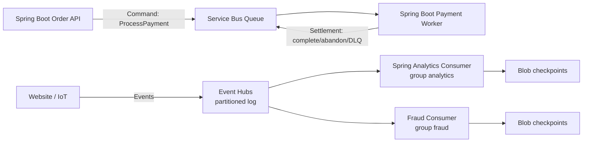

| Aspect | **Azure Service Bus** | **Azure Event Hubs** |
|---|---|---|
| Primary role | Reliable queues/commands and business messaging | High-volume ingestion and event streaming |
| Storage unit | Message in a queue or topic subscription | Event in an append-only partitioned log |
| After processing | Message is **settled** (`complete`, `abandon`, `defer`, `dead-letter`) | Event is normally **not deleted when one consumer reads it** |
| Re-reading | Based on retries, DLQs, deferred messages, and app design | Re-read by **offset, sequence, or time** within retention |
| Multiple consumer groups | Topic with independent subscriptions | Independent consumer groups |
| Parallelism | Competing receivers, sessions, and concurrency | Bounded by partition count within one consumer group |
| Ordering | Within queue/session boundaries and receive semantics; requires design | Ordered within **one partition**, no global order |
| Deduplication | Duplicate detection if enabled/supported, plus idempotency | Consumer idempotency, event IDs, checkpoints |
| Error handling | DLQ, delivery count, locks, deferral | Replay/checkpoint, app-designed poison-event strategy |
| Billing / capacity | Tier and operations/messaging units per config | Tier/throughput or processing units, ingress/egress, and retention |

**Do not treat Event Hubs as a queue simply because it delivers events in order.** When one worker reads an event from Event Hubs, other consumer groups can still read it; there is no `complete()` operation that removes an event system-wide. Conversely, a Service Bus queue is not a historical stream store for arbitrary replay by multiple groups.

## 3. Components of Azure Service Bus

### Queue

A queue has one logical destination where multiple workers compete to receive messages. A message locked by one receiver for processing (Peek-Lock) is withheld from concurrent delivery to other receivers under normal lock semantics. Once the receiver finishes and calls **`complete()`**, the message is removed from the active queue.

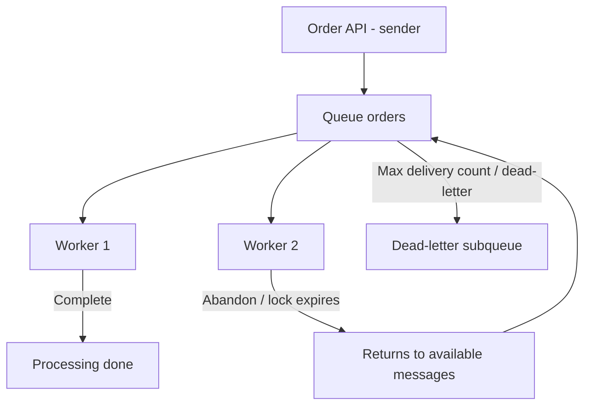

### Topic and Subscription

A topic distributes each message to **multiple subscriptions** based on rules/filters. For example, business event `OrderCreated` is published to topic `order-events`:

```text
Topic: order-events
   |-- Subscription: billing
   |-- Subscription: shipping
   |-- Subscription: notifications
```

Each subscription has its own independent receive stream and delivery state. Topics/subscriptions fit when each consumer group needs broker semantics, retries, and a DLQ. Still, this is not Event Hubs retention-based stream replay.

### Namespace and Entities

- **Namespace**: infrastructure boundary for endpoint, identity/networking, and capacity.
- **Queue/topic**: sending entity.
- **Subscription**: receiving entity under a topic.
- **Rule/filter**: selects which messages route into a subscription.
- **DLQ**: subqueue holding messages that could not be processed under defined conditions.
- **Session**: groups messages sharing a session ID for stateful sequential processing per service/tier capabilities.

Never assume creating a namespace automatically creates queues or subscriptions; configure Spring with exact entity names provisioned via Portal, IaC, or CLI.

## 4. Components of Azure Event Hubs

Event Hubs ingests events from many producers and stores them across **partitions**. Each event has an **offset** and **sequence number** within its partition; consumers start from a stored checkpoint, the earliest event, or the latest position as configured.

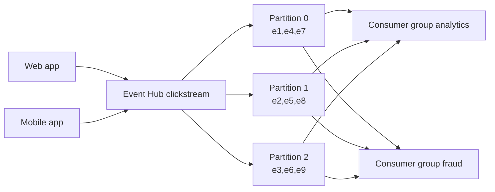

### Four Key Concepts

1. **Partition:** an ordered segment of the log; events are appended per partition. There is no strict global ordering across all partitions.
2. **Partition key:** a stable value so related events (e.g., for the same `customerId`) route to the same partition.
3. **Consumer group:** a group of consumers tracking its own read position independently of other groups.
4. **Checkpoint:** the position a consumer has processed and acknowledged, typically persisted externally in a Blob checkpoint store.

### One Consumer Group Is Not One Reader

Within a single consumer group, one processor or multiple instances cooperate by **dividing partitions** for parallel reading. If an event hub has 4 partitions and you scale one consumer group to 20 processor instances, not all 20 will receive partitions; useful parallelism is bounded by partition count and load distribution.

A separate downstream team should use a **separate consumer group** so it reads the same log without overwriting the first group's checkpoints. Never share one consumer group and checkpoint store between two independent apps that each need every event.

## 5. Side by Side: Queue/Topic, Log, and When Data Disappears

Suppose the API sends command `ReserveInventory(orderId=1001)` to Service Bus, while the frontend sends event `ProductViewed(user=42, sku=SKU-A)` to Event Hubs.

| Moment | Service Bus queue | Event Hubs |
|---|---|---|
| Send | Broker accepts message; confirms receipt | Event appended to a partition |
| Consumer reads | Message locked under Peek-Lock | Consumer reads record at an offset |
| Consumer crashes | Lock expires; message redelivered | New processor resumes from saved checkpoint |
| Processing succeeds | Client calls `complete()` to settle | Client checkpoints after durable processing |
| New group wants history | Not built as an arbitrary replay log | Can read history still within retention |
| Prolonged errors | Retries, delivery count, DLQ | Poison-event policy, app quarantine/DLQ, intentional checkpoint advance |

**Both require application-level idempotency.** Service Bus can redeliver when a lock expires after a database commit; Event Hubs can replay events after a database write that occurred before checkpointing. Never treat "send succeeded" or "checkpoint succeeded" as an ACID transaction with your target database.

## 6. Preparing the Spring Boot and Azure Environment

Examples assume the following lab resources:

| Resource | Illustrative name | Role |
|---|---|---|
| Resource group | `rg-spring-msg-lab` | Container for demo resources |
| Service Bus namespace | `sb-orders-lab.servicebus.windows.net` | Message broker |
| Service Bus queue | `orders-command` | Order-processing worker queue |
| Service Bus topic/subscription | `order-events` / `billing` | Business fan-out |
| Event Hubs namespace | `eh-telemetry-lab.servicebus.windows.net` | Streaming endpoint |
| Event hub | `clickstream` | Website events |
| Consumer group | `analytics-app` | Spring analytics app group |
| Storage account | `stspringmsgcheckpoint01` | Blob checkpoint store |
| Blob container | `eh-checkpoints` | Ownership and checkpoint records |
| Application host | App Service / Container Apps / AKS | Runs Spring Boot |
| Identity | Managed identity / AKS Workload ID | Passwordless auth without shared secrets |

### Least-Privilege Permissions

| Client | Azure RBAC role to evaluate |
|---|---|
| Service Bus producer | **Azure Service Bus Data Sender** |
| Service Bus consumer | **Azure Service Bus Data Receiver** |
| Event Hubs producer | **Azure Event Hubs Data Sender** |
| Event Hubs consumer | **Azure Event Hubs Data Receiver** |
| Event processor checkpoint store | **Storage Blob Data Contributor** on the target container |

Assign roles at the narrowest supported namespace, entity, or container scope—never grant subscription `Owner` to an app. On App Service/Container Apps with managed identity, use the workload's **principal ID**; on AKS Workload Identity, use the user-assigned identity/federated workload principal rather than the cluster control-plane identity.

### Inspecting Resources via Azure CLI

```bash
az login
az account set --subscription "<lab-subscription-id>"

az servicebus namespace show \
  --resource-group "rg-spring-msg-lab" \
  --name "sb-orders-lab" \
  --query "{name:name,location:location,sku:sku.name}" \
  --output json

az eventhubs namespace show \
  --resource-group "rg-spring-msg-lab" \
  --name "eh-telemetry-lab" \
  --query "{name:name,location:location,sku:sku.name}" \
  --output json
```

Both `show` commands are **read-only**. If queues, event hubs, or containers do not exist yet, ask the infrastructure team to create them via IaC or authorized admin tooling. App instances should never need permissions to create or delete namespaces just to start up.

## 7. Integrating into Spring: SDK Beans or Spring Cloud Azure?

Both approaches are valid:

**A. Azure SDK for Java managed as Spring beans:** gives explicit control over `ServiceBusProcessorClient` and `EventProcessorClient` lifecycles, settlement/checkpointing, handlers, retries, and metrics. This lesson uses this approach to keep delivery semantics crystal clear.

**B. Spring Cloud Azure or Spring Cloud Stream binders:** provide auto-configuration, producer/consumer abstractions, annotations, or function bindings per release. They reduce boilerplate yet require understanding how your specific binder handles **acknowledgement, error channels, checkpoints, transactions, and consumer groups**.

| Criterion | Direct SDK + Spring beans | Spring Cloud Azure / Stream binder |
|---|---|---|
| Domain code | Java SDK clients and Spring services | Spring abstractions and configuration |
| Settlement / checkpoint | Explicit calls inside handlers | Driven by binder/container policies |
| Lifecycle | Spring manages beans; app calls start/stop | Framework usually auto-starts per config |
| Framework coupling | Minimal dependence on binding conventions | Coupled to Spring Boot ↔ Spring Cloud Azure version matrix |
| Deep control | Direct access to granular SDK options | Must verify binder exposes needed options |
| Best used when | Complex delivery semantics needing explicit control | Many apps sharing standardized abstractions |

**Assign one clear owner per entity or consumer group.** If a binder consumer is already running, never accidentally spin up an extra `EventProcessorClient` on the same consumer group and checkpoint store and wonder why partitions rebalance.

## 8. Maven Dependencies and Version Compatibility

In this Spring Boot 3.x / JDK 17+ example (adjust to your project baseline), we use **Azure SDK for Java** inside Spring to clarify APIs and semantics. At minimum, include:

```xml
<dependencies>
    <dependency>
        <groupId>org.springframework.boot</groupId>
        <artifactId>spring-boot-starter-web</artifactId>
    </dependency>
    <dependency>
        <groupId>org.springframework.boot</groupId>
        <artifactId>spring-boot-starter-actuator</artifactId>
    </dependency>
    <dependency>
        <groupId>com.azure</groupId>
        <artifactId>azure-identity</artifactId>
        <version>REPLACE_WITH_APPROVED_AZURE_SDK_VERSION</version>
    </dependency>
    <dependency>
        <groupId>com.azure</groupId>
        <artifactId>azure-messaging-servicebus</artifactId>
        <version>REPLACE_WITH_APPROVED_AZURE_SDK_VERSION</version>
    </dependency>
    <dependency>
        <groupId>com.azure</groupId>
        <artifactId>azure-messaging-eventhubs</artifactId>
        <version>REPLACE_WITH_APPROVED_AZURE_SDK_VERSION</version>
    </dependency>
    <dependency>
        <groupId>com.azure</groupId>
        <artifactId>azure-messaging-eventhubs-checkpointstore-blob</artifactId>
        <version>REPLACE_WITH_APPROVED_AZURE_SDK_VERSION</version>
    </dependency>
    <dependency>
        <groupId>com.azure</groupId>
        <artifactId>azure-storage-blob</artifactId>
        <version>REPLACE_WITH_APPROVED_AZURE_SDK_VERSION</version>
    </dependency>
</dependencies>
```

`REPLACE_WITH_APPROVED_AZURE_SDK_VERSION` entries are **placeholders**, not valid Maven versions; substitute tested versions or manage them centrally via the **Azure SDK BOM**. Never blindly assign the same version number across artifacts from different release lines. With Spring Cloud Azure, import the BOM compatible with your Spring Boot/Spring Cloud release train.

### If Your Project Uses Spring Cloud Azure

Artifacts to look up for your target release line may include:

```text
com.azure.spring:spring-cloud-azure-starter-servicebus
com.azure.spring:spring-cloud-azure-starter-eventhubs
com.azure.spring:spring-cloud-azure-stream-binder-servicebus
com.azure.spring:spring-cloud-azure-stream-binder-eventhubs
```

This is a **menu of integration options**, not a requirement to install all four in one app. Starter auto-configuration and Stream binders can overlap in responsibility. Pick one integration style per flow, check the **Spring Boot ↔ Spring Cloud Azure** compatibility matrix, and configure version-appropriate binder properties.

### Do You Need `spring-boot-starter-amqp`?

**No.** Service Bus and Event Hubs speak AMQP, but they are not RabbitMQ brokers targeting Spring AMQP's `RabbitTemplate` by default. Use the Azure Messaging SDKs or Spring Cloud Azure integrations built for Azure rather than pointing a RabbitMQ client at a Service Bus namespace.

## 9. Separating Hostnames from Credentials in Spring Boot Config

Place resource names in `application.properties` or a safe config source:

```properties
app.servicebus.namespace=sb-orders-lab.servicebus.windows.net
app.servicebus.queue=orders-command

app.eventhubs.namespace=eh-telemetry-lab.servicebus.windows.net
app.eventhubs.hub=clickstream
app.eventhubs.consumer-group=analytics-app

app.storage.blob-endpoint=https://stspringmsgcheckpoint01.blob.core.windows.net
app.eventhubs.checkpoint-container=eh-checkpoints

app.messaging.servicebus.max-concurrent-calls=4
```

There is **no** `connectionString`, `SharedAccessKey`, or `clientSecret` here. `fullyQualifiedNamespace` is the hostname, e.g., `sb-orders-lab.servicebus.windows.net`, not an `Endpoint=sb://...;SharedAccessKey=...` string.

### Distinguish App Properties from Spring Cloud Azure Properties

These `app.*` keys **are read directly by our Spring Java code**, not auto-discovered by Spring Cloud Azure. If switching to starters or binders, replace them with the prefix supported by your Spring Cloud Azure version and configure application name, destination, group, and entity type per docs. Do not set `app.servicebus.queue` expecting a binder to bind automatically.

### Use Profiles Deliberately

```text
application.properties          -> safe defaults, zero secrets
application-local.properties    -> authorized DEV namespaces
application-staging.properties  -> STAGING namespaces
application-prod.properties     -> PROD namespaces via deployment pipeline
```

Never commit sensitive values to Git. In production, supply endpoints and queue names via App Service settings, Container Apps environment variables, or Kubernetes ConfigMaps/IaC. Any unavoidable secrets for external systems belong in Key Vault/secret managers—never baked into Docker images.

## 10. Using `DefaultAzureCredential` and Spring Beans

A single `TokenCredential` can be reused across Service Bus, Event Hubs, and the Blob checkpoint store. On App Service/Container Apps/VMs with managed identity, `DefaultAzureCredential` acquires the workload's token; on AKS Workload Identity, ensure projected tokens and federation are wired properly. When production permits managed identity only, swap in an explicit `ManagedIdentityCredentialBuilder`.

### Spring Configuration Creating Clients

```java
package example.messaging;

import com.azure.core.credential.TokenCredential;
import com.azure.identity.DefaultAzureCredentialBuilder;
import com.azure.messaging.eventhubs.EventHubClientBuilder;
import com.azure.messaging.eventhubs.EventHubProducerClient;
import com.azure.messaging.servicebus.ServiceBusClientBuilder;
import com.azure.messaging.servicebus.ServiceBusSenderClient;
import com.azure.storage.blob.BlobContainerAsyncClient;
import com.azure.storage.blob.BlobContainerClientBuilder;
import org.springframework.context.annotation.Bean;
import org.springframework.context.annotation.Configuration;
import org.springframework.core.env.Environment;

@Configuration
public class AzureMessagingConfiguration {
    @Bean
    public TokenCredential tokenCredential() {
        return new DefaultAzureCredentialBuilder().build();
    }

    @Bean(destroyMethod = "close")
    public ServiceBusSenderClient orderSender(
            TokenCredential credential, Environment env) {
        return new ServiceBusClientBuilder()
                .fullyQualifiedNamespace(
                        env.getRequiredProperty("app.servicebus.namespace"))
                .credential(credential)
                .sender()
                .queueName(env.getRequiredProperty("app.servicebus.queue"))
                .buildClient();
    }

    @Bean(destroyMethod = "close")
    public EventHubProducerClient eventHubProducer(
            TokenCredential credential, Environment env) {
        return new EventHubClientBuilder()
                .credential(
                        env.getRequiredProperty("app.eventhubs.namespace"),
                        env.getRequiredProperty("app.eventhubs.hub"),
                        credential)
                .buildProducerClient();
    }

    @Bean
    public BlobContainerAsyncClient checkpointContainer(
            TokenCredential credential, Environment env) {
        return new BlobContainerClientBuilder()
                .endpoint(env.getRequiredProperty(
                        "app.storage.blob-endpoint"))
                .containerName(env.getRequiredProperty(
                        "app.eventhubs.checkpoint-container"))
                .credential(credential)
                .buildAsyncClient();
    }
}
```

**Meaning:**

- Spring instantiates each client once as a singleton bean rather than per HTTP request.
- `destroyMethod="close"` releases sender/producer resources when the Spring `ApplicationContext` shuts down.
- Azure Identity's `TokenCredential` manages token acquisition—no hard-coded SAS keys needed.
- `checkpointContainer` only **references** an existing Blob container without creating it; the consumer identity needs `Storage Blob Data Contributor` at the proper scope.

### When to Use a Different Credential?

If the host runs a user-assigned managed identity with a specific client ID:

```java
// Replace TokenCredential bean when production permits managed identity only:
TokenCredential credential = new ManagedIdentityCredentialBuilder()
        .clientId(System.getenv("AZURE_CLIENT_ID"))
        .build();
```

This is a **snippet** requiring importing `ManagedIdentityCredentialBuilder` and verifying `AZURE_CLIENT_ID` is set properly. On laptops, `ManagedIdentityCredential` normally does not work; `DefaultAzureCredential` with `az login` fits local dev. On AKS OIDC Workload Identity, use compatible `WorkloadIdentityCredential` or `DefaultAzureCredential` rather than abusing the node's identity.

## 11. Spring Boot Producer Sending Service Bus Commands

Write a service publishing `ProcessOrder` commands to a queue using a **stable message ID** tied to the logical command for deduplication:

```java
package example.messaging;

import com.azure.messaging.servicebus.ServiceBusMessage;
import com.azure.messaging.servicebus.ServiceBusSenderClient;
import com.fasterxml.jackson.core.JsonProcessingException;
import com.fasterxml.jackson.databind.ObjectMapper;
import java.util.Map;
import org.springframework.stereotype.Service;

@Service
public class OrderCommandPublisher {
    private final ServiceBusSenderClient sender;
    private final ObjectMapper objectMapper;

    public OrderCommandPublisher(
            ServiceBusSenderClient sender, ObjectMapper objectMapper) {
        this.sender = sender;
        this.objectMapper = objectMapper;
    }

    public void publishOrder(String orderId, String tenantId) {
        Map<String, String> payload = Map.of(
                "eventType", "ProcessOrder",
                "schemaVersion", "1",
                "orderId", orderId,
                "tenantId", tenantId);
        try {
            String json = objectMapper.writeValueAsString(payload);
            ServiceBusMessage message = new ServiceBusMessage(json);
            message.setMessageId("process-order:" + orderId + ":v1");
            message.setCorrelationId(orderId);
            message.setContentType("application/json");
            message.getApplicationProperties().put("schemaVersion", 1);
            sender.sendMessage(message);
        } catch (JsonProcessingException e) {
            throw new IllegalArgumentException("Invalid command payload", e);
        }
    }
}
```

### What Must You Know Before Calling `sendMessage()`?

1. The SDK call confirms the broker accepted the message—**not that a worker finished processing the order**.
2. If a timeout hits after the broker receives the message but before the producer gets the ack, retrying **creates a duplicate**.
3. A stable `MessageId` for the same logical command enables broker duplicate detection **when enabled and within its window**, yet **never replaces consumer idempotency**.
4. `CorrelationId` links requests/orders with traces; never embed PII or secrets.
5. Payloads need `schemaVersion` and business IDs; never dump raw payment card numbers or credentials.

### Never Rely on Faith to Sync a DB Transaction and Queue Send

If a `@Transactional` method writes an Order to Azure SQL and calls `sender.sendMessage()`, **that is not a single ACID transaction**. The DB may commit while sending fails, or the message may publish before the DB rolls back. For critical workflows, use a **transactional outbox**:

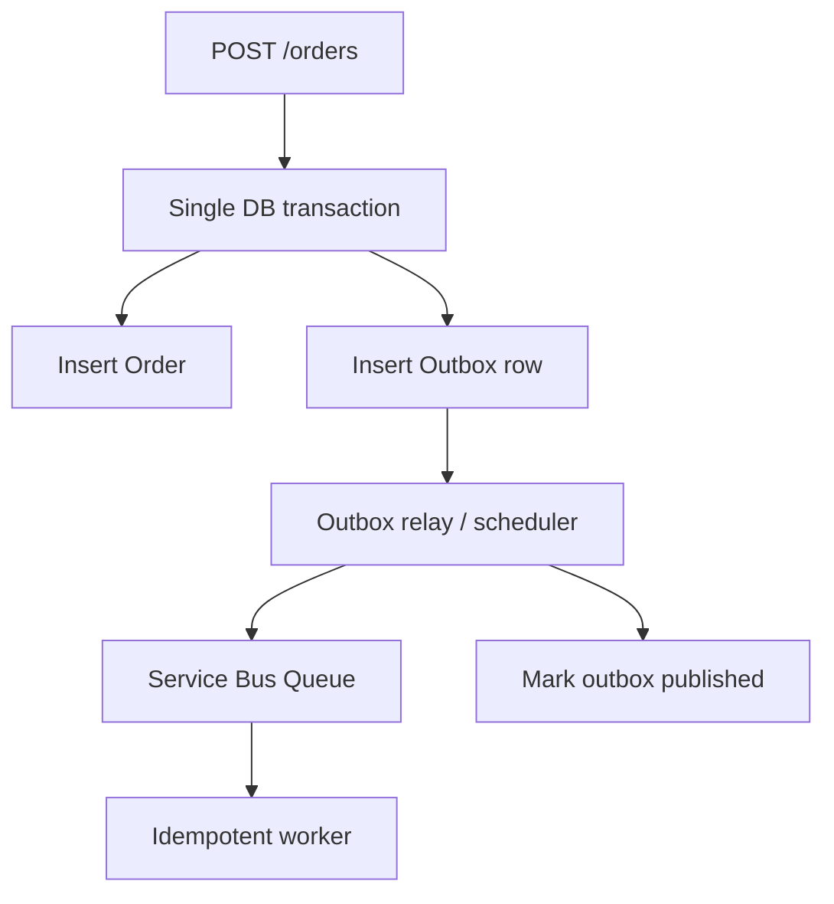

The outbox relay can still send duplicates if it crashes after sending and before marking the row published, so the consumer must stay idempotent. Purge outbox rows only per retention/auditing policy.

## 12. Spring REST Controller: Lab API Publishing Commands

This short example sends a message after input validation; **it does not replace a production Order + transactional outbox workflow**:

```java
package example.messaging;

import java.util.Map;
import org.springframework.http.HttpStatus;
import org.springframework.web.bind.annotation.PathVariable;
import org.springframework.web.bind.annotation.PostMapping;
import org.springframework.web.bind.annotation.RequestMapping;
import org.springframework.web.bind.annotation.RestController;
import org.springframework.web.server.ResponseStatusException;

@RestController
@RequestMapping("/lab/orders")
public class OrderCommandController {
    private final OrderCommandPublisher publisher;

    public OrderCommandController(OrderCommandPublisher publisher) {
        this.publisher = publisher;
    }

    @PostMapping("/{orderId}/process")
    public Map<String, String> publish(@PathVariable String orderId) {
        if (!orderId.matches("[A-Za-z0-9-]{1,64}")) {
            throw new ResponseStatusException(
                    HttpStatus.BAD_REQUEST, "Invalid order ID");
        }
        // In production, derive tenantId from user identity/DB;
        // never hard-code or trust an arbitrary client-sent tenantId.
        publisher.publishOrder(orderId, "tenant-lab");
        return Map.of(
                "orderId", orderId,
                "status", "accepted-for-processing");
    }
}
```

Returning `accepted-for-processing` means the API handed the command to the messaging layer—**not that payment or shipping completed**. Public endpoints require OAuth/authz, rate limiting, request idempotency keys, input validation, and dedicated HTTP retry policies.

## 13. Spring Service Bus Consumer with Explicit Settlement

Under **Peek-Lock**, a receiver gets a message with a lock window for processing. Main settlement actions:

- **`complete()`:** processing succeeded; remove message from active queue/subscription.
- **`abandon()`:** temporary processing failure; allow broker to redeliver.
- **`deadLetter()`:** move unrecoverable message to the DLQ per policy.
- **`defer()`:** postpone a message for later retrieval by sequence number in specialized workflows.

### Creating the Consumer as a Spring Bean

```java
package example.messaging;

import com.azure.core.credential.TokenCredential;
import com.azure.messaging.servicebus.ServiceBusClientBuilder;
import com.azure.messaging.servicebus.ServiceBusProcessorClient;
import org.slf4j.Logger;
import org.slf4j.LoggerFactory;
import org.springframework.boot.context.event.ApplicationReadyEvent;
import org.springframework.context.annotation.Bean;
import org.springframework.context.annotation.Configuration;
import org.springframework.context.event.EventListener;
import org.springframework.core.env.Environment;

@Configuration
public class ServiceBusConsumerConfiguration {
    private static final Logger log =
            LoggerFactory.getLogger(ServiceBusConsumerConfiguration.class);

    @Bean(destroyMethod = "close")
    public ServiceBusProcessorClient orderProcessor(
            TokenCredential credential,
            Environment env,
            OrderCommandHandler handler) {
        return new ServiceBusClientBuilder()
                .fullyQualifiedNamespace(env.getRequiredProperty(
                        "app.servicebus.namespace"))
                .credential(credential)
                .processor()
                .queueName(env.getRequiredProperty("app.servicebus.queue"))
                .disableAutoComplete()
                .maxConcurrentCalls(4)
                .processMessage(context -> {
                    try {
                        String body = context.getMessage()
                                .getBody().toString();
                        handler.handle(body);
                        // Only complete after domain side effects are durably persisted.
                        context.complete();
                    } catch (InvalidOrderCommandException bad) {
                        log.warn("Permanent command validation error");
                        context.deadLetter();
                    } catch (Exception transientOrUnknown) {
                        log.error("Processing failed; will allow redelivery",
                                transientOrUnknown);
                        context.abandon();
                    }
                })
                .processError(errorContext -> log.error(
                        "Service Bus processor error",
                        errorContext.getException()))
                .buildProcessorClient();
    }

    @EventListener(ApplicationReadyEvent.class)
    public void startConsumer(ApplicationReadyEvent ready) {
        ready.getApplicationContext()
                .getBean(ServiceBusProcessorClient.class)
                .start();
    }
}
```

Here, `OrderCommandHandler` and `InvalidOrderCommandException` are **application-defined business classes**, not part of the Azure SDK. Below is only their illustrative contract:

```java
package example.messaging;

import org.springframework.stereotype.Service;

@Service
public class OrderCommandHandler {
    public void handle(String json) {
        // 1. Parse/validate JSON schema and tenant.
        // 2. Check idempotency key/messageId inside DB transaction.
        // 3. Persist business state durably.
        // 4. Throw InvalidOrderCommandException if payload is invalid.
        // This snippet is a skeleton, NOT complete domain logic.
        if (json == null || json.isBlank()) {
            throw new InvalidOrderCommandException("Empty message");
        }
    }
}

class InvalidOrderCommandException extends RuntimeException {
    InvalidOrderCommandException(String message) {
        super(message);
    }
}
```

**Never use this skeleton handler to `complete()` production messages**, since it only checks for non-blank strings. Real handlers must parse schemas, authorize inputs, commit durable domain operations, and record idempotency markers before returning.

### Lifecycle Details

1. `disableAutoComplete()` gives your code explicit control over complete/abandon/dead-letter.
2. `maxConcurrentCalls(4)` is a lab setting; production values must match database capacity, throughput, and concurrency budgets.
3. `processError` handles processor/receive infrastructure errors—it **does not replace** business `try/catch` handling.
4. Spring calls `close()` on shutdown; ensure the consumer starts **exactly once**.
5. If multiple processor beans exist, replace the single-type lookup in `startConsumer()` with **bean names/qualifiers** or a dedicated lifecycle manager.
6. On shutdown, allow time to **drain in-flight messages** within the host's termination grace period instead of killing the JVM abruptly.

### Handling Settlement Errors Carefully

If `handler.handle()` commits to the database yet `context.complete()` fails from **lock lost** or a network timeout, the broker will redeliver the message. **Never roll back an already-committed database transaction solely because `complete()` failed**; rely on idempotency so the redelivery is recognized as already handled and safely completed.

## 14. Service Bus Peek-Lock, Lock Renewal, and Delivery Count

Suppose processing an order takes 90 seconds while the message lock lasts 30 seconds. If the consumer does not renew the lock or auto-lock renewal is misconfigured, the lock expires mid-work and another worker receives the **same message**:

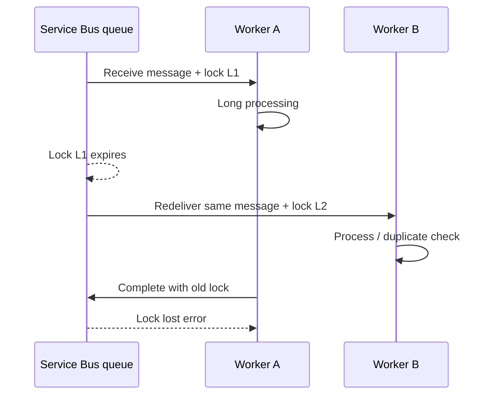

### Settings to Review

- Queue/subscription **lock duration** within service/tier limits.
- **Max auto lock renewal duration** supported by the processor SDK.
- **Handler timeouts** and deadlines for database/HTTP calls.
- **Prefetch count**: high prefetch boosts throughput yet can burn lock time while messages sit buffered before the handler starts.
- **Delivery count** and DLQ threshold.
- **Concurrency**: many workers competing for downstream capacity.

Never solve a 15-minute handler by stretching locks indefinitely: split into a **short command + durable job state + background workflow**, or design checkpoints/subtasks to recover cleanly across container restarts.

### At-Least-Once and Correctness

Service Bus Peek-Lock permits **redelivery** whenever a message is not completed. Therefore, **at-least-once** processing requires:

1. A stable idempotency key, typically `MessageId` plus tenant/business operation.
2. Persisting business state and the **processed message ID** inside the same DB transaction whenever feasible.
3. Checking whether the message was already processed before executing side effects.
4. If already processed: safely completing the redelivered message without repeating side effects.
5. Persisting durable processing proof rather than relying solely on in-RAM caches.

### Delivery Count Is Not Lifetime

`DeliveryCount` tracks broker delivery attempts, not every application-level exception. Messages also have TTLs and distinct lock/delivery rules. Exceeding `maxDeliveryCount` moves messages to the DLQ under supported conditions—not every error dead-letters immediately.

## 15. Dead-Letter Queue, Poison Messages, and Replay

The **Dead-letter queue (DLQ)** holds messages that cannot be processed normally or were dead-lettered by the broker per policy. A DLQ **never auto-reprocesses itself**, and there is no "Spring `@Retry` that magically fixes corrupted business data."

### Error Classification

| Failure | Example | Strategy |
|---|---|---|
| **Transient** | SQL timeout, HTTP 503, network blip | Bounded retry/backoff, abandon, or delayed retry policy |
| **Permanent payload** | Invalid JSON schema, missing required `orderId` | Dead-letter with reason and audit after inspection |
| **Business conflict** | Order already canceled or ineligible | Classify terminal vs. recoverable per domain rules |
| **Authorization/config** | Worker lacks data role, wrong namespace | Alert and fix infrastructure—never blindly retry every message |
| **Idempotent duplicate** | Message ID already processed | Skip side effects and `complete()` safely |
| **Unknown failure** | Unclassified bug | Cap attempts and emit telemetry; avoid infinite loops |

### DLQ Operations

```text
orders-command
  ├── Active messages
  └── $DeadLetterQueue
       ├── Failed validation
       ├── MaxDeliveryCountExceeded
       └── Explicit dead-letter by worker
```

When dead-lettering, attach a **PII-free** reason/description alongside message and correlation IDs for auditing. Processor context APIs support passing reason/description via options; `context.deadLetter()` above is a minimal learning call.

### DLQ Runbook

1. Monitor **DLQ count** and alert thresholds.
2. Inspect metadata/payloads in a secure environment using an identity scoped only to DLQ analysis.
3. Group by root cause: bad schema, worker bug, missing permissions, or downstream outage.
4. Fix the root cause and design a **replay plan**—never blindly dump thousands of poison messages back onto the active queue.
5. When replaying, **preserve logical message IDs/idempotency keys**, track replay counts, and prevent duplicate charges.
6. Purge resolved DLQ entries per retention/approval policies with audit logs.

**Never use a DLQ as a long-term event database.** DLQs exist for error operations; use dedicated data retention and warehouses for long-term auditing.

## 16. Service Bus Topics/Subscriptions, Sessions, and Duplicate Detection

### Fan-Out via Topic

Instead of publishing `OrderCreated` to three separate queues, publish once to **topic `order-events`**, letting subscriptions `billing`, `shipping`, and `notifications` filter and receive independently:

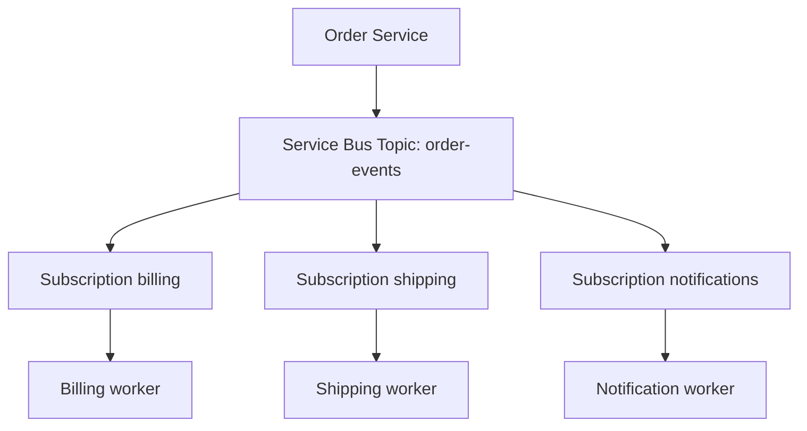

Each subscription maintains its own DLQ, locks, and settlement. If the billing worker fails, the shipping worker still completes its own copy—sharing a topic creates no cross-service transaction across the three workflows.

### Sender / Processor for a Topic

```java
// Configuration snippet replacing QUEUE sender; import ServiceBusClientBuilder.
ServiceBusSenderClient topicSender = new ServiceBusClientBuilder()
        .fullyQualifiedNamespace("sb-orders-lab.servicebus.windows.net")
        .credential(credential)
        .sender()
        .topicName("order-events")
        .buildClient();

// Topic subscription receiver:
ServiceBusProcessorClient billingProcessor =
        new ServiceBusClientBuilder()
                .fullyQualifiedNamespace(
                        "sb-orders-lab.servicebus.windows.net")
                .credential(credential)
                .processor()
                .topicName("order-events")
                .subscriptionName("billing")
                .processMessage(context -> {
                    // Real handler: validate, enforce idempotency, and commit.
                    // Auto-completes unless disableAutoComplete() is called.
                })
                .processError(context -> {
                    // Log/alert on processor errors.
                })
                .buildProcessorClient();
```

These **snippets illustrate topology**, not production handlers. Close producers/processors via Spring lifecycles, and note default auto-complete here differs from the explicit-settlement queue example. Never deploy empty callbacks to real environments.

### Sessions: Ordered Processing per Group

Service Bus sessions can use `SessionId=orderId` or `customerId` to preserve sequential processing per session where supported. You must provision a **session-enabled queue/subscription upfront** and use a **session-aware processor/receiver**; setting `SessionId` on a non-session entity grants no ordering guarantees.

Session ordering helps sequences like `Created → Reserved → Cancelled` for one order, yet **cannot fix wrong business state if the producer emits events out of order**. Include payload sequence/version numbers to detect source reordering.

### Duplicate Detection

When enabled on supported entities/tiers, Service Bus inspects `MessageId` within a **configured detection window**. That window is finite and conditional on broker settings; if a duplicate arrives after the window or with a different ID, broker deduplication cannot replace business idempotency.

When using Service Bus partitioning or sessions, uniqueness semantics can interact with `PartitionKey`/`SessionId` settings. Design IDs/keys deliberately and verify service/tier documentation rather than treating `MessageId` as a permanent global lock.

## 17. Event Hubs Producer in Spring: Batching Events

An Event Hubs producer appends events to an event hub. The SDK provides **`EventHubProducerClient`**, `EventData`, and `EventDataBatch` for much higher throughput than sending single events one by one.

### Spring Service Publishing Events

```java
package example.messaging;

import com.azure.messaging.eventhubs.EventData;
import com.azure.messaging.eventhubs.EventDataBatch;
import com.azure.messaging.eventhubs.EventHubProducerClient;
import com.azure.messaging.eventhubs.models.CreateBatchOptions;
import com.fasterxml.jackson.core.JsonProcessingException;
import com.fasterxml.jackson.databind.ObjectMapper;
import java.time.Instant;
import java.util.Map;
import java.util.UUID;
import org.springframework.stereotype.Service;

@Service
public class ClickstreamPublisher {
    private final EventHubProducerClient producer;
    private final ObjectMapper mapper;

    public ClickstreamPublisher(
            EventHubProducerClient producer, ObjectMapper mapper) {
        this.producer = producer;
        this.mapper = mapper;
    }

    public void publishView(
            String customerId, String sku, String tenantId) {
        Map<String, Object> body = Map.of(
                "eventId", UUID.randomUUID().toString(),
                "eventType", "ProductViewed",
                "schemaVersion", 1,
                "customerId", customerId,
                "tenantId", tenantId,
                "sku", sku,
                "occurredAtUtc", Instant.now().toString());
        try {
            EventData data = new EventData(mapper.writeValueAsString(body));
            data.getProperties().put("eventType", "ProductViewed");

            EventDataBatch batch = producer.createBatch(
                    new CreateBatchOptions().setPartitionKey(customerId));
            if (!batch.tryAdd(data)) {
                throw new IllegalArgumentException(
                        "Event exceeds allowed batch size");
            }
            producer.send(batch);
        } catch (JsonProcessingException ex) {
            throw new IllegalArgumentException("Invalid event payload", ex);
        }
    }
}
```

**Things to remember:**

- `CreateBatchOptions.setPartitionKey(customerId)` routes events sharing a key to the same partition per Event Hubs semantics. **It does not guarantee global ordering** across different customers.
- `EventDataBatch.tryAdd` returns `false` when an event exceeds the batch limit; never ignore it and silently drop events.
- This creates a **single-event batch** to keep the API clear. High-throughput production systems typically **group many events** with compatible partition keys using time- and memory-bounded buffering/micro-batching.
- `UUID.randomUUID()` generates a new event ID per invocation. On HTTP retries, two calls produce two different IDs. For business events needing dedup, **derive a stable ID from the source or request idempotency key**.
- A successful Event Hubs send confirms the service ingested the event—**not that every consumer group processed it**.

### Sending a Multi-Event Batch

```java
EventDataBatch batch = producer.createBatch(
        new CreateBatchOptions().setPartitionKey("customer-42"));

for (String json : incomingJsonEvents) {
    EventData event = new EventData(json);
    if (!batch.tryAdd(event)) {
        if (batch.getCount() == 0) {
            throw new IllegalArgumentException(
                    "One event exceeds maximum batch size");
        }
        producer.send(batch);
        batch = producer.createBatch(
                new CreateBatchOptions().setPartitionKey("customer-42"));
        if (!batch.tryAdd(event)) {
            throw new IllegalArgumentException(
                    "One event exceeds maximum batch size");
        }
    }
}
if (batch.getCount() > 0) {
    producer.send(batch);
}
```

This is a **method-body snippet** assuming `producer` and `incomingJsonEvents` are declared. When a batch fills up, send it and start a new batch; **ensure all events in a batch share a valid partition strategy**. Across multiple customers, group by partition key or let the service auto-assign partitions when per-customer ordering is unnecessary.

### Handling Batch Send Failures

If `send(batch)` times out, whether the broker persisted it is ambiguous from the producer's view. **Never mint fresh event IDs** on retry; keep logical event IDs, use an outbox or durable buffer, and enforce consumer idempotency. Never buffer batches unboundedly in RAM on containers subject to restarts.

## 18. Event Hubs Consumer Groups, Partition Ownership, and Checkpoint Stores

Event Hubs consumers read by partition and offset. The Azure SDK's **`EventProcessorClient`** coordinates instances to:

1. Discover partitions.
2. Balance partition ownership across processors in the **same consumer group**.
3. Read events from each partition's saved checkpoint.
4. Invoke your processing callback.
5. Record checkpoints through the configured **`CheckpointStore`**.

A standard choice is **Azure Blob Storage** via `azure-messaging-eventhubs-checkpointstore-blob`.

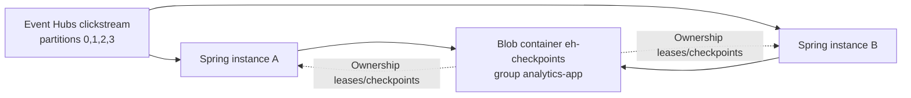

### Why Use a Shared Blob Checkpoint Store?

If each Spring instance tracks offsets **only in RAM or local files**, scaling or restarting causes:

- Instances disagreeing on partition ownership.
- Processors losing track of processed positions.
- Excessive event replay or skipped events on misconfigured startup.

The checkpoint store is **durable coordination state**. All instances of the **same app/consumer group** share one store as configured to balance partitions; independent apps must use **distinct consumer groups** (and verified checkpoint isolation).

### Storage Permission Requirements

The app identity needs **Storage Blob Data Contributor** on the checkpoint Blob container or appropriate scope. **Storage Blob Data Reader** is insufficient because the processor must **create and update ownership/checkpoint blobs**. Simultaneously, the identity needs **Azure Event Hubs Data Receiver** to read events.

**Checkpoints are not a DLQ.** They record read progress, not failed events for investigation. If an event fails parsing, write it to an app-managed **quarantine/error topic/blob** and decide explicitly when checkpoints may advance.

## 19. Spring `EventProcessorClient`: Creating the Processor and Callbacks

### Spring Configuration

```java
package example.messaging;

import com.azure.core.credential.TokenCredential;
import com.azure.messaging.eventhubs.EventHubClientBuilder;
import com.azure.messaging.eventhubs.EventProcessorClient;
import com.azure.messaging.eventhubs.EventProcessorClientBuilder;
import com.azure.messaging.eventhubs.checkpointstore.blob.BlobCheckpointStore;
import com.azure.storage.blob.BlobContainerAsyncClient;
import org.slf4j.Logger;
import org.slf4j.LoggerFactory;
import org.springframework.boot.context.event.ApplicationReadyEvent;
import org.springframework.context.annotation.Bean;
import org.springframework.context.annotation.Configuration;
import org.springframework.context.event.EventListener;
import org.springframework.core.env.Environment;

@Configuration
public class EventHubConsumerConfiguration {
    private static final Logger log =
            LoggerFactory.getLogger(EventHubConsumerConfiguration.class);

    @Bean(destroyMethod = "stop")
    public EventProcessorClient clickstreamProcessor(
            TokenCredential credential,
            Environment env,
            BlobContainerAsyncClient checkpointContainer,
            ClickstreamHandler handler) {
        return new EventProcessorClientBuilder()
                .credential(
                        env.getRequiredProperty("app.eventhubs.namespace"),
                        env.getRequiredProperty("app.eventhubs.hub"),
                        credential)
                .consumerGroup(env.getRequiredProperty(
                        "app.eventhubs.consumer-group"))
                .checkpointStore(
                        new BlobCheckpointStore(checkpointContainer))
                .processEvent(context -> {
                    try {
                        String json = context.getEventData()
                                .getBodyAsString();
                        String partitionId = context.getPartitionContext()
                                .getPartitionId();
                        handler.handle(json, partitionId);
                        // Demo: checkpoint after each processed event.
                        context.updateCheckpoint();
                    } catch (Exception ex) {
                        log.error("Event failed; do not checkpoint", ex);
                        // Production policy: retry/quarantine/stop per error type.
                    }
                })
                .processError(errorContext ->
                        log.error("Event Hubs processor error",
                                errorContext.getThrowable()))
                .buildEventProcessorClient();
    }

    @EventListener(ApplicationReadyEvent.class)
    public void startEventProcessor(ApplicationReadyEvent ready) {
        ready.getApplicationContext()
                .getBean(EventProcessorClient.class)
                .start();
    }
}
```

**SDK note:** Verify exact `EventProcessorClientBuilder` and `EventContext.updateCheckpoint()` overloads for your SDK version, especially sync vs. async clients. This example uses the common sync API with a **Spring-managed start/stop lifecycle**.

### Minimal Domain Handler

```java
package example.messaging;

import org.springframework.stereotype.Service;

@Service
public class ClickstreamHandler {
    public void handle(String json, String partitionId) {
        // Production:
        // - Parse JSON/schemaVersion and validate fields.
        // - Record event ID in durable dedup store.
        // - Write results to DB/data lake per desired semantics.
        // - Return ONLY AFTER durable write succeeds.
        if (json == null || json.isBlank()) {
            throw new IllegalArgumentException(
                    "Empty event on partition " + partitionId);
        }
    }
}
```

**`ClickstreamHandler` is only a skeleton, not a durable implementation.** Never deploy it as-is to production, because it would checkpoint without persisting to a sink. In production, `handle()` returns only once **durable persistence** or **quarantine** has succeeded per approved error policy.

### A Subtle Trap in the Callback Example

If the callback catches an exception, logs it, and **skips checkpointing**, the processor may **keep advancing to subsequent events in the same runtime** depending on SDK mechanics; `catch` alone does not trigger an immediate retry of that event. Only after a restart or rebalance would the processor resume from the earlier checkpoint. Therefore, production policies must be explicit: **pause/stop partition processing, retry with bounded backoff, persist to quarantine before advancing the checkpoint, or alert for intervention**. Never silently lose a poison event thinking "not checkpointing means it retried."

### Should You Checkpoint Every Event?

Checkpointing every event is clear to follow yet generates **many Blob writes/operations** at high throughput. Production systems often checkpoint by **event count** or **time interval** (e.g., every N events or computed window) if and only if all earlier events on that partition are **durably processed**. Less frequent checkpoints reduce Blob transactions while increasing replay volume on crash.

## 20. When to Checkpoint: Durable Processing First

Suppose a processor receives 3 events:

```text
Partition 2:
  seq=101  -> processed and written to DB
  seq=102  -> processed and written to DB
  seq=103  -> received, DB write fails
```

A sequential processor's checkpoint must advance **only to 102**, never 103 before event 103 is durably settled. On crash/restart, `seq=103` must be re-read.

### Mistake: Checkpointing Before Database Commit

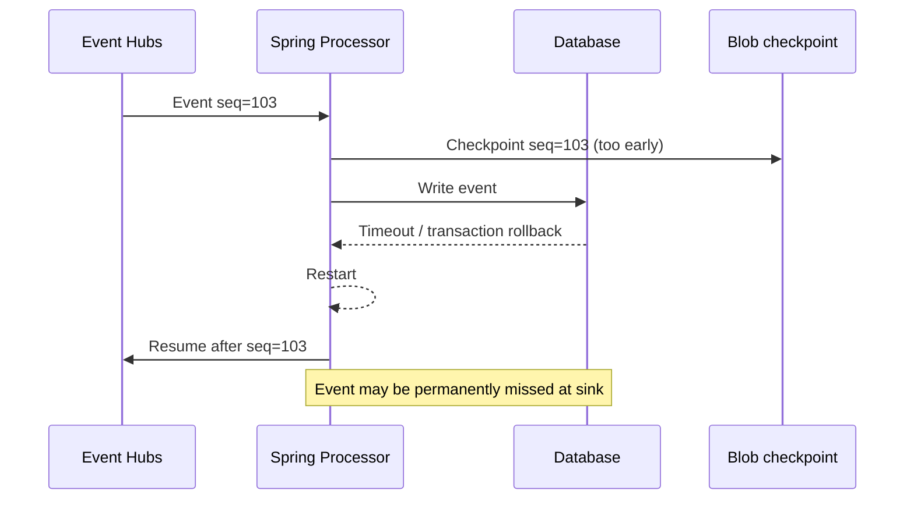

### Better: Commit Then Checkpoint

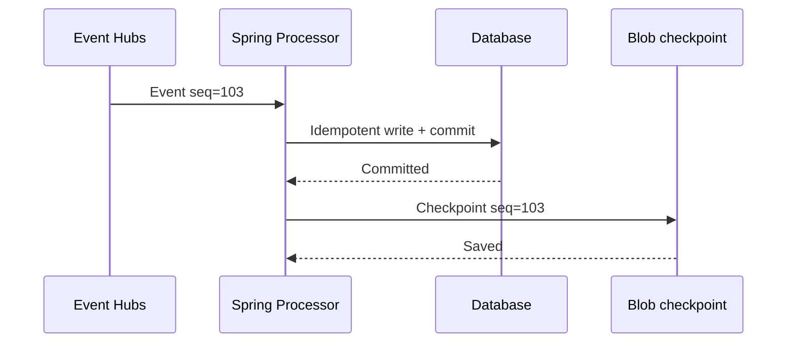

If the DB commit succeeds and checkpointing fails, the event will be re-read. An **idempotent sink** makes replay safe; there is no automatic distributed transaction across a database and a Blob checkpoint.

### Sequence Number, Offset, and Checkpoint

- **Sequence number:** monotonically increases per partition, not globally across the entire event hub.
- **Offset:** relative position within the partition log per service semantics.
- **Enqueued time:** timestamp when the broker accepted the event.
- **Checkpoint:** processed position for **one consumer group/processor**; it does not control whether events remain within retention.

Track **`eventHub + partitionId + sequenceNumber`** to inspect and reconcile stream position; for business deduplication, include a **producer-generated `eventId`** so retries producing **two records with different sequence numbers** still deduplicate cleanly.

## 21. Replay, Partition Keys, Consumer Groups, and Ordering

### Domain-Aligned Partition Keys

An app tracking user behavior needs events for the same `customerId` ordered within one partition. The producer calls `setPartitionKey(customerId)`; if keys distribute reasonably evenly, skew stays low.

**If one customer generates extreme volume**, one partition can become a hotspot. Switching to random partition keys boosts throughput yet **loses per-customer ordering**. Decide which SLA takes precedence, or consider logical key sharding combined with consumer-side versioning/sequencing.

### Distinct Consumer Groups for Distinct Workloads

```text
Event Hub: clickstream

Consumer group: analytics-app
  -> consumers A, B, C (share partitions)

Consumer group: fraud-app
  -> consumers X, Y (share partitions independently)

Consumer group: data-lake-export
  -> independent capture/processing workflow
```

Never share `analytics-app` between two independent systems if both need to read **every event**. Separate consumer groups hold independent checkpoints and consume the same stream within retention.

### Replay Is Not Infinite

Event Hubs keeps events only for the configured **retention period** per tier/settings; afterward, old offsets expire. For multi-year auditability:

- Use **Event Hubs Capture** where supported by tier/features, or stream durably to ADLS Gen2/Blob.
- Preserve schema/version, partition metadata, event IDs, and timestamps.
- Build a replay procedure from the data lake or long-term store.
- Never assume a lagging consumer can still read events past retention.

### Starting at Earliest vs. Latest

Initial read position depends on existing checkpoints and the client/binder's **initial partition event position**. If a checkpoint already exists, changing "start from earliest" in code may not override the stored checkpoint. **Resetting checkpoints or consumer groups** can trigger massive replay and cost—execute only via a runbook.

## 22. Spring Cloud Azure and Spring Cloud Stream: Alternative Integration

Not every Spring app needs to instantiate `ServiceBusProcessorClient` or `EventProcessorClient` manually. When standardizing on **Spring Cloud Azure**, starters and Spring Cloud Stream binders integrate directly with Spring idioms:

- **Spring Cloud Azure starters** provide auto-configuration for Azure service clients and supported abstractions.
- **Spring Cloud Stream** uses functional bindings to send and receive messages through binders.
- **Spring Integration** supplies channels and adapters for suitable messaging topologies.

### Spring Cloud Stream Functional Consumer

```java
package example.messaging;

import java.util.function.Consumer;
import org.springframework.context.annotation.Bean;
import org.springframework.context.annotation.Configuration;
import org.springframework.messaging.Message;

@Configuration
public class FunctionalConsumerConfiguration {
    private final OrderCommandHandler handler;

    public FunctionalConsumerConfiguration(OrderCommandHandler handler) {
        this.handler = handler;
    }

    @Bean
    public Consumer<Message<String>> processOrder() {
        return message -> {
            handler.handle(message.getPayload());
            // Binder controls ack/settlement per its specific configuration;
            // do not assume Java SDK complete/checkpoint rules apply verbatim.
        };
    }
}
```

Illustrative **generic Spring Cloud Stream functional model** binding snippet:

```properties
spring.cloud.function.definition=processOrder
spring.cloud.stream.bindings.processOrder-in-0.destination=orders-command
```

This is **not a complete Service Bus binder config**: you still need the binder artifact, binder selection, namespace/credentials, entity type (`queue`/`topic`), consumer tuning, and settlement mode matching your **Spring Cloud Azure version**. Event Hubs binders also require consumer group, checkpoint store, and partition ownership settings. Never treat this two-line snippet as production-ready.

### Mandatory Questions Before Picking a Binder

1. **Which Spring Cloud Azure release matches your Spring Boot version?** Check the BOM/version matrix.
2. **Which binder targets Service Bus queues/topics vs. Event Hubs?** Never assume one generic destination type.
3. **Who owns acknowledgement?** How are auto-ack, manual ack, checkpoints, errors, and retries wired?
4. **What happens when the callback throws?** Is the message abandoned/redelivered, dead-lettered, retried in-container, or does the partition stop?
5. **Who starts/stops the consumer?** Does Spring Cloud Stream manage lifecycle automatically or does code call SDK start?
6. **How do consumer groups, sessions, and partitions map?** Binding names can differ from Azure entity names.
7. **Do you need native features the binder does not expose?** If custom settlement is critical, direct SDKs may fit better.

### Avoid Accidental Double-Consuming

If the app already runs a Spring Cloud Stream consumer on `orders-command` and also starts a custom `ServiceBusProcessorClient` on the same queue, both act as competing consumers. That **may be intentional when scaling identical workers**, yet is usually a bug if two handlers perform different business tasks. On Event Hubs, two consumer styles sharing a group and checkpoint store also trigger constant rebalancing and split partitions.

### Test Against Your Actual Framework Version

Never rely on stale snippets while ignoring breaking changes: package names, property prefixes, minimum JDK versions, identity auto-config, and delivery semantics change across release lines. Write **integration tests** covering queue send/receive, DLQ, and event checkpoint/restart on the exact deployed version.

## 23. Managed Identity and RBAC for Service Bus, Event Hubs, and Blob

On Azure, Spring apps normally use `DefaultAzureCredential` or `ManagedIdentityCredential`. Microsoft Entra ID issues tokens for the target service, and the broker/Storage enforces **data-plane roles**.

### Permission Diagram

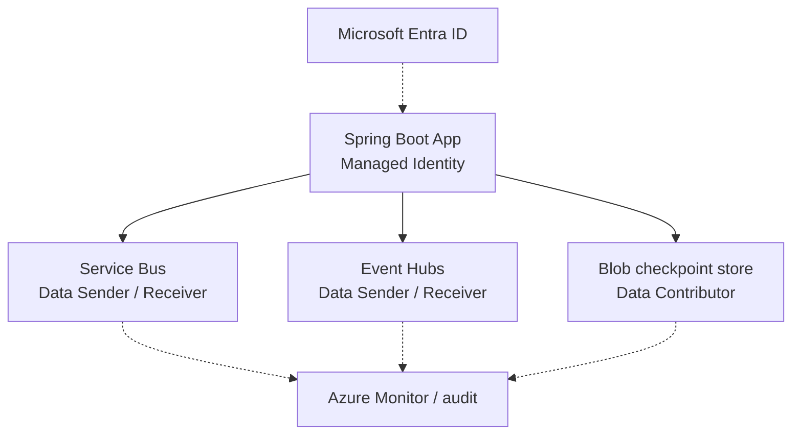

For an app that only publishes commands and clickstreams, never grant **Data Owner** or receiver roles unnecessarily. Service Bus and Event Hubs workers can use **separate identities** scoped to their exact duties.

### Lab Role Assignment Example

```bash
RG="rg-spring-msg-lab"
PRINCIPAL_ID="<spring-app-managed-identity-principal-id>"

SB_ID=$(az servicebus namespace show \
  --resource-group "$RG" \
  --name "sb-orders-lab" \
  --query id --output tsv)

EH_ID=$(az eventhubs namespace show \
  --resource-group "$RG" \
  --name "eh-telemetry-lab" \
  --query id --output tsv)

ST_ID=$(az storage account show \
  --resource-group "$RG" \
  --name "stspringmsgcheckpoint01" \
  --query id --output tsv)

# Example for one app acting as both sender and receiver;
# production should separate producer and consumer principals.
az role assignment create \
  --assignee-object-id "$PRINCIPAL_ID" \
  --assignee-principal-type ServicePrincipal \
  --role "Azure Service Bus Data Sender" \
  --scope "$SB_ID"

az role assignment create \
  --assignee-object-id "$PRINCIPAL_ID" \
  --assignee-principal-type ServicePrincipal \
  --role "Azure Service Bus Data Receiver" \
  --scope "$SB_ID"

az role assignment create \
  --assignee-object-id "$PRINCIPAL_ID" \
  --assignee-principal-type ServicePrincipal \
  --role "Azure Event Hubs Data Sender" \
  --scope "$EH_ID"

az role assignment create \
  --assignee-object-id "$PRINCIPAL_ID" \
  --assignee-principal-type ServicePrincipal \
  --role "Azure Event Hubs Data Receiver" \
  --scope "$EH_ID"

az role assignment create \
  --assignee-object-id "$PRINCIPAL_ID" \
  --assignee-principal-type ServicePrincipal \
  --role "Storage Blob Data Contributor" \
  --scope "$ST_ID"
```

**These commands modify permissions**—run only with approval. Assigning at namespace/account scope keeps the lab simple, **not optimal least privilege**. In production, scope to specific queues, event hubs, or containers where supported, separate producer/consumer identities, and audit inherited assignments.

### Common Permission Confusions

| Scenario | Reality |
|---|---|
| Spring app has `Contributor` on resource group | Does not automatically grant Entra data-plane Sender/Receiver rights |
| Has Service Bus Data Sender | Does not grant Event Hubs send rights |
| Has Event Hubs Data Receiver | Does not grant Blob checkpoint write rights |
| Has Storage Blob Data Reader | Insufficient for `EventProcessorClient` to update checkpoints |
| Developer `az login` works | Runtime managed identity may be a different principal |
| Identity attached to AKS cluster | Pod Workload Identity still needs FIC/ServiceAccount and its own roles |

Role assignments can incur **propagation delay**. On a `403` right after assigning a role, verify identity, principal, scope, token caches, and networking before widening permissions.

## 24. Private Link and Private Networking for Messaging

Service Bus and Event Hubs expose public endpoints and support **Private Link** depending on tier and service capabilities. A Spring Boot app inside a VNet needs **outbound routing and accurate DNS** to reach the namespaces.

### Both Endpoints Share the `servicebus.windows.net` Suffix

```text
Service Bus:
  sb-orders-lab.servicebus.windows.net

Event Hubs:
  eh-telemetry-lab.servicebus.windows.net
```

Common Private DNS zone:

```text
privatelink.servicebus.windows.net
```

Blob checkpoint store uses a separate endpoint:

```text
stspringmsgcheckpoint01.blob.core.windows.net
privatelink.blob.core.windows.net
```

**Never confuse Service Bus with Event Hubs just because they share a hostname suffix.** They remain **distinct namespaces, services, resources, and permissions**.

### VNet Architecture

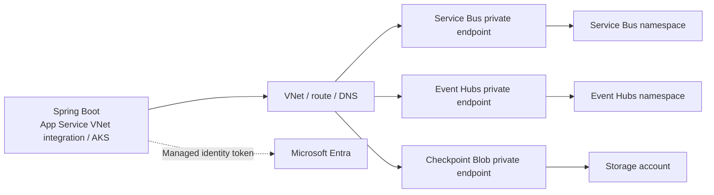

### AMQP TCP vs. AMQP over WebSockets

Azure messaging SDKs normally use **AMQP**. Connections may need AMQP TLS port **5671** or **AMQP over WebSockets** on **443** depending on configured transport and network policy. In networks allowing only outbound 443, configure the SDK's WebSockets transport explicitly and test it—never test HTTPS 443 and assume AMQP TCP works.

When configuring client builders, use the transport enum/class supported by your **exact Service Bus or Event Hubs SDK version** (never copy enums/imports across SDKs blindly). Private Link, firewall rules, and IP filtering vary by tier; confirm before disabling public access.

### Verifying DNS and Networking

```bash
# Run from an authorized container/VM/App Service console.
nslookup sb-orders-lab.servicebus.windows.net
nslookup eh-telemetry-lab.servicebus.windows.net
nslookup stspringmsgcheckpoint01.blob.core.windows.net

# When netcat is available:
nc -vz sb-orders-lab.servicebus.windows.net 5671
nc -vz eh-telemetry-lab.servicebus.windows.net 5671
nc -vz stspringmsgcheckpoint01.blob.core.windows.net 443
```

If using AMQP over WebSockets, check port 443 for messaging and verify the actual transport setting. **TCP reachability alone does not prove RBAC is right**, and `403` can reflect either authorization or service network policies. Check SDK exceptions, service logs, and correlation IDs before changing permissions.

### Tricky Case: Event Hubs Receives Events Yet Checkpointing Fails

If the Java app receives events yet `context.updateCheckpoint()` fails:

1. Event Hubs Data Receiver is likely already working.
2. The Blob container may be missing, or the account URL is wrong.
3. The managed identity may **lack `Storage Blob Data Contributor`**.
4. The Blob Private Endpoint or DNS may block app access.
5. Blob throttling, quotas, or checkpoint store lease/ETag conflicts may occur.

Do not grant broader Event Hubs roles when the failure sits on the **Blob data plane**.

## 25. Retries, Backoff, Circuit Breakers, and Redelivery

**Messaging retries span at least three layers**, each with distinct consequences:

1. **SDK transport retries:** handle transient connection or `ServiceBusy` errors on send/receive.
2. **Application dependency retries:** worker retries failed DB, downstream REST, or Storage calls.
3. **Broker redelivery / replay:** Service Bus redelivers uncompleted messages; Event Hubs re-reads from the last checkpoint.

If all three layers retry without limits, a minor database blip escalates into a **retry storm**, spiking latency, throughput/cost, DLQs, and checkpoint churn.

### Failure Decision Matrix

| Root cause | Service Bus consumer | Event Hubs consumer |
|---|---|---|
| Brief SQL timeout, uncommitted | Bounded retry, then `abandon` for redelivery | Bounded retry; skip checkpoint, decide pause/quarantine |
| Permanent invalid JSON/schema | Dead-letter with reason and alert | Write to durable quarantine, then checkpoint per policy |
| Missing RBAC `403` | Alert and fix config; never abandon infinitely | Stop/throttle consumer to avoid reading when sink writes fail |
| Committed yet settlement/checkpoint fails | Redelivery → idempotent no-op → `complete()` | Replay → dedup store recognizes → checkpoint |
| Downstream overloaded | Lower `maxConcurrentCalls` / back off | Lower processing concurrency; never checkpoint unwritten data |
| Out-of-order business events | Session/sequence/version rules | Partition key/sequence checks and late-event handling |

### Bounded Exponential Backoff

Example wait-time calculation for internal retries:

\[
\text{delay}_n \approx \min(\text{maxDelay},\ \text{baseDelay}\times 2^n)+\text{jitter}.
\]

Never run unbounded retry loops inside a callback holding a message lock, as the lock may expire while sleeping. On Service Bus, consider scheduled retry messages or broker redelivery per architecture **without creating non-idempotent re-sends**. On Event Hubs, apply a poison-event policy so one bad event cannot stall a partition forever.

### Circuit Breakers

If a downstream payment gateway returns `503` repeatedly, a circuit breaker can pause calls so you stop hammering a degraded dependency. Still:

- Never `complete()` a message whose mandatory side effect failed.
- Never `updateCheckpoint()` for unprocessed events unless quarantined per policy.
- Track/alert on growing backlogs.
- While the circuit is open, throttle receive concurrency so messages do not pile up in memory unboundedly.

### Spring Retry

**Spring Retry** can help on short idempotent calls, yet watch how it interacts with SDK retries and broker settlement. Putting `@Retryable` on a method does not combine database writes and queue completion into one distributed transaction.

## 26. Idempotency: Ensuring Correctness Across Redeliveries

**At-least-once** means one logical message or event can be delivered multiple times. The standard defense is **deduplication at the database/sink**.

### Processed Messages Table

Suppose Azure SQL has:

```sql
CREATE TABLE dbo.ProcessedMessages (
    ConsumerName nvarchar(100) NOT NULL,
    MessageId nvarchar(200) NOT NULL,
    ProcessedAtUtc datetime2(3) NOT NULL,
    CONSTRAINT PK_ProcessedMessages
        PRIMARY KEY (ConsumerName, MessageId)
);
```

Inside **one single SQL transaction**:

1. Attempt to insert `(consumerName, messageId)`.
2. On a duplicate-key error, recognize it as already processed and skip side effects.
3. Otherwise, update business state.
4. Commit the transaction.
5. After commit, `complete()` the Service Bus message or checkpoint the Event Hubs event.

**Never `SELECT` then `INSERT` across two separate transactions**, as two workers can race. Rely on unique constraints / atomic inserts and database duplicate-key semantics; writing the processed marker and business state in the same transaction yields **once-only business effects**.

### Message ID Differs from Event Position

| Metadata | Use for |
|---|---|
| **Service Bus `MessageId`** | Deduplicating the same logical command per sender contract |
| **Business operation ID** | Idempotency for payments, refunds, and orders |
| **Event Hubs `eventId`** | Deduplicating the same logical event even across producer retries |
| **`partitionId + sequenceNumber`** | Observing read position, monitoring, and replay |
| **`CorrelationId` / `traceparent`** | Distributed tracing from HTTP to consumers |

If a producer retries and appends the same logical event to Event Hubs a second time, the broker assigns a **new sequence number**. Therefore, never use sequence numbers as business idempotency keys; use a producer-supplied `eventId` that stays constant across retries.

### What Does "Exactly Once" Actually Mean?

You can achieve **exactly-once business effects within a specific sink boundary** using idempotent transactions and unique constraints. Never advertise an entire pipeline as "exactly once" when it spans:

- HTTP ingress;
- Azure SQL Order writes;
- Service Bus publishing;
- Worker writes;
- Event Hubs checkpoints;
- Outbound emails.

Every boundary needs outbox, inbox/dedup, saga/compensation, or reconciliation design. **There is no Spring Boot switch** that turns the whole chain into distributed ACID.

### Guarding Against Schema Drift and Poison Data

Separate **retryable transient errors** from **permanent validation errors**. Retrying invalid payloads infinitely clogs Service Bus DLQs/queues or stalls Event Hubs partitions. Record quarantined errors with source ID, `schemaVersion`, and reason while keeping PII out of logs.

## 27. Schema Evolution and Event Contracts

Today a Spring app publishes:

```json
{
  "eventId": "evt-001",
  "eventType": "OrderCreated",
  "schemaVersion": 1,
  "orderId": "order-1001",
  "amount": 150000,
  "currency": "VND",
  "occurredAtUtc": "2026-11-20T10:00:00Z"
}
```

Three months later, the producer adds `promotionCode` and renames `amount` to `amountMinorUnits`. Older consumers can fail parsing or miscalculate revenue.

### Contract Rules

1. Every message/event carries `eventType` and `schemaVersion`.
2. Stable `eventId` and explicit business keys.
3. Timestamps in UTC ISO 8601; keep business local dates/timezones separate.
4. Never reuse the same event name with incompatible semantics.
5. Add optional fields for backward compatibility; breaking changes need a new version and migration.
6. Send only fields consumers need—never stuff full Order aggregates carrying PII.
7. Respect broker/tier size caps; never embed large PDFs inside messages.
8. Consumers must define behavior for unknown `eventType` or `schemaVersion` values.

### Event Payload vs. Event Pointer

For large documents, store the payload in Blob Storage and publish a pointer message containing:

```json
{
  "eventId": "evt-doc-1001",
  "eventType": "DocumentUploaded",
  "schemaVersion": 1,
  "tenantId": "tenant-42",
  "blobPath": "incoming/2026-11-20/batch-1001.pdf",
  "contentHash": "sha256:...",
  "occurredAtUtc": "2026-11-20T10:00:00Z"
}
```

Consumers use **managed identity + `Storage Blob Data Reader`** to fetch the authorized file. Never embed **long-lived SAS URLs** in messages, keeping secrets out of logs, DLQs, and caches.

### Schema Registries and Contract Testing

Across multiple teams, adopt JSON Schema, Avro, Protobuf, or a supported schema registry. Still, a registry does not force every Spring consumer to validate schemas automatically: enforce validation in producers/consumers, run CI compatibility tests, and govern rollouts/rollbacks.

### Ordering and Versioning

Even with Event Hubs partition key `customerId`, two producers can emit events out of business order. Include a source `entityVersion` or sequence number so consumers never let `OrderUpdated(version=3)` overwrite an already-applied `OrderUpdated(version=4)`.

## 28. Scaling and Backpressure

Adding Spring instances does not automatically scale throughput linearly. Account for **broker characteristics, consumer patterns, entity partitions, and downstream bottlenecks**.

### Service Bus Scaling

- Adding **competing receivers** increases parallelism while a queue has backlog.
- `maxConcurrentCalls` on the processor caps concurrent message callbacks per instance.
- **Sessions** serialize messages sharing a `SessionId`; a hot session can bottleneck throughput.
- Lock renewal, prefetch, and settlement consume overhead—never raise prefetch blindly.
- If the database handles only 200 writes/second, 2,000 concurrent callbacks will make performance worse.

### Event Hubs Scaling

- **Partition count** caps useful parallelism per consumer group.
- Producer batching and partition keys govern partition skew.
- `EventProcessorClient` coordinates ownership; scaling instances triggers rebalances, replays, and churn.
- Checkpointing too often increases Blob operations; checkpointing too rarely increases crash replay work.
- Event Hubs throughput capacity and quotas depend on tier and settings.

### Illustrative Distribution

```text
Event Hub: 4 partitions
Consumer group analytics-app:
  2 processors  -> each processor can receive ~2 partitions
  4 processors  -> each processor can receive ~1 partition
  10 processors -> not all 10 will have a partition to process
```

This is a **simplified illustration, not a guarantee of perfectly even assignment**. Ownership shifts with load balancing, instance health, and network conditions.

### Backpressure in Spring

When a consumer receives events faster than the database can write:

1. Bound concurrency, prefetch, and batch sizes sensibly.
2. Use **bounded queues/buffers**; never accumulate unbounded `List<EventData>` in heap.
3. Measure downstream latency, retry rates, and memory pressure.
4. Keep blocking DB calls off non-blocking event loops when using Reactor/Async SDKs—never call `Thread.sleep` or blocking JDBC on event-loop threads.
5. Checkpoint only after durable writes; buffered uncommitted data must never be checkpointed.
6. Scale databases/compute/tiers or spill bursts to appropriate queues/data lakes during surges.

### Spring MVC vs. WebFlux

The Azure SDK provides both **sync** and **async/Reactor** clients. In Spring MVC, sync clients are straightforward; in Spring WebFlux, prefer async clients because blocking calls on reactive event loops degrade scalability. Never disguise synchronous code as reactive by wrapping `Mono.just(sender.sendMessage(...))`—that executes synchronously before subscription.

## 29. Observability, Tracing, and Alerts

Messaging systems need visibility across **API → broker → consumer → database**, not just HTTP 200 on the producer.

### Recommended Metrics

| Layer | Metrics | Question answered |
|---|---|---|
| Spring API | Request rate, p95, accepted commands, failed sends | Is the broker accepting commands? |
| Service Bus | Active messages, dead-letter count, incoming/outgoing, server errors, throttling | Are workers falling behind or hitting poison messages? |
| Service Bus consumer | Receive-to-complete latency, `deliveryCount` distribution, abandons, lock lost | Is processing healthy and stable? |
| Event Hubs | Incoming/outgoing events/bytes, throttled requests, capacity usage | Is the stream hitting throughput caps? |
| Event Hubs processor | Per-partition lag, last checkpoint age, rebalance count | Is the consumer keeping pace with ingress? |
| Blob checkpoint | Write failures, latency, permission errors, operations | Is the checkpoint store healthy? |
| Database / sink | Commit latency, duplicate hits, conflicts, errors | Are business effects persisting cleanly? |
| End-to-end | Event time → business effect latency, DLQ age, lost/duplicate reconciliation | Are business SLOs being met? |

**Some metrics exist only at the application layer**: the broker does not know which `orderId` hit a duplicate check or the lag from producer event timestamp to a silver revenue table. Emit custom application metrics and traces.

### Trace Context

Carry a **correlation ID**, W3C/OpenTelemetry `traceparent` where supported, `eventId`, and `schemaVersion` on messages/events. Avoid high-cardinality sensitive order/customer IDs in metric labels; log hashed IDs in restricted environments where needed.

```text
HTTP POST /orders
  traceId = abc123
    -> Service Bus send (commandId=process-order:1001)
       -> Service Bus receive
          -> SQL commit
          -> complete

Web click event
  eventId = evt-xyz
    -> Event Hubs enqueue (partitionId, sequence)
       -> consumer process + sink commit
       -> Blob checkpoint update
```

### Azure Monitor and Application Insights

Check metrics and diagnostic settings on the **exact Service Bus/Event Hubs namespaces** and checkpoint Storage account. Access Azure Monitor Metrics via Portal or CLI, and use Application Insights or OpenTelemetry exporters to capture dependency spans, logs, and custom business metrics.

```bash
SB_ID=$(az servicebus namespace show \
  --resource-group "rg-spring-msg-lab" \
  --name "sb-orders-lab" --query id --output tsv)

EH_ID=$(az eventhubs namespace show \
  --resource-group "rg-spring-msg-lab" \
  --name "eh-telemetry-lab" --query id --output tsv)

az monitor metrics list-definitions \
  --resource "$SB_ID" \
  --output table

az monitor metrics list-definitions \
  --resource "$EH_ID" \
  --output table
```

These commands **read metric definitions**; they do not create alerts. Metric names and dimensions vary by resource and tier. Inspect the returned list to set thresholds rather than hard-coding an Event Hubs–only metric onto a Service Bus dashboard.

### Safe Structured Logs

Example structured log entry:

```text
operation=servicebus.complete
messageId=process-order:1001
deliveryCount=2
durationMs=43
result=success
traceId=...
```

Logs should include approved identifiers, operations, and status—**never SAS keys, raw JWTs, payment payloads, emails, shipping addresses, or full PII**. For Event Hubs, log `partitionId`, `sequenceNumber`, and checkpoint age for replay investigations rather than dumping full `EventData.getBodyAsString()` in production.

## 30. Data Security in the Messaging Pipeline

Managed identity eliminates **Shared Access Keys** for Service Bus and Event Hubs, yet brokers still require securing payloads, send/receive rights, network paths, and downstream storage.

### Risk Register

| Risk | Example | Control |
|---|---|---|
| Over-privileged identity | Public API holds namespace-wide Data Owner | Scope `Data Sender` to required entities |
| Secret/SAS leak in code | Connection string committed to Git | Managed/Workload Identity; Key Vault for unavoidable secrets |
| Cross-tenant messages | Tenant A submits `tenantId=B` and worker trusts it | Authenticate tenant at producer; verify ownership at consumer |
| PII in DLQ/logs | Messages carry emails/card numbers | Minimize payloads, redact, restrict DLQ access, enforce retention |
| Malicious payloads | Oversized/deep JSON or unsafe deserialization | Schema validation, size caps, forbid untrusted polymorphic deserialization |
| Replay attacks | Resending an old money-transfer command | Idempotency keys, state machines, domain expiry/nonces |
| Event poisoning | Infinite retries on one malformed event | Bounded retries, quarantine, and auditing |
| Misconfigured Private Endpoint | App falls back to public path against policy | Validate DNS and egress from the live workload |
| Checkpoint tampering | Unrelated identity alters Blob checkpoints | Container-scoped RBAC and isolated groups/apps |

### TLS and Networking

AMQP over TLS/WebSockets must enforce **valid hostnames and certificates**. Never disable TLS validation to work around DNS or Private Endpoint errors. Fix canonical hostnames, DNS resolvers, proxies, and JVM truststores instead.

### Data Minimization

Send only business fields consumers actually need. For payloads larger than broker limits or large attachments, store the file in permissioned Blob Storage and send a **pointer reference** with checksum, `eventId`, and `schemaVersion`. Consumers read the file using their own identity—never broadcast long-lived SAS URLs to all subscribers.

### Application-Level Authorization

Azure RBAC granting an identity permission **to send to a queue** does not validate `tenantId` inside the payload. The Spring backend must authenticate callers, verify order/tenant ownership in the database, allow only authorized command types, and stamp verified claims. Consumers must never blindly trust every payload field even when only an internal namespace can publish.

### Sensitive Data in Event Hubs

Multiple consumer groups can read and replay an event throughout retention. Putting PII into Event Hubs **expands data distribution and retention footprint**. Consider pseudonymization, field minimization, per-consumer-group governance, and compliant downstream deletion workflows.

## 31. Cost and Capacity Planning

Service Bus and Event Hubs use different capacity and billing models. **Do not compare them solely by messages/day**; account for message size, retention, consumer group count, publish/receive operations, duplicates/retries, and SLA needs.

### Key Cost Drivers

| Component | Service Bus | Event Hubs |
|---|---|---|
| Capacity | Tier, messaging units, or operations per offering | Throughput/processing units and tier capacity |
| Ingress | Message count, payload size, batching | Ingress events/bytes, producer batching |
| Egress | Consumers, topic subscriptions, redeliveries | Each consumer group reading the stream, egress/processing |
| Retention | TTL/queue/topic state and DLQs | Retention window and capture/export |
| Reliability | Scheduled retries, DLQs, sessions, duplicate detection | Checkpoints/replay, durable sinks, retention |
| Auxiliary services | SQL/outbox, diagnostics | Blob checkpoints, Data Lake Capture, analytics compute |
| Security / network | Private Endpoints, DNS, monitoring | Private Endpoints, Blob checkpoints, monitoring |

### Illustration: One Event Read by Three Consumer Groups

Suppose the frontend generates **1 million clickstream events/day** consumed by `analytics`, `fraud`, and `recommendations`. Ingress stays 1 million events, while **total reads/egress** and downstream processing multiply because each group reads independently. If all three write to a data lake without coordination, storage multiplies too.

With a Service Bus topic having three subscriptions, each published message fans out into three logical deliveries—impacting throughput and backlogs differently from three workers competing on **one queue**.

### How Many Operations Does Checkpointing Consume?

Suppose a processor handles `1,000 events/second`:

- **Checkpoint every event:** generates nearly one checkpoint update per event per second depending on SDK/design.
- **Checkpoint every 500 events:** dramatically reduces checkpoint writes, while crashes may replay up to several hundred events.

Do not assume a 500× **total cost** drop since ownership polling, other operations, and retries remain; check Azure Storage metrics and Cost Management on your real workload. Pick checkpoint frequency by balancing **replay cost ↔ Blob transactions ↔ sink RPO**.

### Throttling and Capacity

When encountering `ServiceBusy` or throttling:

1. Check namespace tier, current throughput/capacity, and metrics.
2. Review producer batch/message sizes, retry rates, and consumer concurrency.
3. Check whether checkpoint Storage or downstream databases are saturated.
4. Avoid scaling consumers past partition counts or Event Hubs limits.
5. Plan tier or throughput increases once application tuning is complete.

Never promise a fixed throughput ceiling across every subscription, region, and tier; verify quotas and benchmark with real payloads, transports, and consumer counts.

### Estimating Total Architecture Cost

\[
\text{Total cost}
= \text{Broker capacity/operations}
+ \text{Network}
+ \text{Checkpoint storage}
+ \text{Downstream compute/storage}
+ \text{Monitoring}
\]

This is a **cost breakdown**, not a price table. Use the Azure Pricing Calculator and Cost Management for your target region and tier, including private networking and log ingestion. A system with modest event counts where each event triggers dozens of database queries often spends more on **consumer compute and databases** than on the broker itself.

## 32. Case Study: Order Processing and Clickstream Running Side by Side

### Context

An e-commerce company runs three Spring Boot applications:

1. **Order API:** accepts HTTP orders, writes to Azure SQL, and dispatches order-processing commands.
2. **Order Worker:** receives commands from Service Bus, checks inventory/payment, and updates status.
3. **Analytics Stream Processor:** reads clickstream events from Event Hubs and writes curated data to ADLS Gen2 or an analytics sink.

Traffic surges 10× on peak Fridays. Each system must scale independently without duplicating orders, while multiple teams replay clickstream events.

### Architecture

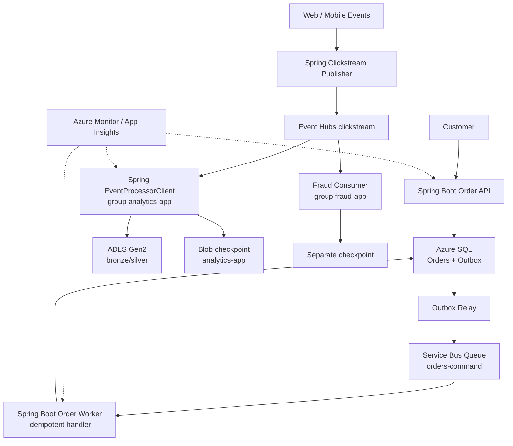

### Flow A — Order Processing

1. Customer sends `POST /orders` with an idempotency key; API authenticates user/tenant.
2. Inside **one Azure SQL transaction**, API inserts the Order and an outbox record with a stable command ID.
3. Outbox relay reads unpublished records and sends Service Bus message `ProcessOrder` with `MessageId`.
4. Worker receives under Peek-Lock, validates schema and tenant, and checks processed-message ID in the database.
5. Worker executes the domain operation, committing status and the idempotency record in one DB transaction.
6. Worker calls **`complete()`** after commit; if `complete()` fails, redelivery skips duplicate side effects.
7. Invalid payloads go to the DLQ with a reason; ops replays them after fixing the bug.
8. API/status endpoints read Order state from the database—**never claiming completion solely from send success**.

### Flow B — Clickstream and Analytics

1. Frontend emits `ProductViewed` with `eventId` and timestamp.
2. Spring publisher sends to Event Hubs partitioned by user/customer when ordering is required.
3. Analytics consumer group reads partitions, validates schemas, and commits micro-batches durably to the data lake.
4. After sink commit/manifest confirmation, the processor updates the Blob checkpoint.
5. On a crash before checkpointing, the consumer replays and the sink deduplicates by `eventId`.
6. The fraud consumer group reads the same stream independently and writes to its own store.
7. The data lake retains history longer than Event Hubs retention for replay and ML.

### Flow C — Late or Out-of-Order Events

If a `10:03` checkout event arrives at the consumer before a `10:02` `add_to_cart` event due to network paths, the app must not sort solely by **arrival time** and conclude the user checked out before adding to cart.

- Track source `occurredAtUtc`, broker `enqueuedTime`, and explicit event IDs/sequences.
- With a shared partition key and single controlled producer, partition order helps; still account for multiple producers, retries, and clock skew.
- Analytics watermarks and late-data windows handle delayed arrivals.
- Never silently drop business events just for falling slightly outside a small window without a defined policy.

### Permission Separation

| Workload | Permissions |
|---|---|
| Order API / Relay | Service Bus Data Sender, scoped SQL privileges |
| Order Worker | Service Bus Data Receiver, scoped business SQL privileges |
| Clickstream Publisher | Event Hubs Data Sender |
| Analytics Consumer | Event Hubs Data Receiver, Blob checkpoint contributor, Data Lake writer |
| Fraud Consumer | Event Hubs Data Receiver, dedicated checkpoint store and sink |
| SRE | Monitoring/diagnostics; approved DLQ/replay permissions |

**Never share one user-assigned identity holding broad permissions across every namespace, database, and data lake** when apps span different trust boundaries. Separating identities shrinks blast radius and simplifies auditing.

### Illustrative SLAs / SLOs

| SLO | How measured | Response |
|---|---|---|
| 99.9% of commands accepted by broker | Producer success/error counts and outbox backlog | Alert on send failures; bounded retries |
| 95% of Order commands processed within 30s | Accepted-to-committed duration | Scale workers, check downstream |
| DLQ does not grow continuously | DLQ count and message age | Investigate poison messages |
| Clickstream lag under 2 minutes | Event enqueued time → sink commit, checkpoint age | Inspect partitions and processing capacity |
| Zero double charges | Business idempotency and invariant tests | Block releases on regressions |

Thresholds are **illustrative only**; validate against business needs and real workloads. Never turn 99.9% broker receipt into a payment-accuracy promise without database reconciliation.

### A Common Real-World Incident

A payment worker commits to the DB successfully, then its container restarts before `complete()`. The broker redelivers the command to another instance. If the worker simply "receives message and calls the payment gateway" without idempotency, the customer gets charged twice.

Proper design: every payment carries a **business idempotency key**, passed to the payment gateway when supported, while the database tracks progress and callback reconciliation; on redelivery, the worker sees the completed state and skips duplicate side effects. Azure Service Bus delivery semantics alone cannot prevent this.

## 33. Service Bus and Event Hubs Troubleshooting Runbook

### Symptom → Root Cause → Action Table

| Symptom | Possible cause | Checks and remediation |
|---|---|---|
| Service Bus send returns `401` | Wrong token audience/tenant or auth mode | Check SDK credential, namespace hostname, and token acquisition |
| Service Bus send returns `403` | Missing **Data Sender** or denied by network policy | Check identity principal, role scope, and firewall/private networking |
| Event Hubs producer returns `403` | Missing Event Hubs Data Sender or role on wrong namespace | Verify exact namespace, principal, and Azure RBAC |
| Event processor receives events yet fails checkpoint | Missing Blob role, missing container, or Storage network block | Check Blob Data Contributor, endpoint, and private DNS |
| Queue backlog grows | Consumers down, under-provisioned throughput, slow downstream | Check consumer health, p95 duration, `maxConcurrentCalls`, DB |
| Active queue drops while DLQ grows | Schema failures, max delivery count, lock lost | Inspect DLQ reasons, `deliveryCount`, and error metrics |
| Same command processed multiple times | Lock expiry, `complete()` failure, or producer retry | Check idempotency table, `MessageId`, and lock renewal |
| Frequent `MessageLockLost` | Handler too slow, high prefetch/missing renewal, deadline mismatch | Speed up handler, tune auto-renew, timeouts, and concurrency |
| DLQ replay causes duplicate payments | Replay changed ID or consumer lacks dedup | Preserve `operationId` and check processed-messages table |
| Event Hubs lag spikes on one partition | Partition key skew or slow handler | Check per-partition lag, ownership, and hot keys |
| Extra `EventProcessor` instances sit idle | Fewer partitions than instances or active rebalance | Compare partition count vs. instance count and checkpoint store |
| Two independent apps each miss half the events | Sharing one consumer group and ownership | Assign separate consumer groups per workload |
| Event Hubs duplicates after restart | Checkpoints unsaved or crash post-commit | Use idempotency/durable sinks and tune checkpoint strategy |
| Sink misses data after restart | Checkpointed too early before durable write | Move checkpointing strictly after commit; backfill within retention |
| Event Hubs consumer stuck on poison event | Missing error/quarantine policy | Add bounded retries, durable quarantine, then advance |
| Java `DefaultAzureCredential` unavailable | Managed identity disabled or local not logged in | Check host/Workload ID or `az login` locally |
| DNS returns public IP in private-only setup | Missing `privatelink.servicebus.windows.net` or Blob zone link | Debug DNS from inside the runtime |
| TCP 443 works yet AMQP fails | Client using AMQP TCP 5671 blocked by proxy/firewall | Verify transport option (`WebSockets` vs. TCP) and egress |
| Historical events missing | Retention expired or checkpoint reset improperly | Verify retention/offsets; restore from Capture/data lake if archived |
| Consumer processes twice after deploy | Both SDK processor and Spring Cloud Stream binder active | Inspect bean lifecycles and bindings |
| Event Hubs batch send fails on big event | `tryAdd` returned false; payload exceeded size cap | Shrink payload or switch to Blob pointer pattern |
| Sudden cost spike | Retry storms, DLQ churn, excessive checkpoints, extra groups | Measure broker operations, Blob transactions, and downstream |
| Staging app accidentally reads prod queue | Wrong profile or namespace config | Verify endpoints, deployment settings, and identity scope |

### Runbook A — Growing Service Bus Backlog

1. Confirm the exact namespace, queue/subscription, and UTC incident start time.
2. Check active count, DLQ count, incoming/outgoing rates, and throttled/failed requests.
3. Verify Spring instances are healthy, processors called `start()`, and inspect `processError` logs.
4. Check receiver role, private connectivity, and TLS/AMQP transport.
5. Check handler latency, DB pool saturation, and `abandon`/lock-lost counts.
6. If the bottleneck is downstream, **lower retries and concurrency**—never scale hundreds of workers into a saturated database.
7. Increase tier/capacity or worker count only after isolating the root cause.
8. Post-recovery, measure backlog drain time, duplicate hits, and business state consistency.

### Runbook B — Growing Event Hubs Lag

1. Identify the affected consumer group and lagging partitions.
2. Check processor ownership, instance count, checkpoint container, and Blob errors.
3. Compare latest `enqueuedTime` against `last sink committed` and checkpoint age.
4. Check for partition key skew or a slow handler.
5. Verify whether the data lake/DB sink is failing, throttling, or rejecting payloads.
6. Check retention headroom: consumers lose data if lag exceeds retention.
7. Tune concurrency/batching and processing capacity—never advance checkpoints over unprocessed events.
8. If retention was exceeded, report the data gap and backfill from long-term archives if available.

### Runbook C — Recent Role Change Causes Spring `403`

1. Verify the live principal ID of the App Service, Container App, or AKS Workload ID.
2. Check **Data Sender/Receiver** roles on the exact service and scope—never confuse Service Bus and Event Hubs roles.
3. For checkpoint failures, inspect `Storage Blob Data Contributor` separately.
4. Check token caches, role propagation delay, and namespace hostnames.
5. In private-only environments, verify DNS, routing, and approved Private Endpoints.
6. Apply least-privilege role fixes per change plan and audit.
7. Never leave account-level Shared Keys in place as a permanent workaround.

## 34. End-to-End Spring Boot Integration Lab

**Objective:** Run a lab Spring app that publishes a Service Bus command, receives and settles it, publishes an Event Hubs event, and consumes/checkpoints via Blob Storage. Use **synthetic data**—never real customer or payment details.

### 34.1. Resource Preparation

Perform only in authorized isolated namespaces and containers:

1. Create or verify **Service Bus queue** `orders-command`.
2. Create or verify **Event Hub** `clickstream` and consumer group `analytics-app`.
3. Create Blob container `eh-checkpoints` reachable from the Spring runtime.
4. Identify principals for producer, Service Bus consumer, and Event Hubs consumer.
5. Assign least-privilege data-plane RBAC (a single lab app can temporarily share one lab identity; separate in production).
6. Verify network reachability and exact fully qualified namespaces.
7. Align JDK, Spring Boot, and Azure SDK versions approved by your engineering team.

### 34.2. Starting Spring

1. Create a Spring Boot project with `spring-boot-starter-web`, `actuator`, and section 8 Azure SDK dependencies.
2. Supply `app.*` config from section 9 with zero connection strings.
3. Wire beans for `AzureMessagingConfiguration`, Service Bus processor, and `EventProcessorClient`.
4. Ensure local runs use `az login`/developer credentials scoped to the **lab**; Azure hosts use assigned managed identities with roles.
5. Start `EventProcessor` only once the Blob checkpoint container exists and write permissions are in place.

### 34.3. Testing Service Bus

- Send an HTTP request to lab endpoint `POST /lab/orders/ORD-001/process`.
- Observe producer logs sending `MessageId=process-order:ORD-001:v1`.
- Observe the consumer receiving and persisting metadata; once the real handler commits durably, call `complete()`.
- Briefly simulate a transient failure to watch `abandon`/redelivery without flooding the namespace.
- Deliberately publish an invalid payload in the lab to watch DLQ routing and handling.
- Resend the same logical `MessageId` and confirm zero duplicate side effects.

**Because the section 13 sample handler only checks for non-blank strings, never treat a passing `complete()` there as proof an Order was saved.** Add a real test sink (database table or durable file) and idempotency table to test the full guarantee.

### 34.4. Testing Event Hubs

- Invoke `ClickstreamPublisher.publishView("customer-42", "SKU-A", "tenant-lab")` from a lab test/controller.
- Send a multi-event batch using section 17 code and verify `tryAdd`.
- Observe `EventProcessor` receiving partition IDs and payloads, writing to a durable test sink.
- Checkpoint only after durable writes succeed; inspect checkpoint metadata in Blob Storage using an authorized identity.
- Restart one instance and confirm the processor resumes from the checkpoint without duplicating business events.
- Add a second processor instance in the same consumer group and observe rebalancing/partition ownership.
- Create a second consumer group and verify it reads independently within retention.

### 34.5. Controlled Fault Injection

| Fault | Expected behavior |
|---|---|
| Stop lab consumer | Queue backlog / Event Hubs lag grows with zero data loss |
| Temporarily break SQL test sink | Uncommitted data is never completed or checkpointed |
| Publish same `eventId` twice | Idempotency prevents duplicate business state |
| Narrow Blob checkpoint role in lab | Event consumer still reads yet checkpointing fails and alerts |
| Set wrong `AZURE_CLIENT_ID` | Credential failure without falling back to unintended keys/secrets |
| Block Service Bus network | Producer/consumer fail cleanly with bounded retries and alerts |
| Events past Event Hub retention | Do not claim replay is possible; verify archive source |

Perform all fault injection strictly on **isolated lab resources**. Never delete shared consumer groups or checkpoint containers, never send real payment commands, and never alter production firewalls.

### 34.6. Reporting Results

```text
Lab: spring-messaging-001
Spring Boot / Java / Azure SDK versions: <record>
Service Bus producer send: <PASS/FAIL>
Service Bus consumer complete after durable write: <PASS/FAIL>
Service Bus poison message -> DLQ: <PASS/FAIL>
Event Hubs producer batch: <PASS/FAIL>
EventProcessor checkpoint after sink commit: <PASS/FAIL>
Replay and business deduplication: <PASS/FAIL>
Identity/RBAC (no shared keys): <PASS/FAIL>
Private network/DNS: <PASS/FAIL/NOT_APPLICABLE>
Backlog, lag, p95 latency, retry, failures: <measurements>
Blockers/next actions: <details>
```

This is a **report template**, not results from a completed run. Mark `PASS` only with observed evidence; clean up lab-created resources once metrics are recorded.

## 35. Self-Check Questions

### Case A. Command or Event?

An app wants exactly one worker to process a `RefundOrder` command, retry transient SQL errors, and move malformed commands to a DLQ. Choose Service Bus or Event Hubs?

*Hint:* **Service Bus queue** fits best thanks to competing consumers, Peek-Lock, settlement, and DLQs. Still enforce idempotency at the payment gateway and DB.

### Case B. 3-Day Analytics Replay

Both analytics and fraud teams want to read a clickstream independently and replay by position within retention. Which service fits?

*Hint:* **Event Hubs** with separate consumer groups; configure sufficient retention, checkpoints, and durable export for longer history.

### Case C. Does Send Success Mean Processing Finished?

The Spring API succeeds on `sender.sendMessage()` and immediately returns `"paymentComplete"`. Is that accurate?

*Hint:* No. That only proves the broker accepted the message; workers may not have started yet. Return accepted/pending status and track business state via DB/callbacks.

### Case D. Crash Between DB Commit and `complete()`

A worker commits `Order.status=PAID` and restarts before calling `complete()`. The message is redelivered. How do you avoid charging twice?

*Hint:* Business idempotency key, transactional processed-messages table check, payment-gateway idempotency, and completing the duplicate cleanly once recognized.

### Case E. Checkpointing Event Hubs Too Early

A processor reads `seq=501`, checkpoints, and then its SQL write fails. What can happen after restart?

*Hint:* The consumer may resume after `seq=501`, silently dropping the business event at the sink. Always commit durably before checkpointing.

### Case F. Event Hubs Scaling

An event hub has 4 partitions and one consumer group runs 16 processor instances. Are there 16 partitions so every instance gets one?

*Hint:* No. Useful parallelism is capped at 4 partitions; adding instances does not increase partition count or ordering guarantees.

### Case G. Shared Consumer Group

Fraud and analytics are two independent services sharing consumer group `analytics-app` and one checkpoint store. Why does fraud see only part of the events?

*Hint:* Processors in the same consumer group split partition ownership. Create a **separate consumer group** for fraud.

### Case H. Service Bus Role vs. Event Hubs Role

An app holds `Azure Service Bus Data Receiver` on `sb-orders-lab`, tries to consume `eh-telemetry-lab`, and gets `403`. Does the old role carry over?

*Hint:* No. Assign **`Azure Event Hubs Data Receiver`** on the exact Event Hubs namespace/entity and principal.

### Case I. Blob Checkpoint Store

`EventProcessorClient` reads Event Hubs fine yet hits `403` saving checkpoints. Should you grant `Event Hubs Data Owner` or check elsewhere?

*Hint:* Check **`Storage Blob Data Contributor`** on the checkpoint container, the processor's identity, and Blob networking.

### Case J. Poison Events

The callback receives malformed JSON, catches the exception without checkpointing, and the processor moves on to newer events. Has the system automatically retried the bad event?

*Hint:* Not necessarily. Define an explicit policy: pause/stop, bounded retry, durable quarantine before checkpointing, or alert for manual intervention.

### Case K. Spring Cloud Stream vs. SDK

A team consumes a queue with a Spring Cloud Stream binder. An engineer adds a second `ServiceBusProcessorClient` on the same queue "to monitor it." What happens?

*Hint:* The second processor becomes a competing consumer and **steals commands** from the main handler. Use metrics/diagnostics or non-destructive inspection APIs instead of a second consumer.

### Case L. Ordering and Partition Keys

All events for one customer must remain ordered in the stream. Should you pick a random partition key per event to maximize throughput?

*Hint:* Random keys scatter one customer's events across partitions and break per-customer ordering. Use a stable partition key and handle hot-key trade-offs with versioned design.

### Case M. Retries and Cost

A broker holds `50,000` commands while the backend returns sustained `503`s; each worker retries internally 10 times before abandoning, and the SDK also retries. What are the risks?

*Hint:* Retry amplification, expired locks, consumer saturation, duplicates, rising costs, and DLQ floods. Enforce bounded retries, backoff, circuit breakers, and lower concurrency.

### Case N. Tenant Security

A producer holding `Data Sender` sends a payload with a `tenantId` chosen by the HTTP client. Can the worker trust the payload and transfer funds for that tenant?

*Hint:* No. Tenant authorization must come from verified identity sources; the producer's broker role does not validate business claims inside payloads.

### Case O. Designing Your Own Contracts

Design `ShipmentRequested` (message) and `ShipmentStatusChanged` (event) with `schemaVersion`, idempotency key, `correlationId`, `tenantId`, `occurredAtUtc`, and retry/replay policies. Explain why commands go to Service Bus while status history may use Event Hubs or a Service Bus topic depending on requirements.

*Hint:* Start from business semantics, not service names. Shipment commands need worker settlement and DLQs, while multi-reader status logs benefit from streaming/retention or topic subscriptions with DLQs depending on needs.

## 36. Production Readiness Checklist for Spring Messaging

### Architecture Choices

- [ ] Clearly identified **commands/messages** vs. **event streams** per workflow rather than forcing one service on everything.
- [ ] Service Bus queues or topics/subscriptions have owners, naming conventions, and DLQ policies.
- [ ] Event Hubs partition count, partition keys, consumer groups, and retention fit access patterns.
- [ ] Explicitly distinguished broker-accepted, consumer-processed, and business-state-committed outcomes.
- [ ] Durable long-term data store designed when replay exceeds Event Hubs retention.

### Java and Spring Boot

- [ ] Spring Boot, JDK, and Azure SDK versions are compatible and tested in staging.
- [ ] Selected one primary integration style (SDK-managed beans or Spring Cloud Azure/binders) avoiding duplicate consumers.
- [ ] `TokenCredential` reused across clients; zero hard-coded SAS connection strings.
- [ ] Clients and processors have clear start/close lifecycles and graceful shutdown/drain policies.
- [ ] Service Bus explicit settlement or binder ack semantics documented.
- [ ] `EventProcessor` checkpoint store uses the right container, consumer group, and data-plane role.
- [ ] Processor handlers commit durably before calling `complete()` or updating checkpoints.
- [ ] Concurrency, prefetch, and batch sizes bounded to match downstream capacity.

### Delivery and Reliability

- [ ] Outbox/inbox/dedup store or idempotency mechanism protects business side effects.
- [ ] Message/event IDs remain stable across retries with clear `schemaVersion` and correlation IDs.
- [ ] Never claim end-to-end exactly-once without proving all transaction boundaries.
- [ ] Lock durations, auto-renewal, delivery counts, and DLQ policies tested.
- [ ] Bounded retries, exponential backoff with jitter, and circuit breakers protect transient calls.
- [ ] Poison-event policy and durable quarantine enforced before advancing checkpoints if applicable.
- [ ] Replay and partition rebalancing tested against idempotent sinks.
- [ ] Schema evolution covered by contract tests and backward compatibility.
- [ ] Topic subscription/session semantics tested against real workflows.

### Security and IAM

- [ ] Azure RBAC uses exact data-plane roles: Service Bus Sender/Receiver, Event Hubs Sender/Receiver, Blob checkpoint Contributor.
- [ ] Roles, scopes, and identities separated by app and environment—never subscription `Owner`.
- [ ] App Service/Container Apps managed identity or AKS Workload ID verified.
- [ ] Private Endpoints, DNS, AMQP TCP/WebSockets transport, and routing verified from live runtimes.
- [ ] Logs, DLQs, and event bodies exclude secrets, raw payment data, and unnecessary PII.
- [ ] Producers/consumers validate tenant, schema, and business authorization—never trusting arbitrary client metadata.
- [ ] Auditing enabled on role, network, queue/topic, and consumer-group changes.

### Monitoring, Performance, and Cost

- [ ] Dashboards track queue active count, DLQ count, lock lost, retries, and processing latency.
- [ ] Dashboards track Event Hubs incoming/outgoing rates, per-partition lag, checkpoints, and ownership rebalances.
- [ ] Alerts configured for stale checkpoints, poison messages, 401/403s, and throttling.
- [ ] Trace/correlation IDs flow across HTTP → broker → consumer → sink.
- [ ] Benchmarked concurrency, event batching, partition skew, and consumer group counts.
- [ ] Budgeted broker tier/capacity, Blob checkpoint operations, compute/networking, and logging.
- [ ] Drain/replay/DLQ runbooks documented and recovery tested from durable storage.
- [ ] Rollout/rollback plans avoid losing messages or duplicating business operations.

## 37. Conclusion

**Integrating Service Bus and Event Hubs in Spring Boot** starts with **business and delivery semantics**, not merely adding Maven dependencies to `pom.xml`. **Azure Service Bus** excels at commands and workflows needing queues, topics/subscriptions, Peek-Lock, settlement, and dead-letter handling. **Azure Event Hubs** excels at high-throughput event streams, multiple consumer groups, per-partition ordering, and retention-based replay. In Spring, choose either **Azure SDK for Java** with explicit bean lifecycles or **Spring Cloud Azure/Stream binders** aligned with your version and delivery semantics.

A sound architecture **commits durably before completing or checkpointing**, deduplicates via idempotency keys, bounds retries, and keeps the database—not the broker—as the business source of truth. **Managed identity, data-plane RBAC, Private Link/DNS, backlog/lag observability, DLQ operations, and cost controls** ensure the system scales safely and recovers cleanly from failures. The end goal is not merely passing a lab send/receive check, but running Spring apps that **process commands reliably, consume replayable events, and preserve business integrity under faults**.
