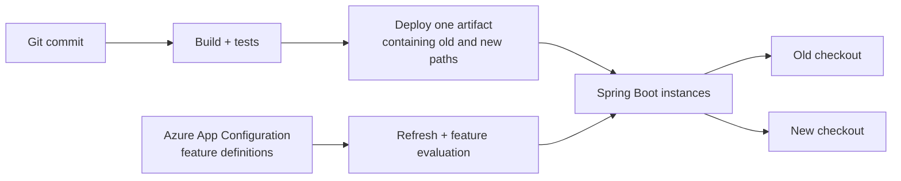
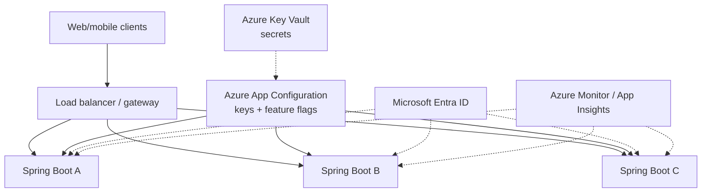
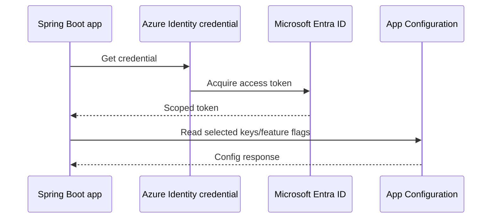
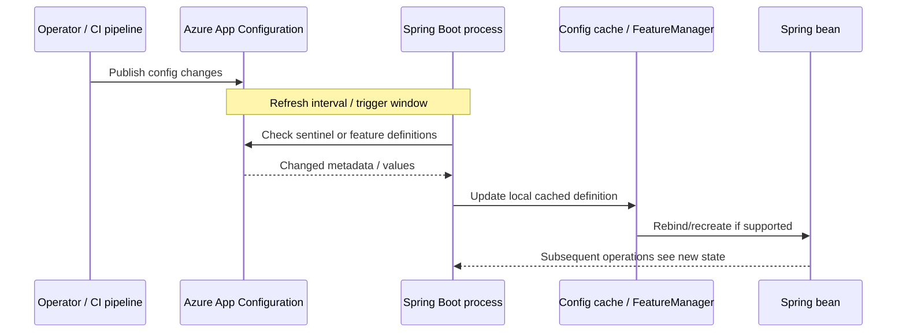
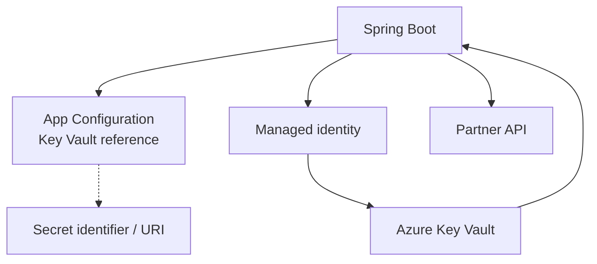
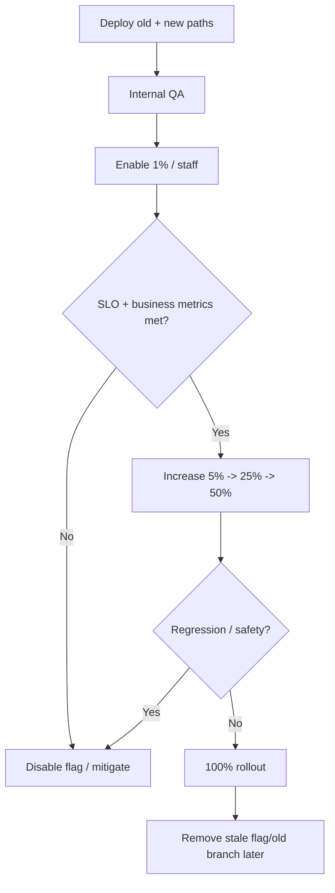
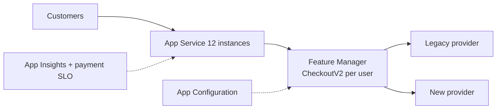
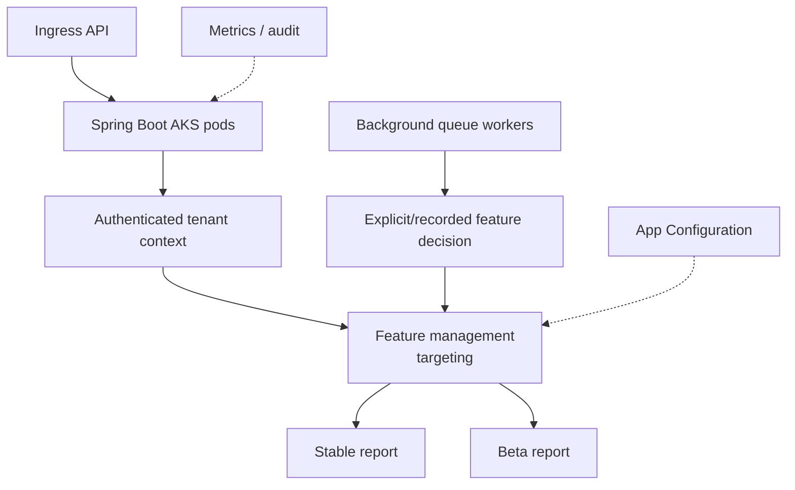

# Feature Flags and Application Configuration Refresh

An e-commerce **Spring Boot** application running on Azure App Service has two checkout flows: a stable legacy flow and a new optimized flow. The development team has deployed both code paths and wants to enable the new flow for employees first, followed by 5%, 25%, and 100% of customers. Meanwhile, the operations team needs to reduce the partner API call timeout from 3,000 ms to 1,500 ms without rebuilding the JAR. If the partner degrades, they need to quickly turn off the new path—yet the system runs across eight instances with independent caches and refresh schedules.

**Azure App Configuration** together with **Spring Cloud Azure** enables centralized storage of **key-value configuration** and **feature flags** with labels, access controls, and refresh mechanisms. However, changing a value in the portal **does not mean every Spring Boot instance applies it at the exact same millisecond**. Safe rollouts require understanding **caching, feature evaluation, refresh triggers, bean lifecycle, permissions, observability, and rollback**.

This lesson belongs to the **Spring Boot on Azure** chapter in the **CLOUD_PROVIDERS_AZURE** module, part of the Azure learning journey from subscriptions, resource groups, and Microsoft Entra ID to virtual networking, compute, storage, and data, alongside how to deploy, monitor, secure, and control application architecture costs. It connects Spring Boot with **App Configuration, Azure Key Vault, managed identity, App Service/AKS, Azure Monitor**, and production operating practices.

**After this lesson, you will be able to:**

- Distinguish between **feature flags, configuration properties, secrets, deployments**, and **authorization**.
- Organize App Configuration using **keys, labels, content types, prefixes, revisions**, and environments.
- Design boolean, **percentage, targeting, and time-window** flags, progressive delivery, and kill switches.
- Connect Spring Boot to App Configuration via **Spring Cloud Azure**, preferring Microsoft Entra / managed identity.
- Evaluate feature flags behind an abstraction, controlling **default behavior**, on/off branches, and tenant context.
- Refresh key-values via **sentinels, refresh intervals, caching, and bean refresh**, and distinguish this from feature-flag refresh.
- Handle **multiple instances, eventual consistency, concurrency, configuration snapshots, refresh failures**, and rollout incidents.
- Build tests, auditing, monitoring, CI/CD workflows, cost budgets, and recovery runbooks.

## 1. A Feature Flag Is Not a Deployment

A **deployment** changes the **code version**. A **feature flag** decides **which behavior path** inside already-deployed code executes.



Setting `CheckoutV2=true` **does not conjure code out of thin air** on an application version that lacks the CheckoutV2 branch. Conversely, you can deploy new code with the flag disabled by default and test thoroughly before exposing it to real users.

### 1.1. Three Distinct Types of Changes

| What needs to change | Typical suitable mechanism | Example |
|---|---|---|
| Select behavior by cohort | **Feature flag** | Enable new checkout for 10% of customers |
| Tune operational parameters | **Configuration key-value** | Lower `partner.timeout-ms` |
| Rotate secrets/credentials | **Key Vault + rotation** | Rotate partner API key |

Never store passwords inside feature flags or plaintext configuration key-values. You can use **Key Vault references**, but you must still configure Key Vault permissions and verify separate rotation/refresh behavior.

### 1.2. Flags Do Not Replace Authorization

Never rely on `if (flagEnabled)` as the sole guard for admin APIs or bank accounts. **Authorization** must independently verify user/tenant/roles/ownership. Feature flags control **experience and behavior**, never IAM enforcement.

## 2. Spring Boot Architecture on Azure



Arrows represent dependencies, not an implication that App Configuration pushes every change instantaneously to every JVM. The client library may **cache** values and poll for refresh on an interval or trigger. An idle instance or one experiencing network drops can retain older values longer than another instance.

### 2.1. Components

| Component | Responsibility |
|---|---|
| **App Configuration** | Stores key-values, feature flags, labels, revisions, and endpoints |
| **Spring Cloud Azure App Configuration client** | Loads config, selects labels, and caches/refreshes per library version |
| **Feature management library** | Evaluates flags and feature filters |
| **Spring Environment / ConfigurationProperties** | Binds properties into beans |
| **Key Vault** | Stores secrets, certificates, and manages rotation |
| **Managed identity + Entra** | Authenticates workloads and enforces data-plane RBAC |
| **Azure Monitor/Application Insights** | Tracks errors, refreshes, rollouts, and business metrics |

## 3. Configuration Sources and Precedence

Spring Boot can load configuration from `application.yml`, profiles, environment variables, command-line arguments, Kubernetes ConfigMaps/Secrets, App Service settings, App Configuration, and Key Vault.

**PropertySource precedence** depends on the Spring Boot / Spring Cloud version, bootstrap/config-import setup, and integration configuration. When the same key exists in both App Configuration and environment variables, **verify the effective value at runtime** rather than guessing from file order.

### 3.1. Create a Contract for Every Property

```text
Key:                checkout.partner.timeout-ms
Type:               integer milliseconds
Safe default:       3000
Allowed range:      100..10000
Owner:              payments-platform
Environment:        production
Secret?:            no
Restart required?:  only if dependent bean cannot refresh safely
```

Document **type, unit, bounds, owner, environment, fallback, refresh semantics, and business impact**. If a key is named `timeout` and one team thinks seconds while another thinks milliseconds, faster refresh only makes outages arrive faster.

## 4. Key-Values, Labels, and Prefixes

Azure App Configuration identifies each key-value by **key + label** (label may be null). Two entries with the same key and different labels can hold different values.

| Key | Label | Value |
|---|---|---|
| `checkout.partner.timeout-ms` | `dev` | `5000` |
| `checkout.partner.timeout-ms` | `production` | `3000` |
| `checkout.partner.timeout-ms` | *null label* | `4000` |
| `checkout.partner.max-retries` | `production` | `2` |
| `ui.banner-text` | `production` | `Welcome` |

### 4.1. Labels Are Not Security Boundaries

An application granted read permission over the entire store can read multiple labels depending on permissions and APIs; **`label=dev` does not replace an RBAC boundary**. When dev and production must be strictly isolated, use **separate stores**, separate identities, separate data-plane RBAC, and appropriate network policies.

### 4.2. Key Prefixes

```text
Store:              appconfig-shop-prod
Key filter:         /shop/checkout/*
Label filter:       production
```

If a key in the store is `/shop/checkout/timeout-ms` while Java binds `checkout.partner.timeout-ms`, you must configure supported **prefix trimming/mapping**. Do not assume the framework automatically translates `/`, `.`, or `-` into your Java structure as desired.

### 4.3. Revisions and Snapshots

App Configuration maintains revision metadata for key-values and may offer **snapshots / snapshot references** depending on features and tier. Revisions help audit changes, but **do not automatically provide transactional application rollback**. When publishing multiple coordinated keys, use a versioned publish process, a sentinel, or snapshots, and verify convergence across all instances.

## 5. Feature Flags Have Their Own Structure

A feature flag typically consists of an **ID, enabled state**, and **conditions/filters**. **Conceptual** JSON:

```json
{
  "id": "CheckoutV2",
  "enabled": true,
  "conditions": {
    "client_filters": [
      {
        "name": "Microsoft.Percentage",
        "parameters": {
          "Value": 10
        }
      }
    ]
  }
}
```

This is a **definition example** for learning purposes, not an instruction to write raw JSON directly into a regular key-value. Feature flags in Azure App Configuration use dedicated storage metadata and key prefixes; create and edit them via the **Feature Manager UI, supported SDKs, or supported APIs**.

### 5.1. Boolean Properties vs. Feature Definitions

A key-value `checkout.v2.enabled=true` is just a boolean property. A feature flag `CheckoutV2` can attach targeting, percentage, or time-window filters that are **evaluated** by the feature management library. Code that simply injects a boolean via `@Value` **cannot evaluate** feature filters automatically.

### 5.2. Flag Names Are Contracts in Code

```text
CheckoutV2
PartnerFallback
ReadOnlyMode
NewRecommendationModel
```

Define the owner, scope, creation date, toggle criteria, and target removal date. Never leave hundreds of stale flags lying around indefinitely after rollouts finish, because dual logic paths expand the test surface and maintenance risk.

## 6. Boolean Flags, Kill Switches, and Rollouts

```text
CheckoutV2=false -> old branch
CheckoutV2=true  -> new branch
```

A **kill switch** is a flag designed to turn off a feature during an incident. However, a kill switch is only effective if:

- The **off** branch stays compatible with written data and remains covered by tests.
- Refresh has a clear SLO; instances may not all flip within the same second.
- When App Configuration is unreachable, cached/default values follow an explicit policy.
- Secondary mitigations are ready if a dangerous payment path must be halted immediately.

**Never rely on a flag as the sole control blocking illegal behavior or unauthorized access**; keep independent authorization, network, and API controls in place.

### 6.1. Progressive Delivery

```text
Pilot staff -> 1% users -> 5% -> 25% -> 50% -> 100%
```

Every step needs **gates**: error rate, p95 latency, database load, business conversion, data integrity, support complaints, and security findings. These percentages are illustrative; never advance to the next tier on a fixed schedule if metrics are already degrading.

## 7. Percentage, Time-Window, and Targeting Filters

| Filter | Use case | Questions to check |
|---|---|---|
| **Boolean on/off** | Enable/disable for the whole app | Large blast radius |
| **Percentage** | Canary a share of requests/users | Is assignment **sticky** per user or random per request? |
| **Time window** | Limit activation window | Timezone, UTC, clock skew, refresh lag |
| **Targeting** | User/tenant/group cohorts | Context must originate from an **authenticated source** |
| **Variants/experiments** (where supported) | Multiple response/model variants | SDK/definition compatibility and metrics |

### 7.1. What Does "10%" Mean?

A percentage filter can decide randomly per request or deterministically per stable identity, depending on the SDK/filter and provided context. **Never assume "10%" always means a sticky 10% of users.** When checkout requires a consistent experience, use targeting or sticky assignment keyed by a stable user/tenant ID and test the behavior.

### 7.2. User or Tenant Targeting

```text
Authenticated principal -> stable user ID
Verified tenant context -> tenant ID
Trusted group membership -> allowed groups
Feature evaluation -> enabled / disabled
```

Never read `tenantId` or `isPremium` from client-supplied JSON and treat it as trusted context. Targeting does not replace authorization; any client request can be tampered with or spoofed.

### 7.3. Time-Window Flags

Suppose a new ranking algorithm is scheduled to activate at 14:00 UTC:

- Confirm the timezone used in the definition.
- Account for refresh and cache propagation lag.
- Never promise every instance switches at precisely 14:00:00 UTC.
- If promotion rules demand an exact cutoff timestamp, enforce business time in backend logic separately.

### 7.4. Filter Compatibility

Seeing a filter in the Azure Portal does not guarantee your **Spring Java feature management library** ships a matching evaluator. Only enable filters verified on your exact SDK version; for custom filters, test thread safety, context propagation, performance, and failure modes.

## 8. Evaluate Flags per Request or per Process?

| Flag | Appropriate scope | Rationale |
|---|---|---|
| `CheckoutV2` | User/tenant | Sticky rollout and backend contract |
| `ReadOnlyMode` | Whole service | Kill switch with consistency SLO |
| `PartnerFallback` | Request/health/dependency | Combines with circuit breaking |
| `NewRecommendationModel` | User/cohort/experiment | Needs clean attribution for comparison |
| `WorkerConcurrencyV2` | Instance/process | Affects memory, threads, and quotas |

Enabling a flag on 50% of instances **is not equivalent** to enabling it for 50% of users. Load balancers can route the same user across different instances. Use **stable evaluation contexts and consistent definitions** whenever sticky experiences matter.

## 9. Spring Cloud Azure Libraries

Modern Spring Boot uses the `com.azure.spring` ecosystem. Artifact names, properties, and compatibility **vary across Spring Boot and Spring Cloud Azure releases**. Pick a compatible BOM, pin versions, and read release notes before adopting snippets in your build.

### 9.1. Illustrative Maven Dependencies

```xml
<dependencies>
  <dependency>
    <groupId>com.azure.spring</groupId>
    <artifactId>spring-cloud-azure-appconfiguration-config-web</artifactId>
  </dependency>
  <dependency>
    <groupId>com.azure.spring</groupId>
    <artifactId>spring-cloud-azure-feature-management-web</artifactId>
  </dependency>
</dependencies>
```

This is a **fragment**; a real project needs dependency management (BOM/versions) plus the right Spring Web/validation/reactor modules. `-web`/`non-web` artifact names and property paths **are not immutable guarantees**; verify against your chosen release. Avoid blindly adding every web and non-web variant "just in case," as that easily causes bean and lifecycle conflicts.

### 9.2. Roles

- **Configuration integration:** loads key-values into the Spring Environment.
- **Feature management:** evaluates flags/filters against context.
- **Refresh integration:** checks caches/refresh based on triggers and web vs. worker runtime mechanics.
- **Azure Identity:** acquires access tokens using managed identity or developer credentials.

## 10. Authenticating to App Configuration with Managed Identity

Prefer **Microsoft Entra ID + managed identity** when running on App Service or AKS. In local development, use a signed-in developer credential scoped to lab permissions.



### 10.1. Data-Plane Read RBAC

Workloads typically need **App Configuration Data Reader** on the target store/scope. Writers/operators may need **App Configuration Data Owner** or an equivalent data role. Azure ARM `Reader` **does not automatically** permit reading App Configuration data (data plane).

### 10.2. App Service and AKS

- **App Service:** enable system-assigned or user-assigned managed identity and assign the role to the exact principal ID.
- **AKS:** configure Microsoft Entra Workload ID / identity bindings per supported integration.
- **Local:** Azure CLI/IDE credentials may be picked up by the SDK; working locally does not prove the production identity has permissions.
- **User-assigned:** distinguish clearly between client ID, principal/object ID, and resource ID.

### 10.3. Connection Strings

Connection strings work where supported by client/service settings, but they are **secrets** requiring Key Vault / App Service secret settings, rotation, and exclusion from logs and Git. For Azure-hosted workloads, prefer identity-based auth whenever supported.

## 11. application.yml with App Configuration

An **illustrative** configuration for Spring Cloud Azure App Configuration releases supporting `stores`:

```yaml
spring:
  application:
    name: shop-api
  cloud:
    azure:
      appconfiguration:
        stores:
          - endpoint: https://appconfig-shop-prod.azconfig.io
            selects:
              - key-filter: /shop/*
                label-filter: production
            feature-flags:
              enabled: true
```

**Conditions for use:**

1. The endpoint is a placeholder example; substitute your approved store endpoint.
2. Selectors must match real keys/labels, and prefix mapping to Spring properties must be tested.
3. Depending on the release, **bootstrap/config-data import** or slightly different property keys may be required; this YAML illustrates the model and is not guaranteed verbatim across all Spring Boot/SDK versions.
4. Your feature management dependency must support the flags/filters you configure.
5. The principal needs the data-plane role and valid network/TLS connectivity to App Configuration.
6. Refresh and Key Vault are not shown here; they are added in later sections.

### 11.1. Never Hard-Code Environments in a Shared Artifact

Dev/test/prod builds should receive endpoints and labels via **trusted deployment configuration**, never allowing end-user requests to select arbitrary labels. If strict data isolation is required, use separate stores and identities rather than relying solely on labels.

## 12. Binding Configuration with @ConfigurationProperties

```java
import jakarta.validation.constraints.Max;
import jakarta.validation.constraints.Min;
import org.springframework.boot.context.properties.ConfigurationProperties;
import org.springframework.validation.annotation.Validated;

@Validated
@ConfigurationProperties(prefix = "checkout.partner")
public class CheckoutPartnerProperties {
    @Min(100)
    @Max(10000)
    private int timeoutMs = 3000;

    public int getTimeoutMs() {
        return timeoutMs;
    }

    public void setTimeoutMs(int timeoutMs) {
        this.timeoutMs = timeoutMs;
    }
}
```

Register the class using `@ConfigurationPropertiesScan` or `@EnableConfigurationProperties(CheckoutPartnerProperties.class)`. On Spring Boot 3+, include the Bean Validation starter so constraint annotations are enforced.

### 12.1. Value Validation

If an operator enters `checkout.partner.timeout-ms=-1` or `99999999`, the configuration must be rejected by validation or kept at **last-known-good** per your runtime contract rather than feeding destructive values straight into the HTTP client. Startup failures on invalid mandatory values should halt boot; dynamic refresh failures must be caught and alerted cleanly.

### 12.2. Changing the Environment Does Not Mutate Every Object

If a `RestClient`, `HikariDataSource`, or thread pool is created once at startup with an old timeout or pool size, updating the Spring Environment **does not recreate that object**. Use refresh-compatible beans, `@RefreshScope` where appropriate, or explicit safe reconfiguration lifecycles. A property **read only once inside a constructor** will not refresh automatically even after App Configuration updates.

## 13. Evaluating Feature Flags in Java Code

Several releases of Spring Cloud Azure Feature Management expose a `FeatureManager` abstraction with async methods such as `isEnabledAsync`.

```java
import com.azure.spring.cloud.feature.management.FeatureManager;
import org.springframework.stereotype.Service;
import reactor.core.publisher.Mono;

@Service
public class CheckoutRoutingService {
    private final FeatureManager features;

    public CheckoutRoutingService(FeatureManager features) {
        this.features = features;
    }

    public Mono<String> selectCheckoutRoute() {
        return features.isEnabledAsync("CheckoutV2")
            .map(enabled -> enabled
                ? "checkout-v2"
                : "checkout-legacy");
    }
}
```

**Scope and caveats:** package, class, and method names follow releases exposing those APIs. Check the **dependencies, signatures, evaluation context, and filter support** for your exact release. This snippet only returns a route label; it does not process payments or check user permissions.

### 13.1. Controller for Lab Testing

```java
import org.springframework.web.bind.annotation.GetMapping;
import org.springframework.web.bind.annotation.RestController;
import reactor.core.publisher.Mono;

@RestController
public class CheckoutRouteController {
    private final CheckoutRoutingService routing;

    public CheckoutRouteController(CheckoutRoutingService routing) {
        this.routing = routing;
    }

    @GetMapping("/lab/checkout-route")
    public Mono<String> route() {
        return routing.selectCheckoutRoute();
    }
}
```

This endpoint is a **lab demo**. Never expose unauthenticated public debug endpoints revealing flags, internal feature names, or experiment assignments.

### 13.2. Blocking vs. Non-Blocking

When the library returns `Mono<Boolean>`, compose with `map`/`flatMap` in WebFlux instead of calling `block()`. **Never call `block()` on a Netty reactive event loop thread.** In synchronous Spring MVC, use synchronous adapters or cached-state evaluation APIs supported by the library, with explicit timeouts so servlet threads never hang indefinitely waiting on the network.

### 13.3. Never Freeze Decisions in Static Constants

```java
// Wrong if you want the flag to change while the application is running:
private static final boolean CHECKOUT_V2_ENABLED = false;
```

A `static final` field initialized at class load or startup **will not change** when App Configuration is edited. For per-user flags, evaluation must pass the **current request's context**, never a single shared boolean cached globally.

## 14. Adapter to Reduce SDK Coupling

Instead of scattering Azure feature management imports throughout business code, wrap them behind your own interface:

```java
import reactor.core.publisher.Mono;

public interface FeatureDecisions {
    Mono<Boolean> enabled(String featureId);
}
```

Sample implementation:

```java
import com.azure.spring.cloud.feature.management.FeatureManager;
import org.springframework.stereotype.Component;
import reactor.core.publisher.Mono;

@Component
public class AzureFeatureDecisions implements FeatureDecisions {
    private final FeatureManager manager;

    public AzureFeatureDecisions(FeatureManager manager) {
        this.manager = manager;
    }

    @Override
    public Mono<Boolean> enabled(String featureId) {
        return manager.isEnabledAsync(featureId);
    }
}
```

In unit tests:

```java
import reactor.core.publisher.Mono;

FeatureDecisions allOff = featureId -> Mono.just(false);
FeatureDecisions checkoutOn =
    featureId -> Mono.just("CheckoutV2".equals(featureId));
```

**Benefits:** easy testing of on/off branches, centralized auditing and fallback, and clean SDK swaps without rewriting domain logic. **Never swallow all exceptions and blindly return `true`.** Implement fail-safe policies explicitly with clear logs and metrics.

### 14.1. Feature Evaluation May Require Context

Passing only `featureId` illustrates a **non-targeted** flag. For user or tenant targeting, pass an **authenticated targeting context** using the API supported by your filter/library. If a custom filter reads request context from `ThreadLocal`, **WebFlux, async executors, or virtual threads can lose that context**; test context propagation or pass explicit parameters.

### 14.2. Consistency Within a Single Business Operation

If a checkout request evaluates `CheckoutV2` three separate times and the flag flips mid-request, step one could invoke the new flow while step three runs legacy logic. **Evaluate once at the business transaction boundary**, attach the decision to the request/workflow context, and reuse it across all steps. For long-running sagas or jobs spanning multiple workers, persist the **feature decision/version** in job metadata for reproducibility.

## 15. Fail-Safe Defaults and Last-Known-Good

Without App Configuration reachable, the system needs an explicit fallback policy:

| Setting | Example fallback | Rationale |
|---|---|---|
| Optional new feature | Disabled, run legacy branch | Preserve stable experience |
| Fraud/risk checks | **Never default to skipping checks** | Protect safety and compliance |
| Partner timeout | Validated baseline value | Avoid infinite timeouts |
| Payment destination | Fail closed if valid value is missing | Prevent misrouting transactions |
| Required secret | Never use a dummy secret in production | Protect authentication |

### 15.1. Missing Config Does Not Always Mean `false`

If `FraudChecksEnabled` defaults to `false` whenever the store is unreachable, the app could waive fraud screening. Mandatory controls must rely on independent authorization/policy enforcement or fail closed—never hinge security on an optional feature toggle.

### 15.2. Limits of Last-Known-Good

Retaining the last successfully read value helps bridge transient outages. However:

- A newly scaled instance has no prior cache.
- In-memory caches are lost on restart.
- Cached values may be stale relative to an emergency kill switch.
- Persisting caches to disk risks exposing configuration or Key Vault references.

Define a **maximum acceptable staleness** per flag, a degraded-mode policy, and alerts when refreshes lag too long.

## 16. Configuration Refresh: Four Distinct Steps

Dynamic changes are more than "write then read":

1. **Publish:** an operator/API updates a key-value or feature flag in App Configuration.
2. **Detect:** each application instance detects a change via polling, sentinel, or event signal.
3. **Fetch:** the client downloads selected keys/definitions and refreshes its local cache.
4. **Apply:** Spring Environment, beans, and feature evaluators begin using the new values.



**Key takeaway:** detect, fetch, and apply can happen at separate moments; Spring beans **are not automatically rebuilt** solely because the underlying config source cache changed.

### 16.1. Refresh Is Not a Restart

| Action | Effect |
|---|---|
| Restart JVM/container | Rebuilds the full Spring context cleanly; incurs rollout/downtime cost |
| Refresh Spring Environment | Updates property sources per supported mechanism |
| Refresh `@RefreshScope` bean | Recreates the scoped target proxy on next access after refresh |
| Feature management refresh | Updates cached flag definitions/evaluations; may not need bean rebuilds |
| Reload Hikari/HTTP client | Requires dedicated lifecycle/refresh code if created with old settings |

Do not slap `@RefreshScope` onto every `@Bean`. Recreating database pools during peak traffic can drop connections, trigger latency spikes, or disrupt in-flight transactions.

## 17. Sentinel Keys and Atomic-Looking Publishes

A **sentinel key** is a designated key watched as a **refresh trigger**. Instead of having every instance poll every key constantly while edits are half-finished, operators update the **sentinel last** to signal that a batch of changes is ready.

Example:

```text
Checkout parameters (label=production):
  checkout.partner.timeout-ms = 1500
  checkout.partner.max-retries = 1

Sentinel (label=production):
  /shop/config/sentinel = release-2026-11-20.02
```

### 17.1. Safe Publish Procedure

1. Validate new values and dependencies in test.
2. Write each updated key under the target environment/label.
3. Confirm completeness, types, and readability.
4. **Update the sentinel key last.**
5. Instances detect the sentinel change per interval/trigger and reload config.
6. Monitor config versions, refresh success rates, and business SLOs.

### 17.2. Sentinels Are Not Distributed Transactions

If an instance happens to refresh mid-publish (or another key is edited out-of-band), it **can observe mixed versions**. A sentinel reduces risk, but does not guarantee an atomic snapshot across values and instances in every scenario.

For stronger release consistency:

- Use **immutable versioned labels/keys or App Configuration snapshots** where supported by version and tier.
- Publish a version **pointer** only after the snapshot is finalized.
- Validate the version of the full bundle, not just the sentinel.
- Keep **backward-compatible schemas** while instances run mixed versions.

### 17.3. Sentinel Placement Convention

Ensure the sentinel resides within an actually selected prefix/label. If the app filters `key-filter: /shop/checkout/*` while the sentinel is `/shop/config/sentinel`, make sure your monitoring trigger still watches that sentinel independently or adjust the filter. Otherwise, updating the sentinel triggers nothing.

## 18. Configuring Refresh in Spring Cloud Azure

Several Spring Cloud Azure App Configuration releases support `monitoring`, `refresh-interval`, and `triggers` for key-value refresh, while feature flags often use their own refresh/interval properties per release.

**Illustrative** snippet:

```yaml
spring:
  cloud:
    azure:
      appconfiguration:
        stores:
          - endpoint: https://appconfig-shop-prod.azconfig.io
            selects:
              - key-filter: /shop/*
                label-filter: production
            monitoring:
              enabled: true
              refresh-interval: 30s
              triggers:
                - key: /shop/config/sentinel
                  label: production
            feature-flags:
              enabled: true
              refresh-interval: 30s
```

**Version warning:** property names, nesting, defaults, interval units, sentinel label matching, and feature-flag refresh behavior **differ across releases**. This example demonstrates the *configuration concepts*, not a copy-paste guarantee for every Spring Cloud Azure version. Consult the configuration metadata and samples for your pinned version, and verify with an integration test confirming sentinel edits reach the JVM.

### 18.1. Enabling Monitoring Alone Is Not Enough

Refresh can still fail to take effect if:

- The right starter/web integration is missing.
- The sentinel key was never created or has a mismatched label.
- Your release requires `bootstrap` or a different config-data import setup.
- The refresh interval has not elapsed yet.
- No HTTP requests hit an instance using request-driven refresh.
- Managed identity cannot read the store or DNS times out.
- The config cache refreshed, but the target bean never rebound.

### 18.2. Do Not Poll Too Aggressively

A 1-second interval across hundreds of replicas drives heavy request costs, App Configuration throttling, and network overhead—without meaningfully improving safety if bean application lags anyway. Pick an interval based on your **refresh SLO**, instance count, traffic pattern, and quotas, and measure `p95 effective refresh lag` rather than staring at the config setting.

## 19. Web Refresh, Non-Web Refresh, and Actuator

### 19.1. Web-Driven Refresh

Some web integrations check refresh eligibility when handling **incoming HTTP requests**, subject to caching/interval guards so every request does not hit the network. Benefit: zero extra background schedulers in Spring MVC. Limitations:

- Idle instances receiving zero requests may **not refresh promptly**.
- Sudden traffic bursts can cause synchronized checks if intervals align.
- Avoid placing synchronous remote refresh calls on latency-critical request paths without strict timeout and caching policies.

### 19.2. Background / Non-Web Refresh

Queue workers, scheduled jobs, or IoT consumers without HTTP traffic may require an **explicit refresh task/scheduler** or non-web SDK integration. Configure intervals, jitter, retries, load limits, and cancellation carefully.

**Avoid "constantly curling a localhost health endpoint just to trigger refresh"** as your primary mechanism for non-web workers; it hides dependencies and adds operational fragility.

### 19.3. Spring Cloud Actuator `/actuator/refresh`

In certain setups, Spring Cloud Context/Actuator exposes an endpoint to refresh application context properties. However:

- Do not assume the endpoint exists or is exposed by default in every Spring Boot starter.
- Do not equate Spring `/actuator/refresh` with **App Configuration feature-flag refresh APIs** across all versions.
- If exposed, protect it with authentication, authorization, network isolation, and auditing—never expose it publicly to the internet.
- Refreshing beans carries side effects (rebuilding pools/connections), so test thoroughly before operationalizing.

## 20. @RefreshScope, Immutable Beans, and Lifecycle

Spring Cloud Context provides `@RefreshScope` to recreate scoped beans upon refresh. **Illustrative example** when dependencies and configuration support it:

```java
import org.springframework.cloud.context.config.annotation.RefreshScope;
import org.springframework.context.annotation.Bean;
import org.springframework.context.annotation.Configuration;

@Configuration
public class PartnerClientConfiguration {
    @Bean
    @RefreshScope
    public PartnerTimeoutPolicy partnerTimeoutPolicy(
            CheckoutPartnerProperties properties) {
        return new PartnerTimeoutPolicy(properties.getTimeoutMs());
    }
}
```

With a record class:

```java
public record PartnerTimeoutPolicy(int timeoutMs) {
    public PartnerTimeoutPolicy {
        if (timeoutMs < 100 || timeoutMs > 10000) {
            throw new IllegalArgumentException("Invalid timeoutMs");
        }
    }
}
```

**Limitations:** this snippet demonstrates an immutable policy object. It does not guarantee `CheckoutPartnerProperties` rebinds on every refresh configuration, nor does it automatically rebuild an underlying HTTP client. Test the full chain: **App Configuration → Environment → Properties → scoped bean → new request**.

### 20.1. Recreating Beans Can Disrupt In-Flight State

For connection pools, `WebClient`/HTTP clients, or message consumers, bean recreation can replace a client while older requests are still executing. Design **graceful shutdown, draining, backpressure, and thread safety**, and test under active traffic. If a component cannot refresh safely in place, use a **rolling restart/rollout**.

### 20.2. ConfigurationProperties and Refresh Scope

Never assume every Spring version rebinds `@ConfigurationProperties` + `@RefreshScope` identically. Behavior varies across starters, Spring Cloud Context, immutable constructor binding, and refresh events. Write integration tests asserting the **value actually used during business calls**, not just Environment properties.

## 21. Feature Flag Refresh vs. Key-Value Refresh

When an operator updates both:

```text
Key-value:  checkout.partner.timeout-ms = 1500
Flag:       CheckoutV2 = true (targeting 5% users)
```

These two categories may rely on **different refresh triggers, poll intervals, and caches**. A sentinel key watching general settings **does not automatically guarantee** feature flags reload immediately across all library versions.

### 21.1. Test Separately

1. Change a key-value and the sentinel; verify the Spring bean observes the new value.
2. Change only a feature flag; verify the evaluator picks up the new definition within its supported interval.
3. Simulate App Configuration 429/network outages; verify fallback/staleness rules.
4. Measure propagation delay on an idle instance.
5. Verify in-flight requests retain consistent feature decisions throughout a workflow.

### 21.2. Should One Sentinel Control Flags Too?

That depends on the library version. Where feature flags expose dedicated refresh controls, configure them explicitly. **Never assume a single sentinel governs both flags and key-values**—confirm via request-level telemetry.

## 22. Multiple Instances and Eventual Consistency

Suppose an operator toggles a flag at 10:00:

```text
10:00:00  App Configuration flag changes
10:00:03  Instance A refreshes
10:00:18  Instance C refreshes
10:00:31  Instance B refreshes
10:00:45  Instance D refreshes after request arrives
```

These timestamps are **hypothetical** to illustrate eventual consistency. During that 45-second window, identical requests can execute different code paths if the load balancer routes across instances.

### 22.1. Emit the Applied Version

Each instance should emit telemetry like:

```json
{
  "instance": "checkout-api-03",
  "configurationVersion": "release-2026-11-20.02",
  "lastRefreshSuccessUtc": "2026-11-20T10:00:31Z",
  "featureDefinitionVersion": "flags-109",
  "activeCodeVersion": "build-17f2",
  "refreshStatus": "succeeded"
}
```

This is a **custom application telemetry schema**, not a built-in Spring Cloud Azure payload. Never log raw secrets or complete config dumps. For user targeting, avoid high-cardinality plaintext user IDs as metric dimensions.

### 22.2. Required Consistency by Business Use Case

| Use case | Required consistency |
|---|---|
| New UI banner | Eventual consistency over tens of seconds is acceptable |
| Recommendation model selection | Sticky assignment within a request/session |
| Payment processing | Single workflow must hold consistent decisions and schemas |
| Access denial / privilege revocation | Never rely on flag refresh; enforce immediately at the auth layer |
| Safety limit changes | Centralized enforcement with independent rollback |

## 23. Targeting in Multi-Tenant and Async Processing

A multi-tenant SaaS platform might enable `CheckoutV2` for selected tenants. Separate these questions:

- **Who is authenticated?** Verified user or daemon identity.
- **Which tenant owns the resource?** Verified claims or authorization database.
- **What flag decision applies?** Targeting filter evaluated against trusted context.
- **Can this user perform the operation?** Independent authorization check.

### 23.1. ThreadLocal vs. Reactor Context

In servlet MVC, targeting contexts often leverage request-scoped or thread-local adapters. Across **WebFlux, async executors, scheduled tasks, or messaging consumers**, execution crosses threads. When filters implicitly read request context:

- Test behavior across thread and context switches.
- Use explicit parameters or Reactor Context per SDK support.
- Avoid caching `enabled=true` in a singleton when decisions depend on tenant.

### 23.2. Long-Running Queued Jobs

If a user schedules a report at 09:00, the worker runs at 09:30, and the flag changes at 09:15, pick one of two explicit semantics:

1. **Freeze assignment:** persist the feature decision/version when enqueued so all steps follow identical logic.
2. **Evaluate at execution:** evaluate the current flag when work starts, ensuring schemas and contracts remain compatible.

Never let retries of the same job jump across incompatible code paths without versioning and idempotency.

## 24. Automating Refresh: Event Grid vs. Polling?

App Configuration can emit key-value change events to Event Grid/automation where supported; applications can also rely on **polling-based refresh**.

| Approach | Pros | Limitations |
|---|---|---|
| **Interval polling** | Simple, self-healing if an event is missed | Bound to interval; calls scale with replicas |
| **Sentinel-triggered polling** | Avoids checking every key; clear batch publishes | Still has detection lag and non-atomic windows |
| **Event-driven notification** | Rapid change notification | Delivery may duplicate, reorder, or drop; app must still fetch/verify |
| **Rolling restart/redeploy** | Predictable rollout state | Slower and potentially disruptive |
| **Immutable snapshot + pointer** | Stronger bundle consistency by version | Requires publish/rollback pipeline and SDK support |

**An event notification does not directly mutate Java objects.** It is only a hint; the instance must still authenticate, fetch, validate, and apply. Always pair event triggers with **periodic reconciliation** so missed notifications self-heal.

### 24.1. Do Not Confuse Webhooks with the Config API

When receiving a Webhook/Event Grid notification at a gateway:

- Validate the event origin using supported authentication mechanisms.
- Never trust raw event JSON to supply arbitrary endpoints or config secrets.
- Do not return HTTP 200 claiming refresh succeeded before durably accepting/processing.
- Guard against duplicate notifications and request floods.
- Never expose refresh actuators publicly on the internet.

## 25. Key Vault References and Secret Refresh

An **Azure Key Vault reference** inside App Configuration gives the app a **reference URI/metadata** pointing to a Key Vault secret rather than storing plaintext secrets directly in App Configuration.



This illustrates the logical flow. Resolvers/libraries actively fetch secrets from Key Vault using configured credentials; App Configuration **does not hold** the plaintext secret behind the reference. To resolve Key Vault references in Spring Boot, configure the version-appropriate **Key Vault integration / secret resolver and identity**.

### 25.1. Two Independent Permission Sets

| Resource | Required permission | Purpose |
|---|---|---|
| **App Configuration** | Appropriate App Configuration Data Reader role | Read key-value/feature definitions and Key Vault references |
| **Key Vault** | Key Vault Secrets User or secret `get` permission per access model | Retrieve the actual secret value |

Reading App Configuration **does not grant** permission to read Key Vault secrets, and Key Vault permissions do not grant access to App Configuration flags. If Key Vault uses a Private Endpoint, the app needs DNS and routing to both endpoints.

### 25.2. Versioned vs. Unversioned Secret References

If a reference points to a **specific secret version**, creating a new version in Key Vault **will not update what the app reads** until the reference itself changes. With an unversioned reference, the library/cache can pick up the latest version upon refresh—verify refresh TTL semantics and confirm when clients actually reload the new secret.

### 25.3. Safe Secret Rotation

1. Create the new secret version in Key Vault (keep the old version active).
2. Ensure partners/backends accept both old and new credentials during the cutover window if possible.
3. Update the reference or reload policy to pick up the new version.
4. Refresh or restart the beans that **actually consume the secret**.
5. Canary and verify authentication success rates.
6. Revoke the old secret once zero consumers depend on it.
7. Audit and confirm secrets never appear in Actuator, logs, metrics, or exceptions.

**Never equate "updated the App Configuration reference" with "secret rotation complete."** An HTTP client may keep cached auth headers, tokens, or connections built from the old secret.

## 26. Networking and Security for Spring Boot Apps

### 26.1. Private Endpoints

When organizational policy mandates private network access to App Configuration and Key Vault:

- Verify **Private Link support** on the chosen resource tiers.
- Provision private endpoints and corresponding private DNS zones.
- Confirm App Service VNet Integration or AKS networking routes outbound traffic to the private IPs.
- Verify DNS resolution **from inside the running container/instance**, not just in the Azure Portal.
- Preserve TLS hostname checks; never substitute an IP for the FQDN and disable certificate validation.
- Inspect public network access settings, Azure Firewall, NSGs, UDRs, and proxies.

On timeouts, inspect DNS and routing first; on HTTP 403, examine **data-plane roles, active principal, deny policies, and firewall restrictions** per exact error details. **Never assign subscription Owner just because config refresh failed.**

### 26.2. RBAC for Operators vs. Applications

- Application runtime: **read-only** on target App Configuration and Key Vault resources.
- Configuration publisher / CI: **approval-gated** write access to the right environment store.
- Auditor: scoped read access to history and diagnostic metadata.
- Admin / RBAC manager: separate privileges; never share admin credentials with the runtime app.

### 26.3. Config Injection and Input Validation

Never let API clients control:

```text
appConfigurationEndpoint = arbitrary URL
label = arbitrary tenant name
keyPrefix = ../../secrets
```

Endpoints, labels, and prefixes must originate from trusted deployment configuration. Even when App Configuration holds third-party URLs or templates, validate them against allowlists and business rules—**stored configuration does not automatically make inputs safe**.

## 27. Observability: Tracking Config Versions and Rollouts

Production systems should monitor:

- **Refresh check attempts** and **refresh success/failure rates**.
- **Time since last successful refresh** per instance.
- **Applied config version/sentinel** reported by each instance.
- **Flag evaluation counts** broken down by on/off branch.
- **Effective rollout percentage** in live traffic, not just the portal definition.
- **Error rates, p95/p99 latency, saturation, and DB contention** per branch.
- **Business metrics:** conversion, abandoned checkouts, payment failures.
- **App Configuration request volume/429s** plus Key Vault latency and auth failures.
- **Noisy neighbor** impacts if multiple services share one store.

### 27.1. Structured Logging

```json
{
  "traceId": "trace-ec4e",
  "instanceId": "shop-api-07",
  "environment": "production",
  "configVersion": "release-2026-11-20.02",
  "featureId": "CheckoutV2",
  "decision": "enabled",
  "rolloutCohort": "canary",
  "branch": "checkout-v2",
  "refreshAgeSeconds": 16,
  "result": "success",
  "latencyMs": 238
}
```

This is an **application-defined telemetry schema**, not built-in Azure App Configuration output. Never log raw JWTs, API keys, plaintext secrets, user emails/PII, or full config payloads.

### 27.2. Cardinality and Privacy

Never use unbounded `userId` or `sessionId` values as metric dimensions in Azure Monitor; that inflates costs and risks privacy exposure. Use **aggregated cohorts or tenant tiers**, sampling, and controlled correlation IDs.

### 27.3. When Two Code Versions Overlap

During a rolling deployment, multiple combinations coexist:

```text
App build A + config release 17
App build A + config release 18
App build B + config release 18
```

Log **app build version + config version + branch decision** so you can distinguish code regressions from config refresh effects—never log only "CheckoutV2 enabled."

## 28. Cost Control and Throughput

Centralizing configuration with App Configuration incurs **service/tier charges, request charges, data/retention fees**, plus network, Key Vault, and monitoring costs under current pricing. Exact USD rates are omitted because tiers, regions, and pricing change over time.

### 28.1. Estimating Polling Load

Assume:

```text
Instance count:                  100
Refresh check interval:          30 seconds
Duration 1 hour:               3,600 seconds
```

Baseline checks (assuming all instances are active and perform one check per interval):

\[
N \approx 100\times\frac{3600}{30}=12,000\ \text{checks/hour}
\]

This is an **illustrative estimate**, not an exact Azure App Configuration billing count: SDKs apply caching, conditional requests, multiple selectors, retries, request-driven refresh, and implementation-specific behaviors.

### 28.2. Optimization

- Set refresh intervals according to **business SLOs**, not the smallest possible value.
- Use sentinels to avoid re-reading every key-value where supported.
- Leverage appropriate caching and read-only patterns; never fetch the whole store per business request.
- Avoid selecting thousands of unused key-values and flags.
- Do not place rapidly rotating secrets in config stores that trigger whole-app refreshes continuously.
- Monitor 429 throttling and Application Insights / Log Analytics ingestion costs.
- For large workloads, consider **store partitioning** by application and environment with tight RBAC.

### 28.3. Do Not Cut Observability to Save Pennies

Saving a few network checks achieves nothing if a stale kill switch lets failed payments pile up. Balance **refresh latency, store cost, network availability, and business criticality** per flag.

## 29. Progressive Rollout and Stepwise Rollback

### 29.1. Feature Rollout Plan



### 29.2. Pre-Rollout Checks

1. The **new branch** is deployed on every instance eligible for traffic.
2. Database schemas and event contracts support **both old and new branches** during transition.
3. Rollout percentages target the intended user/cohort deterministically when sticky behavior is needed.
4. Thresholds are defined for error rates, latency, conversion, and downstream queue depth.
5. An owner/on-call engineer and exact rollback/disable commands are assigned.
6. A time budget exists to measure fleet **effective refresh lag**.
7. Independent mitigations exist if flag propagation stalls.

### 29.3. Flipping a Flag Off Does Not Undo Data Mutations

If the new branch wrote data in a schema the legacy branch cannot read, disabling the flag can worsen errors. Apply **expand–migrate–contract**, versioned events, and dual-read compatibility. Every rollout requires a **data rollback / forward-fix plan**, not just a toggle.

## 30. CI/CD and Configuration Change Governance

In production, changing a key-value can carry the same blast radius as a code deploy. Put config changes through **ownership, review, diffs, validation, and audit**.

```text
Pull request / change request
  -> validate keys, types, labels, owners
  -> run automated unit/integration tests
  -> produce approved config change plan
  -> publish new keys/flag conditions
  -> update sentinel or snapshot pointer last
  -> observe rollout and instance version
  -> rollback/change again if SLO fails
```

### 30.1. Separate Data-Plane Readers from Publishers

Runtime apps only read. CI publishers use **managed identity / OIDC workload federation** where supported, holding write scope only for their environment store/labels and executing solely from approved branches/environments. Never let untrusted pull requests access production write credentials.

### 30.2. Should Portal Edits Be Audited?

Yes. Portal changes are convenient but easily bypass code review:

- Audit the principal, timestamp, scope, key/label, and before/after values per policy.
- Record a change ticket, rationale, and rollout/rollback plan.
- Run access reviews and restrict who can edit production directly.
- For emergencies, enforce break-glass procedures and post-incident reconciliation.

### 30.3. Labels, Stores, and Environments

```text
dev  -> appconfig-shop-dev -> mi-shop-dev
test -> appconfig-shop-test -> mi-shop-test
prod -> appconfig-shop-prod -> mi-shop-prod
```

One artifact can run in all three, while **deployment config supplies endpoint, label, and identity**. Separate stores lower the risk of a developer accidentally flipping a production flag and allow distinct network policies.

## 31. Unit Tests and Integration Tests

### 31.1. Unit Testing On/Off Branches

Using the `FeatureDecisions` adapter from Section 14:

```java
import reactor.core.publisher.Mono;

FeatureDecisions off = id -> Mono.just(false);
FeatureDecisions on = id -> Mono.just(true);

// Unit tests (pseudocode):
// - off -> old checkout branch
// - on  -> new checkout branch
// - invalid/missing flag -> explicitly chosen safe behavior
// - same request retains the same decision across multiple steps
```

Mock external payment gateways rather than calling real processors. Also test:

- Legacy branch handling data written earlier by the new branch.
- Flag flips occurring mid-transaction.
- Fallback behavior on evaluator exceptions.
- Missing or invalid targeting contexts.
- Unauthorized requests still rejected when the feature is disabled.

### 31.2. App Configuration Integration Tests

Against an authorized **dev/test** store:

1. Load `checkout.partner.timeout-ms` and verify binding.
2. Update a key-value **without updating the sentinel** and observe configured refresh behavior.
3. Update the sentinel and measure how long it takes the live service value to update.
4. Toggle `CheckoutV2` and verify **feature definition refresh** separately.
5. Verify percentage/targeting behavior for fixed user IDs.
6. Simulate App Configuration 403/429/timeouts and verify last-known-good or fail-closed rules.
7. Test starting an instance while the store is unreachable.
8. Test Key Vault references, secret rotation, and client recreation where required.
9. Run multiple instances and measure convergence distribution.
10. Inspect logs to confirm zero secret or PII leakage.

### 31.3. Load Testing Beyond Raw Throughput

Measure:

- Request p95 latency when refresh overlaps peak load.
- App Configuration request rates across instance counts.
- Memory/GC impact when refreshing many keys and flags.
- Time to propagate a feature change to 95% and 100% of instances.
- DB/network pool churn triggered by `@RefreshScope`.
- Correctness when a rollout shifts during active user sessions.

## 32. Case Study A: Canary Checkout on App Service

**Context:** a payment app runs 12 instances on App Service and needs to enable a new checkout per user and disable it if failure rates rise.



### 32.1. Design

1. Deploy both code paths while maintaining backward-compatible payment records.
2. Create `CheckoutV2` disabled by default.
3. Enable for QA/staff first and validate against the sandbox provider.
4. Target by **verified stable user ID** and confirm sticky routing.
5. Roll out 1% then 5%, monitoring payment failures, latency, abandon rate, and refunds.
6. Ensure every payment attempt captures a **fixed decision**.
7. On errors, scale back or disable the flag while keeping circuit breakers and backend mitigations ready.
8. Remove the legacy branch only after all data and consumers are compatible and approved.

**Evaluation:** all 12 instances may not flip within the same second; track the share of **live traffic** actually entering the new branch, not just the portal setting.

## 33. Case Study B: Changing Timeouts Without Restarting

**Context:** Spring Boot calls a shipping carrier service. When carrier latency spikes, operators want to cut timeout and max retries without restarting instances.

### 33.1. Configuration Design

```text
shipping.partner.timeout-ms=3000
shipping.partner.max-retries=2
shipping.config-version=release-17
```

Operators publish:

```text
shipping.partner.timeout-ms=1500
shipping.partner.max-retries=1
shipping.config-version=release-18
```

During publish, the sentinel or version pointer updates last. The backend must:

1. Reload/rebind properties from App Configuration.
2. **Reconfigure the active client's timeout/retry policy**, not merely update the Environment.
3. Enforce safe numeric bounds.
4. Ensure in-flight requests are not abruptly aborted erroneously.
5. Monitor retry storms and p95 latency afterward.

### 33.2. Pitfall

If the HTTP client is instantiated once inside a singleton constructor, it **keeps the old timeout** after refresh. Conversely, constructing a brand-new client per request causes connection churn and latency. Use a **controlled client lifecycle** or read dynamic policies at the request boundary where supported by the HTTP client library.

## 34. Case Study C: Multi-Tenant Configuration on AKS

**Context:** a SaaS platform serves 80 tenants, each allowed to opt into a beta reporting engine. Spring Boot runs across multiple AKS replicas alongside background queue workers.

### 34.1. Architecture



### 34.2. Design Decisions

- Resolve each tenant via a **verified tenant ID**, never raw request body `tenantId`.
- The feature flag selects the report engine only; the API still enforces tenant authorization.
- Background jobs record the decision/version upon enqueue when reproducibility is needed.
- Pods refresh via intervals/sentinels; queue workers implement an explicit non-web refresh strategy.
- During rolling updates, logs capture both app build and config version.
- Tenants with stricter data isolation/retention requirements are isolated beyond feature flags.

**Acceptance criteria:** zero cross-tenant leakage, stable branch execution per job, and no idle pod serving stale definitions beyond strict refresh bounds.

## 35. Runbook: Flag Changed Yet App Behavior Did Not

### Phase 1 — Verify the Source Configuration

1. Confirm the **App Configuration store, key/flag ID, label, environment, and endpoint**.
2. Inspect the published value, revision/timestamp, and author.
3. Confirm the **code branch** actually exists in the deployed build.
4. Verify the filter/targeting definition matches your SDK version.
5. Confirm the sentinel (if used) was updated **last**.

### Phase 2 — Verify How the App Reads Configuration

1. Check managed identity / token principal and **App Configuration Data Reader** assignment.
2. Test DNS, TLS, private endpoints, and routes from inside the running pod/instance.
3. Verify key selectors, labels, prefix mappings, and property precedence.
4. Check **last refresh success**, cache timestamps, refresh interval, and instance ID.
5. Confirm web-driven instances are receiving HTTP traffic or workers are running schedulers.
6. Distinguish **feature flag refresh** from **general key-value refresh**.
7. Verify whether beans actually rebind/recreate or only the Environment updated.

### Phase 3 — Triage Failures

| Symptom | Likely cause | Action |
|---|---|---|
| 401/403 loading config | Wrong identity/role or policy | Check principal and data-plane permissions |
| DNS/timeout | Private DNS, VNet, firewall, proxy | Test from app runtime network |
| One instance updated, others did not | Refresh lag, caching, or idle instance | Inspect last refresh and triggers |
| Environment changed, HTTP client unchanged | Bean captured config in constructor | Recreate/reconfigure safely |
| Unstable percentage per user | Non-sticky filter context | Check user ID, context, and evaluator |
| Flag visible in portal, ignored in Java | SDK/filter version mismatch | Switch filter or upgrade and test SDK |
| Stale values during outage | Last-known-good held too long | Enforce max staleness and degraded mode |
| Error spike after enabling | Bug or data incompatibility | Dial back rollout, roll back, run RCA |
| Key Vault reference changed, secret stays old | Secret/client cache or version-pinned ref | Check rotation, refresh, and bean lifecycle |
| Store returns 429 | Overly frequent polling or replica bursts | Increase intervals/jitter, trim calls |

### Phase 4 — Recovery

1. Dial back rollout percentage or disable the flag in the target store/label.
2. Confirm refresh reaches every instance; perform controlled restarts if necessary.
3. If incompatible data was written, run data recovery / forward fixes.
4. Verify branch decisions, active refresh versions, and metrics recover to SLO.
5. Reconcile affected cohorts/tenants.
6. Document timeline, change ID, root cause, stale instances, and preventive actions.

**Avoid:** exposing `/actuator/refresh` publicly, assigning subscription Owner to "fix" 403s, disabling TLS verification, logging secrets, or assuming toggling a flag off rolls back data.

## 36. Common Misconceptions

| Misconception | Reality |
|---|---|
| "Feature flags are deployments" | Code must already be deployed; flags only select a branch |
| "Flags flip instantaneously on all instances" | Caching, refresh intervals, and traffic introduce lag |
| "Boolean properties handle percentage filters" | Requires a feature management evaluator |
| "Dev/prod labels block cross-environment reads" | Labels do not replace RBAC or store boundaries |
| "Defaulting a flag to `false` on outage is always safe" | Fraud/security checks may need fail-closed behavior |
| "Tenant targeting equals authorization" | Backends must still enforce permissions and ownership |
| "10% always means sticky 10% of users across SDKs" | Depends on filter type and evaluation context |
| "Refreshing Environment updates every bean" | Constructor-cached clients need reconfiguration/recreation |
| "`@RefreshScope` belongs on every bean" | Causes churn, dropped connections, and latency spikes |
| "A sentinel provides an atomic transaction" | It is only a trigger/coordination pattern |
| "Updating the sentinel reloads every flag too" | Feature flags can have independent refresh mechanics |
| "Actuator refresh is a harmless public endpoint" | It is sensitive and needs auth/network protection |
| "Updating a Key Vault reference finishes rotation" | Secret/client caches may still retain the old version |
| "Web refresh runs immediately with zero traffic" | Some web integrations trigger refresh on incoming requests |
| "No need to measure real rollout distribution" | Instances and cohorts can diverge |
| "Turning a flag off undoes newly written data" | Requires backward compatibility and rollback plans |
| "Keep old flags forever for flexibility" | Stale flags pile up complexity and technical debt |

## 37. Production Checklist

- [ ] Every feature/flag has an **owner**, goal, review date, and removal criteria.
- [ ] Both new and legacy branches are tested prior to enabling the flag.
- [ ] Flags **never replace authentication or authorization**.
- [ ] App Configuration stores/labels align with trust boundaries.
- [ ] Workloads use managed identity with only the required App Configuration Data Reader role.
- [ ] Key Vault references, secret permissions, and rotation are designed separately.
- [ ] Zero connection strings/keys hard-coded in source, Git, or container images.
- [ ] Key selectors, prefix transforms, and property precedence are tested.
- [ ] Spring Boot and Spring Cloud Azure dependencies are pinned to a compatible matrix.
- [ ] Feature filters are supported by the active Java SDK and tested with real targeting contexts.
- [ ] Targeting contexts are authenticated; arbitrary tenant/user inputs are never trusted.
- [ ] Feature decisions stay consistent within a business transaction or job.
- [ ] Safe defaults / last-known-good and max staleness bounds are defined for critical keys.
- [ ] Publish pipelines write keys first and update the sentinel last, or promote immutable snapshots/versions.
- [ ] Refresh intervals balance SLOs, costs, and throttling across replica counts.
- [ ] **Feature-flag refresh** and **key-value refresh** are tested independently.
- [ ] Non-web workers have a dedicated refresh strategy.
- [ ] Spring beans define clear rebind/recreate semantics without churning HTTP/DB pools.
- [ ] Key Vault secret rotation and client credential reloads are tested.
- [ ] Private endpoints, DNS, and TLS are verified from the real runtime environment.
- [ ] Rollouts progress through stages gated by error, latency, and business thresholds.
- [ ] Data rollback/forward-fix plans and fallback mitigations exist if flag propagation stalls.
- [ ] Logs capture app build, config version, and feature decisions without secrets or PII.
- [ ] Metrics track refresh success/age, flag evaluations, lag, and costs.
- [ ] CI publishers require approval; runtime readers hold no write permissions.
- [ ] Tests cover 401/403/429/outages, stale instances, concurrent refreshes, and idle workers.
- [ ] On-call runbooks and stale-flag cleanup schedules are in place.

## 38. Self-Check Questions

1. How does a feature flag differ from a deployment and a configuration property?
2. Why does an App Configuration label not create an RBAC boundary by itself?
3. When should you use Azure Key Vault instead of a plain key-value?
4. If a flag branch does not exist in the deployed code, does enabling the flag in the portal do anything?
5. Why might a percentage flag fail to remain sticky for a given user?
6. Where must tenant targeting derive its context from to prevent spoofing?
7. Why must a feature flag never serve as the sole guard on an admin API?
8. During an App Configuration outage, why is falling back to `false` risky for fraud checks?
9. How many times should a payment transaction evaluate a flag, and why?
10. How do the responsibilities of Spring `@ConfigurationProperties` and `FeatureManager` differ?
11. Why might updating a property in Spring Environment leave an existing HTTP client using the old timeout?
12. What are the risks of placing `@RefreshScope` on a datasource or connection pool?
13. Should a sentinel be updated before or after publishing the other keys, and why?
14. Does a sentinel guarantee an atomic snapshot across all JVMs?
15. Why can feature-flag refresh behave differently from general key-value refresh?
16. Can web-driven refresh stall on an idle instance?
17. Should Spring `/actuator/refresh` be exposed publicly to the internet? Why or why not?
18. A Key Vault secret is rotated yet the app keeps using the old credential—what should you inspect?
19. Roughly how many refresh checks per hour occur across 100 instances at a 30-second interval?
20. When 12 instances run two overlapping config versions, what metadata should logs record for debugging?
21. Can event notifications completely replace periodic reconciliation?
22. Why is enabling a flag on 50% of instances different from enabling it for 50% of users?
23. When a 5% rollout causes errors for certain tenants, what should happen before scaling to 25%?
24. Why does turning a flag off not automatically undo database writes from the new branch?
25. How do you distinguish a managed identity 403 error from a Private Endpoint DNS failure?
26. When a background job is enqueued before a flag change, what evaluation policies exist?
27. How do you remove stale flags cleanly without breaking rollback or older clients?
28. Design a canary checkout plan on App Service and explain how to measure effective rollout.
29. Design a timeout refresh test for a Spring Boot HTTP client.
30. Outline a runbook for when App Configuration updates succeed yet an AKS pod keeps using the old value.

## Conclusion

**Feature flags and dynamic configuration refresh** let Spring Boot applications on Azure **decouple code deployment from feature activation**, tune operational settings cleanly, and run gradual rollouts without rebuilding JARs for every tweak. **Azure App Configuration** hosts key-values, labels, and feature definitions; **Spring Cloud Azure** loads and refreshes them according to release mechanics; **Microsoft Entra / managed identity** secures reads, and **Key Vault** safeguards secrets. Safe production operations require understanding **sentinels, refresh intervals, caching, bean rebinding, multi-instance fleets, and eventual consistency**, while continuously tracking applied config versions, business impact, and costs. A flag **does not replace authorization**, refresh **does not guarantee atomic transactions**, and rollback **does not undo data mutations**. Combining compatibility tests, staged rollouts, auditing, idempotent workflows, telemetry, and runbooks turns App Configuration from a simple key store into a dependable pillar of Spring Boot production operations.
