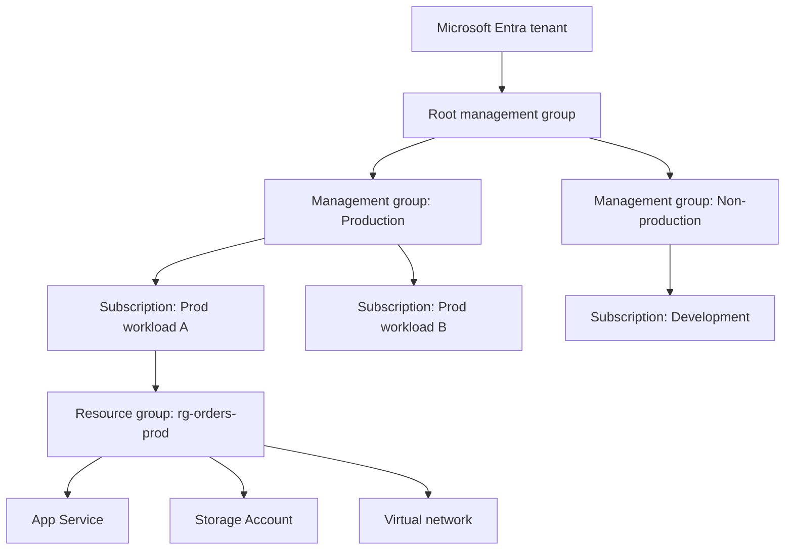

# Tenant, Management Group, Subscription, and Resource Group Hierarchy

When building systems on Microsoft Azure, how you organize resources from the start directly affects how operations teams manage identity, assign permissions, enforce policies, track costs, and isolate environments. Azure provides a hierarchy consisting of **Microsoft Entra ID tenant, management group, subscription, and resource group**. Each level has its own purpose and governance scope.

This lesson belongs to the **Resource organization and governance** chapter of the **CLOUD_PROVIDERS_AZURE** module. The module helps you explore the Azure ecosystem from subscriptions, resource groups, and Entra ID to virtual networks, compute services, storage, and data; while learning how to deploy, monitor, protect, and control costs for an application architecture.

After this lesson, you will be able to:

- Describe the relationship between tenant, management group, subscription, resource group, and resource.
- Distinguish identity boundaries from resource management and cost boundaries.
- Explain how Azure RBAC and Azure Policy inherit down the hierarchy tree.
- Choose the appropriate level to separate environments, workloads, administrative permissions, and costs.
- Build a subscription and resource group structure that is easy to operate, control, and scale.

## 1. Overview of the Resource Hierarchy

In Azure, resources are placed in a resource group; a resource group belongs to a subscription; a subscription is associated with a Microsoft Entra tenant and is organized underneath a management group. Management groups can be nested to create a governance structure across multiple subscriptions.



The diagram illustrates an example branch. In practice, a tenant can have multiple management groups, subscriptions, and resource groups. A resource group can contain multiple resources of different types; a subscription can contain multiple resource groups.

| Level | Primary role | Example governance question |
|---|---|---|
| Microsoft Entra tenant | Directory and identity boundary | Which organization do users, groups, and applications belong to? |
| Management group | Groups subscriptions for governance at scale | Which security policies apply across all of production? |
| Subscription | Scope for Azure management, quotas, and cost tracking | Which budget and quotas does this workload or environment use? |
| Resource group | Groups resources by lifecycle and operational purpose | Which resources are deployed, updated, or deleted together? |
| Resource | Specific Azure object | What are the configuration, data, and state of this service? |

These levels have a hierarchical relationship, but they are not interchangeable. For example, creating another resource group does not create a new identity boundary; creating another tenant does not automatically create subscriptions or resources.

## 2. Microsoft Entra Tenant: Identity Boundary

A **tenant** is a Microsoft Entra ID instance for an organization or an identity governance scope. A tenant contains objects such as:

- Users and groups.
- Application registrations and service principals.
- Managed identities used by Azure workloads.
- Authentication configurations, identity settings, and related access policies.

A tenant has a unique tenant ID. When a user or application authenticates with Microsoft Entra ID, the tenant provides the identity and token so that Azure services or applications can verify access permissions.

### 2.1. How Are Tenants and Subscriptions Linked?

A subscription is associated with one Microsoft Entra tenant at a time to provide the identity scope for managing and accessing resources. Users in the tenant can be granted Azure RBAC permissions on the subscription or on the resources underneath it.

An organization can have multiple subscriptions associated with the same tenant. This approach is typically appropriate when the organization wants to share the identity system, groups, and sign-in processes while still separating environments, workloads, budgets, or quotas at the subscription level.

A tenant can also contain multiple subscriptions belonging to different workloads. Therefore, you should not think of a tenant as a large subscription, or assume that every subscription must have its own tenant.

Users from another tenant can still be invited into the organization as guests using Microsoft Entra B2B and granted appropriate permissions. This does not change the subscription's associated tenant; the guest remains an identity represented within the resource tenant.

### 2.2. When Are Multiple Tenants Needed?

Multiple tenants can be appropriate when independent identity and administrative boundaries are required, for example:

- Legal entities with separate identity governance requirements.
- Environments requiring strong identity isolation due to security or compliance requirements.
- Organizations undergoing mergers and acquisitions or operating multiple independent business units.
- A testing environment that needs to be completely separated from the production tenant to control identities and configurations.

However, multiple tenants increase operational overhead for managing users, applications, identity synchronization, cross-organization access, and monitoring. If you only need to separate permissions, costs, or resource lifecycles, first consider using management groups, subscriptions, and resource groups within the same tenant.

## 3. Management Group: Governing Multiple Subscriptions

A **management group** is an organizational level for subscriptions. It allows enterprises to group multiple subscriptions according to a governance structure and apply shared governance mechanisms at a level above subscriptions.

Each tenant has a **root management group** (also called the tenant root group) at the top of the management group tree. Other management groups can be created beneath the root group and can be nested into multiple layers. A subscription is placed as a child of one management group in the tree at a time.

For example, an enterprise might organize its hierarchy as follows:

```text
Tenant Contoso
└── Root management group
    ├── Platform
    │   ├── Identity
    │   │   └── Subscription: sub-identity-prod
    │   └── Connectivity
    │       └── Subscription: sub-network-prod
    ├── Landing Zones
    │   ├── Corp
    │   │   └── Subscription: sub-erp-prod
    │   └── Online
    │       └── Subscription: sub-commerce-prod
    └── Sandbox
        └── Subscription: sub-lab
```

The names and structure above are only examples. An organization can choose to group by environment, business unit, criticality, region, or landing zone model.

### 3.1. Centralized Governance with Azure Policy

Azure Policy can be assigned at a management group to enforce rules on the subscriptions beneath it. For example:

- Allow resource deployment only in organization-approved regions.
- Require resources to have a `CostCenter` or `Environment` tag.
- Control public storage configurations or require encryption.
- Audit allowed SKUs or diagnostic configurations according to internal standards.

Assignments at the management group level can inherit down to child scopes. A group of production subscriptions can therefore share a common set of security and compliance rules. At lower scopes, the organization can add policies tailored to specific workloads. Policy exemptions must be managed with a clear justification, scope, and expiration.

### 3.2. Permission Assignment at Management Groups

Azure RBAC allows assigning roles at the management group level. Users or groups granted permissions here can receive permissions on child scopes through inheritance. This is useful when a platform administration team needs to view or manage multiple subscriptions.

Because the blast radius is large, limit privileged permissions at the root management group. A role or policy change at a high level can affect many workloads. Permissions should be granted at child management groups matching each team's scope of responsibility instead of defaulting to broad permissions at the root.

## 4. Subscription: Management, Quota, and Cost Boundary

A **subscription** is a key management unit in Azure. Azure resources are created and managed within the scope of a subscription; a subscription is also a common scope for Azure RBAC, Azure Policy, quotas, and Cost Management.

A subscription is typically tied to a billing relationship or cost-tracking scope within an organization's Azure agreement. However, how invoices are actually aggregated depends on the agreement type and billing account structure. Multiple subscriptions can be consolidated onto the same invoice or billing scope. Therefore, distinguish between using subscriptions for cost allocation and management versus the organization's commercial invoicing structure.

### 4.1. Common Reasons to Separate Subscriptions

- **Environment isolation:** separate production from development/test to reduce the risk of accidental changes and manage permissions separately.
- **Cost allocation:** track costs by workload, department, project, or budget-owning unit.
- **Quotas and service limits:** some quotas are managed per subscription and region; separating subscriptions can help an organization manage distinct quota demands, though it is not an automatic way to bypass all Azure limits.
- **Governance and security scope:** apply separate role assignments, policies, locks, and operational processes.
- **Lifecycle management:** a large workload or business unit may require independent ownership and change cycles.

### 4.2. Subscriptions Are Not an Absolute Isolation Boundary

Subscriptions provide a useful governance scope, but subscriptions in the same tenant can still share identities, high-level policies, network connectivity, or platform services. Someone with permissions at a parent management group can have access across multiple child subscriptions. A workload can also communicate with a workload in another subscription if networking, identity, and permissions allow.

When isolation is required, combine subscription separation with tenant, RBAC, policy, network, key management, and operational process design. Do not rely on placing two workloads in different subscriptions as the sole security control.

### 4.3. Choosing the Right Number of Subscriptions

There is no single optimal number of subscriptions for every organization. Too few subscriptions can cause many teams to share quotas, permissions, and cost scopes; too many subscriptions increase the number of policies, role assignments, deployment pipelines, and monitoring tasks.

Several useful questions when deciding whether to split a subscription:

1. Does the workload need independent administrative permissions or an independent owning team?
2. Is separate tracking of budgets, quotas, or costs required?
3. Do security and compliance requirements demand a separate management boundary?
4. Are the deployment cycle and lifecycle of the workload significantly different?
5. Can the requirements be met using existing resource groups, management groups, RBAC, and policies?

## 5. Resource Group: Grouping Resources by Lifecycle

A **resource group** is a logical container holding Azure resources within the same subscription. It is the standard unit for organizing the resources of an application, an architectural component, or a deployment environment.

For example, an order-processing application might use the resource group `rg-orders-prod` containing an App Service, Storage Account, Application Insights, and related resources. The operations team can assign permissions, policies, or resource locks at the resource group level to manage the resources within the application's scope.

Key rules:

- A resource group belongs to exactly one subscription.
- A resource belongs to only one resource group at a time.
- Resource groups cannot contain other resource groups; resource groups are peers within a subscription.
- Resources in the same resource group can reside in different regions.
- The region chosen when creating a resource group determines where the resource group's metadata is stored; it does not force all resources inside it to be deployed in that region.
- Deleting a resource group initiates the deletion of the resources inside it, so verify carefully before performing this action.

### 5.1. Organizing Resource Groups by Application and Lifecycle

A common organizational pattern is grouping resources that share the same owner, purpose, and lifecycle. For example:

| Resource group | Illustrative contents | Reason to separate |
|---|---|---|
| `rg-orders-prod` | App Service, Storage Account, Application Insights | Production application components |
| `rg-orders-data-prod` | Data resources with distinct lifecycle and permissions | Tighter control over data and access permissions |
| `rg-orders-network-prod` | Dedicated networking resources | Managed independently by the platform team |
| `rg-orders-dev` | Testing resources | Can be deployed and deleted frequently |

This is an illustrative grouping; you do not necessarily have to create multiple resource groups as shown in the table above. If all resources of an application share the same lifecycle and ownership, a single resource group can be simpler. If data requires different access permissions or a different lifecycle, separating it can help reduce the blast radius when modifying or deleting resources.

### 5.2. Moving Resources Between Resource Groups

Azure supports moving certain resources between resource groups or subscriptions, though not every resource type or scenario is supported. Moving can be constrained by the resource provider, resource type, deployment state, dependencies, locks, or related services.

Before moving, you should:

1. Check the documentation for the resource type to confirm move support and limitations.
2. Identify dependencies with other resources, including resources outside the resource group.
3. Check role assignments, policies, locks, tags, and configurations that reference resource IDs.
4. Plan the maintenance window, test in an appropriate environment, and prepare a rollback plan.

Moving a resource group does not mean changing the region of its resources. Each resource's deployment location is managed according to the configuration and capabilities of its respective service.

## 6. How Permissions and Policies Inherit Down the Hierarchy

A major benefit of the hierarchy is the ability to govern at a parent level and inherit down to child levels.

### 6.1. Azure RBAC

Azure RBAC controls who is allowed to perform which actions on which scope. Role assignments can be created at a management group, subscription, resource group, or resource. Permissions assigned at a parent scope are typically inherited by child scopes.

For example:

- Assigning `Reader` at the `Production` management group can allow an audit team to view resources in the production subscriptions underneath.
- Assigning `Contributor` at subscription `sub-orders-prod` to a deployment team allows managing resources in that subscription according to the role's permissions.
- Assigning `Storage Blob Data Reader` at the appropriate storage scope to an API's managed identity to read blob data.

Pay attention to the difference between resource management permissions and data plane permissions. A `Reader` role on a resource group allows viewing resource metadata within the role's scope, but does not automatically grant permission to read blob contents or secrets.

### 6.2. Azure Policy

Azure Policy evaluates and controls resource configurations using policy definitions and initiatives. Assignments can be placed at a management group, subscription, resource group, or resource depending on the scenario. Assignments at a parent level can apply to child scopes.

For example, an organization assigns a policy requiring the `Environment` tag at a management group. Every subscription and resource group underneath is subject to that requirement, except for valid exemptions. A workload can receive additional specific policies at its subscription or resource group.

RBAC and Policy address two different questions:

| Mechanism | Primary question | Example |
|---|---|---|
| Azure RBAC | Who can do what? | Which resources can the operations team update? |
| Azure Policy | Which configurations are allowed or required? | Must resources have required tags and use approved regions? |

Someone who has RBAC permission to create a resource can still be denied by policy if the configuration does not meet the rules. Conversely, a policy allowing a configuration does not mean a user automatically has permission to create the resource.

## 7. Example Hierarchy Design for an Enterprise

Suppose an enterprise has an e-commerce system, an ERP system, and testing environments. The enterprise wants to share a tenant for identity management, apply uniform platform policies, and allocate costs by workload.

A reference structure:

```text
Tenant: contoso.onmicrosoft.com
└── Root management group
    ├── Platform
    │   ├── sub-connectivity
    │   │   ├── rg-hub-network
    │   │   └── rg-private-dns
    │   └── sub-management
    │       └── rg-monitoring
    ├── Production
    │   ├── sub-ecommerce-prod
    │   │   ├── rg-ecommerce-app-prod
    │   │   └── rg-ecommerce-data-prod
    │   └── sub-erp-prod
    │       └── rg-erp-prod
    └── Non-production
        ├── sub-ecommerce-dev
        │   └── rg-ecommerce-dev
        └── sub-shared-test
            └── rg-integration-test
```

The organization can assign baseline security policies at the root or an appropriate management group, production policies at the `Production` branch, and separate operational permissions at each subscription. The platform team manages connectivity and monitoring; application teams are granted permissions within the subscription or resource group scopes they own.

Splitting subscriptions by workload makes cost and quota allocation clearer. Splitting resource groups by application or lifecycle makes deploying, updating, and decommissioning resources convenient. Tags such as `Application`, `Environment`, `Owner`, `CostCenter`, and `DataClassification` add metadata for reporting and auditing.

## 8. Exploring the Structure with Azure CLI

Azure CLI helps inspect the tenants, subscriptions, management groups, and resource groups you have access to. The following commands only read information or set the default subscription for the CLI session; they do not create or delete resources.

List subscriptions that the current identity can access:

```bash
az account list --output table
```

View the currently selected subscription in Azure CLI:

```bash
az account show --output json
```

List management groups that the identity has permission to view:

```bash
az account management-group list --output table
```

View details of a management group and its child levels:

```bash
az account management-group show \
  --name <management-group-id> \
  --expand \
  --recurse \
  --output json
```

List resource groups in the current subscription:

```bash
az group list --output table
```

View a specific resource group:

```bash
az group show \
  --name rg-ecommerce-app-prod \
  --output json
```

If you need to switch the CLI context to another subscription, specify the subscription explicitly:

```bash
az account set --subscription <subscription-id>
```

This command changes the default subscription for the current CLI session. Before running deployment commands, re-check `az account show` to avoid creating resources in the wrong environment.

## 9. Design Principles and Common Organizational Mistakes

- **Design tenants around identity boundaries.** Only create separate tenants when independent identity governance or clear isolation is required.
- **Use management groups for governance at scale.** Group subscriptions according to your governance model and apply shared policies and permissions at the appropriate level.
- **Separate subscriptions based on real needs.** Consider environment, workload, quotas, budget, ownership, and compliance requirements.
- **Group resource groups by lifecycle.** Resources that are typically deployed, updated, and decommissioned together can reside in the same resource group.
- **Keep permissions at the smallest appropriate scope.** Avoid assigning `Owner` or broad permissions at the root management group if the work only requires a single subscription or resource group.
- **Name and tag consistently.** Use conventions that indicate application, environment, owner, and cost center.
- **Track inheritance and exceptions.** Review role assignments, policy exemptions, and resource locks at both parent and child levels.
- **Verify context before deploying.** Confirm the active tenant and subscription in the Portal, CLI, or pipeline.

Common mistakes to avoid:

1. Creating too many tenants just to separate development and production, making identity governance unnecessarily complex.
2. Putting all workloads in a single subscription even though they have different owners, budgets, or security requirements.
3. Creating resource groups by resource type without considering lifecycle, causing an application to be fragmented and hard to manage.
4. Broadly assigning permissions at the root management group, increasing the blast radius of mistakes or compromised accounts.
5. Assuming the resource group's region determines the region of all resources inside it.
6. Deleting a resource group without checking the resources and dependencies inside it.

## 10. Self-Check

1. Can a single tenant contain multiple subscriptions? What is shared among subscriptions in the same tenant?
2. Why are management groups useful when an organization has dozens or hundreds of subscriptions?
3. When should you create a new subscription instead of a new resource group?
4. If a resource group is created in `southeastasia`, must all resources inside it also be in `southeastasia`? Explain.
5. If an Azure Policy is assigned at a management group, how are the subscriptions beneath it affected?
6. Why doesn't a separate subscription automatically create an absolute identity isolation boundary?
7. Before deleting a resource group, what should you verify?

## Conclusion

Tenants organize identities; management groups organize subscriptions and enable centralized governance; subscriptions provide the scope for management, quotas, and cost tracking; resource groups group resources by application and lifecycle. Azure RBAC and Azure Policy can inherit down the hierarchy tree, so where you place role assignments and policies affects many child scopes. When designing an Azure landing zone, choose each level based on identity, governance, security, budget, and operational needs so the system can grow while remaining under control.
