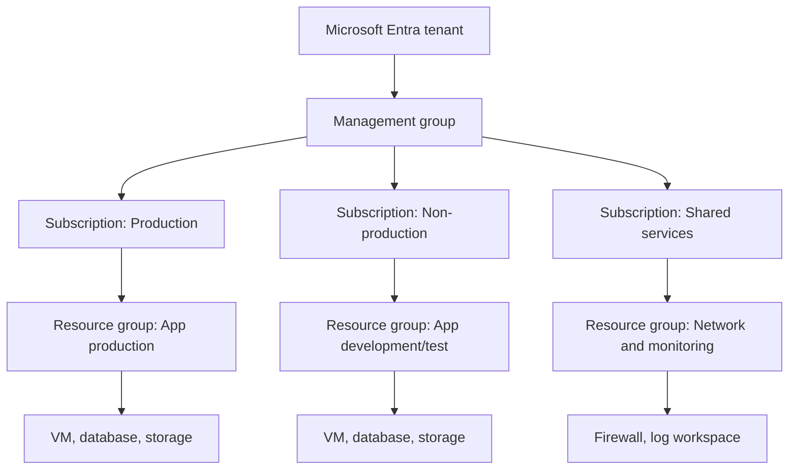
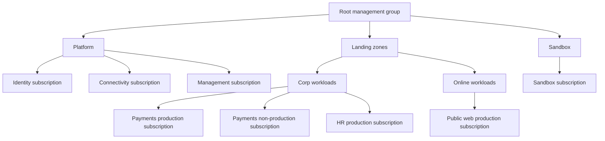
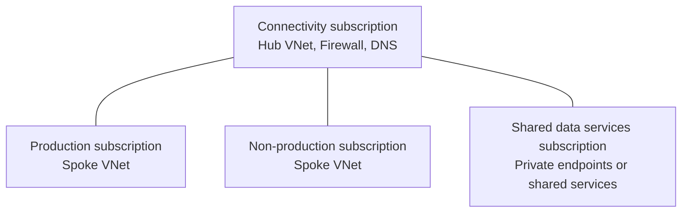

# Designing Subscription Boundaries by Environment and Team

When an organization begins deploying multiple applications on Microsoft Azure, placing all resources into a single subscription often makes access control, policies, quotas, and costs difficult to manage. Conversely, creating too many subscriptions without shared conventions increases operational overhead and makes it hard for teams to understand how the system is organized.

Designing subscription boundaries is the decision of determining which workloads, environments, and teams are managed within the same Azure scope. Appropriate boundaries give development teams autonomy, keep production protected, enable cost accountability, and still allow the platform to enforce common standards.

In the `CLOUD_PROVIDERS_AZURE` module, you explore the Azure ecosystem from subscriptions, resource groups, and Microsoft Entra ID to virtual networks, compute, storage, and data. This lesson places the subscription within the overall governance structure, while connecting environment and team segmentation with RBAC, Azure Policy, networking, quotas, monitoring, and cost control.

## Objectives

After this lesson, you will be able to:

- Explain the roles of tenant, management group, subscription, resource group, and resource in the Azure hierarchy.
- Identify requirements that should be addressed using subscription boundaries.
- Choose how to split subscriptions by environment, team, and workload.
- Design a management group structure to apply shared policies.
- Assign permissions, track costs, and manage quotas per subscription.
- Establish a consistent process for provisioning, operating, and decommissioning subscriptions.

## 1. Where Does a Subscription Fit in the Azure Structure?

Azure organizes resources in a hierarchy. Each layer addresses a different management scope:

| Component | Primary role |
|---|---|
| Microsoft Entra tenant | Identity directory containing users, groups, applications, and identities for authentication |
| Management group | Groups multiple subscriptions to organize governance and apply Azure Policy or Azure RBAC at scale |
| Subscription | Scope for resource management, permission assignment, quotas, and cost analysis at the subscription level |
| Resource group | Groups resources with related lifecycles or management purposes |
| Resource | Specific Azure resource such as a VM, VNet, Storage Account, or database |

An illustrative structure:

In practice, management groups can have multiple child levels, and subscriptions can sit in different branches. Each subscription belongs to one management group at a time within the same tenant. A subscription can be moved to another management group when the governance structure changes, though the impact of inherited permissions and policies must be evaluated.

### Distinguishing Tenant and Subscription

A Microsoft Entra tenant is an identity directory boundary. A subscription is associated with a tenant to use the identities in that tenant for authentication and authorization. A single tenant can manage multiple subscriptions.

Creating separate subscriptions for production and development within the same tenant separates permissions, policies, quotas, and cost tracking at the subscription level. However, this does not create an independent identity directory. Administrators with high-level privileges in the tenant or permissions granted at a management group can still have broad administrative scope across child subscriptions.

Only consider multiple tenants when there is a clear requirement for separating identity, organization, legal entity, or governance. Multiple tenants increase complexity in collaboration, identity synchronization, monitoring, and platform management.

## 2. Why Design Subscription Boundaries?

A subscription is one of Azure's core governance boundaries. Proper segmentation directly affects the following operations:

- **Access permissions:** Azure RBAC can be granted at the subscription level and inherited down to resource groups and resources. Separating subscriptions helps limit the scope of a team's permissions.
- **Governance policies:** Azure Policy can be assigned at the management group or subscription level. Separate subscriptions allow applying distinct configurations for production, non-production, or workloads with specialized requirements.
- **Quotas:** many quotas are tracked per subscription, region, resource provider, or SKU. Separating workloads can make quota demand tracking and quota increase requests clearer.
- **Costs:** Cost Management can analyze costs by subscription. Separate subscriptions make it easier to attribute costs to an environment or owning team, even if invoices are consolidated at the billing account or billing profile level depending on the agreement.
- **Lifecycle:** subscriptions can be provisioned, handed over, managed, and decommissioned according to the lifecycle of a product or group of workloads.
- **Blast radius:** scoping permissions and policies at the subscription level helps reduce the risk of an accidental administrative action affecting unrelated workloads.

Subscriptions do not automatically create a network boundary or guarantee physical isolation. Workloads in different subscriptions can still communicate if networking and permissions are configured to allow it. To control network traffic, you still need to design VNets, subnets, routes, firewalls, private endpoints, and appropriate connectivity rules.

## 3. Choosing Criteria to Split Subscriptions

There is no single formula like "one subscription per team" or "one subscription per environment" that fits every organization. Evaluate the following criteria before creating boundaries.

### Deployment Environment

Production typically requires strict access control, approved changes, rigorous security policies, and a dedicated operational budget. Development and test usually need faster experimentation speed, may use different SKUs, and have shorter resource lifecycles.

Therefore, a common starting point is separating production from non-production. If dev and test have significantly different requirements for permissions, quotas, costs, or policies, they can be split further into separate subscriptions. For sandboxes, you should use dedicated subscriptions and policies to limit resources, costs, and lifetime.

### Teams and Workload Ownership

A team may need its own subscription when it is responsible for independent operations, has a clear owner, needs autonomous deployment permissions, and requires separate cost tracking. If multiple teams develop a single product with a shared lifecycle and the same accountable owner, sharing a subscription while separating resource groups and RBAC can be simpler.

Avoid creating subscriptions for individual users or small feature branches unless there is a corresponding governance need. Every new subscription requires permission setup, policy assignment, monitoring setup, cost tracking, quota management, and inventory registration.

### Criticality and Compliance Requirements

Workloads handling sensitive data, subject to audits, or requiring high availability may need a dedicated subscription to apply separate policies, access controls, change processes, and cost tracking. Separating subscriptions supports governance, but does not by itself prove that a workload meets regulatory requirements. Data controls, encryption, log retention, data residency, and operational processes must still be designed and verified.

### Quota and Cost Requirements

If a workload has high consumption or frequently requires quota increases, a dedicated subscription provides clear visibility into usage and demand. For small workloads sharing the same owner and policies, splitting them just to have a separate cost line item can add overhead without proportional value.

### Decision Guidance Table

| Scenario | Design direction to consider | Reason |
|---|---|---|
| Production and development have different protection requirements | Separate production and non-production | Reduce permission scope and apply environment-appropriate policies |
| Two teams own independent workloads, operations, and budgets | Consider separate subscriptions per workload or workload group | Separate accountability, quotas, and costs |
| Multiple teams operate a shared platform | Shared platform subscription with group-based RBAC | Avoid duplicating platform services and centralize governance |
| Short-term experimentation with unstable resource usage | Sandbox subscription with limiting policies and budgets | Control risk and clean up experimental resources |
| Workload with compliance or special control requirements | Dedicated subscription with additional policies and processes | Easier to define control scope and gather audit evidence |
| Multiple small apps with the same owner and same policies | Can share a subscription and separate resource groups | Reduce subscription operational overhead |

Document the rationale for each boundary. If you cannot explain which permissions, policies, costs, quotas, or lifecycle a subscription is protecting, the structure may be overly fragmented.

## 4. Reference Model for Multi-Team Organizations

A common model combines management groups for shared governance with subscriptions for workloads and environments. The following structure is only an example to be adapted to your organization's scale and requirements:

Meaning of the groups:

- **Platform:** contains shared platform services such as workload identity services, core network connectivity, firewalls, DNS, monitoring, or operations. Identity, connectivity, and management can be separated into distinct subscriptions when ownership, lifecycle, or protection requirements differ.
- **Landing zones:** contains subscriptions for product teams' applications and workloads. Branches can be divided by workload type or connectivity requirements, such as internal workloads and internet-facing workloads.
- **Sandbox:** intended for controlled experimentation, typically with policies restricting regions/SKUs, budget alerts, and expiration workflows.

Names like `Corp`, `Online`, `Platform`, or `Sandbox` are reference conventions. Use names and structures that reflect your organization's actual operating model. There is no need to create every branch if there are no corresponding workloads yet.

### Split by Environment or by Team?

These two dimensions can be combined. For example, the Payments team owns two subscriptions `payments-prod` and `payments-nonprod`; the HR team owns `hr-prod` and `hr-nonprod`. Workload subscriptions sit under a management group with a shared baseline, while production can sit under a stricter policy branch.

This model establishes boundaries by both workload and environment. It gives workload-owning teams clear accountability, while the platform team can still enforce security and operational standards from the management group level.

## 5. Designing Access Permissions Along Boundaries

Azure RBAC allows assigning roles at multiple scopes: management group, subscription, resource group, and resource. Role assignments at a parent scope can inherit down to child scopes. Therefore, permission design should align with the subscription structure.

Practical principles:

1. Create Microsoft Entra ID groups based on job roles, such as `Payments-Developers`, `Payments-Operators`, and `Cloud-Platform-Admins`.
2. Assign permissions to groups rather than directly to individuals whenever possible, so personnel changes are managed centrally.
3. Grant developer permissions on non-production subscriptions or appropriate resource groups; restrict production permissions to designated operations teams.
4. Use roles with the smallest scope and least privilege needed for the job. Only grant Owner or User Access Administrator when managing permissions or full-scope configuration is genuinely required.
5. Use Privileged Identity Management (PIM) and time-bound activation for privileged roles if your organization has the appropriate licensing and configuration.
6. Review role assignments inherited from management groups to avoid unintentionally granting overly broad permissions.

For example, the Payments Developers group has deployment permissions on the `payments-nonprod` subscription. The Payments Operators group has production operational permissions according to approved roles. The Cloud Platform team manages foundational networking and policies within their corresponding scope. Application identities should use managed identities or service principals scoped to required permissions, rather than personal accounts in pipelines.

Remember that separate subscriptions do not eliminate high-level administrative permissions. If a group holds Owner at a parent management group, those permissions can affect all subscriptions underneath. Therefore, management group administration and privileged accounts must be strictly protected.

## 6. Applying Azure Policy by Environment

Azure Policy helps organizations enforce configuration standards across resources. You can assign policies or initiatives at a management group to establish a shared baseline, then assign additional policies on branches or subscriptions tailored to specific environments.

Examples of policy layers:

| Scope | Policies that can be applied |
|---|---|
| Root management group or platform branch | Require diagnostic settings, restrict prohibited resource types, enforce baseline security standards |
| Landing zones | Restrict allowed regions, require owner and cost center tags, control public network configurations |
| Production subscriptions | Require data protection settings, monitoring, backups, or approved SKUs |
| Sandbox subscriptions | Restrict SKUs/regions, require expiration metadata, and restrict high-cost resources |

Policies assigned at a management group can be inherited by subscriptions and resources underneath. Test the impact before using the `Deny` effect at a broad scope, because an overly strict policy can block valid deployments. For necessary exceptions, use the exemption mechanism with documented justification, owner, and review expiration according to organizational processes.

Tags such as `environment`, `owner`, `costCenter`, and `application` help categorize resources. However, tags on a subscription are not automatically copied to every resource. If tag inheritance is needed, configure the appropriate Azure Policy and check existing resources.

## 7. Network Connectivity Between Subscriptions

Organizations often have shared networking services such as a hub VNet, Azure Firewall, VPN Gateway, ExpressRoute, DNS, and connectivity to on-premises systems. These services can be placed in a connectivity subscription and connected to workload subscriptions using a hub-and-spoke model.

This model lets the platform team manage central connectivity within a dedicated scope, while application teams manage workload networking according to their granted permissions. VNet peering, routes, firewall rules, and DNS must be explicitly configured. Placing two VNets in different subscriptions neither automatically connects them nor automatically blocks connectivity.

If production and non-production require network isolation, design subnets, routes, firewalls, and connectivity policies accordingly. Do not rely solely on subscription names to infer network isolation levels.

## 8. Cost Allocation and Control

Separate subscriptions make it easier for Cost Management to analyze costs by environment or owner. However, billing invoices may be aggregated at the billing account, billing profile, or invoice section level depending on your organization's agreement type and billing configuration.

To get useful cost data:

- Map subscriptions to the right owner, workload, environment, and cost center in your organization's inventory.
- Use Cost Analysis to view cost trends by subscription and available breakdown dimensions.
- Set up budgets and alerts for each subscription or appropriate cost scope.
- Use consistent tags for application, environment, owner, and cost center; combine with Azure Policy if tag enforcement or inheritance is needed.
- Track costs of shared services such as firewalls, log ingestion, DNS, and network egress; define allocation rules for consuming teams.
- Review unused resources and unexpected cost spikes.

Budgets in Azure Cost Management primarily provide tracking and alerting. A budget is not a mechanism that automatically stops all resources when costs hit a threshold. To cap spending, you must combine quotas, Azure Policy, resource creation permissions, approval workflows, and cleanup practices.

## 9. Quotas and Limits When Splitting Subscriptions

Many Azure quotas are calculated per subscription and region, though exact scopes depend on the service and metric. When splitting workloads across multiple subscriptions, do not assume every quota automatically increases or is shared across subscriptions.

Before a major deployment:

1. Check quotas for the exact target subscription and region.
2. Check quotas related to the resource provider, SKU, or VM family.
3. Check service-specific limits and regional capacity availability.
4. Estimate total demand for each subscription and workload.
5. Submit quota increase requests for the appropriate subscription if needed, and monitor the outcome before deployment day.

If a shared platform serves multiple subscriptions, plan quotas in both the shared services subscription and the workload subscriptions. Splitting subscriptions clarifies ownership and usage scope, but does not replace checking actual quotas.

## 10. Subscription Provisioning and Lifecycle Management Process

To prevent each team from creating subscriptions with inconsistent configurations, organizations should establish a subscription vending process. This process can be automated using Infrastructure as Code and internal pipelines.

### When Creating a New Subscription

1. **Intake request:** record workload, environment, owning team, technical owner, cost center, region, and compliance requirements.
2. **Evaluate boundary:** determine whether a separate subscription is needed or if a resource group in an existing subscription suffices.
3. **Select governance placement:** place the subscription under the right management group to inherit baseline policies and permissions.
4. **Set up permissions:** create role assignments for Entra ID groups, define owners, and establish privileged access procedures.
5. **Configure foundation:** set up network connectivity, DNS, logging, monitoring, and required shared services.
6. **Configure cost controls:** record owner/cost center metadata in inventory, and configure budgets and alerts.
7. **Check quotas:** verify required limits for planned regions and SKUs.
8. **Hand over:** document purpose, owner, policies, permissions, connectivity, quotas, budgets, and support channels.

### During Operations

- Periodically review owners, authorized groups, and privileged permissions.
- Monitor policy compliance, security posture, costs, and quotas.
- Re-evaluate structure when workloads change environments, switch owning teams, or face new compliance requirements.
- Document policy exemptions, management group moves, and quota increase decisions.

### When Decommissioning

Before decommissioning a subscription, confirm that data has been archived or migrated, dependencies have been removed, required logs have been preserved, billing has been reconciled, and the owner has approved. Then execute the cancellation or closure process according to your agreement type and organizational policy. You can move the subscription to a decommissioned management group to apply appropriate controls during the waiting period, if your governance model uses such a branch.

## 11. Example Design for a Company with Three Product Teams

Suppose a company has three teams: Payments, HR, and Web. Each team owns its own application; the Cloud Platform team manages connectivity, monitoring, and the security baseline. Production requires stricter controls than non-production.

A possible design:

| Subscription | Owner | Purpose |
|---|---|---|
| `sub-platform-connectivity` | Cloud Platform | Shared hub VNet, firewall, VPN/ExpressRoute, and DNS |
| `sub-platform-management` | Cloud Platform | Shared log workspace, monitoring, and management services |
| `sub-payments-prod` | Payments | Payments production workload |
| `sub-payments-nonprod` | Payments | Payments development and testing |
| `sub-hr-prod` | HR | HR production workload |
| `sub-hr-nonprod` | HR | HR development and testing |
| `sub-web-prod` | Web | Web production workload |
| `sub-web-nonprod` | Web | Web development and testing |
| `sub-sandbox` | Cloud Platform and authorized teams | Short-term experimentation under dedicated policies |

Workload subscriptions are placed under the appropriate management group branches. The production branch enforces stricter policies on permissions, logging, backups, and network configuration. The non-production branch permits certain approved experimental SKUs while still restricting regions and costs. The Cloud Platform team manages shared services and grants access permissions as needed.

If the company is still small, several non-production subscriptions can be consolidated when teams share the same policies, owner, and quota requirements. If an application grows significantly or requires isolated controls, that workload can be split into its own subscription. The structure should evolve alongside actual governance needs.

## 12. Common Mistakes

| Mistake | Consequence | How to improve |
|---|---|---|
| All environments share a single subscription | Permissions, quotas, policies, and costs are hard to isolate | Separate production from non-production when operational requirements differ |
| One subscription per feature or individual | Increases overhead for inventory, policies, permissions, and monitoring | Create subscriptions aligned with owners and meaningful governance boundaries |
| Using subscriptions instead of network boundaries | Traffic flows may still remain open if networking permits | Design VNets, firewalls, routes, and private endpoints separately |
| Granting broad Owner roles at management groups | Privileged permissions can cascade to many subscriptions | Use Entra ID groups, least privilege, PIM, and review inheritance |
| Relying solely on tags for cost management | Missing or inconsistent tags distort reporting | Combine policies, inventory, Cost Management, and clear ownership |
| Assuming budgets automatically stop resources | Costs can continue rising after an alert | Combine alerts with policies, quotas, and remediation processes |
| Creating subscriptions without an owner | Unclear who handles incidents, costs, or quota requests | Mandate owner declaration and a formal handover process |

## 13. Subscription Boundary Design Checklist

- [ ] Defined tenant and management group structure.
- [ ] Documented workloads, environments, owners, and accountable teams.
- [ ] Evaluated needs for separating permissions, policies, quotas, costs, and lifecycles.
- [ ] Decided which subscriptions are dedicated and which can be shared.
- [ ] Separated production from non-production where control requirements differ.
- [ ] Placed subscriptions in the right management groups and verified inherited policies.
- [ ] Designed RBAC using Entra ID groups and the principle of least privilege.
- [ ] Defined network topology and connectivity flows between subscriptions.
- [ ] Set up logging, monitoring, budgets, alerts, and cost center metadata.
- [ ] Verified quotas and limits for planned regions and SKUs.
- [ ] Established processes for provisioning, ownership changes, and decommissioning subscriptions.
- [ ] Documented design rationale for future reviews as the organization grows.

## Conclusion

Subscription boundaries should reflect how your organization divides accountability, environments, and workloads. Use management groups to apply shared governance, subscriptions to separate permission scopes, quotas, and cost tracking, resource groups to manage the lifecycle of resource collections, and tenants to manage identity. Combining this structure with RBAC, Azure Policy, network design, monitoring, and a vending process enables Azure to scale cleanly as applications and teams grow.
