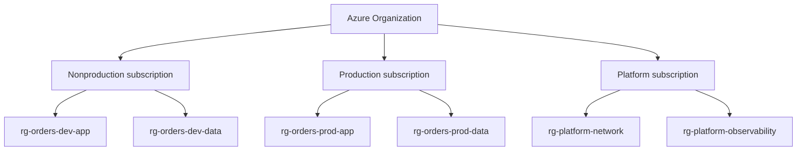

# Designing Resource Groups by Application Lifecycle

In the **Resource organization and governance** chapter of the **CLOUD_PROVIDERS_AZURE** module, this lesson covers how to organize resource groups for deploying, operating, and retiring an Azure application. The design must align with administrative permissions via Microsoft Entra ID, network dependencies, compute services, data, monitoring, and cost.

An ordering application might have its compute runtime replaced repeatedly, while orders must persist longer than any single deployment. Shared networking also serves other applications. If you put everything into one resource group and treat "deleting the application environment" as "deleting the entire group," cleanup actions can exceed their intended scope.

The core design question is: **which resources can be managed and retired together?**

After this lesson, you will be able to:

- Identify the lifecycle of each resource group before creating resource groups.
- Separate application resources, long-lived data, and shared infrastructure when there is a specific reason.
- Design permission, deployment, and cleanup scopes that match the grouping strategy.
- Explain the impact of cross-group dependencies, tags, locks, costs, and moving resources.

## 1. A Resource Group Is a Management Unit for Related Resources

A resource group is a logical container holding Azure resources that should be managed together. Microsoft recommends grouping resources that share a lifecycle so they can be conveniently deployed, updated, and deleted together. A resource group's location determines where the group's metadata is stored; resources inside it can reside in different regions. [Source: Manage resource groups](https://learn.microsoft.com/en-us/azure/azure-resource-manager/management/manage-resource-groups-portal).

For resources deployed at the resource group scope, each resource belongs to one group at a time. A resource can connect to resources in another group. Azure also has resource types managed at the subscription, management group, or tenant scope; not every Azure object must reside in a resource group. [Source: Azure Resource Manager](https://learn.microsoft.com/en-us/azure/azure-resource-manager/management/overview).

For example, a web app in the application group can still connect to a database in the data group, provided networking, identity, and access permissions allow it.

| Aspect | What does a resource group help organize? | What still needs separate design |
| --- | --- | --- |
| Lifecycle | Groups resources with shared management accountability | Data retention, recovery, and service retirement |
| Permissions | Provides a scope for management permissions | Data-plane permissions and inherited permission sources |
| Deployment | Provides a deployment target | Deployment ordering and cross-group dependencies |
| Operations | Groups resources for inventory and observability | Network paths, availability, and alerting |
| Cost | Creates a scope for viewing costs by group | Shared resource allocation and budget overrun handling |

Placing two resources in the same group does not automatically create network connectivity between them. Separating them into two groups does not automatically block connectivity either. Similarly, creating additional resource groups does not automatically give an application regional fault tolerance.

## 2. Understanding "Application Lifecycle" Properly

A resource's lifecycle spans multiple stages, not just creation:

| Stage | Decision to clarify | Example in the ordering application |
| --- | --- | --- |
| Creation | Which resources are created for the environment? | Web app and dedicated compute plan for development |
| Change | Who makes changes and through which process? | Application team releases runtime configuration |
| Replacement | Can it be recreated while preserving required state? | Recreate runtime while reconnecting to existing data |
| Retention | Is there an obligation to keep data or logs after stopping service? | Retain orders per business requirements |
| Retirement | When can it be deleted, who decides, and what must remain? | Delete test environment while keeping required reports |

**Code release cadence and resource lifespan are not always the same.** Releasing a web app every day does not mean creating a new resource group every day. A database may receive frequent schema changes while still needing to persist continuously across application versions.

Therefore, when grouping resources, consider update patterns, replaceability, and deletion conditions. Two resources created on the same day can still have different lifecycles.

For example:

- A development web app and a compute resource dedicated solely to that web app can be recreated together.
- A Storage Account holding customer files needs a dedicated retention and recovery plan.
- A Log Analytics workspace serving multiple applications can outlive individual applications.
- A preview environment for a change can be created and deleted as a whole if it only uses reproducible synthetic data.

These are design choices for an illustrative scenario. A specific service may have constraints requiring certain resources to stay together.

## 3. Process for Deciding Which Resources Belong Together

### 3.1. Catalog by Accountability

Before naming groups, record at least six attributes for each resource or cluster of resources:

| Attribute | Design question |
| --- | --- |
| Owner | Which team is responsible for changes and incident response? |
| Environment | Development, test, production, or platform service? |
| Reproducibility | Can it be recreated from IaC and from which data source? |
| Retention condition | Which data, logs, keys, or configurations must survive longer? |
| Dependencies | Who consumes this resource, inside and outside the application? |
| Deletion condition | When is deleting this resource considered business-complete? |

You do not need a complex management system to start. A clear table documenting owners, dependencies, and deletion conditions is usually more useful than a list of groups created ad hoc.

### 3.2. Group by Ability to Change and Retire Together

Suppose two resources both belong to development, share the same owning team, serve only one application, and can be deleted at the same time without losing state that must be kept. They are good candidates to place in the same resource group.

Conversely, a database that must be kept after replacing the entire runtime has a reason to belong to another group. Splitting groups aligns the management scope better with retention requirements, though data protection and recovery mechanisms are still required.

A practical rule of thumb is to try describing the group retirement action in one sentence:

> When the Orders application's test environment ends, this group can be deleted after exporting required results; no other application depends on resources in this group.

If the sentence requires many exceptions like "keep the database," "keep another team's network," or "keep the shared workspace," revisit how the groups are divided.

### 3.3. Avoid Over-Fragmentation

Splitting every single resource into its own resource group can multiply scopes, assignments, and deployment targets without clear benefit. Conversely, putting an entire department's systems into one group makes permissions and cleanup scopes overly broad.

The right granularity is one that can be justified by **actual lifecycle, owner, environment, or governance requirements**. There is no fixed number of resource groups that fits every application.

## 4. Example: Orders Application with Data and Shared Infrastructure

Suppose the system has the following characteristics:

- Each environment has its own web app and App Service Plan.
- Order data and attachments must persist across web app recreations.
- The platform team manages the hub network and shared monitoring.
- Production and nonproduction have different governance requirements.
- Databases in this example have a dedicated logical server per environment.

A proposed grouping:

| Resource group | Illustrative components | Owner | Lifecycle condition |
| --- | --- | --- | --- |
| `rg-orders-dev-app` | Web app, dedicated development App Service Plan | Orders team | Development runtime can be recreated |
| `rg-orders-dev-data` | Development SQL logical server/database, Storage Account | Orders data team | Delete only when development data is no longer needed |
| `rg-orders-prod-app` | Production runtime | Orders operations team | Follows production change process |
| `rg-orders-prod-data` | Production data | Orders data owner | Separate retention and recovery requirements |
| `rg-platform-network` | Hub network and shared network components | Network platform team | Does not retire with a single application |
| `rg-platform-observability` | Shared monitoring workspace | Platform operations team | Follows organization monitoring lifecycle |

The diagram below depicts **resource containment relationships** only, not network connectivity:



Using separate subscriptions in the example is a governance choice, not a prerequisite for creating resource groups. When you need to clearly separate limits, costs, and administrative permissions between environments or platforms, subscriptions are a boundary level to consider. [Source: Subscription considerations](https://learn.microsoft.com/en-us/azure/cloud-adoption-framework/ready/landing-zone/design-area/resource-org-subscriptions).

### 4.1. When Is a Single Application Group Enough?

For a lab environment consisting of a web app, reproducible sample data, and dedicated compute resources, a single group like `rg-orders-lab-001` can be simpler. The entire group shares the same deletion condition; adding a separate data group just to mirror production may not provide value yet.

Conversely, when lab data becomes reference data used across multiple test cycles, the assumption that "everything can be deleted" no longer holds. The grouping should be adjusted to match the new lifecycle.

### 4.2. A Shared Service Must Be Treated as Truly Shared

Do not place an App Service Plan serving three applications into a group managed solely by one application's pipeline, and give that pipeline permission to clean up the entire group. Having "shared" in a resource name does not prevent deletion.

Shared resources need an owner, a list of consumers, and a dedicated change process. It must also be clear who bears the cost and under what conditions the resource can be retired when the last application leaves.

## 5. Managing Dependencies Between Resource Groups

Splitting groups does not eliminate dependencies. It shifts coordination from "managing one group together" to "managing contracts between groups."

In the Orders example:

```text
Orders runtime
  -> needs database endpoint
  -> needs identity granted data access
  -> needs network path to database and Storage
  -> sends telemetry to designated workspace

Data team
  -> needs to know which applications are consuming it
  -> needs to ensure retention and recovery as required

Platform team
  -> provides networking/monitoring per agreed support scope
```

A dependency contract table might include:

| Provider | Information or capability provided | What the consumer must manage |
| --- | --- | --- |
| Data team | Resource ID, endpoint, and how to request permissions | Connection settings, identity, and schema compatibility |
| Network team | Approved subnet or connectivity path | Application network integration settings |
| Monitoring team | Workspace and collection rules | Telemetry ingestion and workload alerting configuration |

Endpoints and resource IDs can be deployment outputs; secrets must be distributed through a proper secret management mechanism. Do not use dependency tables or tags to store passwords.

In Bicep, you can reference `existing` resources in another scope; when deploying resources to multiple scopes, use modules and grant appropriate permissions at those scopes. An application does not need to sit in the same resource group as all its dependencies just to be deployable via IaC. [Source: Bicep deployment scopes](https://learn.microsoft.com/en-us/azure/azure-resource-manager/bicep/deploy-to-resource-group).

One constraint to preserve in the design is service parent/child relationships. Do not arbitrarily separate a child resource from its parent just to achieve a desired group diagram. For example, evaluate the lifecycle of a logical server together with its child databases rather than assuming each database can be placed in a resource group independent of the server.

## 6. Permissions and Governance Must Match the Grouping

### 6.1. Management Permission Scope

Role assignments on a resource group are inherited by the resources inside it. When evaluating permissions, you must also consider assignments from the subscription or management group. Adding a narrow role on an application group does not revoke broad permissions inherited from a parent scope. [Source: Scope in Azure RBAC](https://learn.microsoft.com/en-us/azure/role-based-access-control/scope-overview).

Applied to the example:

| Principal | Suggested scope of responsibility |
| --- | --- |
| Development runtime pipeline | Manages required resources in `rg-orders-dev-app` |
| Data pipeline | Modifies data infrastructure under a separate workflow |
| Platform team | Manages shared networking and monitoring groups |
| Support staff | Read/observability permissions aligned with assigned duties |
| Access management team | Manages assignments at agreed scopes |

This table describes responsibilities, not a complete role list. Select roles based on the exact operations required and grant data-plane permissions separately to the application identity.

Separating the data group from the application group narrows infrastructure management permissions. However, anyone with permission to replace code running under an identity that already has data access can still affect data through the application. Evaluate the deployment path, runtime identity, and permission-granting mechanisms together.

### 6.2. Policies Applied from Multiple Levels

A resource group is a scope that can receive Azure Policy assignments. Policies from parent levels can also cover the group, subject to applicable scopes, exclusions, and exemptions. Creating a new group does not bypass subscription rules. [Source: Scope in Azure Policy](https://learn.microsoft.com/en-us/azure/governance/policy/concepts/scope).

For example, a pipeline with sufficient permissions to create resources in `rg-orders-dev-app` can still be denied if the region or configuration violates policy. Group design must go hand in hand with the deployment standards list that the group owner must follow.

## 7. Organizing Deployments According to the Chosen Lifecycle

### 7.1. Separating Deployment Targets and Coordination Steps

With the example's grouping, an initial deployment flow might be:

1. The platform team provides or confirms network and monitoring dependencies.
2. The data pipeline creates data resources, configures retention, and verifies recoverability.
3. The application pipeline creates the runtime, receives endpoints, and configures connections.
4. The permission workflow binds the right application identity to the data resources.
5. Verify the application under the actual runtime identity before putting it into service.

A UI update does not require redeploying the hub network. A schema change may still need coordination with the application version even though the database and web app sit in two different groups.

Separating resource groups expresses accountability and operational scope; it does not guarantee components are automatically compatible. For data migrations, design the change sequence and how to handle partial deployment success.

### 7.2. Distinguishing a Resource Group from Resources Managed by One Deployment

A resource group contains resources; a single deployment may manage only a subset of them. Do not assume "every resource in the group belongs to this pipeline."

In ARM incremental mode, existing resources not declared in the template are not automatically deleted. However, properties of declared resources are re-applied; do not infer that incremental mode only patches newly added properties. Microsoft recommends using deployment stacks when managing deletion via ARM/Bicep rather than relying on complete mode. [Source: Deployment modes](https://learn.microsoft.com/en-us/azure/azure-resource-manager/templates/deployment-modes).

A deployment stack can manage a set of resources; when a resource is no longer managed, detach or delete behavior depends on the `actionOnUnmanage` setting. Stack design and resource group design should both reflect data retention conditions. [Source: Deployment stacks](https://learn.microsoft.com/en-us/azure/azure-resource-manager/bicep/deployment-stacks).

For example, if runtime and data belong to two groups but the same cleanup process has permission to delete both, separating the groups is not enough to prevent data deletion. Clearly isolate the exact set of resources allowed to be retired in each automation step.

### 7.3. Preview Changes While Still Checking Business Impact

ARM/Bicep what-if predicts resource changes without executing them. Results have analysis limitations; read sections marked as unevaluated or unknown as well. [Source: Bicep what-if](https://learn.microsoft.com/en-us/azure/azure-resource-manager/bicep/deploy-what-if).

In the Orders example, beyond resource changes, the deployer must also check the impact on connectivity, identity, and ability to read existing data. A plan that does not delete the database does not prove a migration will be compatible with the running application.

## 8. Naming, Tags, and Costs Supporting Lifecycle Operations

### 8.1. Choosing Names That Reflect Stable Characteristics

A naming pattern you can use for resource groups is:

```text
rg-<workload>-<environment>-<purpose>[-<instance>]

rg-orders-dev-app
rg-orders-dev-data
rg-orders-prod-app
rg-platform-network
rg-orders-preview-pr123
```

This is an illustrative convention, not a mandatory Azure pattern. Prefer stable elements in names and use metadata for information that changes easily. Each resource type has its own naming rules; do not apply the resource group naming pattern verbatim to Storage Accounts or other services. [Source: Naming convention](https://learn.microsoft.com/en-us/azure/cloud-adoption-framework/ready/azure-best-practices/resource-naming).

If an application deploys to multiple regions, include a region code in the group name only when the group is genuinely managed per region. A resource group's location being `southeastasia` does not mean every resource inside it must reside there.

### 8.2. Tags Must Be Meaningful and Maintained

An illustrative tag set:

| Tag | Example value | Purpose |
| --- | --- | --- |
| `Application` | `orders` | Links groups belonging to the same workload |
| `Environment` | `dev` | Distinguishes environments |
| `Owner` | `orders-team` | Identifies the accountable contact |
| `CostCenter` | `cc-orders` | Supports cost allocation |
| `Lifecycle` | `recreatable` or `retained` | Describes management condition |
| `ExpiresOn` | Expiration date of temporary environment | Input for cleanup processes |

Tags on a resource group are not automatically inherited by resources inside it. If tags are needed at the resource level, deploy them explicitly or apply an appropriate policy mechanism. Tags are plain-text metadata and must not contain secrets or sensitive data. [Source: Azure resource tags](https://learn.microsoft.com/en-us/azure/azure-resource-manager/management/tag-resources).

`Lifecycle=retained` does not prevent resource deletion. `ExpiresOn` does not create an automatic expiration mechanism either. In this design, tags only provide information; pipelines or operational processes must read, inspect, and act according to agreed rules.

### 8.3. Application Costs Can Span Multiple Groups

For Orders, direct costs may sit in both the app and data groups. A portion of networking, monitoring, or shared service costs also sits in platform groups.

You can use an allocation model:

```text
Cost attributed to Orders
  = direct costs of Orders resources
  + share of shared costs allocated per agreed rules
```

Do not alter the resource group structure just to make every expense appear on one screen if doing so breaks lifecycle boundaries. Use tags, reporting scopes, and allocation rules to connect cost views.

Budgets in Cost Management support tracking and threshold alerts; they do not automatically stop consumption or shut down resources. If you design an automated response when exceeding a threshold, you need a separate action workflow suited to the environment. [Source: Cost Management budgets](https://learn.microsoft.com/en-us/azure/cost-management-billing/costs/tutorial-acm-create-budgets).

## 9. Hands-On: Creating Two Development Groups with Different Lifecycles

The following commands use **PowerShell with Azure CLI**. This is an example for learners to practice in a sandbox subscription; the lesson does not perform live deployments against an Azure account.

The goal is to create two new resource groups for runtime and data, then inspect how they appear in the control plane. The example only creates the management containers and tags, without creating a web app, database, or Storage Account yet.

### 9.1. Select Subscription and Check Target Names

Substitute your subscription ID and choose a location permitted by your organization:

```powershell
$subscriptionId = "<sandbox-subscription-id>"
$metadataLocation = "southeastasia"
$appGroupName = "rg-orders-dev-app-lab"
$dataGroupName = "rg-orders-dev-data-lab"

az login
az account set --subscription $subscriptionId
if ($LASTEXITCODE -ne 0) { throw "Failed to select subscription." }

az account show --query "{subscription:id,name:name,tenant:tenantId}" --output json
az group exists --name $appGroupName
az group exists --name $dataGroupName
```

Both `exists` commands should return `false` for creating new groups in this exercise. If a name already exists, check its owner and use a different name to avoid altering tags or modifying an active group.

The location in the variable is where group metadata is stored. When deploying resources later, you must still specify or design an appropriate location for each service.

### 9.2. Create Groups and Specify Lifecycle Purpose

```powershell
az group create --name $appGroupName --location $metadataLocation --tags Application=orders Environment=dev Owner=orders-team Lifecycle=recreatable
if ($LASTEXITCODE -ne 0) { throw "Failed to create app group." }

az group create --name $dataGroupName --location $metadataLocation --tags Application=orders Environment=dev Owner=orders-team Lifecycle=retained
if ($LASTEXITCODE -ne 0) { throw "Failed to create data group." }

az group show --name $appGroupName --query "{id:id,location:location,tags:tags}" --output json
az group show --name $dataGroupName --query "{id:id,location:location,tags:tags}" --output json
```

`az group create` and `az group show` create and inspect resource groups, respectively. The executing account needs appropriate permissions and must comply with subscription policies. [Source: Azure CLI az group](https://learn.microsoft.com/en-us/cli/azure/group?view=azure-cli-latest).

The output should show two distinct resource IDs:

```text
/subscriptions/<sandbox-subscription-id>/resourceGroups/rg-orders-dev-app-lab
/subscriptions/<sandbox-subscription-id>/resourceGroups/rg-orders-dev-data-lab
```

### 9.3. Inventory Resources in Each Group

```powershell
az resource list --resource-group $appGroupName --query "[].{Name:name,Type:type,Location:location}" --output table

az resource list --resource-group $dataGroupName --query "[].{Name:name,Type:type,Location:location}" --output table
```

`az resource list` lists resources by resource group. For two newly created groups with no services deployed yet, the resource list is expected to be empty. [Source: Azure CLI az resource](https://learn.microsoft.com/en-us/cli/azure/resource?view=azure-cli-latest).

This listing does not replace inventorying data inside services or identifying external applications that depend on them. Once actual resources exist, add the dependency list and owner to the lifecycle record.

The hands-on result should confirm:

- Both groups reside in the right sandbox subscription.
- Names and tags reflect two different management purposes.
- No unexpected data or compute services were created.
- The grouping rationale is documented before deploying resources inside.

## 10. Protecting Resources and Ending the Lifecycle

### 10.1. Locks Help Control Management Operations

`CanNotDelete` prevents deletion of protected resources; `ReadOnly` also restricts management updates. Locks at a parent scope inherit downward and can affect operational tasks. Management locks apply to the control plane and do not automatically prevent data deletion via the data plane. [Source: Resource locks](https://learn.microsoft.com/en-us/azure/azure-resource-manager/management/lock-resources).

In the Orders design, the data group may need protection against accidental deletion while still allowing configuration updates. Selecting a lock must account for the actions pipelines perform, especially when a change requires replacing or deleting a resource.

Locks do not replace backups, recovery, or data permissions. A database still existing does not mean the records inside it have not been altered or deleted.

### 10.2. Deleting a Group Is a Lifecycle Decision

Deleting a resource group triggers deletion of the resources inside it, and there is no mechanism to restore an entire deleted group. Some services have their own recovery mechanisms depending on configuration and conditions. Permission to delete an entire resource group must also be evaluated separately rather than only checking delete permissions on individual resources. [Source: Resource group deletion](https://learn.microsoft.com/en-us/azure/azure-resource-manager/management/delete-resource-group).

For this example, an environment retirement record should include:

| Step | Evidence required |
| --- | --- |
| Confirm scope | Subscription, group name, resource list, and accountable person |
| Verify consumers | No remaining applications or processes depend on resources to be deleted |
| Handle retained state | Retained data has been migrated or protected by a verified recovery plan |
| Review permissions and protections | Aware of any locks, policies, or governance controls affecting the operation |
| Execute per plan | Retire only groups and resources within the defined scope |
| Post-action reconciliation | Inventory remaining state, dependencies, and any ongoing costs |

If `rg-orders-dev-app` is retired, the data group remains as planned. However, also check the application identity: when recreating the runtime, the identity may change and data access permissions must be re-verified.

Resources in other groups do not automatically disappear just because the application was deleted. Cleanup must inspect connection settings, alerts, assignments, or auxiliary resources managed by the application outside the app group. For shared components, handle them according to ownership rather than deleting by default.

When an operation fails or is blocked, read the error cause and inventory the actual state. Do not automatically remove all locks and retry deletion, as you may hit resources that must be retained.

## 11. Adjusting Design When Resources Already Exist

You might discover a long-lived Storage Account sitting inside a development group that is frequently recreated. The organization needs fixing, but moving should not be treated as a simple relabeling operation.

Move capability depends on resource type and service constraints; parent/child and dependent resources may need to be processed together. Check move support before planning. [Source: Move support for resources](https://learn.microsoft.com/en-us/azure/azure-resource-manager/management/move-support-resources).

When moving to another resource group, the resource ID changes while the physical location does not automatically change. Update references to the ID and re-evaluate access permissions; do not safely assume role assignments attached directly to a resource will transfer automatically. [Source: Move resources](https://learn.microsoft.com/en-us/azure/azure-resource-manager/management/move-resource-group-and-subscription).

An adjustment plan for this scenario includes:

1. Identify state to preserve and current consumers of the Storage Account.
2. Select a target group with matching owner and governance rules.
3. Verify move support, dependencies, and a rollback plan if issues arise.
4. Prepare updates to IaC, resource IDs, assignments, and related configurations.
5. Test data read/write using the application identity after the change.
6. Bring the old group into cleanup only after the remaining scope is confirmed.

If the service does not support moving in the required manner, you may have to create a new resource and perform a data migration. That is an architectural change with its own plan.

## 12. Choices That Commonly Cause Operational Pain

| Choice | Resulting issue | Adjustment direction |
| --- | --- | --- |
| One group for all applications in a department | Permissions and cleanup exceed individual application scope | Split by lifecycle and accountability |
| All resources of the same type grouped together | Unrelated databases or web apps become coupled during management | Group by type only when they genuinely share a lifecycle |
| One group per code release | Multiplies group count and easily leaves unused resources behind | Decouple release versions from infrastructure lifespan |
| Dedicated group per resource by default | Increases overhead managing scopes and dependencies | Group resources that can be managed together |
| App group holds long-lived data | Recreating the runtime can impact data | Evaluate separating data and retention workflows |
| Shared service inside one application's group | One application's pipeline can impact other applications | Establish platform ownership and lifecycle |
| Relying solely on retention or expiration tags | No actual enforcement or protection | Connect metadata to operational workflows |
| Splitting groups while keeping broad permissions for all pipelines | Management boundaries do not reflect actual access | Narrow permissions to required scopes and actions |

A complete design should answer: what the group contains, who owns it, who can change it, what it depends on, what data must be kept, and when it can be deleted. You can start with fewer groups and split when lifecycles or responsibilities diverge; each split requires accounting for deployment and operational coordination.

For Orders, the desired outcome is the ability to release or recreate the runtime while keeping required data intact, managing platform dependencies clearly, and attributing costs accurately. Resource groups deliver value when their boundaries align with real lifecycle decisions.
