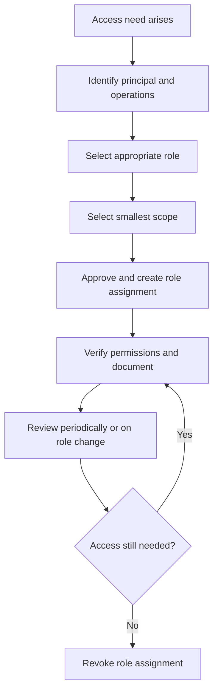

# Managing Resources with Azure RBAC

Azure role-based access control (Azure RBAC) is an authorization mechanism that controls who can perform which actions on Azure resources and at what scope. Instead of granting broad administrative permissions to every user, you can assign appropriate roles to users, groups, or application identities at a subscription, resource group, or individual resource. This structure enables applying the principle of least privilege, separation of duties, and consistent access management as the system grows.

In the Microsoft Azure ecosystem, resources are organized by management group, subscription, resource group, and resource. Subscriptions and resources can be associated with identities managed by Microsoft Entra ID. Azure RBAC binds those identities to roles and resource scopes to decide which operations are allowed.

## Learning Objectives

After this lesson, you will be able to:

- Explain the purpose of Azure RBAC and distinguish Azure RBAC from Microsoft Entra ID administrative roles.
- Identify the three elements of a role assignment: security principal, role definition, and scope.
- Describe the scope hierarchy and how permissions are inherited.
- Select appropriate built-in roles for read, resource management, and access management scenarios.
- Assign, verify, and revoke permissions using the Azure Portal or Azure CLI.
- Understand when to create custom roles, use conditions in role assignments, or manage privileged access with Microsoft Entra Privileged Identity Management (PIM).

## 1. What Problem Does Azure RBAC Solve?

An Azure environment often involves multiple teams working together: development teams deploying apps, operations teams monitoring virtual machines, data teams managing data, and security teams governing access. If everyone is granted Owner permissions across the entire subscription, an accidental action can affect multiple services and accountability becomes difficult to maintain.

Azure RBAC lets you restrict permissions by job function and scope. For example:

- An audit team is granted **Reader** on a subscription to view resource configurations and status.
- A development team is granted **Contributor** on a development environment's resource group to deploy and update resources within that scope.
- An operations engineer is granted permission to start a virtual machine on a specific resource if an appropriate role is configured.
- An identity administration team is entrusted with managing role assignments under a dedicated workflow, instead of everyone who deploys resources being able to grant access to others.

Azure RBAC access decisions are based on identity, role, scope, and, in supported cases, role assignment conditions. When a user or workload sends a request to Azure Resource Manager, Azure evaluates the relevant permissions to decide whether the request is allowed.

## 2. Distinguishing Azure RBAC from Microsoft Entra ID Roles

Microsoft Entra ID manages identities and permissions over identity services, such as managing users, groups, applications, and tenant settings. Azure RBAC manages access permissions to Azure resources such as virtual machines, virtual networks, storage accounts, and resource groups.

| Aspect | Azure RBAC | Microsoft Entra ID Roles |
|---|---|---|
| Primary scope | Azure resources and resource governance scopes | Tenant and Microsoft Entra identity services |
| Example roles | Reader, Contributor, Owner, Virtual Machine Contributor | Global Administrator, User Administrator, Groups Administrator |
| Example permissions | Read VM configuration, create resource groups, manage role assignments | Create users, manage groups, change tenant settings |
| Typical inspection point | Access control (IAM) on a subscription, resource group, or resource | Microsoft Entra admin center and tenant role administration pages |

Someone can be a Global Administrator in Microsoft Entra ID, but that does not mean all operations across every Azure subscription are granted via a standard Azure RBAC role assignment. There is a special mechanism allowing a Global Administrator to elevate access to Azure resources in certain situations, though this is a privileged operation that must be controlled and audited. In day-to-day administration, assign the right role type in the right system and scope.

## 3. Three Elements of a Role Assignment

A **role assignment** binds three elements together:

1. **Security principal**: the identity receiving the permissions.
2. **Role definition**: the set of permissions describing allowed or excluded actions.
3. **Scope**: the Azure boundary over which the permissions take effect.

### Security Principal: Who Receives Permissions?

Azure RBAC can assign permissions to the following identity types:

- **User**: a user account in Microsoft Entra ID.
- **Group**: a Microsoft Entra ID security group. Assigning permissions to groups enables centralized membership management.
- **Service principal**: an identity representing an application or workload that needs to access Azure.
- **Managed identity**: an identity whose credential lifecycle is managed by Azure, commonly used so one Azure service can access another Azure service.

For groups of users, consider assigning roles to security groups rather than creating many individual role assignments. When an employee switches teams or leaves a project, updating group membership is usually easier to control than finding and revoking individual assignments. For applications running on Azure, prefer managed identities when the target service supports them to avoid storing and rotating secrets yourself.

### Role Definition: What Actions Are Allowed?

A role definition describes the permissions a role provides. A role definition can contain:

- **Actions**: control-plane operations, such as reading or updating resource configurations through Azure Resource Manager.
- **NotActions**: operations excluded from the Actions set of that specific role definition.
- **DataActions**: data operations inside services that support the data-plane authorization model, such as reading or writing blobs.
- **NotDataActions**: data operations excluded from the DataActions set of that specific role definition.
- **AssignableScopes**: scopes at which the role definition can be used to create role assignments.

`NotActions` and `NotDataActions` are not absolute deny rules. They only exclude operations from the permissions provided by that specific role definition. If another role assignment grants the same permission through a different role, that permission can still be granted. Therefore, do not use NotActions as a standalone deny mechanism.

Control plane and data plane must be distinguished. For example, permission to manage a storage account's configuration does not necessarily grant permission to read blob contents. To access data, an identity may need a data role such as **Storage Blob Data Reader** or **Storage Blob Data Contributor**, depending on the operation. Some services have their own authentication and authorization mechanisms; check the service's security model before concluding an Azure RBAC role is sufficient.

### Scope: Where Do Permissions Take Effect?

Azure RBAC supports permission assignment across a scope hierarchy:

```text
Management group
└── Subscription
    └── Resource group
        └── Resource
```

A role assignment at a parent scope is typically inherited down to child scopes. For example, Reader assigned at a subscription provides read access across resource groups and resources inside that subscription, within the role's permission limits and related controls. A role assignment placed only on one resource group does not automatically apply to another resource group.

| Scope | Impact radius | Usage example |
|---|---|---|
| Management group | Subscriptions inside the management group and child scopes | Platform governance team needs read access across multiple subscriptions |
| Subscription | Resource groups and resources in the subscription | Audit team needs Reader for an entire environment |
| Resource group | Resources belonging to the resource group | Development team manages the development environment |
| Resource | A single specific resource | An identity only needs to manage one storage account or VM |

The broader the scope, the larger the blast radius of the permissions. Start at the smallest scope that fulfills the job. Only assign at a management group or subscription when the task genuinely needs to span multiple child scopes.

## 4. Choosing the Right Built-In Role

Azure provides many built-in roles for common scenarios. Some frequently encountered general-purpose roles include:

| Role | High-level permissions | Suitable scenario |
|---|---|---|
| **Owner** | Manage resources and manage access permissions within the assigned scope | Administrators with full accountability for a specific scope |
| **Contributor** | Create, update, and delete resources; cannot grant role assignments under this role | Teams deploying and operating resources without managing others' access |
| **Reader** | View resources and configurations without modifying resources | Auditing, monitoring, or read-only support |
| **User Access Administrator** | Manage user access to resources within the scope | Personnel tasked with managing role assignments |
| **Role Based Access Control Administrator** | Manage role assignments according to defined scopes and permissions | Dedicated RBAC administrators |

Role names do not replace checking the detailed role definition. Specialized built-in roles are often better suited than general roles. For example, **Virtual Machine Contributor** focuses on managing VMs; **Storage Blob Data Reader** grants blob data read access; **Network Contributor** serves certain network resource management tasks. Verify exact permissions and supported scopes before assigning.

Several selection principles:

- If only viewing information is needed, prefer Reader or a specialized reader role.
- If only operating one resource type is needed, look for a specialized built-in role for that resource type.
- Only grant Owner when the job genuinely requires both resource management and access assignment permissions.
- Do not grant Contributor assuming it includes all permissions; Contributor does not automatically grant permission to create role assignments.
- If the task only requires managing role assignments, consider Role Based Access Control Administrator or an appropriate access management role instead of Owner.

## 5. Assigning Permissions with the Azure Portal

Example: granting Reader to a security group on a resource group.

1. Sign in to the [Azure Portal](https://portal.azure.com) with an account permitted to create role assignments.
2. Open **Resource groups** and select the target resource group.
3. Select **Access control (IAM)**.
4. Open the **Role assignments** tab to view existing assignments and inherited permissions shown in the interface.
5. Select **Add** and then **Add role assignment**.
6. Under Role, search for and select **Reader**.
7. Under Members, choose the appropriate identity type, search for the target security group, and confirm the selection.
8. Review the role, member, and scope before selecting **Review + assign**.
9. Once complete, return to Role assignments to verify the assignment appears at the expected scope.

Tab names or layouts may vary across Portal versions. If the option to add a role assignment is unavailable, check the signed-in account's own role-assignment permissions and the currently selected IAM scope.

The principal creating a role assignment needs the `Microsoft.Authorization/roleAssignments/write` permission at the relevant scope, typically through an appropriate access management role such as Owner, User Access Administrator, or Role Based Access Control Administrator. Having Contributor on a resource group is not enough to grant permissions to others.

## 6. Assigning and Checking Permissions with Azure CLI

Azure CLI makes permission checks and assignments repeatable. The examples below use placeholders; replace them with actual IDs and names in a verified environment. Never use example values in production.

### Determine the Scope

A resource group has a scope of the form:

```text
/subscriptions/<SUBSCRIPTION_ID>/resourceGroups/<RESOURCE_GROUP_NAME>
```

For example, to check the current subscription:

```bash
az account show --output table
```

Ensure you have the right subscription before continuing. You can also retrieve a resource group's scope with:

```bash
az group show \
  --name "<RESOURCE_GROUP_NAME>" \
  --query id \
  --output tsv
```

### View Role Assignments

List role assignments at a scope, including inherited permissions:

```bash
az role assignment list \
  --scope "/subscriptions/<SUBSCRIPTION_ID>/resourceGroups/<RESOURCE_GROUP_NAME>" \
  --include-inherited \
  --all \
  --output table
```

To filter by a specific principal, use:

```bash
az role assignment list \
  --assignee "<PRINCIPAL_OBJECT_ID>" \
  --scope "/subscriptions/<SUBSCRIPTION_ID>/resourceGroups/<RESOURCE_GROUP_NAME>" \
  --include-inherited \
  --all \
  --output table
```

`PRINCIPAL_OBJECT_ID` is the object ID of the user, group, or service principal in Microsoft Entra ID, not its display name. The listing helps inspect role assignments at the queried scope; actual effective permissions can also be affected by conditions, deny assignments, and service-specific authorization mechanisms.

### Create a Role Assignment

Example granting Reader to a security group on a resource group:

```bash
az role assignment create \
  --assignee-object-id "<GROUP_OBJECT_ID>" \
  --assignee-principal-type Group \
  --role Reader \
  --scope "/subscriptions/<SUBSCRIPTION_ID>/resourceGroups/<RESOURCE_GROUP_NAME>"
```

In this command:

- `--assignee-object-id` identifies the principal receiving permissions.
- `--assignee-principal-type Group` declares that the principal is a security group.
- `--role Reader` selects the built-in role.
- `--scope` defines the scope where permissions take effect.

For a user, the principal type is `User`; for a service principal or managed identity, the principal type is typically `ServicePrincipal`. Use the exact object ID of the identity receiving permissions. After the command succeeds, re-run the role assignment listing command to verify.

### Revoke a Role Assignment

When a user no longer needs permissions, revoke the corresponding assignment. Example:

```bash
az role assignment delete \
  --assignee "<GROUP_OBJECT_ID>" \
  --role Reader \
  --scope "/subscriptions/<SUBSCRIPTION_ID>/resourceGroups/<RESOURCE_GROUP_NAME>"
```

This command deletes the specific role assignment. It does not delete the security group, user account, or Azure resources. Before deleting, verify the exact principal, role, and scope; if the same principal has another assignment at a parent scope or another scope, those permissions may remain active.

## 7. Permission Inheritance and Investigating Effective Permissions

Role assignments at a parent scope are inherited by child scopes. This simplifies centralized management, but can also cause a user to receive permissions from multiple places. For example, an engineer has Reader on the subscription and Contributor on one resource group. Within that resource group, the engineer can update resources via Contributor; in other resource groups, they only have read access via Reader.

When investigating why a user can or cannot perform an operation, check in order:

1. Confirm the exact tenant and subscription the user or workload is accessing.
2. Identify the actual principal behind the request: user, group, service principal, or managed identity.
3. Identify the resource ID and scope where the operation is taking place.
4. Check direct role assignments and assignments inherited from parent scopes.
5. Inspect the role definition to see whether the required operation is in Actions or DataActions.
6. Check role assignment conditions, deny assignments, and service-specific authentication/authorization mechanisms if the operation still fails.

Do not conclude a principal has full access just because you see one role assignment. Likewise, do not conclude a principal lacks access just because there is no direct assignment on the resource group: permissions may be inherited from the subscription or management group.

## 8. When Is a Custom Role Needed?

Built-in roles generally cover common needs. However, a task may require a smaller or different set of permissions than existing roles provide. In that case, the organization can define a **custom role**.

For example, an operations team only needs to read VM information and start or stop VMs, without creating or deleting VMs or changing network configurations. A custom role can specify those exact operations. Designing a custom role requires identifying the exact resource provider operations; never guess permission strings.

An illustrative custom role definition has the following structure:

```json
{
  "Name": "Virtual Machine Start Stop Operator",
  "IsCustom": true,
  "Description": "Read virtual machines and start or stop them.",
  "Actions": [
    "Microsoft.Compute/virtualMachines/read",
    "Microsoft.Compute/virtualMachines/start/action",
    "Microsoft.Compute/virtualMachines/deallocate/action"
  ],
  "NotActions": [],
  "DataActions": [],
  "NotDataActions": [],
  "AssignableScopes": [
    "/subscriptions/<SUBSCRIPTION_ID>"
  ]
}
```

This is a structural example for learning how to read a custom role. Before using it, verify that the operations actually exist and match your organization's operational processes. Some supporting operations may require additional read permissions or permissions on related resources.

Save the verified content to `custom-role.json`, then create the role definition with Azure CLI:

```bash
az role definition create --role-definition @custom-role.json
```

You can inspect the definition:

```bash
az role definition list \
  --name "Virtual Machine Start Stop Operator" \
  --output jsonc
```

After creating it, assign the custom role at an appropriate scope using `az role assignment create`, similar to the Reader assignment example. `AssignableScopes` defines where the role definition can be used; the scope in a role assignment defines where the principal actually receives permissions. These two concepts are related but not identical.

Custom roles should be managed like configuration code: with an owner, clear purpose description, reviews when operations change, and testing before broad rollout. Avoid creating many near-duplicate roles that make auditing and maintenance difficult.

## 9. Reducing Risk with Privileged Access and Access Conditions

### Principle of Least Privilege

The principle of least privilege requires each principal to receive only the permissions needed to complete its task. Apply it by:

- Choosing a specialized role instead of Owner or Contributor if the specialized role suffices.
- Assigning at the resource group or resource level instead of the subscription if work only happens there.
- Assigning permissions to groups or managed identities with clear lifecycles.
- Periodically reviewing unneeded assignments and removing excess permissions.
- Separating resource deployers from access approvers or administrators when processes require separation of duties.

### Using Privileged Identity Management

For high-impact permissions, an organization can use Microsoft Entra Privileged Identity Management (PIM) for Azure resources to manage privileged access just-in-time. Instead of holding a permanent privileged role assignment, eligible users can activate permissions for a time-limited window under policy, with requirements such as extra authentication, justification, or approval.

PIM must be properly configured and licensed in the tenant. If your organization uses PIM, follow the established activation, duration, and approval procedures. Never create a permanent assignment yourself to bypass privileged access activation workflows.

### Conditions in Role Assignments

For certain supported roles and services, Azure RBAC lets you add a **role assignment condition** to restrict permissions based on attributes of the request or resource. This mechanism is commonly used in supported data-access scenarios, such as restricting blob operations by attributes or data scope. Conditions do not apply to every role or every operation. Before implementing, verify supported services, roles, operations, and attributes; then test with a narrowly scoped principal.

## 10. How Azure RBAC Works with Other Governance Mechanisms

Azure RBAC answers **who is allowed to perform which actions**. Other Azure mechanisms address different questions:

| Mechanism | Role in governance |
|---|---|
| Azure Policy | Evaluates or enforces rules on resource configurations, such as requiring tags or restricting deployment regions |
| Resource locks | Reduces the risk of accidental deletion or modification using ReadOnly or CanNotDelete locks at supported scopes |
| Microsoft Entra ID | Manages identities, groups, applications, and authentication |
| Microsoft Entra PIM | Manages and activates time-bound privileged permissions when configured |
| Activity log | Records Azure administrative events for tracking and investigation |

These mechanisms complement one another. For example, someone with Contributor may be allowed to submit a deployment request, but Azure Policy can reject non-compliant configurations. A resource lock can block deleting a resource even when the user has RBAC permission to manage resources. When troubleshooting an issue, inspect permissions, policies, locks, and relevant logs together.

## 11. Access Lifecycle Management Process

A controlled authorization process can follow these steps:

1. **Identify the need**: what actions does the person or workload need to perform, on which resources, and for how long?
2. **Choose the principal**: prefer security groups for users and managed identities for appropriate workloads.
3. **Choose the role**: find the smallest built-in role that meets requirements; only create a custom role when existing roles do not fit.
4. **Choose the scope**: assign at the smallest scope capable of fulfilling the task.
5. **Approve and assign**: follow governance procedures and double-check principal, role, and scope before confirming.
6. **Verify**: inspect the role assignment and test the needed operation within the permitted scope.
7. **Review and revoke**: re-evaluate when job roles change, projects end, or access windows expire.

The following diagram illustrates the high-level lifecycle:



Record the justification for granting access, approver, grant timestamp, scope, and next review date. For critical environments, bring role assignment configuration under controlled change workflows and monitor via the Activity log.

## 12. Common Mistakes When Managing Azure RBAC

| Symptom | Possible cause | How to resolve |
|---|---|---|
| Cannot add a role assignment | Current principal lacks `Microsoft.Authorization/roleAssignments/write` at the scope | Check the current account's access management role and ask an authorized person to perform it |
| User cannot see resources | Wrong tenant/subscription, missing read permission, or incorrect Portal filters | Confirm directory, subscription, scope, and direct/inherited role assignments |
| Has Contributor but cannot grant access to a colleague | Contributor does not include permission to manage role assignments | Use the access-granting process and a principal holding an appropriate access management role |
| Has permission to manage a storage account but cannot read blobs | Control-plane permissions do not automatically grant data-plane permissions | Check the data authentication model and assign an appropriate Storage Blob Data role |
| Role assigned but operation is still denied | Wrong scope, unmet condition, deny assignment, policy, or service-specific mechanism | Read error details, check scope, role definition, conditions, and relevant policies |
| Still has permissions after deleting assignment at resource group | Principal may inherit permissions from a parent scope or another assignment | Check role assignments at subscription, management group, and related scopes |
| Permission just assigned but operation still fails | Permission changes may take time to propagate or session holds a stale token | Wait briefly, refresh session, or acquire a new token per procedure, then retry |

Never fix an authorization error by arbitrarily granting broader Owner permissions. Identify the exact operation being denied, then add only the missing permission and scope.

## 13. Comprehensive Hands-On Exercise

Suppose a development team needs to view and deploy resources in resource group `rg-app-dev`, but must not be allowed to grant access to others.

1. Confirm the development subscription and resource group `rg-app-dev`.
2. Identify the object ID of the development security group in Microsoft Entra ID.
3. Check the appropriate built-in role. If the team needs to manage multiple resource types in the resource group, Contributor may fit; if they only operate one service, consider a specialized role.
4. Someone with role assignment permissions creates the assignment for the group at the `rg-app-dev` scope.
5. Verify the assignment in Access control (IAM) or via Azure CLI.
6. A team member signs in and tests an operation within the granted scope of work.
7. Verify the team member cannot create role assignments themselves without a separate access management permission.
8. When the project ends, the administrator revokes the role assignment or removes members from the group per organizational procedure.

This exercise clearly demonstrates separating resource management permissions from access management permissions. The development team can work with resources within its role, while permission to add more users is controlled by a separate person or administrative team.

## 14. Knowledge Self-Check

1. What are the three mandatory elements of a role assignment?
2. Why can Reader at a subscription take effect on a resource group inside that subscription?
3. How does Contributor differ from Owner regarding granting role assignments?
4. Why does permission to manage storage account configuration not equal permission to read blob contents?
5. Is `NotActions` in a custom role an absolute deny rule across all other role assignments? Explain.
6. When should you consider a custom role or PIM?
7. If you removed an assignment at a resource group but the user can still access resources, which scopes should you inspect?

## Conclusion

Azure RBAC governs resource access by combining principal, role definition, and scope. Choosing the right role, assigning at the smallest scope, understanding permission inheritance, and reviewing assignments periodically help organizations reduce excess permissions while enabling development and operations teams to work effectively. Pair Azure RBAC with Microsoft Entra ID, PIM, Azure Policy, resource locks, and the Activity log to build a controllable and auditable governance process.
