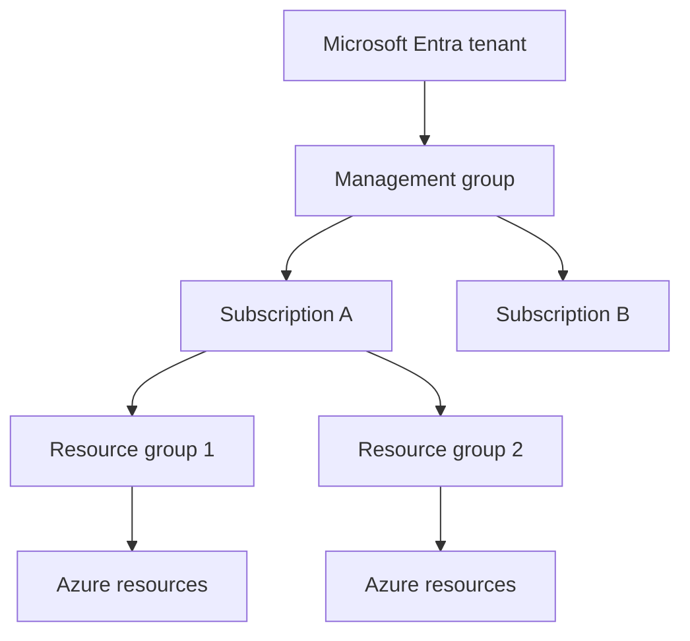
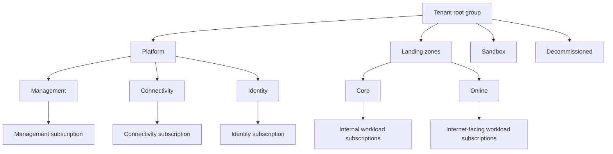
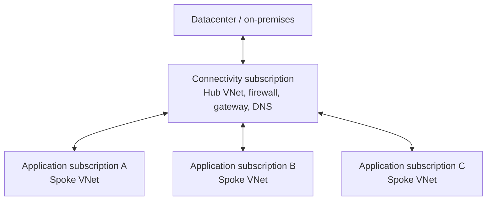
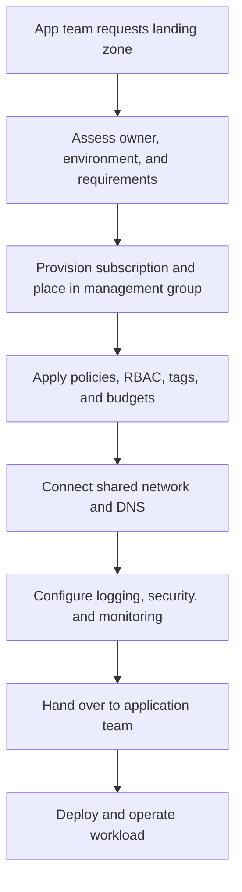

# Organizing Landing Zones and Platform Subscriptions

When an organization first starts using Microsoft Azure, creating a few virtual machines or storage accounts is usually straightforward. Challenges emerge when multiple teams deploy applications concurrently, multiple environments coexist, and systems must satisfy security, networking, operational, compliance, and cost requirements. If every team creates resources their own way, the organization quickly ends up with inconsistent configurations, hard-to-control access permissions, scattered logs, and unattributable costs.

An Azure landing zone is the architectural and governance foundation that prepares an Azure environment so an organization can deploy, operate, and scale workloads consistently. A landing zone encompasses management structure, identity, networking, security, monitoring, policies, and subscription provisioning workflows. In the Azure Landing Zone architecture, platform subscriptions provide shared services such as management and monitoring, network connectivity, and required identity components.

This lesson explains how to organize landing zones at enterprise scale, distinguish platform landing zones from application landing zones, design management groups and subscriptions, define the roles of platform subscriptions, and build a subscription vending workflow for workloads.

After this lesson, you will be able to:

- Explain the purpose and core components of an Azure landing zone.
- Design a management group tree to apply policies and permissions by scope.
- Distinguish platform subscriptions from application subscriptions.
- Define the responsibilities of Management, Connectivity, and Identity subscriptions.
- Choose how to split subscriptions by owner, environment, criticality, and compliance requirements.
- Describe the subscription vending workflow and checks required before handing over a subscription.

## 1. What Is an Azure Landing Zone?

A landing zone is an Azure environment prepared so workloads can be deployed according to an organization's shared standards. It combines both technical architecture and an operating model. A well-designed landing zone lets application teams focus on building products, while foundational requirements such as identity, networking, logging, security, and governance already have clear implementation patterns.

A landing zone is not a single Azure resource or a special resource group. It is a coordinated set of structures and capabilities that can include:

- **Resource organization:** Microsoft Entra ID tenant, management groups, subscriptions, resource groups, and naming conventions.
- **Identity and access:** authentication, Azure RBAC, administrative groups, privileged access, and permission workflows.
- **Networking:** connectivity across workloads, on-premises networks, the internet, and shared Azure services.
- **Security and governance:** Azure Policy, Microsoft Defender for Cloud, configuration standards, and change control.
- **Management and monitoring:** Activity Log, Azure Monitor, Log Analytics, alerting, diagnostics, and incident response processes.
- **Automation and deployment:** Infrastructure as Code (IaC), pipelines, deployment templates, and subscription provisioning workflows.
- **Cost management:** budgets, cost categorization, resource tags, and ownership accountability.

Azure landing zones are typically designed around Cloud Adoption Framework (CAF) design areas, such as resource organization, identity, networking, security, management, governance, and platform automation. Implementation depth for each area depends on organizational scale and requirements. A small team may start with a simple structure; a large enterprise may need multiple management groups, subscriptions, and dedicated network zones.

### What Problems Does a Landing Zone Solve?

Suppose an enterprise has three teams: an HR team managing internal systems, an e-commerce team operating public websites, and a data team building an analytics platform. If each team creates its own subscriptions and configures them independently, common issues arise:

- One team allows deployments in unapproved Azure regions, while another is region-restricted.
- Each team stores logs in a different place, making cross-system incident investigation hard for operations.
- Workloads build VPNs, firewalls, or DNS independently, driving up cost and complexity.
- Owner permissions are granted too broadly or personal accounts are used for automation.
- Without consistent tagging conventions and budgets, it is hard to tell which application generates which costs.

A landing zone solves these problems by establishing a shared set of standards and platform services, while preserving appropriate autonomy for workload-owning teams.

## 2. Two Core Domains: Platform Landing Zones and Application Landing Zones

The Azure Landing Zone architecture is typically organized into two domains with distinct responsibilities.

| Domain | Purpose | Example components |
|---|---|---|
| Platform landing zone | Provides shared platform services for the organization or multiple workloads | Core network connectivity, centralized monitoring, required identity services, policies, and operational tooling |
| Application landing zone | Hosts workloads and resources serving a specific application, product, or business group | Web apps, APIs, VMs, databases, storage, integration resources, and application-specific components |

The platform team is typically responsible for designing and operating the platform landing zone. Application teams own applications, data, and workload configurations within their granted scopes. Both teams coordinate through predefined interfaces, such as network connectivity requests, access-granting processes, logging standards, and support workflows.

Application landing zones are typically deployed in one or more workload subscriptions. Subscriptions can be provisioned per application, per related group of applications, or per environment, depending on security boundaries, lifecycle, and management accountability.

Do not treat the platform landing zone as a single subscription. In common architectures, it comprises multiple platform subscriptions, each with distinct responsibilities and change scopes. Separating them limits blast radius during incidents and clarifies permission management and cost allocation.

## 3. Azure Resource Organization Layers

To understand landing zones, first distinguish the organizational layers in Azure:

| Layer | Function | Relationship |
|---|---|---|
| Microsoft Entra tenant | Boundary for identities, applications, and user groups | One tenant can manage multiple subscriptions |
| Management group | Groups subscriptions to apply Azure Policy and Azure RBAC at scale | Can contain child management groups and subscriptions |
| Subscription | Boundary for resource management, permissions, quotas, and cost tracking | Belongs to one management group at a time; contains resource groups |
| Resource group | Logical grouping of resources with related management or lifecycle | Resides within one subscription |
| Resource | Specific Azure resource | Resides in a resource group or the service's corresponding resource scope |

High-level relationship:

Management groups do not directly contain virtual machines or storage accounts. They organize subscriptions and provide a scope for applying policies or permissions. A subscription is neither a tenant nor a resource group. A subscription is associated with one Microsoft Entra tenant at a time; subscriptions within the same landing zone are typically managed under the organization's chosen enterprise tenant.

These layers have different scopes of impact:

- Policy changes at a management group can affect many child subscriptions.
- RBAC changes at a subscription can grant permissions down to child resource groups and resources.
- Resource groups help manage lifecycle and permissions at a smaller scope, but do not replace subscriptions as a governance boundary.
- Separating subscriptions helps isolate quotas, permissions, costs, and operational impact.

## 4. Designing the Management Group Tree

Management groups organize subscriptions by purpose and apply consistent guardrails. A common structure in an Azure Landing Zone can be illustrated as follows:

This is a reference structure. Organizations can add branches for data, test environments, workloads with special compliance requirements, or business units. There is no need to create every branch upfront if there is no corresponding need or operating model yet.

### Tenant Root Group

The tenant root group is the root of the management group tree. It is a very high-impact scope. Only place policies and permissions here that genuinely must apply across the entire tenant. Restrict the number of administrators at this scope, enforce approval workflows, and monitor every change.

### Platform

The Platform branch holds subscriptions operating shared platform services. Child branches typically include Management, Connectivity, and Identity. This separation aligns each domain's policies and management permissions with the platform team's responsibilities.

### Landing Zones

The Landing zones branch holds subscriptions where applications are deployed. It can be divided into:

- **Corp:** internal workloads or workloads requiring connectivity to corporate/on-premises networks under an approved architecture.
- **Online:** workloads with an internet-facing surface or designed to serve external users.

Corp and Online classify workloads by connectivity and control patterns. Do not use branch names as a substitute for assessing each application's actual risk. A public-facing workload might still require private connectivity to internal systems; in that case, design network paths and policies according to the exact requirements.

### Sandbox and Decommissioned

Sandbox can be dedicated to controlled experimentation with appropriate quotas, budgets, and policies. Do not treat sandbox as an ungoverned zone. Decommissioned can hold subscriptions undergoing retirement, with restrictive permissions and policies to prevent new resource creation during data retention or handover periods.

### Tree Design Principles

1. Organize by governance purpose and operating model, not just the current org chart.
2. Create branches when distinct policies, permissions, or responsibilities need to be applied consistently.
3. Keep the tree shallow enough to understand, audit, and modify easily.
4. Avoid assigning broad permissions at the tenant root group if permissions can be granted on a lower branch.
5. Place subscriptions into the right management group right inside the provisioning workflow.
6. Test policies in an appropriate environment before applying them to a scope with many workloads.

## 5. Platform Subscriptions

In the common reference model, the platform landing zone has three core subscriptions: Management, Connectivity, and Identity. Subscription names may vary per organizational conventions, but responsibilities must be clearly defined.

### 5.1. Management Subscription

The Management subscription holds components for centralized management and monitoring. Depending on design, it may contain:

- Log Analytics workspaces to centralize logs from workloads and platform services.
- Azure Monitor components, alert configurations, and shared dashboards.
- Resources for server management, Azure Arc, or operations automation where required.
- Tools and resources supporting platform operations, inventory, or task orchestration.

Not every monitoring resource must sit in a single subscription. Certain Azure Monitor configurations, diagnostic settings, data collection rules, or security services are managed at different scopes. What matters is defining where data is stored, who can read it, retention duration, ingestion costs, and permission boundaries between operations and application teams.

For example, workload subscriptions can configure diagnostic settings to forward Activity Logs or resource logs to a central destination per organizational standards. Operations teams use that data to monitor system health and investigate incidents. Ensure sensitive data is not over-collected and workspace access permissions are appropriately restricted.

### 5.2. Connectivity Subscription

The Connectivity subscription holds shared network infrastructure and connectivity points between Azure and external networks. Depending on architecture, resources may include:

- Hub virtual networks or Azure Virtual WAN hubs.
- Azure Firewall or approved network appliances.
- VPN Gateways and ExpressRoute Gateways for on-premises connectivity.
- DNS Private Resolvers or shared DNS components.
- Network Watcher and network diagnostic resources.
- Shared network protection and routing services per design.

A hub-and-spoke topology typically places one or more central hubs in the Connectivity subscription. Each application landing zone deploys its own spoke network and peers to the hub according to policy. The hub provides controlled paths to on-premises, the internet, or shared services; spokes isolate workload networks.

Hub-and-spoke is a popular option, though not the only one. Azure Virtual WAN can fit distributed networks spanning many branches or regions. Architecture must consider east-west and north-south traffic, routing, DNS, traffic inspection, scalability, availability, and data transfer costs.

Separating the Connectivity subscription lets the networking team manage shared infrastructure and limit who can alter network configurations. Application teams are typically permitted to manage only their own workload network components per design, without modifying central firewalls, gateways, or shared routes.

### 5.3. Identity Subscription

The Identity subscription is intended for identity infrastructure components that the organization must run inside Azure. Examples may include:

- Domain controllers running Active Directory Domain Services (AD DS) on virtual machines, if legacy applications or systems still depend on traditional domains.
- Identity synchronization or integration components per approved architecture.
- Authentication and identity-supporting services requiring a dedicated operational boundary.

Microsoft Entra ID is Azure's cloud identity platform, not a server deployed inside the Identity subscription. Having an Identity subscription does not mean every organization must build domain controllers. If workloads can use modern authentication with Microsoft Entra ID, managed identities, and cloud-native mechanisms, prefer that architecture. Deploy AD DS or compatibility components only when specifically required, such as legacy apps needing domain join, LDAP, or Group Policy.

Identity servers are typically Tier-0 / high criticality. They require strict network protection, patch management, backups, monitoring, administrative permissions, and recovery plans. Never place these sensitive servers inside a general application subscription when the organization needs an isolated operational boundary.

### Is a Fourth Platform Subscription Needed?

Some organizations create additional subscriptions for shared services, security operations, image building, automation, or specialized platform capabilities. Additional separation should only occur when there are clear differences in ownership, permissions, lifecycle, security requirements, quotas, or costs. Avoid creating subscriptions merely to mirror a team name without corresponding governance benefits.

## 6. Application Landing Zones and Splitting Workload Subscriptions

A workload subscription is where an application team deploys its resources. One subscription can contain multiple resource groups and services, but must have a clear ownership boundary.

Common splitting patterns:

| Split pattern | When suitable | Considerations |
|---|---|---|
| One subscription per application | Application has distinct owner, lifecycle, risk profile, or cost | Easy to isolate permissions and costs, but increases number of subscriptions to manage |
| One subscription per group of related applications | Applications share the same operations team and similar security requirements | Requires clear resource group, RBAC, and tag conventions |
| Subscriptions split by dev/test/prod environment | Environments have different protection, permission, or change requirements | Increases isolation, but requires provisioning automation and multi-subscription management |
| Dedicated subscription for specialized workload | Distinct compliance, region, connectivity, quota, or security requirements | Must justify separation and avoid hard-to-operate exceptions |

There is no single optimal subscription count for all organizations. Decide based on these questions:

- Who owns the workload and is accountable during incidents?
- Which teams are allowed to deploy, modify, or delete resources?
- Does the environment require data and access isolation?
- Are there specific requirements for Azure regions, network connectivity, or security standards?
- How granularly must costs and quotas be allocated?
- Is the workload's lifecycle independent from other applications?

Avoid splitting so finely that every change crosses excessive administrative boundaries, while also avoiding mixing workloads with vastly different trust levels or privilege requirements in the same subscription. Resource groups are useful for grouping resources, but are not a security boundary equivalent to separating subscriptions.

## 7. Enforcing Governance with Azure Policy and Azure RBAC

Management groups and subscriptions establish scopes for applying governance. Two key mechanisms are Azure Policy and Azure RBAC, solving two different problems.

### Azure Policy: Controlling Resource Configurations

Azure Policy evaluates resource states against organizational rules. Policies can be assigned at a management group, subscription, resource group, or appropriate resource scope; parent assignments can apply down to child scopes.

Examples of guardrails:

- Allow resource deployment only in approved Azure regions.
- Require tags such as `environment`, `owner`, or `costCenter`.
- Audit or deny non-compliant network, storage, and security configurations.
- Enable diagnostic settings or deploy supporting components per policy.
- Evaluate compliance and identify resources requiring remediation.

Common effects include `Audit`, `Deny`, `Modify`, and `DeployIfNotExists`. `Audit` flags violations; `Deny` blocks non-compliant create or update requests; `Modify` can update supported properties; `DeployIfNotExists` can deploy related resources when conditions are met. Some policies require a managed identity and appropriate permissions to perform remediation. Test impact before switching from Audit to Deny.

Policy does not replace access permissions. A user may have Contributor permissions and still be blocked by policy from creating a resource in a disallowed region. Conversely, a policy allowing a configuration does not automatically grant a user permission to deploy.

### Azure RBAC: Controlling Who Can Do What

Azure RBAC grants roles to users, groups, service principals, or managed identities at a scope. Roles can inherit down to child scopes. For example:

- The platform team holds permissions to manage infrastructure at management groups or platform subscriptions per its duties.
- The network team holds permissions to manage the Connectivity subscription.
- Application teams hold permissions to deploy within their workload subscriptions.
- The security team holds permissions to read security data or run investigative tasks per process.

Prefer assigning permissions through Microsoft Entra groups rather than directly to individuals. Use least-privilege roles; privileged administrative permissions should be governed by approval workflows and mechanisms like Privileged Identity Management (PIM) when appropriate.

### Layering Policies

A manageable design pattern:

1. At the tenant root group, place a small set of foundational rules that truly apply organization-wide.
2. At Platform, apply standards for subscriptions operating platform services.
3. At Landing zones, apply a shared workload baseline.
4. At Corp, Online, or specialized branches, add policies matching the workload pattern.
5. At subscriptions, create exceptions with clear justification and expiration only when genuinely required.

Policy exceptions must have an owner, reason, scope, and review date. Exceptions should not become the default way to handle non-compliant workloads.

## 8. Connecting Platform and Application Landing Zones

A landing zone must clearly define how workloads consume platform services. For example, an application subscription may need to:

- Connect a spoke to the hub or Virtual WAN per the chosen network model.
- Use internal DNS and private endpoint name resolution.
- Send logs to a central workspace or monitoring target.
- Use managed identities to access Key Vault, Storage, or data services.
- Comply with security, deployment region, and tagging policies set by the organization.
- Receive alerts and operational support per agreed service levels.

These integrations should be automated and documented. Never require application teams to track down network admins ad hoc or guess which workspace to send logs to. A well-designed platform service interface publishes inputs, outputs, required permissions, provisioning lead times, and support contacts.

Example workload onboarding flow:

## 9. Subscription Vending: The Subscription Provisioning Process

Subscription vending is the standardized process for requesting, creating, configuring, and handing over subscriptions. It can be implemented via an internal portal, pipelines, IaC, or a combination. The goal is for every new subscription to start with baseline governance already in place.

A reference workflow includes these steps:

### Step 1: Collect Requirements

Record workload name, technical and business owners, environment, data classification, criticality, required regions, connectivity model, compliance requirements, and cost forecast. Determine whether the new subscription is a Corp, Online, or specialized landing zone workload.

### Step 2: Select Billing Scope and Create Subscription

Create the subscription under the organization's appropriate billing arrangement. Distinguish a billing account or billing profile from a management group: billing scopes serve commercial and invoicing relationships, whereas management groups serve resource organization and governance. The two structures are related but not identical.

### Step 3: Place Subscription in a Management Group

Move the subscription into its corresponding branch immediately after creation. This ensures the subscription inherits the right policies and governance model. Never let a new subscription run for long in an ungoverned temporary location.

### Step 4: Configure Identity and Permissions

Assign Entra groups to required roles at appropriate scopes. Identify accountable contacts, operations teams, security teams, and automation identities. Avoid granting Owner to all application team members if they only need to deploy workloads.

### Step 5: Apply Guardrails and Default Configurations

Apply policies, initiatives, tags, allowed regions, security settings, and naming conventions. Register required resource providers according to workload needs and organizational policy. Configure diagnostic settings, Activity Log exports, or logging integrations per baseline.

### Step 6: Configure Networking and Shared Services

Connect the subscription to the hub or Virtual WAN if required. Set up DNS, private endpoints, routes, firewalls, and network dependencies per design. Verify connectivity paths from the workload to shared services and on-premises systems.

### Step 7: Configure Cost Controls and Operations

Apply tags, create budgets or cost alerts aligned with accountability, set up operational dashboards and alerts, define log retention periods, and assign support contacts. Budgets alert when spending reaches thresholds; they are not hard caps that automatically block all spending.

### Step 8: Verify and Hand Over

Verify policy compliance, RBAC, network connectivity, logging, budgets, and documentation. Hand over the subscription ID, management group, owning group, deployment rules, support contacts, and change request process.

## 10. Automating the Landing Zone Structure

Creating management groups, subscriptions, policies, and networks manually can work for small experiments, but causes drift as workload count grows. Define platform configurations with Infrastructure as Code and manage changes via source control.

Implementation options can include:

- **Bicep/ARM:** declaratively describes Azure resources and governance configurations.
- **Terraform:** manages multi-service infrastructure and maintains deployment state per team workflows.
- **Pipelines:** validate code, run plan or what-if, require approvals, and deploy per environment.
- **Azure Landing Zone Accelerator:** can serve as a starting point for deploying the reference architecture, then tailored to actual requirements and operating models.

Never copy a sample configuration into production without understanding the policies, role assignments, network routes, and resources it will create. Inspect modules, versions, source code, pipeline permissions, and state or secret storage mechanisms.

Commonly automated tasks:

1. Create or select the target management group.
2. Create the subscription from an approved request.
3. Move the subscription into the appropriate management group.
4. Assign policy initiatives and role assignments.
5. Create budgets, tags, and diagnostic settings.
6. Connect networking, DNS, and central workspaces.
7. Run compliance checks and publish handover details.

Pipelines must maintain audit logs, validate inputs, handle errors, and support safe re-runs (idempotency). If a step fails midway, the workflow must determine current state and resume or roll back without creating duplicate resources.

## 11. Securing and Operating Platform Subscriptions

Platform subscriptions typically contain resources affecting many applications. Therefore, governing them requires stricter controls than ordinary test subscriptions.

- **Separation of duties:** clearly define teams owning Management, Connectivity, and Identity; specify who approves and who executes changes.
- **Least privilege:** grant only needed permissions at appropriate scopes; use Entra groups and PIM for privileged access where possible.
- **Protect automation identities:** prefer managed identities or workload identity federation; manage certificates and secrets through controlled processes.
- **Monitor changes:** collect Activity Logs, resource logs, and security events; test alerts and response procedures.
- **Resilience:** back up and test recovery for critical data/configurations; plan for outages in networking, identity, and monitoring workspaces.
- **Change control:** changes to firewalls, DNS, root policies, and identity services require review, testing, and rollback plans.
- **Lifecycle management:** review unowned subscriptions, orphaned resources, obsolete permissions, and expired policy exemptions.

Never let a single team both self-approve and execute high-impact changes without proper controls. For critical platform services, define availability targets, redundancy plans, dependencies, and incident owners.

## 12. Cost Control and Ownership Accountability

Separating subscriptions helps with cost reporting and accountability, but only works with consistent conventions. Every subscription should have a clearly documented owner and purpose.

Recommended practices:

- Use tags such as `application`, `environment`, `owner`, `costCenter`, and `dataClassification` per organizational standards.
- Set budgets and alerts for subscriptions or appropriate cost scopes.
- Track costs of shared services and define how they are allocated to consuming teams.
- Review idle resources, oversized SKUs, storage capacity, and data transfer traffic.
- Set review expiration dates for test and temporary subscriptions.
- Make clear that budgets are tracking/alerting mechanisms; capping spend requires combining operational processes and deployment controls.

Example: the Connectivity subscription can incur firewall, gateway, and data transfer costs for multiple workloads. Without an allocation model, the platform team will struggle to explain cost increases. The organization can allocate costs by measured usage, agreed ratios, or record them as shared platform overhead. The methodology must be transparent and consistent.

## 13. Common Design Mistakes

| Mistake | Consequence | How to improve |
|---|---|---|
| Putting all resources in one subscription | Hard to isolate permissions, quotas, costs, and incident blast radius | Separate platform and workloads; split subscriptions by ownership and risk boundaries |
| Creating too many management groups | Complex tree, hard-to-track policies, hard-to-manage exemptions | Create branches only when genuine governance differences exist |
| Granting Owner at tenant root group | Overly broad permission scope, higher risk of unintended changes | Use restricted admin groups and assign permissions at the lowest suitable branch |
| Treating Identity subscription as hosting Microsoft Entra ID | Misunderstands the cloud identity service model | Distinguish Entra ID from AD DS infrastructure or self-managed identity components |
| Each workload builds its own firewall, DNS, and logging | Costly, inconsistent configurations, hard to operate | Provide shared platform services with clear interfaces |
| Provisioning subscriptions without policies and permissions | Workloads can deploy before guardrails exist | Embed governance into subscription vending and verify before handover |
| Treating budgets as hard spending caps | Costs can still accrue past the threshold | Combine alerts with response workflows and deployment controls |
| Leaving policy exemptions without expiration | Baseline gradually loses effectiveness | Attach owner, reason, scope, and review date to every exemption |

## 14. Example Design for an Enterprise

Suppose Example Corp has these requirements:

- A platform team managing networking, monitoring, and shared services.
- An internal ERP system requiring connectivity to the datacenter.
- An e-commerce website serving internet users.
- A data development environment requiring isolated permissions and test data.

A starting design might include:

| Management group | Subscription | Purpose |
|---|---|---|
| Platform / Management | `sub-platform-management` | Central logs, alerts, and management tools |
| Platform / Connectivity | `sub-platform-connectivity` | Hub network, firewall, VPN/ExpressRoute, and DNS |
| Platform / Identity | `sub-platform-identity` | AD DS on Azure if ERP still requires it; necessary self-managed identity components |
| Landing zones / Corp | `sub-erp-prod` | Internal ERP workload, connected per Corp policies |
| Landing zones / Online | `sub-commerce-prod` | Public website and APIs, protected under Online baseline |
| Landing zones / Corp or dedicated data branch | `sub-data-dev` | Data development environment with isolated permissions and test data |

The ERP and e-commerce website consume platform networking and monitoring services, while workload deployment permissions are restricted to each application's subscription. If the data development environment has distinctly different compliance or governance requirements, the organization can create a dedicated management group rather than placing it under Corp by default.

This design is only a starting point. Before deploying, the enterprise must confirm Azure regions, data classification, recovery requirements, connectivity, permissions, costs, and owners for each subscription. Never treat the names `Corp` or `Online` as sole proof of a workload's security posture.

## 15. Landing Zone Readiness Checklist

Before onboarding the first workload into operations, verify:

- [ ] Tenant and billing arrangement are defined; governance owners are clear.
- [ ] Management group tree reflects the governance model with no unnecessary branches.
- [ ] Platform subscriptions have documented owners, scopes, and purposes.
- [ ] Workload subscriptions are placed in the right management groups.
- [ ] Azure Policy baselines are tested and assigned at appropriate scopes.
- [ ] Entra groups, role assignments, and privileged access processes are established.
- [ ] Network connectivity, DNS, and paths to shared services are verified.
- [ ] Logging, monitoring, alerts, and data retention periods are configured.
- [ ] Security baseline and incident response processes have accountable owners.
- [ ] Tags, budgets, and cost allocation models are agreed upon.
- [ ] IaC or provisioning workflows are version-controlled and safely re-runnable.
- [ ] Handover documentation includes subscription ID, owner, support team, and change process.

This checklist should be tailored to workload criticality and type. A test application may not need the same availability tier as a payment system, but it must still adhere to minimum platform guardrails.

## 16. Practice Exercise

Design a landing zone for a company with one internal application, one public website, and one shared platform team. No real Azure resources need to be created; the goal is to model architectural decisions.

1. Draw a management group tree including tenant root, Platform, Landing zones, and at least two workload branches.
2. Propose three platform subscriptions: Management, Connectivity, and Identity. For each subscription, list at least three responsibilities or resource types placed inside it.
3. Assign subscriptions for the internal application and public website; explain why they belong to Corp or Online under your chosen model.
4. Identify which group needs Connectivity admin permissions, which group deploys applications, and which group has read access to centralized logs.
5. Propose three baseline Azure Policies, such as allowed regions, mandatory tags, and diagnostic settings.
6. Describe the subscription vending steps from request intake to handover.
7. Explain how to track shared platform service costs and how to respond when a subscription exceeds its budget.

You have completed the exercise when you can clearly explain the boundary between platform and workload, why each subscription exists, how policies and RBAC inherit, and the prerequisites that must be met before application teams deploy resources.

## 17. Key Takeaways

An Azure landing zone is the architectural and governance foundation that enables organizations to deploy workloads on Azure consistently, securely, and at scale. Management groups organize subscriptions and serve as key scopes for applying Azure Policy and Azure RBAC. Platform landing zones typically contain Management, Connectivity, and Identity subscriptions to deliver shared capabilities; application landing zones hold workload subscriptions aligned with ownership, environment, and security boundaries. A subscription vending workflow ensures every new subscription lands in the right place with permissions, policies, networking, logging, and cost controls before being handed over to application teams.
