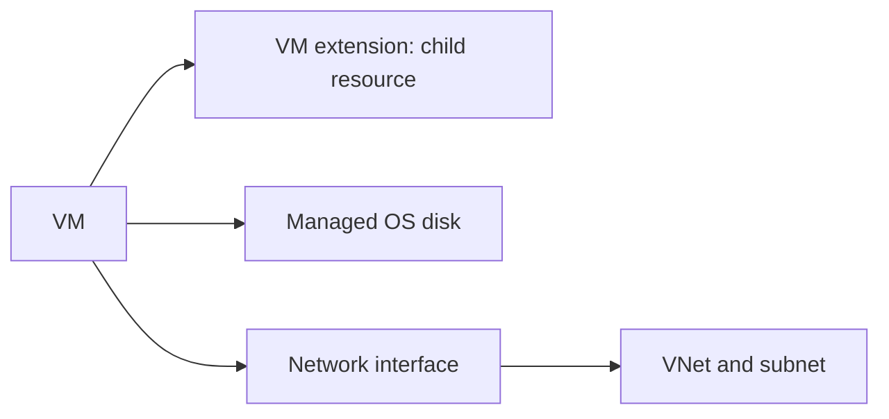

# Moving Resources Between Resource Groups and Subscriptions

## 1. Purpose and Scope

When an Azure application transitions from experimentation to production operations, its initial resource organization may no longer fit. The development team might want to isolate the production environment, hand off operational responsibility to another team, or move the application into a centrally governed subscription.

In the **Resource organization and governance** chapter, moving resources is the operation of changing the management scope of existing resources. This directly involves resource groups, subscriptions, Microsoft Entra ID, Azure RBAC, policies, networking, monitoring, and cost tracking.

After this lesson, you will be able to:

- Identify when to use the Azure Resource Manager move operation.
- Distinguish moving between resource groups, moving between subscriptions, moving between regions, and moving between tenants.
- Inventory resources, dependencies, and configurations that must be updated.
- Verify support, permissions, quotas, and prerequisites at the destination.
- Validate a set of resources before executing a move.
- Verify both resource state and application behavior after moving.

This lesson presents illustrative workflows and commands. Resource names, subscription IDs, and environment structures in examples are hypothetical; replace them with inventoried values before use.

## 2. Understanding the Move Operation Properly

### 2.1. Four Distinct Scenarios

| Need | Approach to evaluate |
| --- | --- |
| Move resources to another resource group in the same subscription | Move between resource groups if the resource type supports it |
| Move resources to another subscription in the same tenant | Move between subscriptions and handle accompanying dependencies |
| Move workload to another region | Region move workflow, redeployment, or service-specific tooling |
| Move environment to another Microsoft Entra tenant | Dedicated tenant transfer or migration plan |

Moving between resource groups and subscriptions does not automatically change the physical region of resources. Direct move via this mechanism also does not move resources into another Microsoft Entra tenant. See [Azure resource move overview](https://learn.microsoft.com/en-us/azure/azure-resource-manager/management/move-resources-overview).

For example, a VM running in Southeast Asia moved from resource group `rg-orders-dev` to `rg-orders-prod` remains in the region where it was deployed. The declared location of the target resource group is not a command to migrate the VM to another datacenter.

If the true goal is changing regions, choose the appropriate workflow for the service; do not use changing resource groups as a substitute. Refer to [select options to move resources across regions](https://learn.microsoft.com/en-us/azure/resource-mover/select-options-to-move-resources).

### 2.2. You Do Not Move the Resource Group Object Itself to Another Subscription

In the standard move flow, create or select a resource group in the target subscription and move supported resources into it. You do not move the resource group object itself to another subscription.

Settings on the source resource group such as role assignments, policies, and tags do not automatically become settings of the target resource group. See [guidance on moving between resource groups and subscriptions](https://learn.microsoft.com/en-us/azure/azure-resource-manager/management/move-resource-group-and-subscription).

This matters when two resource groups share the same name: having the same name does not mean the same object, permissions, or governance configuration.

### 2.3. Resource IDs Change

A resource ID encodes a resource's position in the Azure hierarchy:

```text
/subscriptions/{subscriptionId}
/resourceGroups/{resourceGroupName}
/providers/{providerNamespace}/{resourceType}/{resourceName}
```

Example before moving:

```text
/subscriptions/sub-dev/resourceGroups/rg-orders-dev/providers/Microsoft.Compute/virtualMachines/vm-orders-01
```

After moving resource groups within the same subscription:

```text
/subscriptions/sub-dev/resourceGroups/rg-orders-prod/providers/Microsoft.Compute/virtualMachines/vm-orders-01
```

After moving further to another subscription:

```text
/subscriptions/sub-prod/resourceGroups/rg-orders-prod/providers/Microsoft.Compute/virtualMachines/vm-orders-01
```

The segments `sub-dev` and `sub-prod` are illustrative only; actual subscription IDs are GUIDs. The VM name in the example stays the same, while its management path has changed.

From this scope structure, you can infer that any configuration storing the old resource ID string must be reviewed. Scope structure and relationships are explained in [Understand scope for Azure RBAC](https://learn.microsoft.com/en-us/azure/role-based-access-control/scope-overview).

## 3. What to Assess Before and After Moving

### 3.1. Resource IDs and External References

Build a before-and-after ID mapping table for each resource. Places to search for references include:

- Deployment pipeline parameters.
- ARM templates, Bicep files, and infrastructure-as-code state.
- Operational scripts using hardcoded subscriptions, resource groups, or resource IDs.
- Dashboards, alerts, automation, and data collection configurations.
- Operational documentation, asset inventories, and ownership records.

Do not assume Azure will automatically rewrite ID strings stored in external systems. For instance, a pipeline still pointing at the source resource group could deploy new resources into the wrong place on its next run.

For infrastructure management tools, follow the configuration and state update workflows supported by that tool. Changing only the resource group name in code without accounting for existing state can produce plans that unintentionally recreate or delete resources.

### 3.2. Inherited Permissions and Direct Assignments

Separate two categories:

| Permission source | Impact when scope changes |
| --- | --- |
| Role assignment at parent subscription or resource group | Re-evaluate effective permissions along the destination scope chain |
| Role assignment attached directly to resource or child resource | Do not assume assignments move with the resource; prepare to recreate them at the new scope |

Azure RBAC inherits permissions from parent scopes down to child scopes. Consequently, a team with permissions only on the source resource group may lose access to administer the resource at the destination; teams with permissions at the destination may begin seeing and operating on the resource. See [Azure RBAC scope](https://learn.microsoft.com/en-us/azure/role-based-access-control/scope-overview).

For direct role assignments on moved resources, Microsoft states that assignments are not moved and can become orphaned. Plan to clean up old assignments and recreate required permissions at the destination. Refer to [Troubleshoot Azure RBAC: role assignment isn't moved](https://learn.microsoft.com/en-us/azure/role-based-access-control/troubleshooting#symptom---role-assignment-isnt-moved-after-moving-a-resource).

Permission to execute a move and permission to create role assignments are two separate things. The person moving the resource may not have permission to restore assignments. Assign someone with the required access before the change window; see [Steps to assign an Azure role](https://learn.microsoft.com/en-us/azure/role-based-access-control/role-assignments-steps).

### 3.3. Managed Identities and Data Access Permissions

Applications using managed identities must be tested via the workload's actual access path, not solely with an administrator account.

For example, after a move, a VM continues running yet the application cannot read secrets from Key Vault. One cause to inspect is the identity's effective permissions at the new scope or on dependent services.

Document beforehand:

```text
Workload identity:
Principal ID:
Identity type:
Target service accessed:
Required role:
Role scope:
Verification check:
```

Do not toggle a system-assigned identity off and on as a default troubleshooting step. First verify the actual identity, tenant, and role assignments. Microsoft provides dedicated guidance on [managed identity RBAC drift after moving VMs](https://learn.microsoft.com/en-us/troubleshoot/azure/virtual-machines/windows/move-resources-managed-identity-rbac-drift).

### 3.4. Policies, Tags, and Costs

At the destination, resources enter a new governance chain. Review requirements for allowed locations, resource types, security, tags, and access control. Transitioning to a different governance model can alter inherited policies and permissions; see [transition existing environments to Azure landing zones](https://learn.microsoft.com/en-us/azure/cloud-adoption-framework/ready/enterprise-scale/transition).

Resource group tags are not automatically inherited as resource tags. If your organization uses policies to apply or inherit tags, evaluate that mechanism separately. Refer to [tag resources and inheritance behavior](https://learn.microsoft.com/en-us/previous-versions/azure/azure-resource-manager/management/tag-resources).

For costs, review budget scopes, allocation reports, tags, and active benefit mechanisms. Do not treat moving as an operation that automatically merges historical reporting or guarantees all existing allocation rules remain accurate. Align expected outcomes with your FinOps or cost owner.

## 4. Prerequisites Before Moving

### 4.1. Support Depends on Resource Type and Move Type

There is no rule that "every resource can be moved." Look up the exact namespace and resource type, then inspect the individual support columns for:

- Move resource group.
- Move subscription.
- Move region.

A resource type supporting resource group moves does not necessarily support subscription moves. Beyond the support matrix, read service-specific conditions and configuration constraints. The reference source is [Azure resource types for move operations](https://learn.microsoft.com/en-us/azure/azure-resource-manager/management/move-support-resources).

If resources belong to a managed resource group or are managed on your behalf by a platform service, do not attempt to move internal components by guesswork. Identify the workflow supported by that service.

### 4.2. Source and Destination Subscriptions Must Be Ready

Checklist items to include in the plan:

1. Source and destination subscriptions are active.
2. Both subscriptions belong to the same Microsoft Entra tenant for direct moves.
3. Target resource group already exists.
4. Required resource providers are registered in the destination subscription.
5. Quotas and limits at the destination are sufficient for the resources to be moved.
6. The executing identity holds the required permissions at both source and destination.

ARM documentation lists minimum move permissions as `Microsoft.Resources/subscriptions/resourceGroups/moveResources/action` at the source and `Microsoft.Resources/subscriptions/resourceGroups/write` at the destination. These are not the complete permissions needed for all pre-move preparation or post-move remediation. See [checklist before moving resources](https://learn.microsoft.com/en-us/azure/azure-resource-manager/management/move-resource-group-and-subscription#checklist-before-moving-resources).

Registering providers, raising quotas, adjusting policies, or granting permissions are separate changes to prepare ahead of time. Do not bundle them into the final move window without tracking outcomes.

### 4.3. Resource State and Ongoing Operations

For VMs and dependencies, inspect provisioning state, backups, maintenance, and any ongoing update operations. Do not equate a running VM with a provisioning state ready for moving.

A resource showing `Running` can still have incomplete management operations. Refer to [Preflight checklist for moving Azure VM resources](https://learn.microsoft.com/en-us/troubleshoot/azure/virtual-machines/windows/move-resources-preflight-checklist).

### 4.4. Two Different Types of Locks

**Existing management locks** are protection settings on a subscription, resource group, or resource, such as `ReadOnly` and `CanNotDelete`. Locks at a parent scope can affect scopes below; high-level admin permissions do not bypass locks automatically. See [Lock Azure resources](https://learn.microsoft.com/en-us/azure/azure-resource-manager/management/lock-resources).

Locks can block a move. Identify which lock is blocking, who owns it, and the restoration plan if it must be temporarily removed; never delete all locks out of habit. VM documentation includes a [procedure for handling resource locks blocking a move](https://learn.microsoft.com/en-us/troubleshoot/azure/virtual-machines/windows/move-resources-resource-locks-blocking-move).

**Locks during the move operation** are applied by the platform to preserve consistency. During that window, management operations such as creating, updating, or deleting resources in both source and destination groups are restricted. Existing workloads usually keep running, but never promise zero application impact without evaluating dependencies. See [resource group lock duration during move](https://learn.microsoft.com/en-us/troubleshoot/azure/virtual-machines/windows/move-resources-resource-group-lock-duration).

## 5. Assembling the Resource Set and Dependencies

### 5.1. Child Resources and Dependent Resources Are Not the Same

A child resource, such as a VM extension, sits under a parent resource in the resource type hierarchy. Moving the parent resource normally brings child resources along; do not include child resources as independent top-level move items. Look up exceptions and support in [move support for resources](https://learn.microsoft.com/en-us/azure/azure-resource-manager/management/move-support-resources).

Conversely, managed disks and network interfaces are separate top-level resources even though the VM depends on them. Selecting only the VM in some scenarios will not form a valid move set.

Simple diagram:



The diagram illustrates relationships, not an exhaustive dependency list for every VM.

### 5.2. Cross-Subscription Moves Require Grouping Dependencies Together

A move request lists resources belonging to the same source resource group. The API allows the target resource group to reside in another subscription. Refer to [Move Resources REST API](https://learn.microsoft.com/en-us/rest/api/resources/resources/move-resources).

For cross-subscription moves, identify dependent resources that must move together and any service-specific same-resource-group requirements. If dependencies are scattered across multiple groups, you may need to consolidate them into one group first before moving; verify move support for each consolidation step as well.

Do not sweep an entire environment into the move just to get past a validation error. First determine which resources truly belong to the application and which are shared.

### 5.3. Shared Network Example

Suppose `vm-orders-01` is in `rg-orders`, while its network interface connects to a VNet shared across multiple applications.

If the plan merely says "move VM and disk," the missing questions are:

- Does this network configuration support the chosen move type?
- Which resources are strictly required to move together?
- If the VNet moves, will it impact other workloads?
- What conditions apply to peering, private endpoints, routes, or security configurations?
- Is redeployment needed instead of a direct move?

Do not treat a dependency error as valid justification to pull an entire shared network into another subscription. Inventory and validation results must be reconciled against the architecture and owners of the related resources.

### 5.4. Practical Inventory Table

| Field | Information to record |
| --- | --- |
| Current Resource ID | Full identifier at the source |
| Resource type | Exact namespace and type |
| Source and destination | Subscription, resource group, tenant |
| Location | Current region of the resource |
| Mandatory dependencies | Resources that must move together or prerequisites to satisfy |
| Owner | Accountable person to confirm |
| Permissions to restore | Principal, role, and scope |
| References to update | Pipelines, monitoring, scripts, and IaC tooling |
| Post-move verification | Specific checks for both resources and workload |

## 6. Change Execution Process

A workflow can be divided into seven phases:

```text
Define goal and scope
    -> Inventory and analyze dependencies
    -> Prepare destination subscription/resource group
    -> Validate exact resource set
    -> Coordinate change window and execute move
    -> Restore governance configs and update references
    -> Verify application and hand over
```

Before the production move, agree on:

- The exact set of resources to move and those remaining behind.
- Which pipelines or administrative jobs must be paused.
- How to track operation status and correlation IDs.
- Success criteria at both the control plane and the application layer.
- Owners for permissions, networking, data, and monitoring.
- Rollback or remediation plan if outcomes differ from expectations.

Validation only checks feasibility of the request at that moment. It does not reserve quota, guarantee configurations stay static, or verify application business logic.

## 7. Executing via the Azure Portal

Typical flow:

1. Open the source resource group and verify the active subscription.
2. Select the exact approved set of resources.
3. Select **Move** and choose to move to another resource group or another subscription.
4. Select the target subscription and resource group.
5. Wait for portal validation and read all error messages carefully if any appear.
6. Review the resource set and post-move update requirements.
7. Once the plan is ready, start the move.
8. Monitor the operation to completion, then inventory at the destination.

Never use the "select all" checkbox as a substitute for scoping. A resource group may contain experimental resources, shared data, or components that do not support moving.

If the portal reports missing dependencies, read the indicated resource IDs and return to the inventory table. Even if the portal reports success, continue through the verification steps in section 9.

## 8. Illustration with Azure PowerShell

This example assumes the Az module is installed and an account is signed in. Inventory, validation, and move steps are separated so operators can pause at planned checkpoints.

The illustrated environment is an isolated lab VM with its own OS disk, NIC, and VNet. If your environment includes data disks, public IPs, NSGs, peering, backups, or other dependencies, add them based on your inventory and service guidance. The list below is not guaranteed complete for an arbitrary VM.

### 8.1. Define Source and Destination

```powershell
$sourceSubscriptionId = '<source-subscription-id>'
$targetSubscriptionId = '<target-subscription-id>'
$sourceGroup = 'rg-orders-lab'
$targetGroup = 'rg-orders-managed'

$sourceSubscription = Get-AzSubscription -SubscriptionId $sourceSubscriptionId
$targetSubscription = Get-AzSubscription -SubscriptionId $targetSubscriptionId

$sourceSubscription | Select-Object Id, Name, TenantId, State
$targetSubscription | Select-Object Id, Name, TenantId, State

if ($sourceSubscription.TenantId -ne $targetSubscription.TenantId) {
    throw 'Direct move requires both subscriptions to be in the same tenant.'
}
```

For moving between resource groups within the same subscription, set `$targetSubscriptionId` equal to `$sourceSubscriptionId`. Comparing Tenant IDs does not replace checking all remaining prerequisites.

### 8.2. Inventory Source and Inspect Destination

```powershell
Set-AzContext -SubscriptionId $sourceSubscriptionId | Out-Null

$sourceResourceGroup = Get-AzResourceGroup -Name $sourceGroup -ErrorAction Stop

Get-AzResource -ResourceGroupName $sourceGroup |
    Select-Object Name, ResourceType, Location, ResourceId

Set-AzContext -SubscriptionId $targetSubscriptionId | Out-Null

$targetResourceGroup = Get-AzResourceGroup -Name $targetGroup -ErrorAction Stop

Get-AzResourceProvider -ListAvailable |
    Select-Object ProviderNamespace, RegistrationState -Unique
```

At the destination, verify and register only the providers actually used by the resource set. Check quotas in the exact target region and service unit; for instance, VMs require checking both regional total vCPUs and VM family quotas.

Resource listing cannot discover external references in pipelines or applications. Those dependencies must be inventoried separately.

### 8.3. Select Resources Explicitly

```powershell
$sourceGroupId = $sourceResourceGroup.ResourceId
$targetGroupId = $targetResourceGroup.ResourceId

$resourceIds = @(
    "$sourceGroupId/providers/Microsoft.Compute/virtualMachines/vm-orders-01"
    "$sourceGroupId/providers/Microsoft.Compute/disks/disk-orders-os-01"
    "$sourceGroupId/providers/Microsoft.Network/networkInterfaces/nic-orders-01"
    "$sourceGroupId/providers/Microsoft.Network/virtualNetworks/vnet-orders"
)

Set-AzContext -SubscriptionId $sourceSubscriptionId | Out-Null

foreach ($resourceId in $resourceIds) {
    Get-AzResource -ResourceId $resourceId -ErrorAction Stop |
        Select-Object Name, ResourceType, ResourceId
}
```

Use exact IDs from your actual inventory. If a resource does not exist or resides in another group, stop and fix the plan. Never switch to "move all resources in the subscription" to bypass list errors.

### 8.4. Validate Before Moving

```powershell
$validateParameters = @{
    Action = 'validateMoveResources'
    ResourceId = $sourceGroupId
    ApiVersion = '2021-04-01'
    Parameters = @{
        resources = @($resourceIds)
        targetResourceGroup = $targetGroupId
    }
    ErrorAction = 'Stop'
}

Invoke-AzResourceAction @validateParameters
```

This runs validation on the source resource group. The `resources` array holds the IDs to move; `targetResourceGroup` holds the full ID of the destination group. Action syntax is documented at [Invoke-AzResourceAction](https://learn.microsoft.com/en-us/powershell/module/az.resources/invoke-azresourceaction).

Do not use `Move-AzResource -WhatIf` as a substitute for provider validation. `WhatIf` previews what the cmdlet intends to run; the `validateMoveResources` action is what checks actual move feasibility for the exact resource set and target.

If calling REST directly, `202 Accepted` only means the request was accepted. Poll the `Location` URL for the long-running operation and respect `Retry-After`; successful validation returns `204 No Content`. Read the error body on failure. See [Validate Move Resources REST API](https://learn.microsoft.com/en-us/rest/api/resources/resources/validate-move-resources).

After validation, proceed only once errors, permissions, references, and verification plans are resolved. Avoid leaving too long a gap between validation and moving in a rapidly changing environment.

### 8.5. Move During the Change Window

The following command actually changes the resource's management location; run it only during the execution phase of your plan:

```powershell
Set-AzContext -SubscriptionId $sourceSubscriptionId | Out-Null

$moveParameters = @{
    ResourceId = $resourceIds
    DestinationResourceGroupName = $targetGroup
    DestinationSubscriptionId = $targetSubscriptionId
    ErrorAction = 'Stop'
}

Move-AzResource @moveParameters
```

`ResourceId` accepts the list of source resources. `DestinationResourceGroupName` and `DestinationSubscriptionId` specify the target. See [Move-AzResource](https://learn.microsoft.com/en-us/powershell/module/az.resources/move-azresource).

Do not automatically call move right after validate inside a shared script if your process still requires operations coordination, pausing pipelines, or preparing permission restoration.

### 8.6. Re-Inventory at the Destination

```powershell
Set-AzContext -SubscriptionId $targetSubscriptionId | Out-Null

Get-AzResource -ResourceGroupName $targetGroup |
    Select-Object Name, ResourceType, Location, ResourceId

foreach ($oldResourceId in $resourceIds) {
    $expectedResourceId = $oldResourceId.Replace(
        $sourceGroupId,
        $targetGroupId
    )

    Get-AzResource -ResourceId $expectedResourceId -ErrorAction Stop |
        Select-Object Name, ResourceType, Location, ResourceId
}
```

Prefix replacement in this example is only for checking the selected top-level resources whose names stayed unchanged. Use the actual returned IDs as handover data; never use string replacement blindly to bulk-edit external configurations without understanding their formats.

## 9. Post-Move Verification

### 9.1. Verify the Control Plane

Reconcile each resource against the inventory table:

- Resource appears in the right subscription and resource group.
- New Resource ID is recorded.
- Location and critical settings match expectations.
- Provisioning state shows no abnormal operations.
- Required role assignments are restored or confirmed at the new scope.
- Tags, policies, and protective locks are verified.
- Pipelines and infrastructure tools are updated to the new target.

Do not delete the source resource group as soon as a VM appears at the destination. Confirm no remaining resources, operations, or operational records need to be retained.

### 9.2. Verify Application and Data

For example, an order-processing application should have verification checks such as:

```text
1. Application endpoint returns expected responses.
2. Test business request is processed successfully.
3. Workload reads configs or secrets using the right identity.
4. Database and storage connections function properly.
5. New logs arrive at the expected collection target.
6. Alerts and automation point to the new resource.
7. Backup/recovery procedures are verified per service.
```

Choose checks appropriate to the environment to avoid creating unintended business data. Verification should exercise the application's actual execution path, because an administrator account's permissions do not prove the workload's permissions.

### 9.3. Verify Ongoing Governance Capability

A move that completes while the next pipeline run still deploys back into the source is an incomplete outcome. Before handover, inspect your infrastructure tool's deployment plan and ensure it recognizes existing resources at the new location.

Also confirm the receiving team has permissions to view, operate, and troubleshoot incidents. That is distinct from having a single account privileged enough to perform the initial move.

## 10. Reading Errors and Troubleshooting by Root Cause

| Symptom | First thing to check | How to handle |
| --- | --- | --- |
| Resource type does not support move | Resource type, move type, and service config | Choose a supported migration or redeployment workflow |
| Missing dependent resource | ID cited in error details | Add the exact dependency or adjust architecture |
| Destination subscription lacks registered provider | Namespace and registration state at target | Register the required provider and retest |
| Insufficient quota | Usage/limit and scope of target quota | Secure quota or adjust move scope |
| Lock blocks operation | Direct locks and inherited locks | Handle locks intentionally and restore after change |
| Resource not in Succeeded state | Resource and dependencies currently updating/failed | Resolve state before retrying |
| Denied by authorization or policy | Identity, permission scope, and target policy | Fix the exact condition; do not reflexively broaden permissions |
| App fails access after move | Identity, role, scope, and references | Test along workload path and restore config |

For instance, error code `MoveCannotProceedWithResourcesNotInSucceededState` requires inspecting the referenced resource. It may involve a dependency rather than only the selected VM. See [resource move fails due to non-succeeded state](https://learn.microsoft.com/en-us/troubleshoot/azure/virtual-machines/windows/move-resources-not-succeeded-state).

If you see a message that the group is updating or `ResourcesBeingMoved`, first inspect the active operation and stop competing changes. Do not submit multiple duplicate move requests. Refer to [conflicts when resource group is updating](https://learn.microsoft.com/en-us/troubleshoot/azure/virtual-machines/windows/move-resources-resources-moved-resource-group-update).

Always save the error code, nested details, resource ID, timestamp, and correlation ID if present. Top-level messages like "validation failed" are insufficient to choose a fix.

## 11. Recovery and Handling Incomplete Outcomes

Moving should not be treated as an undo button. Moving back to the source is itself a new operation that still requires move support, permissions, satisfied dependencies, and re-validation.

Prepare three handling paths:

### 11.1. Validation Failed

No resources have moved yet. Keep the current plan intact, read the error, and fix the prerequisite or choose an alternative approach. After fixing, re-validate the exact resource set.

### 11.2. Move Operation Not Finished

Monitor status and avoid competing changes in both source and destination groups. Do not assume an operation is hung simply because it takes longer than a previous run.

If support is needed, provide the recorded operation details and observed state. Never attempt to remove internal platform locks as if they were user-created management locks.

### 11.3. Operation Reported Error or Ambiguous Outcome

Re-inventory both source and destination to determine the true location of every resource. Assume neither that all resources returned to the source nor that all moved to the destination.

From the observed state, determine the current dependency set and next recovery step. If further moves or reverse moves are needed, build a new request based on current state rather than blindly re-running the old command.

A recovery plan should include:

- Pre-change resource ID table.
- Permission configurations and references needing restoration.
- Backup details or service-specific data recovery methods.
- Permissions still required in both subscriptions.
- Criteria for continuing remediation at the destination vs. switching to an alternative plan.
- Decision makers and executors for each part.

## 12. Hands-On Exercise: Documenting a Lab Workload Move Plan

The goal is to produce a plan and run validation; executing the actual move is optional.

### Inputs

Select a lab workload within your permitted testing scope, an existing target resource group, and a specific move type. If testing in a live environment is not permitted, use a hypothetical diagram and complete the planning sections.

### Steps

1. Record the source and destination subscriptions, tenants, and resource groups.
2. List exact resources and current IDs.
3. Distinguish child resources, co-moving dependencies, and shared resources.
4. Look up support for each resource type and specific conditions.
5. Check providers, quotas, permissions, policies, and locks at the destination.
6. Build an ID mapping table and list of references to update.
7. Define verification checks for identity, data, and application behavior.
8. If the environment permits, invoke the validate action with the exact resource set.
9. Record results, remaining errors, and a ready/not-ready decision.

Document template:

```text
Move objective:
Move type:
Source / destination subscription:
Source / destination tenant:
Source / destination resource group:
Resource set and dependencies:
Support prerequisites:
Destination governance conditions:
References to update:
Permissions to restore:
Validation result:
Verification plan:
Recovery plan:
Readiness decision (ready / not ready):
```

The record is complete when another engineer can identify the exact resource set, understand why those resources must move together, and know what to verify after moving.

## 13. Key Principles to Remember

- Define the exact objective: changing governance scope, changing regions, and changing tenants are distinct problems.
- Verify support for the exact resource type and move type.
- Inventory dependencies before finalizing the resource list.
- Prepare the destination subscription and resource group, not only the executor's permissions.
- Separate validation from move execution.
- Monitor to terminal state and re-read actual state afterward.
- Restore permissions, update references, and test the application's primary runtime path.
- Hand over only when the receiving team can continue deploying, monitoring, and operating resources at the destination.
