# Azure Key Vault and the Secret Management Boundary

A development team deploys a **Java Spring Boot** application to Azure App Service. The application needs to access an external payment service, sometimes has to use passwords from a legacy system, needs to sign certain business messages, and enables HTTPS on a custom domain. If the team puts all those values into `application.yml`, a Docker image, shared CI variables, or an unprotected configuration page, a single repository or log leak can affect the entire system.

**Azure Key Vault** helps centralize management of **secrets**, **cryptographic keys**, and **certificates** by identity, permissions, versions, audit logging, and network policy. However, **having Key Vault does not mean the entire secret management problem is solved**: the application still needs an identity to read secrets; values can be cached in RAM; the deployment pipeline can still accidentally print a secret; and an attacker who compromises a workload can still use the secrets that the workload is authorized to read.

The lesson **“Azure Key Vault and the Secret Management Boundary”** belongs to the **Secrets, Keys, and Certificates** chapter of the **CLOUD_PROVIDERS_AZURE** module. Building on Azure subscriptions, resource groups, and Microsoft Entra ID, this lesson connects to private networking, App Service/AKS, data, monitoring, security, and cost to build an Azure application architecture with clear credential management boundaries.

> **Scope:** Focuses on Azure Key Vault (**vault** tier), the secrets/keys/certificates model, Azure RBAC data plane, workload identity, network access, versioning, and rotation. **Azure Managed HSM**, Azure App Configuration, Microsoft Entra, Azure Storage encryption, and internal PKI have separate responsibility boundaries. Role/SKU names, feature capabilities, regional limits, APIs/SDKs, and pricing are subject to change; verify against actual resources. Code and commands are provided for authorized learning/lab use only and have not been run against Azure or used to modify production resources.

## Learning Objectives

After completing this lesson, you will be able to:

1. Explain why secrets must be managed across their entire lifecycle rather than just “encrypted at rest”.
2. Distinguish **secret**, **key**, and **certificate** along with their corresponding objects in Key Vault.
3. Identify the boundaries between the **control plane**, **data plane**, **operators**, **workloads**, and **secret issuers**.
4. Compare Azure RBAC with legacy vault access policies and choose least privilege.
5. Distinguish Microsoft Entra **managed identity**, service principal, and credential bootstrapping.
6. Describe how a Java Spring Boot application retrieves secrets via the SDK or App Service Key Vault references.
7. Design secret versioning, validity periods, rotation, caching, and safe rollback strategies.
8. Understand why Key Vault **key operations** differ from downloading secrets into an application.
9. Explain certificate lifecycle, private key export policies, CAs, and TLS termination.
10. Design Private Endpoints, DNS, firewalls, and outbound access aligned with trust boundaries.
11. Protect secrets across Git, CI/CD, Docker/Kubernetes, environment variables, and logs.
12. Use soft delete, purge protection, backup/restore, and appropriate incident response.
13. Monitor requests, auth failures, latency, expiry, and cost without logging secret values.
14. Practice accessing Key Vault securely from a Java workload and verifying permissions with negative tests.

## 1. What Is a Secret and Why Is It a Governance Problem?

A **secret** is data that, if disclosed, could allow unauthorized access, identity spoofing, or unintended actions against a system:

- A payment provider's API key.
- A database or SFTP password/credential.
- A signing secret/HMAC shared key.
- A service-to-service bearer token or refresh token that must be protected.
- A connection string **containing** a password/account key/SAS.
- Certificate private-key material in models where it must be exportable.
- An encryption passphrase or legacy symmetric key when a cryptographic operation service is not used.

**Not every configuration setting is a secret**: region, service hostname, timeout, port, feature flag, database name, client ID, or resource group ID generally do not need to be kept confidential like a password. They can still be sensitive metadata depending on your threat model, but you should not cram every config setting into Key Vault and force the application to call Key Vault on every request.

### Three Foundational Questions

1. **Who is allowed to know the value?** Which workload actually needs the plaintext secret to call a third party?
2. **Who only needs to use the key without knowing the private key?** Can the workload call Key Vault `Sign/Verify/Encrypt/Decrypt` via API instead of exporting the key?
3. **Who is authorized to create/rotate/revoke?** Operators, deployment pipelines, runtimes, and security admins should not be conflated.

### “Storing in Key Vault” Is Not Enough

If App Service has permission to read 100 secrets when it only needs 2, an attacker who compromises App Service can read all 100. If a secret is printed to stdout, Key Vault cannot delete the copy that already appeared in logs. **Least privilege, identity, networking, application design, auditing, and rotation** are all part of secret management.

## 2. Reference Architecture: Where Do Secrets Travel?

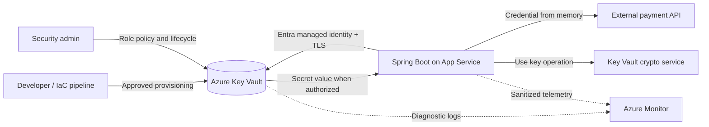

**Key trust boundaries:**

- **The secret issuer** (for example, a payment provider) may need to issue or replace the API key.
- **Key Vault** protects values, versions, and access control up until authorized retrieval.
- **The workload** may need the plaintext key to send to an external API; once retrieved, the application is responsible for protecting it in RAM/config/logs.
- **Key Vault key operations** can keep the private key non-exportable, unlike secret retrieval.
- **Admins/pipelines** are allowed to manage object lifecycles according to granted permissions and have no reason to read every production secret unless required.
- **Cloud monitoring** should know who called which operations, not the secret values.

Do not design a solution simply by picking a place to “stash passwords”; you must map out the **runtime secret flow** and **where plaintext can appear**.

## 3. Three Azure Key Vault Object Types: Secrets, Keys, Certificates

| Object | What it holds / does | Examples | How it is used |
|---|---|---|---|
| **Secret** | Opaque value (string/bytes per API and limits), metadata, versions | API token, database password | `getSecret` returns the **value** to an authorized application |
| **Key** | Key metadata, public material, and cryptographic operations; private key managed by the service | RSA/EC signing/encryption key | `CryptographyClient` invokes sign/verify/wrap/unwrap/encrypt/decrypt per key type |
| **Certificate** | Certificate policy, versions/issuance/lifecycle; typically linked to key and secret objects | TLS certificate for a domain | Manages certs, private-key policy, and certificate-consuming applications |
| **Managed HSM** | Separate dedicated HSM service, not an object type of a standard vault | Root signing key requiring high isolation | Separate management model, rules, pricing, and operations |

### Keys and Secrets Are Not Equivalent

- **Secret:** once read, plaintext leaves Key Vault. For example, a payment provider requires an `X-API-Key` request header; the application may need to read the secret.
- **Key:** the application can send a hash/payload to Key Vault to **sign** without ever receiving the private key. Key types, operations, and tier capabilities vary.
- **Certificate:** is both a public certificate and a private-key lifecycle wrapper. A certificate object does not automatically guarantee that every app with certificate read access can read the private key; you must understand how it links to the secret/key and the export policy.

### Design Decision Question

**Does the application actually need to possess the plaintext key to do its job?** If not, consider cryptographic operations with a non-exportable key. If an external system requires a plaintext API key, use a Key Vault secret while restricting read permissions and in-app retention time.

## 4. Boundaries of Azure Key Vault vs. Entra, App Configuration, and HSM

| Component | Responsibility | Should not be confused with |
|---|---|---|
| **Microsoft Entra ID** | Issues/validates identities and access tokens, manages principals/roles | A store for all application secrets |
| **Azure Key Vault** | Stores/manages secrets, keys, certificates, and data-plane access | An identity provider for end users |
| **Azure App Configuration** | Feature flags and application configuration, can reference Key Vault | An ideal place to store plaintext production passwords |
| **Managed identity** | Workload identity on Azure that obtains tokens without storing passwords in code | A data encryption key or Key Vault object |
| **Azure Managed HSM** | Cryptographic key isolation under a dedicated HSM model | A vault endpoint holding secrets/passwords like Key Vault |
| **Azure Storage encryption/CMK** | Encrypts data at rest or uses customer-managed keys per feature | An application store for third-party API keys |
| **CI/CD secret store** | Protects credentials during build/deploy | A complete replacement for runtime secret management |
| **Device OS/TPM/HSM** | Hardware root of trust/local keys when offline use is required | App Service managed identity |

### App Configuration + Key Vault Reference

An application can store **nonsecret config/feature flags** in Azure App Configuration and store **secret values** in Key Vault; App Configuration holds a *reference* rather than duplicating plaintext. You must still account for **caching, access permissions, refresh failures, and the vault address**.

### Managed HSM Differs from Key Vault Premium

Key Vault **Premium** supports hardware-protected keys according to product capabilities. **Managed HSM** is a separate resource with its own isolation, administration, backup, roles, and pricing. Do not assume from the name “HSM” that it is where you store `database-password` via the Key Vault Secret API.

## 5. Control Plane vs. Data Plane: Two Permission Boundaries

The **control plane** consists of Azure resource management operations via Azure Resource Manager (ARM), such as creating a vault, configuring firewall rules, and setting RBAC. The **data plane** consists of operations on secrets/keys/certificates via the Key Vault endpoint.

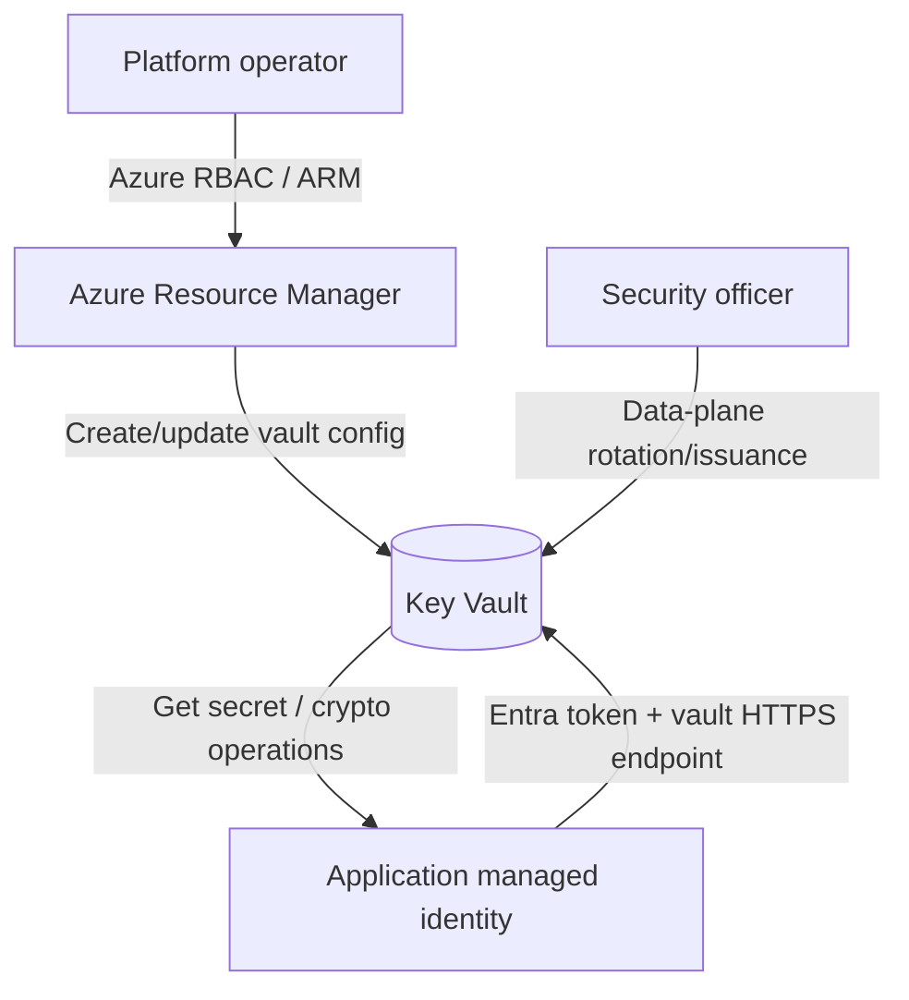

### Concrete Distinctions

| Action | Plane | Permission Type |
|---|---|---|
| Create a vault in a resource group | Control | ARM/Azure RBAC resource permission |
| Change Public network access | Control | Vault resource config permission |
| Assign an Azure role at vault scope | Control/authorization management | `Microsoft.Authorization/roleAssignments/write` per permissions |
| Read plaintext of `payment-api-key` | Data | Key Vault secret data action |
| Add a new secret version | Data | Secret set/write capability |
| Call RSA sign using a key | Data | Crypto sign permission |
| Issue or renew a certificate | Data and PKI workflow | Certificate-management rights |
| Purge a deleted secret | Data/management guardrails | Purge permission, purge protection constraints |

**Having Azure Contributor on a resource group does not automatically grant permission to read plaintext secrets in a vault using Azure RBAC data authorization.** Do not grant Owner or Key Vault Administrator just to fix a `403` when an application needs to read a single secret.

## 6. Two Permission Models in Key Vault: Azure RBAC vs. Legacy Access Policies

Key Vault supports two authorization models depending on configuration:

1. **Azure role-based access control (Azure RBAC)** for the data plane.
2. **Vault access policy**, the legacy model: a list of principals and permissions on secrets/keys/certificates.

### Azure RBAC Is Preferred for New Designs

- Defines roles by operations such as reading secrets, managing secrets, and cryptographic operations.
- Assigns roles at subscription/resource group/vault scope and, where supported by the product, object scope.
- Integrates with PIM/JIT and auditing via Entra governance capabilities.
- Separates vault resource administration from data access.
- Enables periodic review of excessive or inherited role scopes.

### Risks When Using Access Policies

In the access policy model, a principal with permission to manage vault access policies can **grant itself data-plane access** depending on the authorization model and specific permissions. This makes it easy to break the boundary between resource administration and reading secrets. When migrating from legacy access policies to Azure RBAC, plan the migration carefully, assign required roles beforehand, and test workloads to avoid an outage.

### Do Not Mix Models Carelessly

A vault is configured with one specific data-plane permission model. Do not assume that both “added an access policy” and “assigned RBAC” take effect simultaneously. Verify the **active permission model** of the specific vault before troubleshooting a `403`.

## 7. Commonly Used Azure Key Vault RBAC Roles

| Role (common name) | Intended permissions | Suitable principal |
|---|---|---|
| **Key Vault Reader** | Read metadata, not secret values | Inventory auditor |
| **Key Vault Secrets User** | Read secret values within the assigned scope | Application runtime needing secrets |
| **Key Vault Secrets Officer** | Manage secrets | Security/rotation operator |
| **Key Vault Crypto User** | Perform permitted cryptographic operations | Workload signing/encrypting via keys |
| **Key Vault Crypto Officer** | Manage cryptographic keys | Key lifecycle operator |
| **Key Vault Certificates Officer** | Manage certificate objects/lifecycle | PKI automation |
| **Key Vault Administrator** | Broad data-plane permissions | Break-glass/authorized admins |
| **Key Vault Contributor** | Manage the vault resource (control plane) | Platform team; does not grant reading secret contents in RBAC mode |

Role definitions and scope capabilities must be verified in the current Azure portal/CLI. A role containing the word **Reader** does not mean it can read all plaintext. The **Secrets User** role can read secrets within its assigned scope: if the scope is the **entire vault**, an application can read more secrets than it needs.

### Least Privilege by Function

- `orders-web`: only needs **get** on its payment key secret; assign minimal data-plane permissions at the narrowest supported scope.
- `billing-worker`: only uses the crypto signing key; does not need read access to all secrets.
- `secret-rotator`: has permission to create secret versions, without needing Azure Owner.
- `auditor`: metadata and logs, without default access to retrieve secret contents.

**Separate vaults by trust/owner/environment** when object-scope role assignments or the network model cannot adequately enforce boundaries. Do not keep production and development secrets in a single shared vault merely for administrative convenience.

## 8. Scope, Inheritance, and Lateral Movement Risk

Azure RBAC inheritance can make permissions broader than expected.

```text
Management group
  └── Subscription
        └── Resource group
              └── Key Vault A
                    ├── Secret: payment-api-key
                    └── Secret: smtp-credential
```

A role assigned at the **resource group** level can affect multiple vaults inside it; data-plane permissions depend on the role definition and authorization model. Never inspect role assignments “on the vault” alone while overlooking **inherited assignments** from parent scopes.

### Boundary Thinking

1. Each **environment** (dev/test/prod) has its own trust boundary.
2. Each **application/team** has an owner and rotation responsibility.
3. Each **secret** has its own sensitivity and consumers.
4. Assign roles per workload identity, not “every developer is a Secrets Officer”.
5. Grant broad read access minimally and time-bound when needed.
6. Enable Key Vault logs/auditing and PIM/JIT for privileged roles.
7. Resource locks, deny assignments, or governance policies may be needed for high-risk assets; do not assume a lock replaces RBAC.

### Cross-Environment Isolation Example

If a staging App Service is compromised, it **must not have permission to read production secrets**. Separating managed identities, vaults, role assignments, networks, and CI service connections helps limit the blast radius.

## 9. Microsoft Entra Identity: Who Is Actually Calling Key Vault?

The Key Vault data plane authenticates callers via Microsoft Entra tokens, though the actual identity can take different forms:

- **Human developer** running Azure CLI locally.
- **System-assigned managed identity** of an App Service/Function/VM.
- **User-assigned managed identity** attached to one or more Azure compute resources.
- **Workload identity federation** on AKS/GitHub/OIDC-compatible systems where supported.
- **Service principal** with a certificate/secret (when workload federation is not yet usable).
- **Key Vault service integration identity** managed by an Azure product for a specific feature.

### Avoid User Credentials in Production

Production applications should not sign in with personal accounts using passwords or interactive browser flows. Use **managed identity/workload identity** wherever the platform supports it; there is no need to embed a client secret just to get permission to read Key Vault.

### System-Assigned vs. User-Assigned Identity

| Type | Lifecycle | Key considerations |
|---|---|---|
| System-assigned MI | Created/bound to a single resource; deleting the resource deletes the identity | Easy to bind to a workload; replacing the resource requires re-granting permissions |
| User-assigned MI | Independent Azure identity resource | Can be reused in a controlled way, increases risk of overly broad shared permissions |
| Service principal | Application identity registered in Entra | Requires credential management or federation |
| Human principal | Authenticated user | For authorized admin/dev tasks, not for production daemons |

### Bootstrapping Principle

**The application acquires an Entra token using its Azure identity, then calls Key Vault.** Never store a long-lived Key Vault access token in `application.yml`; tokens are short-lived and must be refreshed by the SDK. Network connectivity to the Entra token service and the Vault endpoint must match the hosting model.

## 10. From Identity to Secret Value: The Complete Access Chain

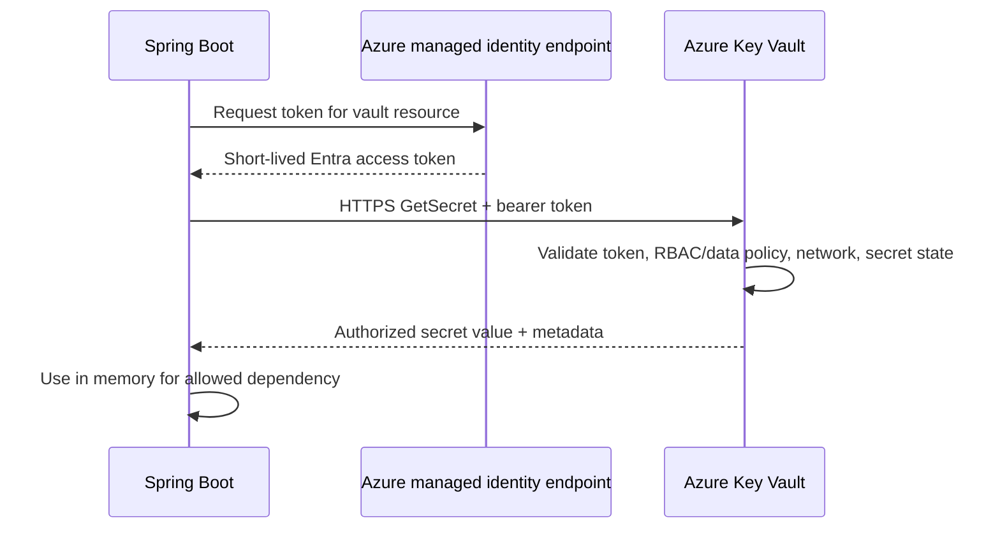

**Independent prerequisites:**

1. The resource hosting the app has the right identity enabled.
2. The runtime SDK obtains a token through the appropriate credential chain.
3. The identity has sufficient data-plane role permissions for the secret at the right scope.
4. Key Vault is using the expected permission model.
5. DNS/TLS/Private Endpoint/firewall along the App → Vault path is valid.
6. The secret name/version exists, is enabled, and is within its validity window.
7. The app does not print the secret in logs or error pages.
8. The downstream provider still accepts that credential.

**An authorized identity does not guarantee network reachability; open network paths do not automatically grant authorization.** These are two separate trust boundaries.

## 11. Secret Object: Name, Value, Version, and Metadata

A Key Vault secret typically has:

```text
Vault URI:     https://kv-orders-prod.vault.azure.net/
Secret name:   payment-api-key
Version ID:    <OPAQUE_SECRET_VERSION_ID>
Value:         [REDACTED]
Enabled:       true
Not before:    optional
Expires at:    optional
Content type:  optional
Tags:          owner=payments; env=prod; rotation=manual
```

This is illustrative metadata. Vault names must be globally unique according to service rules; URIs must be retrieved from the actual resource.

### A Secret Can Have Multiple Versions

```text
payment-api-key
  ├── version V1 (old)
  ├── version V2 (active)
  └── version V3 (new / staged)
```

- A call **without specifying a version** generally retrieves the latest version per current API semantics.
- A **versioned URI** points to a fixed version.
- Creating a new secret version **does not automatically update plaintext copies** cached in the app.
- Deleting or disabling a version does not revoke the old value at an external provider for clients still holding it.
- Secret expiry metadata does not automatically revoke an API key in the payment system; you must coordinate with the provider itself.
- **Rollback** must be planned: pin a known-good version or create a new version containing a valid value per policy.

### Protect Metadata

Tags, secret names, content types, or descriptions can also leak vendor names, tenants, or business processes. Never put user passwords, API keys, sensitive emails, or card numbers in **secret names or tags**.

## 12. Versionless vs. Version-Pinned References

| Type | Example URI | Benefits | Risks |
|---|---|---|---|
| **Versionless** | `https://kv-orders-prod.vault.azure.net/secrets/payment-api-key` | Consumers can pick up latest on refresh | Switching secrets can impact the entire app unexpectedly |
| **Version-pinned** | `https://kv-orders-prod.vault.azure.net/secrets/payment-api-key/<VERSION>` | Reproducible deploys, easy canary/rollback | Does not pick up new versions automatically; requires config rollout |

### Choose Based on Dependency Characteristics

- Provider API key has an **overlap window**: versionless + controlled refresh can be convenient.
- New secret risks breaking backward compatibility: use a pinned version in canary, then roll out.
- Signed token/private-key rotation requires controlling verification of old signatures; changing the reference alone does not resolve trust.
- For a compromise incident, you must revoke at the provider/disable permissions and stop cached credentials from working, not just set a new secret version.

### “Latest” Does Not Mean “Applied by All Pods”

Some apps retain secrets in RAM or connection pools. Executing rotation requires **verifying each consumer** and setting a deadline to revoke the old value, rather than relying on Vault metadata timestamps to conclude all services have switched.

## 13. Rotation Is a Multi-System Process

Suppose `payment-api-key` is issued by a payment provider:

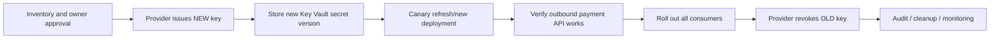

**Who revokes the old key?** The issuer itself (the payment provider) must invalidate the old API key according to its capabilities. Key Vault only manages the copy you store; it has no authority to revoke credentials at the vendor.

### Preflight

1. Know every application using the secret.
2. Know how many instances, clusters, environments, and deployment slots exist.
3. Know whether the provider supports **old + new concurrently**.
4. Know whether the secret is loaded at startup, periodically, or per request.
5. Have a business health check and a rollback plan.
6. Have test cases for provider auth/permission errors.
7. Have alerting and auditing before and after the change.
8. Have an emergency path if the key is compromised.

### Rotation Does Not Happen Automatically Just Because a Date Changes

A Key Vault secret value typically **does not automatically change the credential in an external system**. Automation requires an orchestrator/Function/runbook with permission to issue at the provider and write a new version, then verify migration before revoking the old key. Auto-rotation features for **keys** must not be assumed to apply automatically to all **secrets**.

## 14. Key Vault Keys: Cryptographic Operations and the Private Key Boundary

A **Key Vault key** is an object for performing cryptographic operations according to key type/capabilities. For example:

- `Sign`/`Verify` permitted messages or digests.
- `Encrypt`/`Decrypt` payloads according to supported algorithms/keys.
- `WrapKey`/`UnwrapKey` for a data encryption key in envelope encryption.
- `GetKey` to retrieve public material/metadata; **this does not export the private key**.
- `Create`/`Import`/`Rotate`/`Delete` according to key management permissions.

### Difference Compared to a Secret

```text
HMAC secret:
  App retrieves secret bytes
    -> App computes signature locally
    -> Plaintext secret resides in process memory

Key Vault asymmetric key:
  App requests Sign(digest)
    -> Key Vault performs permitted operation
    -> App receives signature, NOT private key
```

### Limitations to Know

- Key Vault key operations incur network latency, cost, and quotas; do not misuse the service for every byte of a large file.
- The `Sign` API may accept a digest or raw data depending on SDK/algorithm; you must choose the algorithm and standardize canonical representation.
- For large files, **envelope encryption** is typically used: encrypt data locally with a data key and use a Key Vault key to wrap the data key per policy.
- Software/HSM key capabilities, algorithms, and export policies depend on SKU/product.
- A key used to sign JWTs is not automatically a TLS certificate; there are distinct responsibilities for key IDs, public JWK distribution, and rotation.

### When Is Exporting a Private Key Actually Needed?

If a downstream system requires installing a private key for TLS termination or software outside Azure, evaluate the certificate/private key export policy and transit risk. If you can use remote signing operations, keeping the private key **non-exportable** reduces the attack surface.

## 15. Envelope Encryption: Do Not Send Entire Files to Key Vault

An example of protecting a 100 MB file:

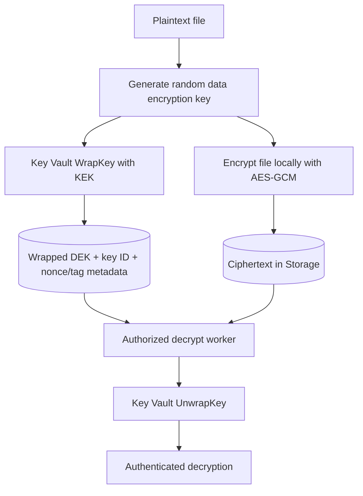

### Boundaries

- **DEK (data encryption key):** randomly generated for an object/batch, used to encrypt data locally.
- **KEK (key encryption key):** resides in Key Vault; used to wrap/unwrap the DEK.
- **Wrapped DEK:** can be stored alongside ciphertext, but integrity/access must be controlled.
- **Nonce/IV:** must be unique per cipher requirements; never reuse an AES-GCM nonce with the same key.
- **Key version ID:** stored in metadata to know which version to use when decrypting after rotation.
- **Audit:** who called unwrap/decrypt via Azure logging; app-level data access checks are still required.

**Do not roll your own cryptography if a vetted library/SDK is available.** This example only illustrates responsibilities and key lifecycle. Key Vault is not a full replacement for Azure Storage encryption; choosing CMK/managed encryption when supported by the data service may be more appropriate.

## 16. Certificates: Public Certificate, Private Key, and Secret Linkage

Key Vault certificate management can link:

- **Certificate object:** metadata/policy, issuance/renewal, certificate versions.
- **Key object:** corresponding cryptographic key per configuration.
- **Secret object:** may hold the certificate bundle (e.g., PFX/PEM) depending on policy and exportability.

### Distinguishing Permissions

- Reading certificate metadata/public X.509 **does not necessarily** allow downloading the private key.
- Reading the **linked certificate secret** can expose the private key when the policy permits export.
- If the private key is configured as **non-exportable**, do not assume every downstream service can retrieve a PFX.
- Managing certificates requires a role with an appropriate scope; do not grant broad Secrets User just to inspect certificate expiry.
- Certificate issuer/CA integration and renewal behavior depend on supported issuers and certificate types.

### Where Does TLS Termination Happen?

If the application sits behind **Azure App Service/Front Door/Application Gateway**, the TLS certificate can be managed at the front end/service integration and reference Key Vault as supported. **The Spring Boot app does not necessarily need to read the private-key PFX** if TLS terminates at the platform/gateway.

### PKI Considerations

X.509 certificates require managing `NotBefore`/`NotAfter`, SAN/hostname, trust chain, revocation, and renewals. Key Vault is only one part of the certificate lifecycle; it does not automatically fix DNS, CA trust, or replace a certificate cached by a reverse proxy.

## 17. Control Plane IaC and the Secret Management Boundary

Infrastructure as Code tools like Bicep/Terraform can provision Key Vault, networking, private endpoints, RBAC, and references. However, **putting plaintext secrets into parameters/state/outputs can expose them**.

### Should Be in IaC

- Vault name, SKU, region, resource group.
- Public network access/private endpoint/DNS config.
- Role assignments by principal and scope.
- Diagnostic settings, tags, purge protection, policies.
- App configuration using **secret URI/reference**, not raw values.
- Managed identity creation/binding.

### Must Be Tightly Controlled

- Secret values passed in deployment parameters.
- Terraform state containing sensitive values even when outputs are marked sensitive.
- ARM deployment histories/logs if parameters are not properly protected.
- CI pipeline steps with `echo`/debug leaking values.
- Temporary files containing secrets appearing on build agents or in artifacts.
- Remote state backend encryption, access, and retention.

**Marking a secret “sensitive” does not guarantee it won't appear anywhere.** Verify the actual behavior of your IaC tool, state store, logs, and CI service connections.

## 18. Secret Lifecycle: Inventory, Ownership, and Expiry

Every production secret should have a record:

```text
Name:            payment-api-key
Vault/environment: kv-orders-prod
Owner:           Payments platform team
Source:          Third-party payment provider
Consumers:       orders-web, billing-worker
Access method:   Managed identity + Key Vault Secrets User
Rotation policy: Every 90 days or on security incident
Old/new overlap: Provider allows two active keys
Expiry metadata: 2027-02-01T00:00:00Z (example)
Validation:      Approved sandbox payment API test
Rollback:        Prior valid key, within provider policy
Incident owner:  Security on-call + payment integration owner
```

Do not put **raw secret values**, PII, or account passwords into the inventory. Tags can hold owner/team and rotation policy identifiers, but metadata sensitivity must be reviewed.

### Who Is Responsible for What?

- **Producer:** creates/revokes the underlying credential at the vendor/CA/database.
- **Vault manager:** manages versions, access, purge protection, and diagnostic settings.
- **Consumer application owner:** refreshes caches and verifies functionality.
- **IAM/security team:** manages roles, conditional access for operators, and incident response.
- **SRE/operations:** handles monitoring, rollout, rollback, and SLAs.
- **Auditor:** reviews evidence, without defaulting to accessing plaintext secrets.

## 19. Soft Delete, Purge Protection, and Recovery

Key Vault provides protection mechanisms when secrets/keys/certificates or vaults are deleted, per product behavior:

- **Soft delete:** upon deletion, the object/vault remains in a recoverable state during the retention period.
- **Purge protection:** when enabled per policy, prevents **permanent purge** before retention expires, even by highly privileged users, subject to service constraints.
- **Recovery:** deleted objects can be restored within the allowed window given proper permissions; names/versions/states follow service rules.
- **Backup/restore:** supported features have restrictions regarding subscription/tenant/geography, permissions, and lifecycle.
- **Resource locks:** protect certain control-plane operations, without replacing IAM or purge protection.

### Why Are Both Needed?

If an attacker gains permission to delete an active secret, the application can suffer an outage. Soft delete allows object recovery; purge protection guards against premature permanent deletion within the retention period. However, **recovery does not revoke a leaked secret**, and apps/caches may still be using an old secret.

### Caution with Purge Protection

Configuration properties may **not be easily disabled** once enabled; retention and lifecycle constraints must be reviewed beforehand. Never test purging on a shared vault. For high compliance, consider vault separation and recovery drills.

## 20. Secret Boundary Architecture in a Java System

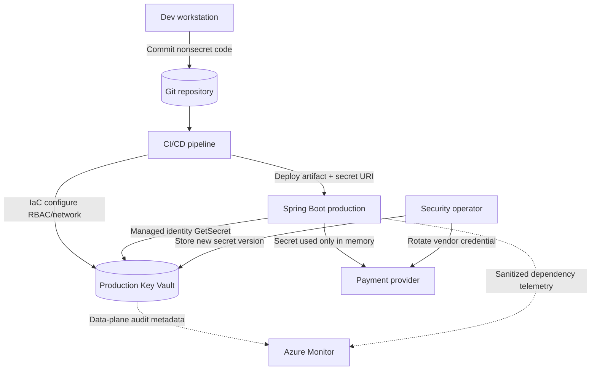

### Critical Boundaries

- **Git:** contains only code, config keys/secret references, never raw secrets.
- **CI:** build artifacts do not need to read production values unless strictly required by a special process; avoid granting secrets to forks/untrusted jobs.
- **App Service:** runtime fetches credentials using its authorized workload identity.
- **Key Vault:** protects versions/values at rest and controls data-plane get operations.
- **External provider:** remains responsible for issuing and revoking credentials.
- **Audit:** must know “who called GetSecret and when”, never “what value was returned”.
- **Cache:** each process/instance needs a refresh/rollout plan; Key Vault cannot erase plaintext in the RAM of an already-compromised process.


## 21. Java SDK: Retrieving Secrets with DefaultAzureCredential

A Spring Boot application needs `payment-api-key` without embedding the value in `application.yml`. The Azure SDK for Java provides `SecretClient` and `DefaultAzureCredential` to retrieve secrets via identity.

### Maven Dependencies

```xml
<dependency>
  <groupId>com.azure</groupId>
  <artifactId>azure-security-keyvault-secrets</artifactId>
  <version><!-- PIN_COMPATIBLE_SDK_VERSION --></version>
</dependency>
<dependency>
  <groupId>com.azure</groupId>
  <artifactId>azure-identity</artifactId>
  <version><!-- PIN_COMPATIBLE_SDK_VERSION --></version>
</dependency>
```

Select compatible versions via the current Azure SDK BOM/dependency management; this is an illustrative `pom.xml` snippet.

### Java Code

```java
package vn.example.orders.security;

import com.azure.identity.DefaultAzureCredentialBuilder;
import com.azure.security.keyvault.secrets.SecretClient;
import com.azure.security.keyvault.secrets.SecretClientBuilder;
import com.azure.security.keyvault.secrets.models.KeyVaultSecret;

public final class PaymentSecretProvider {
    private final SecretClient client;
    private final String name;

    public PaymentSecretProvider() {
        String vaultUrl = required("KEY_VAULT_URL");
        name = required("PAYMENT_SECRET_NAME");
        client = new SecretClientBuilder()
            .vaultUrl(vaultUrl)
            .credential(new DefaultAzureCredentialBuilder().build())
            .buildClient();
    }

    public PaymentCredential load() {
        KeyVaultSecret secret = client.getSecret(name);
        // Never log secret.getValue() or the entire secret object.
        return new PaymentCredential(
            secret.getValue(),
            secret.getProperties().getVersion());
    }

    private static String required(String key) {
        String value = System.getenv(key);
        if (value == null || value.isBlank()) {
            throw new IllegalStateException(
                "Missing configuration: " + key);
        }
        return value;
    }

    public record PaymentCredential(
        String value, String version) {}
}
```

**Conditions:** `KEY_VAULT_URL` is a URL of the form `https://<VAULT_NAME>.vault.azure.net/`; `PAYMENT_SECRET_NAME` contains only the name. The runtime has an authorized managed identity/workload identity or developer credential, the principal has Get Secret permission at the right scope, and networking/TLS/Private Endpoint is working. The secret is active and the vendor still accepts the key.

**Note:** `getSecret` is a network call with latency/quotas/cost, and plaintext will reside in process memory. Reuse the client, design bounded caching/refresh, never log values, and never create a “debug secret” endpoint.

## 22. Spring Boot Bean and Plaintext-Free Configuration

```java
package vn.example.orders.config;

import com.azure.identity.DefaultAzureCredentialBuilder;
import com.azure.security.keyvault.secrets.SecretClient;
import com.azure.security.keyvault.secrets.SecretClientBuilder;
import org.springframework.beans.factory.annotation.Value;
import org.springframework.context.annotation.Bean;
import org.springframework.context.annotation.Configuration;

@Configuration
public class KeyVaultConfiguration {

    @Bean
    SecretClient secretClient(
            @Value("${security.key-vault-url}") String vaultUrl) {
        return new SecretClientBuilder()
            .vaultUrl(vaultUrl)
            .credential(new DefaultAzureCredentialBuilder().build())
            .buildClient();
    }
}
```

```yaml
security:
  key-vault-url: ${KEY_VAULT_URL}
```

The `${...}` expressions here are Spring property placeholders, resolved by Spring from configuration/environment at runtime; no password is hardcoded. The application must fail closed if a required credential is missing or invalid rather than falling back to a default password. For a temporary Vault outage, a last-known-good cache may only be used within **approved limits** and never during a compromise incident.

Avoid exposing `/actuator/env` or config/debug endpoints, printing `System.getenv()`, or logging the entire `KeyVaultSecret` object; such endpoints must have proper authorization and redaction.

## 23. App Service Key Vault References

Azure App Service supports **Key Vault references** for certain app settings:

```text
App Setting name: PAYMENT_API_KEY
App Setting value:
@Microsoft.KeyVault(SecretUri=https://kv-orders-prod.vault.azure.net/secrets/payment-api-key)
```

This is a **versionless** URI. A version-pinned URI appends `/<VERSION_ID>`.

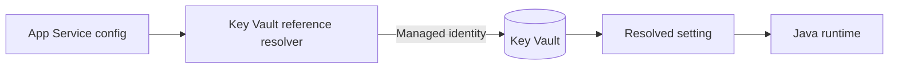

Conditions: App Service has the correct identity (system- or user-assigned), the identity has Get Secret permission, Vault networking/DNS is reachable, and the reference syntax is valid. **Versionless does not mean App Service always refreshes instantaneously**; it has its own caching and refresh/config-change behavior per feature. The resolved value still resides in the process environment/config, so it must not be written to logs.

The **SDK** is suitable when the app needs to select versions, handle errors/refresh, or read metadata. **Key Vault references** are suitable when you want the platform to resolve secret settings; **CryptographyClient** is for key operations and is not equivalent to a secret reference.

## 24. Secret Caching and Multiple Application Instances

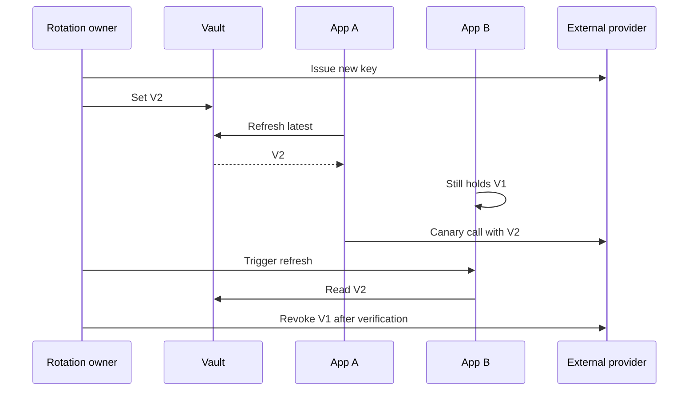

| Pattern | Strengths | Limitations |
|---|---|---|
| Load at startup | Easy to control per release | Requires redeploy/restart |
| TTL polling | Updates periodically | Stale window, vault requests |
| Event-triggered refresh | Reacts to new-version events | Needs retries, idempotency, reconciliation |
| Version-pinned | Explicit canary/rollback | Easy to go stale if forgotten |
| Versionless latest | Fewer config changes | Can pick up a new version unexpectedly on refresh |

Report each instance's **secret version ID** (never the value) to track rollout. If an old key is compromised, do not continue using the cache for uptime; coordinate **revocation at the vendor** and incident response.

## 25. AKS: Secrets Store CSI Driver and Workload Identity

AKS can use the **Secrets Store CSI Driver + Azure Key Vault provider** per feature/version support to mount secrets/certificates into a pod or sync them to a Kubernetes Secret.

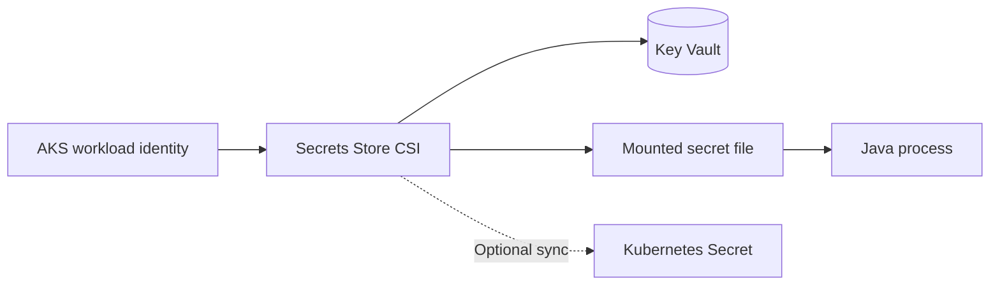

- A **mounted file** still holds plaintext in the pod's filesystem view; protect ACLs, host, pod, and processes.
- **Kubernetes Secret sync** creates an additional copy in the Kubernetes API/etcd/backups; `base64` is only encoding.
- `SecretProviderClass` should contain references, not raw secrets.
- The CSI addon/node identity differs from the workload identity; verify the actual principal.
- File rotation does not automatically make the application reload; env vars populated from Kubernetes Secrets typically require a pod restart to pick up new values.
- Do not mount the entire vault across all namespaces or grant Secrets User to all node identities.
- Verify Private DNS/firewall rules from the CSI/pod runtime.

## 26. Git, CI/CD, Docker, and IaC: Keep Secrets Out of Artifacts

```text
Secret in application.yml
 -> Git history and forks
 -> CI logs and artifacts
 -> Docker build layers and registry
 -> App config dump
```

Controls: secret scanning, protected branches, least-privilege CI connections, OIDC federation for CI when supported; do not use Docker `ARG SECRET`/`ENV SECRET` during builds; IaC manages Vault/RBAC/network/references rather than injecting passwords into Terraform state/ARM outputs/logs. Protect remote state, pipeline logs/backups, and do not grant CI `Secrets User` on production unless genuinely required.

**A committed secret must be revoked/rotated at the source.** Simply deleting the commit/file or enabling secret scanning afterward does not invalidate a leaked key.

## 27. Private Endpoint, Firewall, and Key Vault DNS

A vault has a hostname:

```text
kv-orders-prod.vault.azure.net
```

Private Link typically uses the corresponding private DNS zone:

```text
privatelink.vaultcore.azure.net
```

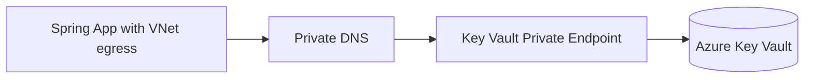

**Authentication, authorization, and network are three independent conditions.** An app with valid RBAC but blocked by a firewall → fails; a working private route without Get Secret → 403.

- A Vault Private Endpoint is the **inbound path to the Vault**. App Service needs VNet Integration/egress to reach that endpoint.
- An inbound Private Endpoint on App Service does not substitute for App → Vault outbound connectivity.
- The SDK should still use the proper vault FQDN with DNS resolving to the private IP; do not hardcode IPs or disable TLS hostname validation.
- Test DNS from the App Service/AKS runtime itself, not just a laptop.
- Ensure the endpoint is approved, Private DNS zone/VNet links exist, and NSGs/UDRs/firewalls allow the path.
- Never open public internet access just to work around a private DNS issue.

```bash
nslookup kv-orders-prod.vault.azure.net
```

Illustrative command; it does not prove the topology of an actual resource.


## 28. Azure CLI: Safely Inspecting Vault Configuration

Use only authorized **lab** resources in an approved subscription. Inspecting Vault info **does not require printing secret values**:

```bash
az account show --output table

RG="<LAB_RESOURCE_GROUP>"
VAULT="<LAB_VAULT_NAME>"

az keyvault show \
  --resource-group "$RG" \
  --name "$VAULT" \
  --query "{name:name,id:id,location:location,rbac:properties.enableRbacAuthorization,publicNetworkAccess:properties.publicNetworkAccess,purgeProtection:properties.enablePurgeProtection}" \
  --output json
```

Field names and CLI versions must be verified against the actual resource. If a query returns null, do not conclude a feature is disabled before checking the actual output/schema.

### Check Assigned Permissions

```bash
VAULT_ID=$(az keyvault show \
  --resource-group "$RG" \
  --name "$VAULT" \
  --query id --output tsv)

az role assignment list \
  --scope "$VAULT_ID" \
  --include-inherited \
  --output table
```

Check **inherited assignments** from parent scopes, principal object IDs, role definitions, and the data-plane permission model. Vaults in **access policy** mode have a different inspection path than vaults using Azure RBAC; do not switch a production vault's mode while diagnosing an issue.

### Read Secret Metadata Without Printing Plaintext

```bash
az keyvault secret list \
  --vault-name "$VAULT" \
  --query "[].{name:name,enabled:attributes.enabled,expires:attributes.expires}" \
  --output table

az keyvault secret list-versions \
  --vault-name "$VAULT" \
  --name "payment-api-key" \
  --query "[].{id:id,enabled:attributes.enabled,expires:attributes.expires}" \
  --output table
```

These commands require appropriate data-plane list permissions. **Do not run `az keyvault secret show` and share the full JSON**, as it can contain the secret value. If you need to inspect metadata specifically, query only safe properties in accordance with current permissions and policy.

## 29. CLI: Granting Scoped Permissions to a Managed Identity

This illustrative example **modifies IAM if executed**; run it only on a lab App Service you manage with approval:

```bash
RG="<LAB_RESOURCE_GROUP>"
APP="<LAB_APP_NAME>"
VAULT="<LAB_VAULT_NAME>"

# Enable a system-assigned identity on the lab App Service.
az webapp identity assign \
  --resource-group "$RG" \
  --name "$APP"

PRINCIPAL_ID=$(az webapp identity show \
  --resource-group "$RG" \
  --name "$APP" \
  --query principalId --output tsv)

VAULT_ID=$(az keyvault show \
  --resource-group "$RG" \
  --name "$VAULT" \
  --query id --output tsv)

az role assignment create \
  --assignee-object-id "$PRINCIPAL_ID" \
  --assignee-principal-type ServicePrincipal \
  --role "Key Vault Secrets User" \
  --scope "$VAULT_ID"
```

**Explanation:**

- Azure IAM role assignments succeed only if the operator has permission to assign roles at that scope.
- This example targets a vault using the **Azure RBAC data plane** and does not apply by default to legacy access policy mode.
- The role is granted at the **entire vault** level, which may be broader than needed for a single secret. When possible, narrow the scope or separate vaults to isolate applications.
- Role propagation can take time; do not retry creating duplicate assignments thinking the service missed it.
- If using a user-assigned identity, select the exact principal/client ID and configure App Service/the SDK accordingly.
- Never grant Key Vault Administrator to a web app that only needs to read a secret.

### Negative Test

Use an identity without Secrets User and attempt `GetSecret` against the lab secret: the request must be denied, even when hostname resolution and TLS succeed. This tests the **data-plane boundary**.

## 30. Key Vault CryptoClient: Signing Without Exporting the Private Key

When an application needs to sign a digest, use `CryptographyClient` with a Key Vault key instead of downloading the private key into process memory.

### Maven Dependencies

```xml
<dependency>
  <groupId>com.azure</groupId>
  <artifactId>azure-security-keyvault-keys</artifactId>
  <version><!-- PIN_COMPATIBLE_VERSION --></version>
</dependency>
<dependency>
  <groupId>com.azure</groupId>
  <artifactId>azure-identity</artifactId>
  <version><!-- PIN_COMPATIBLE_VERSION --></version>
</dependency>
```

### Java Sign Operation

```java
package vn.example.orders.crypto;

import com.azure.identity.DefaultAzureCredentialBuilder;
import com.azure.security.keyvault.keys.cryptography.CryptographyClient;
import com.azure.security.keyvault.keys.cryptography.CryptographyClientBuilder;
import com.azure.security.keyvault.keys.cryptography.models.SignResult;
import com.azure.security.keyvault.keys.cryptography.models.SignatureAlgorithm;

import java.nio.charset.StandardCharsets;
import java.security.MessageDigest;

public final class RemoteSigningExample {

    public static void main(String[] args) throws Exception {
        String keyId = System.getenv("SIGNING_KEY_ID");

        if (keyId == null || keyId.isBlank()) {
            throw new IllegalStateException(
                "SIGNING_KEY_ID must be configured");
        }

        CryptographyClient client = new CryptographyClientBuilder()
            .keyIdentifier(keyId)
            .credential(new DefaultAzureCredentialBuilder().build())
            .buildClient();

        byte[] content =
            "order-id=ORD-1001;amount=120.50"
                .getBytes(StandardCharsets.UTF_8);

        byte[] digest = MessageDigest.getInstance("SHA-256")
            .digest(content);

        SignResult signed = client.sign(
            SignatureAlgorithm.RS256, digest);

        System.out.println(
            "Signature length: " + signed.getSignature().length);
    }
}
```

### Conditions and Limitations

- `SIGNING_KEY_ID` is a Key Vault **key ID**, not a Secret URI.
- The key must have the corresponding RSA key type, state/capabilities, and `RS256` support.
- The managed identity needs **Crypto Sign** permission via an appropriate role/data action; Secrets User is not enough.
- The signing input must be canonicalized; `RS256` signs a **SHA-256 digest** per Key Vault SDK semantics.
- This code does not build a JWT/PKI protocol on its own. To verify signatures, consumers need the public key, `kid`/version, and verification algorithm.
- Key Vault sign calls incur network latency/quotas/cost; do not send every byte of a large file to the service to “sign a file” arbitrarily.
- The private key remains within Key Vault key operations, but a **compromised workload with signing permission** can still be abused to generate signatures. Least privilege and auditing remain essential.

## 31. Certificate Lifecycle and TLS Termination

A certificate in Key Vault can link a certificate object, a key object, and a secret object, depending on policy and exportability.

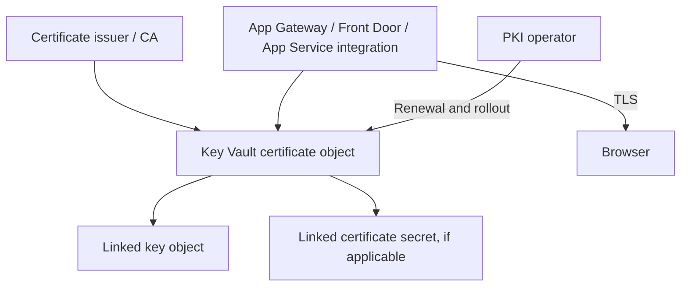

### Roles

- **CA/issuer** issues the X.509 certificate for the DNS hostname.
- **Vault** manages versions/policy/renewal per supported features.
- **Front-end service** fetches or references the certificate via its integration and dedicated permissions.
- **DNS/domain owner** configures hostnames/trust routes.
- **The Spring Boot app** does not necessarily hold a private-key PFX if TLS terminates at the front end.
- **Operators** verify expiry, SANs, trust chain, bindings, listener refresh, and rollover.

### Common Misconceptions

- Reading public certificate information **does not grant permission to read the private key**.
- For exportable certificates, the **linked secret** can contain highly sensitive key material.
- Renewing a certificate in Vault does not guarantee every service listener refreshes immediately.
- An expired certificate cannot be safely handled by disabling TLS validation.
- If the certificate/key is non-exportable, external systems requiring a PFX cannot use it; design trust/termination up front.

## 32. Secret Expiry, Rotation Events, and Automation

For each production secret, track:

```text
Secret: payment-api-key
Owner: Payments platform team
Source issuer: External payment provider
Consumers: orders-web, billing-worker
Rotation window: every 90 days OR on security incident
Provider overlap: old and new valid concurrently
Canary: authorized sandbox transaction
Status: planned -> issued -> staged -> verified -> old revoked
```

The metadata in this example is an internal policy, not a built-in Key Vault schema. **Secret expiry metadata does not expire the vendor API key at the source.**

### Event-Driven Automation

Key Vault provides supported **Event Grid lifecycle events** (e.g., near expiry or new version created), which can be combined with Azure Functions/Logic Apps/automation:

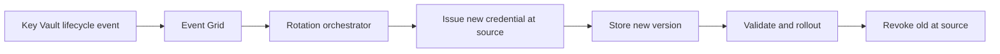

Do not assume events are always delivered exactly once or strictly in order. The orchestrator needs **idempotency**, correlation IDs, checkpointing/reconciliation, retries, approvals, and incident classification. Policy-based auto-rotation of **Key Vault keys** does not mean external providers automatically issue new credentials for Secrets.

### Time-Based Alerting

You can alert at 30/14/7 days prior depending on service and risk. There must be an assignee, runbook, permissions to act, and evidence that the new version was applied; sending an alert email alone does not complete rotation.

## 33. Key Vault Logging and Azure Monitor

Monitor both the Vault and the application:

| Signal | Meaning |
|---|---|
| Request count/latency | Abnormal Vault call volume or slowness |
| 401/403 | Authentication/authorization/network deny |
| 429 | Quota/throttling, ineffective caching |
| GetSecret/Sign operations | Data-plane operations per diagnostic categories |
| Role assignments and Vault config changes | Changes to IAM, network, or purge protection |
| Secret/key/cert expiry | Credential lifecycle |
| App secret-version in use | Whether V2 is applied across all instances |
| Downstream API auth errors | Whether the vendor accepts the new key |
| Key Vault access anomalies | Unusual principal/location/request volume |

### Illustrative KQL

If Log Analytics uses the `AzureDiagnostics` table and diagnostic settings are enabled:

```kusto
AzureDiagnostics
| where TimeGenerated > ago(24h)
| where ResourceProvider =~ "MICROSOFT.KEYVAULT"
| summarize Operations = count() by OperationName
| order by Operations desc
```

Resource-specific tables may be used instead of `AzureDiagnostics`; verify table/column names against your actual workspace and log configuration. Absence of log rows **does not prove absence of access** if diagnostic settings were not enabled.

### Logging Rules

Log `operation, status, latency, correlationId, principalId`/secret version metadata per policy; **never log plaintext values, PFX/private keys, bearer tokens, SAS tokens, connection strings, or raw Authorization headers**. Logs also require RBAC, retention, alerting, and cost estimation.

## 34. Instrumenting Key Vault in a Spring Boot Application

A service can instrument:

```text
metric: keyvault_secret_fetch_seconds
dimensions: operation=getSecret; result=success|failure
trace: requestId, dependency time, sanitized vault resource
audit: principal object ID, secret version ID (not value)
health: no critical secret older than approved deadline
```

These are custom application-defined metric names. Do not assume Azure Monitor provides metrics with these exact names out of the box.

### Avoid High Metric Cardinality

Never use raw secret values, user emails, or tokens as metric labels. Secret names themselves can sometimes be sensitive metadata or cause high cardinality; consider using **logical dependency names** such as `payment-provider`.

### When to Alert

- GetSecret 403 rate spikes right after an IAM change.
- 429s or latency rise because the app bypassed caching.
- Secret version migration has not reached all instances after the change window.
- A certificate is expiring soon and renewal is failing.
- Role assignments expand unexpectedly or public network access is re-enabled.
- The payment provider returns auth failures when a new secret is published.

## 35. Security Practices: Mistakes Where “You Have a Vault but Still Leak”

| Mistake | Why it happens | Risk mitigation |
|---|---|---|
| App can read every secret | RBAC assigned at too broad a scope | Separate vaults or minimize role scope |
| Token comes from developer login in prod | Default credential chain picks the wrong source | Pin workload identity and verify principal |
| Secret printed in startup logs | Config debug/Actuator | Redaction and log testing |
| CI bakes secret into Docker layer | Build-time injection | Runtime references/identity |
| Vault Private Endpoint enabled but app unreachable | Missing VNet Integration/Private DNS | Test egress/DNS from the app |
| New secret version created but app still uses old one | Caching/Key Vault reference refresh | Canary/version telemetry/restart |
| Deleting secret instead of revoking vendor key | Misunderstood boundary | Revoke at issuer/provider |
| Key Vault Contributor treated as Secrets User | Confusing ARM/data-plane | Assign proper data action role |
| Linked certificate secret contains PFX | Overly broad Secrets User role | Key/cert export policy and role isolation |
| KMS signing service abused | Workload compromised with sign rights | Least privilege, rate limiting, monitoring |

### No “Secret Manager” Fixes Bugs in How Secrets Are Used

If an application sends an API key to the wrong host over HTTP, the value is exposed even though Vault previously stored it safely. Clients need TLS hostname validation, allowlisted endpoints, and separation of trusted vs. untrusted input. If a service suffers RCE, Key Vault RBAC only limits **which secrets that service can access**, not the abuse of permissions the service already holds.

## 36. Runbook: GetSecret Returns 401, 403, 404, or Timeout

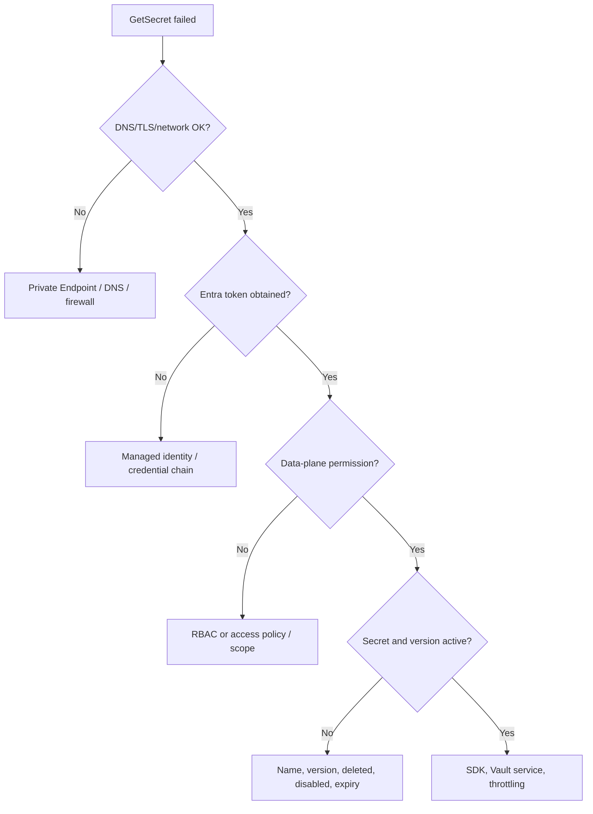

### Investigation Order

1. Record `vault resource ID`, UTC time, app principal ID, operation, and correlation ID; **never log secret values/tokens**.
2. Verify the Vault URL, secret name, and version passed.
3. Check DNS/TLS/Private Endpoint/VNet Integration **from the runtime itself**.
4. Determine whether the credential chain uses system-assigned MI, user-assigned MI, or developer identity.
5. Verify token audience/tenant and that the identity is enabled.
6. Check whether the Vault uses **Azure RBAC** or access policies.
7. Inspect roles/data actions and scope, including inherited assignments.
8. If a role was just assigned, allow for propagation delay; do not grant Administrator.
9. Check if the object is disabled, deleted, expired, or has an incorrect version.
10. For 429s, check excessive `GetSecret` calls/cache misses and bounded backoff.
11. For 5xx/timeouts, separate transient network/service issues from credential failures.
12. Test again with an **authorized lab secret** and record sanitized status/latency.

| Code/symptom | Investigation direction |
|---|---|
| 401 | Authentication/token/challenge |
| 403 | RBAC/data actions, permission model, or firewall/network policy |
| 404 | Vault/object/version does not exist or is unavailable |
| 429 | Quota/throttling; cache/retry pressure |
| 5xx/timeout | Transient network/service issue, retry budget |
| TLS certificate error | Proxy, CA chain, hostname, DNS |

Never disable TLS/issuer validation or open public internet access on the vault as a “quick fix”.

## 37. Runbook: A Rotation Breaks the Application

For example, 50% of payment requests receive 401 from the provider after Vault gets version V2.

### Checklist

- Which App Service slots/pods are using V1 vs. V2? Log **version IDs** only.
- Has the provider activated V2, and is it for the right environment/account?
- Has V1 been revoked by the provider, or is it still within the overlap window?
- Does the app have a version-pinned reference to V1 or a startup cache?
- Does V2 have a trailing newline/encoding/format issue from secret ingestion?
- Do all app instances share the same identity/vault network configuration?
- Are code, RBAC, or egress changes being deployed concurrently?

### Remediation

Pause further rollout/revocation if this is not a compromise incident. Test V2 via a dependency sandbox/canary and refresh/restart consumers sequentially. **Only roll back to V1 if V1 has not been compromised and the provider still permits it**; if it was leaked or revoked, you must forward-fix. Reconcile retried or duplicate transactions and document the audit/lessons learned.

## 38. Runbook: Suspected Secret Exposure

An API key was printed into CI logs, exception traces, or Git history.

1. Trigger security incident response; preserve evidence and restrict log access.
2. Identify owner, provider, secret/version, exposure window, and blast radius.
3. **Revoke/rotate at the credential issuer** (payment vendor/database/Entra service principal).
4. Store a new valid version in Vault and roll it out over secure channels.
5. Verify caches, multiple instances, and downstream auth success.
6. Review Key Vault data-plane audit logs, role assignments, CI artifacts, Git history, Docker layers, and backups.
7. Investigate unauthorized transactions or data access during the exposure window.
8. Reduce permissions and lock related identities if there are signs of compromise.
9. Redact/scrub copies per security policy, but **never treat deleting a Git commit as revocation**.
10. Test secret scanning, log redaction, RBAC negative tests, and rotation drills.

### Two Key Limitations

- Disabling a secret in Key Vault only affects subsequent reads; **it does not invalidate a plaintext key already stolen or cached at the vendor**.
- A non-exportable private key reduces key-extraction risk, but a workload compromised with `Sign` permissions can still misuse the signing service within its granted scope.

## 39. Vault Recovery, Disaster Recovery, and Fail-Safe Behavior

| Incident | Recovery |
|---|---|
| IAM role deleted | Reassign least privilege per approval/audit |
| Private DNS/endpoint broken | Restore route/DNS, verify from runtime |
| Secret soft-deleted | Recover while within retention with proper permissions |
| Vault soft-deleted | Recover resource per capabilities/retention |
| Purge protection enabled | Retention cannot be bypassed by policy |
| Secret compromise | Revoke at provider, create new key; do not restore V1 as a fix |
| Key Vault timeout | Bounded retry, circuit breaker, cache policy/fail closed |
| App restart loses cached secret | Startup dependency, health check, fallback policy |
| Region/network disruption | DR/availability plan per service and RTO/RPO |

**Key Vault backup/restore** is subject to conditions on permissions, object types, subscription/tenant/geography, and current procedures. Test recovery on authorized resources; never promise that any backup can be restored to any arbitrary Vault/region.

### Last-Known-Good Cache: A Risk-Based Decision

During a temporary outage without credential compromise, the application may continue from cache for an approved duration. If key compromise is suspected, **fail closed/revoke** takes priority over uptime. Never leave a hardcoded emergency password in place long-term just because Vault might occasionally be unreachable.

## 40. Capacity and Cost of Secret Management

| Source | Cost drivers |
|---|---|
| Key Vault | Operations, object types, and tier per pricing schedule |
| HSM/Premium/Managed HSM | Key protection/operations/resource model |
| App Service/AKS | Compute, scale-out, and VNet integration |
| Private Link/DNS | Endpoints/network/DNS Resolver/firewall |
| Key rotation workflow | Functions/Event Grid/Logic Apps/automation |
| Monitoring | Azure Monitor/Log Analytics ingestion/retention |
| PKI | Certificate issuer, renewals, HSM, support |
| Operations | IAM reviews, incident drills, business validation |

### Optimization Principles

- Do not read secrets on every HTTP request.
- Use SDK client reuse and a reasonable cache TTL.
- Use App Configuration for **nonsecret config**.
- Use key crypto operations when a non-exportable private key is required.
- For large files, consider envelope encryption/CMK instead of pushing bytes through Key Vault APIs.
- Reduce 429s with retry/backoff and burst reduction rather than skipping rotation/security to save money.
- Set Azure Cost Management budgets/tags/alerts and verify current pricing by region/SKU.
- Never treat a budget alert as a hard cost cap or a secret revocation mechanism.

## 41. Lab: Java Spring Boot Reading Secrets Without Exposing Plaintext

### Prerequisites

- An authorized subscription/resource group and **lab Key Vault**.
- A Java 17+ application (Spring Boot optional) with Azure SDK dependencies.
- A test secret `lab-payment-api-key` with a dummy value, containing no production credentials.
- A test App Service/AKS/VM with a managed identity or authorized developer identity.
- Operator permissions to assign roles on the **lab scope**.
- Access to redacted logs/monitoring.

### Step 1 — Document Boundaries

Diagram Git → CI → App Service → Vault → provider. Record **who issues the key**, **who reads it**, **who can add versions**, **who revokes it**, and where plaintext can appear.

### Step 2 — Inspect Vault Read-Only

```bash
az account show --output table

az keyvault show \
  --resource-group "<LAB_RESOURCE_GROUP>" \
  --name "<LAB_VAULT_NAME>" \
  --output json
```

Confirm tenant/subscription, Vault URL, RBAC mode, network settings, and soft delete/purge protection. Do not run `az keyvault secret show` and paste JSON containing plaintext.

### Step 3 — Assign Proper Permissions

On the approved lab resource, assign the managed identity **Key Vault Secrets User** (or a smaller supported scope). Check inherited assignments. Do not grant Vault Administrator to an application that only needs GetSecret.

### Step 4 — Test Java SDK

Use `PaymentSecretProvider` from Section 21 with:

```text
KEY_VAULT_URL=https://<LAB_VAULT>.vault.azure.net/
PAYMENT_SECRET_NAME=lab-payment-api-key
```

The test application **must not print the value**; only assert that the credential is non-empty, version metadata is present, and the sandbox dependency (if available) accepts the credential.

### Step 5 — Negative Tests

- An identity without GetSecret permission → must be denied.
- An authorized caller whose network is blocked by lab policy → must fail to connect.
- Wrong secret name/version → object-not-found error.
- Simulate 429/timeouts with a test stub; do not flood a real Vault.
- Test log scanning to ensure no keys/Authorization headers appear.

### Step 6 — Version Rollover

The security/lab owner creates **V2 with a test value**; the canary app refreshes and reports its version ID. While instance B still uses V1, confirm this represents an incomplete rollout state. Close the change only once consumers confirm V2 and business tests pass. Do not purge the vault.

### Step 7 — Inspect Telemetry

Monitor sanitized GetSecret failures, latency, IAM changes, and expiry metadata. Never send plaintext, bearer tokens, SAS tokens, or PFXs to Azure Monitor.

### Step 8 — Report and Cleanup

| Item | Evidence |
|---|---|
| Vault/IAM | Resource ID, RBAC mode, role, and scope |
| Identity | Principal object ID (per policy) |
| Network | DNS/Private Endpoint result |
| Java | SDK/JDK, GetSecret PASS/FAIL |
| Versions | V1 → V2 metadata, rollout state |
| Negative tests | Unauthorized and network denied |
| Logs | Zero raw values/tokens |
| Cost | Operations, runtime, networking, monitoring |
| Blockers | Anything not executed/lacking permissions |

Clean up only **lab resources you own** with approval; never delete a production Vault or a shared secret.

## 42. Production Checklist

- [ ] Inventory includes owner, provider/issuer, consumers, and rotation policy.
- [ ] Secrets, keys, certificates, and HSM are properly distinguished when choosing.
- [ ] No plaintext in Git, CI, Docker, Helm values, or IaC state.
- [ ] Dev/test/prod have separate identities, RBAC, vaults, and networks.
- [ ] Managed identity/workload federation is used wherever platform-supported.
- [ ] Both inherited Azure RBAC roles and legacy access policy mode are checked.
- [ ] Workloads only get/invoke the cryptographic operations they actually need.
- [ ] Secret/certificate names and tags contain no PII/raw credentials.
- [ ] Versioning, canary, cache refresh, rollback, and provider-side revocation are in place.
- [ ] Alerts exist for expiry/rotation deadlines, owners, and change approvals.
- [ ] When using key signing/encryption, private keys are not downloaded unnecessarily.
- [ ] Certificate SAN/CA/expiry/exportability and TLS bindings are governed.
- [ ] App Service Key Vault reference refresh and access are tested.
- [ ] AKS CSI sync/reload and K8s Secret exposure are evaluated.
- [ ] Private Endpoint/DNS/VNet Integration are verified from the runtime.
- [ ] Soft delete/purge protection/recovery have approved procedures and DR drills.
- [ ] CI and source repositories have secret scanning and least privilege.
- [ ] Apps do not log values/tokens/keys/PFXs and do not expose debug config endpoints.
- [ ] Logs/metrics cover auth failures, 403/429s, expiry, and unusual Sign calls.
- [ ] Runbooks exist for 403s, failed rotations, leaks, Vault outages, and restored objects.
- [ ] Fail-safe policies exist for cached secrets during compromise/outage.
- [ ] Vault/HSM/Private Link/monitoring costs are budgeted.
- [ ] Unauthorized GetSecret and network isolation have been tested.
- [ ] “Vault has secret V2” is not confused with “all consumers switched to V2”.
- [ ] STEP 4 authoring is not treated as content QA or production deployment.

## 43. Self-Check Questions

1. How does a secret differ from nonsecret configuration?
2. How do Key Vault secrets, keys, and certificates serve three different purposes?
3. When should you use `Sign` instead of loading a private key into the application?
4. How do Key Vault and Microsoft Entra ID divide responsibilities?
5. How do the control plane and data plane differ? Why might Contributor not be able to read a secret?
6. How do Azure RBAC and access policies differ in their permission models?
7. Which role allows a runtime to call GetSecret without managing the vault?
8. Why can an inherited role on a resource group expand the blast radius?
9. How does a managed identity differ from a human developer credential?
10. How do system-assigned MI and user-assigned MI differ in lifecycle?
11. Why must you verify the actual identity used by `DefaultAzureCredential`?
12. What are the trade-offs between a versioned and a versionless secret URI?
13. Once V2 is created, why might apps A and B still use two different versions?
14. Does Key Vault automatically revoke a payment API key at the issuer?
15. Which incidents do soft delete and purge protection help address?
16. Does recovery invalidate a leaked secret?
17. How does an App Service Key Vault reference differ from `SecretClient`?
18. Why can a resolved App Setting still expose plaintext?
19. What risks are associated with CSI mounted files and Kubernetes Secret sync?
20. Why is Kubernetes Secret base64 not encryption?
21. How does a Private Endpoint protect the network, and does it replace RBAC?
22. Why must DNS lookup be tested from the App Service/AKS runtime?
23. If `GetSecret` returns 403, which layers must be checked?
24. When 429s spike, why check caching and concurrency?
25. Does signing digests with Key Vault mean the workload can no longer be abused?
26. What roles do DEK and KEK play in envelope encryption?
27. When is a non-exportable certificate private key appropriate?
28. Why might renewing a certificate in Vault not immediately update the front end?
29. What can CI secrets and Terraform state expose?
30. When a secret leaks in Git, what step is more important than deleting the commit?
31. Why shouldn't raw `az keyvault secret show` output be pasted into a ticket?
32. Do Event Grid expiry/new-version events automatically rotate a vendor credential?
33. Why does rotation require canary testing before revoking V1?
34. During a Vault outage, what determines whether cached credentials may be used?
35. Should logs record the version ID or secret value when verifying rollout?
36. How do you distinguish an unauthorized app from an app without a network route?
37. Does Key Vault backup/restore work across any tenant or region?
38. Why shouldn't you hardcode a fallback password for when Vault fails?
39. When are separate vaults needed per environment or application?
40. In the lab, which test proves that the control plane is distinct from the data plane?

## Conclusion

**Azure Key Vault** centralizes management of **secrets, cryptographic keys, and certificates** in an Azure system, but it does not replace identity, business authorization, or credential issuance processes. You must clearly distinguish the **control plane from the data plane**, **Vault secret retrieval from key operations with non-exportable private keys**, and **third-party-issued passwords from the versions stored in Vault**.

A secure Java Spring Boot application combines **Microsoft Entra managed identity, Azure RBAC least privilege, proper Private Endpoint/DNS, appropriate Key Vault references or SDK usage, versioning, canary rotation, auditing, and recovery**. The secret management boundary continues after Vault returns plaintext: runtime memory, CI/CD, containers, Kubernetes, logs, caches, and credential issuers must all be protected. With clear ownership, lifecycle governance, monitoring, incident response, and cost controls, Key Vault helps Azure applications reduce blast radius and operate auditably instead of merely “stashing passwords somewhere else”.
