# Azure Managed HSM and Dedicated Key Protection Requirements

A bank launches a payment application on Azure. Transaction data is encrypted before being stored in Azure Storage and Azure SQL; a Java service digitally signs electronic vouchers; multiple engineering teams operate the system, yet **no single team may ever retrieve or export the private key**, even with subscription management permissions. Auditors also demand evidence of **Hardware Security Modules (HSM)**, separation of duties, key recovery procedures, and response plans for losing the entire key resource.

Putting private keys in a container PEM file or encrypting with an environment-variable secret is insufficient for this threat model. **Azure Managed HSM** (Managed Hardware Security Module) is the option to evaluate when an organization needs a **dedicated HSM key management service** featuring tenant boundaries, HSM-protected cryptographic keys, controlled data-plane key access, and **security domain** recovery workflows backed by multi-party custody.

This lesson belongs to the **Secrets, Keys, and Certificates** chapter in the `CLOUD_PROVIDERS_AZURE` module, following the Microsoft Azure path from subscriptions, resource groups, and Microsoft Entra ID through virtual networking, compute, storage, data, protection, monitoring, and cost management. The goal is not to claim every system needs Managed HSM: we will design a **decision, deployment, and operations workflow for dedicated key protection on Azure**, while identifying when standard Azure Key Vault or Key Vault Premium is already sufficient.

> **Version and compliance responsibility notice:** HSM/FIPS standard attestations, regional availability, key types/algorithms, Azure integrations, network features, quotas, local RBAC, backup/restore, pricing, and CLI command names vary by version, tier, and region. Before production, cross-check current service documentation and valid certifications against your organization's **assessment scope**. A “certified HSM” does not mean the entire application automatically complies with PCI DSS, ISO, or every industry key management regulation. Examples in this lesson use synthetic keys, endpoints, users, and data; never use production keys in a lab.

## Learning Objectives

After completing this lesson, you will be able to:

1. Distinguish **secrets**, **certificates**, **cryptographic keys**, **key-encryption keys (KEK)**, and **data-encryption keys (DEK)**.
2. Compare **Azure Key Vault Standard**, **Key Vault Premium**, and **Azure Managed HSM** across hardware boundaries, supported services, permissions, lifecycle, cost, and administrative overhead.
3. Explain the **single-tenant HSM pool** model, hardware key protection, and the limits of “dedicated”.
4. Design **separation of duties** across the Azure control plane, Managed HSM local data-plane RBAC, Microsoft Entra identities, and security domain custodians.
5. Understand **security domain activation, quorum, recovery share/key custody, and backup/restore** without confusing them with TLS certificates.
6. Design the key lifecycle: **generate/import (BYOK), activate, use, version, rotate, disable, retire, backup/restore, and destroy**.
7. Choose **sign/verify, wrap/unwrap, and encrypt/decrypt** within algorithm and key-type limits, avoiding sending large payloads/PII directly to RSA.
8. Build an **envelope encryption pattern with AES-GCM and an HSM-backed KEK**, managing key versions, AAD, and idempotency.
9. Use **Microsoft Entra ID/managed identities** and the Azure SDK for Java to execute authorized cryptographic operations.
10. Design private networking, firewalls, DNS, threat models, monitoring, auditing, and cost controls.
11. Prepare **disaster recovery runbooks**, key compromise handling, rotation/revocation, and security domain drills.
12. Execute safe labs for permissions, key operations, and operations without logging secrets or private keys.

## 1. Why Is Dedicated Key Protection Needed?

When encrypting data, the key question is not just “which algorithm?” but also:

- **Who can create, use, modify, export, or delete keys?**
- **Where does the private key or KEK reside, and can it be exported?**
- Should a subscription administrator automatically be allowed to sign vouchers on an app's behalf?
- Can one operator simultaneously grant permissions, use the key, and delete audit evidence?
- If a resource is accidentally deleted, **can keys be recovered and who gets to decide?**
- If a region fails, do the app's RTO/RPO meet obligations?
- Does the system retain evidence of **key usage, role changes, rotation, and revocation**?
- Can **HSM controls be demonstrated** within the required audit scope?

An **HSM (Hardware Security Module)** is dedicated hardware built for key management and cryptographic operations within engineered protection boundaries. In a managed service, Microsoft operates the hardware and infrastructure; the customer remains responsible for identities, policies, key lifecycles, networking, key usage, and recovery.

### Different Levels of Key Protection

| Model | Where the key typically lives | Benefits | Risks to weigh |
|---|---|---|---|
| Key in app config/file | Filesystem, secret store, or runtime RAM | Easy to deploy | Compromised app/host can expose private key |
| Azure Key Vault secret | Managed secret storage service | Access control, versions, auditing | It is a **secret**, not HSM cryptographic key semantics |
| Key Vault software-protected key | Key Vault service for supported key types | Centralized key operations | Does not provide dedicated HSM protection like Managed HSM |
| Key Vault Premium HSM-backed key | HSM-backed key inside the Key Vault service platform | HSM protection with Key Vault experience | Isolation, authorization, and DR models differ from Managed HSM |
| **Azure Managed HSM key** | HSM-backed key inside a **tenant-dedicated Managed HSM pool** | Isolation, key custody, local RBAC, security domain | Higher cost and operational/quorum/recovery complexity |
| Self-managed on-prem HSM | Enterprise-operated hardware | High physical infrastructure control | Separate CapEx, operations, HA, patching, security, and DR |

Choose based on your **threat model and audit requirements**, rather than assuming the most expensive option is automatically the safest.

## 2. Distinguishing Secrets, Certificates, and Cryptographic Keys

Three object types are often loosely called “keys” despite having distinct semantics.

### Secret

A **Secret** is a confidential value that an application may need to **read out**:

```text
api-token
database-password
connection-string
third-party-client-secret
```

When `get secret` is granted, the secret value can enter app memory. **Managed HSM is not a general-purpose secret/password store.**

### Certificate

A **Certificate** is typically an X.509 certificate with a public key, subject, issuer, validity, and TLS/mTLS or signing lifecycle by design. Azure Key Vault manages certificate objects and corresponding integrations, whereas **Managed HSM does not provide the same certificate management object model as Key Vault**. You can keep a **signing key in Managed HSM** and manage public certificates elsewhere via PKI; do not assume certificate auto-renewal exists inside Managed HSM.

### Cryptographic Key

A **Cryptographic key** is an object for cryptographic operations such as signing/verifying, wrapping/unwrapping, or encrypting/decrypting (per algorithm/key capabilities):

```text
key name: payment-signing
key type: RSA-HSM or EC-HSM (if supported for the use case)
key version: <opaque version>
allowed operations: sign, verify, wrapKey, unwrapKey, ...
activation/expiry: per policy
```

**Private key material is protected inside the HSM** per key type and origin model; applications call APIs to execute operations instead of receiving plaintext private keys. In public-key cryptography, the **public key** can be read and shared by design to verify signatures or encrypt corresponding data.

### Quick Check

“A Java service needs to retrieve a database password to connect” → this is **secret management**, not a Managed HSM private signing key problem.

“A Java service needs to sign every voucher without ever exporting the private signing key” → this is **key management/HSM cryptographic operations**, where Managed HSM may fit.

## 3. Azure Key Vault vs. Managed HSM: Product Boundaries

### Comparison Table

| Criterion | Key Vault Standard | Key Vault Premium | Azure Managed HSM |
|---|---|---|---|
| Objects | Secrets, keys, certificates | Secrets, keys, certificates | **Keys and HSM cryptographic operations** |
| Key protection | Software-protected for supported key types | Includes HSM-backed keys | **HSM-backed keys in a dedicated pool** |
| Tenant/HSM model | Multi-tenant Key Vault service per platform model | Platform-managed HSM within Key Vault | **Single-tenant Managed HSM pool** |
| Access control | Azure RBAC or access policies per vault | Azure RBAC or access policies per vault | **Azure control plane + Managed HSM local data-plane RBAC** |
| Security domain governance | Not the Managed HSM mechanism | Not the Managed HSM mechanism | **Customer-held security domain/quorum recovery** |
| Secret `get/set` | Yes | Yes | **Not an equivalent secret store API** |
| Certificate lifecycle | Yes | Yes | **Not an equivalent certificate management store** |
| Key generate/import/crypto | Per tier/key type | Per HSM-backed key type | Per Managed HSM supported key types/ops |
| Cost/capacity | Per service/operations/storage/tier | Premium pricing | **Dedicated pool/capacity + operations per current pricing** |
| Target workloads | General applications | Apps needing HSM-backed keys plus vault features | Workloads with dedicated/custody/quorum requirements |

This is a **selection-principles** table, not an exhaustive list of algorithms, standards, integrations, or current pricing. For implementation, consult the exact capability matrix and certification scope.

### Decision Questions

1. **Need to store secrets/certificates like a vault?** → Standard/Premium Key Vault usually fits better.
2. **Need HSM-backed keys without a dedicated pool/security domain?** → Evaluate Key Vault Premium.
3. **Need a tenant-dedicated HSM pool, custody policy, quorum/restore, and strict separation of duties?** → Evaluate Managed HSM.
4. **Does the Azure service consuming CMK officially support Managed HSM endpoints?** → Verify exact integration before choosing.
5. **Can operations support recovery/quorum and the budget?** → Factor this in before provisioning a pool.

**Managed HSM is not a drop-in “vault tier rename”.** Migrating apps may require changing client/endpoints, permission models, CMK integrations, and DR procedures.

## 4. What Does a Single-Tenant HSM Pool Mean?

A **Managed HSM pool** is an Azure resource backed by managed HSMs dedicated to one tenant's workloads under the service's isolation model. Here, “single-tenant” describes the **HSM service boundary**—it does not mean:

- the enterprise physically owns or touches the HSM hardware;
- you have OS login or control over arbitrary firmware operations;
- Microsoft has zero remaining infrastructure responsibilities;
- every network hop to the HSM is physically dedicated end to end;
- every application data encryption key automatically stays inside the HSM;
- client software becomes incapable of leaking plaintext data.

### Dedicated Managed HSM vs. On-Premises HSM

With **Managed HSM**, Microsoft operates the hardware, HA, and service; the customer manages **key operations, identities, the security domain, and usage governance**. With a self-managed HSM, the organization must also operate physical hardware, firmware, patching, HA, and physical security.

### Evaluating FIPS/HSM Requirements

Claims like “validated HSM”, “FIPS level”, or PCI compliance can depend on **specific devices, firmware versions, modes of operation, and certification boundaries**. Have Security/Compliance verify valid certificates and scope for your exact use case; never hardcode a FIPS level into audit documentation without verifying at deployment time.

## 5. Reference Architecture for Dedicated Key Protection

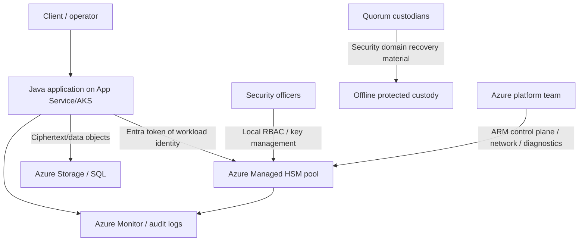

### Independent Paths

- **Control plane:** create/modify resources, location, networking, and permitted Azure configurations.
- **Managed HSM data plane:** create/manage keys and execute cryptographic operations permitted by local RBAC.
- **Application data plane:** plaintext/ciphertext data in the Java runtime and Storage/DB.
- **Recovery plane:** security domain backup, encrypted recovery material, and quorum custodians.
- **Observability plane:** audit metadata about key operations and identities—never a store for private keys.

These boundaries underpin the principle: **“an Azure subscription Owner should not automatically become a key signing operator”**.

## 6. Shared Responsibility Model

| Microsoft operates per service contract | Customer must design/control |
|---|---|
| Managed HSM hardware and infrastructure | Choosing appropriate key types/algorithms/use cases |
| Service availability/capacity per SLA/tier | Subscriptions, identities, resource scopes, and networking |
| Control plane/data plane endpoints | Managed HSM local RBAC/least privilege |
| Infrastructure protecting key material inside HSM | Key backups/security domain quorum and custody |
| Logging/diagnostics subsystems when configured | Enabling logs, protecting logs, and incident response |
| Service-supported soft-delete/recovery mechanisms | Restore/DR planning and drills |

**You cannot outsource all key-protection responsibility to a managed service.** An operator with overly broad `sign` permissions can still misuse the HSM to sign unauthorized payloads even without exporting the private key.

## 7. Key Types and Operations

In Managed HSM, supported key types and algorithms must be verified per service/version:

| Family | Used for | Key points |
|---|---|---|
| **RSA-HSM** | Sign/verify, wrap/unwrap, limited encrypt/decrypt per supported algorithms | Plaintext size and padding limits |
| **EC-HSM** | ECDSA sign/verify per supported curves | Not a replacement for RSA wrap/unwrap |
| **Symmetric/HMAC/AES capabilities** | Depends on product and specific API support | **Never assume every key type/algorithm is available** |

In the application examples below, we use **RSA-HSM for KEK wrap/unwrap** and **AES-GCM for local data encryption**. This avoids sending entire files to the HSM for RSA encryption.

### Mapping Operations to Business Goals

| Business goal | API / operation type | What to verify |
|---|---|---|
| Sign a digest/voucher | `sign` / `verify` | Algorithm, key type, digest input semantics |
| Keep DEK confidential at rest | `wrapKey` / `unwrapKey` | KeyWrapAlgorithm, key version, role |
| Encrypt short values | `encrypt` / `decrypt` | Size/padding/algorithm support |
| Encrypt a 500 MB file | AES-GCM envelope encryption + HSM KEK | Never pass entire file as RSA input |
| Server-side CMK for Azure services | CMK key URI + encryption identity | Service must support Managed HSM endpoints |

Never assign `encrypt` to an EC signing key or `sign` to a key restricted solely to `wrapKey`.

## 8. What Does “Non-Exportable Private Key” Actually Guarantee?

With keys generated/hardware-protected under the Managed HSM model, applications **never receive the plaintext private key via normal APIs**. However:

1. Anyone authorized for `sign` can ask the HSM to sign arbitrary digests. Non-exportability **does not prevent signing abuse**.
2. Anyone authorized for `unwrapKey` receives the **plaintext DEK** from unwrap (per algorithm/API), meaning application data can still be exposed downstream.
3. A compromised app holding a managed identity with the right role can invoke unwanted crypto operations.
4. If the app writes plaintext to logs or disk, the HSM **cannot protect plaintext once it leaves the HSM**.
5. Backup/security domain material must be held under quorum/secret custody so no single operator can hijack everything.

HSM reduces **master/private key extraction risk**, but still requires business authorization, auditing, rate limiting, and runtime security to limit **key misuse**.

## 9. Layered Keys: DEK and KEK

The **Data Encryption Key (DEK)** encrypts data directly; the **Key Encryption Key (KEK)** wraps the DEK so the DEK can be stored as encrypted key material.

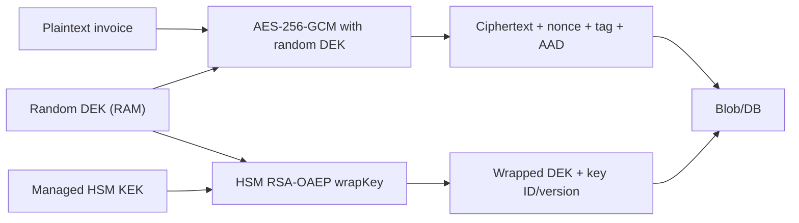

### Benefits of Envelope Encryption

- Large payloads are efficiently AES-GCM encrypted in the app or data plane.
- The HSM receives only a **tiny DEK**, minimizing latency and key operations.
- The HSM-backed KEK lifecycle is managed independently of data objects.
- Each object can use a distinct DEK to minimize blast radius.
- DEKs can be rewrapped during KEK rotation **without necessarily re-encrypting all payloads**, if policy/process permits.

### Critical Warning

If the application generates/unwraps DEKs in the JVM heap, the **plaintext DEK resides in app RAM** temporarily. This is **application-implemented envelope encryption**, not a guarantee that “DEKs never leave the HSM”. If policy requires DEKs never to leave the HSM either, redesign the cryptography model and verify service/API support.

## 10. Managed HSM and Customer-Managed Keys (CMK)

Many Azure services let customers specify a **Customer-Managed Key (CMK)** to protect the service's encryption keys. Some integrations support Managed HSM, but **not every Azure service accepts every key URI or HSM type**.

### Two Distinct Scenarios

1. **Application-managed encryption:** Java generates the DEK, calls Managed HSM wrap/unwrap, and stores ciphertext/metadata. The app owns the encryption protocol, AAD, key versions, and recovery.
2. **Service-managed encryption with CMK:** A supported Azure Storage/SQL/service manages data encryption under contract using a Managed HSM key URI and an encryption identity with the proper crypto role.

### CMK Checklist

- Does the service **officially support Managed HSM** in the target region and tier?
- Are specific **RSA key sizes, wrap/unwrap operations, enabled status, or expiry rules** required?
- Which **managed identity/principal** does the service use to call the HSM?
- Does local RBAC on Managed HSM grant the right role/scope to that principal?
- Do network firewalls/private endpoints allow the required service integration?
- When rotating keys or disabling old versions, can the service still read older data?
- Does losing the HSM/key or permissions make data **inaccessible**?

**Never configure CMK and disable/delete the old key just because a new version was created.** Verify service rotation semantics, rewrap/backfill behavior, and rollback.

## 11. Managed HSM Has Two Authorization Planes

A critical distinction of Managed HSM is separating **Azure Resource Manager (ARM) control-plane access** from **Managed HSM local data-plane access**.

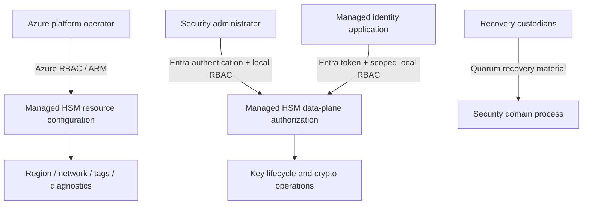

### Control Plane

Permits Azure resource management actions per ARM roles: creating resources, viewing configuration, setting network/diagnostics policies, managing resource groups, etc., depending on specific permissions.

### Data Plane

Governs keys, crypto operations, and permissions inside Managed HSM via the service's **local RBAC**, authenticating Microsoft Entra ID principals. Roles support scopes such as pool-wide or per-key where supported.

### Never Confuse Azure RBAC with Local RBAC

A user holding `Owner` on the subscription has broad ARM control, **but must not be assumed to have sign/decrypt/unwrap rights inside Managed HSM**. Conversely, an app allowed to `wrapKey` on one key **should never have permission to delete the pool, alter firewalls, or assign data-plane roles**.

### Example Separation

| Principal | Azure/ARM responsibility | Managed HSM data-plane responsibility |
|---|---|---|
| Cloud platform engineer | Networking, monitoring, resource deployment | No default crypto permissions |
| Security key officer | Minimal ARM rights needed | Create/rotate/disable keys per duties |
| Application managed identity | Minimal ARM rights (often none) | `wrapKey/unwrapKey` on authorized keys |
| Audit officer | View authorized logs and evidence | Read/audit metadata per approved role |
| Security-domain custodian | Needs no runtime crypto rights | Hold recovery keys/shares and join quorum |

**Security domain custodians do not need permission to read production data.** Separating recovery custody from runtime crypto authorization is a core part of defense in depth.

## 12. Managed HSM Local RBAC: Roles and Least Privilege

Commonly referenced data-plane role groups in Managed HSM include:

- **Managed HSM Administrator:** administers data plane and role assignments per supported permissions.
- **Managed HSM Crypto Officer:** manages key lifecycles and key operations.
- **Managed HSM Crypto User:** executes cryptographic operations on keys per role.
- **Managed HSM Crypto Auditor:** read/observability permissions for auditing.
- Other specialized roles such as service encryption user or backup/restore operator where provided by the product/version.

These describe **responsibility groups**, not an exhaustive permission list or guarantee that role names/built-in semantics never change. Before assigning permissions, inspect **actual Managed HSM role definitions and allowed data actions** in your tenant.

### Permission Assignment Principles

1. Build a **role matrix** by API/operation rather than generic job titles.
2. Prefer **single-key scope** for an app that uses only one KEK.
3. Separate `create/import/delete/rotate` from `sign/wrap/unwrap` whenever business logic allows.
4. Never grant `unwrap` to a system that only needs `wrap`.
5. If a workload only **verifies public signatures**, consider verifying with the public key outside the HSM when policy permits, reducing calls to the private-key service.
6. Use managed/workload identities instead of long-lived client secrets.
7. Monitor role assignment changes, access denials, and revalidation after each deploy.
8. Govern emergency access and privileged elevation per organizational policy.

### Blast Radius

If an application serves only `billing`, its identity must not have access to `employee-pii-signing`, even if both keys live in the same Managed HSM pool. **Broad pool-level permissions** amplify damage if a workload identity is compromised.

## 13. Microsoft Entra ID and How the HSM Authenticates Callers

Managed HSM APIs require an authenticated principal via supported service mechanisms, typically **Microsoft Entra ID tokens** combined with data-plane local RBAC.

### In Azure Environments

```text
Java API on App Service/AKS/VM
  → DefaultAzureCredential / workload identity
  → Microsoft Entra access token for HSM data plane
  → Managed HSM endpoint
  → Validate token + local RBAC key permissions
  → Execute sign/wrap/unwrap
```

### In Local Dev Environments

Java can use developer credentials such as Azure CLI credentials via an approved credential chain. **Never use a personal Global Administrator account to test production keys**; labs should use dedicated keys and scopes.

### Why Never Embed a JWT in Source Code?

Access tokens are short-lived and scoped by audience/identity. Putting tokens in config files or logs leaks credentials. Use `DefaultAzureCredential` or approved workload identity settings and verify the actual principal.

### Common Errors

| Symptom | Likely cause |
|---|---|
| Fails to acquire token | Managed identity disabled, broken workload federation, local CLI not logged in |
| HTTP `401` | Invalid token, audience/tenant mismatch |
| HTTP `403` | Local RBAC lacks data actions, wrong scope, or network/policy denial |
| ARM view works, crypto returns `403` | Azure resource role does not equal Managed HSM local role |
| Newly granted permission not working yet | Role assignment propagation/caching or wrong principal/object ID |

### One Principal for Two Roles?

An app may need both `wrap` and `unwrap`, yet you should never share one identity between the **production runtime** and **key administrator**. Separating identities also makes it easy to revoke runtime access without losing administration paths.

## 14. Security Domain: A Vital Recovery Asset

A **security domain** in Azure Managed HSM is a pool-specific cryptographic/recovery component used to support **backup/restore and recovery continuity** under the service's recovery model. During activation, administrators supply **recovery custodians' public keys**, configure a **quorum**, and receive protected security-domain material per procedure.

### What Is a Security Domain NOT?

- It is not a Microsoft Entra tenant ID.
- It is not an Azure Storage container.
- It is not an app secret string or connection string.
- It is not a TLS certificate for browsers hitting an endpoint.
- It is not a master password to email to DevOps.
- It is not a **plaintext copy of private keys** anyone can open arbitrarily.

### Conceptual Workflow

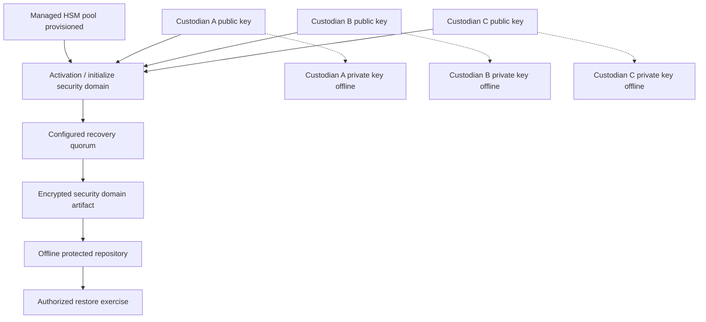

This diagram shows the conceptual model. **Permitted RSA public key counts, min/max quorum, private key formats, and CLI activation commands** must follow current documentation/portal instructions; never populate production values solely from a lesson example.

## 15. Quorum and Separation of Recovery Duties

**Quorum** means requiring a subset of independent holders of recovery private keys/material to approve and execute recovery operations. An internal `2-of-3` policy is purely illustrative: in practice, **Managed HSM's supported quorum limits and enterprise policy** determine the numbers.

### Why Is Quorum Needed?

If one person holds both the encrypted security-domain artifact and all recovery private keys, they defeat multi-party control. Quorum helps:

- reduce the risk of a single person abusing recovery capabilities;
- provide redundancy when a custodian is unavailable;
- produce evidence of DR approval;
- isolate sensitive recovery material custody from application accounts.

### Never Store Shares in the Same Place

Example custody layout:

```text
Encrypted security domain artifact:
  approved offline / immutable repository

Recovery private key A:
  custody officer A, hardware-encrypted device

Recovery private key B:
  custody officer B, separate physical location

Recovery private key C:
  custody officer C, separate organization/site
```

This is an **example policy**, not a mandatory template for every organization. Exact physical separation, encryption at rest, escrow, and retention depend on internal audit requirements.

### Failure Modes to Rehearse

- A custodian leaves the company or loses their recovery private key.
- The security-domain artifact is accidentally deleted or unreadable.
- Copies stored in one shared location suffer a single outage.
- Quorum cannot be assembled due to holidays or unreachable staff.
- The recovery runbook fails to validate the artifact's format/version.
- An operator attempts recovery without documented approval.

**You cannot replace a lost security domain simply by setting a new recovery password.** Secure custody of the artifact and keys is existential for recovery planning.

## 16. Activation and Managed HSM State

Creating the ARM resource **does not mean data-plane key operations are immediately usable**. Managed HSM requires an **activation/security domain initialization** step per service lifecycle.

```text
Resource provisioning
    ↓
HSM pool ready for activation
    ↓
Security domain activation with approved quorum keys
    ↓
Local RBAC and network access configured
    ↓
Generate/import keys
    ↓
Cryptographic operations
    ↓
Backup / restore / rotation / audit
```

### Before Activation

1. Verify who is authorized to run initialization.
2. Prepare recovery custodians and public keys through an approved process.
3. Confirm quorum satisfies both service limits and organizational policy.
4. Prepare storage for the security-domain artifact **isolated from any single admin's control**.
5. Assign reviewers/operators to test the restoration runbook, not just the person provisioning the pool.

### After Activation

- Verify the security-domain artifact is stored per custody policy.
- Never allow a production app to use keys until **recovery evidence** exists.
- Verify local RBAC for administrators and crypto callers.
- Record non-secret identity, resource ID, region, and policy version in inventory.

## 17. Key Backups and the Security Domain: Two Different Assets

The **security domain artifact** and **backups of Managed HSM keys/pool** serve related roles but must never be treated as the same file.

| Recovery asset | Meaning |
|---|---|
| **Security domain artifact** | Enables HSM recovery/restore context under the service model |
| **Recovery private keys/quorum** | Required to restore the security domain when needed |
| **Key backup / full backup artifact** | Backups of keys/pool state created via supported backup operations |
| **Application key registry** | Metadata mapping key names, versions, owners, and dependent services |
| **Encrypted application data** | Ciphertext and wrapped DEKs in Storage/DB with their own backups/retention |
| **RBAC/network/IaC definitions** | Configuration that must be recreated and verified during DR |

**Without ciphertext backups**, restoring HSM keys cannot reconstruct lost business data. Conversely, having ciphertext without recoverable keys/KEKs leaves data **undecryptable**.

### A Successful Backup Is Not Proof of Successful Restore

A “backup succeeded” status does not guarantee:

- custodian keys/quorum are available when needed;
- artifacts are readable from the disaster region;
- backup Storage access permissions work;
- the target Managed HSM is compatible;
- key versions restore properly;
- CMK services point to the right key URIs post-restore;
- the application can decrypt historical data.

Only a **controlled restore drill** provides end-to-end evidence.

## 18. Soft-Delete and Purge Protection

Accidental deletion of keys or pools can render encrypted data inaccessible. Managed HSM provides safeguards around **soft delete, retention, and purge protection** per service semantics; verify exact states and limits on real resources.

### Soft-Delete

Allows recovering deleted resources/keys within a supported retention window and conditions. It **does not replace** off-environment backups, security-domain custody, or recovery if key material is corrupted or lost.

### Purge Protection

Helps prevent permanent deletion during the protection period per product design. Note:

- Retention wait times/reserved names can affect recreating resources.
- Once a valid permanent purge completes per lifecycle rules, recovery may be **impossible**.
- In some modes/tiers, purge protection is mandatory or irreversible.
- Never disable/shorten production retention just to speed up a lab.

### Practice

In IaC and operational checklists, define **delete protection policies, retention periods, who can delete/restore, and how audits work**. Never rely on checkbox names remembered from an older portal UI.

## 19. Local RBAC and Key Permission Scope

Example “invoice-signing” app needing only `sign` on its dedicated key:

```text
Identity: mi-invoice-signing
Allowed Managed HSM scope: keys/invoice-signing
Allowed operation: sign (and verify if needed)
Disallowed: create/import/delete/backup/restore/role assignment
```

This represents the **desired policy**, not role assignment JSON. Map it to **actual built-in/custom role definitions and scopes** supported by Managed HSM.

### Common Permission Errors

- Assigning Azure `Key Vault Crypto User` in ARM (the Key Vault model) without granting **Managed HSM local data-plane RBAC**.
- Assigning the local role at the wrong scope (pool vs. key).
- App using a **different identity's client ID** than the identity granted permissions.
- Newly assigned role has not propagated yet.
- Key is disabled/expired or lacks `key_ops` even though the caller has the role.
- Network policy blocks the app from reaching the endpoint.

### Crypto Rights Do Not Include Key Management Rights

An application can be permitted to wrap/unwrap with an enabled KEK while being forbidden to generate new keys, edit policies, or destroy KEKs. Grant permissions by *task*, not “make the app admin for convenience”.

## 20. Key Lifecycle: Generate, Use, Rotate, Retire

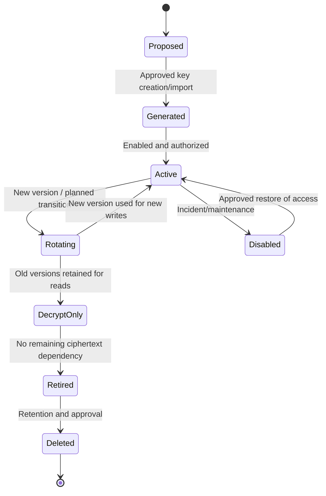

This is an **enterprise-defined state model**. Managed HSM supports lifecycle properties/versions via APIs and does not natively expose business states like `DecryptOnly` or `Proposed`. Separate old versions from new encrypt operations using policy, caller logic, and appropriate key permissions.

### Recommended Key Record

```text
Key name: billing-kek
Purpose: Wrap data encryption keys for invoices
Key type: RSA-HSM
Owner: Data Security Team
Custodian: Managed HSM Security Officers
Allowed caller: Managed identity of billing service
Allowed operations: wrapKey, unwrapKey
Key URI/version: exact identifier (non-secret)
Created/activated: UTC date
Next rotation review: UTC date
Retire gate: no live ciphertext depends on old version
Backup/restore evidence: reference to approved records
```

### Do Not Confuse Rotation with Data Re-Encryption

Creating a **new KEK version** does not automatically rewrap all existing wrapped DEKs. In envelope encryption, legacy data continues pointing to the **old key version** for unwrapping unless a rewrap/backfill campaign runs. In CMK integrations, each Azure service has its own rotation semantics that must be checked separately.

## 21. Generate a New Key or Import via BYOK?

### Generate in HSM

The HSM generates key material directly inside its boundary per service support. This is usually the cleanest option when the app does not need to migrate an existing external key.

### Bring Your Own Key (BYOK)

An organization already holds a key in an on-prem/external HSM and wants to move it to Managed HSM. **BYOK is not uploading a plaintext PEM over HTTP.** It requires a service-supported **secure key transfer/import** procedure compatible with the source HSM/vendor, key type, wrapping, permissions, and target key attributes.

### Questions Before Importing

1. Does the source private key currently reside in an HSM or a file?
2. Is the key **exportable/transferable** under source policy?
3. Does Managed HSM support that key type/algorithm and wrapping/import format?
4. Will the imported key satisfy HSM protection requirements inside the pool?
5. Who approves key export/transport/import and retains audit evidence?
6. Can the key's public fingerprint/signature be verified before and after import?
7. Should the old key copy be disabled/retired?
8. Does DR/recovery handle imported keys as expected?

**Never send a production signing key to a developer laptop** for manual transfer. If BYOK is unsupported for a key, design a controlled migration/reissue/re-encryption rather than lowering security standards.

## 22. Rotation: Never Break Decryption of Older Data

Suppose:

```text
Version V1 of billing-kek wrapped 2 million DEKs.
Day 01: create V2; new objects use V2.
Old objects still hold DEKs wrapped under V1.
```

Disabling or purging V1 immediately can render older objects impossible to unwrap.

### Safe KEK Rotation Procedure

1. Inventory ciphertexts/wrapped DEKs still referencing V1.
2. Create/verify V2 with proper `key_ops` and roles.
3. Switch **new writes** to V2, recording the full versioned key URI in metadata.
4. Keep V1 enabled for **old reads/unwraps** per policy during transition.
5. If needed, run **rewrapping**: unwrap DEK with V1, wrap with V2, update metadata atomically.
6. Test reading both old and new data before/after failover.
7. Monitor error rates, unwrap latency, key usage, and unmigrated object counts.
8. Retire V1 only after proving **zero remaining dependencies** and completing retention/DR reviews.

### Rewrapping Carries Risks Too

If an app writes the new wrapped DEK without atomically updating the key version ID, ciphertext can become unreadable. Use transactions, conditional updates/ETags, or rollback state; never update all records with an uncheckpointed script.

## 23. RSA Algorithms: Signing, Encrypting, and Wrapping Are Not Equivalent

**RSA-HSM** can serve operations permitted by key policy and the service, provided you choose the right **padding, hash algorithm, key usage, and input format**.

### Sign/Verify

A large document is typically **hashed** using an approved algorithm; the HSM signs the digest/input per API/algorithm; recipients verify using the public key.

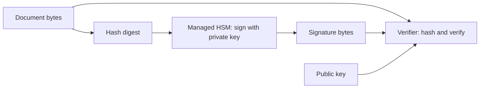

**Never sign the literal string `"OK"` and call it a valid electronic voucher.** Signatures require canonicalized content, hashing, algorithms, certificate/identity chains, timestamping workflows, and legal/business validity.

### Wrap/Unwrap

A random DEK (e.g., 256-bit) is wrapped using the RSA-HSM KEK with a scheme such as RSA-OAEP-256 if supported by the service, key type, and SDK. HSM unwrap returns the **plaintext DEK to an authorized caller**.

### Encrypt/Decrypt

Direct RSA encrypt/decrypt has input size limits tied to key modulus/padding. Never pass multi-MB PDFs/Blobs into the `encrypt` API. For large payloads, use symmetric encryption or service-managed encryption as appropriate.

### Distinguish Hashing from Encryption

- **Hash** is one-way, detecting changes/proving integrity when combined with signatures.
- **Encrypt** is two-way with a key to recover plaintext.
- **Sign** uses a private key to generate a signature proving origin and integrity under an identity model.
- **Wrap** protects another key; it does not directly encrypt large business records.

## 24. AES-GCM: Store Nonce, Tag, and AAD Together

**AES-GCM** is an authenticated encryption mode: beyond ciphertext, it produces an authentication tag to detect tampering when used correctly.

A record might store:

```json
{
  "schemaVersion": 1,
  "contentEncryption": "AES-256-GCM",
  "keyWrapAlgorithm": "RSA-OAEP-256",
  "kekKeyId": "https://<hsm>.managedhsm.azure.net/keys/billing-kek/<version>",
  "nonceBase64": "<12-byte random nonce>",
  "ciphertextWithTagBase64": "<encrypted payload plus authentication tag>",
  "wrappedDekBase64": "<wrapped 32-byte AES key>",
  "aadContext": "invoices/v1/order-501"
}
```

This is a **custom envelope metadata schema**, not a default Managed HSM response. Bracketed values are placeholders, not real ciphertext. In production, AAD must be canonically/binary-encoded from verified fields rather than trusting a modifiable unverified field.

### Nonce/IV Uniqueness

With AES-GCM, **reusing the same nonce for different plaintexts under the same DEK is a severe cryptographic flaw**. A simple safe pattern: generate a new DEK per object, a 96-bit random nonce from a cryptographic PRNG, and store the nonce alongside ciphertext. For very high volumes or encrypting multiple times under one DEK, enforce a reviewed nonce-uniqueness strategy.

### Authentication Tag

GCM decryption fails if ciphertext, tag, or AAD is modified; Java can throw `AEADBadTagException`. **Never catch that error and return unauthenticated plaintext**, and never “fall back” to unauthenticated AES-CBC to bypass errors.

### AAD Binds Context

AAD can be a canonical string:

```text
tenant-id | object-id | schema-version | content-type
```

Derive it from **trusted context** during both encrypt and decrypt with stable encoding rules. If AAD comes solely from attacker-editable payload fields, context-binding guarantees weaken.

## 25. Java SDK for Managed HSM: Authentication and Clients

Managed HSM exposes **key/cryptography endpoints** compatible with supported Azure Key Vault Keys SDK operations. A Java app can use:

- `com.azure:azure-identity` for `DefaultAzureCredential` or appropriate credentials.
- `com.azure:azure-security-keyvault-keys` for `KeyClient`/`CryptographyClient` (per service support).
- Azure SDK BOM to manage compatible library versions.

### Maven Dependencies — Placeholder Versions

```xml
<dependencyManagement>
  <dependencies>
    <dependency>
      <groupId>com.azure</groupId>
      <artifactId>azure-sdk-bom</artifactId>
      <version>REPLACE_WITH_APPROVED_AZURE_BOM_VERSION</version>
      <type>pom</type>
      <scope>import</scope>
    </dependency>
  </dependencies>
</dependencyManagement>
<dependencies>
  <dependency>
    <groupId>com.azure</groupId>
    <artifactId>azure-identity</artifactId>
  </dependency>
  <dependency>
    <groupId>com.azure</groupId>
    <artifactId>azure-security-keyvault-keys</artifactId>
  </dependency>
</dependencies>
```

Versions are **intentional placeholders**: select an official BOM matching your JDK/SDK per organizational policy, then build and test in lab. Never copy arbitrary versions from old examples. You do not need `azure-security-keyvault-secrets` to perform KEK wrap/unwrap.

### Managed HSM Endpoint and Key Identifier

Example:

```text
HSM base endpoint:
  https://<hsm-name>.managedhsm.azure.net/

Versioned key ID:
  https://<hsm-name>.managedhsm.azure.net/keys/billing-kek/<key-version>
```

Because Managed HSM and standard Key Vault use different hostnames, **never replace `managedhsm.azure.net` with `vault.azure.net`**. The key ID must match the real resource, with a principal holding local RBAC and allowed networking.

### Using DefaultAzureCredential

```java
import com.azure.core.credential.TokenCredential;
import com.azure.identity.DefaultAzureCredentialBuilder;
import com.azure.security.keyvault.keys.cryptography.CryptographyClient;
import com.azure.security.keyvault.keys.cryptography.CryptographyClientBuilder;

public final class HsmCryptoClientFactory {
    public static CryptographyClient create(String versionedKeyId) {
        TokenCredential credential =
            new DefaultAzureCredentialBuilder().build();

        return new CryptographyClientBuilder()
            .keyIdentifier(versionedKeyId)
            .credential(credential)
            .buildClient();
    }
}
```

This code uses a **versioned key ID** to reduce the risk of an older operation unexpectedly switching versions during rotation; in practice, client objects/policies need proper lifecycle and caching. `DefaultAzureCredential` resolves different identities locally vs. in the cloud, so verify the **actual calling principal** and local RBAC rather than assuming from your CLI subscription login.

### Sync vs. Async?

The Java SDK provides both synchronous and asynchronous clients. If a Spring WebFlux app handles high concurrency, consider `CryptographyAsyncClient` or an appropriate scheduler adapter; never block a Reactor event loop with sync HSM calls. For batch workflows, the sync client can be simpler and sufficient under bounded concurrency.

## 26. Java Example — Wrapping and Unwrapping an AES DEK

Example using an **existing, authorized RSA-HSM KEK** in Managed HSM; the application only wraps/unwraps and lacks create/delete permissions.

```java
import com.azure.security.keyvault.keys.cryptography.CryptographyClient;
import com.azure.security.keyvault.keys.cryptography.models.KeyWrapAlgorithm;
import com.azure.security.keyvault.keys.cryptography.models.WrapResult;
import com.azure.security.keyvault.keys.cryptography.models.UnwrapResult;

import java.security.SecureRandom;
import java.util.Arrays;

public final class WrappedDekExample {
    private WrappedDekExample() { }

    public static void run(CryptographyClient cryptoClient) {
        byte[] dek = new byte[32];  // AES-256 key length.
        new SecureRandom().nextBytes(dek);

        try {
            WrapResult wrapped = cryptoClient.wrapKey(
                KeyWrapAlgorithm.RSA_OAEP_256, dek);
            byte[] wrappedDek = wrapped.getEncryptedKey();

            // In production: store wrappedDek + algorithm + full key ID/version.
            // Never log dek or wrappedDek to public logs.

            UnwrapResult unwrapped = cryptoClient.unwrapKey(
                KeyWrapAlgorithm.RSA_OAEP_256, wrappedDek);
            byte[] recovered = unwrapped.getKey();
            try {
                if (!Arrays.equals(dek, recovered)) {
                    throw new IllegalStateException("DEK unwrap mismatch");
                }
                System.out.println("HSM wrap/unwrap check: PASS");
            } finally {
                Arrays.fill(recovered, (byte) 0);
            }
        } finally {
            Arrays.fill(dek, (byte) 0);
        }
    }
}
```

### What to Verify When Running

1. Your pinned SDK version supports `RSA_OAEP_256` on Managed HSM and the chosen key type.
2. Key ops permit `wrapKey` and `unwrapKey`.
3. Caller identity holds **local RBAC** at the right scope.
4. TLS/network reaches the HSM endpoint.
5. Key version is enabled and valid.
6. Credentials, access tokens, DEKs, and HSM response bodies are never logged.

**Some SDK results carry additional metadata (key ID, algorithm), and version-retrieval methods vary across library versions.** Production apps should capture the key ID per the contract of their exact SDK version and persist it verbatim rather than guessing strings from key names.

### Why Clearing `byte[]` Is Not a Full Guarantee?

`Arrays.fill(...)` shortens the lifetime of data in that specific array, but the JVM, GC, SDK, or JCE can leave **copies in heap or native memory** unreachable from pure Java. Never claim “DEK no longer exists in RAM” after calling fill. Strict environments require runtime hardening, memory-dump access controls, and suitable cryptography designs.

## 27. Java AES-GCM to Encrypt Payloads Before Storage

Azure-independent Java/JCA sample for the AES portion:

```java
import java.security.SecureRandom;
import java.util.Arrays;
import javax.crypto.Cipher;
import javax.crypto.spec.GCMParameterSpec;
import javax.crypto.spec.SecretKeySpec;

public final class LocalAesGcm {
    public record Encrypted(byte[] nonce, byte[] ciphertextWithTag) { }

    public static Encrypted encrypt(
        byte[] aes256Key,
        byte[] plaintext,
        byte[] aad
    ) throws Exception {
        if (aes256Key.length != 32) {
            throw new IllegalArgumentException("AES-256 requires 32-byte key");
        }
        byte[] nonce = new byte[12];
        new SecureRandom().nextBytes(nonce);

        Cipher cipher = Cipher.getInstance("AES/GCM/NoPadding");
        cipher.init(Cipher.ENCRYPT_MODE,
            new SecretKeySpec(aes256Key, "AES"),
            new GCMParameterSpec(128, nonce));
        cipher.updateAAD(aad);
        return new Encrypted(nonce, cipher.doFinal(plaintext));
    }

    public static byte[] decrypt(
        byte[] aes256Key,
        byte[] nonce,
        byte[] ciphertextWithTag,
        byte[] aad
    ) throws Exception {
        Cipher cipher = Cipher.getInstance("AES/GCM/NoPadding");
        cipher.init(Cipher.DECRYPT_MODE,
            new SecretKeySpec(aes256Key, "AES"),
            new GCMParameterSpec(128, nonce));
        cipher.updateAAD(aad);
        return cipher.doFinal(ciphertextWithTag);
    }
}
```

### Best Practices

- Every encryption must use a **unique nonce under the same key**.
- Use an environment-appropriate `SecureRandom`; never use `java.util.Random` for DEKs or nonces.
- Persist **nonce, ciphertext/tag, wrapped DEK, algorithm, key ID/version, and AAD context**.
- Derive AAD consistently from verified record/tenant context.
- Never ignore `AEADBadTagException` or fall back to an unauthenticated mode.
- Never put DEKs/plaintext in logs, telemetry, exception messages, or public Blob uploads.
- Production systems must handle content streaming, memory limits, transactions, key erasure, and versioned envelope formats; this byte-array example is for learning only.

### What Does This Code Do and Not Do?

`LocalAesGcm` encrypts/decrypts **inside the JVM**, not inside Managed HSM. **The HSM protects the KEK**, while the app handles plaintext and DEKs—so the threat model must still address host compromise.

## 28. Coordinating Java CryptoClient with the Envelope Format

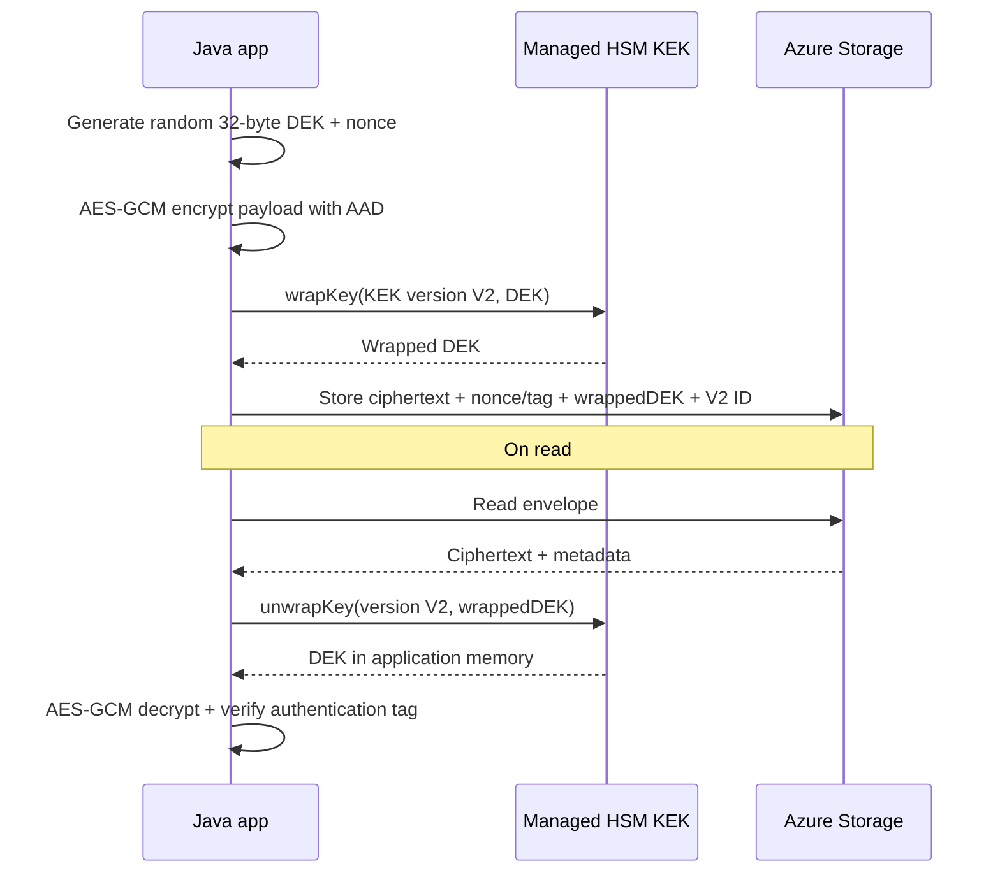

### Versioned Key URI

When reading an old envelope, use the **key version saved when wrapping**, not the latest version by default. If V2 was retired/disabled, unwrapping fails even when V3 is enabled.

### Atomic Writes

Ciphertext and metadata must be persisted as one **logical atomic record** or via a verified reconciliation mechanism. If you write Blob ciphertext first and lose connectivity before saving the wrapped DEK, you leave behind undecryptable ciphertext. Use a single envelope file, conditional writes, or database transactions/outboxes per system design.

### AAD with Multi-Tenancy

Suppose `tenant-A/order-501` is the AAD. When a Tenant B user requests a read, the app must **deny Tenant B access to Tenant A's record** before unwrapping. GCM AAD only protects integrity of the supplied context; it does not enforce application authorization on its own.

## 29. Document Signing via HSM and Authentication Evidence

A document signing workflow might look like:

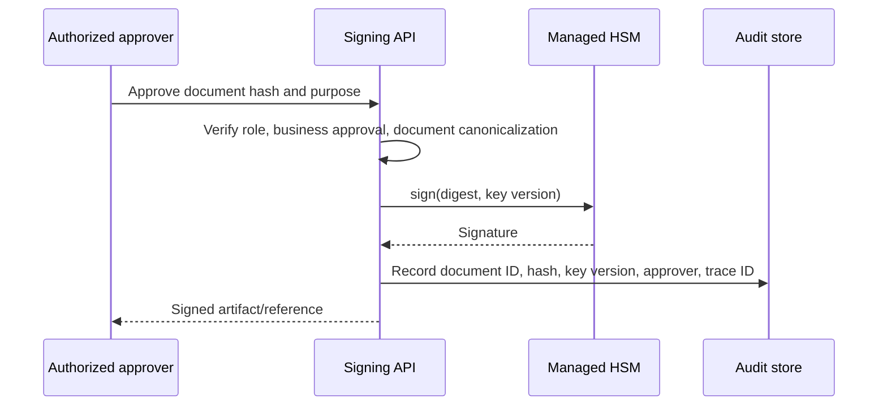

### What Does Each Layer Protect?

- **Business authorization:** who is allowed to sign which document types.
- **Canonicalization/digest:** exact version of the data being signed.
- **Managed HSM:** protects the private signing key and performs signing.
- **Audit trail:** records approvals, document hash, key ID, and timestamps.
- **Trust/PKI:** tells verifiers which public key/certificate identity is trusted.

If an authorized caller invokes `sign` through an app lacking business-role checks, the HSM will still sign an unapproved digest. **The HSM protects key material; it cannot verify that the transaction content was approved by the right authority.**

### Where Can Verification Happen?

Depending on algorithms and policy, public-key signatures can be verified using the **public key** outside the HSM, eliminating the need to grant crypto-user permissions to verifiers. However, public key trust, chains, rotation, and revocation must still be governed per PKI/application contracts.

## 30. Key Operation Latency and Throughput

HSM cryptographic operations **are neither free nor zero-latency**. A wrap/sign request from App Service/AKS traverses:

```text
Request construction
→ Entra credential/token acquisition or cache
→ DNS/TLS/network/private endpoint
→ Managed HSM authorization
→ HSM operation
→ response parsing
→ application processing
```

### Avoid Calling the HSM for Every Data Chunk

If a 1 GB upload is split into 4,096 chunks and the app calls HSM wrap per chunk, cost and latency explode needlessly. With envelope encryption, generate one DEK per object, wrap it once, and encrypt streaming/chunks using a securely designed protocol (with reviewed nonce uniqueness and authentication boundaries).

### Caching Considerations

- Caching **public keys/metadata and clients** appropriately reduces request overhead.
- Never cache **unwrapped plaintext DEKs long-term** if it widens data exposure risk.
- Never cache Azure access tokens via custom hacks that bypass SDK credential security/expiration.
- Rotation must invalidate references by key version and business policy.

### Varying Limits

Managed HSM enforces quotas and service limits on operations, key creation, connections, and capacity depending on version/region. Measure **p95/p99 latency, operations/sec, throttling, and peak load** before committing to latency-sensitive payment or API designs.

## 31. Network Security: Public Endpoints, Private Link, and DNS

Managed HSM supports network access controls and private networking per current features and regions. A private-only design must cover **both application paths and administrative/recovery tooling**.

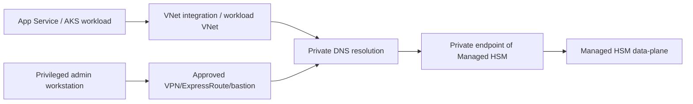

### What Private Link Does NOT Solve Automatically

- Does not grant the app key permissions; **Entra tokens + local RBAC** are still required.
- Does not replace TLS hostname and certificate chain validation.
- Does not allow a public internet laptop to reach the HSM without an approved route.
- Does not automatically handle network paths for security-domain activation/backup workflows or Azure service CMK integrations; check each operation individually.
- Does not protect plaintext once loaded from the HSM into application RAM.

### Connectivity Checklist

1. Does the app's HSM endpoint use the exact `<hsm>.managedhsm.azure.net` hostname?
2. Does DNS resolve to the private IP from inside the actual VM/pod/App Service runtime?
3. Is the Private Endpoint connection approved?
4. Do VNet peering, VPN/ExpressRoute, route tables, and NSGs allow the traffic?
5. Can the workload reach Microsoft Entra token endpoints for its identity model?
6. Are local RBAC permissions and key enabled state configured?
7. Does any CMK-enabled Azure service have a supported network integration path or special settings?
8. Do diagnostic/export endpoints have approved routes?

### 403 Errors vs. Timeouts

**403** can indicate authorization or a service-side network access policy denial. **Timeouts/TLS/DNS errors** typically point to connectivity or certificates. Never “fix” by disabling network restrictions before diagnosing status codes, traces, and sandbox network tests.

## 32. Availability, Zones/Regions, and Failure Domains

Managed HSM provides availability according to Microsoft's published service architecture and SLA, but **never assume keys automatically work in an independent Managed HSM pool in another region**.

### Three Failure Domains

| Domain | Example | Action needed |
|---|---|---|
| **App runtime** | Java app/pod crash | Recreate workloads, managed identities, and configs |
| **Managed HSM service** | Outage, network partition, or auth outage | Monitor service health, retry budgets, failover plan |
| **Regional disaster/key recovery** | Pool/region unavailable; restore required | Security domain, backups, compatible target, tested runbook |

### Practical RTO/RPO

- **Cryptography RTO:** how quickly can the app sign/wrap/unwrap again?
- **Key/config RPO:** up to what timestamp do backups capture key versions and required permissions?
- **Encrypted data RPO:** are data objects/ciphertexts in Storage/DB independently backed up/replicated?
- **Business continuity:** must legacy data remain readable, or is signing new data sufficient?

### Key Difference Between Signing and Decryption

If a signing HSM pauses briefly, you can **queue jobs** and sign once the service recovers, if business SLAs allow. However, if an API must **unwrap DEKs to read customer data**, losing the HSM can make data temporarily unavailable even while Storage is completely healthy.

### Never Create a “Bypass Key” During an HSM Outage

Do not resolve an outage by copying a private key into an app file for local signing/encryption, as that violates the **HSM-only key custody** requirement. Availability must be engineered using **certified service/DR options and key custody plans**, never by lowering security during an incident.

## 33. Disaster Recovery: End-to-End Recovery Drills

A trustworthy runbook must be rehearsed using **synthetic keys and synthetic ciphertext**. Never use a production signing key just to demonstrate DR in a drill.

### Conceptual Recovery Sequence

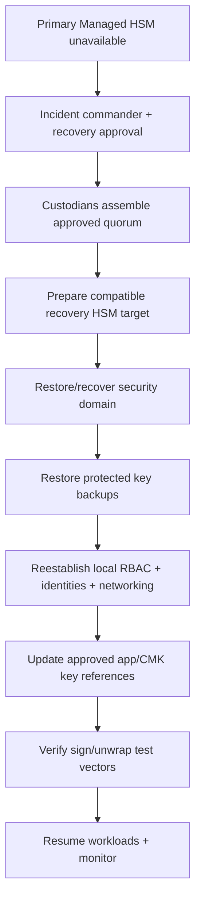

**Exact order and APIs** depend on actual backup/restore capabilities and source/target states. Some steps may need to run at different times or environments per supported Managed HSM workflows; this diagram is not an executable script.

### Drill Evidence Template

```text
Exercise ID:
Test resource / region:
Security domain version / custody record:
Quorum reached: PASS/FAIL (never record private keys)
Backup artifact reference:
Target HSM compatibility checked: PASS/FAIL
Key names/versions restored:
Local RBAC re-applied: PASS/FAIL
Network/DNS tested: PASS/FAIL
Can unwrap historical test DEK: PASS/FAIL
Can verify test signature: PASS/FAIL
RTO measured:
RPO observed:
Key material leaks detected: NONE/INCIDENT
Cleanup owner:
```

### What Must Never Enter a DR Report

- Recovery private keys or passwords.
- Encrypted security-domain artifacts if policy forbids storing them in tickets.
- HSM key material or plaintext DEKs.
- Production document samples or unnecessary customer ciphertext.
- Tokens or Storage SAS backup URLs.

### Quorum Incidents

If a custodian is unavailable, **never share private keys over chat to reach quorum**. Recovery plans must designate backup custodians, alternate locations, and identity verification procedures for custodians.

## 34. Key Compromise: Key Material Exposure vs. Permission Abuse

An HSM can prevent private key export, yet an attacker who compromises a workload identity can still perform **unauthorized signing/unwrapping**.

### Two Scenarios to Separate

| Scenario | Symptoms | Response plan |
|---|---|---|
| **HSM-backed key material suspected compromised** | Suspected flawed import/recovery or broken boundary trust | High-severity incident, key replacement, PKI/trust/rewrap review |
| **Workload credential misused** | Spike in sign/unwrap from unfamiliar principal/host | Revoke token/identity access, local RBAC, network restrictions; audit operations |

### Runbook on Detected Key Misuse

1. Confirm principal, key ID/version, timestamps, and affected operations from trusted logs.
2. Activate incident response with Security and the Key Owner.
3. Block/revoke permissions of the affected principal without destroying evidence.
4. Temporarily disable the key/version if business impact and policy permit, accounting for unreadable data.
5. Audit signatures or unwrap operations within the exposure window.
6. Replace/rotate the key and block continued use of the suspected version.
7. Handle trust/certificate revocation, re-signing, or data rewrapping as required.
8. Trace where the app, CI/CD, managed identity, or privileged access was breached.
9. Recover per playbook with dual approval.
10. Re-audit role matrices, alerts, networking, and recovery custody.

**Never delete a key reflexively**: doing so can permanently break historical data decryption or document verification. Lock down permissions, isolate workloads, and execute a safe replacement plan.

## 35. Audit Logging, Traces, and Monitoring Crypto Operations

**Key creation, usage, modification, and recovery** must be monitored via Azure Monitor/diagnostic logging and application telemetry.

### Critical Audit Questions

- Which principal called `sign/unwrapKey/deleteKey`, and when?
- Did the call succeed, fail with denial, or get throttled?
- Which key and version were used?
- Which role assignments changed prior to the incident?
- Did any network configuration or backup policy change?
- Did unwrap counts spike unusually after a deployment?
- Did custodians execute recovery workflows per procedure?

### Safe Log Data Model

```json
{
  "timestamp": "2026-11-20T09:21:00Z",
  "principalAlias": "mi-billing-prod",
  "operation": "wrapKey",
  "keyAlias": "billing-kek",
  "keyVersionAlias": "v2",
  "outcome": "success",
  "durationMs": 34,
  "traceId": "4bf92f3577b34da6a3ce929d0e0e4736",
  "environment": "production",
  "source": "billing-service"
}
```

This is an **illustrative application-generated log schema**, not Azure Managed HSM JSON output. Never log DEKs, raw signature inputs, sensitive ciphertext, bearer tokens, or key-operation request bodies.

### Combining Three Evidence Sources

1. **Managed HSM diagnostic/audit logs:** operations, callers/statuses, and details provided by the service version.
2. **Application logs/traces:** business request IDs, tenant authorization decisions, latency, and error taxonomy.
3. **Azure activity/control-plane logs:** resource changes, network/ARM policies, and recorded permission edits.

Do not expect **one** log source to prove full end-to-end business authorization; for example, the HSM knows a caller is authorized to sign, not whether an invoice received two levels of manager approval.

### Suggested Alerts

| Signal | Meaning | Response |
|---|---|---|
| Surge in denied crypto operations | IAM scope, token issue, or attack | Check principal/role/network |
| Anomalous unwrap/sign requests | Key abuse or code loop | Quarantine principal, inspect audits |
| Upcoming key disable/expiry | Risk of operational outage | Execute planned rotation |
| Role assignments changed outside window | Privilege escalation risk | Security review |
| Backup failed or overdue | DR gap | Evaluate recovery readiness |
| Private endpoint connectivity failure | App loses crypto capability | Check DNS/routes/approval |
| p95/p99 crypto latency rising | Network/service/throttling | Check capacity/health/traffic |
| HSM resource cost spike | Request storm or quota/config issue | Cost Management/operations |

### Never Use Logs to Store Recovery Material

Security domain artifacts, private shares, and key backup artifacts **are not telemetry fields**. Log only **protected references**, timestamps, owners, and test results.

## 36. Designing SLIs/SLOs for Crypto Dependencies

### Recommended Metrics

```text
wrap_success_rate
unwrap_success_rate
sign_success_rate
crypto_operation_p95_latency_ms
crypto_operation_p99_latency_ms
authorization_denials_per_principal
key_version_usage_counts
key_rotation_progress_percent
backup_last_success_age
security_domain_recovery_drill_age
```

These are **application/process-defined SLI names**; do not assume Azure Monitor emits built-in metrics with these exact names.

### Example Business SLOs

```text
P99 invoice DEK unwrap latency < 200 ms
No unexpected key version usage after cutover
100% Tier-1 KEKs have backup/recovery evidence
0 unauthorized production sign operations
100% key-role changes are approved/audited
```

These numbers are **illustrative targets**; load-test from your actual region/network and check service SLAs/latency. For banking/medical data, error budgets can differ dramatically.

### Bound Metric Label Cardinality

Never create labels by `invoiceId`, `customerId`, or token—that causes high cardinality and privacy risks. Use key alias, operation, status category, and environment; look up specific events via trace/request IDs in access-controlled logs.

## 37. Cost Model: Managed HSM Differs from Key Vault Standard

Managed HSM uses a cost model reflecting a **dedicated pool/capacity** plus key operations per current configuration and pricing. For small workloads, the base cost of a dedicated resource can dominate total spend.

### Components to Budget

| Component | What to estimate |
|---|---|
| **Managed HSM pool** | Base/dedicated pool charge by region/tier/duration |
| **Crypto operations** | Volume of sign/verify/wrap/unwrap/encrypt/decrypt operations per billing model |
| **Key backups/recovery workflows** | Storage/backup operations and supporting infrastructure |
| **Networking** | Private endpoints, VNets, VPN/ExpressRoute, data transfer |
| **App compute** | Java CPU/RAM for AES-GCM, concurrency/thread pools |
| **Azure Monitor** | Log Analytics ingestion, retention, alerts |
| **Security operations** | PKI, custodians, dual-control, DR exercises |
| **CMK dependent services** | Separate Storage/SQL/service pricing |
| **Multi-region DR** | Standby recovery resources/capacity if required by SLA |

**Never cite absolute dollar amounts without a chosen region, SKU, and pricing date.** Use the Azure Pricing Calculator, current rate cards, Cost Management, and real operation counts.

### Load Calculation Example (Not Billing)

Suppose an application handles:

```text
500 new encrypted invoices/minute
1 HSM wrapKey operation per invoice
10,000 invoice reads/minute
1 unwrapKey per read without cache
```

This implies:

\[
500 + 10\,000 = 10\,500\ \text{crypto operations/minute}
\]

or roughly \(175\) operations/second on average under these assumptions. This is a **demand model**, excluding key metadata calls, retries, parallel tenants, regional bursts, caching, and service limits. Load-test and budget before committing to throughput/latency SLAs.

### Design Choices to Reduce Operation Volume

- Wrap DEKs **per object or batch policy** rather than every few bytes.
- Verify public-key signatures locally when your trust model allows it.
- Cache key metadata and clients rather than repeatedly listing keys.
- Avoid pointlessly unwrapping the same DEK repeatedly, while **never caching plaintext DEKs long-term**.
- Bound retries to prevent operation storms.
- Tear down/delete **lab resources per procedure** instead of leaving pools accruing charges.

### Weigh Security Value

Evaluate effectiveness by **reduced key-extraction risk, scoped permissions, auditability, recovery evidence, and compliance fit** alongside total cost of ownership—not just the unit price of a single signature.

## 38. Choosing Architecture by Use Case

| Scenario | Initial Recommendation | Rationale |
|---|---|---|
| An API needs to store a database password | **Key Vault secrets** | Secret read/write, not an HSM key operation |
| Website needs TLS certificate lifecycle | **Key Vault certificates** or appropriate cert manager | Managed HSM is not a certificate object store equivalent |
| Service needs an HSM-backed signing key, moderate requirements | **Evaluate Key Vault Premium** | May already provide sufficient protection more simply |
| Organization mandates a single-tenant HSM pool and recovery quorum | **Evaluate Managed HSM** | Stronger custody, isolation, and recovery fit |
| Data lake encrypted with CMK on a supported service | **Key Vault/Managed HSM per integration matrix** | Service-specific CMK contract is decisive |
| App encrypts GBs of documents itself | **Envelope encryption + HSM-backed KEK** | AES-GCM in data plane; HSM protects KEK |
| Contract-signing app with 2-person approval workflow | **Managed HSM or Premium per policy + business approval** | HSM never replaces business authorization |
| Legacy HSM key migrating from on-prem | **BYOK/import design review** | Key type, transfer, custody, and lifecycle |
| Low budget, only needs app-level config secrets | **Managed HSM usually unsuitable** | Cost and operational overhead exceed needs |

### Choose Key Usage Before Choosing Tier

A single solution can combine **Key Vault for secrets/certificates**, **Managed HSM for dedicated KEKs/signing keys**, **managed identities** for workloads, and **Storage/SQL** for encrypted data. Do not force every secret into one resource.

## 39. Threat Modeling for Managed HSM

### Assets to Protect

```text
1. Managed HSM KEKs / private signing keys
2. Security-domain encrypted artifact
3. Recovery private keys/quorum material
4. Managed identities / Entra role assignments
5. Wrapped DEKs / key version metadata
6. Encrypted business records
7. Plaintext inside Java runtime
8. Audit / backup evidence
```

### Attackers and Entry Points

| Threat | Attacker goal | Primary defense |
|---|---|---|
| Compromised Java container | Unauthorized `unwrap/sign` calls | Key scope, identity isolation, app authorization, monitoring |
| Compromised cloud admin | Escalate rights / delete HSM | ARM vs. data-plane separation, PIM/approval, delete protection |
| Stolen credential | Reuse data-plane token | Managed identity, short-lived credentials, revoke and audit |
| Malicious key officer | Improperly delete/rotate keys | Separation of duties, reviews, logs, recovery |
| Backup artifact theft | Obtain recovery material | Encrypted backups, separated quorum private keys |
| Single custodian compromise | Attempt unauthorized recovery | Quorum + independent custody |
| Man-in-the-middle | Intercept/alter network traffic | TLS validation, private networking |
| Ciphertext metadata tampering | Swap key ID/nonce/AAD | Authenticated envelopes, trusted metadata, conditional writes |
| Retry storm | Overload HSM/key operations | Backoff, retry budgets, throttling, circuit breakers |
| Unauthorized CMK rotation | Make data unreadable | CMK policies, version pinning, migration evidence |

### Security Domain Addresses Only One Layer

Quorum recovery **does not directly govern** every runtime `sign` call and **cannot prevent an app from logging plaintext**. Your threat model must cover **app authorization, runtime, APIs, networking, identity, and governance processes**.

## 40. Lab 1 — Decision Exercise: Do You Need Managed HSM?

### Prompt

Three teams have requirements:

**Team A:** An HR app needs to store an attendance-system API key and a TLS certificate.

**Team B:** An e-commerce app needs an HSM RSA key to sign receipts, with no requirement for a single-tenant HSM pool or security-domain quorum.

**Team C:** A payment platform must protect private signing keys in a dedicated HSM, separate operators from crypto officers, govern recovery via quorum, and maintain DR records.

### Evaluation Matrix

| Criterion | A | B | C |
|---|---|---|---|
| Has secret/password/certificate objects | Yes | Not primary requirement | Not primary requirement |
| Needs crypto operations with non-exportable HSM key | Not necessarily | Yes | Yes |
| Requires dedicated HSM boundary | No | Not yet | Yes |
| Requires security-domain/quorum recovery | No | Not yet | Yes |
| Accepts dedicated pool cost/operational burden | Unclear | Needs evaluation | Already budgeted |

### Guidance

- **Team A:** Key Vault secret/certificate management is a much better fit.
- **Team B:** Evaluate Key Vault Premium HSM-backed keys first; never claim only Managed HSM offers HSM-protected keys.
- **Team C:** Managed HSM is a strong candidate, but verify **certifications, supported algorithms/integrations, IAM, security domain, cost, and DR**.

### Acceptance Criteria

Learners must clearly state **mandatory requirements** and **trade-offs**; answering “Managed HSM is the most secure so use it everywhere” fails.

## 41. Lab 2 — Planning an HSM Pool Deployment

Perform actual provisioning only when your organization authorizes **billable resources**, has budget, and has assigned recovery custodians. A Managed HSM pool is not a cheap disposable lab like a single Key Vault secret.

### Prerequisites

```text
Azure subscription: approved sandbox
Resource group: rg-hsm-governance-lab
Managed HSM name: <globally unique approved name>
Location: <supported region>
Expected tenant: <Entra tenant ID>
Recovery custodians: <internal list, never public>
Quorum: <per policy + supported limits>
Network: <restricted public or private access per policy>
Budget owner: <approved>
Cleanup/retention owner: <approved>
```

### Order of Operations

1. Gather key-protection, algorithm, tenant/region, cost, and DR requirements.
2. Define the **pool resource** and initial data-plane administrators per the creation workflow.
3. Prepare **recovery public keys** and quorum, keeping private keys isolated with custodians.
4. Provision the Managed HSM resource via approved Portal/IaC/CLI, recording resource ID and endpoint.
5. Run security-domain activation per current service guidance.
6. Confirm the encrypted security-domain artifact is stored per custody policy.
7. Configure local RBAC, networking, and diagnostic settings.
8. Only then create a **test RSA-HSM key**; never import production keys.
9. Measure connection/crypto/API latency and test access-denied cases.
10. Document a cleanup runbook accounting for soft-delete/purge retention and the fact that **charges do not stop merely because apps stop calling the API**.

### Gate Deployment When Quorum Is Missing

If only one administrator exists and recovery private keys cannot be held separately, **stop at the design exercise**. Never provision a production HSM pool and “skip the security domain for now” as an afterthought.

## 42. Lab 3 — Reading ARM Resource Info via Azure CLI

Once the resource exists and the learner holds **ARM metadata read** permissions, verify without creating keys:

```bash
az login --tenant "<tenant-id>"
az account set --subscription "<subscription-id>"

az account show \
  --query "{subscription:id,tenant:tenantId,name:name}" \
  --output json

az resource show \
  --resource-group "rg-hsm-governance-lab" \
  --resource-type "Microsoft.KeyVault/managedHSMs" \
  --name "<managed-hsm-name>" \
  --query "{id:id,name:name,location:location,sku:sku,properties:properties}" \
  --output json
```

**Meaning:** This is a **control-plane read**. It returns infrastructure metadata; it does not prove the user can `sign/unwrap` or that the security domain is properly held. If output includes sensitive resource/network details, store only minimal projections in controlled reports.

### Can Key Operations Be Queried via CLI?

The `az keyvault key ...` command group may offer Managed HSM targeting flags like `--hsm-name` depending on CLI version/extension. **Before running**, inspect:

```bash
az keyvault key --help
az keyvault key list --help
az keyvault key create --help
```

Never assume a regular Key Vault command targets Managed HSM without the proper endpoint/parameter. Operations like `create`, `delete`, `purge`, `backup`, and `restore` must follow change control; this lesson **does not require running mutations outside a sandbox**.

## 43. Lab 4 — Creating a Test Key and Testing Role Separation

### Objective

Prove that **Azure resource management rights and cryptographic key rights are two separate permissions**.

### Preparation

- An **activated** sandbox Managed HSM pool.
- A security officer designated to create the test key.
- Workload identity `mi-hsm-lab-app` (or lab principal).
- Key name `lab-invoice-kek`, supported RSA-HSM/algorithm.
- A test operator with ARM view rights only.
- Role assignments recorded in a governance ticket.

### Procedure

1. The officer creates `lab-invoice-kek` using verified key-management tooling, selecting `wrapKey/unwrapKey` ops as appropriate.
2. The officer grants the workload identity minimal crypto permissions on the supported key/scope via Managed HSM local RBAC.
3. The user with ARM Reader/Contributor—but no local RBAC—attempts a key operation in the test environment.
4. Confirm the **operation is denied**; never add extra roles just to make the test pass.
5. Run Java wrap/unwrap using the authorized workload identity.
6. Confirm success and verify zero plaintext DEKs appear in logs.
7. Revoke the workload identity's permissions in the controlled test environment; after propagation, confirm new requests are denied.
8. Restore test permissions if needed for subsequent labs.

### Evidence Table

| Test | Expected |
|---|---|
| Azure ARM Reader views metadata | PASS per ARM role |
| ARM Reader calls unwrap without local RBAC | DENIED |
| Crypto identity wraps with granted key | PASS |
| Crypto identity deletes key | DENIED |
| Key officer creates key | PASS if role/capability match |
| Disabled key used for crypto operation | DENIED per key state/SDK semantics |
| Network path blocked | Connection fails; never fix with broad public access |

**Never run disable/delete tests on keys shared by other services.** Always use an isolated test key with a clear owner and cleanup plan.

## 44. Lab 5 — End-to-End Envelope Encryption with Java

### Objective

Starting from a synthetic plaintext string, learners will:

1. Generate a **32-byte DEK** and AES-GCM nonce.
2. Encrypt the payload using JCA.
3. Wrap the DEK using the Managed HSM KEK (`wrapKey`).
4. Persist **ciphertext, tag, nonce, wrapped DEK, key ID/version, algorithm, and AAD**.
5. Call `unwrapKey`, AES-GCM decrypt, and compare against original plaintext.
6. Flip one byte of ciphertext/tag/AAD to observe authentication failure.
7. Remove unwrap permission and confirm decryption fails without a valid DEK.

### Synthetic Data

```json
{
  "tenant": "test-tenant",
  "invoiceId": "invoice-lab-001",
  "amount": 150000,
  "currency": "VND"
}
```

### Pseudocode Flow

```java
// PSEUDOCODE connecting the Java snippets above:
//
// byte[] dek = randomBytes(32);
// byte[] aad = canonicalAad(tenantId, invoiceId, schemaVersion);
// LocalAesGcm.Encrypted e =
//     LocalAesGcm.encrypt(dek, utf8(invoiceJson), aad);
//
// WrapResult w = hsmCryptoClient.wrapKey(
//     KeyWrapAlgorithm.RSA_OAEP_256, dek);
//
// persistAtomically(
//     e.nonce(), e.ciphertextWithTag(), w.getEncryptedKey(),
//     approvedFullKeyVersionId, "RSA-OAEP-256", aadContext);
//
// // On read: authorize user/tenant before unwrapping.
// byte[] recoveredDek = hsmCryptoClient.unwrapKey(
//     KeyWrapAlgorithm.RSA_OAEP_256, stored.wrappedDek()).getKey();
// byte[] clear = LocalAesGcm.decrypt(
//     recoveredDek, stored.nonce(),
//     stored.ciphertextWithTag(), trustedAad);
//
// finally: zeroize byte arrays best-effort,
// do not claim all JVM memory copies are erased.
```

### Why Use Pseudocode?

This demonstrates **the protocol and processing order** without hiding production concerns like record schema validation, atomic persistence, hash/version checks, concurrency, exceptions, memory erasure, streaming, or KMS throttling. To run for real, combine the Java SDK/JCA classes from Sections 25–27, add dependencies, try-finally blocks, error handling, and verify with sandbox tests.

### Negative Test Cases

| Case | Expected outcome |
|---|---|
| Modified nonce | AES-GCM authentication fails |
| Modified ciphertext/tag | No plaintext returned |
| Altered tenant in AAD | Authentication fails if AAD binds properly |
| Wrong key version ID | HSM unwrap fails or mismatches; never silently fall back |
| Key disabled | Crypto call blocked per policy |
| Identity lacks local RBAC | Access denied |
| Ciphertext missing wrapped DEK | Invalid record; report business error |
| Wrapped DEK rewrapped without updating key ID | Reconciliation/rollback; never return wrong data |

## 45. Lab 6 — Rotation and Historical Decryption

### Scenario

Learners have three envelopes:

```text
invoice-001: DEK wrapped with KEK V1
invoice-002: DEK wrapped with KEK V1
invoice-003: DEK wrapped with KEK V2
```

### Part A — Switch New Writes

1. Security officer creates/enables V2 per procedure.
2. App configures new encrypt operations to use V2.
3. Old envelopes retain the full V1 key version ID.
4. Test reading all three invoices: PASS.

### Part B — Rewrap

1. Read each V1 record under authorized permissions.
2. Unwrap the DEK using V1.
3. Wrap the same DEK using V2.
4. Write the new wrapped DEK and V2 key ID in **one conditional/atomic update**.
5. Checkpoint progress and retry safely.
6. Re-test decrypting `invoice-001`/`002` with V2.
7. Verify zero live records still depend on V1.
8. Retire V1 only after approval and backup/retention review.

### Part C — Failure Injection

Simulate a worker stopping after wrapping with V2 but **before** committing the database update. Expected result: the record still holds a valid V1 envelope with no half-updated corruption. Without transactions, design a **`PENDING_REWRAP`** state and checkpointed reconciliation/rollback.

### What Must Strictly Be Avoided

Never purge V1 immediately after creating V2. Never run a production rewrap script concurrently with application migrations without versioning, locking, and idempotency guards.

## 46. Lab 7 — Procedural Recovery Drill

Without approval from Security/DR owners, **perform this as a tabletop exercise only**:

```text
Scenario: Region A Managed HSM pool cannot be used.

Participants:
  Incident commander
  HSM administrator
  Custodian A, B, C
  Application service owner
  Network/identity engineer
  Auditor

Required evidence:
  Security-domain artifact exists in approved custody
  Quorum private keys available independently
  Compatible backup accessible
  Target/network/permissions plan documented
  Test vectors for old-key unwrap and signature verify
  RTO/RPO criteria
```

### Drill Questions

1. If one custodian is absent, can quorum still be met?
2. Did anyone accidentally store all private keys in the same vault?
3. Where are backups of V1 and V2 stored, and is retention controlled?
4. Can a target pool be created in an eligible region without violating legal boundaries?
5. How do you verify an old ciphertext decrypts without logging plaintext?
6. Do CMK-dependent services need updated key URIs or network grants?
7. While the target pool is still being restored, does the system have a valid graceful degraded mode?
8. If the HSM cannot recover within RTO, what escalation path applies?

### Only When Approved

A real restore drill must use **test pools, test keys, and test backups** with official quorum custodians participating. Never send security domain or recovery private material to workers, ChatGPT, or unauthorized support tickets.

## 47. Troubleshooting: Why Did an HSM Call Fail?

| Symptom | Possible Cause | How to Investigate |
|---|---|---|
| Resource visible in Azure Portal but key API returns `403` | Only holds ARM role, lacks Managed HSM local RBAC | Check principal, data actions, scope |
| Token acquisition failed | Managed identity/workload federation, tenant, or audience | Check credential chain, identity/runtime |
| HTTP `401` | Invalid/wrong-audience/expired token | Check token acquisition, tenant, endpoint |
| HTTP `403` over private access | Local role or network rules | Separate IAM denial from firewall denial |
| TLS/DNS failure | Private DNS, routing, proxy, trust store | Test from the actual workload runtime |
| Key not found | Wrong HSM hostname, name/version, or deleted key | Verify versioned URI and lifecycle |
| Key disabled/expired | Key state disallows crypto | Re-enable/rotate per procedure |
| Algorithm not supported | Incompatible key type/size/padding | Verify RSA-HSM/EC-HSM and API options |
| `wrapKey` works, `unwrapKey` denied | Role/key ops permit wrap but not unwrap | Check role matrix and key permissions |
| AES-GCM decrypt fails | Wrong AAD/nonce/tag/DEK or record corruption | Validate envelope schema and metadata |
| Old data unreadable after rotation | V1 disabled/purged or missing V1 key URI | Check key usage inventory, rollback/rewrap |
| Key operations throttled | Quota/capacity/excessive retries | Check p95/p99, ops/sec, retry budget |
| CMK service stops reading data | Key disabled, identity/network/permissions | Check service-specific key settings/alerts |
| Backup job fails | Permissions, network, destination, or service state | Check backup logs, rights, target support |
| Restore exercise fails | Security domain/quorum/backup incompatibility | Check recovery custody/runbook/versions |
| HSM billing increases | Active dedicated pool, crypto volume, or logs | Check usage/cost/resource inventory |

### Flow Diagram

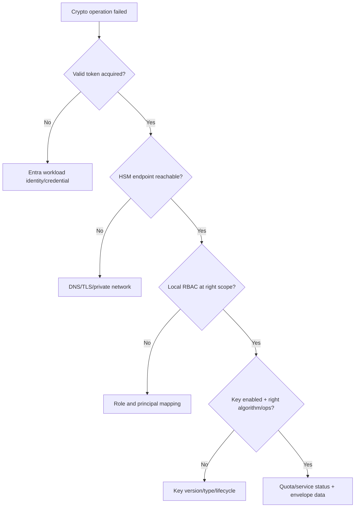

Never grant pool-wide Administrator to an application just because “it couldn't create a key”. Separate operator, key officer, crypto user, and recovery custodian cleanly by function.

## 48. Production Checklist: Dedicated Key Protection

### 48.1 Service Decision

- [ ] Specific threat model and regulatory/audit requirements exist for HSM.
- [ ] Demonstrated which mandatory requirement Key Vault Standard/Premium fails to meet, or why Managed HSM is a better fit.
- [ ] Verified HSM certification/validation scope for the deployed version and region.
- [ ] Verified supported key types, padding, algorithms, and key operations.
- [ ] Verified actual CMK integration if keys will back another Azure service.
- [ ] Budgeted resource pool, crypto operations, and DR costs.

### 48.2 IAM and Key Lifecycle

- [ ] Azure ARM control plane and Managed HSM local data-plane RBAC are separated.
- [ ] Managed HSM Administrator, Key Officer, Crypto User, Auditor, and Recovery Custodian are not merged arbitrarily.
- [ ] Applications have per-key scope and least-privilege data actions.
- [ ] Workloads use managed/workload identities with no long-lived secrets in source.
- [ ] Inventory tracks key names, owners, purposes, versions, key operations, and expirations.
- [ ] Processes exist for generate/import/BYOK and signing key approvals.
- [ ] Rotation plans include historical decryption checks before retiring/purging.
- [ ] Emergency revoke/disable plans account for business availability impacts.

### 48.3 Security Domain and DR

- [ ] Security domain initialized with a valid quorum.
- [ ] Recovery private keys held independently, never co-located with the artifact or single admin rights.
- [ ] Custody owners, alternates, and access evidence are documented.
- [ ] Encrypted security-domain artifact resides in an approved repository.
- [ ] Backup/restore runbook, retention, and compatibility reviews exist.
- [ ] Restore tested using test keys and test ciphertext.
- [ ] RTO/RPO for HSM dependencies and encrypted data are approved.
- [ ] Recovery procedures cover unavailable custodians, regions, or identities.

### 48.4 Crypto and Applications

- [ ] Every `sign/wrap/unwrap` call enforces proper business authorization.
- [ ] Document signing includes canonicalization, hashing, PKI, and auditing per contract.
- [ ] Envelope encryption enforces nonce uniqueness, authenticated encryption, and AAD.
- [ ] Plaintext DEKs are never logged, cached long-term, or sent to telemetry.
- [ ] Wrapped DEKs + full key version IDs are persisted consistently/atomically.
- [ ] Recovery paths handle lost responses, ETag conflicts, and partial rewraps.
- [ ] Private keys are never exported, and no fallback keys sit in source code for HSM outages.
- [ ] Encryption at rest and network/TLS follow separate policies.

### 48.5 Networking, Monitoring, and Cost

- [ ] HSM endpoint, private DNS, routing, TLS, and Entra token paths are tested.
- [ ] Azure HSM diagnostic settings and ARM activity logs are active.
- [ ] Alerts cover unauthorized crypto calls, key disables/expiry, and permission changes.
- [ ] p95/p99 latency, error rates, throttling, and key usage are monitored.
- [ ] Logs never contain plaintext, DEKs, security-domain artifacts, or private keys.
- [ ] Cost Management budget and owner exist for the dedicated HSM pool.
- [ ] Operations/sec, retries, and workload bursts are load-tested in staging.
- [ ] Rollback and incident runbooks cover key loss, network loss, and CMK integration failures.

## 49. Common Misconceptions

**“Managed HSM is just Key Vault Premium renamed.”** False. Managed HSM is a service/pool with a single-tenant model, custody, local RBAC, and security domain distinct from Key Vault Premium.

**“Managed HSM stores all API passwords, connection strings, and TLS certificate objects.”** False. It focuses on cryptographic keys/operations; secrets and certificates belong in appropriate services/workflows.

**“Just using an HSM guarantees passing all PCI/FIPS requirements.”** False. You must verify certification scope, versions, application design, and operational controls.

**“Single-tenant means the customer directly manages the HSM OS/firmware.”** False. Microsoft manages the hardware and infrastructure per service contract.

**“ARM Owner automatically gets permission to sign with every key.”** False. Managed HSM data-plane permissions use separate local RBAC by design.

**“Data-plane Crypto User can delete the Managed HSM pool on Azure.”** Do not infer that. Control-plane and data-plane roles are distinct.

**“Having a managed identity eliminates the need for Managed HSM local RBAC.”** False. The token authenticates the caller; local RBAC governs which operations are permitted.

**“Knowing the key URI is enough to decrypt.”** False. You still need identity, enabled key state, permitted operations, and network reachability.

**“The security domain is the Entra tenant ID.”** False. It is a dedicated cryptographic recovery mechanism, not a tenant name.

**“The security domain file and passwords can be handed to one admin for easier DR.”** Violates quorum/custody goals; recovery keys and permissions must remain separated.

**“Key backups alone are enough; security domain/quorum aren't needed.”** False under Managed HSM's recovery model when restoration requires both.

**“The security domain is a plaintext file containing every KEK's private key.”** False. It is a service-protected recovery artifact/mechanism.

**“Soft delete replaces backups and DR.”** False. It does not replace regional/disaster recovery or historical decryption verification.

**“Purge is always the fastest way to clean up a lab.”** False. Retention/purge protection impose constraints, and permanent deletion can destroy data.

**“RSA can directly encrypt a 2 GB file.”** False. RSA input sizes are constrained by modulus/padding; use hybrid/envelope encryption.

**“An EC-HSM signing key can wrap AES keys with RSA-OAEP.”** False. Algorithm and key type must be compatible.

**“Since the DEK sits in app RAM, Managed HSM is pointless.”** False. The HSM still protects the master/KEK and blocks private-key extraction, while app memory remains a separate layer to harden.

**“The DEK never leaves the HSM in the Java wrap/unwrap example.”** False. `unwrapKey` can return the plaintext DEK to the JVM.

**“Zeroing a `byte[]` guarantees every copy of the DEK is gone from Java memory.”** False. JVM/JCE/GC may retain copies.

**“AES-GCM can reuse any nonce as long as the KEK is in an HSM.”** False. Per-DEK nonce uniqueness is a mandatory cryptographic requirement.

**“AAD and tags don't matter once ciphertext is encrypted.”** False. AAD/tags protect integrity and context; skipping them weakens authentication.

**“You can disable the old key version right after creating a new version.”** False. Historical data may still reference the old version.

**“Creating KEK V2 automatically rewraps all DEKs from V1.”** False in the application envelope model; verified migration is required.

**“CMK in an Azure service has the exact same semantics as app envelope encryption.”** False. Service-managed CMK follows each integration's own protocol and features.

**“Every Azure service accepts a Managed HSM key URI as a CMK.”** False. Verify the integration matrix by service, tier, and region.

**“A Managed HSM private endpoint removes the need for Entra authentication.”** False. Networking and IAM are independent.

**“A non-exportable HSM key means attackers cannot abuse signing.”** False. An attacker who compromises an identity with `sign` rights can still invoke `sign`.

**“HSM logs prove the signer had manager approval.”** False. HSM audits record caller and operation; business approvals must be enforced and logged by the application.

**“Backup succeeded guarantees DR will work.”** False. You still need the artifact, quorum, compatible target, permissions, networking, and a restore test.

**“During an HSM outage, we can temporarily sign with a private key copy in the app.”** That defeats the non-exportable HSM key requirement and must be avoided.

**“An HSM pool with zero API calls costs nothing.”** Never assume that. Dedicated resources can incur base/capacity charges.

**“Using Managed HSM automatically satisfies all legal requirements for digital signatures.”** False. PKI, trust anchors, certificate validity, timestamps, business approvals, legal rules, and retention remain separate responsibilities.

## 50. Self-Check Questions

**Q1.** What is the primary purpose of Azure Managed HSM?

**Answer:** Managing cryptographic keys and key operations using managed HSMs in a single-tenant pool under the service model for dedicated key-protection requirements.

**Q2.** Why shouldn't Managed HSM be used as a secret store for database passwords?

**Answer:** Managed HSM focuses on key operations and does not replace Key Vault's secret/certificate object lifecycle.

**Q3.** When is Key Vault Premium sufficient instead of Managed HSM?

**Answer:** When you need HSM-backed keys without mandatory requirements for a dedicated HSM pool, security-domain quorum, or specialized custody model.

**Q4.** Does “single-tenant HSM” mean the enterprise manages the physical hardware directly?

**Answer:** No. The HSM is dedicated per the service isolation model; Microsoft still operates the infrastructure under contract.

**Q5.** How do ARM Owner and Managed HSM local Crypto User differ?

**Answer:** ARM Owner manages the Azure resource control plane; local Crypto User holds data-plane key operation rights at a given scope/role.

**Q6.** Does a managed identity replace local RBAC?

**Answer:** No. Managed identity proves the principal; local RBAC determines which operations that principal is allowed to perform.

**Q7.** What problem does the security domain solve?

**Answer:** It is a core recovery/custody component in Managed HSM per the service's mechanism, working alongside backups and quorum private materials.

**Q8.** What risk does quorum mitigate?

**Answer:** Reduces the chance of a single person performing unauthorized recovery by splitting custody of private recovery keys.

**Q9.** Why shouldn't the encrypted security domain artifact and all recovery private keys be stored in one account?

**Answer:** Compromising that single account would break separation of duties and quorum custody.

**Q10.** What happens if you have key backups but lose quorum materials?

**Answer:** Restore requirements may not be met; you must ensure backups, the security domain, and recovery private keys are all protected and rehearsed.

**Q11.** How do KEK and DEK differ?

**Answer:** The DEK encrypts data directly; the KEK wraps/protects the DEK. Managed HSM typically protects the KEK in an envelope design.

**Q12.** Why shouldn't you RSA-encrypt a 500 MB PDF?

**Answer:** RSA has strict input-size limits and is not meant for bulk data encryption; use AES-GCM and have the HSM wrap/unwrap the DEK.

**Q13.** When Java calls `unwrapKey`, where does the DEK live?

**Answer:** It can appear in plaintext inside the Java caller's memory, requiring runtime protection, best-effort zeroization, and avoiding caching/logging.

**Q14.** Why must an AES-GCM nonce be unique under the same DEK?

**Answer:** Reusing a nonce breaks GCM confidentiality and integrity.

**Q15.** What is the function of AAD?

**Answer:** Binds unencrypted context (such as tenant/object/version) into the authentication tag to detect context mismatches or tampering.

**Q16.** Can a new key version automatically decrypt DEKs wrapped with an older version?

**Answer:** Not by default; store the full versioned key ID and retain the old version or perform a verified rewrap.

**Q17.** Why does key rotation require inventorying ciphertexts still using V1?

**Answer:** If V1 is disabled/purged before migration completes, older data may become impossible to unwrap.

**Q18.** What is the difference between generating a key and BYOK?

**Answer:** Generate creates the key inside the HSM; BYOK transfers an existing key via a supported, controlled secure import/transport mechanism.

**Q19.** Does signing on Managed HSM automatically prove an approver agreed to contract terms?

**Answer:** No. Business authorization, canonicalization, signer identity/PKI, auditing, and legal workflows are still required separately.

**Q20.** Can Managed HSM be used as a CMK for every Azure service?

**Answer:** No. You must verify each service, tier, region, key type, encryption identity/permissions, and network integration.

**Q21.** Does a private endpoint replace Entra/local RBAC?

**Answer:** No. A private network route does not grant data-plane crypto permissions.

**Q22.** Why is a successful HSM `sign` operation alone insufficient for business auditing?

**Answer:** The HSM knows the authorized principal and operation, not the approval workflow or document meaning unless the app enforces and records that evidence.

**Q23.** Distinguish 401, 403, and timeouts when Java calls Managed HSM.

**Answer:** 401 usually indicates authentication/token issues; 403 can be local RBAC or network policy; timeouts involve DNS/network/service/deadlines. Inspect each layer explicitly.

**Q24.** Why shouldn't an app that only needs wrap hold key delete permissions?

**Answer:** Least privilege shrinks the blast radius if the workload identity is compromised.

**Q25.** If a Managed HSM region becomes unavailable, which assets are needed for DR?

**Answer:** Security domain/quorum, compatible backups, target pool, RBAC/network/IaC, separate encrypted data backups, and a tested runbook.

**Q26.** Do the RPO of ciphertext and the RPO of HSM key backups have to be identical?

**Answer:** No. They are independent backup systems; design so that any recovered data still has the keys required to read it.

**Q27.** Why can't Managed HSM stop an app from accidentally logging a plaintext invoice?

**Answer:** Once the app decrypts/receives plaintext, protecting memory and logs is the runtime/application's responsibility.

**Q28.** Can `Arrays.fill(dek, 0)` guarantee zero DEK remnants remain in JVM memory?

**Answer:** Not completely. It clears only that specific array; the JVM/JCE may retain copies.

**Q29.** What costs beyond key count must be budgeted for Managed HSM?

**Answer:** Pool/base capacity, operations, networking/private endpoints, backup/recovery, logs, application compute, DR, and security operations per current pricing.

**Q30.** Before declaring a system compliant with dedicated key protection requirements, what must be verified?

**Answer:** Threat model, certification scope, key types/algorithms, IAM local RBAC, security-domain quorum, backup/restore tests, networking, lifecycle/rotation, auditing, and cost.

## 51. Comprehensive Scenario Exercise

**Prompt:** A financial platform on Azure has three requirements:

1. Sign payment authorizations with a non-exportable private key.
2. Encrypt PDF statements up to 20 MB and store them in Azure Blob Storage.
3. The payment service running on AKS must operate while DevOps has no permission to use the private signing key.

The system uses Microsoft Entra ID, a Managed HSM pool administered by security officers, Azure Storage, and Cosmos DB; transaction data contains PII and must never enter telemetry. The business sets an approved recovery window and audits the entire key lifecycle.

### Design Tasks

1. Name and classify the signing key, KEK, and DEK by purpose.
2. Decide when to use Key Vault secrets/certificates vs. Managed HSM.
3. Build a role matrix for platform operator, security officer, crypto workload, auditor, and recovery custodian.
4. Design the security-domain quorum, backup custody, and recovery drill.
5. Diagram the document signing flow and recording of approval/hash/version evidence.
6. Diagram the AES-GCM + RSA-HSM KEK envelope encryption flow.
7. Specify mandatory envelope metadata for restoring after 5 years.
8. Define how tenant-specific AAD and app authorization are managed.
9. Design private networking, DNS, AKS workload identity, and Managed HSM local RBAC.
10. Plan periodic key rotation and historical DEK rewrapping.
11. Define SLIs/alerts for sign/unwrap, denied operations, and key disabling.
12. Write runbooks for accidental key disablement, pool outage, or a custodian losing their recovery private key.
13. Provide a DR plan covering key version verification and storage ciphertext restore.
14. Estimate operations/sec based on transaction and statement-read volumes.
15. Give one example where Managed HSM should **not** be used even though the enterprise already owns a pool.

### Suggested Architecture

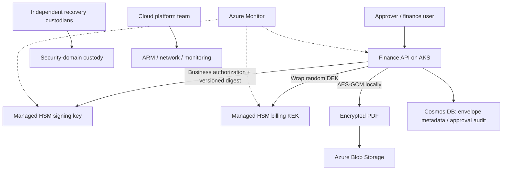

### Responsibility-Driven Solution Sketch

| Component | Core design |
|---|---|
| Signing key | RSA-HSM or EC-HSM with approved signing algorithm; workload has `sign` only |
| Encryption KEK | RSA-HSM KEK for `wrap/unwrap`, dedicated scope |
| DEK | Generated per document, AES-GCM, plaintext DEK never stored |
| Envelope | Stores ciphertext/tag/nonce/AAD/wrappedDEK/algorithm/full key version |
| App identity | AKS workload identity or managed identity per environment |
| IAM | Per-key local RBAC; separate ARM admins and security-domain custodians |
| Certificates/PKI | Separate management of public trust/signature validation as needed |
| Approvals | Business API checks signer, value threshold, tenant, and audit trail |
| Monitoring | Crypto outcomes/latency, denied calls, key lifecycle/role changes |
| DR | Quorum + security domain artifact + backups + target + restored test decrypt |
| Cost | Dedicated pool, crypto operations, networking, Storage, logs, and DR |

### Critical Scenario

When App Service/AKS hits an HTTP timeout after `wrapKey`, only the response may have been lost while the HSM already executed the operation. Because **wrapping the same DEK can produce different ciphertexts due to algorithm randomness**, never rely on bytewise equality of wrapped keys as an idempotency check. The application needs a **logical document/operation ID, conditional persistence, and consistent envelope metadata**, rather than retrying and creating duplicate statements just because a response was lost.

## Summary

**Azure Managed HSM** fits when an organization needs **managed HSM key protection in a dedicated pool** with clear requirements for **single-tenant isolation, non-exportable HSM-backed key operations, separation of duties, and security-domain quorum recovery**. It **is not a replacement for Azure Key Vault's secret/certificate stores**, nor does it automatically make an application compliant with every regulation.

Proper design separates the **Azure ARM control plane from Managed HSM local data-plane RBAC**, protects managed/workload identities, the security-domain artifact, and independent private recovery keys, and governs key generation/import/BYOK, signing, wrap/unwrap, **rotation, and historical decryption**. For large payloads, use **envelope encryption: AES-GCM in the application data plane and a Managed HSM-backed KEK to protect the DEK**, while recognizing the security limits of plaintext in the JVM/runtime.

Before production, verify **key/algorithm support, CMK integrations, private DNS/networking, backup/restore, quorum, RTO/RPO, audit logging, p95/p99 crypto latency, quotas, and total cost**. With change control, least privilege, and evidenced restore drills, Managed HSM becomes an **auditable, recoverable dedicated key-protection component** rather than merely an expensive key locker.
