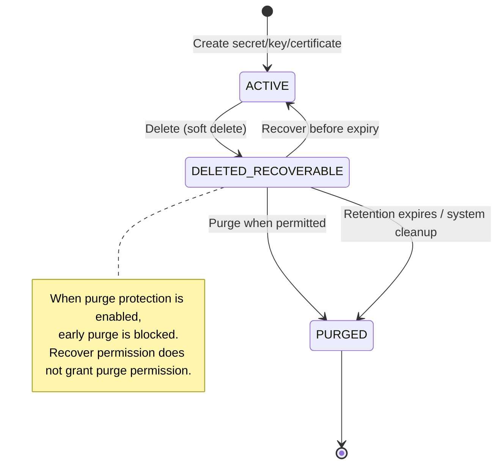
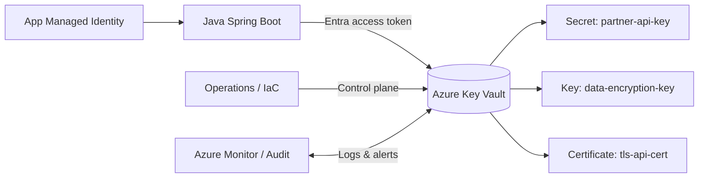
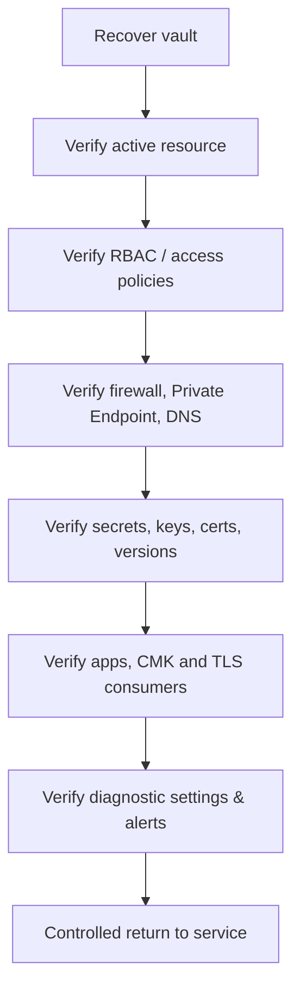
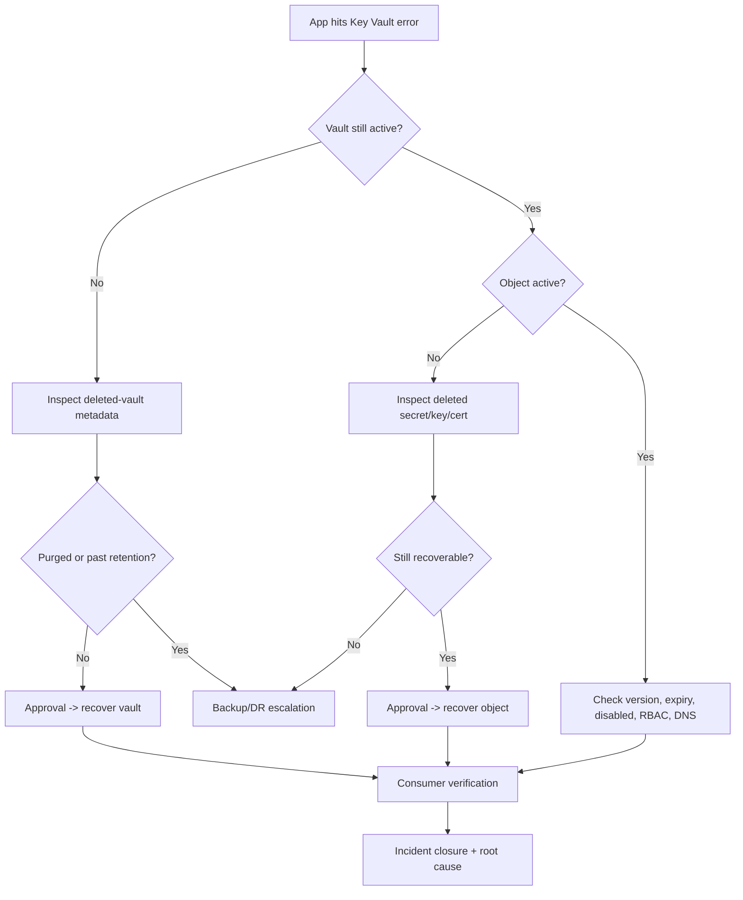

# Soft Delete, Purge Protection, and Key Vault Recovery

A Spring Boot application running on Azure App Service uses **Azure Key Vault** to retrieve partner connection secrets, data encryption keys, or TLS certificates. An accidental secret deletion, an IaC deployment deleting the wrong vault, or a compromised admin account can take the application down, break data decryption, or remove essential certificates. In such incidents, **soft delete** and **purge protection** are two vital mechanisms that are **not the same**, nor do they replace backups, access control, or incident response procedures.

**Azure Key Vault** stores and governs access to **secrets, cryptographic keys, and certificates**. Once an object or an entire vault is deleted, the resource can enter a **deleted-but-recoverable state** for a retention period. A **purge** operation permanently deletes soft-deleted data when policy allows. **Purge protection** blocks purging until the configured retention period expires, even for privileged users. In a real incident, this protection determines whether an admin mistake or attacker action immediately causes permanent data loss.

This lesson belongs to the **Secrets, Keys, and Certificates** chapter of the `CLOUD_PROVIDERS_AZURE` module, covering Azure subscriptions, resource groups, Microsoft Entra ID, networking, compute, data, monitoring, security, and cost control. The goal is to design **recoverability for Key Vault**, diagnose/inspect state with proper permissions, know when to recover a **secret/key/certificate** versus an **entire vault**, and establish rules preventing irreversible deletion.

> **Scope and safety:** Focuses on **Azure Key Vault (vault)**; do not assume identical properties for **Managed HSM**, Azure App Configuration, or other secret stores. Command names, required roles, capabilities, and API rules can vary across Azure CLI versions, SDKs, and RBAC/access policy models. Examples use placeholder paths/names; never execute them on production. Actions like `purge`, deleting a vault, and enabling purge protection **have severe or irreversible consequences**; perform them only under approved change management on the target environment.

## Learning Objectives

After completing this lesson, you will be able to:

1. Explain the **active, soft-deleted, recovered, and purged** states of a vault or object.
2. Distinguish **soft delete**, **purge protection**, **retention period**, **backup/restore**, and **business continuity**.
3. Understand which choices are **immutable/irreversible** and when approval is required.
4. Distinguish **deleting an entire vault** from **deleting a single secret, key, or certificate**.
5. Inspect protection settings and deleted resources via Azure Portal/CLI with proper permissions.
6. Build a runbook to **recover a secret/key/certificate**, verifying versions, permissions, and dependencies.
7. Build a runbook to **recover a soft-deleted vault**, handling name conflicts and dependent resources.
8. Understand Azure RBAC/data-plane requirements, Key Vault access policies, separation of duties, and purge permissions.
9. Design IaC, Azure Policy, resource locks, and monitoring/auditing to prevent accidental deletion.
10. Assess incidents involving lost encryption keys, config secrets, certificates, or App Service references.
11. Test recovery using synthetic data and document evidence of **RTO/RPO, timelines, risks, and cost**.
12. Write a production checklist for Azure Key Vault in a Java/Spring Boot application architecture.

## 1. Distinguishing Soft Delete, Purge, and Recovery

### 1.1. Core Definitions

| Concept | Nature | Key Takeaway |
|---|---|---|
| **Soft delete** | Keeps deleted resources/objects in a recoverable state during the retention period. | Data does not reactivate automatically; apps can still fail until recovery. |
| **Retention period** | Duration deleted data is kept before becoming eligible for permanent removal per policy. | Not equivalent to version/backup retention or a recovery SLA. |
| **Recover** | Restores an object/vault from soft-deleted state back to active when eligible. | Requires valid permissions, identity, subscription/region, and eligible state. |
| **Purge** | Permanently deletes a soft-deleted object/vault when policy allows. | Cannot be treated as reversible; normal recovery is no longer available. |
| **Purge protection** | Blocks purging before the retention period ends, even for principals with purge permissions. | Once enabled, it cannot be turned off under current Key Vault mechanics. |
| **Backup/restore** | Dedicated backup/restore per Key Vault features and limits. | Never assume backups exist simply because soft delete is enabled. |
| **Versioning** | Secrets/keys/certificates maintain version history by type and operation. | Deleting an object by name differs from picking an older version; inspect exact state. |
| **Resource lock** | Control-plane guardrail blocking certain management operations. | Does not replace purge protection, data-plane access control, or backups. |

**Key message:** *Soft delete gives you an opportunity to recover; purge protection protects that opportunity from premature purging.* The two features address different risks.

### 1.2. Lifecycle States of an Object



This is a **logical diagram**, not a guarantee that every object shares identical operations, API states, or cleanup timings. Actions can fail if the object was already recovered, constrained by vault state or permissions, or past retention.

### 1.3. Lifecycle States of a Vault

```text
ACTIVE VAULT
  ├─ May contain secrets, keys, certificates, versions, policies.
  └─ Delete vault:
       ↓
SOFT-DELETED VAULT
  ├─ Vault cannot serve normal requests as before.
  ├─ Vault name may remain reserved.
  ├─ Can be recovered within retention when policy permits.
  └─ Purge is only possible if not blocked by purge protection/retention.
       ↓
RECOVERED VAULT
  ├─ Verify objects/versions are intact.
  ├─ Verify RBAC/role assignments, policies, Event Grid, networking/DNS.
  └─ Test every app consuming the vault before declaring recovery complete.
```

**Recovering a vault does not automatically restore the entire surrounding Azure ecosystem.** Independent resources like role assignments, Event Grid subscriptions, private endpoints, DNS entries, or App Service configurations must be verified and may need to be recreated or reconfigured per runbook.

## 2. Two Levels of Deletion: Vault vs. Individual Object

### 2.1. Deleting a Secret/Key/Certificate

An active vault may hold:

```text
vault: kv-payments-prod
  secret: partner-api-key
  secret: database-password
  key:    encryption-key
  cert:   api-tls-certificate
```

If `partner-api-key` is soft-deleted:

- The vault still exists and continues serving other objects.
- The active version of the deleted secret can no longer be fetched via normal `get secret` calls.
- The deleted secret can be listed/recovered with proper permissions.
- Applications fetching the secret by name start failing; in-memory caches may delay **when errors become visible**.
- The secret name may remain reserved by the deleted object, blocking creation of a new secret with the same name until validly recovered or purged.

**Never work around this by creating a new secret with a different name while ignoring the soft-deleted state.** First inspect deleted objects and decide between recovery and replacement through an approved workflow.

### 2.2. Deleting an Entire Vault

If the vault itself is deleted:

- The entire namespace and all contained objects become unavailable to workloads.
- The vault appears in the deleted vaults list for that subscription/location.
- The Key Vault name may remain unusable for creating a new vault while soft-deleted.
- Recovery must happen at the **resource level**, not via `az keyvault secret recover`.
- Integrations using the vault URI will fail until the vault is active again and network paths/permissions are verified.

Never conclude a vault was deleted from a single `SecretNotFound` error; it could be a **wrong secret name, missing version, object soft delete, wrong vault URI, missing permissions, or network failure**. Diagnose the vault state first.

### 2.3. “Deleted Secret in an Active Vault” vs. “Secret Inside a Deleted Vault”

| Question | Active vault, deleted object | Soft-deleted vault |
|---|---|---|
| Can active objects be listed? | Yes, if principal has permissions and vault is reachable. | Vault cannot be used as an active resource. |
| Recovery scope | Single secret/key/cert by name. | First recover at the vault level. |
| Primary CLI | `az keyvault secret/key/certificate ...` | `az keyvault list-deleted / recover ...` |
| Impact | May affect only one workload/secret. | Can impact all workloads pointing to the vault. |
| Name reservation | Object name cannot be reused as a new object yet. | Vault name may remain unavailable for reuse. |
| Post-recovery checks | Versions, permissions, consumers. | All objects + RBAC/networking/dependencies. |

## 3. Soft Delete: Protection Scope and Retention Period

### 3.1. Configuring Retention

In modern Azure Key Vault, **soft delete is enabled/enforced by default on new vaults**, with a configurable retention period typically between **7 and 90 days** per current rules/features; the default is typically **90 days** unless specified otherwise. Verify exact behavior on your **vault type, subscription, API version, and Azure cloud**.

**Important:** `softDeleteRetentionInDays` is a critical choice at **vault creation time**; once a vault is created, the retention period generally **cannot be arbitrarily adjusted**. Never assume you can switch an existing production vault from 7 to 90 days to satisfy a new policy.

Example:

```text
Vault A: soft delete retention = 7 days
Vault B: soft delete retention = 90 days

Secret soft-deleted at 10:00 UTC on Day D.

Within retention window:
  - Recoverable under valid conditions.
  - Whether early purge is allowed depends on purge protection.

After retention expires:
  - Soft delete cannot be relied upon to guarantee recoverability.
  - Valid backups/DR and separate procedures are required if applicable.
```

Never calculate dates by local intuition; record **UTC timestamps** and check `scheduledPurgeDate` or service-returned attributes. **Retention is not RTO:** even if a secret is retained for 90 days, teams still need the identity, permissions, URI, networking, and procedure to restore service within target timelines.

### 3.2. What Is Preserved and What Is Not Guaranteed?

Soft delete supports recovering soft-deleted Key Vault objects or vaults, but it is not a full backup of your Azure infrastructure:

- Does not restore deleted **App Service/AKS/Functions** configurations.
- Does not restore an encrypted **database** if DB backups/ciphertext are also lost.
- Does not guarantee independent role assignments, network objects, or Event Grid subscriptions return intact if those resources were also deleted.
- Does not fix misconfigured apps: URIs, vault names, secret names, and versions still must be verified.
- Does not protect against **overwriting a secret's value before deletion** or picking the wrong version without version validation and auditing.
- Does not allow recovery via `recover` after a **completed valid purge**.

### 3.3. Secrets, Keys, Certificates, and Versions

Key Vault tracks **per-object versions**, so distinguish:

- Recovering an **object by name** from soft delete.
- Accessing a **specific version** of an active object.
- Pinning a version in an application URI, which can leave the app tied to an older version.
- Recovering required **key/certificate material** without automatically fixing consumer configuration.

An app referencing `https://kv-payments-prod.vault.azure.net/secrets/partner-api-key/<version-id>` might fail because that **version was disabled/missing**, not because the whole secret was soft-deleted. Never delete and recover a secret just to “try fixing” a version error. Inspect status/diagnostics and compare against the source of truth.

## 4. Purge Protection: Bounding Permanent Deletion

### 4.1. Purging When Purge Protection Is Disabled

Suppose a vault has soft delete enabled but purge protection **disabled**. A principal with purge permissions can **permanently delete** a soft-deleted object or vault per service rules and resource state. This creates risks:

- An operator trying to “free up a vault name” accidentally destroys recovery options.
- An IaC pipeline or cleanup script targeting the wrong subscription permanently wipes data.
- An attacker with purge permissions intentionally destroys both the vault and all secrets/keys/certs.
- Staff rushing to fix an issue by purging and recreating a resource with the same name lose irreplaceable data.

**Soft delete alone does not stop an authorized principal from purging early.**

### 4.2. When Purge Protection Is Enabled

When **purge protection** is enabled on Azure Key Vault:

- Soft-deleted objects/vaults are retained for the configured retention duration.
- Even principals holding purge permissions **cannot purge early** while protection is active.
- **Purge protection cannot be turned off** once enabled under current Key Vault mechanics.
- There is no “one-time admin override” to bypass protection during retention, per the service's protection contract.
- Once retention expires, the system permanently deletes soft-deleted data per lifecycle rules; **never treat purge protection as eternal storage**.

Enabling purge protection blocks accidental or malicious premature permanent deletion, while also **restricting immediate name reuse and immediate on-demand data erasure** once objects are deleted. Balance compliance, data-erasure obligations, and DR at the **vault design stage**.

### 4.3. Decision Matrix

| Scenario | Soft delete | Purge protection | Expected outcome |
|---|---|---|---|
| Secret deleted by mistake, want to recover | Enabled | Either | Recoverable within retention with valid permissions. |
| Attacker has purge rights and secret is deleted | Enabled | Disabled | Can cause permanent loss if purge is permitted. |
| Attacker has purge rights, retention active | Enabled | **Enabled** | Early purge blocked; contain attacker and recover. |
| Want to reuse vault name immediately after delete | Enabled | Enabled | Likely infeasible due to name reservation/retention. |
| Want to change `softDeleteRetentionInDays` post-creation | Enabled | Either | Do not expect in-place change; plan migration. |
| Retention expires on deleted resource | Enabled | Enabled | Cannot rely on recover; valid backups/DR required. |

### 4.4. Purge Protection Does Not “Freeze Everything”

Purge protection **does not prevent**:

- An authorized principal **soft-deleting** objects/vaults; the application still suffers downtime.
- An authorized principal **changing secret values or rotating keys** via permitted APIs.
- Secrets expiring, certificates expiring, consumer deployment bugs, or TLS trust failures.
- Admins accidentally **deleting a private endpoint or role assignment** outside the vault resource.
- Ciphertext or databases outside Key Vault being deleted without backups.
- Service availability, regional, or network health issues.

Combine it with Azure RBAC, Microsoft Entra ID/PIM, Azure Policy, Azure resource locks, backup/DR, monitoring, and application operations.

## 5. Responsibility Model and Anatomy of an Incident

Suppose a Java app uses `DefaultAzureCredential` and a Key Vault `SecretClient`:



There are at least three concerns:

1. **Application (data plane):** can it read secrets or decrypt with keys?
2. **Administration (control plane):** is the vault active, deleted, or undergoing recovery?
3. **Recovery:** is recovery permitted for the object/vault, and are retention, identities, endpoints, DNS, and role assignments still intact?

**HTTP 403** typically points to permissions/policies/firewalls; **404** can mean a missing object, soft-deleted object, or wrong URI; **timeouts** point to networking. Never diagnose a deleted vault from a single HTTP status code alone. Check Azure resource status and deleted objects with appropriate permissions.

## 6. Designing Protection Policies Before Creating Key Vault

### 6.1. Decisions That Must Not Be Left to Unreviewed Defaults

Before creating a vault, the platform team must define **subscription, tenant, resource group, region, data classification, retention period, purge protection, permission model, and RTO/RPO**. If the vault holds keys encrypting databases or storage accounts, losing a key can leave ciphertext intact yet completely unreadable. If the vault only holds a re-issuable API token, recovery can be simpler.

**7–90 days retention** is the window selected at new vault creation per current Azure Key Vault capabilities, defaulting typically to **90 days**. Retention generally **cannot be changed after vault creation**; treat it as an architectural decision and verify against the target API/region. **Once enabled, purge protection cannot be disabled**, so obtain owner sign-off before enabling it on vaults with data or special deletion workflows.

### 6.2. Bicep Example Creating a New Vault

```bicep
@description('Globally unique Key Vault name per Azure naming rules.')
param vaultName string

@description('Approved Azure region.')
param location string = resourceGroup().location

resource vault 'Microsoft.KeyVault/vaults@2023-07-01' = {
  name: vaultName
  location: location
  properties: {
    tenantId: subscription().tenantId
    sku: {
      family: 'A'
      name: 'standard'
    }
    enableRbacAuthorization: true
    enableSoftDelete: true
    softDeleteRetentionInDays: 90
    enablePurgeProtection: true
    publicNetworkAccess: 'Disabled'
  }
}

output keyVaultName string = vault.name
```

**This is a learning IaC sample**, not a complete production configuration or a guarantee that every API version supports every property in every cloud. With `publicNetworkAccess: 'Disabled'`, apps require proper **Private Endpoint/Private DNS/VNet routing**; otherwise the vault is unreachable despite valid RBAC. Add role assignments, diagnostic settings, alerts, tags, and policies. Never apply this IaC to a live vault without reviewing the **change plan**: retention and purge protection have irreversible constraints.

### 6.3. If Current Retention Fails Compliance

If an existing vault was created with 7 days while a new policy demands 90 days, do not assume an `update --retention-days` command works on that vault. Plan a **migration to a new vault** configured with the compliant policy from creation. Migrating secrets differs from migrating non-exportable cryptographic keys; switching vaults **without preserving key material/versions** can render encrypted data unreadable. Test migration and cutover thoroughly before deleting the old vault.

## 7. Azure CLI: Read-Only State Inspection

The examples below **read metadata only**. Operators must have proper permissions and sign into the approved tenant/subscription.

```bash
az login --tenant "<tenant-id>"
az account set --subscription "<subscription-id>"

VAULT="kv-recovery-lab"
RG="rg-keyvault-lab"

# Inspect active vault and protection attributes.
az keyvault show \
  --name "$VAULT" \
  --resource-group "$RG" \
  --query "{name:name,location:location,softDelete:properties.enableSoftDelete,purgeProtection:properties.enablePurgeProtection,retentionDays:properties.softDeleteRetentionInDays}" \
  -o json

# List soft-deleted vaults visible in scope.
az keyvault list-deleted -o table
```

JSON/JMESPath paths depend on CLI version representations. If a query returns `null`, inspect raw `az keyvault show -o json` output and CLI help rather than **immediately concluding purge protection is off**. An empty `list-deleted` does not prove zero deleted vaults exist if you are in the wrong subscription or lack permissions.

### 7.1. Deleted Objects Inside an Active Vault

```bash
VAULT="kv-recovery-lab"

az keyvault secret list-deleted --vault-name "$VAULT" -o table
az keyvault key list-deleted --vault-name "$VAULT" -o table
az keyvault certificate list-deleted --vault-name "$VAULT" -o table
```

These are **data-plane** operations. Resource-group management `Reader` does not grant permission to list deleted secrets/keys/certificates. Verify the vault's **Azure RBAC** or **access policy** model.

### 7.2. Inspect a Deleted Secret by Name

```bash
az keyvault secret show-deleted \
  --vault-name "kv-recovery-lab" \
  --name "partner-api-key" \
  -o json
```

Depending on API version, output includes **deleted date** and **scheduled purge date**. Never estimate recovery deadlines as `now + 90 days` if vault retention differs or deletion occurred earlier. If nothing is returned, the name may be wrong, the secret was never deleted, it was already recovered or purged, retention expired, or permissions are missing.

### 7.3. Distinguishing Object-Level vs. Vault-Level Inspection

| Scenario | Command group | What to check |
|---|---|---|
| Active vault, missing secret | `az keyvault secret show-deleted/list-deleted` | Name, version/retention, and data-plane permissions. |
| Active vault, missing key | `az keyvault key show-deleted/list-deleted` | Key name, key ID/version, crypto consumers. |
| Active vault, missing cert | `az keyvault certificate show-deleted/list-deleted` | Certificate policy, chain/versions. |
| No active vault exists | `az keyvault list-deleted` and management metadata | Subscription, location, vault name, resource group. |

Never run `az keyvault recover` when only one secret was deleted; never run `az keyvault secret recover` when the whole vault is gone.

## 8. Runbook: Recovering a Secret

Suppose the Spring Boot app calls `SecretClient.getSecret("partner-api-key")` on `kv-recovery-lab`, and requests fail after an administrative action.

### 8.1. Pre-Recovery Checks

1. Confirm vault URI, environment, subscription, tenant, secret owner, and detection time.
2. Diagnose **403/404/timeouts**; rule out wrong URI, RBAC, Private DNS, Key Vault firewall, or pinned secret version.
3. Halt any faulty automation/delete script so no other actor keeps mutating state.
4. Confirm the vault is active and the deleted secret exists via read-only commands.
5. Check scheduled purge time, purge protection status, and confirm retention remains.
6. Obtain owner approval and run with a principal holding **recover** permission—never add purge permissions.
7. Plan smoke tests, rollback, and monitoring.

### 8.2. Recover Secret — State-Changing Operation

```bash
# Run ONLY in lab or an approved incident on the exact vault/secret name.
az keyvault secret recover \
  --vault-name "kv-recovery-lab" \
  --name "partner-api-key"
```

Never have multiple operators run recovery simultaneously. Command success does not guarantee the app immediately receives the right secret value; verify version, `enabled`, expiry, access policies, managed identity, and Key Vault reference caches.

### 8.3. Verify Metadata Only Post-Recovery

```bash
# Never print secret values in output/logs.
az keyvault secret show \
  --vault-name "kv-recovery-lab" \
  --name "partner-api-key" \
  --query "{id:id,enabled:attributes.enabled,expires:attributes.expires,notBefore:attributes.notBefore}" \
  -o json
```

In production, run a **smoke test from the real application** using its MI/TokenCredential rather than operator credentials to confirm runtime permissions. If the secret was compromised, **recovery does not replace rotation**; issue a fresh credential at the third party and update consumers.

### 8.4. Cannot Create a New Secret with the Same Name?

A soft-deleted secret reserves its name, blocking creation of an active object with the same name. **Never purge to “free up the name”** before knowing what the secret did, since purging permanently destroys it when allowed. Prefer recovering when appropriate; if renaming is needed, plan a clean cutover rather than deleting old secrets just to dodge naming conflicts.

## 9. Runbook: Recovering a Cryptographic Key

Key Vault keys can back **customer-managed encryption keys (CMK)**, key wrapping, signing, or app encryption. Losing a key can make data-plane ciphertext **unreadable** even when Blob/SQL backups exist.

```bash
# Read-only: inspect deleted key.
az keyvault key show-deleted \
  --vault-name "kv-recovery-lab" \
  --name "data-encryption-key" \
  -o json

# STATE CHANGE: execute only after approval.
az keyvault key recover \
  --vault-name "kv-recovery-lab" \
  --name "data-encryption-key"
```

After recovery, verify:

- Exact **Key ID** and **key version** required by encrypted data or CMK integrations.
- Key is enabled, within validity, and permits `wrapKey/unwrapKey/decrypt/sign` per use case.
- Workload/Storage/SQL managed identities have permissions on the key.
- Key Vault URI, versioned key URI, and network paths are intact.
- Applications/CMK services actually execute real crypto operations, not just read metadata.
- Ciphertext, recovery points, and backups on dependent systems remain intact.

**Never replace a lost key with a new key of the same name** expecting encrypted data to decrypt. A key name is not cryptographic material. For non-exportable or HSM-backed keys, backup/migration has specific constraints; check official capabilities and resource policies.

## 10. Runbook: Recovering a Certificate

A Key Vault certificate links certificate policy, versions, key material, and secret representation depending on creation/import/issuer mode. When a certificate is deleted:

```bash
az keyvault certificate show-deleted \
  --vault-name "kv-recovery-lab" \
  --name "public-api-tls" \
  -o json

# STATE CHANGE: requires approval.
az keyvault certificate recover \
  --vault-name "kv-recovery-lab" \
  --name "public-api-tls"
```

Recovery is only part of the fix. Verify the **certificate chain, private key availability, expiry, SAN/subject, issuer/renewal policy**, and that applications actually **bind/sync** the recovered certificate. If the CA already revoked the certificate, recovering it in Key Vault **does not un-revoke it at the CA**.

For App Service certificate bindings, Application Gateway/ingress, or other TLS terminators, verify **sync mechanisms, caches, identities, and networking**. Never assume recovering a certificate causes proxies to immediately serve the right version.

| Object Type | Post-recovery smoke test | Risk if skipped |
|---|---|---|
| Secret | App retrieves expected version/value under runtime permissions. | Expired secret, wrong permissions, or compromised credential. |
| Key | Workload performs crypto operation on valid test data. | Ciphertext fails to decrypt due to wrong key/version. |
| Certificate | TLS chain, binding, expiry, and access verified. | TLS outage despite active vault object. |

## 11. Recovering an Entire Soft-Deleted Key Vault

When the **vault resource is deleted**, `secret recover` will not work while the vault itself is inactive.

### 11.1. Pre-Checks

1. Verify exact **vault name, original location, resource group, subscription, tenant**, and incident ID.
2. Run `az keyvault list-deleted` (read-only) to locate the deleted vault and timestamps.
3. Confirm retention remains, the vault was not purged, and **management-plane vault recover** permissions are in place.
4. Check accounts/policies/IaC so no job immediately deletes the vault again after recovery.
5. Plan post-recovery checks for **data-plane RBAC/access policies**, networking, and consumers.

### 11.2. Recover Vault — Requires Permissions and Approval

```bash
# Use ONLY on the exact approved deleted vault, region, and resource group.
az keyvault recover \
  --name "kv-recovery-lab" \
  --resource-group "rg-keyvault-lab" \
  --location "southeastasia"
```

`southeastasia` is illustrative; **take the actual region from deleted vault metadata**. The command fails if location/scope is wrong, permissions are missing, name conflicts occur, or retention expired. **Never** substitute `az keyvault create` to “recreate the vault” while the name is reserved; a fresh vault does not restore prior key/secret/cert material.

### 11.3. Post-Recovery Verification



**Recovering a vault does not guarantee all integrated resources come back intact.** Inspect role assignments, Event Grid subscriptions, private endpoint connections, Private DNS records, resource locks, IaC state, App Service Key Vault references, and monitoring/alerts; some are independent resources that may require recreation. Conversely, do not assume everything was lost either: **compare actual state against your baseline**.

### 11.4. Commonly Forgotten Dependencies

| Dependency | Symptom | Verification action |
|---|---|---|
| Azure RBAC assignments | App using MI gets 403. | Compare principal ID/scope and role definition. |
| Vault access policies | `SecretClient` lacks `get` permission. | Check RBAC vs. access policy mode and permissions. |
| Private Endpoint / DNS | App times out or hits blocked public endpoint. | Check approval, DNS/private IP, VNet routing. |
| App Service Key Vault references | Config value stale or failing. | Check reference status/cache and controlled refresh. |
| CMK in Storage/SQL | Encrypted data cannot open. | Check key URI/version, wrap/unwrap, tenant/identity. |
| Certificate bindings | TLS errors or old certificate served. | Check TLS chain/SNI/renewal/integration sync. |
| Event Grid subscriptions | Event handling stops firing. | Check subscription, endpoint, filters, and retries. |
| Diagnostics/alerts | Telemetry missing. | Check diagnostic settings, Azure Monitor, and Log Analytics. |
| IaC/Policy/locks | Deployments delete again or drift. | Reconcile state under proper change request. |

## 12. Permissions for Recover, Delete, and Purge: Control Plane vs. Data Plane

Key Vault permissions are not monolithic. Responders must separate **managing the vault resource** via Azure Resource Manager from **operating on secrets/keys/certificates** via the Key Vault data plane.

### 12.1. Operations Matrix

| Target | Example operations | Permissions and model to check |
|---|---|---|
| **Vault resource** | Create/delete/recover vault, change network settings. | Azure management-plane role/permissions at subscription/resource group/resource scope. |
| **Secret** | Get, list, set, delete, list deleted, recover, purge. | Corresponding Azure Key Vault data-plane role or vault access policy. |
| **Key** | Get/list, sign/verify, wrap/unwrap, delete, recover, purge. | Data-plane permissions for keys and operations. |
| **Certificate** | Get/list, import/create, manage issuer/policy, delete/recover/purge. | Permissions for certificates and linked key/secret objects. |
| **Role assignments** | Create/update/delete permission grants. | Separate IAM admin permissions; never included with reader roles. |
| **Private Endpoint/DNS** | Connect and resolve vault addresses. | Permissions on independent network resources. |

An operator with management-plane `Reader` can view certain resource metadata, yet **cannot read secret values by default**, much less recover or purge. A principal authorized to recover a secret **does not automatically have permission to recover a deleted vault resource**.

### 12.2. Azure RBAC vs. Vault Access Policies

Azure Key Vault supports:

- **Azure RBAC data-plane authorization** using built-in/custom roles assigned at supported scopes.
- **Legacy vault access policies** granting secret/key/certificate permissions directly on the vault.

Examples of distinct role purposes:

| Example role | Primary purpose | Caution |
|---|---|---|
| **Key Vault Secrets User** | Read secret values at the assigned scope. | Does not grant recover/purge by default. |
| **Key Vault Reader** | Read vault/object metadata per role. | Does not allow viewing secret values. |
| **Key Vault Secrets Officer** | Administer secret data plane per role definition. | Broad rights; verify actual delete/recover/purge permissions. |
| **Key Vault Crypto Officer** | Manage keys/operations per role definition. | Never grant to an app that only needs unwrap on one key. |
| **Key Vault Certificates Officer** | Manage certificates per role definition. | Can affect certificate renewal/workflows. |
| **Key Vault Administrator** | Very broad data-plane rights. | Never grant permanently just to recover one object. |
| **Key Vault Purge Operator** | Covers purging deleted objects per role permissions. | Irreversible risk; separate operators. |

**Role names do not replace reviewing the role definition and scope.** Azure RBAC/data-plane capabilities can vary by policy or API; on vaults using access policies, inspect exact `recover` and `purge` permissions per object type. In the access policy model, principals allowed to edit policies can escalate into data-plane access if poorly controlled—one reason to prefer Azure RBAC and separation of duties.

### 12.3. Designing Separation of Duties

```text
Application Managed Identity:
    GET secret / unwrap key  (narrow resource/scope only)
    No DELETE, RECOVER, PURGE

Routine Operations:
    Read metadata and monitor alerts
    No standing PURGE permissions

Incident Recovery Operator:
    List deleted / Recover per change ticket
    Short-lived elevation, fully audited

Security/Purge Approver:
    Dedicated process for permanent deletion when permitted
    Two-person verification of resource name/tenant/subscription

IaC Deployment Identity:
    Scoped resource creation/configuration rights
    No automated PURGE job as default cleanup
```

Use Microsoft Entra ID **Privileged Identity Management (PIM)**, approvals, and Conditional Access per organizational licensing and policies. Never collapse all permissions onto one principal simply to make lab setup easier.

### 12.4. Recovery Rights Do Not Guarantee Secret Read Access

After recovery, an operator can confirm the object is active again while the app still receives 403 because the app's MI lacks a data-plane read role. Conversely, an app authorized to read secrets should not be allowed to delete or purge them. **Both authorization paths must be verified independently.**

## 13. Purge Is Destructive: When Not to Purge

“Purge this vault so we can reuse the name” is never sufficient justification on its own. Before considering any permanent deletion, answer:

1. Which **decryption keys, CMKs, partner secrets, certificates, or legal holds** does the vault/object serve?
2. Do **other Azure services** reference old key URIs or certificates?
3. Do ciphertexts or backups still require that key for decryption?
4. Is the resource under **legal hold, retention obligation, or incident investigation**?
5. Is purge protection enabled, and has retention expired?
6. Is there a backup capable of restoring the **exact cryptographic material**, and has **restore been drilled successfully**?
7. Are there independent owners and approvers, a change window, and audit records?
8. Are **subscription, tenant, vault name, object name, and location** 100% verified?

### 13.1. Warning on Purge Commands

Azure CLI exposes purge commands for objects and vaults such as:

```text
# FOR COMMAND-GROUP RECOGNITION ONLY; DO NOT RUN.
az keyvault secret purge      --vault-name <vault> --name <secret>
az keyvault key purge         --vault-name <vault> --name <key>
az keyvault certificate purge --vault-name <vault> --name <certificate>
az keyvault purge             --name <vault> --location <region>
```

This section **is not an execution runbook**; we intentionally omit a batch-runnable script. When purge protection is enabled, early purging is blocked even for callers with purge roles. When protection is off and purging is allowed, the action **permanently destroys data**. Treat purge as a destructive change requiring two-person verification, not a fix for `ResourceAlreadyExists`.

### 13.2. Purge Protection and Data Erasure Requirements

An organization may simultaneously need:

- To prevent premature deletion of secrets/keys to preserve recoverability.
- To erase personal data upon valid expiration or deletion requests.
- To limit retention of sensitive metadata/identifiers after service retirement.

When purge protection retains deleted objects until retention expires, erasure compliance must be **designed from the start**, not left to a purge button. Classify what data requires erasure, legal/contractual frameworks, storage locations, and retention per system. **Never claim purge protection exempts you from legal erasure duties**; consult security/compliance owners on applicable policies.

### 13.3. When a Key Vault Name Is Locked

A soft-deleted vault can hold its namespace name. Never assume “deleting the resource group and recreating the vault with the old name” frees the name. **Recover the original vault** if data is still needed; if building a new vault under a new name, plan URI/cert/key migration and recognize it will not share the same resource identity. **Never purge just to recreate** if data still depends on the old name/keys.

## 14. Soft Delete Does Not Replace Backups and Disaster Recovery

### 14.1. Different Kinds of Loss

| Risk | How soft delete/purge protection helps | Still needed |
|---|---|---|
| Secret deleted by mistake | Recovery window while within retention. | Owner/permissions/monitoring, version verification. |
| Principal tries immediate purge | Purge protection blocks premature purge. | Fewer delete rights, incident response, auditing. |
| Wrong secret value rotated without deleting | Soft delete does not revert overwritten content. | Version selection/rollback, source of truth, testing. |
| Certificate expired | Does not prevent expiration. | Renewal/issuer monitoring and binding tests. |
| CMK key disabled | Does not auto-enable keys. | Key state/permission checks and crypto validation. |
| Encrypted data outside vault deleted | Does not protect external ciphertext. | Database/Storage backups and replication. |
| Vault/network/region unreachable | Data may exist while APIs fail. | Availability/DR, network runbooks, architecture design. |
| Vault or object validly purged | Normal soft-delete recovery is gone. | Valid backups if supported, anti-purge safeguards. |
| External resource deleted | Does not restore external resources. | IaC, backups, dependency inventory. |

### 14.2. Backing Up and Restoring Secrets, Keys, and Certificates

Azure Key Vault supports backup/restore operations **per object type within service limits**. However:

- These are not **raw secret string/certificate PEM exports** usable across arbitrary vaults/clouds.
- Backup material is Azure-protected and carries **constraints on vault, subscription, geography, tenant, or key type**, depending on feature and object type. Verify exact **target resources** and real restore feasibility.
- If a cryptographic key is non-exportable, you cannot copy the private key to a file and import it into any Key Vault.
- Backups require governed **access, encryption, retention, ownership**, and **restore drills** proving usability.
- Backup/restore does not automatically reconnect App Service/Storage/SQL CMK integrations to the right key URI/version or key material.
- Because Key Vault has its own service replication/availability model, do not assume every DR scenario requires or permits restoring a backup file instantly into an arbitrary region.

**At minimum:** for keys protecting long-lived encrypted data, design how to preserve **the ability to execute crypto operations on ciphertext** after DR, rather than merely checking that a backup file exists in Blob Storage.

### 14.3. Key Vault RPO and RTO

- **RPO:** How many recent changes to secrets/keys/certificates/versions can you afford to lose? When a key/secret rotates, is an older backup still valid?
- **RTO:** After an incident, how long until the vault, permissions, private endpoints, DNS, app references, and CMK consumers are operational again?

Keeping soft delete for 90 days **does not mean RTO = 90 days**. RTO must be measured in drills; targets may be minutes or hours depending on apps and approval chains. A vault recovered in 5 minutes while App Service reads the wrong secret for 2 hours has missed end-to-end RTO.

### 14.4. Fallback Discipline for Java Applications

An application using `DefaultAzureCredential` and Key Vault `SecretClient` should:

- Never write secret values to logs on error or during troubleshooting.
- Reuse clients and configure bounded retries for **transient** 429/5xx/timeouts; never endlessly retry 403 permission errors or deleted objects.
- Track secret versions/expiry, distinguishing rotation updates from deletions.
- Enforce TTL/refresh policies on caches; caches are not backups and must never keep revoked secrets alive against policy.
- Never fall back to an **admin's environment secret or account key** when Key Vault fails.
- With customer-managed encryption keys, test that clients can actually read/write data post-recovery, not just `get key` metadata.

## 15. Azure Policy, Locks, and IaC: Prevent Accidental Deletion First

### 15.1. Policy for Purge Protection

At subscription or management group scope, apply **Azure Policy** to audit or deny vaults lacking purge protection and/or other baseline controls per supported policy definitions. IaC (Bicep/Terraform/ARM) should declare **`enablePurgeProtection`** and retention from day one.

**Never assume an Azure Policy assignment automatically modifies existing vaults**, especially for immutable properties. Policy **audits or denies** per its effect/definition; remediation must be planned and tested—never delete and recreate live vaults just to become compliant.

### 15.2. Resource Locks Are Not Purge Protection

Azure management locks like **CanNotDelete** (blocking management-plane deletion at scope) reduce the risk of an operator or IaC pipeline deleting the entire vault. However:

- They do not block data-plane deletion of individual secrets, keys, or certificates.
- They do not replace purge protection.
- Principals with lock-management permissions can remove locks per IAM policy.
- Locks can break automated deployments/cleanups if pipelines aren't designed around them.

Use **locks to lower resource deletion risk**, purge protection to preserve recovery windows on deleted resources/objects, and RBAC/PIM to limit destructive privileges. All three layers complement each other.

### 15.3. IaC Must Guard Against Unexpected Deletion

A Terraform/Bicep PR can trigger vault replacement when an incompatible property changes. Before applying:

1. Inspect the **change plan / what-if**.
2. Flag any `Delete`, `Replace`, `Purge`, or resource name/region drift.
3. Protect state files, branch/release approvals, and deploy permissions.
4. Define migration/backup/restore before ever replacing a vault.
5. Prevent cleanup pipelines from auto-purging deleted vaults after tests.
6. Use environment-specific names and isolation; never reuse a production vault in integration tests.
7. During rollbacks, **never assume reverting IaC can turn purge protection off**.

### 15.4. Control-Plane Rights Are Dangerous Even Without Secret Read Access

An identity authorized to manage the vault resource—even without permission to read secret values—can still **delete the entire vault or alter policies/networking** if management privileges are overly broad. Conversely, a data-plane officer can delete individual secrets. Threat-model **both control plane and data plane**, not just who can call `get secret`.

## 16. Monitoring, Auditing, and Deletion/Recovery Alerts

### 16.1. Events to Track

| Event / Signal | Risk | Desired Response |
|---|---|---|
| Vault delete/recover/purge attempts | Loss of entire namespace/objects. | High-priority alert; verify change ticket and owner. |
| Secret/key/certificate delete/recover/purge | App, CMK, or TLS disruption. | Alert based on object classification and impact. |
| Purge protection/config change attempts | Guardrail/baseline drift. | Review policy and immutable-state expectations. |
| Role assignment / access policy changes | Access loss or privilege escalation. | Compare against approved baseline, PIM/audit. |
| Key disabled/expired/rotated | Encryption/decryption/signing outage. | Test crypto consumers; notify key owner. |
| Certificate expiry/renewal failures | TLS downtime. | Execute renewal plan; verify binding/sync. |
| Key Vault 401/403/404/429/5xx | Identity, permissions, missing object, or throttling. | Investigate by layer; bounded retries if transient. |
| Private DNS/endpoint failures | Vault unreachable. | Run network diagnostics; never open public access blindly. |
| Deleted resource nearing scheduled purge | Recovery window closing. | Incident owner decides on approved recovery. |

### 16.2. Azure Telemetry Sources

Combine:

- **Azure Activity Log** for resource management actions (control plane).
- **Key Vault diagnostic logs** and supported metrics; diagnostic settings route to Log Analytics/Storage/Event Hub per policy.
- **Azure Monitor alerts** for explicit conditions and resource health.
- **Microsoft Entra ID audit/sign-in logs** for identity/access context where available.
- **Application Insights/OpenTelemetry** for Java client errors, latency, and dependency tracking.
- **IaC/CI deployment logs** for resource, permission, and network changes.

**Never assume every data-plane event appears in the Activity Log**, and never invent metric/log category names. Verify diagnostics configuration, retention, and exact schema for your Key Vault version/region. Application logs must never contain secret values, key material, raw access tokens, SAS URLs, or certificate private keys.

### 16.3. Sample Incident Event Log

```json
{
  "incidentId": "INC-LAB-007",
  "eventUtc": "2026-11-20T10:00:00Z",
  "vault": "kv-recovery-lab",
  "objectType": "secret",
  "objectName": "partner-api-key",
  "action": "DELETE_DETECTED",
  "status": "INVESTIGATING",
  "approvedRecovery": false,
  "owner": "platform-security"
}
```

This payload is **synthetic**, not real Azure log output. Obfuscate or hash object names if logs have broad readership. If secret names contain sensitive identifiers, apply redaction and appropriate retention.

### 16.4. Alerts Must Never Auto-Purge

Automation that spots deleted objects and immediately “cleans them up” is an **anti-pattern**. When an alert detects unexpected deletion, the safe response is **stop the actor, preserve evidence, and evaluate recovery**. Only consider purging under a separately vetted request, if purge protection and policy permit.

## 17. Name Collision Risks and Vault Replacement

A soft-deleted vault can cause creating a new vault with the same name to fail. This is **not a random ARM glitch**: the name is reserved to support recovery and prevent unintended reuse.

### 17.1. Handling “Vault Name Unavailable”

```text
IaC create vault -> error about name unavailable
      |
      +-- Verify subscription/tenant/location expected
      |
      +-- Check deleted vaults (authorized read)
      |     |
      |     +-- Found same name, needed data?
      |          |
      |          +-- Yes -> Recovery assessment and approved recover
      |          +-- No  -> Check retention/purge protection and change policy
      |
      +-- Not found or no visibility?
            -> Verify global name constraints, access rights,
               external use/name allocation; do not purge blindly
```

Never try to “unlock” a name by deleting another resource group or sending purge requests across subscriptions. If the name is held by a soft-deleted vault with purge protection, you may have to **wait out retention** rather than reusing it immediately.

### 17.2. Changing the Vault Name Changes the URI

A Key Vault endpoint typically has the form:

```text
https://<vault-name>.vault.azure.net/
```

Creating a new vault under a different name requires **updating** application references, SDK configs, CMK integrations, certificate bindings, and network/DNS. A key with the same name in a new vault still has **different key identity/material**. Especially for CMK, never point configs to a new vault without verifying key eligibility for existing data.

## 18. Java Example: Recovery and Consumer Validation

In standard Java applications, **the runtime should not hold recover or purge permissions**. `DefaultAzureCredential` enables the runtime to read secrets or run permitted key operations; recovery is executed via an **operator runbook**.

Example verifying consumer access post-recovery with the Azure SDK:

```java
import com.azure.core.credential.TokenCredential;
import com.azure.identity.DefaultAzureCredentialBuilder;
import com.azure.security.keyvault.secrets.SecretClient;
import com.azure.security.keyvault.secrets.SecretClientBuilder;
import com.azure.security.keyvault.secrets.models.KeyVaultSecret;

public final class VerifyRecoveredSecret {
    public static void main(String[] args) {
        String vaultUrl = System.getenv("AZURE_KEYVAULT_URI");
        if (vaultUrl == null || vaultUrl.isBlank()) {
            throw new IllegalArgumentException("Missing Key Vault URL");
        }

        TokenCredential identity =
            new DefaultAzureCredentialBuilder().build();

        SecretClient client = new SecretClientBuilder()
            .vaultUrl(vaultUrl)
            .credential(identity)
            .buildClient();

        KeyVaultSecret secret = client.getSecret("partner-api-key");

        // Example only verifies the secret has a value; NEVER log contents.
        if (secret.getValue() == null || secret.getValue().isBlank()) {
            throw new IllegalStateException("Secret value unavailable");
        }

        System.out.println("Secret retrieval succeeded");
    }
}
```

**Prerequisites:** the vault is recovered, the MI/service principal holds `get` secret rights, the Key Vault URI is right, and networking is reachable. This example does not check whether the third party still accepts the API token; in production, run a real functional integration test without printing secrets.

**Note:** When run on a laptop, `DefaultAzureCredential` may pick your Azure CLI user instead of the production MI; local success **never replaces** a smoke test from the actual App Service/AKS runtime. Never grant operator recover/purge rights to an app just for post-recovery validation.

### 18.1. When Key Vault References Are Cached

Azure App Service and other services can use **Key Vault references** or certificate sync with their own caching mechanisms. After recovery or rotation, app state may lag due to platform caching, refresh intervals, or service health. Check integration docs, reference status, and supported refresh/restart procedures. Never restart all production instances blindly just because an old log still reflects an earlier read; pinpoint exact cache layers and follow maintenance procedures.

## 19. Phased Incident Response Runbook

A Key Vault incident can disrupt entire applications, data encryption, or TLS certificates. **Incident response is not just running `recover`**—it must stop further impact, preserve evidence, classify the fault, recover at the right level, and confirm users are genuinely served again.

### 19.1. Detection and Containment

1. Determine application impact: secret retrieval, key unwrap/decrypt, TLS binding, or the entire vault namespace.
2. Record **UTC timestamp**, tenant, subscription, resource group, vault URI, object name/ID, and version if known.
3. With authorized access, inspect **Azure Activity Log, Key Vault diagnostics, role changes, and IaC/deployment records**.
4. Pause the faulty automation/delete/rotation job under approval.
5. If identity compromise is suspected, work with security to restrict/revoke the actor before recovering.
6. Never paste raw secrets, tokens, private keys, certificate private material, or connection strings into tickets.
7. Designate one incident commander/lead operator so two people do not run conflicting recovery actions.

### 19.2. Diagnosis and Recovery Path Selection



Never attempt recovery when the true cause is **403 from IAM**, **timeout from DNS**, **expired certificate**, or **disabled key**. A `recover` command does not fix every Key Vault error.

### 19.3. Recovery and Verification

- **Active vault, deleted object:** recover `secret`, `key`, or `certificate` after reviewing deleted metadata.
- **Deleted vault resource:** recover the vault at the management plane, then verify every object and dependency.
- **Purged/past retention:** never promise soft-delete recovery; assess backups, key material, and business recovery.
- **Post-recovery:** verify **app runtime identity**, RBAC/access policies, Private Endpoint/DNS, object versions, CMKs, and certificate bindings.
- **If credentials leaked:** recovery is insufficient; also revoke/rotate at the credential issuer.
- **If encryption was impacted:** run crypto operations on valid test data rather than merely checking key name existence.

### 19.4. Incident Log Template

```text
Incident ID:                 <recorded>
Subscription/tenant/vault:   <verified>
Affected object/version:     <redacted as necessary>
Detection UTC:               <observed>
Delete time / purge deadline:<observed>
Purge protection:            <confirmed true/false>
Suspected root cause:        <operator/IaC/security/other>
Action approval:             <recorded>
Recovery start/finish UTC:   <measured>
Consumer smoke tests:        <PASS/FAIL>
RBAC/network verification:   <PASS/FAIL>
Observed RTO:                <measured>
Owner sign-off:              <approved>
Preventive action:           <policy/test/permission change>
```

This is a **template**, not an executed test report. Never record object values or cryptographic material.

## 20. Production Scenarios

### 20.1. Secret Deleted, Spring Boot Fails Unevenly

A Java API calls `SecretClient.getSecret("partner-api-key")`. A cleanup job deletes the secret; existing pods with cached values keep running, while newly started pods fail.

**Resolution:** Stop the cleanup job, inspect deleted secret metadata, recover by exact name while within retention, verify `enabled`/expiry/version, and test from the **runtime managed identity** against the partner API. If compromise is possible, coordinate **rotation** rather than keeping the old secret. Fix IAM so cleanup jobs lack out-of-scope delete rights.

**Lesson:** Soft delete does not prevent downtime, and app caching can mask an incident temporarily.

### 20.2. CMK Key Deleted, Ciphertext Intact Yet Unreadable

Storage/SQL/VM Disk uses a Key Vault key; once deleted, a service fails to unwrap or decrypt.

**Resolution:** Treat as high severity; determine if the key is soft-deleted vs. disabled/expired, recover if eligible, verify **key version/material** and consumer permissions. Never create a new key with the same name expecting ciphertext to become readable. Test end-to-end with valid data while checking backup/DR and retention deadlines.

**Lesson:** Preserving **cryptographic material and the exact key version** matters more than the object name.

### 20.3. IaC Deletes Whole Vault, Name Cannot Be Reused

A deployment configuration change deletes the vault. The next deploy script tries creating a new vault with the same name and fails.

**Resolution:** Stop the script, inspect deleted vaults in the right subscription/region, recover the vault after approval, and reconcile RBAC, Private DNS/Endpoints, diagnostic settings, app references, and CMK bindings. Fix change plans, approvals, and locks to prevent repeat deletion.

**Never resolve this via automated purge**: doing so can permanently destroy all recovery options, which is catastrophic if the vault holds decryption keys.

## 21. Safe Practice Lab with Synthetic Data

**Perform only in an approved lab.** Never delete or purge a production Key Vault; never use keys serving real databases or certificates serving real applications.

### 21.1. Prerequisites

```text
Subscription:         <approved-lab-subscription>
Resource group:       rg-keyvault-lab
Vault:                kv-recovery-lab-unique
Dummy secret:         dummy-recovery-token
Dummy secret content: example-only-not-a-credential
Vault retention:      <observed>
Purge protection:     <observed>
Recovery operator:    <approved identity>
```

All `<...>` values must be verified. If purge protection is enabled on the lab vault, **do not expect to delete the vault and reuse its name immediately**; factor lifecycle, lingering resources, and cost before practicing.

### 21.2. Controlled Steps

1. Sign in to the lab tenant/subscription; verify vault name and role assignments.
2. Inspect **soft delete, retention, and purge protection** properties.
3. Create a purely dummy secret in the lab vault if permitted.
4. Inspect secret metadata (never print the value).
5. Under lab approval, perform a **soft delete** on the dummy secret through reviewer-controlled steps; do not purge.
6. Verify via `az keyvault secret list-deleted` and `show-deleted`.
7. Recover the dummy secret after approval using the command illustrated in Section 8.
8. Verify metadata, enabled/expiry state, and that a mock app client reads the secret.
9. Test with a principal **lacking recover permission** to prove it is denied.
10. Record RTO, audit evidence, and clean up per policy; never delete production vaults or bypass retention.

### 21.3. Read-Only Practice Commands

```bash
az keyvault show --name "kv-recovery-lab-unique" -o json

az keyvault secret list-deleted \
  --vault-name "kv-recovery-lab-unique" -o table

az keyvault secret show-deleted \
  --vault-name "kv-recovery-lab-unique" \
  --name "dummy-recovery-token" -o json
```

**Delete and recover operations require separate approval**: these read-only commands do not delete anything. Once a dummy secret is soft-deleted and the operator holds proper permissions, run `az keyvault secret recover` per Section 8. This lab intentionally includes **no purge script**.

### 21.4. Acceptance Evidence

| Item | Evidence to Collect |
|---|---|
| Vault in right scope | Tenant, subscription, region, resource group. |
| Protection policy | Retention days, purge protection status. |
| Deleted object | Name, deletion UTC, scheduled purge if present. |
| Recovery action | Operator, approval, CLI/API outcome. |
| Active secret | Metadata and consumer get-secret test; zero value logging. |
| Negative permission | Principal lacking recover is denied. |
| Timing | Detection → recovery → application restored. |
| Incident review | Root cause, policy change, owner sign-off. |

A lab recovering only a secret **does not prove** recovery procedures for a Key Vault holding HSM-backed CMKs or an entire production vault. Those require dedicated exercises aligned with security requirements.

## 22. Reliability and Security Test Matrix

| Scenario | Test | Expected Result |
|---|---|---|
| Secret soft-delete | Delete dummy secret in sandbox. | Deleted record visible with proper read permissions. |
| Recover secret | Recover object within retention. | Active object/versions verified. |
| Recover wrong name | Look up non-existent deleted name. | Does not auto-create another secret or purge. |
| Principal lacks permission | Use identity without recover rights. | Denied; never auto-escalate privileges. |
| Purge protection | Review policy and deleted resource state. | Never test purge on production; retention verified. |
| Wrong tenant/subscription | Simulate mismatch in checklist. | Halt before state-changing operations. |
| Vault-level delete | Tabletop or dedicated sandbox vault. | Use proper management-level recovery. |
| Vault recovered, app 403 | MI attempts secret read without permission. | Investigate RBAC/access policy. |
| Vault recovered, app timeout | Controlled DNS/private network test. | Classify network fault; never open public access blindly. |
| Key version mismatch | Crypto test with dummy/approved key. | Never swap key material carelessly. |
| Certificate expired | Check metadata and TLS probe. | Distinguish expiration from deletion. |
| Deleted vault name conflict | IaC plan attempts creating reserved name. | Block automated cleanup/purge. |
| Duplicate recovery operations | Tabletop drill. | Single incident owner; avoid concurrent conflicts. |
| Backup/restore drill | Execute per service constraints on synthetic data. | Restore yields usable data, not just a backup file. |
| Auditing | Inspect Activity Log and diagnostics. | Clear timeline and IAM edits; zero secret logging. |
| IaC drift | Plan tries altering immutable protection. | Flagged/blocked for review and migration planning. |

### 22.1. Definition of PASS

A drill passes only when the **exact vault/object** is restored, recovery avoids unintended purges, permissions are right, app/CMK/TLS consumers work, zero secrets/tokens leak, and an **actual measured RTO timeline** is recorded. A zero CLI exit code **is insufficient** if applications still fail.

## 23. Common Errors

| Symptom | Cause | Resolution |
|---|---|---|
| `getSecret` returns 404. | Wrong name/version, soft-deleted object, or never created. | Check active/deleted metadata and exact vault. |
| Secret recover returns 403. | Missing data-plane recover permission or network policy. | Verify RBAC/access policies and identity. |
| Vault recover denied. | Missing management-plane permission or wrong scope. | Check subscription/resource group/location. |
| Vault name cannot be reused. | Deleted namespace reservation or name taken elsewhere. | Inspect deleted vaults; never purge arbitrarily. |
| Early purge blocked. | Purge protection is working. | Respect retention/approval; never try to bypass. |
| Changing retention fails. | Retention attribute is immutable over vault lifecycle. | Plan migration rather than unapproved delete/recreate. |
| Vault recovered, app still gets 403. | Runtime MI lacks role or wrong permission model. | Verify principal/role scope and data plane. |
| Vault recovered, app times out. | Private DNS/Endpoint/network misconfigured. | Check connectivity paths and firewalls. |
| Secret recovered, API still fails. | Wrong version, expired, cached, or revoked by partner. | Check validity and rotation/refresh policy. |
| Key recovered, decryption fails. | Wrong key material, version, or permissions. | Check Key ID and cryptographic operations. |
| Certificate recovered, TLS fails. | Expired, CA-revoked, broken chain, or stale binding. | Run TLS smoke test and check cert policy. |
| CLI query returns null. | JMESPath mismatches CLI output version. | Inspect raw JSON before assuming protection is off. |
| Deleted object not visible. | Wrong scope/permissions, purged, or past retention. | Check logs, location, permissions, and retention window. |
| Alerts miss deletions. | Diagnostics or log query targets wrong plane. | Check Activity Log and Key Vault diagnostics. |

## 24. Review Questions

1. **How does soft delete differ from purge protection?** Soft delete preserves recovery ability; purge protection blocks premature permanent deletion.
2. **Once purge protection is enabled, can it be disabled?** No, under current Key Vault mechanics.
3. **Does soft delete prevent downtime when a secret is deleted?** No; deleted objects cannot be read by apps as active objects.
4. **Are recovering a secret and recovering a vault the same?** No; data-plane object vs. management-plane resource.
5. **Can you recover after a valid purge completes?** Not via normal soft-delete recovery.
6. **Is a 90-day retention period your RTO?** No; RTO is the end-to-end time to restore service.
7. **Can you create a new key with the same name to decrypt old ciphertext?** Not by name alone; exact key material/version is required.
8. **Does purge protection replace backups?** No.
9. **Does the Reader role read secret values?** Not by default.
10. **Who should hold standing purge permissions?** Very few principals, under least privilege, approvals, and auditing.
11. **Why check Private DNS after vault recovery?** Networking and Private Endpoints are separate dependencies.
12. **Why might TLS still fail after certificate recovery?** Bindings, caches, chains, or CA revocation status may still be invalid.
13. **Does a 403 prove a secret was deleted?** No; it usually indicates authorization or network policy.
14. **What should you do when a vault name is unavailable after deletion?** Check deleted vaults; never purge blindly.
15. **Why never test purge in a shared lab?** It can permanently destroy data and disrupt names/retention.
16. **When can an incident be closed?** Once keys/secrets/certs, IAM/networking, and apps pass smoke tests with owner sign-off.

## 25. Production Checklist

- [ ] Owner, tenant/subscription/resource group/region, and vault purpose documented.
- [ ] Soft delete/retention verified against policy prior to vault creation.
- [ ] Purge protection evaluated/enabled per security/compliance, understanding it **cannot be disabled**.
- [ ] Retention period, name reservation, and recovery deadlines documented in operations.
- [ ] IaC declares retention/purge protection with what-if/plan approvals.
- [ ] Azure Policy/locks used appropriately, never confused with data-plane purge protection.
- [ ] No automated scripts purging deleted vaults/keys/secrets/certs.
- [ ] App runtime identities hold only required read/crypto permissions—no delete/purge.
- [ ] Recover/delete/purge permissions separated with approval/PIM/auditing where required.
- [ ] Key Vault Azure RBAC vs. access policy model explicitly chosen and verified.
- [ ] Separate runbooks exist for **object recovery** and **vault recovery**.
- [ ] Ability to inspect deleted objects, deletion UTC, and scheduled purge time verified with proper permissions.
- [ ] Secret values, key material, tokens, and private keys never appear in logs or tickets.
- [ ] Key version/CMK integration inventory and test-data decryption smoke tests in place.
- [ ] Certificate bindings/expiry/issuers/chains and TLS validation inventoried.
- [ ] Policy requires rotating compromised secrets rather than only recovering old credentials.
- [ ] App Service/AKS/Functions/Container Apps consumers and MI/OIDC principals inventoried.
- [ ] RBAC, Private Endpoints/DNS, Event Grid, diagnostics, and App Service references inventoried.
- [ ] Alerts configured for vault deletion, object deletion, role changes, and purge attempts.
- [ ] Azure Activity Log, Key Vault diagnostic logs, and app telemetry have proper retention and ACLs.
- [ ] Runbooks clearly separate 401/403/404/network errors from object deletion.
- [ ] Backup/restore for critical objects evaluated and tested on matching key/cert types.
- [ ] End-to-end RTO/RPO defined and tested rather than equated with retention.
- [ ] Drills cover negative permission tests, wrong tenant, name conflicts, and IAM/network failures.
- [ ] Owner/compliance approval required before any purge or key migration.
- [ ] Recovery marked complete only after business consumers, CMK/TLS, and audits all PASS.

## Conclusion

**Soft delete, purge protection, and Key Vault recovery** safeguard the recoverability of **secrets, keys, certificates, and vault resources** against accidental deletion or malicious tampering. Soft delete preserves recovery within retention; purge protection blocks premature permanent deletion and **cannot be turned off once enabled**. Yet neither feature prevents immediate service disruption upon deletion, replaces backups or proper access control, or automatically restores IAM, networking, references, or cryptographic consumers. In production, distinguish **object-level from vault-level recovery**, inspect **tenant/subscription/region, versions, RBAC/access policies, Private Endpoints/DNS, CMKs, and certificates**, and verify that services actually work again. Combining IaC, Azure Policy, resource locks, separation of duties, monitoring, approval workflows, and RTO/RPO drills minimizes the risk of unrecoverable key material loss, restores Azure applications verifiably, and keeps Key Vault governed sustainably.
