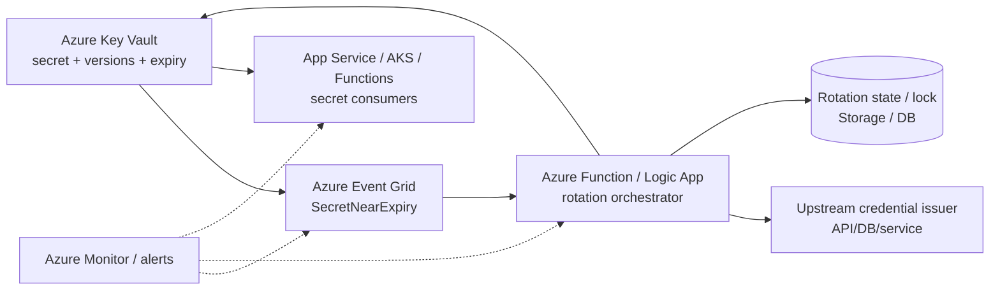
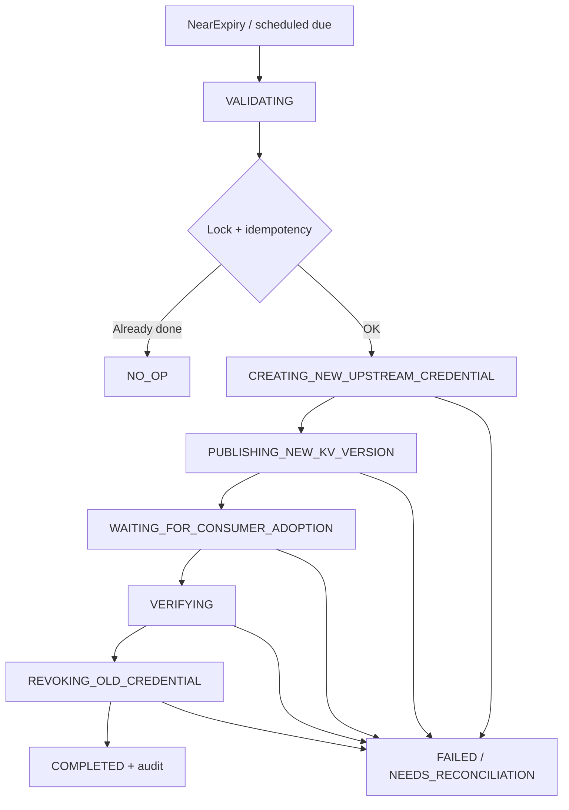
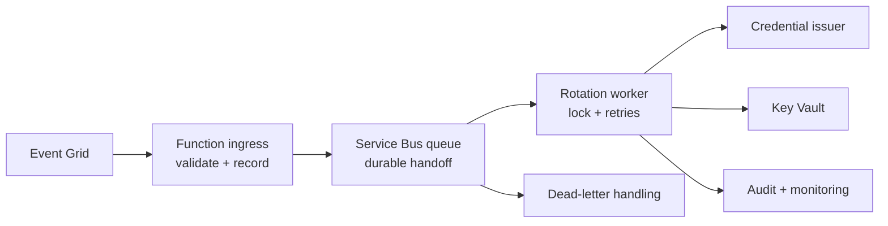
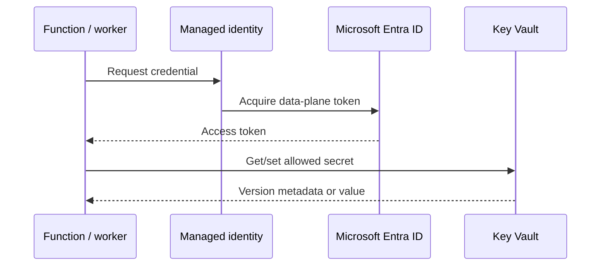
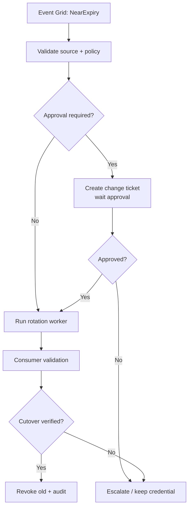
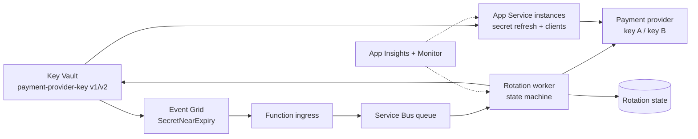

# Event-Driven Secret Rotation and Automation

A Java/Spring Boot application on **Azure App Service** uses an API key to call a third-party payment service. The key is stored in **Azure Key Vault** with a 90-day expiration date. Periodically, an operator generates a new key in the partner portal, updates Key Vault, and messages development teams to restart their apps. Missing even one instance leaves the old key in use; revoking the old key too early triggers mass transaction failures. When the on-call engineer is away on leave the week a key expires, the manual process breaks down.

A better design is **event-driven secret rotation**: Key Vault emits an event when a secret nears expiration; **Azure Event Grid** routes it to **Azure Functions, Logic Apps**, or an approved worker. The worker rotates the credential **at the source system**, writes a **new version in Key Vault**, verifies applications are using the new credential, and **revokes the old version only after sufficient cutover evidence**. The system must also handle duplicate/delayed events, partial workflow failures, application caching, authorization, and auditing.

The hardest part is **not** the API call to create a secret version. It is ensuring **the real credential at the target service**, **the value in Key Vault**, and **all consuming applications** switch versions in a safe order.

This lesson belongs to the **Secrets, Keys, and Certificates** chapter of the `CLOUD_PROVIDERS_AZURE` module. The module spans from subscriptions, resource groups, Microsoft Entra ID, virtual networking, compute, storage, and data to operations, monitoring, security, and cost control for Azure application architectures. Here we focus on **Azure Key Vault secrets + Event Grid + automation**, while distinguishing them from rotating **cryptographic keys** and **certificates** because each object type has its own mechanisms.

**After completing this lesson, you will be able to:**

- Distinguish **secret rotation, key rotation, certificate renewal, versioning, expiration, and revocation**.
- Explain the `Microsoft.KeyVault.SecretNearExpiry`, `SecretExpired`, and `SecretNewVersionCreated` events.
- Design the pipeline **Key Vault → Event Grid → Azure Function/Logic App → credential provider → Key Vault → application consumers**.
- Implement **two-phase cutover** leveraging an overlap window where old and new credentials coexist.
- Prevent failures from **duplicate/out-of-order events, retry storms, webhook authentication, poison messages, and partial failures**.
- Apply **managed identities, Azure RBAC, Key Vault Secrets User/Officer, and network isolation** per role.
- Understand **versionless/versioned references, caching, refresh, connection pools, and long-running apps**.
- Design state machines, idempotency keys, auditing, metrics, alerts, rollbacks, and production test suites.

## 1. What Is Secret Rotation and What Is Not?

A **secret** is sensitive data used as a credential or confidential material, such as an **API key, database password, or static access token**. **Secret rotation** is the process of replacing an old credential value with a new one, switching consumers onto the new value, and preventing continued use of the old credential.

| Action | Meaning | Enough to call it complete rotation? |
|---|---|---|
| Change Key Vault secret `expiresOn` metadata | Updates expiration/reminder timestamp | **Does not** change the real credential |
| Create a new Key Vault secret version | Stores a new value in the vault | **Not yet**, if upstream or consumers haven't switched |
| Regenerate API key in partner portal | Changes the active credential upstream | **Not yet**, if Key Vault/apps still use the old key |
| Restart App Service | May reload the stored value | **No**, if the secret itself hasn't rotated |
| Disable old secret version in Key Vault | Blocks/limits vault access to that version per policy | **Does not guarantee** upstream credential revocation |
| **Rotate → publish → verify → revoke** | Completes credential and consumer cutover | **Yes**, once final state is verified |

### 1.1. Three Frequently Confused Objects

| Key Vault object type | Purpose | Typical rotation mechanism |
|---|---|---|
| **Secrets** | Passwords/API keys/secret text | Custom automation or integrations managing the real credential; not every secret has built-in rotation |
| **Keys** | Cryptographic keys for encrypt/sign/wrap | Key Vault offers **key rotation policies** for supported key types; consumers still must be managed |
| **Certificates** | X.509 certificates and linked private keys per policy | Certificate lifecycle/renewal policies, issuer integrations, or external CAs; may have a backing secret |

**Never treat `rotate-key` for an Azure Key Vault cryptographic key as proof that Key Vault rotates external database passwords automatically.** The database or partner still requires an operation to rotate the credential on that system.

### 1.2. Expiration Is Not Revocation at the Source System

A Key Vault secret's `exp` timestamp supports lifecycle governance, alerts, and access semantics per service behavior. It **does not reset a database login password**, **does not invalidate a partner API key**, and **does not stop an app from using a cached credential**. Revocation must be executed explicitly at the **credential issuer**.

## 2. Overall Architecture: One Event Triggers a Multi-Step Workflow



**Two facts must always remain separate:**

1. Event Grid signals that **a secret lifecycle event occurred or is approaching based on metadata**.
2. The rotation workflow decides **whether rotation is allowed, in what order, what to verify, and when to revoke**.

Event Grid does not log into your database to change passwords, grant permissions to Azure Functions, refresh connection pools, or provide a distributed transaction between Key Vault and an external SaaS.

### 2.1. Components and Responsibilities

| Component | Responsibility | Should not do |
|---|---|---|
| **Key Vault** | Store secret versions, lifecycle attributes, emit supported events | Log group master secrets |
| **Event Grid** | Filter/route events to subscribers, retry delivery per policy | Treat events as passwords or business-authorized commands |
| **Function/Logic App** | Orchestrate, validate preconditions, call issuer, publish, verify, revoke | Run unboundedly or hold subscription-wide admin rights |
| **Upstream issuer** | Create/activate/revoke the real credential | Treat Key Vault metadata as sole source of truth |
| **Rotation state store** | Idempotency, distributed locks, progress/approvals/auditing | Store plaintext secrets unnecessarily |
| **Consumers** | Load new versions and manage cache/connection lifecycles | Pin old versions forever without monitoring |
| **Azure Monitor** | Metrics, alerts, incident workflows | Collect raw secret values |

## 3. Lifecycle of a Secret Across Systems

Consider API key `payment-provider-key`:

```text
T0: Provider accepts credential A
    Key Vault secret version v1 holds A
    App instances use A

T1: Key Vault emits SecretNearExpiry for v1
    Automation creates credential B at provider

T2: Provider accepts both A and B (overlap period)
    Key Vault secret version v2 holds B

T3: Consumers refresh and confirm using B

T4: Revoke credential A at provider
    Disable/retire v1 per policy

T5: Audit and complete rotation
```

**Concurrent A/B validity** is only feasible when upstream supports dual credentials, token overlap, multiple active API keys, or an equivalent mechanism. If the provider allows only one password at a time, you need a **dedicated strategy** such as blue/green identities, secondary logins, rolling cutover with approved downtime, or proxy-mediated migration.

### 3.1. Never Schedule Revocation Blindly by Clock

If an app instance temporarily loses connectivity to Key Vault, it may still be using A after v2 is written. Revoking A at T2 simply because “v2 was written” breaks in-flight calls. **Revocation gating** requires cutover evidence (new credential success, consumer version adoption, an appropriate grace period, and SLO checks).

### 3.2. Sequence When Provider Supports Dual Credentials

```mermaid
sequenceDiagram
    participant E as Event Grid
    participant F as Rotation Function
    participant P as Provider / Database
    participant K as Key Vault
    participant A as Applications
    E->>F: SecretNearExpiry(v1)
    F->>F: Validate event + acquire lock
    F->>P: Create credential B; retain A
    P-->>F: Credential B
    F->>K: Set secret new version v2
    K-->>F: Version ID v2
    F->>A: Signal refresh / plan rolling reload
    A->>P: Authenticate with B
    P-->>A: Success
    A-->>F: Adoption/health evidence
    F->>P: Revoke credential A
    F->>F: Audit COMPLETE; release lock
```

This diagram illustrates the **business workflow**; Event Grid does not wait for each step to finish, and applications do not emit adoption callbacks unless you implement them.

## 4. Key Vault Events for Secrets

Azure Key Vault emits **Event Grid events** for supported lifecycle changes. Common event types:

| Event type | Meaning | Recommended action |
|---|---|---|
| `Microsoft.KeyVault.SecretNearExpiry` | A secret version has entered its near-expiry warning window | **Initiate or check rotation plan** |
| `Microsoft.KeyVault.SecretExpired` | A secret version reached its metadata expiration time | **Alert/incident** if rotation is incomplete |
| `Microsoft.KeyVault.SecretNewVersionCreated` | A new secret version was created | Verify/audit/update downstream; **never blindly rotate again** |

Beyond secret events, key and certificate events exist such as `KeyNearExpiry` or `CertificateNearExpiry`, which represent **different object types and workflows**.

### 4.1. NearExpiry Is Not “Expiration Minus an Arbitrary Offset”

Key Vault emits `SecretNearExpiry` according to **service rules**, typically a fixed lead window before the version's `exp`. Never build SLOs solely assuming an immutable fixed day count; verify the current contract, subscription/delivery health, and add **scheduled reconciliation** in case events arrive late or drop.

### 4.2. Always Set Meaningful Lifecycle Attributes

If a secret is created without expiration metadata or with mismatched metadata, do not expect near-expiry events on your business schedule. Secret provisioning should set and track:

- Creation/issuance date and `expiresOn` per policy.
- Owner, upstream system, and credential identifier.
- Rotation cadence, lead time, grace period, and security controls.
- Escalation contact if automated rotation fails.

**Expiration metadata is an alert input**, not a guaranteed scheduler.

### 4.3. Events Are Signals—They Never Contain Secret Plaintext

Events typically carry metadata such as event ID/type, subject, timestamp, and vault/object/version IDs. **Never expect the event payload to carry the secret value.** Workers inspect metadata, validate source/scope, and call Key Vault with an authorized identity as needed.

## 5. Event Grid Envelope and Event Classification

A **simplified, hypothetical** Event Grid schema sample:

```json
{
  "id": "evt-secret-near-expiry-001",
  "eventType": "Microsoft.KeyVault.SecretNearExpiry",
  "subject": "payment-provider-key",
  "eventTime": "2026-11-20T08:00:00Z",
  "data": {
    "vaultName": "kv-payment-prod",
    "objectName": "payment-provider-key",
    "version": "opaque-version-id",
    "exp": 1790000000
  },
  "dataVersion": "1"
}
```

**Do not copy this JSON as an authoritative payload:** actual data fields, casing, subject structure, and timestamps depend on **Event Grid schema/CloudEvents mode and event version**. HTTP webhook endpoints also have a distinct validation handshake and transport contract. In production code, use the proper SDK type/parser for your event schema and validate minimal required fields.

### 5.1. Which Identifiers Should Drive Processing?

- **Source/resource ID:** Which Key Vault emitted the event? Is it on the allowlist?
- **Event type:** Is it `NearExpiry` or `NewVersionCreated`?
- **Object/secret name:** Is it covered by an active rotation policy?
- **Version:** Which version does the event refer to? Is it still the current version?
- **Event ID:** Deduplicates a single delivery; insufficient to stop two differently-ID'd events from rotating the same secret.
- **Timestamp:** Useful for analysis, not sole proof that an event reflects fresh state.

### 5.2. Never Trust `subject` Alone

If your receiver is a webhook, never trust an internet request claiming `eventType=SecretNearExpiry`. Use a **secured Event Grid trigger/subscription**, endpoint validation, and proper authentication, plus **source/vault ID verification** in business logic. If receiving CloudEvents, validate schema/cert/auth and never let callers specify an arbitrary vault.

## 6. Event Grid Delivery: At-Least-Once, No Ordering Guarantee

Event-driven automation must assume:

- Events can be **delivered multiple times**.
- Events can **arrive delayed or out of order**.
- Endpoints can time out even after receiving or partially processing an event.
- Retry policies cap delivery attempts and time-to-live.
- Once retries exhaust, events can go to a **dead-letter destination** if configured; otherwise automated handling may be lost.
- Event Grid **does not** provide exactly-once execution for a password-rotation workflow spanning two systems.

### 6.1. Two-Layer Idempotency

A resilient solution needs at least:

1. **Event deduplication:** avoid reprocessing the same `event.id` for the same subscription.
2. **Business rotation deduplication:** avoid creating a new credential whenever multiple events arrive for the **same secret/generation**.

If Event Grid delivers event E twice, the function must recognize the workflow is already running. If E1 and E2 carry different IDs yet both request rotating `payment-provider-key`, a **per-secret lock and rotation state** must prevent double rotation.

### 6.2. Never Drop an Event Simply by Returning 200

With webhooks, acknowledging 200 before persisting a durable job risks losing the request if the process crashes right after ACK. Instead:

- Use an Azure Functions Event Grid trigger with proven runtime/retry semantics.
- Or receive the event and **durably enqueue** the job (e.g., Service Bus) before ACKing.
- Design retry, DLQ, and replay policies for both event delivery and worker execution.

## 7. Rotation Workflow States

Instead of a single function that “calls the API then sets the secret”, use a **state machine**:



### 7.1. Minimal State Data

```json
{
  "rotationId": "kv-payment-prod/payment-provider-key/generation-042",
  "vaultResourceAlias": "kv-payment-prod",
  "secretName": "payment-provider-key",
  "triggerVersion": "v1",
  "workflowState": "WAITING_FOR_CONSUMER_ADOPTION",
  "newVersion": "v2",
  "oldCredentialReference": "provider-credential-a",
  "newCredentialReference": "provider-credential-b",
  "startedAtUtc": "2026-11-20T08:02:00Z",
  "lastUpdatedAtUtc": "2026-11-20T08:10:00Z",
  "approvalId": "change-1187",
  "attempt": 2
}
```

This is an **illustrative business schema**, not a Key Vault or Event Grid object. Credential references are **opaque identifiers**, never secret text. Persist state in Azure Table/Cosmos DB/SQL/Storage depending on transaction/locking needs, with encryption at rest, RBAC, and retention.

### 7.2. Is the Event's Referenced Version Still Current?

Before rotating:

1. Read secret name/version metadata from Key Vault if permitted.
2. Check policy, enabled/expiration status, and the current active version.
3. If an operator already rotated and a newer version is active, a `NearExpiry` event for the **old version** should resolve to **`NO_OP`**.
4. If another workflow is active, enqueue/reconcile rather than creating uncontrolled versions.

**Never treat “received later” as proof that an event represents the latest state.**

## 8. Designing Triggers: NearExpiry, Schedules, and Break-Glass

Production designs should combine multiple triggers:

| Trigger | Role | Key considerations |
|---|---|---|
| **SecretNearExpiry** | Proactively rotate ahead of expiration | Event delivery and configured `exp` must be reliable |
| **Scheduled reconciliation** | Scan secrets/policies nearing expiry or stuck workflows | Avoid overly aggressive full-vault scans; apply least privilege |
| **Manual approved rotation** | Handle leaks, urgent incidents, or migrations | Require approval/audit and avoid overlapping workflows |
| **SecretNewVersionCreated** | Track consumers and version adoption | Never trigger another rotation solely because a new version appeared |
| **SecretExpired** | Incident alert or escalation | Too late if used as the primary start trigger |

### 8.1. How Early Should Rotation Start Before Expiration?

Compute **lead time** from:

```text
Minimum lead time
  = event/detection delay
  + approval turnaround (if any)
  + upstream credential creation time
  + Key Vault publish time
  + consumer refresh and verification time
  + grace period / rollback buffer
  + safety margin
```

For example, a system might need at least 72 hours of overlap to refresh 100 replicas and run smoke tests. If `NearExpiry` fires too close to your deadline, add an earlier **proactive scheduled job** rather than gambling on a single event.

## 9. Azure Functions and Logic Apps: Choosing the Orchestrator

| Criterion | **Azure Functions** | **Logic Apps** |
|---|---|---|
| Complex multi-step logic | Rich code control and unit testing | Declarative workflows, connectors, and approvals |
| Event Grid integration | Supported triggers/bindings | Event subscriptions/triggers/connectors |
| Calling upstream APIs | Code-managed HTTP/SDK calls | HTTP/connector actions, custom connectors |
| Long-running state machines | Durable Functions or state store/queue | Stateful workflows on supported plans |
| CI/CD | Source, build, test, deployment pipeline | IaC + workflow definitions |
| Retries/DLQ | Must be designed end to end | Built-in workflow retries; still needs idempotency/recovery |
| Identity/networking | Managed identity, VNet/Private Endpoint per plan | Managed identity/networking per SKU/connector |
| Best fit | Rotations needing crypto/SDKs/custom APIs | Multi-connector workflows with approvals and notifications |

An event-triggered Function **should not hold an HTTP invocation open for hours** waiting for every consumer to refresh. For long-lived workflows, **durably enqueue** work and use Durable Functions, stateful Logic Apps, or a scheduler-backed state machine.

### 9.1. Why Event Grid → Function → Queue?



This decouples **event delivery time** from **credential rotation time**. Never return success from the event handler until the state/job is durably persisted per contract. Use `sessionId`/partitioning/locking when serializing per secret, while keeping the worker **idempotent**.

## 10. Azure Key Vault RBAC and Identity Separation

**Microsoft Entra ID** secures most Azure Key Vault administration; the data plane uses **Azure RBAC** or legacy access policies depending on resource configuration. Choose an **explicit permission model**.

| Principal | Permissions needed | Should not be granted by default |
|---|---|---|
| **Application consumer** | `get` secret value, typically **Key Vault Secrets User** in RBAC | Set/delete/purge all secrets |
| **Rotation worker** | Scoped get/set secret/version and metadata, e.g., **Key Vault Secrets Officer** | Subscription Owner |
| **Event ingress** | Receive/enqueue job metadata; may not need plaintext secret reads | Key Vault Administrator |
| **Publisher/infra pipeline** | Manage Event Grid subscriptions and Key Vault setup under approval | Access to upstream production DB passwords |
| **Auditor/monitor** | Read required logs/metadata | Read all secret values |
| **Emergency admin** | Break-glass via PIM/approval | Standing unaudited credentials |

### 10.1. Be Careful with Secrets Officer Scope

A role with `set` and secret-value read rights carries a large blast radius if granted vault-wide. Consider **separate vaults per app/environment**, secret-scoped role assignments where supported and practical, or **custom roles/actions** by design. If automation manages multiple versions, verify actual data-plane permissions and vault policies.

### 10.2. The Worker Needs Two Separate Sets of Permissions

A rotation worker typically needs:

1. Permissions on **Azure Key Vault** to read/publish secrets.
2. Permissions on the **upstream issuer** (database/admin API, SaaS provider, Storage account, service principal credential API, etc.) to create/revoke credentials.

**Holding Key Vault Secrets Officer does not grant permission to change database passwords or rotate partner API keys.** Grant upstream permissions minimally, separately, and with independent auditing.

### 10.3. App Runtimes Do Not Need Rotation Rights

A web app only needs `get` on its active secret; it should never be able to rotate the organization's API keys. That minimizes blast radius if the app is exploited.

## 11. Managed Identity Instead of Service Principal Secrets

Apps on Azure Functions, App Service, AKS, or VMs can use **managed identity** to obtain Key Vault tokens where supported. This prevents a circular dependency: “Automating secret rotation, yet the worker itself relies on an expiring secret”.



### 11.1. System-Assigned vs. User-Assigned

- **System-assigned managed identity:** bound to an Azure resource; shares its lifecycle.
- **User-assigned managed identity:** standalone identity attached by design and managed independently.
- **Workload identity** on AKS/CI can also access Key Vault via federation/Entra configuration.

When assigning roles, distinguish **client ID**, **principal/object ID**, and **Azure resource ID**. Even if `DefaultAzureCredential` uses your Azure CLI identity locally, the production managed identity still needs its own explicit role assignment.

### 11.2. Authentication Does Not Replace Networking

A valid managed identity still times out if Key Vault uses a Private Endpoint with broken DNS/routing. Conversely, working networking still returns 403 if the principal lacks data-plane permissions or the vault firewall/access model blocks it.

## 12. Network Isolation: Key Vault, Event Grid, Function, and Provider

Event delivery and rotation flows cross **multiple network boundaries**:

```text
Key Vault resource
  -> Event Grid delivery path
  -> Function/Logic App event ingress
  -> Rotation worker egress
      -> Key Vault data plane
      -> upstream API/database
      -> state store / queue
```

### 12.1. A Private Endpoint Does Not Automatically Protect the Whole Chain

- Key Vault can enforce private endpoints and public network restrictions per tier/feature.
- The worker needs approved routing/DNS to both Key Vault and upstream.
- Event Grid delivery to Functions/Service Bus requires **delivery authentication, networking, and identity** compatible with the endpoint/subscription type.
- If Functions uses VNet integration, test DNS from the **actual execution host**, not just the portal.
- For public SaaS upstream endpoints, enforce egress firewall allowlists and TLS validation.
- Never expose unnecessary public ingress on the worker just because an Event Grid callback hit 403.

### 12.2. Event Grid Source Authentication

When using an **Azure Functions Event Grid trigger** or native Event Grid integration, leverage platform-managed handshakes, extensions, and identity delivery. For custom webhooks, enforce **subscription validation handshakes**, optional AAD delivery authentication, and source allowlists; never trust arbitrary raw JSON posted from the internet.

### 12.3. Multiple Secrets in One Vault

A vault-level event subscription can deliver events for many secret names. The worker must enforce an **allowlist and policy mapping**: `payment-provider-key` routes to the payment adapter, `reporting-db-password` routes to the database adapter; never treat an arbitrary `objectName` as a URL or SQL username.

## 13. Java Example: Application Reading Secrets with Azure Identity

In Java/Spring Boot apps, one way to read secrets is the **Azure SDK for Java** (`azure-security-keyvault-secrets` with `azure-identity`). This example **reads only** the latest secret by name from an approved Key Vault:

```java
import com.azure.identity.DefaultAzureCredentialBuilder;
import com.azure.security.keyvault.secrets.SecretClient;
import com.azure.security.keyvault.secrets.SecretClientBuilder;
import com.azure.security.keyvault.secrets.models.KeyVaultSecret;

public final class ReadPaymentKey {
    public static void main(String[] args) {
        String vaultUrl = requireEnv("AZURE_KEY_VAULT_URL");
        String secretName = requireEnv("PAYMENT_SECRET_NAME");

        SecretClient client = new SecretClientBuilder()
            .vaultUrl(vaultUrl)
            .credential(new DefaultAzureCredentialBuilder().build())
            .buildClient();

        KeyVaultSecret secret = client.getSecret(secretName);

        // Log only minimal metadata. Never print secret.getValue().
        System.out.println("Secret name: " + secret.getName());
        System.out.println("Secret version: " + secret.getVersion());

        String credential = secret.getValue();
        try {
            // Pass credential to a protected provider client.
            // Never place in logs, exception messages, or metrics.
            useCredentialWithProtectedClient(credential);
        } finally {
            // Strings in Java cannot be reliably zeroized.
            // Protect heap/process access and limit credential lifetime.
        }
    }

    private static String requireEnv(String name) {
        String value = System.getenv(name);
        if (value == null || value.isBlank()) {
            throw new IllegalArgumentException("Missing env: " + name);
        }
        return value;
    }

    private static void useCredentialWithProtectedClient(String credential) {
        // Placeholder: real application integration.
        if (credential.isBlank()) {
            throw new IllegalArgumentException("Empty credential");
        }
    }
}
```

**Prerequisites:**

- `AZURE_KEY_VAULT_URL` is a trusted configured vault URI, never taken from client requests.
- Compatible SDK versions: `azure-identity` and `azure-security-keyvault-secrets` declared in Maven/Gradle.
- The selected principal holds **get secret** permission.
- HTTPS/TLS/Private Endpoint/DNS are functioning.
- `getSecret(name)` typically fetches the **current/latest version per API**, while `getSecret(name, version)` targets a specific version; verify SDK semantics.

**Note:** This code illustrates reading, **not a refresh policy**. If the app calls it only at startup and holds `credential` all year in a singleton, it will not automatically update when the vault gets a new version.

### 13.1. Why Never Log the Value?

A secret is a bearer credential. Log aggregators, support tickets, traces, crash dumps, CI consoles, and HTTP access logs can retain secrets for days or weeks. When troubleshooting, log **name, version (with controlled visibility), correlation ID, and result/status**—never `getValue()`.

## 14. Versionless vs. Versioned Secret References

**Each `set secret` call on an existing name** creates a new version per Key Vault API. Consumers can reference:

```text
Versionless URI:
  https://kv-payment-prod.vault.azure.net/secrets/payment-provider-key

Versioned URI:
  https://kv-payment-prod.vault.azure.net/secrets/payment-provider-key/<version-id>
```

**Versionless** targets the current version upon re-fetch; **versioned** pins a specific version. Actual behavior still depends on **caching, client lifecycle, reference resolution, and permissions**.

| Strategy | Pros | Cons |
|---|---|---|
| **Versionless reference** | Picks up new versions after fetch/refresh | Propagation lag; requires rollout control |
| **Pinned version** | Reproducible configuration, canary control | Does not auto-update when new versions appear |
| **Config pointer → versioned secret** | Explicit versioned rollout/rollback | Needs publisher, consumer refresh, and atomicity |

### 14.1. Key Vault Does Not Push Plaintext Secrets into the JVM

When v2 is created, a running Java SDK, HTTP client, or connection pool using v1 **does not swap automatically**. You must reload the secret, reconfigure the consumer, and verify authentication with v2.

### 14.2. App Service Key Vault References

App Service supports Key Vault references in application settings. Resolution, caching, and refresh follow platform semantics (which can include substantial caching windows), alongside supported refresh triggers on config changes or via API. **Never promise instantaneous updates across all instances simply from using a versionless URI.** Verify current caching contracts and test empirically before relying on them for emergency rotation.

### 14.3. Spring Boot and Key Vault Integrations

If a secret is bound via `@Value` at startup, updating the Key Vault version is not enough. You must:

1. Fetch the new value.
2. Validate it without logging.
3. Rebuild/reconfigure credential-bearing clients if required.
4. Protect in-flight requests.
5. Observe version adoption before revocation.

Never arbitrarily recreate an entire Spring context or connection pool without a draining policy.

## 15. Rotation Policy: From Business Requirements to Engineering

Each secret needs a **rotation contract**:

```yaml
secret: payment-provider-key
vaultAlias: kv-payment-prod
ownerTeam: payments-platform
credentialIssuer: approved-payment-provider
rotationCadenceDays: 60
maxAgeDays: 90
requiredOverlapHours: 72
minimumConsumersAdoptedPercent: 100
revokeOldCredential: after-verification-and-approval
consumerRefreshSloMinutes: 30
failureMode: keep-old-valid-and-escalate
```

**This is an illustrative business policy YAML**, not a native Key Vault/ARM/Event Grid config. Fields like `minimumConsumersAdoptedPercent` require real telemetry and must account for offline instances and long-lived processes.

### 15.1. Do Not Force One Cadence on Every Credential

- Payment API keys may rotate every 60/90 days.
- Database passwords may need staggering based on active users/connection pools.
- Storage account keys support **dual-key rotation** per service capabilities.
- Certificates follow issuer lifetimes and client trust lifecycles.
- Platform-issued short-lived managed identity tokens generally **do not need custom Event Grid secret rotation** to “swap tokens” every few weeks.

### 15.2. Rotation Triggers vs. Business State

A `NearExpiry` event arriving after a workflow already completed should evaluate to `NO_OP`. A secret missing a near-expiry event that exceeds policy max age should be caught by the scheduler. Base decisions on **rotation policy and persisted state**, not event type alone.

## 16. Two-Phase Cutover: Create New Before Revoking Old

### Phase A — Prepare

1. Verify policy, owner, source/vault allowlist, and pending approvals.
2. Acquire distributed lock/idempotency state.
3. Confirm upstream supports **two active credentials**.
4. Create credential B upstream while keeping A active.
5. Store credential B as a new Key Vault version via authorized identity.
6. Verify version ID, metadata, status, and **test authentication** with B over an approved channel.

### Phase B — Adopt

1. Trigger/apply refresh via configuration pipeline or rolling deployment.
2. Track consumers switching to B via version/revision **metadata** and upstream auth success.
3. Monitor error rates, long-lived sessions, connection pools, and offline workers.
4. Wait an appropriate grace period; never revoke just because a timer fired if adoption is incomplete.

### Phase C — Commit

1. Confirm all critical consumers have switched to B.
2. Revoke A upstream under change approval.
3. Verify A is denied and B continues succeeding.
4. Disable/retire v1 per Key Vault retention policy.
5. Record audit logs, update rotation expiry/owner, and release the lock.

### 16.1. If Upstream Allows Only One Password

You cannot guarantee zero downtime using two Key Vault versions alone. Consider:

- Creating a new login/identity and migrating clients before dropping the old login.
- Secondary accounts/credentials where supported by the product.
- A proxy/auth broker capable of controlled credential switching.
- Planned maintenance with approved downtime.

Never claim “zero-downtime rotation” for a system whose upstream does not support overlap.

## 17. Designing Idempotency and Distributed Locks

### 17.1. Idempotency Key

A key can take the form:

```text
<approved-vault-resource-id>/<secret-name>/<rotation-generation>
```

`event.id` only deduplicates **one delivery**. When multiple `NearExpiry` events, manual triggers, and scheduled triggers arrive for the same secret, a business key tied to **rotation generation** prevents creating B, then C, then D.

### 17.2. Lock Scope

Lock at the **secret/upstream identity** level, not per function instance. If one upstream API account backs multiple secret names, you may need a **provider-credential-scoped lock** so two workflows cannot overwrite the same upstream credential concurrently.

### 17.3. What Must the State Store Provide?

- Durable writes and conditional updates/ETags.
- TTL/leases or fencing tokens if a worker crashes.
- Idempotent transitions `PENDING→PREPARED→PUBLISHED→VERIFIED→COMPLETED`.
- Enough state to reconcile if the upstream API succeeded while the Key Vault write failed.
- RBAC, encryption, retention, and auditing.

An **in-memory boolean lock** in an Azure Function does not protect across replicas or restarts.

## 18. Partial Failures: The Most Dangerous Points

| Failure point | Possible leftover state | Safe recovery |
|---|---|---|
| Before calling upstream | Credential unchanged | Retry/`NO_OP` per policy |
| After creating B upstream, before writing v2 to Key Vault | B exists, consumers unaware | Reconcile via upstream credential ID and publish B; avoid creating C |
| After writing v2, before consumers refresh | A/B both active, apps still on A | Maintain overlap, retry adoption workflow |
| After half of instances use B | Mixed fleet | Continue rollout and track per-instance version |
| After revoking A, a job still uses A | Auth failures | Incident; consider re-enabling A if permitted/supported, or migrate job |
| Revoke A succeeded, function timed out | State persistence incomplete | Query upstream status rather than blindly retrying revoke |
| Event retried after completion | Risk of extra secret versions | Idempotent `NO_OP` + audit |

**There is no shared ACID transaction** across Key Vault, Event Grid, and external providers. Designs must include **compensating actions and reconciliation**, not just `try/catch`.

### 18.1. Upstream May Return the Secret Value Only Once

Many providers display API key B **only once** at creation time. If the Function creates B and crashes before saving to Key Vault, B may not be retrievable via API. The state machine must know how to:

- Revoke/retire orphaned credential B if feasible.
- Issue B2 in a controlled manner (never unboundedly).
- Manage rollback/approvals and auditing without plaintext secrets.

Never stash B temporarily in logs or an unencrypted state store “just in case of a crash”. If durable secret handoff is needed, persist straight into protected secret storage/Key Vault at creation time per contract.

## 19. Key Vault Version Expiration and State

A secret version supports lifecycle attributes such as `enabled`, `notBefore`, `expiresOn`, and content metadata per API.

### 19.1. Avoid Setting Wrong Metadata Automatically

If newly created v2 accidentally inherits v1's soon-to-expire `expiresOn`, the system may immediately emit more `NearExpiry`/`Expired` events or false alerts. In automation:

1. Compute expiry from the **new rotation policy**, never blindly copy old metadata.
2. Standardize on UTC.
3. Record a link to the upstream credential ID in **non-sensitive** metadata if policy allows.
4. Ensure the new version's `enabled`/`notBefore` align with rollout.
5. Account for events emitted by `setSecret` to prevent self-triggering loops.

### 19.2. SecretNewVersionCreated Is Not a Command to Rotate Again

When the worker sets v2, Key Vault emits `SecretNewVersionCreated`. If an Event Grid subscription captures all events and the handler rotates on every event, you get:

```text
NearExpiry(v1) → set v2 → NewVersion(v2) → set v3
→ NewVersion(v3) → set v4 → ...
```

Solution: **filter event types**; on `NewVersion`, perform only **verification/adoption** or auditing per policy. Enforce workflow state and idempotency before any side effect.

## 20. Azure Functions Example: Safely Receiving SecretNearExpiry

With **Python Azure Functions programming model v2** and a compatible Event Grid extension, you can use `@app.event_grid_trigger`. This example **only receives, validates metadata, and writes sanitized logs**—it **does not rotate secrets**, preventing a code sample from mutating production unexpectedly.

```python
import logging
import os

import azure.functions as func

app = func.FunctionApp()

EXPECTED_EVENT_TYPE = "Microsoft.KeyVault.SecretNearExpiry"

@app.event_grid_trigger(arg_name="event")
def on_secret_near_expiry(event: func.EventGridEvent) -> None:
    if event.event_type != EXPECTED_EVENT_TYPE:
        logging.info("Ignoring event type %s", event.event_type)
        return

    data = event.get_json() or {}
    if not isinstance(data, dict):
        raise ValueError("Invalid event data")

    # Field names depend on the Event Grid schema/extension.
    vault_name = data.get("vaultName") or data.get("VaultName")
    secret_name = data.get("objectName") or data.get("ObjectName")
    version = data.get("version") or data.get("Version")

    allowed_vault = os.environ["ROTATION_ALLOWED_VAULT"]
    allowed_secret = os.environ["ROTATION_ALLOWED_SECRET"]

    if vault_name != allowed_vault or secret_name != allowed_secret:
        # Unexpected source/name must not cause credential mutation.
        logging.warning("Ignored unapproved rotation metadata")
        return

    # Never log full event.get_json() and never fetch secret values.
    logging.info(
        "Approved rotation trigger. event_id=%s vault=%s secret=%s",
        event.id, vault_name, secret_name
    )

    # PRODUCTION NEXT STEP:
    # 1. Verify trusted Event Grid subscription/source mapping.
    # 2. Durably store/queue idempotent rotation job.
    # 3. Return success only after reliable handoff.
    # 4. Separate worker performs controlled rotation.
    # Version is read for policy checks inside the worker.
    _ = version
```

**Limitations of this example:**

- Lacks a durable queue, distributed lock, full source validation, and actual rotation: **not production-ready as-is**.
- The Event Grid trigger/binding is framework-managed integration; never replace it with an unauthenticated custom webhook.
- Checking vault/secret names illustrates allowlisting, **not a substitute** for checking the **full resource ID/source** and permissions.
- Verify `version` field names, casing, and event envelope against the actual event schema.
- The Function should use **managed identity** and never store Key Vault admin secrets in environment variables.
- Events **must never be used directly** as credentials or upstream URLs.

### 20.1. Implementing Durable Handoff

The worker should receive a job **containing no plaintext secrets**:

```json
{
  "jobType": "ROTATE_SECRET",
  "rotationKey": "kv-payment-prod/payment-provider-key/generation-042",
  "vaultResourceAlias": "kv-payment-prod",
  "secretName": "payment-provider-key",
  "triggerVersion": "v1",
  "eventId": "evt-secret-near-expiry-001",
  "requestedBy": "keyvault-event",
  "policyId": "payment-key-policy-v3"
}
```

Enqueue the job onto **Azure Service Bus** using an identity with send rights; the worker uses receive/complete/dead-letter semantics paired with business idempotency in the state store. If event ingress crashes after durable enqueue but before ACK, duplicate delivery remains safe.

## 21. Rotation Worker Pseudocode

This example shows the **algorithm**, not copy-paste production code. `upstream` is an adapter with a service-specific contract.

```text
handle(job):
    validate_trusted_job_source(job)
    policy = load_approved_policy(job.secretName)
    assert policy.vault == job.vault

    lock = acquire_lease(policy.credentialScope)
    try:
        state = load_or_create_rotation_state(job.rotationKey)
        if state.status == COMPLETED:
            return NO_OP

        current = key_vault.read_secret_metadata(policy.secretName)
        if event_is_stale_or_not_due(job, current, state, policy):
            mark_no_op_and_audit()
            return NO_OP

        if state.status == NOT_STARTED:
            candidate = upstream.create_new_credential_safely()
            persist_upstream_credential_identifier(candidate.id)
            state.transition(PREPARED)

        if state.status == PREPARED:
            key_vault.publish_new_version(
                name=policy.secretName,
                credential_value=retrieve_candidate_securely(),
                expiration=compute_next_expiry(policy)
            )
            persist_new_key_vault_version()
            state.transition(PUBLISHED)

        if state.status == PUBLISHED:
            initiate_consumer_refresh_or_rolling_restart()
            state.transition(WAITING_FOR_ADOPTION)

        if state.status == WAITING_FOR_ADOPTION:
            if not all_required_consumers_verified():
                schedule_recheck_without_recreating_credential()
                return PENDING
            state.transition(VERIFIED)

        if state.status == VERIFIED:
            upstream.revoke_previous_credential()
            verify_old_credential_denied_and_new_one_works()
            state.transition(COMPLETED)
    finally:
        release_lease_safely(lock)
```

### 21.1. Why Persist Every State?

An Azure Function can be retried, scaled out, restarted, or terminated mid-run. Keeping state only in RAM means:

- The worker does not know if B was already created upstream.
- Retries can spawn extra credentials C and D.
- Loss of state can cause revoking the wrong credential.
- There is no audit trail explaining where rotation stopped.

Persist **external operation identifiers/version IDs** and state transitions. Avoid storing plaintext credentials in the state store; if upstream returns the secret only once, secure storage must be engineered explicitly.

### 21.2. Lease Timeouts and Fencing

If a lease expires while worker A is still running, worker B can acquire a new lease and start rotating. Use **fencing tokens, conditional writes, and state version checks** so worker A cannot overwrite newer state or revoke the wrong credential. Never rely solely on an in-memory `lockAcquired=true` flag.

## 22. Logic Apps: Workflows with Approvals and Error Branches

When rotation involves multiple approval groups or enterprise connectors, Logic Apps can model:



### 22.1. Stateful Workflows

If approvals take hours or days, never hold an HTTP request open waiting. Use **stateful Logic Apps** or Durable Functions/a workflow state store on a supported plan.

### 22.2. Connectors and Identity

For each action, check:

- Does the connector use **managed identity**, service principal, OAuth connection, or API key?
- Does the connection's secret/token create a circular rotation dependency on itself?
- Are access and role scopes minimal?
- Are network paths to Key Vault and upstream permitted?
- Can retry policies cause double rotation?

### 22.3. Logic Apps Retries Do Not Replace Idempotency

If an HTTP action creates credential B successfully yet Logic Apps times out, retrying the action can create B2. Use an **idempotency key** if upstream supports one, or query operation state and reconcile.

## 23. Event Grid Subscriptions: Right Filters and Targets

To prevent loops, configure event subscriptions deliberately:

```text
Source:  approved Key Vault resource
Events:  Microsoft.KeyVault.SecretNearExpiry
Target:  approved Azure Function / Logic App / Service Bus
Policy:  bounded delivery retries + DLQ + monitoring
Filter:  object/subject filtering where supported and tested
```

### 23.1. Filter Event Types at Two Layers

1. **Event Grid subscription** subscribes only to the event types to process.
2. **Worker** still validates event type, source, and secret policy before rotating.

Never rely solely on Event Grid configuration to prevent mistakes if another subscription or manual invocation can push jobs to the queue.

### 23.2. Subject Filters

Subjects often filter by Key Vault object/path per event schema. **Never hardcode a `subject` format from a simplified example** before observing real events. Test with a lab secret and confirm filters never accidentally drop production events.

### 23.3. Dead-Letter Destinations

When configuring Event Grid dead-lettering to Storage:

- Provision a suitable Storage account/container with write permissions, networking, and delivery identity.
- Understand which conditions cause an event to be dead-lettered.
- Configure retention, encryption, access reviews, and alerts.
- Build a **replay tool** with idempotency, approvals, and current-state checks.
- Keep enough event metadata for auditing without turning it into a log of secrets.

**A DLQ does not replay itself automatically**; maintain a runbook or automation to triage DLQ items.

## 24. Azure CLI: Inspecting Config Without Reading Secret Plaintext

The commands below **read metadata only** in an approved environment. Never run `az keyvault secret show` and accidentally print `value` into terminals or CI logs.

```bash
VAULT="kv-payment-prod"
SECRET="payment-provider-key"

# Verify the right subscription and tenant:
az account show \
  --query "{name:name,id:id,tenantId:tenantId}" \
  -o table

# Inspect resource metadata and permission model:
az keyvault show \
  --name "$VAULT" \
  --query "{id:id,location:location,rbac:properties.enableRbacAuthorization,publicNetworkAccess:properties.publicNetworkAccess}" \
  -o json

# List metadata (without secret values):
az keyvault secret list \
  --vault-name "$VAULT" \
  --query "[].{name:name,id:id,expires:attributes.expires,enabled:attributes.enabled}" \
  -o table

# Version metadata for a specific secret:
az keyvault secret list-versions \
  --vault-name "$VAULT" \
  --name "$SECRET" \
  --query "[].{id:id,expires:attributes.expires,enabled:attributes.enabled}" \
  -o table
```

**Notes:**

- `az keyvault secret list` and `list-versions` typically return **metadata** rather than secret values; still avoid exposing production resource IDs and secret names casually.
- The `attributes.expires` field and query mappings can change by CLI/REST serialization; if empty, inspect the metadata schema in a protected environment.
- `list-versions` may require **`list`** permission in addition to `get`, depending on RBAC/access policies.
- Never execute credential creation/revocation commands from read-only examples.

### 24.1. Check Event Grid Subscriptions

```bash
VAULT_RESOURCE_ID="<approved-key-vault-resource-id>"

az eventgrid event-subscription list \
  --source-resource-id "$VAULT_RESOURCE_ID" \
  --query "[].{name:name,provisioningState:provisioningState,endpointType:destination.endpointType}" \
  -o table
```

Verify field names and CLI subcommands against your CLI/Event Grid extension version and subscription type. This reads subscription configuration; **it does not prove delivery to an active Azure Function works**. Confirm delivery via metrics, delivery logs, trigger logs, or a lab test.

### 24.2. Security While Debugging

Never run:

```text
az keyvault secret show ... -o json
```

in shared pipeline logs because the response can include **`value`**. When an app must read a secret to authenticate upstream, pass it through memory/controlled paths without terminal dumps. Avoid putting plaintext credentials in shell history too.

## 25. Storage Account Key Rotation: Dual-Credential Example

Storage accounts typically have **two access keys** (e.g., `key1`/`key2`) when shared-key auth is enabled. This is a textbook case for **staggered rotation**:

```text
T0: App uses key1; key2 is standby

T1: Regenerate standby key2
T2: Publish key2 in a new Key Vault version
T3: App refreshes to key2 and is verified
T4: Regenerate/revoke old key1
T5: Verify old key1 is invalid, key2 works
```

**First evaluate Microsoft Entra ID/managed identity for the Azure Storage data plane** to eliminate Shared Key reliance; avoid building key-rotation pipelines if keys aren't needed. If keys remain required:

- Regenerating an active key immediately breaks every client still using it.
- SAS tokens signed with an account key are invalidated when that key is regenerated.
- Never guess whether consumers use `key1` or `key2`; track via inventory and monitoring.
- Check management-plane permissions required to regenerate keys and their blast radius.
- Publishing `key2` to Key Vault **does not guarantee** all apps switched.

### 25.1. Event-Driven Is Only the Trigger, Not the Full Algorithm

For a secret holding a storage access key, `NearExpiry` can trigger a worker that checks which key is active, picks the standby slot, regenerates, and publishes. The logic must **know the active key slot**, consumers, SAS dependencies, and prior state—never blindly call `regenerateKey("key1")` on every event.

## 26. Database Password Rotation: May Not Be Zero-Downtime

A database with a single SQL login/password typically **cannot support two concurrent passwords for the same login**. If the worker changes the upstream password first, new connections using the old password fail.

Options:

1. **Prefer Microsoft Entra auth/managed identity** for databases if supported by the service and driver, reducing long-lived secrets.
2. Use **two least-privilege logins/users** like blue/green, migrate app credentials, then retire the old user.
3. If only one login exists, schedule a **maintenance cutover** coordinating rolling restarts/connection pool draining within a downtime SLO.
4. Use app/backend mechanisms that keep existing connections open while rotating if supported by the database, testing reconnection thoroughly.

### 26.1. Safe Sequence with Blue/Green Identities

```text
Create new login B with minimum privileges
  -> Validate B access
  -> Store B in Key Vault new version
  -> Refresh applications / rotate DB connections
  -> Confirm all critical apps use B
  -> Disable/drop login A according to retention policy
```

Depending on database, schema permissions, connection pooling, and transaction semantics, the final step requires approval. Never drop user A if an offline reporting job still depends on that credential.

### 26.2. Why Changing Only the Key Vault Secret Can Break Production?

If Key Vault v2 holds the new password while the database still accepts only A, apps that refresh early fail to log in. **Publishing the secret must never outpace upstream readiness to accept the new credential**, unless a specialized transactional cutover handles both.

## 27. SaaS API Keys: Upstream Returns the Secret Once

Many SaaS providers show a new API key only at creation time. The workflow must:

- **Create key B** via an authenticated admin endpoint.
- Immediately persist B into a new Key Vault version over a protected channel.
- Retain **key ID/owner/expiry/scopes** to revoke B or A accurately, without storing the raw key in workflow state.
- Test B with a **low-impact API operation**.
- Roll out across cohorts/instances and track upstream authentication success.
- Revoke A once cutover is verified.
- Handle the failure branch “B created but publish failed”: revoke orphaned B or reconcile per contract.

### 27.1. Never Blindly Clone Credential Scopes

Credential B should hold **minimal permissions matching its intended use**, rather than copying admin scopes from A when the app only reads one API. Rotation is an opportunity to **tighten scope**, though scope changes can break workloads if untested—always run functional authorization tests.

### 27.2. When Upstream Forbids Automated Key Creation

If a provider lacks an API or mandates manual issuance, an automated workflow still helps:

```text
NearExpiry
  -> create change ticket / notify owner
  -> secure approval and manual key creation
  -> verified secret handoff into Key Vault
  -> automated consumer rollout checks
  -> approved revocation and audit
```

Never “fake automation” by sending plaintext keys over email/Slack for staff to paste into a portal.

## 28. Multi-Layer Monitoring and Auditing

### 28.1. Event Grid Delivery

Track:

- Published/matched events by type.
- Successful/failed deliveries, retry attempts, and dead-letter counts.
- Endpoint health, auth/delivery failures, and event lag.
- Duplicate/out-of-order events received by the worker.

### 28.2. Rotation Worker

Track:

- Secrets **due/overdue** per policy.
- Rotation started/succeeded/failed/stuck counts.
- Time from `NearExpiry` to `PUBLISHED`, `VERIFIED`, and `COMPLETED`.
- Workflow state age and retry counts.
- Lease contention and idempotent `NO_OP` counts.
- Partial failures broken down by upstream create, Key Vault write, consumer refresh, and old-key revocation.

### 28.3. Consumers and Upstream

Track:

- Auth success/failure rates by redacted/obfuscated **credential identifier/version**.
- Count of App Service/AKS instances running the new version.
- Connection pool reuse/recreation and long-lived sessions.
- API latency, error rates, 401/403s, and business SLOs.
- Confirmation that upstream credential A is truly revoked.

### 28.4. Example Audit Schema

```json
{
  "correlationId": "rotation-claim-092",
  "rotationKey": "kv-payment-prod/payment-provider-key/generation-042",
  "triggerEventType": "Microsoft.KeyVault.SecretNearExpiry",
  "workflowState": "VERIFIED",
  "newVersionAlias": "v2",
  "consumerAdoptionPercent": 100,
  "oldCredentialRevoked": false,
  "elapsedSeconds": 412,
  "retryCount": 1,
  "requiresHumanApproval": true
}
```

This is a **custom application schema**, not an Event Grid/Key Vault response. Never log plaintext secrets, SAS tokens, private keys, raw connection strings, or full event payloads unnecessarily. Depending on sensitivity, even secret/vault names may need pseudonymization on shared dashboards.

### 28.5. Azure Activity Log and Key Vault Diagnostics

- **Azure Activity Log** audits management-plane operations.
- **Key Vault diagnostic/resource logs** track data-plane operations per supported log categories/tiers.
- **Event Grid metrics** track delivery.
- **Application Insights/Log Analytics** track Functions and apps.
- **Rotation state store** tracks business workflows and approvals.

Never assume the Activity Log alone records **secret-value reads or upstream credential changes**. Configure diagnostics, retention, RBAC, and data minimization properly.

## 29. Rotation SLOs and Alerting

An organization might set internal policies:

| Metric | Illustrative internal target | Response if breached |
|---|---|---|
| Time-to-start after `NearExpiry` | Workflow starts within 15 minutes | Alert on Event Grid/Function |
| Rotation completed before expiry | Completed at least 72 hours before expiry | Escalate to owner/on-call |
| Consumer adoption | 100% of inventoried consumers before revoke | Block revoke, open incident |
| Workflow stuck age | No state stuck > 2 hours without justification | Retry/reconcile or manual intervention |
| Overdue secrets | 0 credentials past policy max age | Critical alert |
| DLQ events | 0 untriaged > 30 minutes | Replay/diagnose |

These targets **are not published Azure SLAs**. Real targets depend on fleet size, upstream provider, refresh windows, criticality, and rollback capabilities.

### 29.1. Alerts Do Not Replace Actions

Azure Monitor alerts can notify Slack/Teams/email/on-call, but **they do not revoke upstream keys** without an action workflow. Never equate “alert resolved” with “rotation verified”.

### 29.2. Escalation by Expiration Timeline

```text
T-30d:  Rotation due / planning
T-14d:  Alert if not yet PREPARED
T-7d:   Escalate if not yet VERIFIED
T-72h:  Freeze risky changes, manual response
T0:     Incident if credential expired without cutover
```

These timestamps are **illustrative policies**, not the exact day Azure emits `NearExpiry` for every secret. Pair with schedulers and metadata tailored to your needs.

## 30. Cost Governance and Performance

Costs can arise from:

| Component | Cost driver |
|---|---|
| **Key Vault** | Operations, tier, key/secret protection per current pricing |
| **Event Grid** | Event deliveries/operations per service tier |
| **Azure Functions** | Executions/compute per hosting plan |
| **Logic Apps** | Workflow/connector actions per plan |
| **Service Bus / Storage** | Queues, state stores, transactions/retention |
| **Azure Monitor** | Log ingestion, metrics, alerts, retention |
| **Private networking** | Private Endpoints, outbound connectivity |
| **Upstream issuer** | Credential issuance/rotation fees or API calls per provider |

Never assign a fixed USD cost “per rotation” without checking **actual SKUs, regions, and rate cards**.

### 30.1. Retry Storms Drive Both Cost and Risk

If an Event Grid event delivers 5 times, the Function retries 4 times, and the worker calls the issuer 3 times, attempts multiply rapidly without dedupe and retry budgets—raising costs and creating **unwanted duplicate credentials**.

### 30.2. Do Not Continuously Scan the Whole Vault

Reconciliation is valuable, but you do not need to scan thousands of secret versions every second. Pick a cron/interval aligned with expiry policies and scan **metadata**, avoiding reading secret values just to check expiration dates. Use paging, backoff, RBAC, and monitoring.

### 30.3. Use Identity-Based Access Whenever Possible

Eliminate long-lived API keys and connection strings using **managed identity/Entra ID** where upstream and apps support it; fewer secrets mean fewer rotations, fewer on-call incidents, and a smaller blast radius. Never write custom automation to rotate short-lived tokens already managed by the platform.

## 31. Case Study A: Rotating a Payment API Key with App Service

**Context:** A Java/Spring Boot app on App Service runs 12 instances. The payment service supports **two concurrent active API keys**, each with an ID and expiration date. The app uses `payment-provider-key` in Key Vault; manual key updates previously caused outages when an instance kept an old connection/credential.

### 31.1. Architecture



### 31.2. Detailed Workflow

1. **Inventory:** list apps, batch jobs, test clients, and other consumers using A.
2. **NearExpiry:** Event Grid delivers event to secured Function ingress.
3. **Validate:** verify source/vault/secret/version, policy, and idempotency state.
4. **Prepare:** create B at the payment provider while keeping A active; assign minimal permissions.
5. **Publish:** store B as Key Vault v2 with updated expiration metadata.
6. **Adopt:** trigger App Service Key Vault reference refresh/rolling restart/SDK refresh per active mechanism; never assume instant propagation.
7. **Verify:** run low-impact/sandbox payment smoke test, observe auth success under key ID B, and verify all 12 instances/jobs.
8. **Revoke:** only after sufficient evidence and grace period, revoke A at the provider.
9. **Retire:** disable/retire secret version v1 per policy, retaining audit records.
10. **Monitor:** track error rates, client credential versions, and incident windows.

### 31.3. Controlled Chaos Tests

- **Receiving `NearExpiry` twice:** upstream creates only one new credential B.
- **App instance #7 offline:** do not revoke A if that instance can still wake up using A without a recovery plan.
- **Function crashes after creating B:** next run reconciles B without issuing C.
- **Key Vault 403:** never log B temporarily; procedure holds or revokes orphaned B per policy.
- **Consumer B auth fails:** block revoking A; roll back pointer/refresh if possible.
- **`NewVersionCreated` for v2:** never triggers an automatic v3 loop.

**Completion criteria:** all critical consumers use B, A is confirmed rejected by the provider, and zero payment failures exceed SLO during cutover.

## 32. Case Study B: Dual-Key Rotation for Azure Storage

**Context:** A legacy app uses a Storage account shared key via connection string. The organization wants to migrate to identity-based auth while continuing key rotation until migration finishes.

### 32.1. Long-Term Solution

Prefer **Azure Storage data-plane RBAC + managed identity** when supported by workload/SDK rather than retaining account keys. Migration typically covers:

1. Inventory clients, SAS tokens, and SDKs relying on Shared Keys.
2. Grant appropriately scoped data-plane roles to managed identities.
3. Migrate consumer groups to OAuth/Entra in waves.
4. Monitor auth, latency, and access failures.
5. Disable Shared Key access only once policy and all consumers permit it.

### 32.2. While Account Key Rotation Is Still Required

```text
Key1 is active in applications; Key2 serves as standby.
  -> Regenerate Key2 within approved window
  -> Store Key2 as secret v2 in Key Vault
  -> Refresh applications onto Key2
  -> Verify clients and SAS dependencies
  -> Regenerate Key1 (old) after overlap period
  -> Verify Key1 is invalidated and Key2 works
```

**Risks:** SAS tokens signed with a regenerated account key become invalid; un-inventoried apps may still be using `key1` or `key2`. Never treat “Key Vault v2 exists” as sufficient signal to regenerate `key1`.

### 32.3. Relationship with Event Grid

`SecretNearExpiry` on `storage-account-key` only initiates the workflow; the worker must understand **account ID, active key slot, credential dependencies, and regeneration permissions**. Listing secret versions via Key Vault API does not automatically tell you which key slot apps are using.

## 33. Case Study C: Database Passwords and Background Jobs

**Context:** A Spring Boot API runs multiple replicas alongside a nightly batch job, both sharing one database login. The database supports only one password per login. Changing the password leaves existing pooled connections open while new reconnects fail.

### 33.1. Why Can't You Just “Set v2 and Restart Everything”?

Changing the DB password to B before apps refresh breaks apps using A. Publishing B to Key Vault first while the DB only accepts A breaks apps that refresh early. There is no A+B overlap on a **single login**, so **there is no zero-downtime guarantee**.

### 33.2. Improved Design

**Preferred option:** use Microsoft Entra authentication/managed identity if supported by the database engine and driver. If password rotation remains required:

1. Create a parallel least-privilege **login B** if database/app support it.
2. Configure access grants and test B.
3. Publish B in Key Vault v2.
4. Refresh API instances and batch workers on an approved schedule.
5. Verify all connection pools and the nightly job use B.
6. Disable login A once adoption is verified.

If a second login is impossible, plan a **maintenance window, connection draining, restarts, and rollback/forward-fix procedures**. `NearExpiry` events remain helpful for opening tickets and tracking schedules even when cutover isn't fully hands-free.

### 33.3. How to Verify

- API health checks must verify real database operations, not just that the JVM process is alive.
- Monitor new connections/auth failures, pool recycling, and exception spikes.
- Batch jobs can sit offline for hours; count adoption only after the job is verified on the new credential.
- Never put passwords in `application.yml`, log messages, or metric connection strings.

## 34. Designing End-to-End Testing

Automation authorized to rotate credentials requires **at least three testing tiers**, not just unit tests on one Function:

### 34.1. Unit Tests

Use fake `KeyVaultGateway`, `CredentialIssuer`, `RotationStore`, and `ConsumerAdoptionTracker`. Test:

- Wrong event type or unallowlisted source/vault/secret → `NO_OP`.
- Secret not yet due for rotation → `NO_OP`.
- Stale version event when current version moved on → `NO_OP`.
- Two duplicate events with same ID → single workflow.
- Two events with different IDs for same secret/generation → single upstream rotation.
- Upstream lacks overlap support → blocks unsafe automatic mode.
- Key Vault publish fails after creating B → enters `NEEDS_RECONCILIATION`.
- Insufficient consumer adoption → does **not** revoke A.
- Revoke A succeeded yet timed out → re-read upstream before retrying.

### 34.2. Sandbox Integration Tests

Provision **Key Vault + Event Grid subscription + Function/Logic App + queue** in an **approved lab subscription** using a **mock credential issuer** isolated from real systems:

1. Create a test secret with appropriate expiration metadata.
2. Trigger test event type/endpoint per service support rather than posting unauthenticated JSON at production.
3. Verify Event Grid delivery, Event Grid trigger auth, and durable handoff.
4. Test idempotency with duplicate and reordered events.
5. Inject Key Vault 403, DNS timeout, throttling, and Service Bus downtime.
6. Kill the worker between `PREPARED` and `PUBLISHED`.
7. Confirm LRO/workflow state survives Function host restarts.
8. Verify telemetry contains zero plaintext secrets.
9. Test DLQ/replay without duplicating upstream credentials.
10. Clean up lab resources per cost/retention policies.

### 34.3. Consumer Refresh Tests

Test against production-like apps:

- Java SDK `getSecret(name)` loads the new version upon re-fetch.
- App Service Key Vault references follow caching/refresh policy rather than assuming instant updates.
- Spring Boot and connection pools reconfigure cleanly.
- Offline workers do not use revoked v1 upon reconnecting.
- Long-running requests do not swap credentials mid-transaction in a breaking way.
- If rolling back the pointer to v1, upstream A **must still be active** during the rollback window.

### 34.4. Chaos Tests

```text
Event Grid duplicate delivery
Function crash after credential B created
Key Vault unavailable for 20 minutes
SaaS issuer responds 500 then eventually succeeds
Service Bus redelivery after lock timeout
One application instance stale for 3 hours
Old credential revoked but telemetry still shows A
SecretNewVersionCreated arrives before NearExpiry retry
```

**Acceptance outcome:** never lose credential control, never enter a rotation loop, preserve recoverability, and produce audit evidence for every state.

## 35. Runbook: Automated Rotation Failure

### Phase 1 — Determine Current State

1. Identify the **approved Key Vault**, secret name, current version, and expiration.
2. Check Event Grid subscription, event type, event ID, and delivery status.
3. Inspect workflow `rotationKey`, state, lease owner, and last successful transition.
4. Verify which upstream credentials A/B are currently valid—via authorized admin APIs, never raw secret logs.
5. Identify which versions apps/jobs are actively using.
6. Assess remaining time before expiry and incident severity.

### Phase 2 — Classify Root Cause

| Symptom | Possible Cause | Response |
|---|---|---|
| No `NearExpiry` event | Missing expiration, wrong source/subscription/filter, delivery issue | Check metadata and scheduled reconciliation |
| Event landed in DLQ | Endpoint error/auth/network, delivery exhausted | Fix delivery path; replay idempotently |
| Function gets 401/403 on Key Vault | Wrong managed identity or data-plane RBAC | Fix exact principal/scope |
| Key Vault DNS/TLS timeout | Private Endpoint/routing/clock/proxy | Fix networking; never grant Owner |
| Upstream created B then Function crashed | Partial state, missing durable handoff | Reconcile B by credential ID; avoid unbounded issuance |
| V2 in Key Vault, apps still use A | Cache/version pin/bean lifecycle | Refresh/rolling update and verify adoption |
| Apps use B, upstream rejects | B inactive or wrong scope | Keep A, halt revoke, fix issuer/publish |
| Continuous rotation loop | `NewVersion` event self-triggering | Filter event types, enforce business lock/idempotency |
| Multiple workers rotating concurrently | Weak lock/lease or duplicate jobs | Fencing, per-secret state, serialization |
| Secret expired and apps failing | Overdue rotation or upstream expired early | Incident; emergency cutover/restore per policy |
| Revoke A failed | Upstream API error or missing permission | Keep workflow pending, escalate |
| Revoke A succeeded, then retried | Worker failed to persist `COMMITTED` | Query upstream before side effects |

### Phase 3 — Safe Mitigation

1. If both A and B are active and consumers haven't migrated enough, **keep A alive** until a valid cutover completes.
2. If B hasn't been published yet, protect/reconcile orphaned B—never send it via email/chat.
3. If a credential leaked, prioritize **incident containment and revocation** per severity, accepting controlled downtime if needed rather than delaying for zero downtime.
4. Pause faulty rotation triggers/workers if they are looping credentials, while keeping alerts and scheduled reconciliation active.
5. Restore proper roles/networking and fall back to an approved manual runbook if automation cannot recover before deadline.

### Phase 4 — Complete or Roll Back

1. Record current upstream, Key Vault, and application versions in state.
2. Resume the remaining steps in the state machine rather than **blindly restarting from scratch**.
3. Verify the new credential via functional smoke tests and SLO checks.
4. Revoke the old credential only under policy/approval once adoption evidence is complete.
5. Audit Key Vault version, issuer credential ID, owner, timestamps, and change ticket.
6. Update retry/DLQ/monitoring configs, timeline, and post-incident RCA.

### 35.1. When Is Break-Glass Required?

When a credential shows signs of leakage, unauthorized permissions, or a severe security event:

- Notify the incident/security owner.
- Revoke upstream immediately if necessary, **bypassing normal overlap cadence**.
- Issue dedicated emergency credentials and perform a rolling deployment/refresh.
- Audit unauthorized access, logs, and blast radius.
- Never use routine rotation automation to mask a compromise incident.

## 36. Common Mistakes

| Misconception | Consequence | Right approach |
|---|---|---|
| “Setting `expiresOn` auto-rotates” | Real password never changes | Use a worker that updates upstream credentials |
| “Key Vault Key rotation policy rotates secret passwords too” | Wrong object type | Separate key/cert/secret workflows |
| “`NearExpiry` always arrives right on schedule” | Missed deadline | Scheduled reconciliation + lead time |
| “Event Grid delivers exactly once” | Duplicate keys, premature revocations | Idempotency + durable state |
| “`NewVersionCreated` also means rotate” | Rotation loop | Event-type filtering |
| “Key Vault Secrets Officer is enough to change DB passwords” | Upstream permission failure | Separate vault and issuer authorization |
| “App has Reader role so it can read secrets” | 403 on data plane | Grant Key Vault secret get role |
| “Updating vault to v2 updates apps to v2” | Stale caches/connection pools | Refresh/reconfigure + verify |
| “Versionless URI updates instantaneously” | Mixed instances still on A | Understand caching contracts |
| “Version pinning is always safe” | Never rotates automatically | Need a version pointer publisher |
| “Always revoke old after 72 hours” | Breaks offline jobs | Verify adoption and policy |
| “DPS/Storage/SQL all rotate via one API” | Wrong provider semantics | Dedicated adapters per credential issuer |
| “Function retry works as long as it doesn't throw” | Lost events if ACKing before durable handoff | Queue/persist before ACK |
| “DLQ replays itself automatically” | Silent expired secrets | Monitoring + approved replay |
| “Private Endpoint replaces managed identity” | Auth still fails | Separate IAM, networking, and event auth |
| “Log full Event Grid body to debug” | Sensitive metadata exposure | Structured redacted logs |
| “Delete old version right after publish” | Zero rollback path | Overlap + retention |
| “Rotation failed, keep making new versions” | Secret sprawl and larger blast radius | Reconcile state, idempotent workflow |
| “No need to test upstream” | Key Vault stores broken credentials | Functional auth verification |

## 37. Production Checklist

- [ ] Secret inventory tracks **owner, issuer, consumers, expiry, rotation cadence, and SLO**.
- [ ] Key Vault **secrets/keys/certificates** are distinguished and use matching rotation mechanisms.
- [ ] Expiration metadata is set and matched with scheduler/near-expiry triggers.
- [ ] Event Grid subscriptions accept only approved event types and sources.
- [ ] Event Grid triggers/webhooks enforce validation, authentication, and allowlists.
- [ ] **Scheduled reconciliation** guards against missing or delayed events.
- [ ] Event bodies are never used as plaintext secrets or arbitrary upstream URLs.
- [ ] Functions/Logic Apps use least-privilege identities without long-lived service principal secrets.
- [ ] Separate principals exist for event ingress, rotation worker, app reader, and operator.
- [ ] Rotation worker holds separate **upstream issuer permissions**, not just Key Vault rights.
- [ ] Key Vault permission model/RBAC and secret get/set rights are verified.
- [ ] Private Endpoints/DNS/TLS/network routes are tested from the real runtime.
- [ ] Durable handoff/Service Bus or stateful workflows are in place.
- [ ] Per-secret/per-provider locks, idempotency keys, and state machines are implemented.
- [ ] Protected against duplicate/out-of-order events, retries, and DLQ replays.
- [ ] Timeouts, backoff, jitter, and bounded non-compounding retries are configured.
- [ ] Runbook exists for when upstream creates a credential but Key Vault publish fails.
- [ ] New credentials are **activated upstream** before consumers use them.
- [ ] Dual-credential overlap or approved maintenance strategy is confirmed.
- [ ] Consumer versionless/versioned references and cache refreshes are tested.
- [ ] App Service/AKS/Functions/Java clients have rebind/rolling-update mechanisms.
- [ ] Sufficient adoption evidence is required before revoking old credentials.
- [ ] Post-revocation checks verify the old credential fails and the new one succeeds.
- [ ] Offline/long-running consumers and credential pinning are handled.
- [ ] No rotation loops caused by `SecretNewVersionCreated`.
- [ ] Secret plaintext, connection strings, auth headers, and raw tokens never appear in logs.
- [ ] Azure Monitor tracks events, delivery/DLQ, workflow states, refresh lag, and consumer errors.
- [ ] Alerts exist for impending expiry, overdue rotations, stuck workflows, failed revocations, and repeated auth failures.
- [ ] Approvals, audit IDs, retention, and rollback/forward-fix plans are documented.
- [ ] Sandbox tested with duplicate events, upstream timeouts, crashes, 403s, and Key Vault outages.
- [ ] Costs budgeted for Key Vault, Event Grid, Functions, Logic Apps, Storage, and Monitor.
- [ ] Break-glass/security incident path exists for compromised credentials.

## 38. Self-Check Questions

1. What constitutes a **complete secret rotation**? Why is setting a new Key Vault version alone insufficient?
2. How do secrets, cryptographic keys, and certificates differ in Key Vault?
3. Why doesn't `expiresOn` metadata automatically change a database password?
4. Which action should `Microsoft.KeyVault.SecretNearExpiry` appropriately trigger?
5. Why shouldn't `SecretNewVersionCreated` start a new rotation by default?
6. Does Event Grid guarantee exactly-once or in-order delivery?
7. Distinguish event deduplication from business rotation idempotency.
8. Why use a durable queue or state machine instead of keeping a Function event handler running for hours?
9. A worker created key B in a SaaS provider and crashed before writing to Key Vault. What must it do before retrying?
10. If a provider allows only one password per login, can Key Vault versions alone guarantee zero downtime?
11. When should Logic Apps be preferred over Azure Functions?
12. Is an app holding `Key Vault Secrets User` allowed to set a new secret version?
13. Why does the worker need separate permissions at the upstream credential issuer?
14. How do managed identities eliminate circular dependency on the very secret being rotated?
15. How do symptoms of a broken Private Endpoint DNS differ from RBAC 403?
16. How can `SecretNewVersionCreated` trigger a rotation loop?
17. What is a **two-phase cutover** with credentials A and B?
18. Why shouldn't you revoke A simply because v2 exists in Key Vault?
19. Does an App Service using a versionless Key Vault reference always load v2 instantaneously?
20. Does Java SDK `getSecret(name)` automatically refresh a value stored once in a singleton?
21. Why track credential version adoption per application instance and job?
22. What should happen when an offline background worker still pins v1?
23. Why lock at the **credential issuer** scope if two secret names point to the same account?
24. Does an Event Grid DLQ replay events automatically?
25. Why shouldn't `az keyvault secret show -o json` be logged in CI?
26. What risk does Azure Storage dual-key rotation pose to SAS tokens?
27. For database passwords, why can blue/green logins be safer than rotating a single login?
28. List the workflow states and explain how to handle a timeout during `REVOKING_OLD_CREDENTIAL`.
29. Which metrics prove rotation succeeded end to end from upstream to consumers?
30. When a credential truly leaks, how does the break-glass workflow differ from routine rotation?
31. Design a test for duplicate `NearExpiry` events and a Function crash after `PREPARED`.
32. Design a rotation system using Key Vault, Event Grid, Service Bus, and a 20-replica Java backend.

## Conclusion

**Event-driven secret rotation and automation** turns Key Vault from a static credential locker into a link in a **lifecycle security workflow**. **Azure Event Grid** emits and delivers signals such as `SecretNearExpiry`; **Azure Functions/Logic Apps** orchestrate event validation, creating the new credential upstream, writing the new Key Vault version, refreshing applications, verifying adoption, and finally revoking the old credential. A secure architecture must assume **Event Grid delivery is at-least-once**, implementing **idempotency, distributed locks, state machines, retries, DLQs, partial-failure handling, RBAC/managed identities, and network isolation**. At the same time, **Key Vault expiration does not revoke upstream credentials, versionless references do not refresh every client instantaneously, and a new version does not mean rotation is complete**. With auditing, observability, scheduled reconciliation, cutover testing, and break-glass runbooks, organizations can reduce manual toil, shrink secret exposure windows, and keep Azure applications running reliably without sacrificing security.
