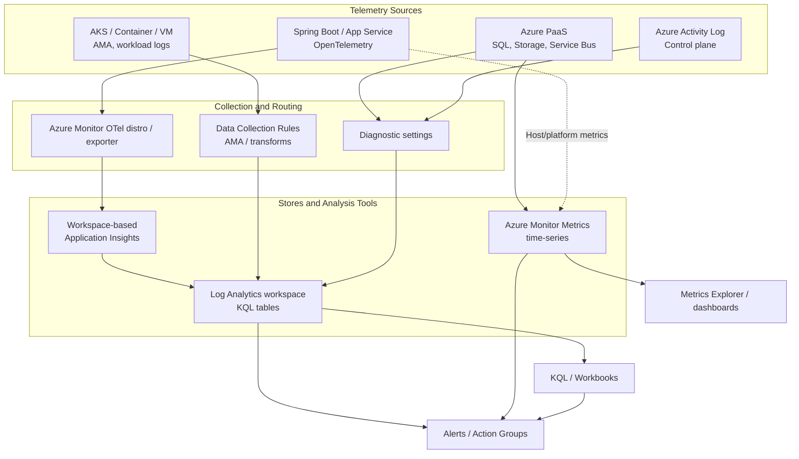
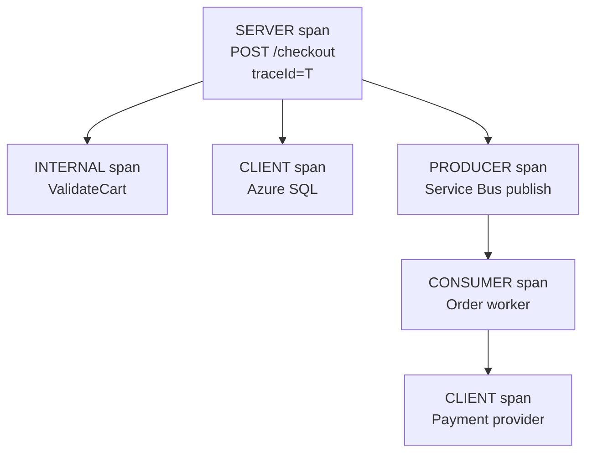
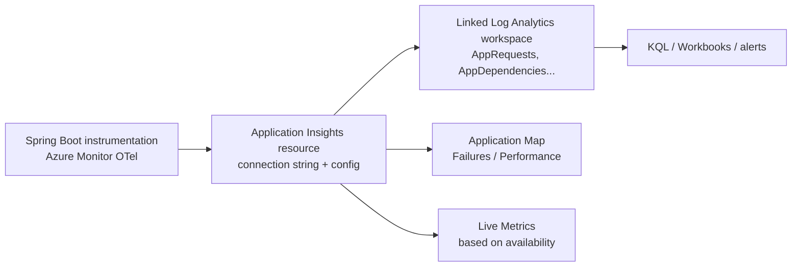
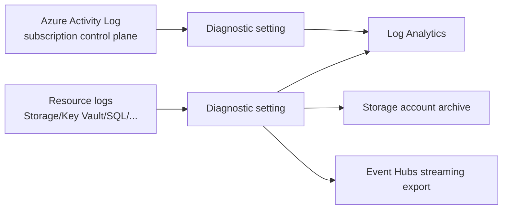
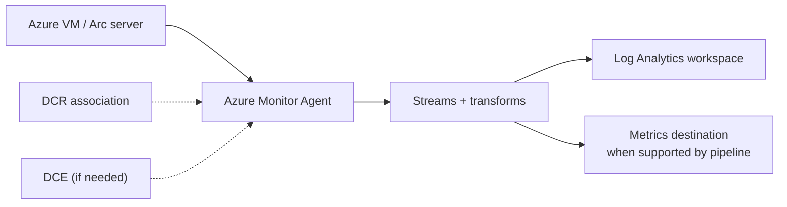
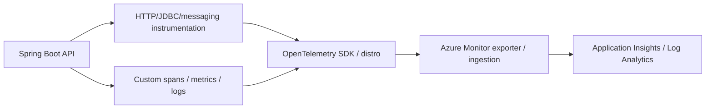
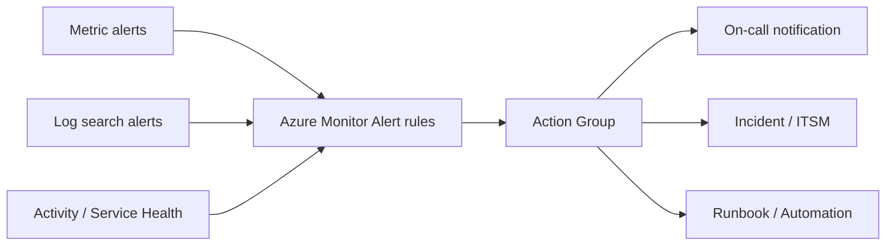
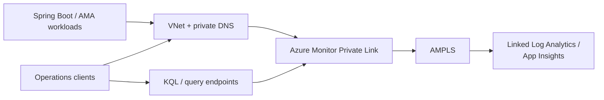
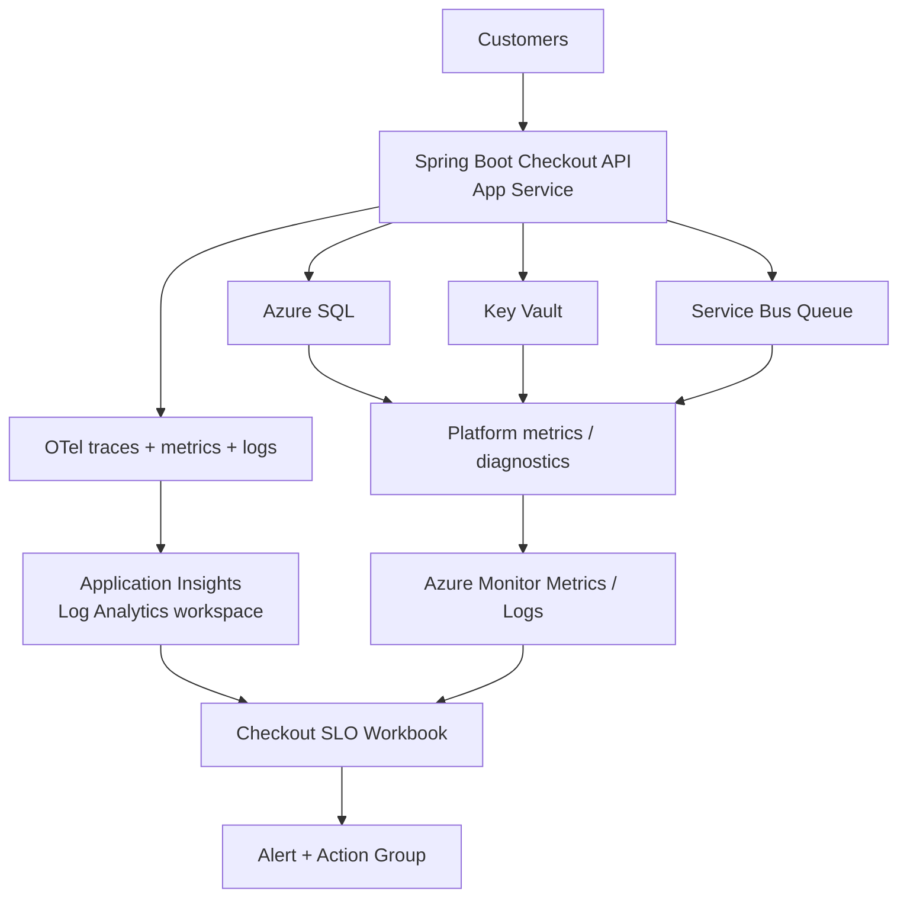

# Azure Monitor Architecture with Metrics, Logs, and Traces

An e-commerce application deployed on Azure App Service has three components: a Java Spring Boot API, Azure SQL Database, and Azure Service Bus. One evening, customers report slow checkout, but the App Service CPU dashboard looks normal. The operations team does not know whether the issue comes from SQL queries, Service Bus connections, Java code, or a recently deployed network change. The CPU metric alone is not enough to answer that; you need to combine **metrics** on latency and error rates, **logs** with context, and **distributed traces** connecting operations within the same request.

**Azure Monitor** is the monitoring and observability platform on Azure that collects, analyzes, visualizes, and alerts on telemetry from many sources. Common components include **Azure Monitor Metrics**, **Azure Monitor Logs / Log Analytics workspaces**, **Application Insights**, **diagnostic settings**, **Data Collection Rules (DCRs)**, **Azure Monitor Agent (AMA)**, **alerts/action groups**, **Workbooks**, and **OpenTelemetry** integrations for applications. They solve different parts of an observability architecture, rather than being interchangeable names.

In the **CLOUD_PROVIDERS_AZURE** module, learners explore the Microsoft Azure ecosystem from subscriptions, resource groups, and Entra ID to virtual networks, compute, storage, and data; learning how to deploy, monitor, protect, and control the cost of an application architecture. This lesson belongs to the **Monitoring and Observability** chapter, focusing specifically on **"Azure Monitor Architecture with Metrics, Logs, and Traces"**. The goal is to design which signals to collect, telemetry pipelines, queries/correlations across signals, alerting, security, budgets, and actionable operational workflows.

> **Lab scope:** Resource names, data, alert thresholds, and code examples are for lab use. Log Analytics table configurations, OpenTelemetry pipelines, DCR/DCE capabilities, Data Collection Endpoints, resource-specific tables, tiers, and costs vary by service, region, and SDK version. When applying them, always verify the actual capabilities of your resources, APIs/SDKs, and internal policies; never send tokens, secrets, PII, or sensitive payloads into telemetry.

## 1. Learning Objectives

After this lesson, you will be able to:

- Distinguish **monitoring** from **observability**, and understand the complementary roles of **metrics, logs, and traces**.
- Diagram the flows **Azure resource metrics → Metrics**, **resource/platform logs → Log Analytics**, and **application telemetry → Application Insights/OpenTelemetry**.
- Explain the concepts **resource, namespace, dimensions, metric series, log table, workspace, span, trace ID, and parent span ID**.
- Distinguish **Azure Activity Log**, **resource logs**, **application logs**, and **guest OS/container logs**.
- Configure **diagnostic settings**, **DCR**, **AMA**, and workspaces at the appropriate architectural level.
- Run **KQL** queries to evaluate errors, latency, throughput, dependencies, and correlation.
- Design Java/Spring instrumentation with **Azure Monitor OpenTelemetry** and context propagation.
- Build **metric/log/availability** alerts, action groups, dashboards, and SLOs following alert-fatigue reduction principles.
- Control **cardinality, sampling, retention, costs, RBAC, data residency, Private Link, and redaction**.
- Write an incident investigation runbook using metric → trace → log, and recognize common mistakes in production environments.

## 2. How Does Monitoring Differ from Observability?

**Monitoring** is observing system health through known signals and pre-defined questions: Is CPU above 80%, is HTTP 5xx increasing, is the queue backlog above the threshold?

**Observability** is the ability to infer **internal system state from telemetry outputs**, even when the root cause was not anticipated beforehand. When a customer reports "every time I click checkout it takes 12 seconds," observability helps link the request to individual spans, SQL queries, retries, and exceptions, isolating the bottleneck.

| Perspective | Monitoring | Observability |
|---|---|---|
| Typical question | "Is the error rate above threshold?" | "Why is this group of requests slow, and at which step?" |
| Signals | Metrics, health checks, alerts | Metrics + logs + traces + topology/dependencies |
| Response | Detect symptoms | Explain, verify hypotheses, and improve |
| Challenges | Setting accurate thresholds, avoiding noise | Correlation, sampling, coverage, cardinality, cost |
| Value | Early incident detection | Shorter MTTR and root cause discovery |

Observability does not mean "collect as many logs as possible." Uncontrolled telemetry collection can **increase ingestion costs, slow down queries, leak PII**, and still fail to answer any operational question. Start from **users, SLOs, and critical business journeys**, then design purpose-built signals.

## 3. The Three Pillars: Metrics, Logs, and Traces

| Signal | Data | Answers | Example |
|---|---|---|---|
| **Metric** | Numeric values over time, often with dimensions | "How much? When? How is it trending?" | `http.server.request.duration` p95, CPU %, error rate |
| **Log** | Events with timestamps and fields/context | "What happened? Why did it fail?" | `payment_authorization_failed` with redacted error code |
| **Trace** | Chain of spans belonging to the same distributed operation | "Which steps did the request pass through? Where is it slow?" | API → SQL → Service Bus → Worker |

### Illustrating a Request with All Three Signals

```text
Metric:
  http.server.request.duration{route="/checkout",status="500"} = 2.3 s

Log:
  2026-11-20T10:05:03Z ERROR payment dependency timeout
  trace_id=4bf92f... service=checkout-api exception_type=TimeoutException

Trace:
  traceId=4bf92f...
  [SERVER] POST /checkout              2.30 s
      [CLIENT] Azure SQL: update order  0.05 s
      [CLIENT] Payment gateway          2.20 s  <-- hotspot
      [INTERNAL] Publish event          0.02 s
```

**Metrics** help detect an increase in slow requests; **traces** show that the payment gateway took 2.20 seconds; **logs** reveal which timeout, rate-limit, or configuration is involved. No single signal is always sufficient.

### Correlation Does Not Happen Automatically

Metrics usually **do not contain individual traceIds** because creating a series per request causes excessive cardinality. Traces and logs can carry `traceId`/`spanId` for linking. Some systems support **exemplars** or click-through from a metric to a trace depending on the specific integration; do not assume every Azure metric has an automatic link to a trace.

## 4. Azure Monitor Reference Architecture



**Conceptual diagram**: not every PaaS metric goes through diagnostic settings. Many **platform metrics** are collected automatically by Azure and can be viewed directly in **Azure Monitor Metrics**. **Resource logs** typically require enabling diagnostic settings to forward them to Log Analytics, Storage, or Event Hubs. Workspace-based Application Insights stores application telemetry in the linked workspace; specific log and metric types may use different pipelines and tables.

### Components and Responsibilities

| Component | Responsibility |
|---|---|
| **Azure Monitor Metrics** | Stores and queries time-series metrics for the Azure platform and supported custom/application sources |
| **Azure Monitor Logs** | Queries tabular records in Log Analytics using KQL |
| **Log Analytics workspace** | Storage and governance boundary for log data, retention, and access |
| **Application Insights** | Application observability: requests, dependencies, exceptions, traces, availability, and user flows based on enabled capabilities |
| **Diagnostic settings** | Routes supported platform/resource logs and selected metrics to supported destinations |
| **Azure Monitor Agent (AMA)** | Collects machine/OS/guest telemetry according to DCRs |
| **DCR (Data Collection Rule)** | Defines sources, streams, destinations, and transformations for compatible pipelines |
| **DCE (Data Collection Endpoint)** | Ingestion/configuration endpoint for compatible DCR/agent architectures; not mandatory for every source |
| **Alerts** | Evaluates conditions on metrics, logs, or availability and fires alert events |
| **Action Groups** | Routes notifications and automated actions when an alert fires |
| **Workbooks** | Combines visualizations from KQL, metrics, and parameters for operations |

## 5. Different Signal Sources in Azure

A good observability architecture must identify the **source**, **signal**, and **storage destination**. For example:

| Source | Common Metrics | Logs/Traces to Configure |
|---|---|---|
| **App Service** | HTTP requests, CPU/memory per metric definitions | App logs, HTTP logs, Application Insights instrumentation |
| **Spring Boot** | Request duration, JVM runtime, business counters | Structured application logs, OTel spans/dependencies |
| **Azure SQL** | CPU, DTU/vCore, storage, connections | SQL diagnostics/audit, query metrics by feature |
| **Storage account** | Transactions, ingress/egress, latency/availability | Blob/DFS service diagnostics by category |
| **Service Bus** | Active/dead-letter counts, throughput, errors | Operational/audit logs where diagnostic categories are supported |
| **Event Hubs** | Incoming/outgoing, throttling, capacity | Resource/operational logs, consumer app traces |
| **AKS** | Node/pod/system signals per integration | Container insights/Prometheus logs/metrics and app traces |
| **Azure VM** | CPU/network/disk platform metrics | Guest syslog/Windows Events/performance counters via AMA + DCR |
| **Azure Resource Manager** | Not an application trace | **Azure Activity Log** for control-plane events |
| **Key Vault** | Request volume/latency or service metrics | Audit events via diagnostic settings |

**Not all logs are enabled by default.** Having a Metrics chart on a resource does not guarantee diagnostic logs are being sent to a workspace; having an Application Insights resource does not automatically capture full traces from an uninstrumented app.

### Azure Activity Log Is Different from Application Logs

**Azure Activity Log** records control-plane events at the subscription level, such as who modified a network rule or created a resource. It **does not replace** a log such as "request /checkout returned 500" in Spring Boot. Resource logs and application traces use different pipelines and must be configured separately.

## 6. Designing Around Operational Questions Before Choosing Tables

Before creating a workspace, determine:

1. **Which user journeys matter?** Login, checkout, upload, order placement.
2. **Which SLOs need protection?** Availability, latency, correctness, freshness.
3. **Which incidents must be detected?** 5xx spikes, p95 increases, SQL throttling, Service Bus DLQ growth.
4. **When an alert fires, what does the on-call engineer need?** Service, region, deployment, traceId, runbook.
5. **Which signals measure symptoms?** Stable metric dimensions, KQL queries against the right tables.
6. **Which signals identify root cause?** Spans/dependencies, exception metadata, platform diagnostics.
7. **What are reasonable retention and cost boundaries?** High-cardinality logs, retention duration, and sensitive data.
8. **Who has read permissions?** Workspace/resource RBAC, multi-tenant data/PII isolation.

**Design output** can take the form of a mapping table:

| SLO / Issue | Metric Alert | Log Query | Trace |
|---|---|---|---|
| Successful checkout | HTTP server error rate | `AppRequests` 5xx by route | Trace of failed requests |
| Checkout p95 under threshold | Request duration p95 | Percentile request durations | SQL/gateway dependency spans |
| Queue does not back up too long | Active messages/oldest age per metric capability | Worker processing errors | Producer → broker → consumer |
| No lost business events | Sink success/failure counter | Outbox/checkpoint/audit logs | Event trace context |
| No unexpected network changes | Azure Activity Log alert | `AzureActivity` / resource diagnostics | Deployment correlation |

## 7. What Is a Metric? Time Series, Aggregation, and Dimensions

A metric measures a numeric value at a point in time or over an interval, such as CPU %, request count, or processing duration. A **time series** is identified by the metric name + set of dimension labels/values + source.

```text
metric: http.server.request.duration
unit: seconds
labels:
  service.name: checkout-api
  http.route: /checkout
  http.response.status_code: 200
aggregation: histogram / p95 query
```

### Common Metric Types

- **Counter (monotonic):** cumulative count of events, e.g., `orders_processed_total`; when querying, you can compute rate/increase over a window.
- **Up/down counter or gauge:** items currently waiting, open connections, active workers; values go up and down at a given point in time.
- **Histogram/distribution:** records the distribution of request/dependency durations, supporting percentiles depending on storage/aggregation mechanisms.
- **Azure platform metric:** emitted by the service with pre-defined units/aggregations; does not necessarily match OpenTelemetry metric instruments by default.

### Aggregation Matters

```text
In one minute:
  100 fast requests: 50 ms
  5 slow requests:   3000 ms

The average may look relatively fine,
but p95/p99 still captures the tail latency affecting users.
```

Never take the **average of p95 values** and treat it as the overall request p95: percentiles are not additive like sums. You must use raw distributions/histograms or backend-supported aggregations on the appropriate underlying data.

### Dimensions and Cardinality

Use useful dimensions with bounded cardinality:

```text
service.name = checkout-api
deployment.environment = production
cloud.region = southeastasia
http.route = /checkout
result = success|failure
```

**Do not use `orderId`, `userId`, `traceId`, or URLs containing customer IDs as metric dimensions.** Each unique value creates a new time series, increasing costs and degrading query performance. Per-request identifiers belong in logs or traces with appropriate security policies.

## 8. Azure Monitor Metrics: Platform Metrics and Custom Metrics

**Platform metrics** are typically provided out of the box by Azure resources in Metrics Explorer: for example, App Service CPU, Storage operations, or Service Bus active messages. The exact set of metrics depends on resource type, tier, and API.

### Querying Metrics via Azure CLI

```bash
az login
az account set --subscription "<subscription-id>"

APP_ID=$(az webapp show \
  --resource-group "rg-observe-lab" \
  --name "app-checkout-lab" \
  --query id --output tsv)

# List the metric definitions for this specific resource.
az monitor metrics list-definitions \
  --resource "$APP_ID" \
  --output table

# Once the exact metric name is confirmed via list-definitions:
az monitor metrics list \
  --resource "$APP_ID" \
  --metric "<metric-name-from-definitions>" \
  --interval PT1M \
  --aggregation Average \
  --output json
```

The second command contains **placeholders** and cannot be run as-is until you fill in a valid metric name and supported aggregation. Do not assume every service exposes the same `CpuPercentage` metric or the same dimension labels.

### What Does Metrics Explorer Help With?

An operator can:

1. Select the resource, region, and metric namespace.
2. Select the metric name, aggregation, and time granularity.
3. Split by a supported dimension, such as status, category, or location.
4. Compare before and after a deployment.
5. Create a meaningful metric alert or pin the chart to a dashboard/workbook.

**Do not use "All metrics" to forward every series into logs out of fear of missing something.** Metric definitions and appropriate retention/aggregation should guide your design; pushing metrics into logs can raise ingestion costs and may not preserve metric store semantics.

### Custom Metrics

Applications can emit custom metrics through OpenTelemetry and supported Azure Monitor pipelines/features. For example:

```text
business.orders.processed
  unit = {order}
  attributes = {tenant_tier, result}

business.payment.authorize.duration
  unit = s
  attributes = {provider, result}
```

Avoid labels like `customer_id` or `order_id`. Do not use metrics as audit logs: a metric counter does not store individual records detailing the reason and the actor.

## 9. What Is a Log? Structured Events and Log Analytics Tables

A log is an event record with a timestamp, severity, and fields. Logs can be:

- **Application logs** from Spring Boot, e.g., `WARN payment provider slow`.
- **Request/dependency telemetry** from Application Insights, e.g., request status, SQL call duration.
- **Platform/resource logs** via diagnostic settings, e.g., Key Vault audit or gateway access logs.
- **Guest logs** from VM syslog/Windows Event Logs via AMA/DCR.
- **Azure Activity Log** for control-plane changes.

### Structured Logging Instead of Free-Form Strings

Bad:

```text
Something went wrong for order 9839482, user alice@example.com,
payment card ending 1234, secret=...
```

Better:

```json
{
  "timestampUtc": "2026-11-20T10:12:00Z",
  "level": "ERROR",
  "service": "checkout-api",
  "environment": "production",
  "operation": "AuthorizePayment",
  "errorType": "DependencyTimeout",
  "provider": "payment-gateway",
  "traceId": "4bf92f...",
  "spanId": "00f067...",
  "durationMs": 2200
}
```

**Never put PII, access tokens, connection strings, Authorization headers, or full request bodies into logs.** A trace ID can be used to locate a specific request; if compliance requirements apply, enforce access and retention policies on log records.

### Workspaces and Tables

A **Log Analytics workspace** stores multiple log tables. Typical tables (depending on integration and configuration) may include:

| Table | Common Source/Meaning |
|---|---|
| `AppRequests` | Workspace-based Application Insights request telemetry |
| `AppDependencies` | Dependency calls from application instrumentation |
| `AppTraces` | Application trace/log message telemetry |
| `AppExceptions` | Application exception telemetry |
| `AppEvents` | Custom application events per pipeline |
| `AzureActivity` | Subscription Activity Log if routed into the workspace |
| `AzureDiagnostics` | Resource logs when using legacy/Azure diagnostics table mode |
| Resource-specific tables | Resource logs written to dedicated tables per supported resource/category |
| `Heartbeat` / `Perf` / `Event` / `Syslog` | Guest/agent data when configured |

Not every workspace has every table. If Application Insights is not linked or there is no traffic, `AppRequests` may be empty; if diagnostic settings use **resource-specific tables**, you cannot assume all resource logs live in `AzureDiagnostics`.

## 10. Traces and Spans: Understanding the Path of a Distributed Request

A **trace** describes an end-to-end operation, typically starting at an ingress request. A trace consists of multiple **spans**, each representing an operation with parent-child relationships or links according to instrumentation standards.



Key concepts:

- **Trace ID**: identifies the entire trace, typically propagated across calls.
- **Span ID**: identifies an individual span.
- **Parent span ID**: captures parent-child relationships where applicable.
- **Span kind**: SERVER, CLIENT, PRODUCER, CONSUMER, INTERNAL per OTel semantics.
- **Attributes**: metadata such as `service.name`, `http.route`, `db.system`, with bounded cardinality.
- **Events/status**: timestamps and status within a span, not a replacement for structured logs.
- **Links**: associations to other spans/traces, often useful for async queues/batches.

### Context Propagation

Headers following the **W3C Trace Context** standard such as `traceparent` and `tracestate` can carry context over HTTP. In messaging, propagation usually happens via **message application properties** or compatible instrumentation/broker integration mechanisms.

```text
HTTP request:
  traceparent: 00-<trace-id>-<parent-span-id>-01

Spring order API:
  traceId = T
  publish Service Bus message

Order worker:
  extract tracing context from message headers/properties
  create CONSUMER span or appropriate span link
```

**Do not assume a queue message always becomes a direct child span of an HTTP request.** For asynchronous processing, batching, or fan-out, span links or a new trace model may be more appropriate. What matters is preserving correlation without turning a trace into an artificial multi-day chain.

### Traces Are Different from Logs

A span has start/end times, status, and attributes; a log record describes an event. You should not turn every debug statement into a span, nor should you only log start/end messages as a substitute for distributed tracing. Design spans around **meaningful operation boundaries**.

## 11. Workspace-Based Application Insights: Its Place in Azure Monitor

**Application Insights** focuses on application telemetry: inbound requests, outbound dependencies, exceptions, logs, availability, and user experience depending on instrumentation and enabled features. The **workspace-based Application Insights** architecture links data to a Log Analytics workspace for KQL analysis and centralized governance.



The diagram illustrates **logical management relationships and telemetry flow**; it does not mean the OTel SDK proxies every HTTP step through the Application Insights resource. In a real environment, the exporter sends telemetry to the corresponding Azure Monitor/Application Insights ingestion endpoint, and the linked workspace receives the data via the integration.

### Is the Connection String a Secret?

An **Application Insights connection string** only configures ingestion endpoints and the instrumentation resource; it is not a credential granting read access to data. Still, it should not be broadcast indefinitely because it can invite noise/cost and reveal topology; store it as configuration according to policy. **Do not confuse an instrumentation key/connection string with Entra authorization**: management and read permissions on the workspace still rely on Azure RBAC and appropriate mechanisms.

### Why Should an App Declare Its Service Identity?

In OpenTelemetry, `service.name`, `service.namespace`, `service.version`, and `deployment.environment.name` help distinguish:

```text
checkout-api / production / v2.8.1
orders-worker / production / v1.7.4
checkout-api / staging / v2.9.0-rc
```

If every service shares the name `unknown_service:java`, Application Map and filters become hard to tell apart. At the same time, do not give each pod a unique `service.name`; pod/container instance IDs have their own place as resource attributes and must not explode metric dimension cardinality.

## 12. Azure Activity Log, Resource Logs, and Diagnostic Settings

An Azure platform change can cause an incident even when Spring code has not changed. For instance, someone modifies a Service Bus network rule and breaks worker connectivity; **Azure Activity Log** helps find the administrative operation, while Application Insights shows client failures.

### Platform Data Flow



**Diagnostic settings** can route supported log categories and metric categories to **Log Analytics**, a **Storage account**, or **Event Hubs** depending on the source and destination. Not every resource supports every category or destination. For Activity Log, export configuration applies at the subscription scope with corresponding permissions, rather than as a diagnostic setting on an individual App Service.

### When Should Diagnostic Settings Be Enabled?

Examples:

- **Key Vault**: audit access and operations on keys/secrets per supported categories.
- **Storage Blob**: operational/resource logs for troubleshooting authorization/transaction issues.
- **Service Bus**: operational logs when investigating permissions/operations, paired with broker metrics.
- **Azure SQL**: diagnostics/auditing according to database/server policy.
- **Azure Firewall/NSG/Gateway**: network logs to trace drops/denies.

**Resource logs are not necessarily available retroactively before being enabled**; do not expect to recover uncollected history. After enabling them, verify the right log categories, destination, table, and actual ingestion using a lab event.

### Different Destinations Serve Different Purposes

| Destination | Best For | Watch Out For |
|---|---|---|
| **Log Analytics workspace** | KQL, correlation, alerts, investigations | Ingestion/retention cost, workspace RBAC |
| **Storage account** | Long-term archive, compliance/export | Lifecycle/immutability, harder to query directly than LAW |
| **Event Hubs** | Streaming logs to external SIEM/consumers | Event Hub capacity, consumers, authorization |

Exporting a single log category to multiple destinations can incur costs and requires retention design at each destination. Do not blindly dump all high-volume access logs into Log Analytics without forecasting costs.

## 13. Azure CLI: Inspecting Diagnostic Categories Before Configuration

Example with a lab Key Vault:

```bash
az login
az account set --subscription "<subscription-id>"

KV_ID=$(az keyvault show \
  --resource-group "rg-observe-lab" \
  --name "kv-observe-lab" \
  --query id --output tsv)

# Find supported categories on the exact resource.
az monitor diagnostic-settings categories list \
  --resource "$KV_ID" \
  --output json

# Check existing settings.
az monitor diagnostic-settings list \
  --resource "$KV_ID" \
  --output json
```

Only after inspecting the actual categories should you route them to the workspace:

```bash
LAW_ID=$(az monitor log-analytics workspace show \
  --resource-group "rg-observe-lab" \
  --workspace-name "law-observe-lab" \
  --query id --output tsv)

# Replace category with a name returned by categories list.
az monitor diagnostic-settings create \
  --resource "$KV_ID" \
  --name "send-audit-to-law" \
  --workspace "$LAW_ID" \
  --logs '[{"category":"<supported-category>","enabled":true}]'
```

**Warning:** The `create` command modifies configuration and may incur ingestion charges. The placeholder `<supported-category>` cannot be used verbatim. Depending on the CLI version, the syntax for `--logs`/`--metrics` and table destination mode may differ; check `--help`, categories, and policy before running. Only create settings on authorized resources.

### Resource-Specific Tables

When choosing Log Analytics as the destination, some diagnostic logs can be written to **resource-specific tables** (per resource/category) instead of the consolidated `AzureDiagnostics` table. Queries must target the **actual deployed table**, rather than hardcoding `AzureDiagnostics` everywhere.

### Do Not Force Metrics into Logs Without Need

Platform metrics are already viewable in Metrics Explorer; routing metrics via diagnostic settings has its own rules and support limits. If the goal is simply to alert on CPU or transactions, a **direct metric alert** is usually more suitable than ingesting all samples into Log Analytics and querying them back.

## 14. Azure Monitor Agent, Data Collection Rules, and Data Collection Endpoints

**Azure Monitor Agent (AMA)** collects telemetry in supported guest/compute environments, typically deployed on Azure VMs or Arc-enabled servers, and uses **Data Collection Rules (DCRs)** to specify which data streams to collect. Do not confuse AMA with the **OpenTelemetry SDK inside a Java process**: AMA collects OS/performance/syslog telemetry, whereas OTel instrumentation produces application traces and metrics with code context.

### What Does a DCR Specify?

A **DCR** can define:

1. **Data sources/streams**: performance counters, syslog, Windows events, or compatible custom data pipelines.
2. **Destinations**: such as a Log Analytics workspace or another supported destination for that data type.
3. **Data flows**: source → transformation → destination routes.
4. **Transformations**: KQL transformations to filter/normalize fields where supported by the pipeline.
5. **Associations**: binding the DCR to the target resources/machines.



### Is a DCE Always Required?

**No.** A Data Collection Endpoint serves agent, configuration, and data ingestion scenarios that require a designated endpoint, private networking, or specific APIs. Many DCR pipelines use other endpoints/paths and do not need a separate DCE; decide based on **source type, agent version, network requirements, and current API**.

### Choosing the Right Collection Approach

| Requirement | Collection Approach |
|---|---|
| Windows Event Log on VM | AMA + Windows events DCR |
| Linux Syslog on VM/Arc | AMA + Syslog DCR |
| Guest performance counters | AMA + performance counters DCR |
| Java application spans | Azure Monitor OpenTelemetry Distro/SDK or compatible exporter |
| Key Vault resource logs | Resource-side diagnostic settings |
| Azure SQL CPU platform metric | Azure Monitor Metrics |
| AKS container logs | Container Insights/AMA-based integration per configuration |
| Managed Prometheus metrics | Appropriate Azure Monitor managed service for Prometheus pipeline |

**Do not use a default DCR with all syslog levels** just "in case logs are lost": debug and notice levels can consume huge volume. Build DCRs based on actual data sources, noise levels, compliance, and SLOs.

### Ingestion-Time Transformations

A DCR transform can drop or normalize certain fields or records **before data enters the table**, reducing cost and exposure. However, a faulty transform can **cause unrecoverable data loss**, especially when there is only a single storage path. Test in a lab with real log samples, inspect the output schema, and maintain version control and rollback.

## 15. Log Analytics Workspaces: Designing by Environment and Permissions

An enterprise may use **one shared workspace** or multiple workspaces separated by environment, region, or security boundary. Neither "one workspace per resource" nor "one workspace for the entire organization" is universally right.

### Criteria for Splitting Workspaces

| Criterion | When Separation May Be Needed |
|---|---|
| **Data residency** | Logs from a market/region must stay in an approved location |
| **Security** | Different teams must not read each other's sensitive logs |
| **Retention** | Audit logs kept 1 year, debug logs kept 7 days per policy |
| **Billing** | Chargeback required across business units or owners |
| **Scale/limits** | Query workloads or table/data ingestion have distinct profiles |
| **Operations** | Staging must avoid triggering production alerts or costs |

### Sample Design

```text
Production (regional boundary):
  law-prod-sea
    ├── Application Insights: checkout-api-prod
    ├── Application Insights: orders-worker-prod
    ├── Azure Activity / PaaS diagnostic logs
    └── AMA logs / container signals

Non-production:
  law-nonprod-sea
    ├── Application Insights: checkout-api-staging
    ├── Test diagnostics
    └── Short retention + budget
```

If teams use multiple workspaces, cross-workspace queries are possible depending on KQL capabilities and permissions, though query complexity, cost, and access policy considerations increase. Do not use cross-workspace queries to bypass mandated data isolation boundaries.

### RBAC: Reading Logs Is Different from Resource Administration

Someone with **Reader** on a resource group will not necessarily be able to read all log tables in another workspace outside the appropriate scope or data access model. You should design:

- Azure RBAC on the **workspace** for users permitted to read or edit configuration.
- Resource-context vs workspace-context access according to workspace configuration.
- Table-level granular access when supported by the feature and required by policy.
- Dedicated action group/integration identities for automation.
- Workspace administrators should not automatically read raw PII if unnecessary.

**Do not put secrets into logs** and expect RBAC alone to eliminate leak risk. Access control is the second layer; ingestion-time redaction and data minimization are the foundation.

## 16. KQL Basics: From Raw Data to Insight

**Kusto Query Language (KQL)** queries Log Analytics using pipeline operators. A query typically starts with the **table** name, filters `TimeGenerated` early, and then applies `summarize`, `project`, and `order by`.

### Minimal Query Example

```kusto
AppRequests
| where TimeGenerated >= ago(1h)
| where Name has "checkout"
| summarize Requests=count() by bin(TimeGenerated, 5m)
| order by TimeGenerated asc
```

**Preconditions:** the workspace contains Application Insights data and the `AppRequests` table, and the `Name` field contains the corresponding operation name. In another workspace, table or field names may differ; verify the schema and use the actual column names.

### Essential Operators

| Operator | Purpose | Example |
|---|---|---|
| `where` | Filter data | `where TimeGenerated >= ago(15m)` |
| `project` | Select/rename fields | `project TimeGenerated, Name, DurationMs` |
| `extend` | Create calculated fields | `extend IsFailure = Success == false` |
| `summarize` | Aggregate by group | `summarize Failures=count() by Name` |
| `bin` | Bucket by time | `bin(TimeGenerated, 5m)` |
| `join` | Join tables by keys | Request vs dependency by correlation |
| `parse_json` | Parse a JSON string | Custom dimensions when present |
| `top` / `order by` | Sort | Top slow operations |
| `let` | Define variables/query expressions | Reuse time ranges |

### Inspect Tables and Schemas First

```kusto
AppRequests
| where TimeGenerated > ago(24h)
| take 10
```

In the Log Analytics portal, inspect **Tables** and real sample schemas. Before putting KQL into an alert, test it against a window with actual data, and check nulls, time zones, and scope. **A KQL query that succeeds and returns 0 rows does not prove the system has zero errors**: instrumentation or tables might not be enabled, or the filter might be wrong.

## 17. KQL: HTTP Error Rate and p95 Latency

### Request Error Rate

```kusto
AppRequests
| where TimeGenerated >= ago(1h)
| summarize
    TotalRequests=count(),
    FailedRequests=countif(Success == false)
  by bin(TimeGenerated, 5m), AppRoleName
| extend ErrorRatePercent =
    iff(TotalRequests == 0, 0.0,
        100.0 * todouble(FailedRequests) / todouble(TotalRequests))
| order by TimeGenerated asc
```

**`Success` may reflect instrumentation logic**, not a strict "HTTP 5xx only" definition; if your SLO only counts 5xx as errors, filter `ResultCode` as required and exclude valid 4xx responses. **Do not lump every 404 into an incident** if 404 is normal business behavior.

### p95 Request Duration

```kusto
AppRequests
| where TimeGenerated >= ago(1h)
| where Name has "checkout"
| summarize
    Count=count(),
    P50Ms=percentile(DurationMs, 50),
    P95Ms=percentile(DurationMs, 95),
    P99Ms=percentile(DurationMs, 99)
  by bin(TimeGenerated, 5m), AppRoleName
| order by TimeGenerated asc
```

In workspace-based Application Insights, `DurationMs` typically stores duration in milliseconds; verify the actual field type and units. If there are only 4 requests in a 5-minute window, p95 is far less reliable than a distribution with thousands of samples. Add a **minimum traffic** condition to alert rules.

### 5xx Errors by Route (When ResultCode Is an HTTP Code String)

```kusto
AppRequests
| where TimeGenerated >= ago(30m)
| extend StatusCode = toint(ResultCode)
| where StatusCode between (500 .. 599)
| summarize Failures=count() by Name, StatusCode
| top 20 by Failures desc
```

Do not take `ResultCode` from an SQL dependency and interpret it as an HTTP status code: dependency types have different semantics. Always query within the appropriate table and fields.

## 18. KQL: Dependencies, Exceptions, and Correlation by OperationId

### Finding Slow Dependencies

```kusto
AppDependencies
| where TimeGenerated >= ago(2h)
| summarize
    Count=count(),
    Failed=countif(Success == false),
    P95Ms=percentile(DurationMs, 95)
  by Target, Type, AppRoleName
| top 20 by P95Ms desc
```

When the result points to `Azure SQL` with elevated p95, you must continue by checking **database service metrics and query diagnostics**. A trace span saying "SQL call took 5 seconds" cannot by itself distinguish lock contention, CPU pressure, network delay, or JDBC retries.

### Latest Exceptions

```kusto
AppExceptions
| where TimeGenerated >= ago(1h)
| project TimeGenerated, AppRoleName,
          ExceptionType, OuterMessage, OperationId
| order by TimeGenerated desc
| take 50
```

**OuterMessage** can contain application data or PII if code throws exceptions unsafely. In sensitive environments, restrict permissions and consider displaying only the error type/code rather than sharing screenshots containing payloads.

### Tracing a Specific Operation

```kusto
let Operation = "<observed-operation-id>";
union isfuzzy=true
    (AppRequests | where OperationId == Operation
        | project TimeGenerated, OperationId, Id, ParentId,
                  Name, DurationMs, Success, ItemType="request"),
    (AppDependencies | where OperationId == Operation
        | project TimeGenerated, OperationId, Id, ParentId,
                  Name, DurationMs, Success, ItemType="dependency")
| order by TimeGenerated asc
```

This query illustrates a **typical correlation pattern** for the workspace-based Application Insights schema. `OperationId` usually represents a trace/operation, while `Id` and `ParentId` capture telemetry relationships. When using OTel, verify how traceId/spanId map to columns; some pipelines use different table columns or dynamic properties. `union isfuzzy=true` is not a substitute for verifying data when a table is missing.

### Correlating Logs for the Same Operation

```kusto
AppTraces
| where TimeGenerated >= ago(2h)
| where OperationId == "<observed-operation-id>"
| project TimeGenerated, SeverityLevel,
          Message, AppRoleName, OperationId
| order by TimeGenerated asc
```

For log correlation to work, the Java logger must emit context/trace IDs via the instrumentation configuration or OTel bridge; **do not assume every `System.out.println` is automatically synced into `AppTraces` with an `OperationId`**.

## 19. KQL: Azure Activity Log and Configuration Changes

When a 5xx alert begins right after a deployment, check activity logs to see who or what changed infrastructure:

```kusto
AzureActivity
| where TimeGenerated >= ago(6h)
| where ActivityStatusValue in~ ("Succeeded", "Failed")
| project TimeGenerated, OperationNameValue,
          ResourceGroup, ResourceId, Caller, ActivityStatusValue
| order by TimeGenerated desc
```

**Precondition:** The subscription Activity Log has been routed into the workspace and the `AzureActivity` table contains data. Otherwise, the subscription **Activity Log** in the portal still shows events within the platform retention window, but does not automatically send them to Log Analytics.

### Do Not Infer Causation from Timing Alone

If HTTP 5xx errors spike after a `Microsoft.Web/sites/write` event, that is a **correlation signal**, not proof that the deployment caused it. Inspect release versions, code changes, feature flags, downstream health, and traces before concluding.

### Interpret Results Responsibly

The `Caller` field can be a user, principal, or service; do not jump to blaming an individual for "breaking production" based on a single entry when deployment automation runs under a shared identity. Attach change tickets, deploy IDs, and full audit trails.

## 20. TimeGenerated, Ingestion Time, and Timezones

An event may be emitted at 10:00 but only ingested into Log Analytics at 10:02 due to buffering or retries. Key concepts:

- **Event timestamp/TimeGenerated**: the timestamp attached to the record by the source/pipeline.
- **Ingestion time**: the time when the data actually reaches the storage/query backend where observable.
- **Processing time**: the time when KQL/alerts execute or a processor handles the data.

### KQL to Check Ingestion Delay

```kusto
AppTraces
| where TimeGenerated >= ago(2h)
| extend IngestDelaySeconds =
    datetime_diff("second", ingestion_time(), TimeGenerated)
| summarize
    Samples=count(),
    P50DelaySec=percentile(IngestDelaySeconds, 50),
    P95DelaySec=percentile(IngestDelaySeconds, 95)
  by bin(TimeGenerated, 10m)
| order by TimeGenerated asc
```

This is a diagnostic query for latency on **tables/systems that support `ingestion_time()`**; results may be null or depend on how ingestion is configured. Do not assume all Azure Monitor datasets expose ingestion time identically.

**KQL timestamps normally use UTC.** Displaying local time on a dashboard does not alter the stored timestamps. When investigating incidents in Vietnam, record both **UTC and the user's local timezone** to avoid a 7-hour offset when comparing with CI/CD releases and Azure Activity Log.

### Alerts Evaluate with Latency

A log alert running every 5 minutes and querying 5 minutes of data can **miss late-arriving logs** or fire duplicate alerts if windows overlap. Design evaluation frequency, lookback, event timestamp/ingestion latency, suppression, and deduplication to match your SLO. Metric alerts are often better suited than log alerts for low-latency platform signals when metrics are available.

## 21. Java/Spring Boot Instrumentation with OpenTelemetry

**OpenTelemetry (OTel)** is a vendor-neutral set of APIs, SDKs, semantic conventions, and telemetry collection tools. On Azure, you can use the supported **Azure Monitor OpenTelemetry Distro/Java agent or exporter** to send compatible traces, logs, and metrics to Application Insights/Azure Monitor.

### Choosing an Instrumentation Approach

| Approach | Advantages | What to Check |
|---|---|---|
| **Java auto-instrumentation/agent** | Captures HTTP client/server, JDBC, and many libraries with minimal code changes | Agent compatibility with Java/Spring version, exporter config |
| **Manual OpenTelemetry API** | Creates spans for business steps, custom attributes, and events | Active SDK/exporter to actually emit telemetry |
| **Spring Boot Actuator + Micrometer Observation** | Familiar instrumentation abstractions in the Spring ecosystem | Compatible OTel bridge/exporter and avoiding double instrumentation |
| **Azure Monitor OpenTelemetry Distro** | Integrated with Azure Monitor and auto/config per capabilities | Correct Java package/version, connection string, sampling |
| **Collector/agent in infrastructure** | Centralizes processing/export for workloads where supported | Routing, auth, retries, scaling, governance |

**Adding only the `opentelemetry-api` dependency will not send traces to Azure Monitor.** You need an active provider/instrumentation + exporter or configured agent, plus a valid Azure Monitor/App Insights resource.

### A Java Instrumentation Diagram



## 22. Configuring Application Insights for a Spring Boot Service

Suppose you have an Application Insights resource `appi-checkout-prod` linked to Log Analytics workspace `law-prod-sea`. The Java service needs the connection string issued by Azure for the **matching environment's** resource.

### Configuration via Environment Variables

```text
APPLICATIONINSIGHTS_CONNECTION_STRING=InstrumentationKey=<key>;IngestionEndpoint=https://<supported-ingestion-endpoint>/
OTEL_SERVICE_NAME=checkout-api
OTEL_RESOURCE_ATTRIBUTES=deployment.environment.name=production,service.version=2.8.1
```

This is a **template**, not a valid runnable connection string. Use the actual connection string of an authorized Application Insights resource; endpoints may vary by cloud/region. Environment variable syntax and semantic conventions depend on the agent/distro/version. **Never copy staging configuration to production**, as it can mix telemetry across environments.

### Java Agent or Distro: Pick One Clear Pipeline

You can configure the Azure Monitor Java/OpenTelemetry distribution **via agent or code** depending on the current package. One Java agent option looks like:

```bash
# Pseudocommand: replace /opt/agents/<approved-agent>.jar with
# the actual compatible Java agent approved by your organization.
java -javaagent:/opt/agents/<approved-agent>.jar \
  -jar checkout-api.jar
```

**Not every generic OpenTelemetry JAR automatically sends data to Azure Monitor** simply by setting `APPLICATIONINSIGHTS_CONNECTION_STRING`. Only rely on this variable according to the specific **Azure Monitor agent/distro** documentation; if using the generic OTel Java agent, configure the corresponding **OTLP endpoint/exporter/collector**. Avoid enabling the classic Application Insights agent, OTel agent, and SDK auto-instrumentation simultaneously without realizing they can produce duplicate spans.

### Example Dependencies for Manual Spans

```xml
<dependencies>
  <dependency>
    <groupId>io.opentelemetry</groupId>
    <artifactId>opentelemetry-api</artifactId>
    <version>REPLACE_WITH_APPROVED_VERSION</version>
  </dependency>
  <dependency>
    <groupId>org.springframework.boot</groupId>
    <artifactId>spring-boot-starter-actuator</artifactId>
  </dependency>
</dependencies>
```

`REPLACE_WITH_APPROVED_VERSION` is an **invalid placeholder** for Maven; replace it with the OpenTelemetry BOM or an approved version. You must wire a provider/exporter from a separate agent or distro if you want to actually observe spans.

### A Custom Span with Business Context

```java
package example.observability;

import io.opentelemetry.api.GlobalOpenTelemetry;
import io.opentelemetry.api.trace.Span;
import io.opentelemetry.api.trace.StatusCode;
import io.opentelemetry.api.trace.Tracer;
import io.opentelemetry.context.Scope;
import org.springframework.stereotype.Service;

@Service
public class OrderValidationService {
    private final Tracer tracer = GlobalOpenTelemetry.getTracer(
            "checkout-api.business", "1.0.0");

    public void validateOrder(String orderType) {
        Span span = tracer.spanBuilder("orders.validate").startSpan();
        try (Scope ignored = span.makeCurrent()) {
            // Only use values with bounded cardinality.
            span.setAttribute("order.type", orderType);
            // Actual business validation goes here.
            if (orderType == null || orderType.isBlank()) {
                throw new IllegalArgumentException("Invalid order type");
            }
        } catch (RuntimeException e) {
            span.recordException(e);
            span.setStatus(StatusCode.ERROR);
            throw e;
        } finally {
            span.end();
        }
    }
}
```

**Precondition:** The OTel SDK/provider must be configured so `GlobalOpenTelemetry` obtains a real tracer provider; otherwise, the span may be a **no-op**. Never attach `orderId` or `customerEmail` as attributes due to PII/cardinality concerns. Also normalize `orderType` to a finite set (e.g., `standard`/`subscription`), rather than arbitrary user input.

### Watch Out for Async Code

Span context does not automatically propagate across every Executor, CompletableFuture, Reactor pipeline, or queue callback. Instrumentation libraries and context propagation must be configured properly. If traces break between `POST /orders` and the Service Bus worker, inspect W3C trace context injection/extraction and process boundaries rather than simply adding manual `ThreadLocal` code.

## 23. Spring Boot Actuator, Micrometer, and OpenTelemetry

Spring Boot Actuator can expose endpoints and metrics for the application, while **Micrometer Observation/Tracing** instruments operations using Spring's native abstractions. With a compatible OTel bridge and exporter, observations and spans can be sent to Azure Monitor according to the chosen architecture.

### A Custom Observation

```java
package example.observability;

import io.micrometer.observation.Observation;
import io.micrometer.observation.ObservationRegistry;
import org.springframework.stereotype.Service;

@Service
public class CheckoutService {
    private final ObservationRegistry observations;

    public CheckoutService(ObservationRegistry observations) {
        this.observations = observations;
    }

    public void placeOrder() {
        Observation.createNotStarted(
                "checkout.place_order", observations)
            .lowCardinalityKeyValue("channel", "web")
            .observe(() -> {
                // Validate and persist order in a real implementation.
            });
    }
}
```

This is an **instrumentation pattern**: the no-op body itself performs no business work. You need compatible Spring Boot/Micrometer/OTel tracing bridges and exporters configured for the observation to appear as expected telemetry. Do not auto-instrument the same operation with multiple tools simultaneously, which causes double-counting.

### Actuator Metrics Differ from Azure Platform Metrics

An `/actuator/metrics` endpoint exposes JVM/process-level metrics. App Service Azure Monitor Metrics provide Azure resource-level platform signals. They complement rather than replace each other:

- JVM GC pauses rise while App Service CPU looks normal: you need application runtime metrics.
- App Service CPU rises while JVM threads look normal: it could be sidecars, host processes, or other load; check the right scope.
- SQL dependency p95 rises while inbound request count stays flat: you need trace/dependency metrics.

**Protect Actuator endpoints:** Never expose sensitive endpoints like `env`, `heapdump`, or `configprops` to the public Internet. Configure exposure, authentication, and network access per security policy.

## 24. Trace Propagation Across HTTP and Messaging

In microservices, a single request may traverse:

```text
Client → API Gateway → Spring Checkout API
                         → Azure SQL
                         → Service Bus queue
                         → Spring Order Worker
                         → Third-party payment API
```

To see this end-to-end:

1. HTTP ingress server instrumentation creates a span.
2. HTTP/SQL client instrumentation creates child spans.
3. When publishing a message, **inject context** into message application properties using supported standards and libraries.
4. The consumer **extracts context** and creates a consumer span or span link following async semantics.
5. Each service's logs attach `traceId`/`spanId` via a correlation bridge.
6. Resource attributes identify services, environments, and versions.

### Java OTel Context Injection Example

```java
import io.opentelemetry.api.GlobalOpenTelemetry;
import io.opentelemetry.context.Context;
import io.opentelemetry.context.propagation.TextMapSetter;
import java.util.Map;

// applicationProperties is the message metadata map provided by the SDK.
Map<String, Object> applicationProperties = message.getApplicationProperties();
TextMapSetter<Map<String, Object>> setter =
        (carrier, key, value) -> {
            if (carrier != null) {
                carrier.put(key, value);
            }
        };
GlobalOpenTelemetry.getPropagators().getTextMapPropagator()
        .inject(Context.current(), applicationProperties, setter);
```

This is a **snippet inside a sender method** assuming a Service Bus `message` variable and configured OTel providers/propagators. On the consumer side, use a corresponding `TextMapGetter` to extract context. Do not manually pass trace context inside a **JSON message body** when standard application properties are appropriate, and never put access tokens or secrets inside tracing headers.

### A Security Note on Correlation

`traceparent` is correlation metadata, **not proof of identity or authorization**. Never trust a client-supplied `traceId` to grant access to another tenant's data. Authentication and authorization must be enforced independently.

### Queue Tracing Rarely Forms a Strictly Linear Parent Tree

A message may be emitted from a batch or retried multiple times, and an Event Hubs batch may contain events from many different traces. In such cases, **span links** and domain correlation IDs often reflect reality better than a single span tree. Tracing design must align with the semantics of your messaging SDK and instrumentation.

## 25. Sampling: Keeping Useful Signals Without Collecting Every Span

Sampling collects only a subset of traces/events under high traffic. For example, 10,000 requests/s generating 20 spans each can produce a massive volume of telemetry.

### Strategies

| Type | Meaning | Risk |
|---|---|---|
| **Head sampling** | Decided at the start of a trace via probability/rules | Can miss rare errors before the outcome is known |
| **Tail sampling** | Decided after seeing most of the trace | Requires collector/buffering/capacity; more complex |
| **Adaptive sampling** | Adjusts rate dynamically with load as supported by tools | Requires understanding estimated counts and bias |
| **No sampling** | Keeps all traces | High cost and throughput overhead |
| **Log level filtering** | Drops unnecessary DEBUG/INFO logs | Does not replace trace sampling; audit logs must still be kept |

### Sampled Data Affects Queries

If you keep only 10% of request traces, `count()` on `AppRequests` may **not equal the true request count** unless item counts/weights are accounted for or a suitable platform metric is used. Application Insights can populate a field such as `ItemCount` for certain sampled telemetry; verify the exact schema and feature behavior before estimating totals.

**Never use sampled traces as the source of truth for financial transaction counts.** Business finance counters must come from reliable transaction/audit stores, not stored span counts.

### Sampling Rules to Apply

- Retain or prioritize critical error traces when supported by your pipeline.
- Retain a representative percentage of successful traces for endpoint latency visibility.
- Apply consistent sampling across services when reconstructing distributed traces.
- Never sample **mandatory audit/security records** unless permitted by policy.
- Monitor telemetry ingestion volume and data loss from rate limits or drops.

## 26. Azure Monitor Alerts: Metric, Log, and Availability

Azure Monitor supports multiple alert types:

| Type | Input | When to Use |
|---|---|---|
| **Metric alert** | Metric series/aggregation | CPU, latency, error count, active messages where signals exist |
| **Log search alert** | KQL query over workspace/Application Insights | Complex conditions combining fields, exceptions, failed requests |
| **Activity Log alert** | Control-plane/service health events per capability | Permission/network changes, critical configuration updates |
| **Availability/test alert** | Synthetic availability or supported health tests | External issues on business-critical endpoints |
| **Service Health/Resource Health** | Azure service/resource health signals | Platform, regional, or resource-level outages |

### Rules for Choosing Alert Types

1. **User-facing symptoms** first: checkout success rate, latency, availability.
2. Use metric alerts when the signal is available and low latency is needed.
3. Use log alerts for correlation or business logic when no suitable metric exists.
4. Activity Log alerts track changes/risk, though not every change is an incident.
5. Alert only when there is a clear **owner, specific action, and runbook**, never on every INFO log.

### Illustrative Alert Condition

```text
Checkout API SLO:
  error rate > 5% over 10 minutes
  AND total requests >= 100

Alert severity: Sev2
Owner: checkout on-call
Action: inspect AppRequests p95, dependency traces,
        deployment changes, SQL/service health
```

The thresholds above are a **design example**, not a deployed Azure Monitor metric configuration. If only a log table is available as the source, you can write KQL to compute `ErrorRatePercent` and `TotalRequests` and use a **scheduled query alert** as supported.

## 27. SLI, SLO, Error Budget, and Burn Rate

To avoid hundreds of alerts screaming "high CPU" while users are completely unaffected, operations teams use **Service Level Indicators (SLIs)** and **Service Level Objectives (SLOs)**.

### Definitions

- **SLI:** a measure of service quality, such as request success ratio, p95 latency, or freshness.
- **SLO:** the target for an SLI over a period, e.g., 99.9% of valid requests succeed over 30 days.
- **SLA:** a contractual commitment; not identical to an internal SLO.
- **Error budget:** the allowable margin of failure before breaching the objective.
- **Burn rate:** how fast the error budget is being consumed relative to the sustainable average rate.

### Availability SLO Example

Suppose the SLO is **99.9% success over 30 days**. The corresponding error budget is:

\[
100\%-99.9\%=0.1\%.
\]

If there are 1,000,000 valid requests in the 30-day window, the request-based budget is roughly **1,000 failed requests** per the SLI definition. This does not mean the system gets exactly "43.2 minutes" of outage if traffic is unevenly distributed; duration-based SLOs and request-based SLOs have different semantics.

### KQL to Build an SLI over Request Records

```kusto
let StartWindow = ago(1h);
AppRequests
| where TimeGenerated >= StartWindow
| where Name has "checkout"
| summarize
    Total=count(),
    Failures=countif(Success == false)
| extend AvailabilityPercent =
    iff(Total == 0, real(null),
        100.0 * (todouble(Total - Failures) / todouble(Total)))
```

If sampling is active, this query operates on **telemetry samples that do not necessarily equal all requests**; accurate SLOs require properly weighted/un-sampled sources, a clear definition of "valid requests," and no missing data gaps.

### Multi-Window, Multi-Burn-Rate Alerts

A burn-rate alert can combine a **short window** to catch severe outages and a **long window** to detect sustained degradation. For example:

- Fast burn: over 5 minutes and 1 hour, the error budget is rapidly consumed.
- Slow burn: over 1 hour and 6 hours, persistent errors stay below immediate outage levels.

Burn numbers and thresholds must be calculated from your SLO, risk tolerance, traffic, and on-call schedule. Do not copy thresholds from a 10,000 req/s service onto a batch job that runs 5 times a day.

### Watch Out for Very Low Traffic

When an API receives only 3 requests in 10 minutes, one failure produces a 33% error rate. Percentage-only alerts will be **noisy**. Add **minimum request thresholds**, use synthetic checks, or pick longer windows aligned with business SLAs.

## 28. Action Groups, Alert Routing, and Incident Lifecycle

An **alert rule** only determines "the condition was met." An **Action Group** determines where notifications or actions go and which mechanisms are used. Targets can include email, SMS, webhooks, ITSM, automation, and other integrations depending on resource type, region, and policy.



### Operational Factors

1. **Severity and ownership:** Sev0/Sev1/Sev2, owning team, environment.
2. **Dedup/suppression:** do not send 300 notifications for the same incident.
3. **Alert processing rules:** mute, suppress, or route during maintenance windows where permitted.
4. **Runbook link:** an alert must link directly to dashboards and response instructions.
5. **Resolution:** track when the condition clears, not only when it fires.
6. **Escalation:** if nobody acknowledges within SLA, escalate channels.
7. **Testing:** periodically test action groups in a safe environment; never assume webhooks or emails work.

### Alert Payloads Must Not Contain Sensitive Data

Webhooks and notifications often traverse external systems outside the workspace. Do not include **raw stack traces containing tokens**, full query results with PII, or connection strings in emails or SMS. Send the resource ID, alert ID, severity, authenticated trace/dashboard links, and investigation instructions.

### Automation Needs Guardrails

Do not configure every `HTTP 500` to trigger "restart the entire App Service" or "scale SQL to the highest tier." Automated remediation requires guardrails, rate limits, idempotency, auditing, and rollback; otherwise, a noisy alert can escalate into a larger outage.

## 29. Azure Workbooks, Dashboards, and Application Map

**Azure Workbooks** combine KQL and metrics into parameterized analysis pages. They are **question-driven** observability tools, not just collections of pretty charts.

### A Workbook for Checkout

**Page 1 – Overview:**

- Request rate, error rate, p95/p99 latency by environment/version.
- Deployment markers and Activity Log changes.
- Health of Azure SQL, Service Bus, and Key Vault.

**Page 2 – Investigation:**

- Top errors by route/error type.
- Slowest dependencies in the last 30 minutes.
- List of trace IDs with high duration or failures.
- Links to open Application Insights transaction details/traces where available.

**Page 3 – Cost & Ingestion:**

- Log ingestion volume by table.
- Retention/budget warnings.
- Sampling config and estimated coverage.

### Application Map and Distributed Traces

**Application Map** can visualize app ↔ dependency relationships based on instrumented telemetry, along with health and performance. It helps spot when a new Service Bus worker appears or an API starts calling an unexpected endpoint.

**Do not treat Application Map as an authoritative CMDB or exact physical network map.** If instrumentation misses a dependency, the map may miss edges; if service names are inconsistent, one app may appear as multiple nodes.

### Who Can Access a Shared Workbook?

KQL queries typically execute in the viewer's context and respect appropriate data access permissions. However, a Workbook with embedded results or parameters does not protect raw data if the user already has workspace query permissions. Review workbook RBAC/sharing and avoid embedded secrets in query text.

## 30. Azure Monitor Costs: Ingestion, Retention, Queries, and Exports

A telemetry system can generate **more data than the business application itself** if it logs every request body, every retry, and every SQL statement. Costs must be evaluated across the entire chain:

```text
Source instrumentation
   -> Agent / DCR / exporter
   -> Ingestion
   -> Storage/retention
   -> Query/alerts
   -> Export/archive
```

### Cost-Driving Components

| Component | When Costs Rise | How to Control |
|---|---|---|
| **Log Analytics ingestion** | Excessive INFO/DEBUG logs, overly broad diagnostic categories | Filter log levels, apply targeted DCR transforms |
| **Log Analytics retention** | Retaining unqueried data for long periods | Set retention by table/data plan and compliance |
| **Application Insights telemetry** | Dense spans/dependencies and logs | Sampling, instrumentation scoping, noise exclusion |
| **Custom metrics / Prometheus** | Many series or high-cardinality labels | Reduce dimensions and scrape volume |
| **Alerts / scheduled queries** | Many alert rules, heavy KQL, or high frequency | Consolidate rules around SLOs, optimize queries |
| **Diagnostic export** | Sending the same events to multiple destinations | Define clear use cases for archives/SIEM |
| **Storage archive** | Long retention, replication/tier choices | Lifecycle policies, retention, legal hold |
| **Network/private endpoints** | Data egress, cross-region ingestion, AMPLS/network | Consider region locality and policy |

**Pricing, tiers, and default retention change over time.** Do not state a fixed unit price per GB of logs or "90 days free" without verifying the pricing plan, region, and workspace data plan. Use the Azure Pricing Calculator and Cost Management alongside actual usage metrics.

### KQL to Measure Ingestion Volume by Table

In many Log Analytics workspaces, the `Usage` table contains usage information by DataType/Quantity:

```kusto
Usage
| where TimeGenerated >= ago(7d)
| where IsBillable == true
| summarize
    QuantityGB = sum(Quantity) / 1024
  by DataType
| top 20 by QuantityGB desc
```

**Unit warning:** In the `Usage` table, `Quantity` is recorded in the dataset's unit, accompanied by `QuantityUnit`; before dividing by 1024 to infer GiB, **verify the unit and pricing metadata** in your workspace. Do not treat this query as an official invoice. Actual billing may depend on data plans, included allowances, commitments, and other tables.

### KQL to Locate High-Volume Log Producers

```kusto
AppTraces
| where TimeGenerated >= ago(24h)
| summarize
    Records=count(),
    EstimatedCharacters=sum(strlen(Message))
  by AppRoleName, SeverityLevel
| order by Records desc
```

**Log message character count is not the exact number of bytes billed by Azure**; record metadata, encoding, and ingestion schema also add size. Use this query to **identify noisy services and log levels**, then check official cost and usage tools.

### A Budget Design Example

Suppose an API handles 100 million requests/month; keeping 20 full spans per request could reach 2 billion spans before limits and sampling. You need to:

1. Measure average bytes per span/record using real telemetry.
2. Choose trace sampling and signal retention aligned with SLOs.
3. Keep business audit records in an independent reliable system instead of stuffing all business documents into traces.
4. Set budgets and alerts at the subscription/workspace level.
5. Monitor trends after releases, since a single debug logging change can multiply ingestion volume severalfold.

## 31. Retention, Data Governance, and Log Access Permissions

Telemetry can contain **IPs, user agents, request paths, database error messages, correlation IDs**, and even PII or secrets if loggers are misconfigured. Treat it as **classified data**, not harmless debug files.

### Decisions by Data Type

| Data | Retention Logic | Controls |
|---|---|---|
| Operational metrics | Based on SLO/seasonality | Keep needed aggregates, bound cardinality |
| Application traces | Based on MTTR and investigation needs | Sampling, TTL, redaction |
| HTTP access logs | Based on security/SRE policy | Strip secrets/PII, restrict workspace readers |
| Security/audit logs | Based on compliance/legal hold | Strict retention, approved archiving |
| Debug logs | Short-term and conditional | Disabled by default in prod, avoid logging bodies |
| Business transactions | Based on source system, never solely in Monitor | Governed database/audit store |

### Core Principles

- **Privacy by design:** Strip or hash user-linkable identifiers when needed.
- **Least privilege:** On-call engineers read only the logs required for their duties.
- **Data residency:** Select workspace regions and destinations per data requirements.
- **Controlled retention:** Shorten retention on data that does not need long-term storage using table/data plan capabilities.
- **Audit changes:** Who enabled debug logs, changed DCRs, altered diagnostic settings, or updated workspace RBAC?
- **Compliance:** Verify deletion, export, legal hold, and sensitive-data rules before rollout.

### Redaction at the Source Beats Fixing Later

If an API logs a bearer token, deleting the log record days later does not prevent token exposure in the meantime. **Block it in instrumentation or filters** before export. DCR transformations add a layer of defense, but may not cover every telemetry pipeline (such as certain Application Insights exports).

### RBAC and Endpoint Security

Dashboard viewers and workspace administrators are distinct roles. For multi-tenant data, ensure users cannot query the entire workspace if they are only authorized for one tenant; a workbook with a tenant filter **is not a security boundary** if the user holds broad KQL permissions.

## 32. Private Link, AMPLS, and Telemetry Data Paths

Applications may reside inside private-only VNets while Azure Monitor ingestion and queries still need to function. **Azure Monitor Private Link Scope (AMPLS)** is a component used in private connectivity architectures for supported Azure Monitor resources.

### Two Directions to Distinguish

| Flow | Example | Risk if Overlooked |
|---|---|---|
| **Ingestion** | Java OTel agent/AMA sends telemetry to Azure Monitor endpoints | App runs normally, but no new logs/traces arrive |
| **Query** | Operators run Log Analytics queries/APIs over the network | Workspace has data, but dashboards/queries from private networks fail |
| **Azure diagnostic settings** | Resource-side delivery to workspace/Storage | Different network path/feature model from SDK agents; do not assume same path |
| **Control plane** | Deploy DCR/workspace/roles via ARM | May require different endpoints/permissions than ingestion |



The diagram shows **logical flow**; real deployments must verify AMPLS linked resources, access modes, private endpoint DNS zones/records, DCR/DCE requirements, and feature availability by service and region.

### Design Steps

1. Inventory telemetry sources across App Service, VMs, AKS, PaaS, CI/CD, and on-premises.
2. Select regions, workspaces, and App Insights resources meeting data residency requirements.
3. Identify which sources use public ingestion and which require private ingestion.
4. For AMPLS, verify **resource associations** and public/private network access modes.
5. Configure private endpoints and private DNS according to the specific Azure Monitor documentation; never guess DNS records.
6. Test from an **actual workload**: is new data landing in the right tables?
7. Test from the operators' network: are KQL queries and dashboards accessible?
8. Prepare a rollback plan before locking down public endpoints.

**Having a managed identity or Entra token does not guarantee network routing works.** Conversely, private IP connectivity does not grant data-reader permissions in a workspace. Debug authentication, DNS, routing, and ingestion configuration as separate layers.

### Risk of Abruptly Blocking Public Access

Some telemetry from PaaS/resource-side diagnostic settings does not traverse the same pipeline as AMA or OTel. If a Private Link design is incompatible with a source, you can create a **monitoring blind spot**. Never disable public access system-wide after testing only one VM; roll out as a canary per source group.

## 33. Layered Observability Model for Enterprise Environments

An application spanning multiple subscriptions, regions, resources, and services needs observability across three layers:

| Layer | Example | What You Need to Know |
|---|---|---|
| **Business/experience** | Checkout success, order placement duration, event processing lag | Are users accomplishing their goals? |
| **Application/runtime** | Spring requests, JVM, dependency spans, exceptions | How are the code and dependencies behaving? |
| **Infrastructure/platform** | App Service CPU, SQL capacity, Key Vault failures, AKS nodes | Are there resource or network issues? |

### Environment and Resource Identity

Standardize names, tags, and resource attributes:

```text
service.name = checkout-api
service.namespace = commerce
service.version = 2.8.1
deployment.environment.name = production
cloud.provider = azure
cloud.region = southeastasia
team = checkout-platform
```

**Not all fields automatically become Azure metric dimensions or Application Insights columns.** Mapping depends on the exporter and resource attributes. Verify emitted telemetry so you do not rely on filters that turn out empty.

### Metrics Detect Incidents, Traces Find Causes

A solid dashboard can start with:

1. Business success rate.
2. Latency p50/p95/p99 and throughput.
3. Error budget burn rate.
4. Top dependencies and exception types.
5. Change and deployment markers.
6. Links to specific request traces.
7. Platform resource health and capacity.

Do not start with 50 per-VM CPU charts while having zero indicators reflecting user experience.

## 34. Case Study: Investigating Slow Checkout After a Deployment

### Context

The Spring Boot application `checkout-api` on Azure App Service calls Azure SQL to persist orders, Azure Service Bus to send commands, and Key Vault to fetch payment configuration. After a deployment at 10:00 UTC, slow requests increase while **CPU remains low and there are no significant 5xx errors**.

Observability components:



### Step-by-Step Investigation

**Step 1 — Confirm the symptom using metrics.** Compare `/checkout` request p95 before and after 10:00 UTC, along with request rate, 5xx, and successful requests. If p95 rises while 5xx stays flat, this may be **latency degradation**, which can still breach the SLO.

**Step 2 — Check the change timeline.** Query `AzureActivity` and deployment records: did app settings, service identity, VNet integration, SQL config, or code version change?

**Step 3 — Find top slow requests.** KQL:

```kusto
AppRequests
| where TimeGenerated between (datetime(2026-11-20T10:00:00Z)
                          .. datetime(2026-11-20T11:00:00Z))
| where Name has "checkout"
| top 20 by DurationMs desc
| project TimeGenerated, Name, DurationMs,
          Success, ResultCode, OperationId, AppRoleName
```

**Step 4 — Trace dependencies** for the slow `OperationId` values. If `AppDependencies` shows a 1.5-second Key Vault call occurring on **every request** instead of only at startup or cache refresh, a new configuration change may have disabled caching in the application.

**Step 5 — Cross-check logs.** Inspect `AppTraces`/`AppExceptions` for 429 retries, DNS exceptions, or circuit breaker events. Never log secret values from Key Vault.

**Step 6 — Check the platform.** Inspect Key Vault request metrics/diagnostics, App Service outbound connections, Service Bus throttling, and SQL performance. A slow dependency span could stem from a network change rather than Java logic.

**Step 7 — Test a controlled hypothesis.** For example, roll back the Key Vault secret-loading config in staging or blue-green, then compare p95 at equivalent request volume. Do not restart the entire production App Service before verifying impact.

**Step 8 — Post-incident follow-up.** Add p95/SLO alerts, adjust caching/SDK policies, add regression tests, update the runbook, and monitor costs from any abnormal log growth.

### Why Is the CPU Metric Insufficient?

Request latency is affected by **network, SQL locks, external dependencies, thread pool exhaustion, GC, cold starts, queue waits**, and other factors. Low CPU does not prove an app is healthy. **Trace spans** usually narrow down the location quickly, while logs and platform metrics verify the root cause.

### What If Traces Are Sampled?

The exact request a user complained about might not have been retained. In that case:

- Inspect aggregate metrics and request distributions first.
- Look for retained traces sharing the same route, deployment, errorType, and timeframe.
- Temporarily raise sampling safely during an incident window if permitted, avoiding PII capture.
- Check dependency metrics, SQL diagnostics, and structured application logs.
- Never treat "no trace found" as proof that the request never happened.

## 35. Runbook: When Telemetry Disappears or Does Not Match

### Scenario A — App Service Has Traffic, AppRequests Is Empty

1. Confirm you are checking the right Application Insights resource, workspace, subscription/region, and time range.
2. Verify the application has enabled the agent/distro/exporter and has a valid connection string.
3. Verify the Java process loads the agent/profiler/instrumentation library at a compatible version.
4. Check network egress to the ingestion endpoint or AMPLS if private.
5. Check sampling, drops, rate limits, and exporter retry/error logs (without printing tokens).
6. Send a **lab** HTTP request with a correlation ID and verify whether the app generates spans/logs.
7. Check data ingestion latency, `AppRequests`/`AppTraces` tables, and the linked resource.
8. If using the generic OpenTelemetry agent, verify OTLP/exporter routing; **`APPLICATIONINSIGHTS_CONNECTION_STRING` alone may not be enough**.

### Scenario B — Platform Metrics Exist, Resource Logs Are Missing

1. Check Metrics Explorer to confirm the right resource.
2. Check diagnostic settings on the right resource/subscription (do not confuse Activity Log with resource logs).
3. Verify selected categories, workspace destination, and permissions to create the setting.
4. Verify the target table: `AzureDiagnostics` vs resource-specific tables.
5. Trigger a **valid lab event** and check for delay; do not cause fake incidents in prod.
6. Check ingestion errors, workspace quotas/policies, and DCRs if a pipeline is involved.

### Scenario C — Request Trace Exists, Downstream Spans Are Missing

1. Verify HTTP/SQL/Service Bus client instrumentation supports the libraries in use.
2. Confirm `service.name`, environment, and exporter configuration on downstream services.
3. Verify W3C `traceparent` injection/extraction across HTTP and messages.
4. For async batching, inspect **span links** and tracer context, not just parent-child links.
5. Check sampling across services to avoid keeping the parent while dropping all children.
6. Never stuff plaintext user tokens into trace attributes to "find correlation."

### Scenario D — Noisy Alerts Fire Constantly Without User Impact

1. Check whether the alert measures a **symptom** or merely resource utilization.
2. Check minimum traffic and window/aggregation to avoid percentage spikes from a few requests.
3. Check whether the alert evaluates late-ingested or intermittent data.
4. Design suppression/dedup and responsible severity tiers.
5. Tune conditions to the SLO/error budget rather than arbitrarily raising thresholds.
6. Track alert rule changes in IaC/changelogs for future incident analysis.

### Scenario E — Log Analytics Costs Spike Suddenly

1. Check Azure Cost Management and daily workspace usage.
2. Query `Usage`/telemetry counts by table; verify units and plans.
3. Check `AppTraces` for spikes in INFO/DEBUG, exception spam, or per-request logs.
4. Check whether a diagnostic category was recently enabled on a high-traffic service.
5. Confirm sampling was not accidentally disabled after a deployment.
6. Filter or reduce noise at the source or via DCR transforms **only after gathering evidence**.
7. Never disable required compliance audit or security logs.

## 36. Common Failure Modes and Root Cause Differentiation

| Symptom | Possible Cause | Priority Check |
|---|---|---|
| `AppRequests` does not exist | Workspace not linked to App Insights or wrong schema/tenant | Tables, resource link, instrumentation |
| `AppRequests` exists but 0 rows | Wrong time range, no traffic, exporter failure, sampling | App trace/exporter config, lab request |
| CPU metric visible but KQL logs empty | Metrics auto-collected, diagnostic settings not enabled for logs | Settings/categories/destination |
| `AzureDiagnostics` empty while logs exist | Resource-specific tables selected | Table inventory, diagnostic settings mode |
| VM not sending syslog | Misconfigured AMA/DCR association, permissions, or network | Agent health, DCR/DCE, Syslog sources |
| Trace has only one span | Missing dependency instrumentation or broken propagation | OTel agent/modules, context, sampling |
| `traceId` in logs but request missing | Logs/requests routed to different workspaces, sampling, or mapping mismatch | App role/workspace/OperationId |
| HTTP 5xx spikes while CPU is low | Downstream/network/locks or application error | Dependency spans, SQL/Key Vault metrics |
| KQL reports missing field name | Different table version/schema | Table schema/sample records |
| p95 query returns NaN/null | Too little data, null Duration field, or wrong datatype | Type/units, min sample count |
| Alert does not fire | Window/time semantics, aggregation, disabled rule/action group | Rule evaluation/history |
| Alert fires but sends no notification | Action Group/connector/permissions failure | Action Group test, delivery logs |
| Log alert fires late | Ingestion lag, eval interval, query window | TimeGenerated vs ingestion latency |
| Metric series explosion | `orderId`/`userId`/`traceId` used as label | Cardinality review, metric schema |
| Costs rise despite unchanged workload | Debug logs, duplicate instrumentation, new diagnostics | Usage tables, deployment diff |
| Telemetry disappears after blocking public ingestion | Misconfigured AMPLS/Private DNS/DCR routing | Test from workload, private connectivity |
| Workbook differs from Metrics portal | Different metric namespace, aggregation, time window/filters | Compare scope, time, dimensions |
| KQL SLI lower than business transaction count | Sampling, valid request definition, or missing telemetry | Data source fidelity and weighting |
| Workbook viewers see unauthorized PII | Overly broad workspace readers | RBAC, table/resource-context access |
| Trace breaks between Service Bus producer and worker | Missing messaging propagation or async links | W3C context, client instrumentation |
| App double-counts spans | Multiple agents/SDK pipelines instrumenting simultaneously | Agent inventory, exporter paths |
| Logs contain access tokens | Unredacted logger/HTTP wire-level logging | Incident response, disable log, rotate secrets |

### Logical Investigation Order

```text
1. Confirm the affected user-facing symptom / SLI
2. Select the resource, UTC time window, environment, and deployment
3. Narrow scope with metrics (when, region, route, service)
4. Locate slow/failing spans or dependencies with traces
5. Verify with structured logs and platform diagnostics
6. Cross-check changes / Activity Log
7. Test hypothesis, roll back, or apply controlled remediation
8. Verify SLO recovery; write postmortem and update alerts
```

**Never troubleshoot an incident by enabling unlimited debug logs, granting Owner on the workspace, disabling Private Link, or deleting/altering production retention.** Every monitoring change must have a purpose, an owner, and a rollback path.

## 37. Exercises and Self-Check Questions

### A. Distinguishing the Three Signals

App Service CPU is normal, yet 10% of users experience slow checkout. Do you look at metrics, logs, or traces first, and why?

*Hint:* Start with user-facing latency/error metrics to narrow the scope, use traces to identify the slow dependency, and use logs/diagnostics to confirm the cause. A CPU metric alone never proves requests are healthy.

### B. Azure Metrics vs. Log Analytics

Metrics Explorer shows Storage transactions, yet a KQL query on `AzureDiagnostics` returns no records. Is metric collection broken?

*Hint:* Not necessarily. Platform metrics can be collected automatically; resource logs require diagnostic settings and the right destination/table. A resource-specific table might be used instead of `AzureDiagnostics`.

### C. Does a DCR Replace Application Insights?

You installed AMA on a VM running Spring Boot and created a syslog DCR. Will that automatically generate spans from `POST /orders` through Azure SQL?

*Hint:* No. AMA/DCR collects guest logs and performance per rules; application spans require OpenTelemetry/Application Insights instrumentation.

### D. KQL Failure Investigation

Write a KQL query computing error rate and p95 on `AppRequests` by `AppRoleName` every 5 minutes; alert only if there are at least 100 requests in the window.

*Hint:* `summarize count(), countif(Success == false), percentile(DurationMs,95) by bin(TimeGenerated,5m), AppRoleName` followed by `where Total >= 100`.

### E. Trace Context in Queues

The Spring Order API sends a Service Bus message and Order Worker processes it, yet Application Map does not link the two services. What field or step could be missing?

*Hint:* W3C trace context injection/extraction in message properties, messaging instrumentation, and span links/parent mapping.

### F. Metric Cardinality

A team adds `orderId` to the `checkout_duration` metric. With 1 million orders/day, what is the consequence?

*Hint:* Huge growth in time series, driving up costs and query load. Order ID belongs in transaction/audit/log traces with proper access controls, not as a metric label.

### G. Sampling and Financial Data

Application Insights retains only 10% of traces. Can you use `AppRequests.count()` for the month-end billing report?

*Hint:* No. Sampling skews counts unless proper weighting is applied, and trace telemetry is not an accounting source. Use the database/ledger.

### H. Alert Fatigue

An app receives 2 requests/hour; a single 500 produces a 50% error rate and triggers alerts constantly. How should you fix this?

*Hint:* Add minimum traffic thresholds, an appropriate SLO window, synthetic checks, and severity aligned with user impact.

### I. Late-Ingested Data

A log is emitted at 10:00 but appears in the workspace at 10:07. What might a log alert querying 10:01–10:05 over a 5-minute window miss?

*Hint:* Event time vs. ingestion delay; design evaluation/lookback windows and alert logic around actual latency.

### J. Private Ingestion

An organization enables Private Link/AMPLS and immediately `AppRequests` stops receiving new data, even though the app keeps working. Which layers should be checked?

*Hint:* App exporter/ingestion route, AMPLS links, DNS, network egress, permissions, and correct workspace/resource; do not assume a business-logic failure.

### K. Traces and PII

An engineer proposes logging the entire HTTP Authorization header to "debug 401s." Why is this dangerous, and what is a better option?

*Hint:* A bearer token is a secret. Log only the error type, non-sensitive audience/scope, service/trace ID, request ID, and redacted status.

### L. SLO and Error Budget

An API has a 99.9% successful requests SLO over 30 days with 2 million total requests. How large is the request-based error budget under that definition?

*Hint:* 0.1% × 2,000,000 = 2,000 allowed failed requests; do not mechanically convert this into minutes of downtime.

### M. Missing KQL Table

A query `AzureDiagnostics | take 10` reports that the table does not exist. What should you check before concluding the source has no logs?

*Hint:* Check diagnostic settings, destination, resource-specific tables, categories, and ingestion latency.

### N. Retention by Responsibility

Developers want to keep DEBUG logs for 365 days, while the audit team requires security logs for 365 days. Should you apply the same retention across all tables?

*Hint:* Design by data type and compliance, reduce debug noise/retention, and keep audit logs per policy. Table-level data plans/retention can be used where supported.

### O. Designing an Incident Dashboard

Design a Workbook for the checkout application: pick 5 must-have signals and explain the flow from alert → trace → log → resource diagnostics.

*Hint:* Error rate, p95 latency, traffic, top dependency duration, and deployment changes, paired with trace search and KQL drill-down.

## 38. End-to-End Lab: Spring Boot + Azure Monitor

**Goal:** Build a complete observability path on **authorized lab resources**, from application metrics/logs/traces to Log Analytics, KQL, and alerts with runbooks. Do not use production accounts, intentionally cause outages, or put real personal data into telemetry.

### Assumed Resources

| Resource | Lab Value | Purpose |
|---|---|---|
| Resource group | `rg-observe-lab` | Deployment scope |
| App Service | `app-checkout-lab` | Runs Spring Boot |
| Application Insights | `appi-checkout-lab` | Application telemetry |
| Log Analytics workspace | `law-observe-lab` | KQL/retention |
| Key Vault | `kv-observe-lab` | Resource diagnostics demonstration |
| Action Group | `ag-checkout-lab` | Test alert routing |
| Workbook | `wb-checkout-lab` | End-to-end investigation |

### Step 1 — Verify Workspace and Application Insights Link

1. In the Azure portal, open **Application Insights → Properties** to verify the linked Log Analytics workspace.
2. Check location, region, retention, and authorized permissions.
3. Confirm the staging app does not point to a production workspace.
4. Check whether `AppRequests`/`AppDependencies`/`AppTraces` already contain data; **do not assume**.

If the App Insights resource does not exist yet, ask an authorized IaC pipeline or admin to provision it; never reuse an instrumentation key copied from someone else's account.

### Step 2 — Instrument Spring Boot

1. Choose an Azure Monitor OpenTelemetry distro/Java agent compatible with your Java/Spring Boot version.
2. Set the lab resource's connection string via secure app settings.
3. Set `service.name=checkout-api` and environment `staging`/`lab`.
4. Keep HTTP/JDBC/HTTP client instrumentation enabled and add one custom `orders.validate` span.
5. Use structured logging with `traceId`/`spanId` after configuring the correlation bridge.
6. Avoid enabling double instrumentation from multiple Java agents simultaneously.

### Step 3 — Generate Test Traffic

Use only authenticated lab endpoints:

```bash
# This lab URL and endpoints only exist once the application is deployed.
curl -i "https://<lab-app-host>/health"
curl -i "https://<lab-app-host>/lab/checkout?scenario=success"
curl -i "https://<lab-app-host>/lab/checkout?scenario=slow"
```

These routes are **illustrative examples**, not APIs that appear automatically when adding Application Insights. To simulate slowness, build a lab handler with clear duration and traffic limits; avoid long `sleep` calls on production request threads.

### Step 4 — Inspect Metrics

- Open App Service Metrics Explorer and view CPU and HTTP request metrics supported by the resource.
- Inspect Application Insights performance/dependencies or instrumented custom metrics.
- Compare p95 latency between `scenario=success` and `scenario=slow` (if the service exposes a valid measurement dimension).
- Verify metric dimensions/cardinality and avoid putting `traceId` in labels.

### Step 5 — Inspect Logs and Traces

KQL:

```kusto
AppRequests
| where TimeGenerated >= ago(1h)
| top 20 by TimeGenerated desc
| project TimeGenerated, Name, Success, DurationMs,
          ResultCode, OperationId
```

Pick an `OperationId` and run the request/dependency correlation query from Section 18. If instrumented logs are enabled, check `AppTraces` for the same operation. Capture and include **only non-sensitive metadata** in reports; never copy full request bodies.

### Step 6 — Add Resource Diagnostics

- Run `az monitor diagnostic-settings categories list` against the lab Key Vault.
- Enable a supported log category and route it to `law-observe-lab` via approved IaC/portal steps.
- Perform a valid lab metadata read operation to emit an event if the service supports logging that operation.
- Check the data in the actual table, not just `AzureDiagnostics`.

### Step 7 — Create a Workbook and Alert

Build a Workbook with: request error rate, p95 latency, top dependencies, exceptions, and latest changes. Create a **test alert** with an owner and action group using an **appropriate lab** metric or log threshold; verify actual notification delivery and close the alert.

Never put PII into alert payloads. Do not page production on-call from a lab without authorization; use a test action group.

### Step 8 — Safe Fault Injection

| Lab Scenario | Expected Observation |
|---|---|
| App intentionally returns HTTP 500 on a test route | Correlated request failure metric/log/trace |
| Simulated dependency sleep/timeouts | Higher p95 and slow child span/dependency |
| Temporarily pause exporter in lab | App receives traffic, but workspace receives no new telemetry |
| Disable diagnostic setting in lab | Resource logs stop, platform metrics may still appear |
| Remove Java agent from staging deployment | Application Insights request/dependency spans drop/disappear |
| Switch log level to DEBUG briefly | `AppTraces` count and ingestion volume increase |
| Overly narrow query filter | KQL returns 0 rows even though data exists |

Every test must have a **time limit, scope, owner, and rollback plan**. Never disable ingestion on shared environments or generate error data affecting real users.

### Report Template

```text
Lab ID: azure-monitor-spring-001
Java/Spring/OpenTelemetry versions: [record]
Application Insights resource / workspace: [lab values]
AppRequests ingestion: PASS/FAIL
AppDependencies tracing: PASS/FAIL
Structured logs with correlation: PASS/FAIL
Platform metric visible: PASS/FAIL
Key Vault resource diagnostic logs: PASS/FAIL
Metric/log alert route: PASS/FAIL
Workbook drill-down: PASS/FAIL
Telemetry contains no secrets/PII: VERIFIED/NEEDS_REVIEW
Observed latency/error/cost impact: [measurements]
Unresolved issues and rollback: [details]
```

This is a **template for recording results**, not confirmation that the lab has been executed. Mark PASS only after measuring actual results in an authorized subscription.

## 39. Production Azure Monitor Deployment Checklist

### Architecture and Coverage

- [ ] Inventory of critical user journeys, services, resource topology, and SLOs exists.
- [ ] Metrics, logs, traces, and platform/resource/guest/application sources are clearly distinguished.
- [ ] Azure Monitor Metrics has essential platform metrics; metrics are not routed through logs by default.
- [ ] Log Analytics workspaces are designed around region, environment, security boundary, and retention.
- [ ] Workspace-based Application Insights is linked to the right workspace and region.
- [ ] Diagnostic settings are enabled for the right resource categories, destinations, and table modes.
- [ ] AMA/DCR/DCE are configured for required guest/data sources without redundant agents.

### Application Instrumentation

- [ ] OpenTelemetry/Java agent/distro or Micrometer bridge/exporter versions are aligned.
- [ ] `service.name`/`service.version`/environment are configured consistently.
- [ ] HTTP/JDBC/queue dependencies are instrumented and preserve trace context.
- [ ] Custom spans/metrics cover only meaningful operations with low-cardinality labels.
- [ ] No duplicate spans are emitted from overlapping agents/exporters.
- [ ] Sampling is clearly defined; sampled traces are never used for accounting.
- [ ] Structured logs include `traceId`/`spanId` where appropriate and are redacted.

### Queries and Alerting

- [ ] KQL queries have been tested against **actual tables, schemas, and units**.
- [ ] Metric and log alerts cover SLO availability, latency, and error budgets.
- [ ] Alert rules include appropriate minimum traffic and evaluation windows to avoid noise.
- [ ] Action groups have been tested and include runbooks, owners, severity, and escalation.
- [ ] Workbooks provide overview and metric → trace → log → diagnostic drill-down.
- [ ] Azure Activity Log/change tracking supports identifying deploy/network/IAM changes.
- [ ] Runbooks exist for "AppRequests empty," "Resource logs missing," and "Broken traces."

### Security, Privacy, and Compliance

- [ ] Workspace/App Insights/alert RBAC follows least privilege.
- [ ] No tokens, SAS, passwords, raw Authorization headers, or unnecessary PII appear in logs/spans.
- [ ] Data residency/retention/legal hold align with policy; audit data is not arbitrarily sampled.
- [ ] Private ingestion/querying via AMPLS/DCE/DNS has been tested per eligible source.
- [ ] Public endpoints are not locked down before verifying all critical ingestion sources.
- [ ] Changes to diagnostic settings, DCRs, workspace permissions, and alerts are audited.

### Cost and Operations

- [ ] Baselines exist for ingestion by table, sampling rates, and peak-load volume forecasts.
- [ ] Budgets/alerts are set for Log Analytics, App Insights, custom metrics, and exports.
- [ ] DEBUG logs and excessive per-operation spans are not collected in production by default.
- [ ] Retention is tailored by data type rather than extended blindly across all tables.
- [ ] Capacity/quota plans and detection for ingestion drops/throttling are in place.
- [ ] Canary rollouts are used when updating agents, DCRs, diagnostic settings, or migrating workspaces.
- [ ] Failover/incident drills tested: when the app recovers, telemetry also recovers with full context.
- [ ] Postmortems improve SLOs, alerts, and instrumentation after every incident.

## 40. Conclusion

**Azure Monitor architecture with metrics, logs, and traces** is not three separate dashboards. **Metrics** detect trends and SLO breaches quickly; **logs** capture events, reasons, and context; **traces** connect operations across HTTP, SQL, and messaging to pinpoint bottlenecks. On Azure, **Azure Monitor Metrics**, **Log Analytics**, **Application Insights**, **diagnostic settings**, **AMA/DCR**, **OpenTelemetry**, **Workbooks**, and **alerts/action groups** combine into a cohesive observability platform when sources and destinations are wired properly.

Good architecture starts with **user journeys, SLIs/SLOs, and operational questions**, not by enabling every possible log. With **structured telemetry, context propagation, KQL correlation, least privilege, verified Private Link, intentional retention/sampling, and cost control**, operations teams can move from symptoms to root causes without compromising data security. The ultimate goal is **early incident detection, accurate root-cause explanation, evidence-backed recovery, and continuous improvement of user experience with every release**.
