# Application Insights for Java and Spring Boot Applications

An ordering system uses **Spring Boot** on Azure App Service. The `POST /orders` API calls Azure Cosmos DB to persist orders, Azure Blob Storage to write invoices, and Azure Service Bus to dispatch notification requests. After a deployment, users report slowness; Java logs only `500 Internal Server Error`, while CPU metrics stay flat. The engineering team needs to know: **which requests are slow, whether time is spent in the controller or Azure SDK, how many retries happened, whether `429` errors are cascading system-wide, and why certain requests have no matching logs?**

**Azure Application Insights** — a capability within **Azure Monitor** — collects and analyzes **requests, dependency calls, exceptions, traces/logs, metrics, and distributed traces** from applications. For Java and Spring Boot, you can use the **Application Insights Java agent**, **Azure Monitor OpenTelemetry Distro**, or a properly configured **OpenTelemetry/Micrometer** pipeline. Data can be queried in Application Insights and via **Log Analytics / Kusto Query Language (KQL)**, and visualized with Application Map, transaction diagnostics, workbooks, and alerts.

This lesson belongs to the **Monitoring and Observability** chapter of the `CLOUD_PROVIDERS_AZURE` module — exploring Azure from subscriptions, resource groups, and Microsoft Entra ID to virtual networks, compute, storage, data, security, monitoring, and cost control. The focus here is **how to instrument, operate, and troubleshoot Java/Spring Boot applications on Azure**, not merely flipping a Portal toggle.

> **Version note:** Features and configuration names for the Application Insights Java agent, Azure Monitor OpenTelemetry Distro, Spring Boot, Micrometer, and Azure SDKs change across versions. Examples illustrate common concepts and APIs; before production, pin JDK, Spring Boot, agent, and dependency versions and verify instrumentation compatibility. Pick **one primary instrumentation pipeline**, avoiding overlapping Java agents/exporters that double-count spans and inflate cost. Examples contain no real connection strings, tokens, or customer data.

## Learning Objectives

After this lesson, you will be able to:

1. Explain the role of Application Insights inside Azure Monitor and the differences between **resource, workspace, and SDK/agent**.
2. Distinguish **logs, metrics, traces, requests, dependencies, exceptions, availability tests, and business events**.
3. Provision **workspace-based** Application Insights and ship telemetry from a Spring Boot app using the Java agent.
4. Understand the **Application Insights connection string**, destination telemetry resource, data residency, identity, and ingestion path security.
5. Compare three approaches — **Java agent auto-instrumentation**, **Micrometer Observation/Tracing**, and **OpenTelemetry API/SDK/Collector** — and prevent duplicate spans.
6. Read **W3C Trace Context**, trace/span IDs, parent-child spans, and correlation across HTTP, Azure SDKs, databases, and messaging.
7. Add **custom business spans and low-cardinality attributes**, and handle context propagation in Reactor/WebFlux and Spring Boot.
8. Emit structured logs, exception mappings, metrics, and alerts without leaking PII, SAS tokens, Authorization headers, or connection strings.
9. Write **KQL** queries for request failure rates, p95 latency, dependency errors, exception trends, and operation IDs.
10. Diagnose "no telemetry," "broken traces," "excessive logs," sampling, and ingestion lag using runbooks.
11. Design **SLIs/SLOs**, dashboards, log retention, sampling, and ingestion cost controls.
12. Complete end-to-end labs and prepare a deployment checklist for App Service, AKS, containers, or VMs.

## 1. Why Are Application Logs Alone Not Enough?

An HTTP request can traverse multiple services:

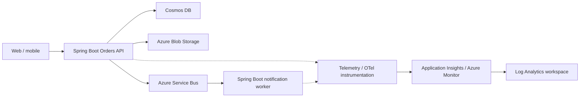

Starting from a blank screen, we must trace:

- Which route, which instance, and when did **request latency** climb?
- Which **dependency** consumed the time (Cosmos DB, Blob, Service Bus, JDBC, HTTP)?
- Was the **exception** caused by an application bug, credentials, network, throttling, or timeout?
- Is there a **trace ID** linking the request to its dependencies and background workers?
- Across multiple replicas, are logs fragmented?
- Did a `429` spike trigger a **retry storm** inflating p95/p99 latency?
- Which records were dropped by **sampling**, and do we need an unsampled source for accurate SLO counts?
- Is any personal data or secret leaking into telemetry?

Application Insights supplies tools to observe these signals, yet **does not automatically know business semantics**. "HTTP 200" can still return a failed business outcome, while "HTTP 404" can be expected when an item does not exist.

## 2. Application Insights in the Azure Monitor Ecosystem

| Component | Role |
|---|---|
| **Azure Monitor** | Azure platform for metrics, logs, traces, and alerting across infrastructure and apps |
| **Application Insights** | Application Performance Monitoring (APM): requests, dependencies, transactions, exceptions, application map |
| **Log Analytics workspace** | Stores and queries workspace-based log/telemetry data via KQL |
| **Azure Monitor Metrics** | Time-series metrics, charts, alerts, and resource-level signals |
| **Azure Monitor Alerts** | Metric/log/activity alerts and action groups |
| **Azure Workbooks** | Reports and visualizations combining logs and metrics |
| **Application Map** | Dependency graph of instrumented application components and dependencies |
| **Application Insights Java agent / Azure Monitor OTel Distro** | Collects/instruments Java telemetry and ships it to Azure Monitor |
| **OpenTelemetry (OTel)** | Standard APIs, SDKs, semantic conventions, context propagation, and exporters |

### Workspace-Based Application Insights

In the workspace-based model, Application Insights links to a **Log Analytics workspace** to store and query application telemetry. Distinguish clearly:

```text
Application Insights resource
  ├─ instrumentation/ingestion configuration
  ├─ application diagnostics views
  └─ associated Log Analytics workspace
       ├─ AppRequests
       ├─ AppDependencies
       ├─ AppExceptions
       ├─ AppTraces
       └─ other tables (per ingestion mode)
```

Table and column names differ between **workspace-based Application Insights tables**, classic `requests/dependencies/traces` tables, or telemetry routed through an OTel Collector / DCR. **Always explore the actual schema in Logs Explorer** before applying any sample KQL.

### Application Insights Is Not a Business Data Lake

Do not use App Insights to store full order JSON payloads, statements, payments, or customer records as a source of truth. Telemetry is subject to **sampling, retention, ingestion delay, access controls, and billing**; databases and message stores manage business state.

## 3. Core Telemetry Types

| Type | Example | Question Answered |
|---|---|---|
| **Request** | `POST /api/orders`, status 201, 420 ms | Which endpoint is slow or failing? |
| **Dependency** | `CosmosDB UpsertItem` 135 ms | Which external service is taking time? |
| **Exception** | `TimeoutException`, `CosmosException` | What error occurred and where? |
| **Trace/log** | `invoice.upload_failed` with traceId | Which events led to the error? |
| **Metric** | Request count, CPU, p95 latency | What are the trends and threshold breaches? |
| **Availability** | HTTP probe from test locations | Is the app reachable externally? |
| **Custom event** | `CheckoutStarted` with sensitive data stripped | Which business actions occurred? |

### Two Meanings of "Trace"

In some Application Insights views, **traces** means **log messages** (`AppTraces`); in OpenTelemetry, a **trace** is the chain of spans belonging to a distributed request. Sharing the name does not mean every row in `AppTraces` is an OTel distributed trace span.

### Relationship Between Logs, Metrics, and Distributed Traces

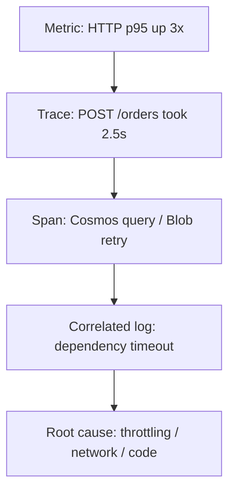

Operators should move from **impact magnitude** (metrics) to **representative requests** (traces), and then to **execution details** (logs), rather than hunting blindly through millions of uncorrelated log lines.

## 4. Instrumentation Architecture for a Java Application

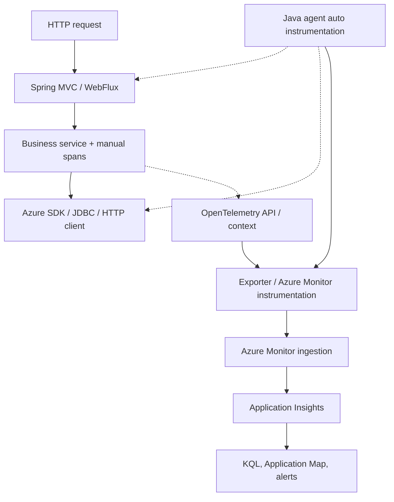

**Do not interpret this diagram to mean all spans are created automatically in every version.** Spring Framework, Java HTTP clients, Azure SDK services, JDBC drivers, and Reactor instrumentation vary in compatibility.

### Layers of Observability

1. **Inbound HTTP:** route, status, server duration, trace context.
2. **Application business logic:** order creation, inventory checks, price calculation.
3. **Outbound dependencies:** HTTP, JDBC, Redis, Azure SDKs.
4. **Messaging:** publishing Service Bus messages and consuming in workers.
5. **Runtime:** JVM memory/GC/threads and platform metrics.
6. **Infrastructure:** App Service, AKS, database/throttling, networking, and resource health.

A system needs visibility across all of these layers, yet **metrics from a JVM process do not replace Cosmos DB or network metrics at the Azure resource layer**.

## 5. What Is the Application Insights Connection String?

Application Insights uses a **connection string** to specify the target resource and ingestion endpoint, for example:

```text
InstrumentationKey=<opaque-id>;IngestionEndpoint=https://<region-endpoint>/
```

This is a **telemetry ingestion configuration string**, **not an Azure Blob Storage connection string** or Cosmos DB connection string. Do not confuse `InstrumentationKey` with **an Azure SDK data-plane password**; it identifies the telemetry resource for ingestion. Nevertheless, **never publish production connection strings freely**, as doing so risks telemetry injection/abuse if ingestion lacks additional authentication controls.

### Where Should It Be Configured?

In a Spring Boot app:

```text
APPLICATIONINSIGHTS_CONNECTION_STRING=<value from approved configuration>
```

Supply it via App Service Application Settings, Kubernetes Secrets, or an approved configuration/secret store. Never commit production values to Git. **Never assign a Storage SAS or service principal client secret to this variable.**

### Ingestion Authentication

Depending on Azure Monitor / OpenTelemetry exporter configuration, telemetry ingestion may use the connection string and/or supported Microsoft Entra authentication. **Successful ingestion does not imply permission to query Logs**: writing telemetry, managing the Application Insights resource, and reading the Log Analytics workspace are distinct scopes.

## 6. Choosing One of Three Java Instrumentation Strategies

| Approach | Advantages | Limitations / Notes |
|---|---|---|
| **Application Insights Java agent** | Auto-instruments Spring MVC/WebFlux, HTTP, and many libraries; minimal code changes | Depends on version compatibility, agent config, and supported libraries |
| **OpenTelemetry + Azure Monitor Distro/Exporter** | Standard OTel, full control over pipeline and custom instrumentation | Must manage SDK/agent/collector/exporter versions |
| **Spring Boot Actuator + Micrometer Observation/Tracing** | Native to Spring ecosystem; easy custom observations/metrics | **Insufficient** to reach App Insights without a compatible exporter/bridge |

### Recommended Default Strategy for Labs

Use **one Application Insights Java agent** to easily capture inbound requests, exceptions, and outbound HTTP. Then add **manual business spans** with the OpenTelemetry API where supported by the agent version—rather than running both the Application Insights agent and a second OpenTelemetry Java agent together.

### When to Use Micrometer?

If Spring Boot 3+ already uses Micrometer Observation/Tracing and your organization runs a shared OpenTelemetry Collector:

- pick the Micrometer–OTel bridge/exporter from your dependency BOM;
- establish a single trace pipeline;
- check for overlapping instrumentation against any Java agent;
- standardize `service.name`/resource attributes, sampling, and propagation.

**Having Micrometer metrics or an Actuator endpoint does not mean Azure Monitor receives all metrics/traces automatically.** An exporter or integration must be configured and verified end-to-end.

## 7. Principle of "One Primary Instrumentation Owner"

A common mistake:

```text
JAVA_TOOL_OPTIONS="-javaagent:applicationinsights-agent.jar"
JAVA_OPTS="-javaagent:opentelemetry-javaagent.jar"
Spring Boot Micrometer Tracing also exports to Azure Monitor
```

If all three instrument outbound HTTP, a single dependency call can emit **multiple spans**, break parent-child trees, inflate request counts, and raise costs.

### Selection Process

1. Check what agents or instrumentation already exist on App Service, AKS, or the Java process.
2. Designate **one owner for inbound/outbound auto-instrumentation**.
3. Configure only one primary exporter path unless a parallel setup is explicitly justified.
4. Add custom spans/metrics deliberately, verifying they do not duplicate framework spans.
5. Keep resource attributes consistent so Application Map does not spawn "unknown" nodes.
6. Inspect test request traces to verify a sensible span count per hop.

### Not Every Duplicate-Looking Span Comes from Two Agents

A single request may legitimately emit a **logical Azure SDK operation span** plus an **HTTP transport span**; that is not necessarily a bug. Suspicious duplication occurs when the exact same HTTP method, URL, duration, and parent are recorded twice by two libraries. Inspect the span hierarchy before disabling instrumentation.

## 8. Preparing Spring Boot and the Application Insights Resource

### Minimum Prerequisites

- A lab subscription/resource group with an approved budget.
- A workspace-based Application Insights resource linked to an approved Log Analytics workspace.
- A Spring Boot application running a compatible JDK/agent version.
- Read access to resource config to retrieve the connection string (delete rights not needed).
- Network connectivity from the JVM to the **telemetry ingestion endpoint**.
- Authorized read access on Application Insights / Log Analytics for verification.
- Synthetic lab data with zero tokens or PII in logs.

### Provisioning in the Azure Portal

1. Select subscription, resource group, and **Application Insights**.
2. Choose name, region, and **Log Analytics workspace** within your authorized scope.
3. Review data residency, retention/cost, and access policies.
4. Create the resource and record its Application Insights resource ID, region, and workspace ID in your lab inventory.
5. Copy the connection string from Application Insights configuration and inject it via approved environment/config channels.
6. Avoid enabling full DEBUG log ingestion in production out of habit.

**Do not create a new Application Insights resource for every JVM instance.** Replicas of the same service/environment normally report to one shared application resource, distinguished by role/instance metadata.

### When Using a Shared Resource

Verify who owns the connection string, retention, sampling, and Logs Reader access. Never modify shared production DCRs, workspace retention, or sampling just to run a lab.

## 9. Installing the Application Insights Java Agent

The **Application Insights Java agent 3.x** is a common way to auto-instrument Java apps with minimal code edits. Download the official agent matching your release and approved JDK version; store the JAR on the host, container image, or trusted artifact registry.

Example file path:

```text
/opt/telemetry/applicationinsights-agent.jar
```

### Running the JVM with the Agent

```bash
export APPLICATIONINSIGHTS_CONNECTION_STRING="<connection-string-from-configuration>"

java \
  -javaagent:/opt/telemetry/applicationinsights-agent.jar \
  -jar orders-api.jar
```

`-javaagent:...` is a **JVM startup argument** placed before `-jar`. Adding a Maven dependency alone does not make Spring Boot load it as a Java agent.

### Using Environment Variables

In App Service or containers, common variables are:

```text
JAVA_TOOL_OPTIONS=-javaagent:/opt/telemetry/applicationinsights-agent.jar
APPLICATIONINSIGHTS_CONNECTION_STRING=<configured telemetry destination>
```

**Caution:** `JAVA_TOOL_OPTIONS` is read by the JVM at startup and affects **every Java process** inside a container/runtime inheriting it. Verify the JAR path, environment, and any helper Java processes before enabling.

### What Is `applicationinsights.json`?

The Java agent can read an `applicationinsights.json` configuration file following the path rules supported by that agent version. **Minimal** example:

```json
{
  "role": {
    "name": "orders-api"
  },
  "sampling": {
    "percentage": 100
  }
}
```

This configuration suits **low-traffic labs**. Pass the connection string via an environment variable to keep it out of config files. Search paths for `applicationinsights.json`, field names, and env-var overrides **depend on the agent version**; check startup logs and version docs.

**Do not leave 100% sampling on in high-volume production simply because a lab needed every trace.** Measure cost and define a deliberate sampling policy.

### Do You Need an Application Insights Maven Dependency?

For the Java agent to auto-instrument Spring Boot, you generally **do not** need to add the agent JAR as an app dependency in `pom.xml`. If you want **manual OpenTelemetry spans**, add the OTel API or a compatible library. Never mix multiple SDK instrumentation libraries without a compatibility plan.

## 10. Verifying the Java Agent Is Actually Running

**Having the JAR inside the image does not mean the JVM loaded the agent.**

### Startup Checks

1. Confirm JVM startup args / `JAVA_TOOL_OPTIONS` include `-javaagent`.
2. Verify the JAR path exists and is readable.
3. Verify agent compatibility with your JDK version.
4. Confirm the agent picks up the intended telemetry configuration.
5. Send a test HTTP request to Spring Boot.
6. Confirm data appears in Application Insights after normal ingestion lag.
7. Verify the expected role name and environment.

### Failure Symptoms

| Symptom | Likely Cause |
|---|---|
| `Error opening zip file or JAR manifest missing` | Bad path or corrupt/invalid JAR |
| JVM fails to start with agent enabled | JDK/agent incompatibility, file permissions, bad JVM args |
| Zero telemetry ingested | Wrong connection string, exporter config, or blocked network |
| Requests appear, dependencies stay empty | Unsupported or disabled HTTP/SDK instrumentation |
| Traces land in the wrong resource | Wrong connection string or environment config |
| Role name shows an obscure default value | `role`/OTel resource attributes not set |
| Duplicate spans | Two agents or overlapping exporters/instrumentations |

### Minimal Smoke Test

```bash
curl -i http://localhost:8080/actuator/health
curl -i http://localhost:8080/api/orders/demo
```

These URLs are **examples** assuming the app exposes them and Actuator permits access. Never expose all Spring Boot Actuator endpoints publicly just "for telemetry."

## 11. Spring Boot Actuator, Micrometer, and Application Insights

In Spring Boot, **Actuator** exposes health/info/metrics/observations per dependencies and config, while **Micrometer** standardizes metrics and observations. Application Insights is Azure's telemetry backend; they are not automatically wired together.

### Layer Roles

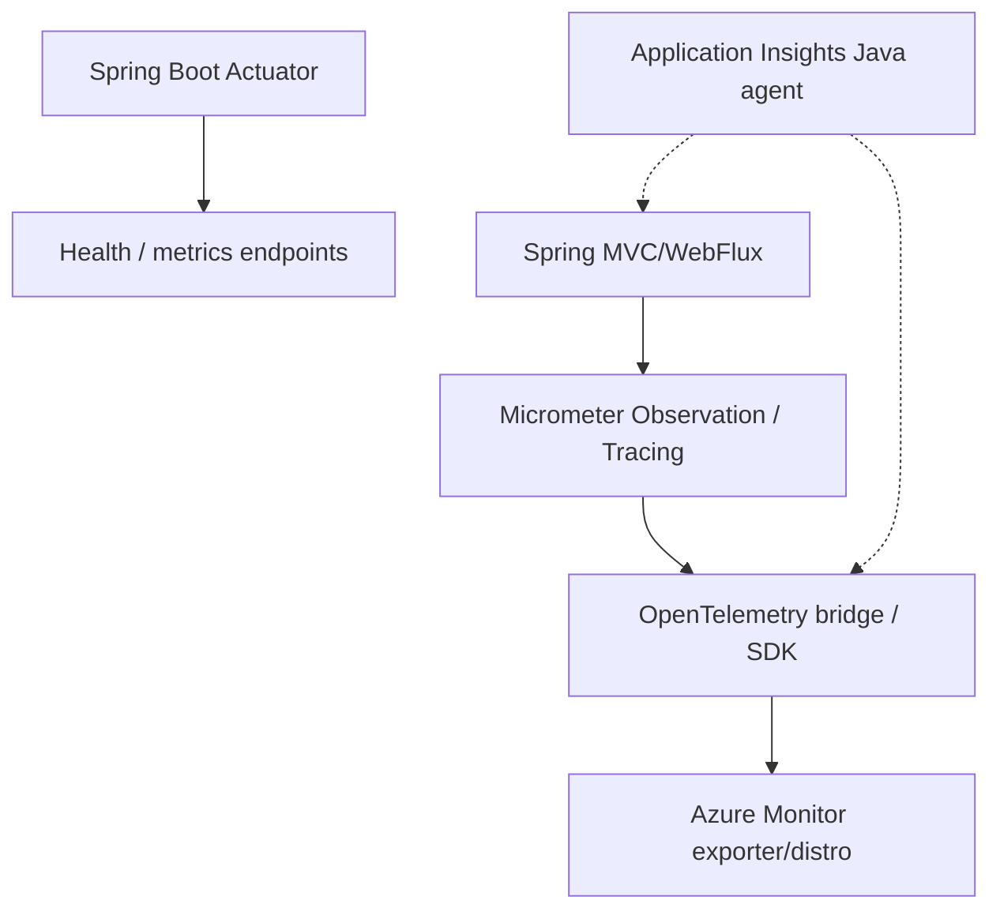

This diagram illustrates available options; **never enable all parallel paths by default**.

### When Using the Java Agent

- Start with the agent to collect requests, dependencies, and exceptions.
- Actuator remains useful for Kubernetes readiness/liveness and JVM/HTTP metrics.
- If Micrometer Tracing is also configured to export spans, check for duplicate HTTP spans and context conflicts.
- Add custom spans/metrics intentionally without spinning up a redundant trace pipeline.

### When Using Micrometer + OpenTelemetry

- Pin Spring Boot dependency management alongside compatible bridge/exporter versions.
- Choose an exporter to Azure Monitor or a Collector per your architecture.
- Keep parent-child trace context and semantic attributes consistent.
- Verify metrics actually export—having `/actuator/metrics` does not prove data reaches Application Insights.

## 12. A Sample Spring Boot Service

Example service handling invoice creation using Blob Storage. The code below focuses on **business logs, typed errors, and request correlation**.

### Core Maven Dependencies

```xml
<!-- Versions managed by approved Spring Boot BOM / Azure SDK BOM. -->
<dependencies>
  <dependency>
    <groupId>org.springframework.boot</groupId>
    <artifactId>spring-boot-starter-web</artifactId>
  </dependency>
  <dependency>
    <groupId>org.springframework.boot</groupId>
    <artifactId>spring-boot-starter-actuator</artifactId>
  </dependency>
  <dependency>
    <groupId>com.azure</groupId>
    <artifactId>azure-storage-blob</artifactId>
  </dependency>
  <dependency>
    <groupId>com.azure</groupId>
    <artifactId>azure-identity</artifactId>
  </dependency>
</dependencies>
```

Selecting compatible Spring Boot BOM / Azure SDK BOM versions belongs to the real project setup; this snippet is **not a complete `pom.xml`** (parent/BOM/version declarations omitted).

### `application.yml`

```yaml
spring:
  application:
    name: orders-api

management:
  endpoints:
    web:
      exposure:
        include: health,info

logging:
  level:
    root: INFO
    com.example.orders: INFO
    com.azure: WARN

orders:
  blob-endpoint: \${AZURE_STORAGE_BLOB_ENDPOINT}
  invoice-container: invoice-lab
```

`\${AZURE_STORAGE_BLOB_ENDPOINT}` is a Spring property placeholder; in deployment, supply a valid endpoint **without any SAS token**. Never hardcode account keys or secrets. Exposing only `health,info` shrinks Actuator's surface area; non-public endpoints still require authentication and network controls.

### Blob Service Client Bean

```java
package com.example.orders;

import com.azure.identity.DefaultAzureCredentialBuilder;
import com.azure.storage.blob.BlobServiceClient;
import com.azure.storage.blob.BlobServiceClientBuilder;
import org.springframework.beans.factory.annotation.Value;
import org.springframework.context.annotation.Bean;
import org.springframework.context.annotation.Configuration;

@Configuration
public class AzureClientsConfig {
    @Bean
    public BlobServiceClient blobServiceClient(
            @Value("\${orders.blob-endpoint}") String endpoint) {
        return new BlobServiceClientBuilder()
            .endpoint(endpoint)
            .credential(new DefaultAzureCredentialBuilder().build())
            .buildClient();
    }
}
```

This example uses **Microsoft Entra credentials**. The workload identity needs **Storage Blob Data Contributor** (or equivalent permissions) at the right scope for uploads—not merely Azure ARM Contributor.

### Service with Safe Business Logging

```java
package com.example.orders;

import com.azure.storage.blob.BlobClient;
import com.azure.storage.blob.BlobServiceClient;
import com.azure.storage.blob.models.BlobStorageException;
import org.slf4j.Logger;
import org.slf4j.LoggerFactory;
import org.springframework.stereotype.Service;

import java.io.ByteArrayInputStream;
import java.nio.charset.StandardCharsets;
import java.util.concurrent.TimeUnit;

@Service
public final class InvoiceService {
    private static final Logger LOG =
        LoggerFactory.getLogger(InvoiceService.class);
    private final BlobServiceClient blobs;

    public InvoiceService(BlobServiceClient blobs) {
        this.blobs = blobs;
    }

    public String uploadDemoInvoice(String orderId) {
        // In production: validate + authorize orderId and tenant before storage.
        if (!orderId.matches("[a-zA-Z0-9-]{1,60}")) {
            throw new IllegalArgumentException("Invalid order identifier");
        }
        long started = System.nanoTime();
        String blobName = "demo/" + orderId + "/invoice.txt";
        byte[] payload = "synthetic-demo-invoice"
            .getBytes(StandardCharsets.UTF_8);

        try {
            BlobClient client = blobs
                .getBlobContainerClient("invoice-lab")
                .getBlobClient(blobName);
            client.upload(new ByteArrayInputStream(payload),
                payload.length, false);
            LOG.info("invoice.upload_succeeded durationMs={}",
                TimeUnit.NANOSECONDS.toMillis(System.nanoTime()-started));
            return "CREATED";
        } catch (BlobStorageException error) {
            int status = error.getResponse() == null
                ? -1 : error.getResponse().getStatusCode();
            LOG.warn("invoice.upload_failed status={} category={} durationMs={}",
                status, classify(status),
                TimeUnit.NANOSECONDS.toMillis(System.nanoTime()-started));
            throw new InvoiceStorageFailure(
                "INVOICE_STORAGE_UNAVAILABLE", error);
        }
    }

    private static String classify(int status) {
        if (status == 401 || status == 403) return "AUTH_OR_ACCESS";
        if (status == 409 || status == 412) return "CONFLICT";
        if (status == 429) return "THROTTLED";
        if (status >= 500) return "SERVER_ERROR";
        return "OTHER";
    }

    static final class InvoiceStorageFailure extends RuntimeException {
        InvoiceStorageFailure(String message, Throwable cause) {
            super(message, cause);
        }
    }
}
```

**Limitations:** This is lab code. Production requires idempotency/conditional writes, typed business error mapping, retry/deadline budgets, full authorization, and global exception handling. Never print `error.getMessage()` if it might contain URIs or SAS tokens. This code **does not manually create an OpenTelemetry span**; when the Java agent is active and instrumentation supports it, HTTP and dependency operations appear automatically.

## 13. Demo Controller to Generate Requests and Statuses

```java
package com.example.orders;

import org.springframework.http.HttpStatus;
import org.springframework.web.bind.annotation.*;

@RestController
@RequestMapping("/api/orders")
public final class DemoOrdersController {
    private final InvoiceService invoices;

    public DemoOrdersController(InvoiceService invoices) {
        this.invoices = invoices;
    }

    @PostMapping("/{orderId}/invoice")
    @ResponseStatus(HttpStatus.CREATED)
    public String createDemoInvoice(@PathVariable String orderId) {
        return invoices.uploadDemoInvoice(orderId);
    }
}
```

This is a **lab API** using synthetic data without security filters. Never expose unauthenticated file-creation endpoints in public or production environments. A first call may create the Blob; a second call with the same `orderId` can receive **409 BlobAlreadyExists**, which should map to a proper public error code rather than a generic "Azure error."

### Expected Observations

When supported by instrumentation:

```text
Request:
  POST /api/orders/{orderId}/invoice
  duration, status, success

Dependency:
  Azure Blob Storage HTTP operation (logical or transport span)
  duration, status

Trace/log:
  invoice.upload_succeeded or invoice.upload_failed
  traceId when correlation is configured
```

`orderId` can be **masked inside the route template** instead of raw paths to reduce sensitive data and cardinality. Never use paths containing usernames or SAS tokens as operation names.

## 14. Exceptions: Log in the Right Place and Never Fake Success

Never swallow SDK errors like this:

```java
// Anti-pattern: turns every failure into fake success.
try {
    uploadInvoice();
} catch (Exception ignored) {
    return;
}
```

A better handling strategy:

1. Distinguish expected conflicts from unexpected dependency failures.
2. Return public error codes—**never** raw stack traces or HTTP headers.
3. Log sanitized business context at an appropriate boundary.
4. Let instrumentation record request status/exceptions per policy.
5. Alert on **final failures**, rather than counting every retry attempt as an API failure.

### Sample Spring Exception Handler

```java
package com.example.orders;

import org.springframework.http.HttpStatus;
import org.springframework.http.ResponseEntity;
import org.springframework.web.bind.annotation.ExceptionHandler;
import org.springframework.web.bind.annotation.RestControllerAdvice;

import java.util.Map;

@RestControllerAdvice
public final class ApiErrorHandler {
    @ExceptionHandler(IllegalArgumentException.class)
    ResponseEntity<Map<String, String>> badInput(IllegalArgumentException e) {
        return ResponseEntity.badRequest().body(
            Map.of("code", "INVALID_INPUT"));
    }

    @ExceptionHandler(InvoiceService.InvoiceStorageFailure.class)
    ResponseEntity<Map<String, String>> storageUnavailable(
            InvoiceService.InvoiceStorageFailure e) {
        return ResponseEntity.status(HttpStatus.SERVICE_UNAVAILABLE)
            .body(Map.of("code", "INVOICE_STORAGE_UNAVAILABLE"));
    }
}
```

**Note:** Mapping every `BlobStorageException` to HTTP 503 only illustrates the handler; production must **distinguish 409/404/412/429/5xx** per business contract. No app should return 503 for "Blob already exists" without checking idempotency.

## 15. Distributed Tracing: Trace ID, Span ID, and Parent–Child

A single trace comprises multiple spans sharing a **trace ID**:

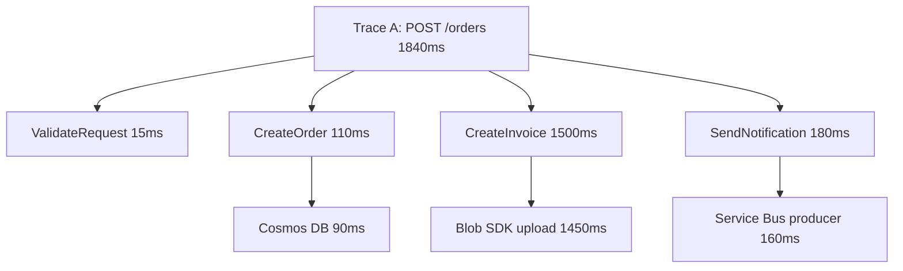

### Identifiers You Must Distinguish

| Field | Meaning |
|---|---|
| **`traceId`** | Identifies one trace across processes/services with proper context propagation |
| **`spanId`** | Identifies one specific span, optionally linked to a parent span ID |
| **Operation ID** in App Insights | Commonly links request/dependency/log records within the same trace per ingestion schema |
| **Azure service request ID** | ID returned by Storage/Cosmos/service, not a W3C trace ID |

W3C Trace Context propagates `traceparent` across services, for example:

```text
traceparent: 00-4bf92f3577b34da6a3ce929d0e0e4736-00f067aa0ba902b7-01
```

`tracestate` carries vendor-specific metadata; never inject user PII or bearer tokens into `tracestate` or `baggage`.

### Parent–Child Is Not Strictly Contained Timelines

Two spans may execute concurrently (for example `Mono.zip` calling Cosmos and Storage), or a worker may process an event after the HTTP request already returned. Parent–child captures context/causality, not necessarily strict duration containment in async models. For queues and messaging, **span links** are often cleaner than direct parent–child links.

## 16. Adding Custom Business Spans with the OpenTelemetry API

Auto-instrumentation captures HTTP, JDBC, and Azure SDK calls, yet lacks visibility into business steps like `ApproveOrder` or `GenerateInvoice`. Use the **OpenTelemetry API** to add meaningful spans:

```java
package com.example.orders;

import io.opentelemetry.api.GlobalOpenTelemetry;
import io.opentelemetry.api.trace.Span;
import io.opentelemetry.api.trace.StatusCode;
import io.opentelemetry.api.trace.Tracer;
import io.opentelemetry.context.Scope;

public final class BusinessTracing {
    private static final Tracer TRACER =
        GlobalOpenTelemetry.getTracer("orders-business");

    public void execute(Runnable operation) {
        Span span = TRACER.spanBuilder("Invoice.Generate")
            .setAttribute("app.operation", "GenerateInvoice")
            .startSpan();
        try (Scope scope = span.makeCurrent()) {
            operation.run();
            span.setAttribute("app.outcome", "succeeded");
        } catch (RuntimeException exception) {
            span.setAttribute("app.error_category", "dependency_failure");
            span.setStatus(StatusCode.ERROR, "Invoice generation failed");
            // Record exception details only when redaction policy permits.
            throw exception;
        } finally {
            span.end();
        }
    }
}
```

**Note:** This uses the manual span API; `GlobalOpenTelemetry` only exports spans if an instrumentation SDK/agent is configured. Do not spin up a second independent OpenTelemetry SDK/exporter just for this class if your Java agent already provides the context.

### Do Not Create a Span for Every Line of Java

A trace bloated with thousands of tiny spans adds overhead and noise. Create spans only for **business boundaries**, uninstrumented dependencies, and stages relevant to SLOs or diagnostics.

### Never Put Sensitive Data into Attributes

```text
Good:
  app.operation=GenerateInvoice
  invoice.type=monthly
  app.outcome=failed
  dependency.name=azure-blob

Avoid:
  customer.email=<private email>
  authorization=<token>
  invoice.content=<full PDF text>
  storage.sas=<signed URL>
```

## 17. Application Correlation IDs vs. Trace IDs

An API may receive an `X-Correlation-ID` header from a gateway or client. Never trust it blindly:

- validate **length, charset, and maximum size**;
- avoid using unvalidated values directly as metric labels;
- never treat it as identity or authorization proof;
- never overwrite standard W3C trace IDs with an arbitrary custom ID.

### A Useful Naming Convention

```text
traceId: W3C trace ID managed by instrumentation
spanId: current span ID
requestId: generated by server/API instance or accepted after validation
businessEventId: stable ID for idempotency/auditing
azureRequestId: ID returned by an Azure service on HTTP responses
```

Application Insights links records via **operation ID / trace context**; an application correlation ID can be attached as a separate custom dimension for customer support lookups.

### One Request Can Have Multiple Service Request IDs

If the Blob SDK retries 3 attempts, the app has one business trace yet receives multiple Azure request IDs—one per HTTP attempt that reached the service. Never equate **logical operation success** with **a single network attempt**.

## 18. Structured Logging with SLF4J and Logback

### Business Logging Example

```java
import org.slf4j.Logger;
import org.slf4j.LoggerFactory;

public final class OrderEvents {
    private static final Logger LOG =
        LoggerFactory.getLogger(OrderEvents.class);

    void success(String operation, long latencyMs) {
        LOG.info("orders.operation_succeeded operation={} elapsedMs={}",
            operation, latencyMs);
    }

    void failed(String operation, int httpStatus) {
        LOG.warn("orders.dependency_failed operation={} status={}",
            operation, httpStatus);
    }
}
```

`{}` placeholders avoid unnecessary string concatenation. With a JSON logging backend, emit structured fields rather than flat text. **Never assume every SLF4J log automatically appears in Application Insights**: you need a supporting agent/exporter/sink and matching levels/filters.

### Suggested JSON Log Schema

```json
{
  "timestamp": "2026-11-20T08:15:30Z",
  "severity": "WARN",
  "service": "orders-api",
  "environment": "staging",
  "operation": "CreateInvoice",
  "dependency": "azure-blob",
  "traceId": "4bf92f3577b34da6a3ce929d0e0e4736",
  "spanId": "00f067aa0ba902b7",
  "httpStatus": 429,
  "errorCategory": "throttled",
  "durationMs": 1250,
  "outcome": "retry_exhausted"
}
```

This is an **app-defined schema**, not the built-in column list of `AppTraces`. `spanId` and `traceId` only hold meaning if instrumentation actually supplies context.

### Why Never Log Raw Headers or Bodies?

HTTP headers often carry `Authorization`, SAS tokens, cookies, and tenant details; bodies carry PII and financial/account data. Application Insights is an operational platform, not a vault for credentials or customer payloads. Log only **metrics, error codes, safely pseudonymized IDs, and minimal necessary context**.

## 19. MDC, Thread Pools, and Log Correlation

**MDC (Mapped Diagnostic Context)** in many SLF4J backends uses `ThreadLocal` to inject `traceId`/`correlationId` into log patterns.

### Safely Adding a Validated Correlation ID

```java
import org.slf4j.MDC;

public static void process(String safeCorrelationId, Runnable action) {
    String previous = MDC.get("correlationId");
    try {
        MDC.put("correlationId", safeCorrelationId);
        action.run();
    } finally {
        if (previous == null) MDC.remove("correlationId");
        else MDC.put("correlationId", previous);
    }
}
```

**Always restore MDC** when thread pools reuse threads; otherwise, subsequent requests inherit the previous customer's ID.

### Reactor/WebFlux Is More Complex

`MDC` is thread-bound, whereas Reactor pipelines hop across schedulers. Never assume `MDC.get("traceId")` stays accurate inside every `flatMap` or `publishOn` callback. Use OpenTelemetry/Reactor context propagation bridges compatible with your versions.

### If Logs Have an Empty Trace ID

- Verify the OTel agent/tracing provider is active.
- Check whether log correlation injection is supported in your agent version.
- Check async context propagation across schedulers.
- Check sampling/export; **an empty `traceId` in logs does not prove the request was not processed**.

## 20. Spring MVC vs. Spring WebFlux: Two Execution Models

| Criterion | Spring MVC (Servlet) | Spring WebFlux (Reactive) |
|---|---|---|
| Execution model | Request threads, blocking common | Reactor pipelines, non-blocking event loops |
| ThreadLocal/MDC | Relatively easy per request thread | Needs bridges/propagation across async boundaries |
| Azure SDK | Sync client fits well with sized thread pools | Async client and `Mono/Flux` composition normally preferred |
| Risks | Thread pool exhaustion, slow blocking dependencies | Calling `block()` on event loops, context loss, unhandled async errors |
| Auto-instrumentation | Check agent's Spring MVC support | Check agent's WebFlux/Reactor support |

### Anti-Pattern: Fire-and-Forget While Returning Success

```java
// Avoid in services when business durability matters:
asyncUpload().subscribe();
return "uploaded"; // Upload may still be running or may fail.
```

For durable async work, use an **outbox / Service Bus job** with explicit state tracking rather than calling `subscribe()` and ignoring errors.

### Anti-Pattern: Blocking Inside the Netty Event Loop

Calling `mono.block()` inside WebFlux starves the event loop, tanking throughput and spiking latency. Use reactive composition or offload blocking calls to a properly sized scheduler; never let telemetry overhead block async callers.

## 21. Correlation Between Messaging and HTTP Requests

A `POST /orders` request publishes `OrderCreated` to Service Bus. A worker processes it 20 seconds later in a separate process:

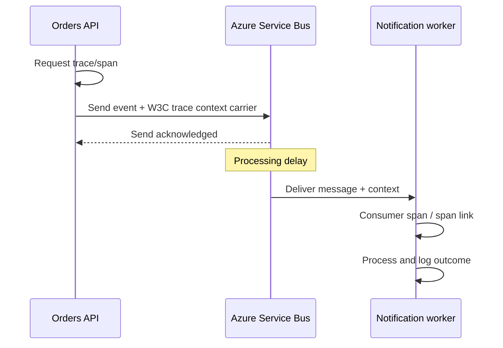

### What Needs to Propagate?

- Message ID / business event ID for deduplication.
- W3C trace context via supported carrier/SDK/framework hooks.
- Correlation ID if needed for business support.
- Tenant/permission context **already validated or re-verified by the worker**, never blindly trusting claims in the message body.

### What Must the Worker Do?

On the consumer side:

1. Extract tracing context per instrumentation support.
2. Create a consumer span or span link matching messaging semantic conventions.
3. Enforce idempotency.
4. Process the message and log the business outcome.
5. Complete or dead-letter the message per service semantics.

**Never fabricate a random W3C `traceparent` inside each worker.** Use OTel propagators/agent integration to preserve causality. When processing batches of messages, a worker span can link to multiple producer contexts.

## 22. Azure SDK Dependency Instrumentation and Limits

In Spring Boot, calling an Azure SDK can emit logical operation spans, HTTP transport spans, or dependency records **depending on the service, SDK version, and agent instrumentation**.

| SDK | What You Want to Observe | What to Check |
|---|---|---|
| **Azure Blob Storage** | Upload/download, HTTP status, duration, request ID | Do dependency spans/logs appear with redaction? |
| **Azure Cosmos DB** | Query/upsert latency, RUs, 429s, diagnostics | Is Cosmos diagnostics/agent instrumentation sufficient? |
| **Azure Service Bus** | Send/receive latency, processing spans, retries | Does context propagate between producer and consumer? |
| **Azure Key Vault** | Secret read outcomes, latency, 401/403 | Never log secret values or response bodies |
| **Azure SQL/JDBC** | DB dependency/query time | Avoid logging raw SQL containing PII literals |
| **Outbound HTTP** | Host/route/status/duration | Any double spans from HTTP client + SDK? |

### SDK Retries May Sit Inside One Span

A 2-second Blob upload span may include network retries and backoff. **Do not claim Azure Blob service processing took 2 seconds** solely from a client span. Distinguish:

- total logical operation duration;
- individual HTTP attempts (if instrumented);
- retry backoff delays;
- network/proxy/TLS overhead;
- service-side processing latency;
- JVM CPU, GC, and thread-pool queuing.

### Logs and Application Map

Application Map renders instrumented dependencies, not every network socket or database. A missing service on the map can stem from sampling, unsupported instrumentation, zero traffic, or inconsistent role names—it does not prove the service is unused.

## 23. Using Application Insights in the Azure Portal

Inside an Application Insights resource, typical views include:

- **Overview/Metrics:** high-level traffic, failures, and latency.
- **Failures:** failed requests, failed dependencies, and exceptions by time range and operation.
- **Performance:** slow operations, duration distributions, and dependency breakdowns.
- **Application Map:** service/dependency topology built from telemetry correlation.
- **Transaction search / End-to-end transaction details:** inspect an individual request and its spans/dependencies.
- **Live Metrics:** near-real-time metrics stream when supported by agent and networking.
- **Logs:** query the workspace with KQL.
- **Workbooks/Alerts:** build dashboards and alert rules.

Menu labels and available blades vary by Azure Portal UI, resource type, workspace, agent, and role. If a blade is missing, check access permissions, ingestion mode, and data availability before assuming a platform fault.

### Drill-Down Workflow When p95 Spikes

1. Select the exact **subscription, Application Insights resource, environment, and time range**.
2. Open Performance and select `POST /api/orders`.
3. Compare p50/p95/p99, noting sampling and traffic distribution.
4. Pick a representative slow transaction.
5. Read the span timeline: inbound request, business spans, dependency calls.
6. Inspect dependency statuses, resultCodes, and exceptions.
7. Use the trace/operation ID to pull correlated logs in Logs.
8. Cross-check Azure resource metrics and Service Health if an Azure-side issue is suspected.

### Choose the Right Time Range

Telemetry ingestion has latency. A request at 08:00 UTC may take several minutes to become queryable depending on the pipeline. During investigations, align:

```text
Event timestamp
Telemetry ingestion timestamp (if provided by table)
Portal timezone display
Deployment timestamp
Alert evaluation window
```

Never confuse Vietnam time (UTC+7) with UTC event timestamps and query the wrong window.

## 24. KQL: Inspect the Schema Before Querying

**Kusto Query Language (KQL)** runs inside Log Analytics. With workspace-based Application Insights, you commonly encounter:

```text
AppRequests
AppDependencies
AppTraces
AppExceptions
AppMetrics
AppEvents
AppAvailabilityResults
```

Classic resources and older queries use `requests`, `dependencies`, `traces`, or `exceptions`. **Never run sample queries against the wrong schema and assume telemetry is missing.**

### Inspect Columns First

```kusto
AppRequests
| where TimeGenerated > ago(1h)
| take 5
```

If the table does not exist, verify the **linked workspace, ingestion path, and actual schema**. In Logs Explorer, inspect column names and types before joining.

### Query Verification Rules

- Pick a time window covering the test requests just sent.
- Target the right resource and workspace.
- Distinguish `AppRoleName` from application service names.
- Never paste production connection strings into KQL.
- When schemas differ, update table and column names instead of guessing.
- Treat query results as observed telemetry, not total request counts when sampling is enabled.

## 25. KQL: Computing Request Counts and Failure Rates

```kusto
AppRequests
| where TimeGenerated > ago(1h)
| summarize
    Requests = count(),
    Failures = countif(Success == false),
    P50Ms = percentile(DurationMs, 50),
    P95Ms = percentile(DurationMs, 95),
    P99Ms = percentile(DurationMs, 99)
    by AppRoleName, Name
| extend FailureRatePct =
    100.0 * todouble(Failures) / iif(Requests == 0, 1, Requests)
| order by Failures desc
```

### Interpretation

- `Requests` is the count of **ingested/queried telemetry records**, not necessarily true request counts when sampling is active.
- `Failures` relies on `Success`, which does not understand custom business rules.
- `P95Ms` and `P99Ms` are sensitive to sample size; check request counts before declaring a regression.
- `Name` should hold normalized route/operation templates rather than raw high-cardinality URLs.

### Comparing in 5-Minute Buckets

```kusto
AppRequests
| where TimeGenerated > ago(2h)
| summarize
    Requests = count(),
    Failures = countif(Success == false),
    P95Ms = percentile(DurationMs, 95)
    by bin(TimeGenerated, 5m), AppRoleName
| order by TimeGenerated asc
```

This timeline aligns spikes against deployment or incident timestamps. With sampling, you may need `ItemCount`/weighted aggregation matching your schema and sampling policy instead of raw `count()`; verify whether the weight field exists and is populated accurately.

## 26. KQL: Identifying Slow Dependencies

```kusto
AppDependencies
| where TimeGenerated > ago(1h)
| summarize
    Calls = count(),
    Failed = countif(Success == false),
    P95Ms = percentile(DurationMs, 95),
    P99Ms = percentile(DurationMs, 99)
    by AppRoleName, Target, Name, DependencyType
| order by P95Ms desc
```

### Do Not Confuse Logical Operations with HTTP Attempts

If the agent instruments both logical Azure SDK operations and outbound HTTP attempts, multiple dependency spans may appear for a single business call. Inspect **`Name`, `DependencyType`, `Target`, and parent–child links** before summing them as business call counts.

### Querying HTTP Result Errors

```kusto
AppDependencies
| where TimeGenerated > ago(1h)
| where Success == false
| summarize Count = count()
    by AppRoleName, Target, Name, ResultCode
| order by Count desc
```

To hunt for Cosmos DB `429` responses, filter `Target` and `DependencyType` using the **actual values observed** in your schema rather than assuming the Java SDK always logs `Target="CosmosDB"`.

## 27. KQL: Linking Requests and Dependencies via Operation ID

Joining both tables on the shared operation/trace ID:

```kusto
let slowRequests =
    AppRequests
    | where TimeGenerated > ago(2h)
    | where DurationMs > 1000
    | project
        RequestTime = TimeGenerated,
        OperationId,
        RequestName = Name,
        RequestDurationMs = DurationMs,
        RequestResultCode = ResultCode;
AppDependencies
| where TimeGenerated > ago(2h)
| join kind=inner (slowRequests) on OperationId
| project RequestTime, OperationId,
          RequestName, RequestDurationMs,
          DependencyTime = TimeGenerated,
          DependencyName = Name,
          Target, DependencyDurationMs = DurationMs,
          DependencyResultCode = ResultCode
| order by RequestTime desc
```

### Why Isn't This Join Always 1:1?

- One request executes multiple dependencies.
- A dependency may run on an async worker or separate trace.
- Sampling may drop either the request or the dependency.
- Broken propagation creates mismatched operation IDs.
- Multiple dependencies share a trace across different branches; joining on `OperationId` does not reconstruct full **parent–child** trees.

For a specific incident, inspect transaction details / trace graphs and `ParentId`/`Id` (where available) to understand span hierarchy rather than relying solely on a flat join.

## 28. KQL: Exceptions and Log Messages

### Grouping Common Exceptions

```kusto
AppExceptions
| where TimeGenerated > ago(24h)
| summarize Exceptions = count()
    by AppRoleName, Type, ProblemId
| order by Exceptions desc
```

Field names like `Type` and `ProblemId` can vary by ingestion schema; check with `take 5` if a query errors.

### Finding Business Logs by Event Name

```kusto
AppTraces
| where TimeGenerated > ago(2h)
| where Message contains "invoice.upload_failed"
| project TimeGenerated, AppRoleName,
          SeverityLevel, Message, OperationId, Properties
| order by TimeGenerated desc
```

### Tracing One Operation ID

```kusto
let targetOperation = "<trace-or-operation-id>";
union
    (AppRequests
     | where OperationId == targetOperation
     | project TimeGenerated, Kind="request",
               Summary=Name, Code=ResultCode),
    (AppDependencies
     | where OperationId == targetOperation
     | project TimeGenerated, Kind="dependency",
               Summary=Name, Code=ResultCode),
    (AppTraces
     | where OperationId == targetOperation
     | project TimeGenerated, Kind="log",
               Summary=Message, Code="")
| order by TimeGenerated asc
```

This KQL illustrates the declared tables and columns; another workspace may require adjusting table names, fields, or casts. If a trace ID comes from a frontend user, **validate its format and enforce authorization** before querying across multi-tenant logs.

## 29. KQL: Before-and-After Deployment Comparison

When a 09:00 UTC release slows down the API, compare before and after windows:

```kusto
let startTime = datetime(2026-11-20T08:00:00Z);
let deployTime = datetime(2026-11-20T09:00:00Z);
let endTime = datetime(2026-11-20T10:00:00Z);
AppRequests
| where TimeGenerated between (startTime .. endTime)
| extend Window = iff(TimeGenerated < deployTime, "before", "after")
| summarize
    Count = count(),
    Failed = countif(Success == false),
    P95Ms = percentile(DurationMs, 95)
    by Window, Name, AppRoleName
| order by Name asc, Window asc
```

**Dates in this example are purely for learning syntax.** Real investigations must use the exact deployment timestamp and compare equivalent traffic/tenant mixes. A higher p95 can reflect shifted traffic patterns rather than a bug in the new build.

### Always Tag Build Versions

Via OTel resource attributes or custom telemetry (as supported by your agent/version), attach:

```text
service.name = orders-api
service.version = 1.4.2
deployment.environment = staging
cloud.region = <Azure region>
```

Without build versions in telemetry, isolating failing traces during rolling upgrades across replicas becomes guesswork.

## 30. Application Map: Understanding the Dependency Graph

Application Map visualizes instrumented components and their dependencies:

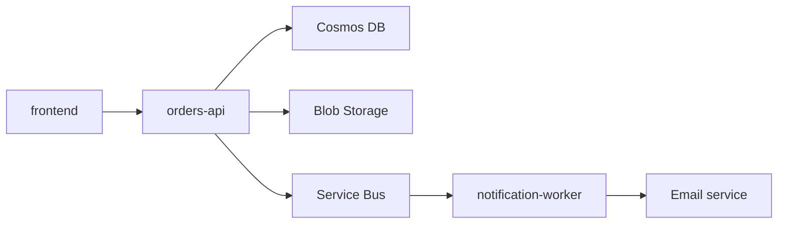

### Why Might the Worker Be Missing from the Map?

Possible causes:

- The worker has not sent telemetry.
- Its exporter connection string points to a different resource.
- App role naming is inconsistent.
- Service Bus message context did not propagate.
- Zero traffic occurred inside the selected time window.
- Messaging SDK instrumentation is unsupported.
- Data was dropped by sampling or delayed in ingestion.

**A missing node does not prove the worker is down.** Check worker logs, Service Bus queue metrics, and traces.

### Never Use the Map as Your Sole Architecture Inventory

Application Map reflects **only observed instrumented telemetry**. It may omit dependencies using custom protocols or called rarely. Supplement it with IaC, architecture diagrams, and service registries.

## 31. Live Metrics and Near-Real-Time Visibility

**Live Metrics** displays near-real-time runtime, request, and failure signals when supported by the app, agent, and network.

### When to Use It

- During a rolling deployment to watch error rates and traffic react immediately.
- While investigating a brief spike.
- To verify newly launched instances are live and emitting telemetry.
- To compare request rates immediately before and after mitigation.

### What Not to Assume

- Never treat Live Metrics as a **permanent ledger of all requests**.
- Never assume logs/traces seen in Live Metrics are guaranteed to be stored under retention.
- Never use Live Metrics for business auditing or billing estimates.
- Never assume zero errors just because a request-count chart reads 0; ingestion networking might be blocked.

### If Live Metrics Shows No Data

Check agent feature/version support, network reachability to Live Metrics endpoints, access restrictions, resource config, and role/telemetry pipelines. **An app can still send standard telemetry while Live Metrics fails**, as they rely on separate streams, endpoints, and policies.

## 32. Sampling: Why Aren't All Requests Visible?

As traffic grows, capturing **100% of request and dependency spans** drives high cost and overhead. Application Insights / OTel supports **sampling** in the agent, SDK, exporter, or downstream pipeline.

### Where Does Sampling Occur?

```text
Application/JVM
  ├─ Trace sampling (head-based or supported policy)
  ├─ Log/metric filtering
  └─ Exporter/processor
       └─ Collector / ingestion configuration
            └─ Application Insights / workspace
```

Some agents expose **sampling percentage or adaptive sampling**, depending on version. Other mechanisms live in collectors. **Never assume two independent sampling layers multiply cleanly to a desired rate or preserve trace completeness.**

### Example Impact on Counts

Suppose an API handles 10,000 requests and samples roughly 10%:

```text
Actual requests:                  10,000
Sampled request records:         ~1,000
Expected errors, actual:            100
Sampled error records:             ~10 (if sampling does not prioritize errors)
```

This is a simplified statistical illustration, **not an exact guarantee**, because sampling can be uneven, correlated, adaptive, or event-biased. **Never use raw `count()` on sampled traces to report total traffic or billing.**

### Sampling and Trace Completeness

When spans in a trace are sampled consistently, parent–child graphs remain intact. If each service samples independently, you may see orphan dependencies without parent requests. Align propagators, samplers, and exporters, and verify trace completeness.

### Which Signals Should You Retain?

- Aggregate request counts, error counts, and latency histograms from an SLO-suitable source.
- High-value error traces where policy and privacy controls allow.
- Business-critical audit events in a **durable audit store**, never relying on sampling.
- A representative sample of healthy traces to study p95 and dependency profiles.

### Avoid Reflexively "Turning Sampling Up to 100%"

When a trace is missing, first check query time range, wrong resource/role, ingestion lag, parent propagation, and exporter errors. Raise sampling only within a **time-boxed, budgeted lab or incident scope**.

## 33. Metric Cardinality and Custom Dimensions

Dimensions like `service.name`, `operation`, `statusClass`, or `region` make metrics actionable.

### Low Cardinality

```text
service = orders-api
operation = CreateInvoice
result = success | failure
region = southeastasia
```

### Dangerous High Cardinality

```text
orderId = <unique per order>
userEmail = <unique per user>
requestId = <unique per HTTP call>
rawUrl = /customers/<userId>/orders/<orderId>
```

High-cardinality metric labels multiply time series, query load, and backend costs—and risk exposing personal data. To investigate an individual order, use **access-controlled logs/traces**, never per-order metric series.

### What Are Custom Metrics For?

Metrics like `orders_created_total` or `invoice_generation_duration` track business throughput and latency. With Micrometer, build counters and timers using low-cardinality tags, and **configure a registry/exporter** to send them to Azure Monitor. Without an exporter, `Counter.increment()` updates only the in-memory registry.

## 34. Custom Metrics with Micrometer in Spring Boot

### Timer and Counter Example

```java
package com.example.orders;

import io.micrometer.core.instrument.Counter;
import io.micrometer.core.instrument.MeterRegistry;
import io.micrometer.core.instrument.Timer;
import org.springframework.stereotype.Component;

import java.util.function.Supplier;

@Component
public final class OrderTelemetry {
    private final MeterRegistry registry;
    private final Counter created;

    public OrderTelemetry(MeterRegistry registry) {
        this.registry = registry;
        this.created = Counter.builder("orders.created")
            .description("Count of successfully created orders")
            .tag("source", "api")
            .register(registry);
    }

    public <T> T measureInvoice(Supplier<T> action) {
        Timer.Sample sample = Timer.start(registry);
        try {
            T result = action.get();
            created.increment();
            return result;
        } finally {
            sample.stop(Timer.builder("invoice.generation.duration")
                .tag("component", "invoice-service")
                .register(registry));
        }
    }
}
```

**Limitation:** Calling `created.increment()` inside a method named `measureInvoice` is **purely illustrative of metric structure**, not a production implementation of an "orders created" metric. In production, increment business counters only where the transaction commits, never before the final outcome is certain.

### Observing Custom Metrics

When using Micrometer:

1. Register meters with stable names and tags.
2. Configure the appropriate backend registry/exporter.
3. Trigger a few test events.
4. Confirm the meter appears in the real telemetry backend.
5. Verify names, units, and dimensions, as exporters may normalize naming conventions.

**Never assume every Micrometer meter automatically lands in `AppMetrics` simply by attaching the Application Insights agent.** Verify compatibility and exporter routing in your actual environment.

## 35. SLIs and SLOs for a Spring Boot API

An **SLI (Service-Level Indicator)** measures service behavior; an **SLO (Service-Level Objective)** sets the operational target. Example:

```text
Orders API successful response ratio >= 99.9% / rolling 30 days
POST /orders p95 latency              <= 800 ms
POST /orders p99 latency              <= 1,500 ms
Invoice dependency final failure rate <= 0.1%
Telemetry ingestion health           monitored separately
```

These numbers are **illustrative examples**, not Azure SLAs for Application Insights or App Service.

### Defining "Success" by Business Contract

An API returning `404` when a user queries a missing order may be expected business behavior rather than a platform outage, depending on the contract. Conversely, `429` or `503` after exhausting retries usually signals degraded service. Explicitly define:

- exact numerator and denominator;
- excluded requests (health probes? invalid client inputs?);
- telemetry sampling and weighting;
- terminal business success criteria;
- evaluation window and burn-rate alerts.

### Availability Is Not a Single Health Check

`GET /actuator/health` returning HTTP 200 only proves the health endpoint responds as configured. It does not prove **login, Cosmos writes, Storage uploads, and email delivery** all work. Pair it with rate-limited, synthetic availability tests using dummy data that never mutate production orders.

## 36. Azure Monitor Alerts and Action Groups

Do not alert on every individual exception. Alert on **rates and user impact**.

### Useful Alert Examples

| Suggested Trigger | Goal | Action |
|---|---|---|
| Request final failure rate spikes over 5–15 min | Detect API outage | Page on-call + runbook |
| p95 latency breaches SLO | Catch tail latency | Compare dependencies and deployments |
| Cosmos `429` and retry pressure rise | Detect RU/hot partition pressure | Inspect RUs, partitions, and queries |
| Azure Blob `503`/network timeouts rise | Storage/dependency issue | Check Service Health + network diagnostics |
| Auth `401/403` spikes post-deployment | Identity/RBAC regression | Check managed identities, roles, firewalls |
| Telemetry disappears from an instance | Exporter/network/agent regression | Verify service health independently |
| Exception rate rises by build version | Code regression | Triage and roll back |
| Log ingestion/cost breaches budget | FinOps/privacy issue | Trim log verbosity and verify sampling |

### What Can an Action Group Do?

Send email, SMS, push notifications, webhooks, or trigger supported automation. Define **on-call ownership, severity, deduplication, escalation, and schedules**; flooding an engineer with 1,000 alerts for one outage causes real warnings to be missed.

### Alerts Do Not Equal Blind Auto-Remediation

A `503` spike could come from a downstream outage, an app retry storm, or a network rule. Automatically restarting all instances can worsen the outage. Any automated remediation needs **guardrails and rollback**.

## 37. Workbooks and Operational Dashboards

A solid workbook for an application owner might include:

```text
1. Traffic: requests/min by endpoint/region
2. SLO: success rate, error budget
3. Latency: p50/p95/p99
4. Dependencies: top failures and slowest targets
5. Exceptions: top types and correlation samples
6. Runtime: CPU, memory, GC, thread/event-loop metrics
7. Releases: build versions / deployment markers
8. Telemetry: ingestion/agent/export errors
9. Cost: ingestion bytes / retention trends
10. Links: incident runbooks and owning team
```

### Metric Sources to Keep Separate

- **App Insights traces/requests:** emitted by the app and subject to sampling.
- **App Service / AKS resource metrics:** platform-level, independent of the agent.
- **Cosmos / Storage / Service Bus metrics:** dependency resource metrics.
- **JVM JMX / Micrometer metrics:** require proper collectors, exporters, and units.

Never add similarly named metrics from two sources if their **denominators or time units** differ.

### Dashboards That Guard Against the "Green Illusion"

If Application Insights stops receiving telemetry, request counts drop to zero and failure charts may look "all green." Include **telemetry freshness / exporter health signals** alongside Azure platform metrics to tell an idle app apart from broken observability.

## 38. Protecting Telemetry Data and Privacy

Telemetry easily turns into a sensitive data store if over-logged:

| Source | Risk |
|---|---|
| HTTP URL/query | SAS tokens, API keys, emails, order IDs |
| HTTP headers | `Authorization`, cookies, bearer tokens |
| Request/response body | PII, financial, health data, passwords |
| Exception messages | Internal URLs, secret values, SQL literal parameters |
| Span attributes | Raw customer identifiers, session IDs |
| User/client metadata | IPs, geolocation, device identifiers |
| Logback MDC | Tenant IDs/user data leaking across pooled threads |
| SQL dependency data | Raw SQL containing sensitive literals |

### Security Principles

1. **Never log secrets** in source code; downstream redaction is only a secondary net.
2. Never enable HTTP `BODY_AND_HEADERS` or full SQL parameter capture by default.
3. Use route templates, endpoint aliases, and low-cardinality labels.
4. Enable privacy filters/processors in OTel agents/collectors where supported.
5. Scope Log Analytics / Application Insights access with least-privilege RBAC.
6. Align retention, exports, and deletion policies with data obligations.
7. Use synthetic data for incident reproductions and labs.
8. Maintain a secret-leakage runbook: isolate access, rotate/revoke secrets, audit exposure, and remediate per policy.

### Pseudonymization Is Not Full Anonymity

Hashing `customerId` or logging an opaque ID may **still link back to an individual** through another system. Do not claim full anonymization casually; apply matching data classification and retention.

## 39. Connection Strings and the Telemetry Injection Threat Model

An Application Insights connection string is normally not an Azure resource-management credential. However, exposing the ingestion target publicly allows third parties to **inject junk telemetry**, pollute dashboards, or inflate bills if ingestion accepts unauthenticated traffic.

### Practical Protections

- Store configuration in App Settings, Key Vault, or Kubernetes Secrets per policy.
- Use network egress restrictions or private ingestion options where supported.
- Consider Microsoft Entra authenticated ingestion if supported by your environment and exporter.
- Audit resource/workspace permissions, ingestion filters, and usage alerts.
- Never grant Logs Reader broadly just because the connection string isn't an admin key.
- Keep unnecessary personal data out of logs.

### Application Identity vs. Telemetry Identity

An App Service managed identity used to read Blob or Key Vault **does not mean the telemetry exporter automatically uses that identity** unless explicitly configured. Ingestion authentication must be configured and verified separately.

## 40. Application Insights and Log Analytics Costs

Primary cost drivers typically involve **data ingestion, retention, table plans/data types, sampling, log volume, custom dimensions, and supporting collector/monitoring infrastructure**.

### Throughput Math

Suppose an API handles:

```text
2,000 requests/second
4 dependency calls/request
3 log events/request
1 exception record per 1% of requests
```

Theoretical event rate:

\[
2\,000 \times (1 + 4 + 3) = 16\,000\ \text{telemetry records/second}
\]

before counting exception records, JVM metrics, live metrics, retries, and service-side logs. **This is raw record count before sampling/filtering**, not monetary cost. Record byte size, ingestion plan, region, and retention determine actual billing.

### Optimization Practices

- Keep INFO/WARN reasonable; enable DEBUG temporarily during incidents.
- Never log the same exception stack trace across 5 layers (app, SDK, controller).
- Tune sampling while keeping accurate aggregate SLO metrics.
- Stick to low-cardinality tags.
- Never log bodies, `Authorization` headers, or SAS tokens.
- Keep telemetry only as long as retention policy requires.
- Choose log plans, diagnostic categories, and routing based on real pricing.
- Monitor `Usage and estimated costs` and Cost Management on workspaces and AI resources.

### Never Cut Costs by Dropping All Errors

If sampling strips out rare errors, runbooks and incident analysis fail. Design sampling around **criticality, volume, error classes, and privacy**, rather than blindly minimizing log counts.

## 41. Budget for the Whole Azure Application, Not Just App Insights

A sluggish Spring Boot API drives up costs beyond telemetry:

- Blob transactions multiply from retries.
- Cosmos DB RU consumption spikes from unoptimized queries.
- Service Bus message redeliveries force workers to reprocess work.
- AKS/App Service autoscale spins up extra instances.
- Log Analytics ingestion surges from retry and exception storms.
- Outbound traffic, Private Link, and collector infrastructure incur charges.

**Application Insights helps pinpoint cost drivers**, rather than replacing Azure Cost Management. Combine traces/logs with Azure resource metrics and cost analysis to find root causes.

## 42. Deploying the Java Agent on Azure App Service

### Architecture

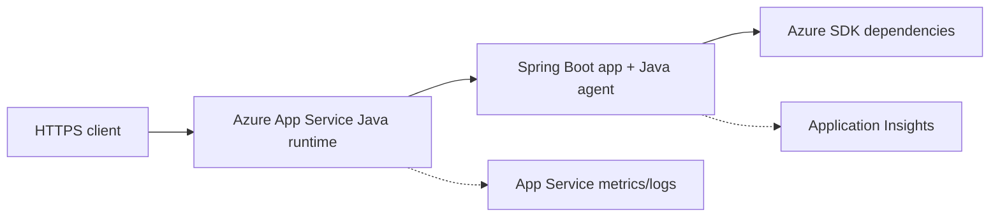

### Reference Deployment Workflow

1. Check whether App Service uses the **built-in Java stack** or a **custom container**, along with JDK version and startup command.
2. Pick one instrumentation method: supported App Service Application Insights integration **or** self-bundled Java agent; avoid doubling up.
3. Pass the connection string via App Settings or approved configuration channels.
4. If bundling the agent yourself, verify the JAR exists before JVM startup and `-javaagent` is wired properly.
5. Set role name, service version, and environment.
6. Verify network egress to ingestion endpoints.
7. Deploy to a staging slot/canary and send synthetic requests.
8. Inspect Application Insights request + dependency traces, comparing CPU and latency before/after.
9. Swap/cut over per deployment plan; monitor error rates and keep rollback ready.

### Does App Service Auto-Enable Application Insights?

Some Portal workflows and stacks offer an Application Insights toggle that **automatically wires instrumentation**. Never add `JAVA_TOOL_OPTIONS=-javaagent:...` on top of platform-managed auto-instrumentation. Check startup logs and transaction views to ensure **exactly one instrumentation owner**.

### VNet Integration and Private Ingestion

App Service outbound networking, proxies, firewalls, and DNS can affect telemetry shipping. **The application should keep serving requests even if the exporter fails**; never fail business requests solely because a telemetry endpoint is temporarily unreachable, unless strict audit rules explicitly mandate fail-closed design.

### Deployment Slots

Staging and production slots can use separate connection strings or share a telemetry resource tagged by environment dimension; pick one consistent model. Never let staging traffic pollute production SLOs without clear labels or filters.

## 43. Deploying on AKS with the Java Agent

On AKS, each Java container needs the agent and configuration via container image, `initContainer`, volume mount, or an approved instrumentation operator.

### Packaging into the Container Image

Illustrative Dockerfile (assuming the **build pipeline fetched and verified the agent JAR from an official source**, never downloaded at runtime):

```dockerfile
FROM eclipse-temurin:21-jre
WORKDIR /app

COPY orders-api.jar /app/orders-api.jar
COPY applicationinsights-agent.jar /opt/telemetry/agent.jar

ENV JAVA_TOOL_OPTIONS="-javaagent:/opt/telemetry/agent.jar"
EXPOSE 8080
ENTRYPOINT ["java", "-jar", "/app/orders-api.jar"]
```

**Note:** Pin base image digests and JDK versions per security policy; `COPY applicationinsights-agent.jar` assumes the build pipeline verified checksums, licenses, and provenance in the build context. Never run unverified images or tags in production.

### Minimal Kubernetes Deployment

```yaml
apiVersion: apps/v1
kind: Deployment
metadata:
  name: orders-api
spec:
  replicas: 2
  selector:
    matchLabels:
      app: orders-api
  template:
    metadata:
      labels:
        app: orders-api
    spec:
      containers:
        - name: orders-api
          image: example.registry.local/orders-api:1.0.0
          ports:
            - containerPort: 8080
          env:
            - name: APPLICATIONINSIGHTS_CONNECTION_STRING
              valueFrom:
                secretKeyRef:
                  name: application-insights-config
                  key: connectionString
          resources:
            requests:
              cpu: "250m"
              memory: "512Mi"
            limits:
              memory: "1Gi"
```

This is a **lab manifest**, omitting Services, Ingress, ServiceAccounts/workload identity, security contexts, probes, autoscaling, and NetworkPolicies. Production requires full AKS hardening. Referencing a Kubernetes Secret does not guarantee security alone; govern Kubernetes RBAC, encryption at rest, and secret rotation separately.

### AKS-Specific Pitfalls

- The agent adds CPU and memory overhead and affects JVM GC/heap sizing.
- Pods can be `OOMKilled` if memory limits omit agent overhead.
- `JAVA_TOOL_OPTIONS` applies to Java processes, not sidecars written in other languages.
- Exporters/collectors need egress DNS and firewall access; AKS `NetworkPolicy` can block them.
- Using dynamic Pod names as service names spawns thousands of components; set a **stable role/service name** and keep Pod ID as an instance attribute.
- HPA and cluster autoscalers change replica counts, shifting dependency maps and costs.
- Never attach Pod labels like `containerId` as uncontrolled custom metric dimensions.

### Operator-Level Instrumentation

If your organization uses the OpenTelemetry Operator to inject instrumentation, **do not also bake an Application Insights Java agent into the image** unless compatibility is proven and explicitly intended.

## 44. VMs, Containers, and Hybrid Environments

Java apps may run on Azure VMs, Azure Container Apps, on-prem JVMs, or hybrid environments. Core requirements stay the same:

1. Compatible runtime, JDK, and agent.
2. App Insights resource / ingestion connectivity.
3. Valid outbound TLS and trust store.
4. Resource attributes for service, environment, and instance.
5. Exporter buffering/retries that never block business threads.
6. Privacy filters and log retention.
7. Role-based access controls for querying telemetry.

### You Don't Have to Host on Azure to Use Application Insights

An on-prem Java app **can** ship telemetry to Azure Monitor if networking, agents/exporters, and tenant policies permit. Still, never send sensitive logs across Azure regions without checking data residency and legal constraints.

### During Network Outages

Exporters buffer, retry, or drop telemetry according to SDK/agent limits; never assume spans are queued indefinitely or delivered exactly once. Set up **telemetry drop/error monitoring** and size collectors for expected bursts.

## 45. Troubleshooting: Zero Telemetry Appears

### Layered Diagnostics

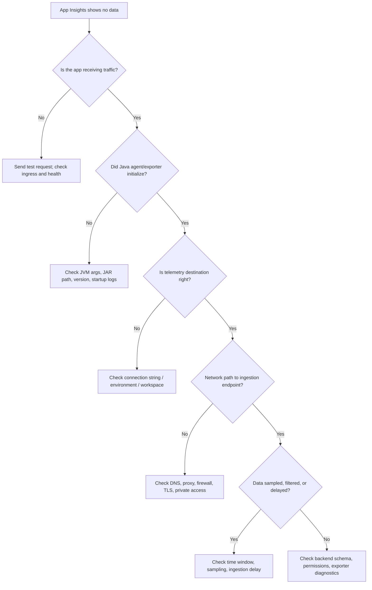

### Specific Checks

| Step | Question |
|---|---|
| 1 | Are you inspecting the **right subscription, resource, and workspace**? |
| 2 | Does the Application Insights resource use the expected region and ingestion endpoint? |
| 3 | Does the JVM include `-javaagent` with the right JAR version and path? |
| 4 | Did the agent hit startup or config parsing errors? |
| 5 | Has the Java app actually received HTTP requests? |
| 6 | Is another Java agent or OTel exporter conflicting? |
| 7 | Are proxies, TLS inspection, or firewalls blocking ingestion? |
| 8 | Is sampling set to 0 or a filter excluding all requests? |
| 9 | Is Logs Explorer querying the right table and time range? |
| 10 | Does your role have sufficient permissions on the Log Analytics workspace? |

**Never troubleshoot by enabling full HTTP BODY logging.** Inspect agent initialization and exporter health first.

## 46. Troubleshooting: Requests Appear, Yet Dependencies Are Missing

Suppose `AppRequests` shows `POST /orders`, yet `AppDependencies` shows no Cosmos DB calls.

### Possible Causes

- The client/SDK version is unrecognized by auto-instrumentation.
- The app uses a custom HTTP transport unsupported by the agent.
- HTTP client instrumentation is disabled or filtered.
- Dependency spans were dropped by sampling or export failure.
- Business code returned from cache without calling Cosmos.
- SDK calls ran across an async context boundary and landed under a separate trace.
- Agent and SDK tracing adapters conflicted.

### Remediation Steps

1. Confirm the executed code path actually calls the dependency.
2. Check service-side metrics (Cosmos RUs/requests) for an independent signal.
3. Verify SDK package and agent version compatibility.
4. Query `AppDependencies` across the **whole role and time window**, not just one trace.
5. Inspect sampling and context propagators.
6. If needed, wrap the dependency call in a manual business span.
7. Never turn on HTTP body logging just to locate a missing span.

## 47. Troubleshooting: Traces Break Across Service Bus

Orders API publishes a message and Notification Worker processes it, yet Application Insights shows two disconnected traces.

### Common Causes

- The producer failed to inject W3C context into the message carrier.
- The consumer failed to extract context, or auto-instrumentation doesn't support that SDK/version.
- Producer and consumer use mismatched propagators.
- The worker starts a new root span instead of using extracted context or span links.
- Processes report to different resources and the viewer is filtering the wrong role/workspace.
- One side was sampled out, leaving an incomplete graph.
- Messaging semantics use **span links**, while the viewer expects direct parent–child links.

### Actions

1. Log sanitized message ID / business event ID alongside trace ID on both producer and consumer.
2. Inspect the trace context carrier (without printing sensitive headers).
3. Compare agent/OTel instrumentation versions across both services.
4. Inspect producer send and consumer receive/process spans.
5. Check span links where supported by the UI/backend.
6. Confirm the worker reports to the expected App Insights resource or allows cross-resource navigation.

Never fabricate a fake `traceId` by copying `messageId` or an order ID; W3C trace/span IDs follow strict format and semantics.

## 48. Troubleshooting: Duplicate Logs, Sampling, and Rising Costs

| Symptom | Likely Analysis | Fix |
|---|---|---|
| One inbound request shows two identical request spans | Duplicate Java agents or overlapping instrumentation | Designate one instrumentation owner |
| One error produces 6 stack traces | Controller, service, and SDK all log ERROR | Log at one boundary; rethrow typed errors |
| `AppTraces` explodes after enabling DEBUG | Verbose logger levels or SDK HTTP logging | Scope levels, durations, and namespaces tightly |
| `traceId` missing in certain Reactor logs | MDC ThreadLocal context loss | Use Reactor OTel context bridge |
| Request counts lower than gateway logs | Sampling, route filters, or ingestion drops | Use proper weighting or platform metrics |
| p95 differs between App Insights and reverse proxy | Different time windows, sampling, or duration boundaries | Align denominators and clocks |
| Exception counts rise while HTTP success holds steady | Caught/retried exceptions still instrumented | Separate transient/handled errors from final failures |
| App Map spawns one node per Pod | Dynamic role name / `service.name` | Use a stable service name; keep Pod as instance |
| Azure Monitor query reports missing table | Wrong workspace or ingestion schema | Verify actual table names |
| Exporter logs latency or network errors | Proxy, egress, or collector capacity | Inspect transport and buffer queues |
| Costs stay high after cutting app INFO logs | Other diagnostics, retention, or traffic volume | Check `Usage` tables and plans |

### Reading Traces with Realistic Expectations

A single SDK call can legitimately emit **multiple spans** (logical operation plus network attempts)—not every extra span is a bug. Compare **span IDs, parent IDs, names, attributes, and start/end timestamps**.

## 49. Incident Runbook: Spring Boot API Suddenly Slows Down

### Scenario

At 10:00 UTC after a deployment, `POST /api/orders` p95 jumps from 400 ms to 2,200 ms, with some requests returning `503`. Cosmos metrics show `429` throttling, while some Blob calls return `403`.

### Steps

1. **Quantify impact:** region, instances, build version, requests/min, failure rate, and user-facing SLO.
2. **Open Performance:** locate slow routes, pick affected traces, and inspect dependency breakdown.
3. **Query `AppDependencies`:** check Cosmos p95/429s, Blob 403s, and correlate against deployment version.
4. **Query `AppExceptions`:** separate token/RBAC errors, throttling, timeouts, and app bugs.
5. **Inspect resource metrics:** Cosmos RUs/partitions, Storage firewalls, App Service network / AKS CPU, and Service Health.
6. **Verify identity:** which identity is the app running after deployment? Does it still hold the right data-plane roles?
7. **Check for retry storms:** are the gateway, SDK, and app stacking retries across layers?
8. **Mitigate:** cap concurrency/retries, roll back if a code regression, or restore scoped permissions via change control.
9. **Verify recovery:** confirm p95/failure rates recover, new traces show no duplication, and telemetry is not dropping.
10. **Postmortem:** document root cause, missing telemetry fields, alert thresholds, business reconciliation, and owner follow-ups.

### Pitfall to Avoid

A Storage `403` on the backend managed identity **must not be misread as an unauthorized end user**. End-user application authorization and Azure workload data-plane permissions are two separate layers.

### Sample Evidence Template

```text
Incident ID:
UTC start / end:
AppRoleName, region, build:
Request name / result code:
Trace/operation ID:
Dependency target and status:
Azure request ID (if any):
SDK/JDK/agent version:
Service-side metrics:
Final error rate and p95:
Mitigation:
Root cause:
Follow-up test/alert:
Secret/PII in evidence: NONE
```

## 50. Incident Runbook: Telemetry Stops While API Keeps Running

### Scenario

Requests continue hitting API Gateway, yet Application Insights shows zero new data after 13:00 UTC.

### Do Not Assume Zero Traffic

Verify with an **independent signal** such as App Service HTTP request metrics, AKS ingress, gateway logs, or Load Balancer metrics.

### Investigation Tree

```text
Gateway metrics show 500 req/min?
  ├─ No → Real traffic may have stopped or ingress failed.
  └─ Yes
      ├─ Did Java agent startup/version change?
      ├─ Did connection string / role name change?
      ├─ Is exporter/collector backed up?
      ├─ Are DNS/egress/TLS/proxies blocked?
      ├─ Did sampling or filters change?
      ├─ Did workspace/DCR/ingestion policies change?
      └─ Are query time range, schema, and permissions right?
```

### Monitoring the Monitor

Alert on **telemetry freshness / exporter failures** alongside independent Azure platform metrics. You cannot rely solely on App Insights to prove its own exporter is healthy.

## 51. Lab 1 — Provision Application Insights and Observe Your First Request

### Goal

Build the flow:

```text
curl → Spring Boot Java app
     → Application Insights Java agent
     → Azure Monitor ingestion
     → Application Insights workspace
     → Logs / transaction search
```

### Prerequisites

| Item | Requirement |
|---|---|
| Azure subscription | Sandbox authorized to create Application Insights / Log Analytics |
| Application Insights | Workspace-based in an assigned region |
| Log Analytics workspace | Query permissions for verification |
| JDK/Spring Boot | Compatible with the Java agent |
| Agent | Official Application Insights Java agent verified from trusted source |
| Network | Outbound TLS permitted to telemetry endpoints |
| Data | Synthetic HTTP requests and dummy data |
| Budget | Assigned owner with bounded retention and sampling |

### Step 1 — Prepare the App

Build the demo Spring Boot app from Sections 12–14 or use a sandbox app exposing `/api/orders/demo`. If Storage isn't ready yet, a stub route returning a dummy string suffices to verify **request telemetry**; dependencies come in the next lab.

### Step 2 — Attach the Java Agent

```bash
export APPLICATIONINSIGHTS_CONNECTION_STRING="<sandbox-connection-string>"
java -javaagent:/opt/telemetry/applicationinsights-agent.jar \
     -jar orders-api.jar
```

On Windows/PowerShell, environment variable syntax differs; use your local shell's syntax and ensure **the connection string is never printed in shared terminal recordings**.

### Step 3 — Send Test Requests

```bash
curl -i http://localhost:8080/actuator/health
curl -i http://localhost:8080/api/orders/demo
```

Routes must actually exist; if `/api/orders/demo` isn't mapped, a `404` still gets instrumented, so distinguish a missing endpoint from an Application Insights failure.

### Step 4 — Verify in Azure

1. Open Application Insights → Requests/Performance or Logs.
2. Query `AppRequests | where TimeGenerated > ago(1h) | take 20`.
3. Inspect `AppRoleName`, `Name`, `DurationMs`, `ResultCode`, and `Success`.
4. Select one request and view transaction/trace details.
5. Compare event time against ingestion time and query time range.

### Outcomes

```text
JVM agent loaded: PASS/FAIL
Connection string target correct: PASS/FAIL
Sample request sent: PASS/FAIL
AppRequests row observed: PASS/FAIL
Role name expected: PASS/FAIL
Trace ID visible: PASS/FAIL
No sensitive request payload in telemetry: PASS/FAIL
```

If the request isn't visible right away, do not blast tens of thousands of requests just to "wake up telemetry." Check the agent/exporter and allow normal ingestion latency.

## 52. Lab 2 — HTTP → Azure Blob SDK Correlation

### Goal

Using `InvoiceService` from Section 12:

1. Provision a sandbox Storage container `invoice-lab`.
2. Grant the app identity **Storage Blob Data Contributor** at the approved scope.
3. Call the demo upload endpoint.
4. Inspect the Application Insights inbound request and Blob dependency.
5. Locate the `invoice.upload_succeeded` application log in the same trace/operation.
6. Call a second time to trigger a controlled `409`.
7. Distinguish an expected conflict from a service outage.

### Observed Flow

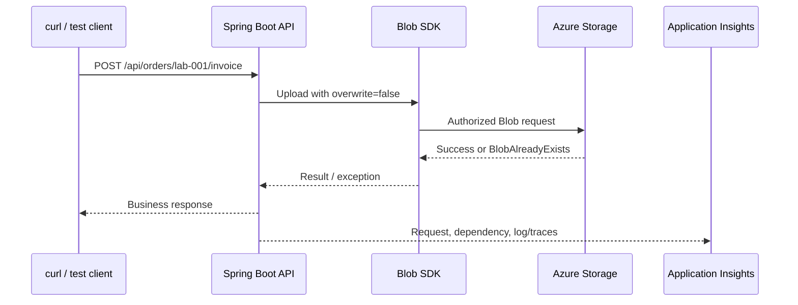

### Verification KQL

```kusto
AppDependencies
| where TimeGenerated > ago(1h)
| where Name has "Blob" or Target has ".blob."
| project TimeGenerated, Name, Target, ResultCode,
          Success, DurationMs, OperationId
| order by TimeGenerated desc
```

`Name has "Blob"` is illustrative; if your agent formats names differently, inspect `take 20` and adjust. The query does not inspect actual blob contents or object names.

### Acceptance

Confirm inside the trace:

- inbound request shows status and duration;
- dependency appears where instrumentation supports it;
- app log records the business outcome;
- `409` is not blindly misclassified as an Azure outage;
- zero SAS tokens, account keys, raw invoices, or user data appear in properties.

## 53. Lab 3 — Custom OpenTelemetry Business Span

### Goal

Create an `Invoice.Generate` span using the OTel API and verify its parent–child relationship with the Spring Boot inbound request.

### Steps

1. Ensure **one** active agent/SDK tracing pipeline is running.
2. Add a compatible OpenTelemetry API dependency.
3. Wrap a business operation with `BusinessTracing.execute(...)` from Section 16.
4. Send a test request to the controller.
5. Open Application Insights transaction details or logs showing trace/span IDs.
6. Confirm the span shares the inbound request's trace ID.
7. Inspect `app.operation`, `app.outcome`, and timing.
8. Trigger a controlled test exception and verify error status is recorded cleanly.

### If the Custom Span Does Not Appear

Check:

- Does `GlobalOpenTelemetry` hold a real provider or a no-op?
- Are Java agent and OTel API versions compatible?
- Did sampling drop the trace?
- Does the agent/exporter accept manual spans?
- Was `Scope` opened and closed properly?
- Was the span created after the original context already ended?

### Negative Test

Never pass `customerEmail` or raw `Authorization` into `setAttribute`. Use `app.operation` and sanitized categories, then verify App Insights properties stay clean.

## 54. Lab 4 — Spring Boot Reactor Context and Async Bugs

### Scenario

A WebFlux controller returns `Mono<String>`. The app calls an async Azure SDK, switches schedulers with `publishOn`, and logs. The team notices the final log has an empty `traceId`.

### Logic Pattern

```java
// Conceptual Reactor snippet: assumes service returns Mono<String>.
return reactiveInvoiceService.generateInvoice(orderId)
    .doOnSubscribe(s -> LOG.info("invoice.generate_started"))
    .doOnSuccess(result -> LOG.info("invoice.generate_completed"))
    .doOnError(e -> LOG.warn(
        "invoice.generate_failed exceptionType={}",
        e.getClass().getSimpleName()));
```

**Never call `subscribe()` inside a controller** when the framework manages subscription and HTTP response writing. Return the publisher for Spring WebFlux to subscribe.

### Test Matrix

| Case | What to Verify |
|---|---|
| Same scheduler | Trace and log preserve valid correlation |
| Switching via `publishOn` | Trace context survives where bridge supports it |
| Triggering timeout | Errors are not swallowed |
| `onErrorResume` | Recovers only permitted business errors |
| Calling `block()` on event loop | Never allowed in production |
| Worker using fire-and-forget `subscribe()` | Needs durable job/queue and explicit error handler |

### Inspecting in App Insights

Check for the same `OperationId` before and after the async boundary. If mismatched, check the OTel Reactor instrumentation bridge rather than scattering `MDC.put` inside every lambda without understanding propagation.

## 55. Lab 5 — KQL, p95, and Classifying Dependency Failures

### Step 1 — Generate Test Workload

Send bounded synthetic requests to a Spring Boot endpoint:

```text
20 successful requests
5 expected not-found requests
5 simulated dependency failures (sandbox only)
```

### Step 2 — Answer Using Queries

1. Total requests and failures over 1 hour?
2. Which operation has the highest p95?
3. Which dependency target has the most errors?
4. Which exception type grew the fastest?
5. Did `429`/`503` appear against the expected dependency?
6. For a chosen operation ID, do matching logs, request, and dependencies appear?
7. Were expected `404`s miscounted against the SLO?
8. Are there signs of sampling or ingestion delay?

### Step 3 — Present Findings

| Metric | KQL Source | Interpretation |
|---|---|---|
| Request throughput | `AppRequests` | Check weighting/sampling before concluding |
| p95 request latency | `AppRequests.DurationMs` | Do not compare directly with dependency p95 without context |
| Dependency failures | `AppDependencies` | Verify result code and target |
| Exception trend | `AppExceptions` | May include handled exceptions |
| Business log | `AppTraces` | Events carry correlation when configured |

### Mistake to Avoid

If `AppRequests | count` returns 30 while the client sent 40, do not immediately claim 10 requests were dropped by the app. Sampling, query scope, ingestion lag, routing, or failed instrumentation may explain it. Cross-check gateway/platform metrics and sampling config.

## 56. Lab 6 — Sampling and Cost

### Context

An app handles 1,000 requests/minute, and each request generates 1 request span + 3 dependencies + 2 log events.

Rough pre-sampling event rate:

\[
1\,000 \times (1+3+2) = 6\,000\ \text{records/minute}.
\]

### Tasks

1. In the lab, observe 10 requests at 100% sampling.
2. Lower sampling via an agent-supported setting, such as a lower target percentage (note that exact retained counts may vary).
3. Send the same test traffic.
4. Compare trace detail/completeness against aggregated metrics.
5. Verify errors still provide sufficient signal for alerts.
6. Use Azure usage/cost reports to measure actual bytes.
7. Verify secrets/PII redaction before increasing verbosity.

### Conclusion

Lowering sampling trims tracing ingestion while reducing the odds of capturing a specific individual request. For SLOs, rely on unsampled aggregate metrics or proper weighting; **never use sampled trace counts for revenue reporting or auditing**.

## 57. Lab 7 — Building On-Call Alerts and Workbooks

### Inputs

Use a hypothetical SLO:

```text
Failure rate > 3% over 10 minutes
P95 request latency > 1200 ms over 15 minutes
Telemetry missing > 10 minutes while gateway still sees traffic
```

### Requirements

1. Build query/metric alerts using supported logs/metrics.
2. Set severity, evaluation frequency/window, and minimum traffic threshold.
3. Attach an action group for on-call plus a runbook link.
4. Configure suppression/deduplication to prevent alert storms for a single incident.
5. Build a Workbook showing throughput, failures, p95/p99, dependencies, and exception trends.
6. Add deployment markers / build version annotations.
7. Test the alert using synthetic sandbox traffic.
8. Confirm the alert does not automatically open/close firewalls or restart production unapproved.

### A Common Pitfall

If traffic is 1 request in 10 minutes and that request fails, failure rate is 100%—yet rarely proves a widespread outage. Alert rules should pair **minimum sample size / traffic volume** with appropriate burn-rate logic.

### Acceptance

```text
Alert query/metric target correct: PASS/FAIL
Window and threshold documented: PASS/FAIL
Action group destination approved: PASS/FAIL
Runbook link present: PASS/FAIL
Alert trigger from test confirmed: PASS/FAIL
Avoid duplicate notifications: PASS/FAIL
No PII/secrets in alert payload: PASS/FAIL
```

## 58. Lab 8 — Safe Telemetry Loss Injection

### Purpose

Verify the operations team can tell an **application outage** apart from a **broken exporter/telemetry path**.

### Procedure

Strictly inside a sandbox cluster/container:

1. Exercise the test endpoint and record gateway request metrics.
2. Configure a test setup so **telemetry cannot be shipped** (e.g., unreachable test collector; network rule edits require approval).
3. Send the same test requests.
4. Confirm the API keeps fulfilling its business contract.
5. Observe Application Insights data drop/stop.
6. Inspect exporter logs / drop counters where supported by the agent.
7. Restore the telemetry path and confirm new data resumes.
8. Check whether backfilling happens; **never assume dropped spans are automatically replayed**.

### Expected Behavior

The application must not depend on the Application Insights exporter to commit orders, while monitoring must detect the **observability outage** and alert via an independent signal.

### Never Do This

Never disable a production Log Analytics workspace or connection string "just to test." Never feed real request bodies or customer data into exporter tests.

## 59. Production Deployment Checklist

### 59.1 Architecture and Instrumentation

- [ ] Application Insights resource, workspace, and region match data residency rules.
- [ ] JDK, Spring Boot, Azure SDKs, and Java agent/OTel versions verified compatible.
- [ ] **One primary instrumentation/exporter owner** designated; no overlapping agents.
- [ ] `service.name`/role name, environment, build/version, and instance attributes configured.
- [ ] Inbound requests, key dependencies, and business spans instrumented.
- [ ] W3C trace context propagates across HTTP and messaging per SDK support.
- [ ] Reactor/MDC context propagation tested across async boundaries.
- [ ] App Service / AKS ingress and platform metrics active independently of app telemetry.
- [ ] Agent benchmarked on staging/canary under production-like load.

### 59.2 Logs, Privacy, and Permissions

- [ ] Logging kept at appropriate INFO/WARN levels; DEBUG/TRACE strictly time-boxed to incidents.
- [ ] Zero Authorization headers, SAS tokens, connection strings, PII, or sensitive SQL literals logged.
- [ ] HTTP `BODY_AND_HEADERS` logging disabled by default in production.
- [ ] Structured log fields and validated trace/correlation IDs in place.
- [ ] Full exception stack traces are not logged redundantly across every layer.
- [ ] Telemetry ingestion and Logs query permissions governed separately.
- [ ] Workspace retention and export policies approved by Security/Compliance.
- [ ] Collector/agent redaction tested with synthetic payloads.
- [ ] Runbook ready if a secret is ever discovered in logs or traces.

### 59.3 SLIs/SLOs and Operations

- [ ] Success/failure defined per business contract.
- [ ] p50/p95/p99 request and dependency latencies tracked.
- [ ] Final error rates, 429/503 throttling pressure, and auth errors tracked.
- [ ] Dashboards, alerts, workbooks, and on-call owners assigned.
- [ ] Independent telemetry freshness / exporter health alert active.
- [ ] Sampling chosen balancing error visibility, cost, and SLO accuracy.
- [ ] KQL queries verified against **actual deployed schemas**.
- [ ] Deployment/build markers available for regression triage.
- [ ] Incident runbooks exist for slow requests, missing spans, and silent telemetry.

### 59.4 Capacity and Cost

- [ ] Agent/collector CPU and RAM overhead measured on App Service/AKS.
- [ ] Events/spans/bytes forecasted for peak traffic and retry storms.
- [ ] Cost Management / Log Analytics usage alerts configured.
- [ ] High-cardinality metric dimensions prohibited.
- [ ] Data retention, table plans, and sampling rates aligned with budget.
- [ ] Staging/debug telemetry isolated from unfiltered production SLOs.
- [ ] Collector/exporter scaling, queuing, and backpressure behavior tested.
- [ ] Fallback verified so ingestion failures never block API responses.

## 60. Common Misconceptions

**"Enabling Application Insights automatically instruments all Java code."** No. Coverage depends on the agent, framework, dependencies, SDKs, and versions; custom business spans often still need manual instrumentation.

**"You should always run the Application Insights Java agent and OpenTelemetry Java agent together."** No. That easily causes duplicate spans and overhead; combine tools only when compatibility is verified and explicitly needed.

**"Spring Boot Actuator exposes metrics, so App Insights picks them all up automatically."** No. A compatible exporter or integration is required.

**"The Application Insights connection string is a Storage account key."** No. It identifies the telemetry ingestion destination, not Blob/DB data-plane credentials.

**"Connection strings can be shared publicly with zero risk."** Bad practice. Exposing them brings telemetry injection, abuse, privacy, and cost risks; protect configuration and ingestion per policy.

**"Having the agent JAR in the container means the JVM is running it."** False. Startup flags must pass `-javaagent`, and initialization must be verified.

**"An App Service with auto-integration still needs a second manual agent."** Not by default; establish a single instrumentation owner.

**"Application Map displays every dependency in the architecture."** No. It shows only observed, instrumented dependencies with active traffic.

**"App Insights not showing the worker means the Service Bus worker is down."** No. It may report to another resource, lack instrumentation, or lack context propagation.

**"Records in `AppTraces` are always distributed trace spans."** No. `AppTraces` holds log/trace message records, distinct from W3C distributed trace spans.

**"`traceId` and `x-ms-request-id` are the same thing."** No. One is a W3C trace ID; the other is an Azure service request ID.

**"An API request only has one dependency."** No. It can invoke multiple services, retries, and async operations.

**"MDC follows Reactor `Mono` automatically across scheduler switches."** Not guaranteed. A proper context propagation bridge is needed.

**"Calling `subscribe()` and returning 200 means the Azure upload succeeded."** No. Async work may still be running or may fail afterward.

**"`block()` on a WebFlux event loop is fine under light traffic."** Dangerous. It causes thread starvation and throughput collapse as load rises.

**"HTTP 200 guarantees business success."** No. The API may return an error payload or fail silently downstream.

**"HTTP 404 is always a service outage."** No. It can be an expected not-found response under the API contract.

**"Cosmos HTTP 429 means the agent is broken."** No. It usually indicates RU/throughput throttling; inspect SDK and resource diagnostics.

**"A 2-second dependency span means the Azure service took 2 seconds."** No. It can include retries, networking, token acquisition, and client serialization.

**"Logging every retry attempt at ERROR improves alerting."** No. It creates noise and raises ingestion cost; distinguish transient attempts from final outcomes.

**"No trace found proves the request never happened."** No. Sampling, instrumentation gaps, exporter errors, time ranges, or permissions can hide it.

**"Calling `count()` on sampled requests equals true traffic."** Not by default. Use weights or unsampled metrics.

**"100% sampling is always required for SLOs."** No. Aggregate metrics or properly weighted statistics let you balance SLO accuracy with cost.

**"10% sampling always keeps exactly 10% of errors."** No. Outcomes depend on the sampling algorithm and traffic distribution.

**"Setting `com.azure` to TRACE is always helpful for debugging Azure SDKs."** No. It can expose metadata/secrets and spike overhead and cost.

**"Adding `customerId` as a metric label makes querying easier."** No. It explodes cardinality and creates privacy risk.

**"App Insights automatically scrubs secrets logged by mistake."** No. You need incident response: revoke/rotate secrets and handle retention/deletion per policy.

**"Live Metrics is an accurate audit log of every request."** No. It is a near-real-time stream, not a durable audit store.

**"KQL tables `requests` and `AppRequests` are identical everywhere."** No. Table names and schemas depend on workspace-based vs. classic vs. OTel ingestion.

**"A failing query proves App Insights has no data."** No. The query may target the wrong table, column, workspace, or timezone.

**"Zero request failures means production is healthy."** No. The exporter might be broken; monitor telemetry freshness and platform metrics independently.

**"App Insights only costs money when installing the agent."** No. Costs stem from ingestion, retention, queries, collector compute/network, and related monitoring per current pricing.

**"Application Insights replaces Azure Monitor resource metrics."** No. Application telemetry and platform/dependency resource metrics complement each other.

**"A tracing dashboard proves order data was persisted accurately."** No. Business reconciliation requires transactional outboxes and dedicated business audits.

## 61. Self-Check Questions

**Q1.** Which Azure service houses Application Insights?

**Answer:** Azure Monitor—focusing on application APM/observability with requests, dependencies, exceptions, telemetry, and distributed transaction views.

**Q2.** Which resource does workspace-based Application Insights link to for storing and querying logs?

**Answer:** A configured Log Analytics workspace.

**Q3.** What is the core difference between logs, metrics, and distributed traces?

**Answer:** Logs describe discrete events; metrics quantify numeric changes over time; traces follow requests across spans and dependencies.

**Q4.** Is an Application Insights connection string the same as an Azure Blob connection string?

**Answer:** No. It configures telemetry ingestion, whereas Blob connection strings carry Storage service semantics and access credentials.

**Q5.** How is the Java agent attached?

**Answer:** Via JVM `-javaagent:/path/to/agent.jar` or supported platform auto-instrumentation hooks.

**Q6.** Why shouldn't you attach two Java agents auto-instrumenting the same HTTP client?

**Answer:** It produces duplicate spans, context conflicts, extra overhead, and higher costs.

**Q7.** Does Spring Boot Actuator automatically send all custom Micrometer metrics to App Insights?

**Answer:** Not necessarily; a compatible exporter/registry integration is required and must be verified.

**Q8.** How do `traceId` and `spanId` differ?

**Answer:** `traceId` identifies the end-to-end trace; `spanId` identifies an individual step/operation within that trace.

**Q9.** What role does `traceparent` play?

**Answer:** Propagates W3C trace context across processes and services to link spans.

**Q10.** Is `x-ms-request-id` a span ID?

**Answer:** No. It is a service request ID returned by an Azure service and should be tracked separately if needed.

**Q11.** Why add manual business spans alongside auto-instrumentation?

**Answer:** Agents see HTTP/JDBC calls but don't understand domain steps like `CreateInvoice` or `ApproveOrder`.

**Q12.** Even with OpenTelemetry API spans in code, why might traces still be missing?

**Answer:** Missing SDK provider/exporter, sampling drops, network/ingestion failures, or misconfigured resource settings.

**Q13.** What risk does MDC carry in thread pools?

**Answer:** Without restoring or clearing MDC, subsequent requests on reused threads can inherit stale IDs.

**Q14.** Why does Reactor need context propagation beyond `ThreadLocal`?

**Answer:** Reactive callbacks hop across threads and schedulers; `ThreadLocal` does not follow automatically.

**Q15.** When using Service Bus, why might producer and consumer land in separate traces?

**Answer:** Missing W3C context inject/extract, mismatched propagators, unsupported SDK instrumentation, or sampling.

**Q16.** How do `AppRequests` and `AppDependencies` differ?

**Answer:** `AppRequests` captures inbound application operations; `AppDependencies` captures instrumented outbound/dependency calls.

**Q17.** Does `count()` on sampled `AppRequests` reflect all traffic?

**Answer:** Not by default; you need sampling weights, unsampled metrics, and proper denominators.

**Q18.** What is KQL used for in Application Insights?

**Answer:** Filtering, aggregating, joining, and analyzing telemetry across time windows, services, errors, and correlations.

**Q19.** Which table should you query for p95 request latency by operation?

**Answer:** `AppRequests` (or the equivalent ingestion schema table), using duration columns like `DurationMs` and `percentile()`.

**Q20.** How do you locate dependencies tied to a slow request?

**Answer:** Grab the operation/trace ID from the request, inspect transaction details, or join `AppDependencies` on `OperationId` where schemas align.

**Q21.** Why might Application Map omit an active background worker node?

**Answer:** The worker isn't instrumented, reports to another resource, lacks context propagation, had no traffic in the window, or was sampled out.

**Q22.** Can Live Metrics replace a business audit log?

**Answer:** No. It serves near-real-time monitoring without durability guarantees or transaction audit completeness.

**Q23.** Why never log full `Authorization` headers or SAS URLs?

**Answer:** They contain credentials that can leak via telemetry backends, widening blast radius.

**Q24.** What is metric cardinality, and why does it matter?

**Answer:** The number of unique dimension value combinations; labels like `orderId` or `email` explode time series, costs, and privacy exposure.

**Q25.** When an app serves traffic yet App Insights shows zero data, which three layers should you check?

**Answer:** Agent/exporter startup and config, telemetry network/ingestion endpoint reachability, and workspace/schema/time range/sampling.

**Q26.** Why doesn't a 403 from the Blob SDK always mean the website's end user is unauthorized?

**Answer:** The app's managed identity may lack Storage data-plane RBAC roles, or a firewall/policy may block the backend.

**Q27.** Why doesn't a 1.5s dependency span prove the Azure service took 1.5s to process?

**Answer:** The client span can include token fetch, networking, retries, backoff, serialization, and connection waits.

**Q28.** Name three SLO indicators for a Spring Boot API.

**Answer:** Final success rate/availability per business contract, p95/p99 latency, and dependency failure/throttling rate.

**Q29.** Why do you need a "telemetry freshness" alert?

**Answer:** If the exporter breaks, dashboards can falsely show zero requests/errors; an independent signal catches observability blindness.

**Q30.** Beyond sampling and log levels, what drives Application Insights costs?

**Answer:** Ingested bytes/records, retention/table plans, labels/dimensions, collector compute/network, diagnostics, and related resource monitoring usage.

## 62. Comprehensive Design Exercise

An e-commerce company deploys:

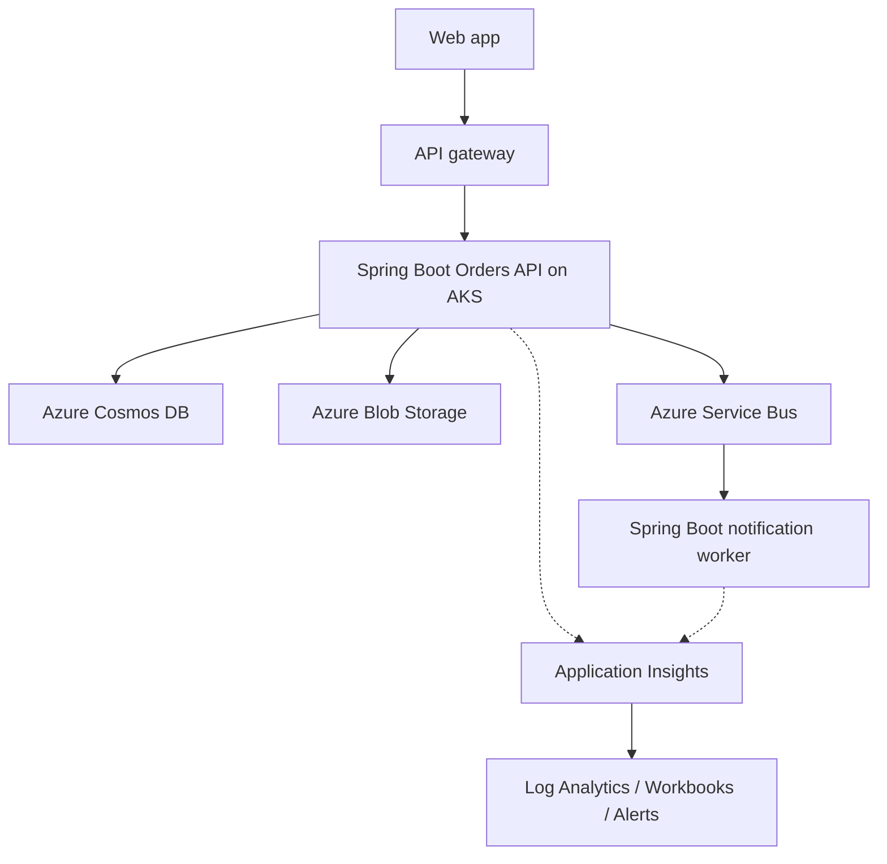

After an upgrade, users occasionally receive duplicate emails, p95 climbs sharply, Cosmos returns `429`s, and 15% of requests lack traces in transaction search. The team also sees ingestion costs nearly double.

### Tasks

1. Choose an instrumentation strategy for the API and worker without duplicate Java agents.
2. Define resource role names, environment, service version, and timezone conventions.
3. Define parent–child spans or span links across the HTTP API, Service Bus, and worker.
4. Design structured logs carrying `traceId`, business event ID, and outcome without PII.
5. Show how to verify Cosmos `429` is throttling rather than an agent bug.
6. Distinguish SDK retries, API gateway retries, and worker redeliveries.
7. Propose an idempotency scheme to prevent duplicate emails.
8. Use KQL to find top slow requests and failed dependencies.
9. Explain why 15% of requests lack traces (sampling vs. exporter vs. propagation).
10. Set SLOs covering p95 latency, availability/final failure rate, and telemetry health.
11. Design alerts that avoid paging on-call for expected HTTP 404s.
12. Measure ingestion cost, audit log levels/duplicate spans, and tune sampling.
13. Describe an AKS canary rollout and rollback if overhead spikes.
14. Design a runbook for when App Insights loses data while the gateway still sees traffic.
15. Explain how to validate all fixes with synthetic data/traffic before production.

### One Sample Solution

| Requirement | Suggestion |
|---|---|
| Instrumentation | One AI Java agent **or** primary OTel pipeline per process, no double agents |
| Correlation | W3C `traceparent` over HTTP/Service Bus carrier; use span links for async |
| Logs | `operation`, `traceId`, `eventId`, sanitized error category, latency |
| Cosmos 429 | Check RU consumption/hot partitions, SDK diagnostics, retries, and capacity |
| Duplicate emails | Stable business event ID, inbox/outbox idempotency, consumer deduplication |
| Missing traces | Sampling, agent/exporter networking, time ranges, context propagation |
| KQL | `AppRequests`, `AppDependencies`, `AppExceptions`, and `AppTraces` per schema |
| SLOs | Final success rate, p95/p99, error budget, telemetry freshness |
| Costs | Sampling, log volume, duplicate spans, workspace retention |
| Rollout | Staging/canary with build versions, compare SLO/cost, and rollback |

### Critical Thinking Questions

If `Service Bus send` succeeds yet the worker has no trace in Application Map, can you conclude the message was lost? **No.** Check Service Bus delivery/consumer metrics, message IDs, and worker processing records; Application Map only reflects observed instrumented telemetry.

If raising sampling to 100% increases cost yet a trace still doesn't appear, should you raise logging to HTTP BODY? **No.** Inspect export, resource target, schema, networking, and propagation first; body logging leaks sensitive data and rarely fixes missing traces.

## Summary

**Application Insights for Java and Spring Boot** is an APM capability inside **Azure Monitor** combining **requests, dependencies, exceptions, logs, metrics, and distributed tracing** to help engineering teams pinpoint bottlenecks and failures on Azure. With the **Application Insights Java agent**, Spring Boot gains auto-instrumentation with minimal code edits; with **OpenTelemetry/Micrometer**, you can add business spans and custom metrics via a compatible exporter.

Reliable observability demands understanding **trace context / W3C propagation, async Reactor/MDC behavior, Azure SDK retries, sampling, workspace KQL schemas, and the boundary between application telemetry and resource metrics**. Use KQL, Application Map, and transaction details to isolate root causes—while never assuming a missing trace means a request never ran, never substituting sampled logs for audits, and never mistaking a green dashboard for an accurate SLO.

In production, establish **one clear instrumentation owner**, pin SDK/JDK/agent versions, tag roles and service versions, enforce redaction and least-privilege access, measure p95/p99 and final failure rates, alert on impact, and monitor **telemetry exporter health** independently. Balance sampling, retention, and ingestion costs against investigative needs, test App Service/AKS rollouts with synthetic traffic, and rehearse runbooks. Done well, Application Insights becomes an **actionable observability tool** helping Java/Spring Boot applications recover faster and run safely on Azure.
