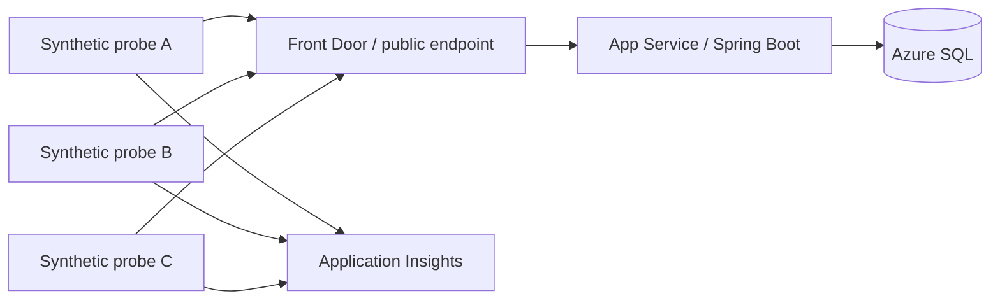
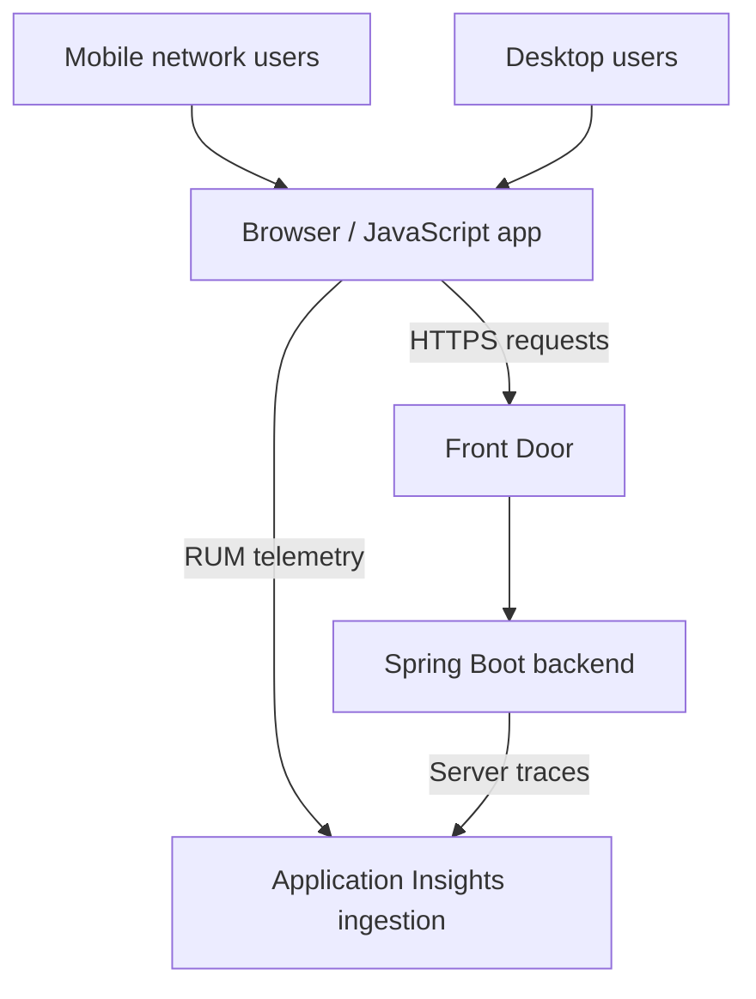
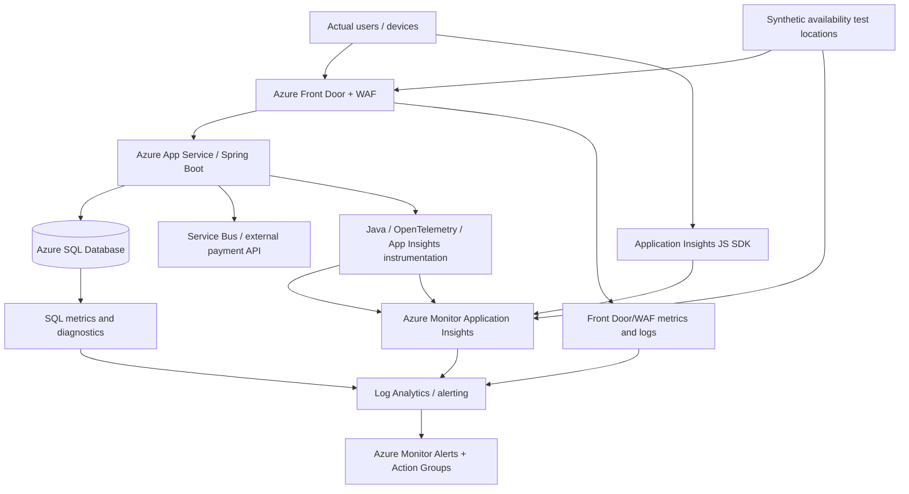
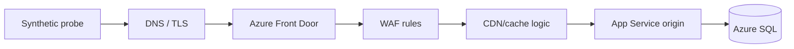
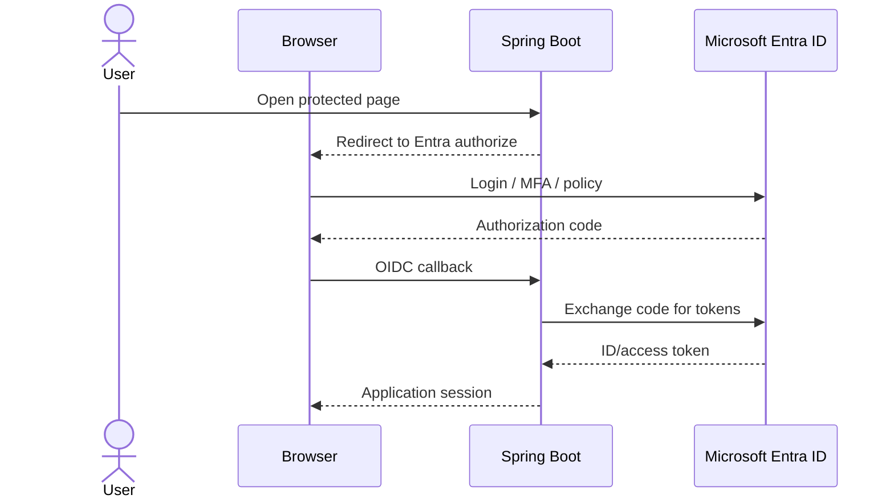
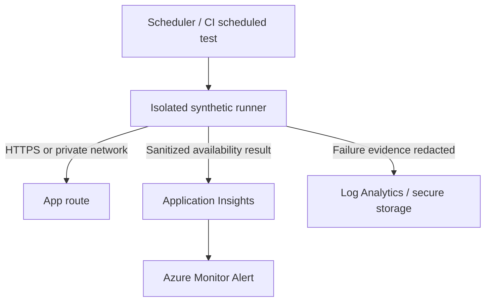
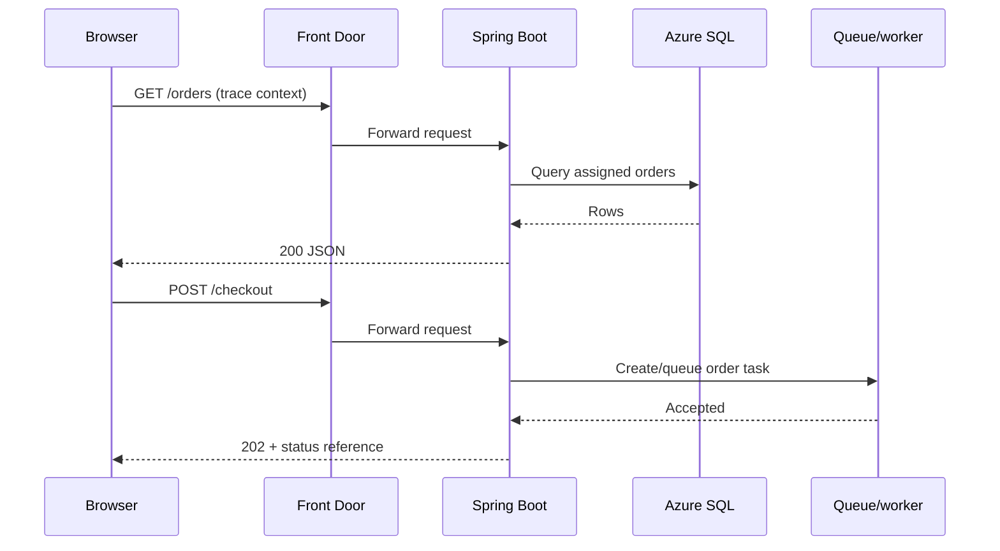
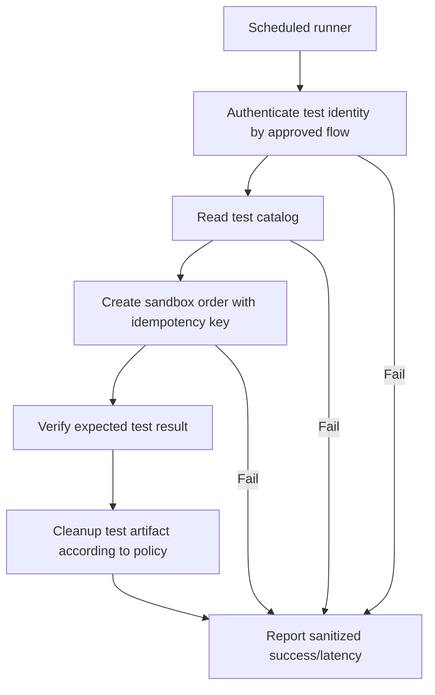

# Availability Tests and User Experience Monitoring

An enterprise deploys an ordering system built with **Spring Boot** on **Azure App Service**, fronted by **Azure Front Door** and backed by **Azure SQL Database** to store orders. The operations dashboard reports every instance as "Healthy," yet some customers in central Vietnam cannot log in, mobile users experience very slow page loads, and a certificate rotation causes part of HTTPS traffic to fail. **Checking that a process is running is not enough to confirm users can actually access the service.**

This lesson, **"Availability Tests and User Experience Monitoring"**, belongs to the **Monitoring and Observability** chapter of the **CLOUD_PROVIDERS_AZURE** module. Spanning subscriptions, resource groups, Microsoft Entra ID, virtual networking, and application services through data, monitoring, security, and cost across Azure architectures, this guide combines **synthetic availability testing**, **real user monitoring (RUM)**, **Application Insights**, **Azure Monitor**, **distributed tracing**, and **service level objectives (SLOs)** to determine *whether a service is reachable, from where, how fast or slow it performs, and which layer holds the root cause*.

> **Scope and assumptions:** Examples target Azure Monitor Application Insights (workspace-based where applicable), Azure App Service, Front Door, and Java Spring Boot/JavaScript applications. Features of Standard availability tests, custom availability tests, Log Analytics tables, SDK property names, regional/tier limits, and Portal UI elements may change; verify against actual resources and APIs. This guide has not provisioned or modified any live Azure subscription. All URIs, secrets, values, and results below are lab illustrations.

## Learning Objectives

After completing this lesson, you will be able to:

1. Distinguish **process uptime**, **readiness**, **external availability**, **user-journey availability**, and **actual user experience quality**.
2. Explain synthetic monitoring, passive RUM, session/user-journey monitoring, and distributed tracing.
3. Choose endpoints, probe locations, intervals, timeouts, response-content checks, and TLS verification for availability tests.
4. Configure a Standard availability test in Application Insights via the Azure Portal.
5. Design custom synthetic tests for multi-step flows or private endpoints that standard probes cannot reach directly.
6. Expose Spring Boot Actuator liveness/readiness endpoints without leaking sensitive details.
7. Measure Core Web Vitals (**LCP, INP, CLS**) and track page views, client errors, and network conditions via RUM.
8. Distinguish **TTFB**, server response time, and user-perceived task completion time.
9. Write KQL queries for availability, request errors, latency, and dependency correlation.
10. Design multi-location, multi-failure alert rules with Action Groups to minimize false positives.
11. Define SLIs/SLOs, error budgets, and analyze regional impact.
12. Diagnose TLS/DNS/WAF, Entra sign-in, Front Door, and backend incidents using independent signals.
13. Govern security, personal data privacy, cost, and quotas for synthetic monitoring and RUM.
14. Rehearse a controlled failure drill, collect evidence, and write an incident response runbook.

## 1. Availability Is More Than HTTP 200

**Availability** describes the ability of users or clients to achieve a valid service outcome within a defined time window.

Examples:

- The Java process is alive, but the database connection pool is exhausted → the API returns `500`.
- `/health/live` returns `200`, yet `/checkout` suffers a JavaScript error → users cannot complete purchases.
- A monitor probe in Singapore connects cleanly, while ISPs in Vietnam fail DNS resolution → a cohort of users is locked out.
- The API returns `200` with malformed JSON schema, causing the mobile app to show a blank screen.
- Front Door serves an error HTML page with status `200` via fallback routes/SPA rewrites → checks inspecting only status codes are fooled.
- OIDC login succeeds, yet authorization checks fail when saving an order → the business transaction still fails.

### Observation Layers

| Signal | Answers | Does Not Prove on Its Own |
|---|---|---|
| Host/process liveness | Is the process/OS still running? | Whether the site is reachable from the Internet |
| Container readiness | Is the instance ready for traffic? | Whether Front Door/DNS/TLS work properly |
| HTTP health check | Does the endpoint return the expected status? | Whether login/checkout user journeys succeed |
| Synthetic availability | Can active probes reach the target? | Whether all users/ISPs can also reach it |
| RUM/browser telemetry | What do real users experience, and how long does it take? | Users unable to load the SDK will emit telemetry |
| Business transaction SLI | Do orders actually complete correctly? | Every path or subsystem is healthy |
| Distributed traces | Which dependency makes a request slow or fail? | Overall users are unaffected |

**Never use a single `200` health endpoint to claim 100% user SLO compliance.** You need measurements across distinct architectural boundaries.

## 2. Synthetic Monitoring: Active Probing

A **synthetic test** acts as a "robot user" sending scheduled requests from one or more locations to check system behavior.



### What Should Each Run Capture?

A probe execution might produce data like:

```json
{
  "testName": "orders-public-home",
  "location": "probe-location-a",
  "timestampUtc": "2026-11-20T09:00:00Z",
  "target": "https://orders.example.com/",
  "httpStatus": 200,
  "expectedContentFound": true,
  "tlsValid": true,
  "durationMs": 320,
  "success": true
}
```

This is a **conceptual schema**, not an official Azure Monitor payload. Standard availability tests have their own fields, capabilities, and telemetry schema.

### Benefits

- Detects outages even during periods of zero live user traffic.
- Actively tests from multiple geographic/network vantage points.
- Checks DNS resolution, TLS handshake, HTTP response, and basic body content.
- Provides a baseline across deployments, WAF updates, and network changes.
- Triggers early alerts before customer support tickets pile up.

### Limitations

- Simple endpoint checks miss issues inside SPAs, logins, databases, or checkout flows.
- A cloud probe region does not represent every ISP or mobile carrier.
- Probes can be blocked by WAF/proxy/bot protection even when real users are unaffected.
- Cached/CDN health responses can mask origin failures.
- All probes experience network jitter, requiring calibrated thresholds and multi-source confirmation.

## 3. Real User Monitoring (RUM): Passive Telemetry from Browsers

**RUM** collects telemetry from web applications used by real people: page views, navigation timing, frontend errors, network dependencies, Web Vitals, and instrumented user interactions.



### What Does RUM Answer?

- Do users on a particular device/browser cohort suffer abnormally high **LCP**?
- Did `/checkout` start throwing JavaScript exceptions after a new release?
- Do users clicking "Place Order" encounter network or HTTP failures?
- Is the percentage of failing user sessions rising even while synthetic probes stay green?
- How does load speed differ between mobile/desktop and regions?

### RUM Cannot See Every Failure

If users **fail to load HTML/JS or are blocked by DNS/TLS before the SDK initializes**, no browser telemetry arrives. That is why synthetic tests and edge/network telemetry **complement** rather than replace RUM.

### Cost and Privacy

Browser instrumentation collects data from real end-user devices; you must govern consent, retention, sampling, cookies/identifiers, URL query strings, PII, and session tracing. An Application Insights connection string routes **telemetry ingestion**, not user passwords; however, exposing it still risks telemetry pollution and must never substitute for business authentication.

## 4. End-to-End Observability Architecture on Azure

A common architecture:



**Synthetic traffic** traverses the public edge like end users, though it does not necessarily run a full browser. **RUM telemetry** originates in real browsers and drops off if clients fail before loading scripts. **Server telemetry** captures app requests, dependencies, and exceptions. **Edge/WAF logs** reveal blocked requests or cached responses never reaching the backend.

You do not need debug-level logging everywhere; select signals that answer operational questions within budget and retention limits.

## 5. SLI, SLO, SLA: Start from User Outcomes

- **SLI (Service Level Indicator):** a measurable metric, such as the ratio of successful checkout requests.
- **SLO (Service Level Objective):** an internal reliability target, such as 99.9% successful checkout requests over 30 days using a specified measurement method.
- **SLA (Service Level Agreement):** a contractual commitment with legal scope and remedies, not automatically synonymous with internal SLOs.
- **Error budget:** the permissible failure margin before breaching an SLO.

### Examples of Distinct SLIs

```text
Synthetic availability SLI:
  successful scheduled probes / all eligible scheduled probes

User transaction SLI:
  successful valid checkout attempts /
  all valid checkout attempts

Latency SLI:
  requests completed within 2 seconds /
  all eligible requests
```

**A synthetic SLI is not automatically a user SLI.** Probing from three locations every five minutes reflects probe schedules and test conditions; it cannot directly tell you the exact share of users in Vietnam impacted.

### Error Budget Example

A **99.9% availability** SLO over 30 continuous days (defined as time-based, measured 24/7) allows roughly **43.2 minutes of downtime** per 30 days. When an SLI counts **requests** instead of minutes, the budget is **0.1% of eligible requests**—which does not map linearly to minutes when traffic fluctuates.

## 6. Choosing URLs and Routes to Test

A system should run tiered availability checks with clear goals:

| URL/Flow | Goal | Limitations |
|---|---|---|
| `GET /` | Public HTML via Front Door | `200` does not prove JS runs properly |
| `GET /health/public` | Safe liveness/endpoint check | May bypass database and login |
| `GET /actuator/health/readiness` | Is the instance ready for traffic? | Should not necessarily be public; requires protection |
| `GET /catalog?item=demo` | Real read-only business content | Caching may mask origin failures |
| `GET /api/catalog/sample` | Public API response/schema | Does not exercise checkout |
| Multi-step login/checkout | Business journey | Requires custom runner and safe test credentials |
| TLS certificate validation | Valid endpoint certificate | Does not validate business payloads |

### Target Selection Criteria

1. **Deterministic and stable** to prevent flaky tests.
2. **Side-effect free** unless paired with idempotent sandbox cleanup.
3. Traverses the same **Front Door/CDN/WAF/TLS** path as users when testing public reachability.
4. Serves content genuinely produced by the backend when origin validation is required.
5. Never requires real admin passwords, long-lived tokens, or personal customer data.
6. Owned route/version governed by a team with SLAs and change control.
7. Protected against accidental rate-limiting or anti-bot blocking.
8. Clearly separated from internal `/live`, readiness, and synthetic business checks.

## 7. Azure Application Insights: Standard Availability Tests

Azure Monitor **Application Insights Availability** supports configuring **Standard tests** to probe URLs from supported locations. Configurable options can include target URL, test locations, HTTP method/headers, frequency, expected status, response content matching, and TLS/SSL certificate validation depending on current features and tiers.

### Azure Portal Workflow

1. Select the right **subscription, resource group, Application Insights resource**, and linked workspace (if applicable).
2. Open the **Availability** blade (menu labels may vary by Portal version).
3. Create a new **Standard test** with a clear, stable name such as `orders-home-public`.
4. Set the target `https://orders.example.com/` to the real public user-facing hostname.
5. Select enough **test locations** representing distinct network paths supported by the service.
6. Choose frequency/interval and timeout aligned with SLOs, quotas, and desired detection speed.
7. Configure success criteria: expected HTTP status and content matching where available.
8. Enable TLS/SSL certificate checks and expiration warnings as supported.
9. Save; verify several runs and per-location distribution before enabling alerts.
10. Attach an **Azure Monitor Alert rule** and **Action Group** routed to the right owner/on-call team.

### Avoid Feature Assumptions

Not every test type supports every HTTP method, auth flow, browser execution, or private networking path. Check the live feature matrix/SKU; **Standard URL tests are not Playwright or full headless browsers**. Document anything left untested in your runbook.

## 8. Choosing Locations and Frequency Intentionally

### Three Principles

- **Multi-location:** a single probe region can suffer transient local network faults; multiple probes distinguish global outages from regional/path issues.
- **Frequency:** shorter intervals speed up detection but generate more test runs, higher cost, and potentially more noise.
- **SLO coverage:** probe frequency and locations must align with user risk and observable endpoints rather than blindly accepting defaults.

### Run Volume Calculation Example

Assume **3 locations**, each running **once every 5 minutes**:

```text
1 location:  24 hours × 60 / 5 = 288 attempts/day
3 locations: 288 × 3 = 864 attempts/day
30 days:     864 × 30 = 25,920 scheduled attempts
```

This is a theoretical figure **assuming steady execution with zero skipped runs, retries, or config edits**. Actual billing depends on service plan, test type, and executed runs; never translate run counts directly into currency without checking current pricing.

### Does Picking a Location "Near Vietnam" Guarantee Coverage of Vietnamese Users?

**No.** Cloud probe locations sit in cloud provider networks/countries and do not represent domestic mobile ISPs in Vietnam. Complement them with RUM, edge telemetry, and **approved private/in-country test runners** when SLAs demand it.

### Multi-Location Alerting

If one location fails once while all others pass, it may be a transient false positive. You can require consecutive failures or simultaneous failures across multiple locations, trading off **slower detection of single-region outages**. Never average all locations together and hide a regional failure.

## 9. Success Criteria Must Go Beyond HTTP Status

For example, `GET /` might return `200` while serving a fallback "Service unavailable" error page.

A thorough synthetic test can verify:

- Exact **HTTP status** or allowed status range.
- **Response content marker**, such as an application version/string that never appears on generic error pages.
- **Maximum response time** when latency is part of success criteria.
- **TLS certificate/hostname validity** and expiry window as supported.
- **Redirect policy**: whether login `302` or HTTP→HTTPS redirects are expected.
- **DNS resolution** and TCP/TLS connect from the probe location.
- **Cache behavior**: whether requests hit origin when origin health is under test.
- **Semantic result**: valid business JSON schema with expected field values.

### Sample Dedicated Synthetic Endpoint Response

```json
{
  "status": "ok",
  "component": "orders-public",
  "schemaVersion": 1
}
```

Never expose internal database hostnames, stack traces, access tokens, signing keys, or dependency lists on a public endpoint. **A `"status":"ok"` field does not validate full checkout functionality**—it only proves what that specific check explicitly exercises.

## 10. Spring Boot Actuator: Liveness vs. Readiness

In Spring Boot 3.x, `spring-boot-starter-actuator` provides health endpoints:

```xml
<dependency>
  <groupId>org.springframework.boot</groupId>
  <artifactId>spring-boot-starter-actuator</artifactId>
</dependency>
```

Example `application.yml`:

```yaml
management:
  endpoint:
    health:
      probes:
        enabled: true
      show-details: never
  endpoints:
    web:
      exposure:
        include: health,info
```

Common endpoints depending on version/configuration:

```text
/actuator/health
/actuator/health/liveness
/actuator/health/readiness
```

### Liveness

Primarily confirms **whether the process should stay running or be restarted**. Never wire every external dependency into liveness, or a brief DB blip will trigger cascading container restarts across all instances.

### Readiness

Determines **whether an instance should receive new traffic**, and may depend on critical backing services required for the workload. If a database outage leaves public static content servable, design readiness policies around service routes rather than enforcing one rigid check everywhere.

### Synthetic Availability

Probes from outside through Front Door/TLS/DNS/routing/WAF. Never equate external synthetic reachability with internal per-instance readiness.

## 11. Sample Public Spring Boot Endpoint for Probing

For an isolated public check endpoint, expose only minimal status metadata:

```java
package vn.example.orders.monitoring;

import java.util.Map;

import org.springframework.http.ResponseEntity;
import org.springframework.web.bind.annotation.GetMapping;
import org.springframework.web.bind.annotation.RestController;

@RestController
public class PublicAvailabilityController {

    @GetMapping("/health/public")
    public ResponseEntity<Map<String, Object>> health() {
        return ResponseEntity.ok(
            Map.of("status", "ok", "schemaVersion", 1)
        );
    }
}
```

### Interpret Accurately

This sample proves only that **an HTTP request reached the Spring container**, executed a controller method, and serialized JSON. It **does not call SQL**, verify checkout, test Entra login, or prove users take the same Front Door route. Use it as **just one layer** of monitoring.

### When Dependencies Must Be Checked

You can add Spring Boot `HealthIndicator` checks or readiness groups for critical dependencies, provided you:

1. Include only dependencies genuinely required for service viability.
2. Enforce tight timeouts (avoid 30-second hanging health checks).
3. Never leak debug/error payloads to the Internet.
4. Never mutate state on `GET` probes without isolated sandbox cleanup.
5. Prevent probes from creating a self-inflicted DDoS when the service is degraded.
6. Test behavior under simulated SQL outages and expired tokens to verify exact semantics.

## 12. App Service Health Check vs. Application Insights Availability

**App Service Health Check** tells the Azure platform **which instances are healthy** for routing and automated recovery inside App Service. It does not measure end-user reachability from the Internet.

**Application Insights Standard availability tests** actively issue HTTP requests from distributed test locations to a target URL, recording external success, failure, and latency.

| System | Where It Measures | Purpose |
|---|---|---|
| App Service Health Check | Platform → app instance | Instance routing and recovery |
| AKS liveness/readiness | Kubelet/control loop → container/pod | Restart decisions or traffic gating |
| Front Door origin health probes | Front Door → origin | Origin selection and failover |
| Application Insights availability | Test location → public endpoint | External reachability |
| RUM | Real user browsers | UX, Web Vitals, client errors |
| Business synthetic test | Custom runner → multi-step flow | End-to-end user transactions |

**Each health check should target its specific architectural layer.** Never point kubelet, Front Door, and synthetic user-journey monitors at one heavyweight endpoint—their timeout and failure semantics differ fundamentally.

## 13. Testing the Front Door, WAF, and Cache Path



### A Test Can Turn "Green" Because of Caching

When `GET /` serves cached HTML from CDN edge nodes while the origin is down, availability probes only see that the edge still responds. That is accurate if your SLO covers **public cached content**, but misleading if used to claim the **checkout API is working**.

### Run Dual Probes When Needed

1. **Edge reachability:** through the custom domain/Front Door, validating TLS and public content.
2. **Origin/business reachability:** targeting an uncached route or permitted read-only API to confirm backend execution.

### WAF and Anti-Bot Controls

WAF rules may block synthetic user agents or probe IP ranges. Never disable the entire WAF just to make tests pass. Implement governed allowlisting where supported, target valid hostnames/paths, and audit whether exemptions open security gaps. Probe source IPs can rotate; avoid hardcoding unverified IP lists.

## 14. TLS, DNS, and Certificate Expiry

An origin can return `200` internally while external users fail to connect due to **TLS handshake errors**.

### What to Verify

- Public custom domain DNS resolves accurately.
- Certificate is valid and Subject Alternative Names (SANs) match the hostname.
- Clients trust the intermediate/root certificate chain.
- Zero expiry gaps during rotation or stale TLS bindings.
- Reverse proxy/Front Door/Ingress serves the right certificate for SNI/host headers.
- HTTP→HTTPS redirects do not loop or redirect to unintended hosts.
- No untrusted self-signed certificates on public endpoints.
- TLS protocols and cipher suites match supported client browsers.

### Why Server-Side Checks Alone Are Not Enough

Internal `localhost` checks bypass DNS, TLS, Front Door/WAF, and custom domain bindings. External availability tests and RUM catch edge failures invisible to local checks.

### Certificate Expiration

Enable certificate expiry monitoring inside availability tests where supported alongside certificate inventory and renewal alerts. **Renewing a certificate in Key Vault does not automatically prove the front-end listener applied the new certificate**; probe TLS directly against the public hostname.

## 15. Monitoring Microsoft Entra ID Sign-In

Users may load the public homepage cleanly while login fails. A Standard test running `GET /` stays green.

### Where Sign-In Can Break



### Appropriate Tests

- Probe **public landing** and **login initiation** to confirm expected redirect status and `Location` header.
- Test end-to-end login via a **custom synthetic browser** using a **dedicated test-only identity with approved consent and MFA/Conditional Access policies**—never use admin accounts or bypass security controls.
- Analyze Entra **sign-in logs**, Spring Security auth errors, session/cookie issues, and token-endpoint dependency calls.
- Test role-protected APIs using tokens scoped to the **right audience/scopes**, without storing long-lived raw tokens in scripts or unguarded vaults.

**Never assume a public Standard URL test handles interactive OIDC journeys**, especially MFA, CAPTCHAs, consent screens, and cross-domain cookies.

## 16. Custom Synthetic Tests: When Are They Necessary?

A **custom synthetic test** runs a scripted flow, for example:

- Logging in and loading a dashboard in an approved test environment.
- Fetching the catalog → validating JSON fields → executing a search.
- Calling internal/private APIs from a runner inside a VNet.
- Verifying a sandboxed external dependency call under a test account.
- Exercising checkout using **non-billable test orders**.
- Validating JavaScript rendering, button clicks, form validation, and navigation.

### Architecture



Runners can execute on Azure Functions, Container Apps Jobs, VMs, AKS jobs, or equivalent platforms with governed networking, schedules, identities, and budgets. **No single template fits every test scenario**; when emitting Application Insights custom availability telemetry, verify your SDK/API supports availability results in that language/version rather than assuming generic custom events automatically show up as Standard availability tests.

## 17. Java: A Simple HTTP Synthetic Runner

A Java runner can actively probe a public HTTPS route and measure latency. Example using JDK 17+ `java.net.http.HttpClient`:

```java
package vn.example.monitoring;

import java.net.URI;
import java.net.http.HttpClient;
import java.net.http.HttpRequest;
import java.net.http.HttpResponse;
import java.nio.charset.StandardCharsets;
import java.time.Duration;

public final class PublicEndpointProbe {

    public static void main(String[] args) throws Exception {
        String target = System.getenv("PROBE_URL");

        if (target == null || target.isBlank()) {
            throw new IllegalArgumentException(
                "PROBE_URL must be an approved HTTPS URL");
        }

        URI uri = URI.create(target);
        if (!"https".equalsIgnoreCase(uri.getScheme())) {
            throw new IllegalArgumentException(
                "Expected HTTPS for public production probe");
        }

        HttpClient client = HttpClient.newBuilder()
            .connectTimeout(Duration.ofSeconds(5))
            .followRedirects(HttpClient.Redirect.NEVER)
            .build();

        HttpRequest request = HttpRequest.newBuilder(uri)
            .timeout(Duration.ofSeconds(12))
            .header("Accept", "application/json")
            .GET()
            .build();

        long start = System.nanoTime();
        HttpResponse<String> response = client.send(
            request,
            HttpResponse.BodyHandlers.ofString(
                StandardCharsets.UTF_8)
        );
        long durationMs =
            (System.nanoTime() - start) / 1_000_000L;

        boolean passed =
            response.statusCode() == 200
                && response.body().contains("\"status\":\"ok\"");

        System.out.printf(
            "success=%s status=%d durationMs=%d%n",
            passed, response.statusCode(), durationMs);

        if (!passed) {
            System.exit(2);
        }
    }
}
```

### Important Limitations

- This sample expects JSON **with no whitespace** between `"status"`, the colon, and `"ok"`. In production, **parse JSON safely with a proper parser** and compare fields rather than matching substrings.
- It enforces timeouts and **disables redirects**, suited for fixed HTTPS endpoints; testing redirect chains requires explicit policy and hop limits.
- It measures **total HTTP request duration** from this runner, not browser LCP or INP.
- It omits scheduling, TLS cert-expiry checks, retry jitter, structured telemetry, attempt IDs, and multi-region execution.
- It does not export results to Application Insights yet; integration requires an official telemetry exporter/custom availability API or custom log/metric ingestion.
- Never accept arbitrary `PROBE_URL` values from end-user input; allowlist **approved endpoints** only to avoid creating an SSRF vector.
- Never log response bodies if they may contain PII, tokens, or sensitive error internals.

### Adding Structured Result Telemetry

A custom probe result should emit `probeName`, `testRunId`, `location`, `timestamp`, `success`, `durationMs`, `statusCode`, and `failureCategory`—never raw credentials, session tokens, or full response bodies. With SDKs supporting **availability telemetry**, use the official API and verify records appear in the right table and portal blade. If emitting generic OpenTelemetry spans/metrics instead, do not mislabel them as built-in Standard availability tests without proper mapping.

## 18. Private Endpoints: Standard Tests Cannot Reach Inside VNets by Default

An API placed behind a **Private Endpoint** with public access disabled is typically unreachable from external Standard test locations.

### Two Strategies

1. **Public synthetic:** test public routes/Front Door as external users experience them, if the product has public ingress.
2. **Private synthetic:** execute a runner **inside the VNet or connected private network** with proper DNS, Private Endpoint routing, and identity to test internal APIs, then ship results to Azure Monitor.

### Never Expose a Private API Publicly Just for Monitoring

When monitoring private backends, **never temporarily open public network access** or expose unauthenticated admin health routes on the Internet. Use an in-network runner, least-privilege identity, and security-reviewed allowlists.

### Two Network Boundaries

- **Runner → private API:** requires routing, private DNS, TLS, and auth tokens.
- **Runner → telemetry ingestion:** requires outbound connectivity to configured Azure Monitor ingestion endpoints; private access to the API **does not automatically** provide a route to monitor ingestion.

Monitor both paths; if the runner cannot export telemetry, *absence of recent results* does not mean the backend is healthy.

## 19. Availability Results: Success, Latency, and Failure Categories

Reports should classify failures distinctly:

| Failure | Symptom | Layer to Inspect |
|---|---|---|
| DNS failure | Hostname fails to resolve | DNS records / ISP |
| Connection timeout | TCP handshake fails to complete | Routing / firewall / outage |
| TLS handshake/cert failure | Invalid cert/CA/hostname | Front Door / App Gateway / Ingress |
| HTTP 401/403 | Auth failure / WAF block / authorization | Entra / security / network |
| HTTP 404 | Wrong route/hostname/deployment mapping | Gateway / routes / app |
| HTTP 429 | Throttling / quota exceeded | Rate limits, tenant quotas, retries |
| HTTP 500/503 | App/origin/dependency unavailable | Java logs, DB / Service Bus |
| HTTP 200 with content mismatch | Wrong page, fallback page, bad deploy | CDN cache, app content, SPA |
| Timeout after slow response | Performance degradation | Server / dependencies / network |
| JavaScript error | Browser fails to render/execute app | RUM / frontend logs |
| Missing synthetic telemetry | Runner/ingestion/scheduler failure | Monitoring pipeline reliability |

### Why Classify?

If synthetic probes fail because the WAF blocked two probe locations, restarting Spring Boot fixes nothing. If a 403 on Key Vault token exchange crashes the app, rotating the Front Door TLS certificate wastes time. Alerts should point on-call engineers straight to the **layer backed by evidence**, not just say "service down."

## 20. Measuring Real Page Speed: Core Web Vitals

Core Web Vitals capture real browser experience:

| Metric | Meaning | Common Causes of Poor Scores |
|---|---|---|
| **LCP (Largest Contentful Paint)** | When main largest content finishes rendering | Slow HTML, oversized images, render-blocking JS/CSS |
| **INP (Interaction to Next Paint)** | Visual responsiveness to user interactions | Busy main thread, long tasks, heavy JavaScript |
| **CLS (Cumulative Layout Shift)** | Unexpected visual layout movement | Unsized images, webfont swaps, late-injected widgets/ads |
| **TTFB (Time to First Byte)** | Wait time until first response byte | CDN cache misses, network latency, slow backend |
| **FCP (First Contentful Paint)** | First visual content painted | Render-blocking assets, slow server/network |
| **JS exception rate** | Client-side code crashes post-load | Faulty deploy, browser incompatibilities |

### Avoid Conflating Metrics

- **Server response time** (Spring controller) excludes DNS lookup, user network latency, and browser rendering.
- **TTFB** excludes downloading images/scripts and executing UI rendering.
- **LCP/INP/CLS** are **browser metrics** that cannot be measured via `curl`.
- **HTTP 200** does not guarantee users can interact with the UI.
- Web performance "good/needs improvement/poor" thresholds evolve over time; check current standards and track p75/p95 across device cohorts.

### Segment Comparisons Properly

Group by route, device class, browser version, permitted network type, broad geographic cohort, and release version. Never directly compare desktop broadband telemetry against 3G mobile users without segmentation.

## 21. JavaScript RUM with the Application Insights Web SDK

For Spring Boot apps serving SPA or JavaScript frontends, integrate the **Application Insights JavaScript SDK**.

### Package

```bash
npm install @microsoft/applicationinsights-web
```

### Example

```javascript
import { ApplicationInsights } from "@microsoft/applicationinsights-web";

const appInsights = new ApplicationInsights({
  config: {
    connectionString: window.publicAppConfig.appInsightsConnectionString,
    enableAutoRouteTracking: true
  }
});

appInsights.loadAppInsights();
appInsights.trackPageView({
  name: "Orders dashboard",
  uri: window.location.origin + window.location.pathname
});
```

### Requirements and Safeguards

- `window.publicAppConfig` should receive only the Application Insights **ingestion connection string**—**never client secrets or database passwords**.
- Do not enable `enableAutoRouteTracking` and also fire manual `trackPageView` calls without checking for **duplicate events**.
- With SPA routers, verify navigation semantics, consent/sampling behavior, and route aggregation.
- Strip query strings containing search terms, emails, order tokens, or PII from `uri`.
- Ensure CSP `connect-src` and network rules allow the configured ingestion endpoint; otherwise RUM telemetry gets blocked silently.
- Never attach plaintext user emails as telemetry user IDs; use pseudonymous identifiers governed by privacy policies.
- Enforce consent, cookie rules, and data retention under applicable regulations.

**RUM requires client-side instrumentation.** Installing only the Java agent in Spring Boot will not generate browser LCP, INP, or CLS metrics.


## 22. Capturing LCP, INP, and CLS from Real Users

An application can measure Web Vitals in the browser and forward metrics to Application Insights.

### Illustrative JavaScript Example

```bash
npm install web-vitals
```

```javascript
import { onLCP, onINP, onCLS } from "web-vitals";

// appInsights is initialized only after consent, where required.
function reportMetric(metric, name, unit) {
  appInsights.trackMetric({
    name: name,
    average: metric.value
  }, {
    metricUnit: unit,
    route: window.location.pathname,
    release: window.publicAppConfig.releaseVersion
  });
}

onLCP(metric => reportMetric(metric, "CWV_LCP", "ms"));
onINP(metric => reportMetric(metric, "CWV_INP", "ms"));
onCLS(metric => reportMetric(metric, "CWV_CLS", "unitless"));
```

Here, `appInsights` refers to the instance initialized in Section 21; in production, keep them in the same module/scope or inject the instance explicitly. **Verify APIs, callbacks, and imports against your installed `web-vitals` version.**

### Data Caveats

- **LCP** and **INP** are measured in milliseconds; **CLS** is unitless.
- Some Web Vitals callbacks fire or update multiple times across page lifecycles; design deduplication/final-value reporting before computing per-session metrics.
- In SPAs, route changes differ from full document loads; distinguish **initial loads** from **soft navigations** according to library support.
- Never include emails, customer names, form inputs, or order IDs in custom dimensions.
- When sampling is active, factor sampling rates into counts and percentiles.
- SDK-reported page view duration and LCP/INP/CLS have different definitions; never sum or compare them interchangeably.
- Network telemetry submission assumes users granted consent and were not blocked from reaching the ingestion endpoint.

### Example Data Interpretation

If mobile p75 LCP jumps from 2.1s to 4.2s on slow networks while server p95 latency remains flat, investigate image payloads, client JavaScript bundles, CDN caching, and network assets—do not reflexively scale out Spring Boot instances.

## 23. Java Backend Observability and Distributed Tracing

Spring Boot services need **request, dependency, exception, and trace** telemetry to pinpoint whether slowdowns stem from the frontend, API, SQL, or external services.

One approach uses a compatible version of the **Azure Monitor Application Insights Java agent**, or supported OpenTelemetry instrumentation/exporters.

### Conceptual Java Agent Launch Example

```bash
# Agent JAR must come from a trusted source with a pinned version.
# APPLICATIONINSIGHTS_CONNECTION_STRING is supplied via
# environment/secret store according to deployment policy.

java \
  -javaagent:/opt/agents/applicationinsights-agent.jar \
  -jar orders-app.jar
```

This command is illustrative only; check exact agent filenames, JDK compatibility, config options, auth modes, and telemetry behavior for your version. Do not run commands blindly while authoring configuration.

### What Does It Observe?

- HTTP request duration, status codes, and exception types.
- Outbound HTTP calls to payment vendors, Entra, or internal microservices.
- SQL/dependency latency where instrumentation supports it.
- Trace/span correlations linking ingress requests to downstream dependencies.
- Non-secret instance, release, and environment metadata.
- Custom business-journey events and metrics.

### What the Java Agent Cannot See on Its Own

- Whether the user saw the first pixel paint.
- Whether JavaScript crashed in the browser before making an API call.
- Why a mobile ISP resolved DNS differently.
- Whether the user actually read the page or completed the workflow.

**Browser RUM and Java server telemetry must be correlated**, not treated as substitutes for one another.

## 24. W3C Trace Context, OperationId, and Correlation

A user journey may span:



### Correlation Fields to Retain

- **Trace ID / operation ID:** links spans across a single transaction.
- **Span ID / parent ID:** captures parent/child relationships along a call path.
- **Release version, route template, service name, and region:** narrow down failure scope.
- **Tenant/business ID:** include only in policy-approved form; never put PII into `traceparent` or `baggage`.
- **Request/attempt ID:** distinguishes client retries.

### Watch Out for Sampling Mismatches

If the browser samples 10% while Java samples 100%, browser-to-server joins will miss traces dropped on the browser side. If downstream services sample independently, child spans disappear. **A missing trace does not prove a dependency was skipped**; check sampling, consent, ingestion lag, clock skew, and correlation headers.

### CORS and Trace Headers

Only propagate trace context headers to trusted origins. Never leak sensitive `baggage` items to third-party domains. Validate CORS rules, SDK cross-origin correlation allowlists, and server-side header propagation.

## 25. User-Journey SLIs Instead of Per-Request Checks Only

Consider three e-commerce user journeys:

| Journey | Success Definition | Suggested SLI |
|---|---|---|
| Product search | Returns matching results or valid empty state | Search success rate and p95 latency |
| Sign-in | Authenticated and dashboard renders | Login success rate across valid attempts |
| Ordering | Authenticated, validated, persisted, order ID issued | Checkout completion rate |
| Payment | Provider confirms valid terminal state | Payment finalization success rate |
| Viewing reports | Report renders data or valid empty state | Report load success + LCP |
| Mobile usage | Routes render and interactions work error-free | Mobile p75 LCP/INP/CLS |

### Do Not Rely on HTTP 200 Alone

A `POST /checkout` returning `202 Accepted` only proves the request was **accepted**; downstream workers or payment calls may still fail. If the SLI measures **completed orders**, track terminal completion state rather than counting `202` as full success.

### Definition Rules

- Define **eligible attempts** explicitly (excluding clearly invalid client inputs per policy if agreed).
- Avoid masking real outages by blindly stripping all 4xx codes: **401s caused by broken login** directly harm users.
- Avoid counting client retries as distinct user attempts when measuring conversion/journey reliability.
- Separate **valid business rejections** (out-of-stock) from infrastructure errors.
- Specify maximum acceptable journey completion timeouts.
- Retain IDs for deduplication without leaking PII into open telemetry.
- When client/network telemetry is absent, cross-check using backend business audit logs.

## 26. Segmenting Experience by Device, Region, and Release

An aggregate "p95 latency = 1.8s" can easily hide mobile users in one region experiencing 8s loads.

### Useful Segments

- **Route/page template:** `/catalog`, `/checkout`, `/orders/{id}`.
- **Release version:** compare pre- vs. post-deployment.
- **Device category:** desktop/mobile/tablet where available.
- **Browser:** Chromium/WebKit/Firefox and version cohorts where relevant.
- **Network class:** slow/fast or RTT buckets if legitimately captured.
- **Region/cohort:** coarse enough to avoid pinpointing individuals.
- **Tenant/business tier:** using policy-approved aggregated or hashed identifiers.
- **Synthetic location:** probe location labels exposed by the platform.

### Avoiding Statistical Bias

- **Selection bias:** users blocked at DNS generate no RUM events.
- **Survivorship bias:** only users completing page load emit Web Vitals.
- **Sampling bias:** SDK sampling retains a subset that may skew away from the whole population.
- **Small-sample noise:** a p95 computed across 4 requests in one region is unreliable.
- **Cached vs. uncached:** edge HTML latency differs sharply from origin API calls.
- **Shifting traffic mix:** a surge of mobile traffic after a campaign alters overall averages.

Report **sample counts, uncertainty/confidence, and p50/p75/p95** over defined time windows rather than a lone mean.

## 27. KQL: Availability Success Rate in Application Insights

In **workspace-based Application Insights** receiving availability telemetry, the typical table is `AppAvailabilityResults`.

### Check Schema First

```kusto
AppAvailabilityResults
| getschema
```

Inspect columns in your workspace before copying queries verbatim. Table and column names can vary across ingestion pipelines or classic resources.

### Success Rate and Latency by Test

```kusto
AppAvailabilityResults
| where TimeGenerated > ago(24h)
| summarize
    Runs = count(),
    Passed = countif(Success == true),
    Failed = countif(Success == false),
    P95DurationMs = percentile(DurationMs, 95)
  by Name, bin(TimeGenerated, 15m)
| extend AvailabilityPct =
    round(100.0 * Passed / Runs, 2)
| order by TimeGenerated asc
```

### Interpretation

- `Runs` counts **ingested telemetry records**, which may be fewer than scheduled attempts if ingestion, sampling, or filtering drops records.
- `Name` holds the test/availability operation name per schema.
- `DurationMs` measures probe execution time, not browser LCP.
- If `Success` can be null/missing in your dataset, define how unknown/invalid runs are handled.
- Group by **RunLocation** (or equivalent verified column) **after confirming exact column names**.
- When sampling applies, denominators may not match full run schedules.

### Per-Location Breakdown

Once you confirm the location column name in your schema, include it in `by` to catch regional faults. **Never aggregate hourly across all locations globally and miss a single probe failing continuously.**

## 28. KQL: Request Latency and Server Errors

When the Java application sends HTTP telemetry to `AppRequests`:

```kusto
AppRequests
| where TimeGenerated > ago(24h)
| summarize
    Requests = count(),
    Failed = countif(Success == false),
    P50Ms = percentile(DurationMs, 50),
    P95Ms = percentile(DurationMs, 95),
    P99Ms = percentile(DurationMs, 99)
  by bin(TimeGenerated, 15m), Name
| order by TimeGenerated asc
```

### Questions This Query Answers

- Which endpoints saw p95/p99 latency increase after deployment?
- Did server error rates spike simultaneously with synthetic probe failures?
- Is `/checkout` spiking while `/health/public` stays normal?
- Are errors isolated to one route or spread across the whole service?

### Dependency Latency

```kusto
AppDependencies
| where TimeGenerated > ago(24h)
| summarize
    Calls = count(),
    Failures = countif(Success == false),
    P95DurationMs = percentile(DurationMs, 95)
  by Type, Target
| order by Failures desc
```

**Verify `Type`, `Target`, and `Success` in your live workspace.** Outbound calls lacking SDK instrumentation will be absent, and a SQL dependency error does not prove checkout failed if graceful fallback succeeded.

### Correlation by Operation

When `OperationId` is populated consistently across tables, filter or join on trace IDs using verified column names. Never join on emails, raw IP addresses, or order numbers containing PII. Under sampling, joins may miss spans.

## 29. KQL: Page Views, Client Errors, and Browser Timings

### Page Views

```kusto
AppPageViews
| where TimeGenerated > ago(24h)
| summarize
    PageViews = count()
  by bin(TimeGenerated, 1h), Name
| order by TimeGenerated asc
```

### Browser Timings

If your SDK/exporter emits `AppBrowserTimings`, inspect its schema first:

```kusto
AppBrowserTimings
| getschema
```

From verified columns, break down network, send, receive, processing, and total durations by route. **Do not assume every SPA route writes rows here**, because custom Web Vitals metrics may land in `AppMetrics` or another table depending on configuration.

### Exceptions

```kusto
AppExceptions
| where TimeGenerated > ago(24h)
| summarize Errors = count() by Type
| order by Errors desc
```

### Querying Custom Web Vitals

Section 22 used `trackMetric` with names `CWV_LCP`, `CWV_INP`, and `CWV_CLS`. If those land in `AppMetrics`, check `getschema` and filter on `Name` and the appropriate value column. **Do not assume `trackMetric` populates `AppBrowserTimings`.** Computing p75 across events often requires deduplication and sampling adjustments.

## 30. Alert Rules: Detection Criteria and Noise Reduction

A useful alert answers: **what is broken, who is impacted, how severe it is, who owns it, and what to check first**.

### Illustrative Policy Table

| Alert | Illustrative Condition | Severity | Owner |
|---|---|---|---|
| Public endpoint down | Multiple failures across at least two test locations in evaluation window | Critical | SRE |
| Regional partial outage | One location fails consecutively while others pass | High/Medium | Network/Edge |
| TLS certificate near expiry | Few days remaining before NotAfter | High/Medium | Platform/PKI |
| API error surge | Server failure rate exceeds baseline with sufficient sample size | High | Backend |
| Mobile LCP regression | Mobile p75 LCP breaches target at sufficient volume | Medium | Frontend |
| Checkout failures | Completion SLI drops rapidly | Critical | Payments/Business |
| RUM disappeared | Browser events drop while edge traffic continues | Medium | Observability/Frontend |

Thresholds above are **illustrative design examples**, not Azure defaults.

### Azure Monitor Setup Workflow

1. Define scope: Application Insights resource, Log Analytics workspace, or resource metrics.
2. Select a metric/signal or **Scheduled Query Alert** with appropriate KQL.
3. Configure aggregation/granularity, evaluation frequency, and lookback window.
4. Set thresholds, consecutive violation counts, missing-data behavior, and minimum sample counts.
5. Split by **dimensions** (test name, region, route) when needed so partial outages are not masked.
6. Attach an **Action Group**: email/SMS/voice/webhook/ITSM integration per policy and feature support.
7. Configure severity, description, runbook URL, and ownership tags.
8. Test firing and auto-resolution in a lab, ensuring alert payloads leak no tokens or PII.
9. Use alert processing rules/suppression during planned maintenance instead of disabling alerts permanently after a noisy false positive.
10. Track alert volume and actionability rate continuously.

### Example Scheduled Query Alert Signal

```kusto
AppAvailabilityResults
| where TimeGenerated > ago(15m)
| summarize
    Runs = count(),
    Failed = countif(Success == false)
| extend FailurePct =
    iff(Runs == 0, real(null), 100.0 * Failed / Runs)
| where Runs >= 5 and FailurePct >= 50.0
```

This query **illustrates signal logic**. Real alert rules must configure evaluation, dimension splitting, and thresholds via the UI/API, plus handle **zero runs** separately to catch ingestion or scheduler outages. Notice this query does not yet split by location, depending on supported schema fields.

## 31. SLOs, Error Budgets, and Burn-Rate Alerts

### A Realistic SLO

```text
Service: Orders API
User journey: Read assigned orders
SLO: 99.9% of eligible requests successful over rolling 30 days
Latency objective: 95% of successful requests under 2 seconds
Exclusions: explicit approved invalid input / planned maintenance policy
Owner: Orders SRE team
Data sources: server request telemetry + business audit
```

### Error Budget

\[
\text{Error budget fraction}=1-\text{SLO target}
\]

At a 99.9% SLO, the budget is 0.1% of eligible attempts in the window. If peak-hour traffic runs 10× higher than off-peak, **1 minute of peak outage** consumes far more request-based error budget than 1 minute overnight.

### Burn Rate

Burn rate measures how fast the error budget is being consumed **relative to a steady pace**. Fast burn alerts over short windows should pair with longer confirmation windows to filter noise while catching severe outages rapidly.

**Never compute business error budgets solely from synthetic probes**, unless your SLO is explicitly defined as synthetic availability. Agree on numerators, denominators, missing-data policies, sampling, and eligible events before publishing.

### Release Gates

When the error budget nears exhaustion, freeze high-risk feature rollouts; if a release spikes 5xx responses or mobile LCP, trigger canary rollback based on SLIs. These are **change-management policies**, not automated traffic switches tripped by a single probe's false positive.

## 32. Consecutive Failures and Multi-Region Balance

Consider:

```text
Probe A: fail, fail, fail, fail
Probe B: pass, pass, pass, pass
Probe C: pass, pass, pass, pass
```

At least three hypotheses apply:

1. Network or probe infrastructure at A failed (false positive for overall service availability).
2. A specific region/ISP **is genuinely unable to connect** (partial outage).
3. A WAF rule blocks only A's probe IP range.

**Do not simply ignore A.** Cross-check Front Door/WAF diagnostics, probe logs, DNS/TLS, and live RUM cohorts. Treat single-region/country alerts distinctly from global outage pages.

### When All Probes Fail

Either the site is down globally or a shared configuration broke all probes—such as a wrong target URL, expired test token, or expired TLS certificate. Correlate with edge traffic metrics and customer support reports before declaring a total global outage.

### Reducing Alert Fatigue

Cut alert noise through root-cause grouping, time-bounded maintenance suppression, clear escalation paths, deduplication, and actionable runbooks. Never classify every single-probe blip as Sev1 or responders will tune out real incidents.

## 33. Executing Multi-Step Synthetic Tests Safely

Real login or checkout journeys cause side effects and require credentials. Design carefully:



### Mandatory Guardrails

- Use **test tenants, sandbox payment providers, and test inventory**—never real money or real customer orders.
- Never disable MFA/Conditional Access on production accounts. If headless auth is required for a test identity, design an IAM-approved auth pattern.
- Store secrets/credentials in Key Vault or use managed identities where supported; never commit passwords or tokens in test scripts.
- Use **idempotency keys**, TTLs, and cleanup routines so scheduler retries do not create thousands of stray orders.
- Enforce rate limits and concurrency caps so tests never overload degraded systems.
- Separate **business journey failures** from **monitoring runner failures**.
- Never store screenshots containing PII, tokens, or payment info; redact artifacts and enforce tight retention.
- Keep private backend runners inside authorized networks rather than opening public ingress.

### Isolating Synthetic Traffic from Business Metrics

Tag synthetic events with `synthetic` at the application level where possible so they **do not distort conversion rates or business analytics**. However, never trust a client-supplied `synthetic=true` flag to bypass security rules or business validation.


## 34. Runbook: Availability Test Fails While App Service Health Check Is Green

Late at night after a deployment, Standard tests fail across multiple locations while the Portal shows every App Service instance healthy.

### Investigation Order

1. Record **test name, public hostname, probe locations, UTC timestamps, status/error categories**, and deployment time.
2. Verify target URL correctness and whether test credentials or content matchers changed.
3. Check **DNS resolution, TLS certificate, and SNI** from the probe locations—not just one engineer's laptop.
4. Inspect **Front Door/WAF logs**, custom domain status, and origin health checks.
5. Check whether a cached error page returning HTTP `200` caused content matching to fail.
6. Inspect App Service request logs, exceptions, startup/restart events, and running build version.
7. Compare `AppAvailabilityResults` against `AppRequests` over the same UTC window.
8. If zero requests reached App Service, suspect **DNS, TLS, Front Door, WAF, CDN, or upstream network** issues before the origin.
9. If requests arrived and returned `5xx`, inspect SQL/Storage/Key Vault dependencies and application exceptions.
10. If only probes are blocked by the WAF, review approved allowlisting and security risk—never disable the entire WAF.
11. Confirm using an **independent check**, RUM, or user reports to separate partial from global outages.
12. Document mitigation, impact, timeline, root cause, and confirm alerts resolved cleanly.

### What Not to Do

- Restart App Service blindly before isolating the failing layer.
- Modify health endpoints to always return `200`.
- Disable TLS certificate validation.
- Expose a Private Endpoint publicly just to keep monitors green.
- Delete the test after a single false positive without investigating partial regional impact.

## 35. Runbook: Only One Region or ISP Fails

```text
Probe location A: 0% success in last 15 minutes
Probe location B: 100% success
Probe location C: 100% success

RUM:
  Mobile users in cohort X: increased network failures
  Other cohorts: normal
```

### Hypotheses

- Divergent DNS caching or record propagation.
- ISP routing, BGP, or peering degradation.
- WAF geo-filtering or IP-reputation rules falsely blocking a cohort.
- Front Door POP, route, or origin failover issue on a single path.
- TLS chain incompatibility affecting specific client stacks.
- Region-scoped browser or CDN cache corruption.
- Outage in location A's synthetic probe infrastructure itself.

### Evidence to Combine

| Source | Question |
|---|---|
| DNS checks from affected region | Does the hostname resolve accurately? |
| TLS handshake diagnostics | Are SNI, SANs, and cert chain valid? |
| Front Door/WAF logs | Are there 403/blocks/rate limits by zone or path? |
| RUM aggregates | Are real users in that cohort hitting network errors? |
| App Service logs | Do requests even reach the origin? |
| Cloud provider Service Health | Is there a published regional/network incident? |
| Alternative VNet/ISP synthetic runner | Is the probe failure isolated to one monitor location? |

**Never assume a cloud probe location shares an ISP with users in Vietnam.** If most customers sit on domestic mobile carriers, validate using real-user network telemetry or an authorized runner on a representative network.

## 36. Runbook: HTTP 200 Yet Browser Is Slow or Blank

Symptom: Standard availability tests stay green, yet conversions drop and RUM reports rising JavaScript exceptions alongside elevated LCP.

### Investigation Steps

1. Identify the **release version**, route, browser/device cohort, and deployment time.
2. Compare p75/p95 LCP, INP, and CLS before and after deployment.
3. Check for `404` JavaScript bundles/assets, CSP violations, script integrity failures, or CDN caching glitches.
4. Inspect **long tasks**, main-thread blocking, and hydration/rendering failures.
5. Check client-side API calls, XHR/fetch failures, and CORS headers.
6. Compare server `AppRequests` p95 against browser timings: fast server but slow LCP?
7. Inspect image sizes, font loading, render-blocking CSS/JS, and cache headers.
8. Verify whether stale service workers cache broken versions.
9. Reproduce via browser DevTools on an authorized representative device/network without storing PII.
10. If a release introduced the regression, roll back or fix forward per canary policy and verify RUM recovery.

### Do Not Reflexively "Scale Up App Service Plan"

If the bottleneck is an 8 MB JavaScript bundle, unoptimized images, or mobile CPU rendering, adding Java backend cores will not help. Measure every segment of the **critical rendering path** and fix the right layer.

## 37. Runbook: Entra Sign-In Fails While Homepage Passes

### Scenario

Synthetic `GET /` passes; users navigating to `/dashboard` enter a redirect loop or receive `401/403`.

### Signals to Inspect

- **Entra sign-in logs:** tenant ID, app registration, Conditional Access/MFA decisions.
- **Spring Security logs:** OAuth state/nonce/callback mismatches and token-exchange failures.
- **App Session Store:** `Secure`/`SameSite`/domain cookie attributes, sticky sessions, or shared Redis state.
- **Redirect URI:** does `https://orders.example.com/login/oauth2/code/entra` match the app registration?
- **Token endpoint / JWKS access:** does the backend have outbound DNS/TLS access?
- **Client secret / certificate expiry:** was a Key Vault secret rotated without the app refreshing it?
- **API audience / roles:** did login succeed while the user lacks roles or the token targets the wrong audience?
- **Front Door / WAF:** is the OAuth callback path rewritten or blocked?

### Valid Synthetic Coverage

You can safely test that `/dashboard` initially returns the expected redirect status and identity-provider `Location` header (without embedding user credentials). End-to-end login requires an **IAM-approved runner and test identity** without bypassing MFA/Conditional Access. Never log or store authorization codes, access tokens, ID tokens, refresh tokens, or session cookies.

## 38. Monitoring the Monitoring System: Eliminating Blind Spots

Observability tooling itself can fail at the exact moment an application suffers an outage.

### How "No Data" Happens

- Synthetic test schedules are paused, disabled, or misconfigured.
- Only one probe location continues reporting.
- Application Insights connection string points to the wrong resource.
- Frontend CSP rules or ad blockers drop RUM ingestion calls.
- Network/firewall rules block backend telemetry exporters.
- Sampling or ingestion throttling drops critical records.
- Workspace ingestion lag, transformations, or expired retention removes rows.
- Queries target the wrong table name or time window.
- Browsers fail to load the JS SDK due to upstream HTML/TLS failures.
- A custom runner catches an exception and exits without emitting failure telemetry.

### Self-Monitoring Safeguards

- Emit a **dedicated heartbeat** from custom synthetic runners/collectors.
- Alert on **zero runs / sudden drops in expected run counts**, not solely on failure rates.
- Audit enabled tests, owners, and target URLs periodically.
- Track ingestion failures and App Insights sampling settings.
- Cross-check application request counts against Front Door ingress volume.
- Verify time zones, clock skew, and KQL lookback windows.
- Maintain an independent manual verification checklist for Sev1 incidents.
- Retain telemetry long enough for postmortems without over-retaining sensitive debug payloads.

**Unknown ≠ Healthy.** If all telemetry disappears while edge metrics still show traffic, dashboards must surface "insufficient data" and trigger pipeline triage.

## 39. Privacy, Security, and Test Safety

### Protecting Real User Data

RUM can capture URLs, user/session IDs, browser/device/network attributes, and client exceptions. Enforce:

- Collect only telemetry **needed for operations**, never full form payloads.
- Mask/strip **query strings, emails, order IDs, access tokens, and payment details**.
- Use pseudonymous IDs or aggregated cohorts under valid consent/legal basis.
- Coarsen IP/geolocation precision per policy; avoid unnecessary personal location tracking.
- Enforce appropriate retention and restrict read/export permissions.
- Restrict session replay or DOM/screenshot capture unless explicitly justified and tightly controlled.
- Never turn on verbose client-side console/network payload dumps in production.
- Comply with GDPR and applicable data-protection mandates for your customer regions.

### Securing Synthetic Runners

- Allowlist only **approved target hosts** to prevent SSRF and arbitrary URL probing.
- Run under dedicated least-privilege test identities with auditing and rate caps.
- Retrieve secrets/credentials via Key Vault or managed identities where supported.
- Never use real production credit cards, live funds, or admin accounts in synthetic checkout flows.
- Make cleanup idempotent so failed runs never leave orphaned test orders behind.
- If capturing Playwright screenshots on failures, redact secrets/cookies/PII and expire artifacts rapidly.
- Never weaken WAF rules or disable CAPTCHAs/MFA on real accounts solely for "end-to-end testing."
- Alert on anomalous test traffic spikes or runner compromise indicators.

### Telemetry Ingestion Is Not a Business API

An Application Insights ingestion connection string **does not grant** clients read access to your business data. However, public ingestion endpoints can receive spoofed client telemetry; apply provenance checks, sampling, and anomaly controls, and never drive financial or security decisions from unverified client events.

## 40. Cost, Quotas, and Economical Design

Cost drivers to track:

| Component | Driver to Monitor |
|---|---|
| Standard availability tests | Number of tests, locations, frequencies, and plan features per current pricing |
| Custom synthetic runners | Functions/VM/Container Apps/AKS compute and scheduling cadence |
| Application Insights | Ingestion volume, sampling rate, retention |
| Log Analytics | Workspace ingestion GB, retention, queries/advanced features |
| Front Door/WAF | Request counts, bandwidth, security features |
| App Service/AKS | Compute, autoscaling, probe-induced load |
| Browser RUM | Page views, events, custom metric volume, and quotas |
| Alerting/notifications | Alert rule count and Action Group notifications per pricing |
| Storage/screenshot artifacts | Storage capacity, retention, egress |
| Operations | On-call toil, incident triage, dashboard upkeep |

### Workload Sizing Example

Suppose a system runs **5 tests × 3 locations × once every 5 minutes**:

```text
5 × 3 × 288 = 4,320 scheduled synthetic attempts/day
30 days: approximately 129,600 scheduled attempts
```

This is a **theoretical attempt count**, excluding retries, skipped runs, or custom runner compute. Never multiply by an assumed unit price without checking Azure's current pricing units and tier rules.

### Sound Optimization Practices

1. Probe **a small set of high-value journeys** instead of every URL.
2. Apply RUM sampling/throttling and skip noisy mouse-movement telemetry.
3. Retain request, dependency, and trace correlation where it aids root-cause triage.
4. Trim oversized log fields, PII, and duplicate page-view events.
5. Align probe frequency with actual detection SLAs rather than maximizing data volume.
6. Separate critical paging alerts from informational dashboard trends.
7. Govern retention, resource tags, budgets, and cost owners.
8. Verify synthetic request rates and test orders cannot exhaust quotas or inventory.
9. Correlate user SLIs and multi-location data before blindly adding more probes.

**Never sacrifice critical outage detection just to shave off a few test runs.** Conversely, never let unbounded synthetic probes overload an already degraded backend.

## 41. Hands-On Lab: Testing Availability and UX of a Spring Boot App

**Goal:** configure a multi-location Standard availability test, collect browser RUM signals, correlate with server telemetry, and simulate a safe failure in a lab environment.

### Prerequisites

- An authorized lab Azure subscription and resource group.
- An App Service/Container App/AKS deployment exposing a public HTTPS test URL.
- An Application Insights resource (workspace-based where appropriate), Azure Monitor/Log Analytics, and permissions to read and configure tests.
- A Spring Boot app with Actuator `/actuator/health` and a public test route.
- A test frontend wired with the Application Insights JS SDK if completing the RUM steps.
- A valid test domain/certificate; never target unauthorized production websites.
- Azure CLI/Portal access with defined owner and cost limits for synthetics.
- Zero real user credentials or payment data.

### Step 1 — Define the SLI Before Creating the Test

```text
Test name: orders-home-lab
Target: https://<LAB_HOSTNAME>/
Expected status: HTTP 200
Expected marker: "Orders Demo" (must not appear on error page)
Frequency: configurable within resource support
Locations: three supported locations
Timeout: based on dependency and user SLO
Owner: platform-lab
```

These parameters are illustrative; balance detection speed against false positives and verify live Standard test options.

### Step 2 — Check Spring Boot Health Endpoints

Add `spring-boot-starter-actuator` if missing, enable `/actuator/health` and probes cleanly without exposing sensitive details, and confirm `GET /` and `/health/public` differ in semantics from internal readiness.

### Step 3 — Create a Standard Availability Test

In Azure Portal → Application Insights → Availability, create a Standard test with your target URL, selected locations, and supported HTTP/content/TLS validation rules. Verify initial run records appear in the test results blade.

### Step 4 — Create an Alert Rule and Action Group

Configure a rule requiring multiple failures/locations tied to a lab on-call Action Group with description and runbook links. Avoid wiring production SMS/voice paging or automated infrastructure webhooks without approval.

### Step 5 — Instrument the Java Server

Attach a compatible Azure Monitor Java agent or OpenTelemetry instrumentation. Supply the connection string via approved runtime configuration and confirm requests, dependencies, and exceptions correlate cleanly without leaking secrets.

### Step 6 — Instrument the Browser

Configure the JS SDK per Section 21 and, where permitted, Web Vitals per Section 22. Check consent/CSP, route grouping, sampling, and privacy redaction. Load the test page from mobile and desktop test devices without logging user emails in custom properties.

### Step 7 — Run Baseline KQL Queries

Once data arrives, query `AppAvailabilityResults` and `AppRequests` to examine:

- Total runs, failure rate, and p95 probe duration.
- Server p95 request latency.
- `AppPageViews` or `AppMetrics` when browser telemetry is enabled.
- Differences between synthetic and RUM numbers caused by sampling, routing, or networks.

### Step 8 — Simulate a Safe Failure

Strictly in the **lab**, introduce a controlled `/lab/fail` route or deploy a test build returning the wrong content marker. Never shut down production App Services, drop databases, or break live certificates. Simulate TLS errors only in authorized test setups without disabling trust stores on real clients.

### Step 9 — Verify Alerts and Interpret Signals

When the probe fails:

- Does the availability dashboard record `success=false`?
- Does the alert fire across the expected window/locations and trigger the Action Group?
- Do Spring request logs show traffic? If not, suspect the edge/network path.
- Does browser RUM report errors? If JS fails to load, notice missing telemetry.
- Is there an independent verification source to rule out false positives?

### Step 10 — Verify Recovery

Restore the lab build/route, confirm probes return to passing, and verify the alert resolves per rule criteria. Compare before/after p95, error rates, and telemetry pipelines. Write a brief postmortem without logging tokens or PII.

### Step 11 — Collect Evidence

| Item | Evidence |
|---|---|
| Resources | Masked subscription/resource IDs, hostname, and region |
| Synthetic | Test name, locations, frequency, expected status/content |
| Backend | Spring Boot health semantics, version, request latency |
| Browser | RUM setup, Web Vitals, cohorts, and consent |
| Alerts | Rule threshold, Action Group, owner, sample count |
| Correlation | Trace IDs and release version without PII |
| Failure drill | UTC start/end, failure category, synthetic detection lag |
| Recovery | Restored pass rate, alert auto-resolve or manual action |
| Costs | Estimated test runs, ingestion/retention/runner usage |
| Limitations | Unmeasured signals or unsupported features |

### Step 12 — Clean Up the Lab

Disable or delete test resources **only if lab-owned and approved**. Never delete shared Application Insights resources or mute production alerts. Retain or purge test records per retention policy.

## 42. Production Checklist Before Relying on Availability and RUM

- [ ] Clear owners and SLOs exist for services, tenants, and user journeys.
- [ ] Liveness, readiness, edge availability, RUM, and business completion are clearly separated.
- [ ] Standard tests target the real public hostname, redirect flow, and TLS path used by customers.
- [ ] Multiple appropriate probe locations are configured without aggregating away partial outages.
- [ ] Probe frequency, timeout, status checks, and content matchers align with service goals.
- [ ] Health checks do not stop at HTTP 200 if fallback/error pages also return 200.
- [ ] Health endpoints expose no internal configuration or stack traces.
- [ ] TLS certificate validity/expiry, DNS, and custom domains are actively monitored.
- [ ] Front Door, WAF, CDN, and origin health are observable independently.
- [ ] Private endpoints use authorized in-network custom runners rather than opening Internet access.
- [ ] Synthetic login/checkout flows use test identities, sandbox data, and idempotent cleanup.
- [ ] No raw production passwords or tokens appear in scripts or screenshots.
- [ ] Browser RUM enforces privacy/consent, URL/token/PII redaction, and sampling controls.
- [ ] RUM captures LCP/INP/CLS in proper units grouped by route and device cohort.
- [ ] Java services emit correlated request, dependency, exception, and trace telemetry.
- [ ] Server latency is never substituted for browser UX metrics.
- [ ] KQL queries are verified against real workspace tables, schemas, and columns.
- [ ] Queries surface sample counts, percentiles, failure ratios, and explicit time windows.
- [ ] Alert rules handle false positives, multi-location failures, and missing telemetry.
- [ ] Action Groups route cleanly to on-call responders with escalation and runbook links.
- [ ] Synthetic runner heartbeats distinguish target outages from collector failures.
- [ ] Application, edge, and cloud service health logs support layer-by-layer triage.
- [ ] Distributed traces propagate no PII or tokens inside `traceparent` or `baggage`.
- [ ] Log retention and sampling support postmortems without runaway cost.
- [ ] Production releases enforce baselines, canary checks, and rollback gates.
- [ ] Drills cover DNS/TLS/WAF breaks, bad deploys, backend 5xx errors, and RUM gaps.
- [ ] User SLIs and synthetic SLIs are never reported interchangeably as one percentage.
- [ ] Error budgets carry clear release-governance actions when nearly exhausted.
- [ ] Spend across Standard tests, custom runners, workspaces, and alerts is tracked.
- [ ] Documentation or test plans are never presented as proof of live Azure execution.

## 43. Self-Check Questions

1. How does process availability differ from user-experienced availability?
2. How does App Service Health Check differ from an Application Insights Standard availability test?
3. What questions do synthetic tests answer that RUM cannot?
4. Why can RUM telemetry disappear completely when a site fails to load?
5. What is the difference between liveness and readiness?
6. Why doesn't `GET /health/public` returning 200 prove checkout works?
7. When selecting synthetic locations, why doesn't one nearby cloud region represent all ISPs in Vietnam?
8. How do Standard test frequency and timeout affect detection latency and cost?
9. Why is response content validation vital when error pages return HTTP 200?
10. What option should you choose when a private API cannot be reached by public probes?
11. Does placing an API behind a Private Endpoint automatically route runner telemetry to Azure Monitor ingestion?
12. Do Standard URL tests execute full JavaScript like a real browser?
13. When do you need a multi-step custom synthetic runner?
14. Why should custom synthetic checkout tests include idempotency keys and cleanup?
15. Should you automate real purchases to monitor checkout? Why or why not?
16. What risks arise when embedding test credentials in Playwright scripts?
17. What three aspects of UX do LCP, INP, and CLS measure?
18. Why is Spring HTTP server response time not equivalent to LCP?
19. If server latency is low while mobile LCP is high, where should you investigate?
20. Why can an SPA route generate duplicate page-view events?
21. Why must user emails and order tokens never appear in browser telemetry?
22. Do custom Core Web Vitals metrics automatically populate `AppBrowserTimings`?
23. What questions is `AppAvailabilityResults` typically queried to answer?
24. Should a KQL availability alert query include a minimum sample count and missing-data policy?
25. Why should you run `getschema` before copying KQL from external documentation?
26. Which failure layers do `AppRequests` and `AppDependencies` help distinguish?
27. What are distributed trace IDs and span IDs used for?
28. How does sampling affect correlation between browser RUM and server traces?
29. How do Azure Monitor Alert rules and Action Groups differ in responsibility?
30. Why are multi-location failures more trustworthy than a single probe failure?
31. If one location fails while two pass, is it guaranteed to be a false positive?
32. When all probes pass yet RUM drops sharply, what might be happening?
33. If synthetic telemetry vanishes, how should the service status dashboard display it?
34. How do SLI, SLO, and SLA differ?
35. Can a request-based error budget be converted directly into outage minutes?
36. What time windows should burn-rate alerts evaluate?
37. Why is HTTP `202 Accepted` insufficient to count a checkout as completed?
38. Why can Front Door caching keep an edge probe green during an origin outage?
39. Does renewing a TLS certificate in Key Vault guarantee the public website serves the new cert?
40. When Entra sign-in fails while the homepage passes, which logs should you inspect?
41. Why should you never disable WAF or TLS verification to stop probe failures?
42. What sensitive data must be excluded from synthetic screenshots and RUM?
43. In a lab drill, what evidence proves detection → alerting → recovery genuinely worked?
44. Does a 100% synthetic pass rate prove every user in every region has good access?
45. Which observability costs beyond App Service compute should be budgeted?

## Conclusion

**Availability testing and user-experience monitoring** require observing systems from multiple angles. **Azure Monitor Application Insights Standard tests** proactively surface DNS, TLS, HTTP, and content breaks across probe locations; **custom synthetics** exercise user journeys or private endpoints within security boundaries; **RUM** reveals real-user experience via page views, Web Vitals, and frontend errors; and **Spring Boot/Java telemetry with distributed tracing** pinpoints slow or failing dependencies. Only by combining these signals can teams separate *the app process is running* from *customers can successfully complete their work*.

Production readiness demands well-chosen targets, locations, and frequencies, meaningful response checks, multi-signal SLO-aligned alerts, missing-telemetry handling, failure/recovery drills, credential/PII protection, and cost control. Above all, **synthetic success is not the same as user satisfaction**, and **absent telemetry never proves health**. The ultimate goal is not an all-green wallboard, but an Azure platform capable of detecting issues early, quantifying impact, isolating root causes, and reliably restoring customer access.


