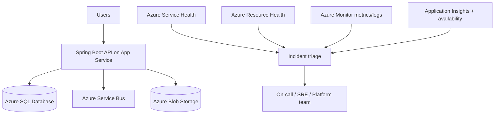
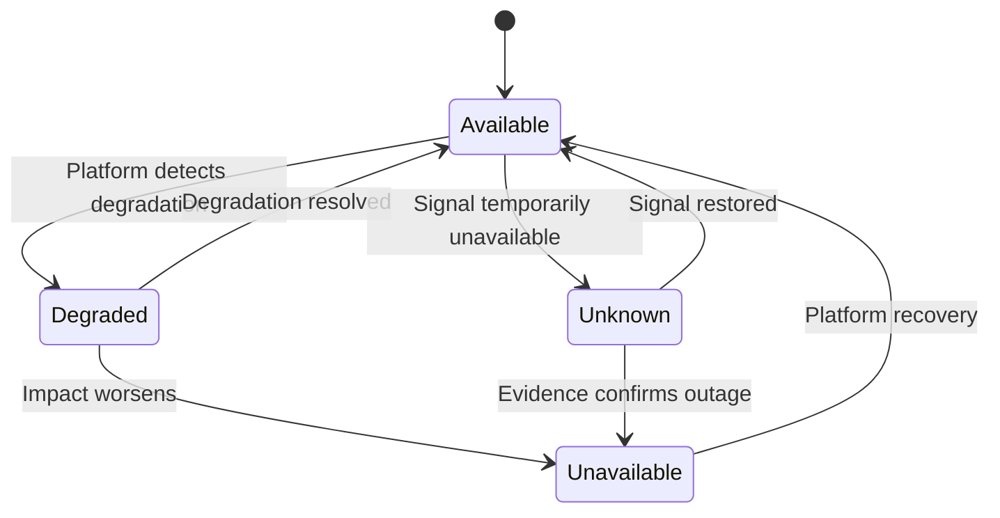
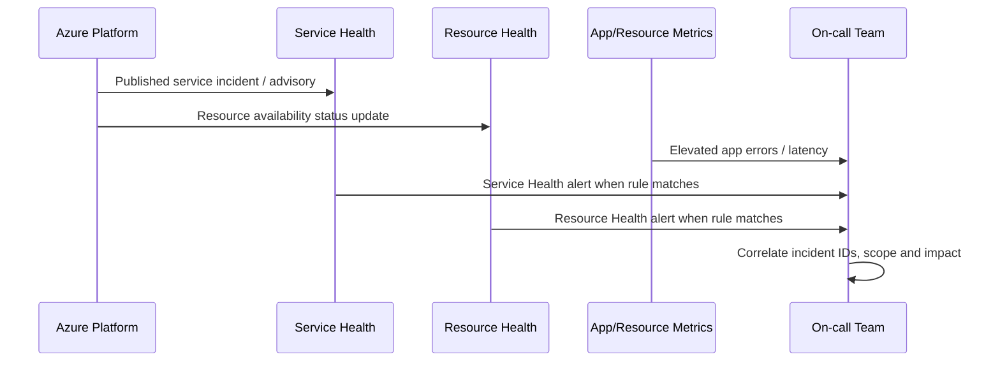
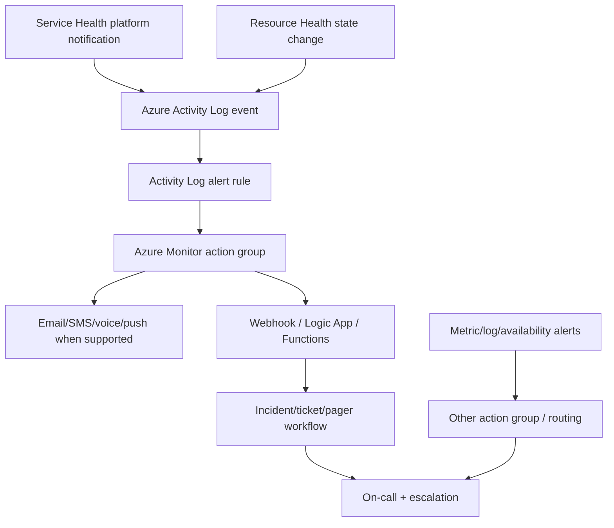
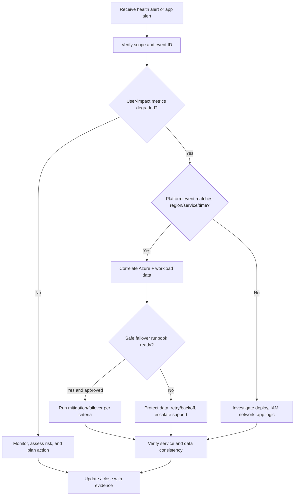

# Service Health, Resource Health, and Platform Incident Alerting

A Spring Boot system running on Azure can return HTTP 503 errors even when neither its source code nor deployment changed: Azure App Service may be experiencing a regional outage, an underlying host VM may become unavailable, Azure SQL may enter maintenance, or network paths to a dependency may degrade. Looking solely at application logs shows the symptom without revealing whether the root cause sits in the **application**, a **specific Azure resource**, or an **Azure platform service**. Conversely, watching only Azure notifications can miss business-logic bugs, misconfigurations, or latency introduced by the application itself.

**Azure Service Health** and **Azure Resource Health** provide two complementary views within Azure Monitor. Service Health delivers **subscription-personalized** information about Azure service incidents, planned maintenance, and advisories; Resource Health reports the health signal of a **supported individual Azure resource** such as a VM or specific service instance. Combining both with **Azure Monitor metrics, logs, Application Insights, availability tests, alert rules, and action groups** lets teams detect, triage, and resolve platform incidents promptly.

This lesson belongs to the **Monitoring and Observability** chapter of the `CLOUD_PROVIDERS_AZURE` module: learning how to monitor, protect, and operate application architectures on Microsoft Azure—from subscriptions/resource groups, Entra ID, virtual networks, compute, storage, and data to alerting and cost control. Its scope focuses on **Service Health, Resource Health, and platform incident alerting**, using Java, Kubernetes, Azure CLI, and KQL examples tied to real operational workflows.

> **Version scope:** The Azure Portal UI, Azure Monitor alert experience, health telemetry, resource types supported by Resource Health, Activity Log schemas, and CLI/ARM APIs evolve over time across subscription types, regions, permissions, and Azure clouds. This is a self-contained guide on concepts and controlled implementation; in production, verify available options against your target subscription and current Azure documentation. All durations, percentages, and scenarios below are **illustrative simulations**, not SLAs or active Azure incidents.

## Learning Objectives

After completing this lesson, you will be able to:

1. Distinguish **Azure Service Health**, **Azure Resource Health**, and **Azure Status** (public global status), as well as Azure Monitor metrics, logs, and Application Insights.
2. Understand common notification types: **service issues**, **planned maintenance**, **health advisories**, and related security advisories where provided.
3. Interpret Resource Health states—**Available, Degraded, Unavailable, Unknown**—and their boundaries.
4. Build a **subscription–region–service–resource matrix** so alerts reach only the responsible on-call team.
5. Configure **Service Health / Resource Health Activity Log alert rules** with Azure Monitor **action groups** and test notification delivery.
6. Separate **platform event alerts** from metric/log/availability alerts so no single signal is treated as absolute truth.
7. Query alert configurations and Activity Logs safely in read-only mode via the Azure Portal and Azure CLI.
8. Integrate incident triage, correlation IDs, impact analysis, escalation, runbooks, approved failover, and postmortems.
9. Plan responses to **planned maintenance** rather than treating every advisory as a Sev1 incident.
10. Design workflows for security, IAM, multi-subscription coverage, noise reduction, and webhook spoof protection.
11. Write alert tests, monitor delivery rates, handle incidents lacking Resource Health signals, and measure **MTTD/MTTA/MTTR**.
12. Establish a production readiness checklist and quality metrics for your alerting pipeline.

## 1. Three Irreplaceable Observation Layers

Consider an order-processing system running on Azure:



You must answer **three distinct questions**:

| Question | Appropriate Signal Source | Why It Is Insufficient Alone |
|---|---|---|
| "Is Azure reporting an incident on a service or region affecting this subscription?" | **Service Health**. | A published Azure incident does not automatically mean your specific app is failing. |
| "Does the platform consider Azure resource `vm-orders-01` available?" | **Resource Health**, if supported for that resource type. | Resource Health `Available` never guarantees application endpoints or business logic are healthy. |
| "Why couldn't users check out in the last 5 minutes?" | **Application Insights, metrics/logs, synthetic/availability tests, and dependency traces** alongside health signals. | Root cause cannot be deduced from a single advisory or raw HTTP status alone. |

### 1.1. Service Health, Resource Health, and Azure Status

| Source | Observation Scope | Personalization | Typical Use Case |
|---|---|---|---|
| **Azure Status** | Broadly published public status of Azure services. | High-level overview; lacks detail about your exact resources. | Checking context during a widespread outage. |
| **Azure Service Health** | Azure service events and advisories relevant to your subscriptions, regions, and services. | **Scoped to your subscription and impacted services** per notification. | Receiving service issue / planned maintenance alerts, opening support tickets, preparing response. |
| **Azure Resource Health** | Current and historical health of an **individual supported Azure resource**. | Bound to a specific resource. | Diagnosing platform availability issues on a VM or specific Azure resource. |
| **Azure Monitor metrics** | CPU, errors, throughput, latency, and resource/service counters. | Scoped by resource and metric dimensions. | Measuring symptoms and thresholds (e.g., rising 5xx rates). |
| **Azure Monitor logs** | Activity Log, diagnostic/resource logs, and app telemetry when ingested. | Depends on log source and collection configuration. | Building timelines, correlations, and RCA. |
| **Application Insights / synthetic availability** | Applications, requests, and dependencies seen from user/agent vantage points. | Scoped to application and synthetic tests. | Proving real user impact, performance, and business SLOs. |

**Never use Azure Status as a substitute for Service Health**, because the public page omits subscription-specific advisories. **Never rely on Resource Health as your sole app health check**: an application can break completely while its underlying host/resource remains `Available`.

### 1.2. Concepts: Event, Alert, and Incident

- **Health event:** A status update or notification emitted by the platform, which may update multiple times over its lifecycle.
- **Alert rule:** Filter criteria determining when to notify operations teams.
- **Action group:** A set of recipients and automated actions/endpoints invoked when an alert rule fires.
- **Incident ticket:** An operational record tracking owner, impact, timeline, remediation actions, and status.
- **Resolution:** Either Azure marking the platform event resolved or the application actually recovering; these timestamps rarely match identically.

One platform event can trigger **multiple notification updates** and multiple downstream application alerts. Correlation and deduplication are essential so one root cause does not spawn endless duplicate tickets.

## 2. Azure Service Health: Service-Level Signals

**Service Health** surfaces issues affecting Azure services your subscriptions use or depend on, as scoped by Azure. In the Azure Portal, it is commonly accessed via **Service Health** (or Azure Monitor → Service Health depending on Portal navigation), letting you inspect active issues, history, and health alerts.

### 2.1. Common Event Categories

| Category | Typical Content | Operational Action |
|---|---|---|
| **Service issues** | Unplanned outages affecting services or regions. | Triage app impact, correlate with metrics and Azure updates; run incident response. |
| **Planned maintenance** | Scheduled maintenance or updates that may impact services. | Review window, HA/failover/readiness, and notify stakeholders. |
| **Health advisories** | Important guidance or upcoming service changes affecting your environment. | Assign an owner to evaluate deadlines and actions; do not page 24/7 by default. |
| **Security advisories** | Relevant security notifications delivered through supported experiences. | Assess scope and prioritize security review and approved remediation. |

**Note:** Category names, payloads, and filterable properties in alert builders can vary by Portal UI, cloud environment, subscription, and feature version. **Never assume every security advisory emits an identical event schema or fires through a single generic alert rule**; verify in your target subscription.

### 2.2. Important Notification Fields

Depending on type and event, a notification may carry:

- **Event/Tracking ID** for correlating updates and Azure support requests.
- **Service name** such as App Service, Storage, SQL Database, or networking.
- **Affected region(s)**—one region, multiple regions, or global scope.
- **Affected subscription(s)** and/or affected resource lists when supplied by Azure.
- **Event status**: investigating, mitigating, resolved, post-incident review, etc.
- **Start time / last update time**, which may differ from when your alert fired or arrived.
- **Root cause / mitigation / communications** as published by Azure (often unavailable immediately).
- **Planned maintenance window** or action deadline where applicable.
- **Links/metadata** for support and tracking.

**Never treat every platform timestamp as the start of end-user impact.** Advisories often publish after errors start, and Azure's publication timestamp never replaces your application's failed-request timestamps.

### 2.3. Service Health Alone Does Not Prove App Failure

Suppose Service Health reports `Azure Storage – East Asia service issue`, while your application stores Blobs in Southeast Asia. The alert may be **unrelated** if your workload has no East Asia dependency—though cross-region replication or global control-plane dependencies can complicate that assessment.

When an event arrives:

1. Identify **affected subscriptions, services, regions, and workloads/resources**.
2. Check your organization's maintained **inventory and dependency map**.
3. Inspect **availability, error rates, latency, and queue lag** on relevant workloads.
4. Never trigger an expensive regional failover over **an advisory showing zero user impact**, unless policy/risk explicitly demands it.
5. Record the tracking/event ID and follow updates through resolution.

### 2.4. Multi-Subscription and Multi-Region Environments

An enterprise topology might look like:

```text
management group: company
  subscription: prod-shared     -> Front Door, DNS, Key Vault
  subscription: prod-southeast  -> App Service + SQL Southeast Asia
  subscription: prod-eastasia   -> Storage East Asia, standby workload
  subscription: dev-test        -> sandbox resources
```

Alert architecture must respect **subscription boundaries**. A Service Health alert scoped to one subscription does not automatically cover sibling subscriptions. Overly narrow **region filters** miss global or cross-region dependencies; overly broad filters flood responders with noise. Build an owner/service/region mapping matrix rather than copying arbitrary filters across every subscription.

## 3. Resource Health: Status of a Specific Resource

**Azure Resource Health** reports the current health status and history of **supported resource types**, often supplemented by context about platform events impacting that resource. Access it via **Resource → Resource Health** or Azure Monitor → Resource Health depending on the Portal and resource type.

### 3.1. Primary Statuses

| Status | Accurate Interpretation | Recommended Response |
|---|---|---|
| **Available** | The platform considers the resource available per that resource type's defined health signals. | Still verify app metrics; never assume business SLOs are met. |
| **Degraded** | The resource is operating, though performance/capacity may be degraded under observed conditions. | Correlate with latency/errors, inspect guidance, and plan action. |
| **Unavailable** | The platform evaluates the resource as unavailable. | Trigger incident triage, verify user impact, and follow HA/failover runbooks. |
| **Unknown** | The platform lacks reliable health telemetry in the current window/scope. | Check telemetry, network, and resource state; neither assume Available nor automatically declare an outage. |

**Resource Health does not cover every Azure resource type uniformly**, and granularity varies by SKU and service. Seeing detailed host metrics on a **VM** does not mean every sub-resource or PaaS offering exposes identical history, reasons, or states.

### 3.2. Why `Available` Does Not Equal "Healthy Application"

A VM can report **Available** while:

- The Java process inside it has crashed.
- The PostgreSQL connection pool is exhausted.
- The API is failing authorization checks or suffering a code regression.
- A queue consumer is deadlocked and stops processing messages.
- A secret or TLS certificate expired.
- Users in one region cannot connect due to DNS, CDN, or client network breaks.

Resource Health reflects **platform-level resource status**, not an HTTP `/actuator/health` or end-to-end business transaction probe.

### 3.3. Platform-Initiated vs. User-Initiated Causes

Some Resource Health events distinguish **Platform-initiated** from **User-initiated** transitions or describe the triggering action where supported. This helps differentiate:

- Unplanned VM host hardware failure.
- An operator or IaC pipeline restarting/deallocating a VM.
- Resizing, maintenance, or automated platform healing.
- Network or permission changes applied to the resource.
- Temporary `Unknown` status during state transitions.

**Never assume "Platform-initiated" simply because no app deployment ran.** Administrative Portal actions, autoscaling, automation scripts, or upstream dependencies could be responsible. Cross-check **Azure Activity Log** (management operations), the Resource Health timeline, and application metrics.

### 3.4. Resource Health Transitions Over Time



This diagram shows **possible state transitions**, not a mandatory linear progression for every resource. Alerts may arrive **after** a transition occurred or be coalesced by event delivery; reconstruct timelines using event timestamps and traces.

## 4. How Service Health and Resource Health Work Together

A platform incident can surface across multiple layers:



| Scenario | Service Health | Resource Health | Metrics / Application Insights |
|---|---|---|---|
| Widespread regional Azure Storage outage | Likely emits an incident affecting subscribed services. | Supported resources may show health updates. | Read/write timeouts, 5xx errors, retries, high latency. |
| Single VM host hardware issue | Usually no widespread Service Health notice. | VM may flip to Unavailable/Degraded. | VM metrics drop; app requests fail. |
| Spring Boot regression after deploy | Unlikely to trigger Service Health. | Underlying host likely stays Available. | Rising 5xx rate, exception traces, new release tag. |
| Planned maintenance | Planned maintenance notice published. | Resource Health may or may not change depending on impact. | Watch SLOs before, during, and after the window. |
| Team misconfigured DNS | No Service Health event. | Underlying resource stays Available. | Synthetic probe failures and DNS errors in client logs. |

**Core principle:** Platform health alerts **explain potential external causes and enable proactive readiness**, while **metrics and availability tests prove real user impact**. Never disable application alerts just because you enabled Service Health alerts.

## 5. Platform Alerting Architecture: Alert Rule → Action Group → Incident

Azure Monitor supports multiple alert types. For Service Health notifications and Resource Health state changes, a standard mechanism is an **Activity Log alert** filtered by category and conditions. An **Action Group** delivers notifications or invokes ITSM/automation endpoints.



**Important:** This diagram shows a **common architecture**, not a guarantee that every Resource Health transition or security advisory emits an Activity Log event with identical fields, schemas, or delivery speeds. Verify **subscription scope, alert categories, supported event properties, and delivery behavior** in your environment.

### 5.1. Activity Log Alerts vs. Metric Alerts and Log Alerts

| Alert Type | Typical Trigger | Best Suited For | Limitations |
|---|---|---|---|
| **Activity Log alert** | Management/health events in a subscription matching filter criteria. | Service Health / Resource Health platform events; control-plane audit alerts. | Event-driven; does not continuously evaluate request error rates. |
| **Metric alert** | Time-series metric crosses static or dynamic thresholds. | VM CPU, HTTP 5xx, availability, DB latency. | Does not inherently explain underlying Azure platform root cause. |
| **Log search alert** | KQL evaluation over a Log Analytics workspace or Application Insights logs. | Correlating errors, dependency timeouts, custom business signals. | Requires log collection and accurate queries; carries ingestion lag. |
| **Smart / application alerts** | Anomalous behavior or availability failures per product capabilities. | Catching app regressions and user impact. | Does not replace Service Health notifications. |

One incident often fires **3–5 alerts**. Your on-call system should correlate by scope, service, time window, and correlation ID—while **avoiding merging two unrelated incidents** merely because they share a region.

### 5.2. What Should Service Health Alerts Filter On?

Each rule should define:

- Which **subscriptions** fall within monitoring scope?
- Which **service types** matter (Storage, SQL, App Service, networking, Service Bus, Key Vault, etc.)?
- Which **regions** are actively used, including dependencies and DR targets?
- Which **event types** page immediately vs. open a ticket or email?
- Which **Action Group** receives notifications or runs automation?
- What internal **severity/priority** applies—**never confuse internal severity with a field assumed to exist on every Azure event**.
- Who is the **owner and what is the runbook** for each service/region/subscription?

Urgency should reflect **business impact**. A `Service issue` for an unused service in another region should not wake the entire on-call rotation.

### 5.3. What Should Resource Health Alerts Filter On?

A Resource Health rule can filter on:

- **Subscription, resource group, or specific resource IDs** as supported by the rule/scoping model.
- **Resource types** and critical resource inventories.
- **Health transitions/statuses** exposed by the rule builder or event schema.
- **`Unknown` status:** often routed as a triage ticket rather than an automatic Sev1 page.
- **Resource Health reason type** (platform- vs. user-initiated) when supported by the event/rule type.
- **Actions:** notifying the right VM/AKS/SQL/Storage owners with a runbook link.

**Never assume every filter works identically on every resource.** The Azure Portal UI may support combinations differently from ARM/CLI schemas; capture a real sample event in your subscription before writing large-scale IaC.

## 6. Action Groups: Notifications, Webhooks, and Escalation

An **Action Group** defines the collection of receivers and actions Azure Monitor triggers when an alert fires. One Action Group can be reused across multiple alert rules when operational policies match.

### 6.1. Receivers and Actions

| Channel | Example Use | Controls Needed |
|---|---|---|
| **Email** | Send alert summary to SRE/platform owner group. | Monitored group mailbox, never a single employee who might be on leave. |
| **SMS / voice / app push** | Urgent paging where supported by service/country/plan. | Cost, delivery reliability, rotation handoffs, anti-spam limits. |
| **Webhook** | Forward events to an incident router or ITSM. | Endpoint auth, HTTPS, schema validation, idempotency. |
| **Logic Apps / Azure Functions** | Route by service/region and enrich with owner/dependency data. | Execution permissions, quotas, retries, secret management. |
| **Event Hubs** | Stream event records into analytics or incident pipelines. | Consumer lag monitoring, access control, retention. |
| **Automation Runbook** | Execute pre-approved operational tasks. | Tight RBAC scoping; never run destructive failovers/restarts blindly. |
| **ITSM integration** | Create/update tickets in supported ITSM tools. | State/priority mapping, deduplication, SLA tracking, access policy. |

Available receiver types, quotas, **Common Alert Schema** support, and regional availability depend on current Azure Monitor capabilities. Never assume every channel is available in every subscription or sovereign cloud.

### 6.2. Two-Tier Notification Routing

A clean split:

```text
Action Group: ag-platform-critical
  ├─ On-call paging / incident router
  ├─ Secured automation or ticket integration
  └─ Shared emergency mailbox

Action Group: ag-platform-advisory
  ├─ Platform maintenance mailbox
  ├─ Planning ticket workflow
  └─ Dashboard / change calendar
```

A **Service issue** impacting revenue-generating services routes to the critical group; a **planned maintenance** notice weeks out opens a planning task and reminds owners without paging at midnight. If maintenance later causes customer impact, metric/availability alerts trigger incident response.

### 6.3. Common Alert Schema and Webhook Security

Enabling **Common Alert Schema** on an Action Group normalizes payload structure across several Azure alert types. Useful fields typically include:

- Alert rule ID and name.
- **Alert target resource/scope**.
- **Fired time** and monitor condition when present.
- **Monitor service** / alert category.
- Specific Service Health / Resource Health context per event.
- Custom properties, correlation fields, or portal links when included.

**Never treat an illustrative payload example as an immutable schema for every alert.** `alertContext` varies across alert types, optional fields may be omitted, and HTTP webhook retries can redeliver identical messages.

Every webhook receiver must enforce:

1. HTTPS with proper caller authentication and validation.
2. Verification that requests come from a trusted channel rather than trusting an arbitrary JSON field anyone could forge.
3. Never blindly fetching URLs embedded inside incoming payloads (prevent SSRF).
4. Deduplication by alert/event ID, target scope, and state/timestamp; **persist idempotency keys durably**.
5. Safe handling of duplicate and out-of-order deliveries—never assume exactly-once delivery.
6. Minimal payload/log retention so subscription IDs, resource IDs, emails, and incident details are protected.
7. Retries, DLQs, and poison-message isolation in the incident router.
8. Strict RBAC separation: alert-receiving webhooks **must not hold broad permissions to fail over or delete Azure resources** unless explicitly approved.

### 6.4. Multiple Action Groups on One Alert Rule?

Rules can attach multiple Action Groups where supported, though firing one event into five separate un-deduplicated incident tools creates chaos. Prefer routing into **one governed incident router** that resolves ownership and downstream workflows. Because that router becomes a critical dependency, monitor its health, ensure HA, and keep fallback email/paging paths ready.

## 7. Scoping by Subscription, Region, and Owner

In an end-to-end Azure architecture, map health alerts to **actual application dependencies**, not just resources visible on one dashboard.

### 7.1. Minimum Dependency Inventory

| Workload | Subscription | Region(s) | Dependencies | Owner |
|---|---|---|---|---|
| Orders API | `sub-prod-app` | Southeast Asia | App Service, SQL, Key Vault, VNet | App/SRE |
| Upload pipeline | `sub-prod-data` | Southeast Asia | Blob Storage, Service Bus, Functions | Data Platform |
| Disaster recovery | `sub-prod-dr` | East Asia | Standby compute/Storage, DNS/Front Door | Cloud Platform |
| Experiment environment | `sub-dev` | Southeast Asia | App Service, Storage | Dev Team |

All names and assignments above are **fictional examples**. Account separately for **global dependencies** like Entra ID, Azure DNS, or Front Door rather than assuming regional filters cover everything.

### 7.2. Building a Routing Matrix

| Alert Type | Scope | Recommended Operational Priority | Receiving Team |
|---|---|---|---|
| Service issue on prod service in affected region | Prod subscription + critical service | **Immediate triage**; severity driven by user impact. | Platform on-call + workload owner. |
| Resource Unavailable on critical prod resource | Relevant resource IDs / resource group | **Immediate triage** alongside synthetic availability checks. | Workload on-call. |
| Resource Degraded | Critical resource | Investigate promptly; escalate if app metrics degrade. | Workload owner / SRE. |
| Resource Unknown | Critical resource | Create triage ticket / verify telemetry; do not assume outage. | Platform triage. |
| Planned maintenance approaching window | Service / region / workload | Change planning and readiness check. | Platform + change manager. |
| Health/security advisory with action deadline | Subscription or affected service | Security/compliance review scaled to risk. | Security / platform owner. |
| Service issue affecting dev/test only | Dev/test subscription | Non-paging ticket or informational notice. | Dev team. |

Priority levels are **organization-defined**, not guaranteed attributes inside Azure Service Health events. Give on-call engineers a runbook specifying revenue impact, SLOs, and whether failover is authorized.

### 7.3. Too Broad vs. Too Narrow

**Too broad:** Configuring "all services, all regions" across every subscription and paging responders on every notice floods teams with irrelevant alerts and induces **alert fatigue**.

**Too narrow:** Watching only App Service in Southeast Asia while overlooking SQL in East Asia, global Front Door, or Storage in a shared subscription leaves blind spots during dependency outages.

Strong designs maintain an **owner-backed inventory updated whenever architecture changes**, periodically auditing coverage across every production dependency and subscription.

### 7.4. Regional, Global, and Availability Zone Scope

An advisory may affect an entire region, a subset of capacity, or specific Availability Zones depending on the service. **Do not assume Service Health always includes zone-level granularity.** Regional Service Health notifications inform risk assessment; failover decisions must weigh HA architecture, live service metrics, and operational readiness.

## 8. Azure Portal Guide: Creating a Service Health Alert

A typical Azure Portal workflow:

1. Sign in to the right **Microsoft Entra tenant** and select the target subscription.
2. Open **Service Health** via the search bar or Azure Monitor.
3. Inspect **Service issues**, **Planned maintenance**, **Health advisories** (and other supported categories) to confirm subscription context.
4. Select **Health alerts** or **Add service health alert** per the current UI.
5. Select **subscription(s)** or scopes supported by the rule builder.
6. Select critical **services**, relevant **regions**, and supported **event types**.
7. Name the rule clearly (e.g., `al-sh-prod-sea-critical`) and choose the resource group/location required by Azure Monitor.
8. Select or create an **Action Group** for the on-call team, verifying receivers are valid.
9. Review filters to ensure global dependencies are covered without triggering excessive noise.
10. Create the rule, inspect the active rules list, and **test Action Group delivery**.
11. Document owner, runbook, subscription/region coverage, and last test date.
12. Re-validate whenever regions, services, or subscriptions change, or after any missed alert.

**Operational caution:** Portal tabs, button labels, and Service Health menus can change. If an event category does not appear in the rule builder, **do not assume choosing "All" automatically covers it**. Verify official documentation and live event payloads.

### 8.1. Illustrative Configuration

```text
Rule name:           al-sh-prod-app-services
Scope:               subscription sub-prod-app
Event types:         Service issues + relevant maintenance
Services:            App Service, Azure SQL, Key Vault
Regions:             Southeast Asia, East Asia, relevant global context
Action group:        ag-platform-critical
Enabled:             true
Owner:               Cloud Operations
Runbook:             RB-SH-001
Review cadence:      Monthly / after architecture changes
```

This is a **design blueprint**; depending on alert rule capabilities, you may need to split it into two rules (e.g., service issues vs. maintenance) or combine supported filters. Never assume one rule expresses arbitrary Boolean logic.

### 8.2. Creating a Resource Health Alert in the Portal

A common workflow:

1. Open **Azure Monitor → Alerts → Create → Alert rule**, or open a resource's **Resource Health** blade.
2. Select scope: target subscription, resource group, or critical resource with a supported health signal.
3. Select the **Activity Log** or **Resource Health** signal type per the current UI.
4. Pick statuses/events to monitor (such as `Unavailable` and `Degraded` where supported).
5. Assign an Action Group tied to the right owner and routing priority.
6. Double-check **scope filters** and resource types so automation-managed transient resources from other teams do not page you.
7. Save the rule and test notification/ITSM integration.
8. Compare Resource Health history with Activity Log during real state transitions.

If a resource type **lacks Resource Health support**, rely on **metrics, availability/synthetic tests, and resource-specific logs** instead—never create a placeholder rule and assume coverage exists.

## 9. Azure CLI: Read-Only Inspection of Alert Rules and Activity Logs

Azure CLI is helpful for auditing **alert rules, action groups, and Activity Logs** in a subscription. The read-only examples below avoid destructive edits and use placeholders for real IDs.

### 9.1. Target the Right Subscription and List Rules

```bash
az login --tenant "<tenant-id>"
az account set --subscription "<subscription-id>"
az account show \
  --query "{subscription:id,tenant:tenantId,user:user.name}" \
  -o json

RG="rg-monitoring-prod"

# List action groups in the resource group.
az monitor action-group list \
  --resource-group "$RG" \
  -o table

# List Activity Log alert rules in the resource group.
az monitor activity-log alert list \
  --resource-group "$RG" \
  -o json
```

**An empty list in one resource group does not mean the subscription has no alerts.** Alert rules often reside in a centralized governance resource group while targeting a different subscription or wider scope depending on rule capabilities. Inspect **resource IDs, rule scopes, and Action Group targets**.

### 9.2. Query Recent Activity Logs

```bash
# Time window is illustrative; --offset support may vary by CLI version.
az monitor activity-log list \
  --offset 7d \
  --query "[].{time:eventTimestamp,category:category.value,operation:operationName.value,status:status.value,resourceId:resourceId}" \
  -o table
```

When hunting for health events, inspect `category` and `properties` in **raw JSON**. Never treat zero rows returned by a category filter as proof that no incident happened; Activity Log has **retention/visibility limits** and may not emit records for every advisory type. Although `az monitor activity-log list` is **read-only**, its output can reveal sensitive resource IDs and operations—handle output securely.

### 9.3. Inspect a Specific Alert Rule

```bash
az monitor activity-log alert show \
  --resource-group "rg-monitoring-prod" \
  --name "al-sh-prod-app-services" \
  -o json
```

From the JSON output, verify:

- Is `enabled` genuinely `true`?
- Does `scopes` match the intended subscription or resource group?
- Does `condition.allOf` (or the equivalent API condition block) specify the right **category/service/region/event type**?
- Do `actions.actionGroups` exist and reference active Action Groups?
- Are rule location, resource group, and RBAC role assignments accurate?
- Were new services or regions deployed without updating the rule?

**Never equate "the rule exists" with "notifications definitely work."** Test the **receiver** and monitor live alert delivery and ITSM integration.

### 9.4. Inspecting Resource Health Programmatically

Resource Health is typically viewed under **Resource → Resource Health** in the Portal. For REST/ARM automation, Azure exposes resource-specific endpoints under **Microsoft.ResourceHealth**, though API versions, resource coverage, and response shapes vary. This guide **does not hard-code a guessed `az rest` API version**. When automating, consult current official documentation for the exact **supported API version and valid resource ID**, then test read-only in a lab first.

## 10. IaC: Generic Activity Log Alert Rule Example

Managing rules with Bicep prevents manual configuration drift, provided you verify **API versions, category conditions, and scope syntax** against your target environment. The snippet below matches **broad `ServiceHealth` events** without service/region filters to keep the structure clear; production rules should narrow scope or route downstream per inventory where supported.

```bicep
@description('Operations team email address supplied from deployment configuration.')
param operationsEmail string

@description('Resource group hosting alert rules/action groups.')
param alertResourceGroupName string = resourceGroup().name

resource platformActions 'Microsoft.Insights/actionGroups@2023-01-01' = {
  name: 'ag-platform-alerts'
  location: 'global'
  properties: {
    groupShortName: 'PLATOPS'
    enabled: true
    emailReceivers: [
      {
        name: 'team-email'
        emailAddress: operationsEmail
        useCommonAlertSchema: true
      }
    ]
  }
}

resource serviceHealthAlert 'Microsoft.Insights/activityLogAlerts@2020-10-01' = {
  name: 'al-sh-all-events-lab'
  location: 'global'
  properties: {
    enabled: true
    scopes: [
      subscription().id
    ]
    condition: {
      allOf: [
        {
          field: 'category'
          equals: 'ServiceHealth'
        }
      ]
    }
    actions: {
      actionGroups: [
        {
          actionGroupId: platformActions.id
        }
      ]
    }
  }
}
```

**Important caveats:**

- This is an **illustrative Bicep template**, not an executed deployment or production-ready rule. Validate compiler/API schemas and test in a lab; API versions and field names can change.
- Subscription scope must align with deployment permissions; in this template, rules and Action Groups live in the target resource group. **Do not deploy straight to production** or execute under overly privileged identities.
- A broad `category = ServiceHealth` condition can generate **alert noise**. In production, add service/region/event-type filters supported by the API or route through an **event router**; verify filter capabilities first.
- Do not assume every advisory or security notification shares identical categories or schemas; validate against real event types.
- Never embed secrets in email/webhook URLs or Bicep parameters; email receivers are operational configs requiring proper IAM governance.
- An Action Group **does not confirm a responder read the alert**; pair it with acknowledgement tracking, escalation, and fallback channels.

### 10.1. Resource Health Alerts in IaC

Conceptually, Activity Log alert rules can also target `category = ResourceHealth` where supported by Azure Monitor and the service, adding scope/status/reason filters as appropriate. However, **filter field names and operators must match real event schemas**. Never copy unverified Bicep snippets referencing guessed `currentHealthStatus`/`previousHealthStatus` fields without testing against real sample JSON events and API versions. For resources without Resource Health support, use metric or log-based alerts.

### 10.2. Choosing Configuration Management Tooling

- **Portal:** visual and ideal for learning and prototyping.
- **Bicep/ARM/Terraform:** best for standardizing across environments/subscriptions with code review and drift detection.
- **Azure CLI/REST:** handy for read-only inventories, audits, and governed automation.

In production, treat **alert-as-code** like any critical infrastructure: clear ownership, change review, testing, rollback paths, expiration dates on temporary suppressions, and periodic audits.

## 11. Correlating with Azure Activity Log and Log Analytics

Incident investigation requires stitching timelines across **multiple sources with distinct latencies and semantics**. Service Health updates may lag symptom onset; Resource Health reflects resource state; Activity Log captures management/health events; Application Insights reveals real user request failures.

### 11.1. Activity Log Does Not Automatically Populate Log Analytics

The Azure **Activity Log** operates at subscription level inside Azure Monitor with platform-defined retention. To run KQL queries in a **Log Analytics workspace**, configure **Diagnostic Settings / exports** to ship Activity Log categories into that workspace. **Do not assume an `AzureActivity` table exists automatically** in every workspace simply because the subscription has an Activity Log.

The query below applies only when Activity Logs are actually exported into an `AzureActivity` table matching that schema:

```kusto
AzureActivity
| where TimeGenerated >= ago(7d)
| where CategoryValue in~ ("ServiceHealth", "ResourceHealth")
| project
    TimeGenerated,
    SubscriptionId,
    CategoryValue,
    OperationNameValue,
    ActivityStatusValue,
    ResourceId,
    CorrelationId
| order by TimeGenerated desc
```

**Query limitations:** Activity Log fields vary across event categories and export pipelines. Never cite zero rows here as proof that zero Service Health advisories were issued. If empty, verify **workspace targeting, Diagnostic Settings, time range, permissions, subscription, and event types**.

### 11.2. Inspecting Event Context Without Exposing Secrets

```kusto
AzureActivity
| where TimeGenerated >= ago(24h)
| where CategoryValue =~ "ServiceHealth"
| project
    TimeGenerated,
    SubscriptionId,
    OperationNameValue,
    ResourceId,
    Properties
| take 50
```

`Properties` may hold embedded JSON strings varying by event type. Before parsing it programmatically, **inspect real records** for that category/pipeline and extract only verified fields—never build parsers against guessed shapes. Also avoid forwarding full `Properties` blobs into public chat channels or unauthenticated webhooks, as resource IDs and details may be sensitive.

### 11.3. Application Insights: Measuring Request Failures

When Spring Boot is instrumented into **workspace-based Application Insights** tables such as `AppRequests`:

```kusto
AppRequests
| where TimeGenerated >= ago(2h)
| summarize
    Requests = count(),
    Failures = countif(Success == false),
    P95DurationMs = percentile(DurationMs, 95)
    by bin(TimeGenerated, 5m)
| extend FailureRatePct =
    iff(Requests > 0, 100.0 * todouble(Failures) / Requests, real(null))
| order by TimeGenerated asc
```

In **classic Application Insights schemas** (e.g., `requests`) or custom schemas, adjust table and column names accordingly. Never assume `Success` covers every user outcome if instrumentation skips certain routes, includes synthetic probes, or masks business errors behind HTTP `200`.

### 11.4. Dependency Failures by Service Type

```kusto
AppDependencies
| where TimeGenerated >= ago(2h)
| summarize
    Calls = count(),
    Failures = countif(Success == false),
    P95DurationMs = percentile(DurationMs, 95)
    by Target, Type, bin(TimeGenerated, 5m)
| order by TimeGenerated desc
```

This reveals whether failures cluster around Azure SQL, Blob Storage, Service Bus, or an external API. Table/column names and auto-instrumentation depth depend on your SDK/agent and Application Insights configuration.

### 11.5. Building a Unified Incident Timeline

```text
09:00 UTC  App Dependencies: SQL calls begin timing out
09:02 UTC  Application Insights alert: SQL failures > threshold
09:04 UTC  Service Health notification published
09:05 UTC  Service Health alert delivered to action group
09:07 UTC  On-call acknowledges and checks affected subscriptions
09:18 UTC  Application errors begin decreasing
09:21 UTC  Service Health status updated (investigating/mitigating)
09:40 UTC  App business transactions fully recovered
10:05 UTC  Azure announces incident resolved (illustrative)
```

**All timestamps are simulated.** Never cite `09:04` as "when user impact began" when telemetry shows failures starting at `09:00`. In postmortems, separate **platform event start**, **detection**, **alert delivery**, **acknowledgement**, **mitigation**, and **user recovery**.

## 12. Standard Triage Workflow for Platform Incidents

Triage means **assessing real impact and choosing the right action**, not blindly forwarding emails from Azure.

### 12.1. 10-Step Runbook

1. **Intake:** Action Group delivers Service Health/Resource Health alert; open or update an incident keyed by event ID, subscription, and workload.
2. **Verify authenticity:** Check the notice inside Azure Portal or official Azure feeds and inspect rule metadata; never click unverified links in suspicious emails.
3. **Define scope:** Affected services, regions, subscriptions, resource IDs, and severity/maintenance windows.
4. **Cross-check inventory:** Which applications depend on these components? Are there cross-region or global dependencies?
5. **Quantify user impact:** Inspect Application Insights, synthetic probes, 5xx rates, p95 latency, queue backlogs, DB connections, and transaction success.
6. **Classify root cause:** Platform outage, single-resource unavailability, application deploy, IAM/network/config error, or a combination.
7. **Select mitigation:** Apply bounded retries, graceful degradation, approved runbook scaling/failover, pause risky batch jobs, or monitor closely if impact is zero.
8. **Communicate:** Share timestamped updates stating affected services and verified facts; avoid blaming Azure prematurely without evidence.
9. **Verify recovery:** Track Service Health updates, Resource Health transitions, and app telemetry; inspect backlogs or inconsistent records.
10. **Close and improve:** Record full timeline, MTTD/MTTA/MTTR, missed alerts, owners, and preventive action items.

### 12.2. Triage Decision Flow



Never **automate failover solely because a Service Health event fired** unless the architecture supports safe regional switching. Reckless failover can cause data loss, violate data-residency rules, trigger split-brain conflicts, or inflict worse disruption than the original issue.

### 12.3. Distinguish "Azure Resolved" from "Business Recovered"

Even after Azure marks a platform issue resolved, your application may still suffer:

- Unprocessed queue backlogs.
- Failed transactions requiring retry or reconciliation.
- Poisoned caches.
- Unrecovered connection pools.
- Database replication lag.
- VMs or Kubernetes pods still failing readiness probes.
- Previously expired certificates or secrets.

Close an incident only when **business SLOs/SLIs recover and data integrity is verified**—not merely when the platform notice turns green.

## 13. Planned Maintenance: Prepare Beforehand Rather Than React Afterward

**Planned maintenance** gives teams advance notice to assess upcoming Azure infrastructure work that might affect workloads.

### 13.1. When a Maintenance Notice Arrives

1. Identify affected **service, subscription, region, and resources** when specified.
2. Check **maintenance start/end times**, time zones, and rescheduling notes.
3. Assess workload **HA/availability posture**, especially single-instance components.
4. Cross-check **deployment calendars** to avoid colliding major releases with the window.
5. Prepare mitigations: extra replicas, zone redundancy, bounded retries, rolling-restart readiness.
6. Notify workload owners and customers if contractual SLAs require notice.
7. Open a tracked change ticket with an owner and re-verify notices right before start time.
8. Monitor metrics and app health before, during, and after the window without automatically blaming every error on maintenance.
9. Close once user experience and data consistency are confirmed.

### 13.2. Simulated Maintenance Schedule Example

```text
Service:            Azure SQL Database
Affected region:    Southeast Asia
Maintenance window: 2026-12-03 02:00–04:00 UTC (illustrative)
Production SLO:     99.9% success, API p95 < 500 ms (hypothetical)
Readiness:
  - Database retry policy with bounded exponential backoff
  - Connection pool health checks and timeouts configured
  - HA/failover already tested
  - On-call holds change ticket and escalation contacts
  - Synthetic transaction checks under heightened watch
```

Timestamps and SLOs above are **not real Azure notices**. In production, rely on actual Service Health events and team-approved runbooks.

### 13.3. Converting UTC to Vietnam Time

Vietnam time (ICT, UTC+7) is commonly used in local shift rosters:

```text
02:00 UTC  -> 09:00 ICT
04:00 UTC  -> 11:00 ICT
```

When announcing maintenance windows, always specify **both UTC and the recipient's local time zone** to avoid date/hour confusion. For distributed teams across DST zones, convert with proper timezone-aware libraries rather than adding 7 hours everywhere. Check the event's last-modified timestamp whenever Azure updates schedules.

### 13.4. Planned Maintenance Does Not Automatically Mean an Outage

A maintenance notice may require preparation yet produce **zero user impact** on HA architectures. Conversely, a single-instance app can drop traffic even during routine planned activity. Never judge impact from event category alone—measure live metrics and failure rates.

## 14. Handling a Resource Health Alert

### 14.1. VM Unavailable

Suppose `vm-orders-01` transitions from `Available` to `Unavailable`:

- Inspect VM status, Azure Activity Log, and maintenance/redeploy events where available.
- Check Service Health for matching regional/service events.
- Check Application Insights/metrics: are HA peers absorbing traffic cleanly?
- If inside a VM Scale Set or autoscale group, verify instance replacement/autohealing per policy.
- If user-initiated, inspect IaC/restart/resize logs before escalating to Azure support.
- Execute approved VM recovery runbooks rather than blindly restarting VMs without checking persistent disk/data state.
- Record health transitions, app errors, actions, and recovery timestamps.

### 14.2. `Degraded` Does Not Automatically Require Sev1

A `Degraded` resource may still process traffic well within SLOs. Decide using metrics:

```text
Resource Health: Degraded
Application p95 latency: within SLO
HTTP errors: unchanged
Traffic: normal
Mitigation: monitor closely, open a ticket if appropriate

Resource Health: Degraded
Application p95 latency: 3x SLO breach
HTTP 5xx: sharp spike
Mitigation: incident triage, run rollback/failover runbook backed by evidence
```

All figures above are hypothetical. **Never ignore `Degraded`**, yet do not reflexively treat it as total unavailability.

### 14.3. Treat `Unknown` as Its Own State

`Unknown` neither guarantees "healthy" nor proves a host is down. It often indicates **missing platform health signals**, unsupported resource telemetry, or transient transitions. Ask:

- Are metrics and synthetic availability tests still reporting?
- Are the resource and subscription IDs correct?
- Is provisioning, deployment, or networking reconfiguration underway?
- Does that resource type fully support Resource Health?
- Are flapping events or missing signals spamming the rule?

Route `Unknown` to platform triage for brief verification and escalate severity immediately if **business metrics** show impact.

## 15. Preventing Duplicate Alerts and Alert Fatigue

### 15.1. One Incident Can Trigger Dozens of Alerts

A regional SQL disruption might simultaneously emit:

- Multiple Service Health event updates.
- Resource Health alerts on supported resources.
- SQL connection failure alerts.
- Spring Boot 5xx and dependency latency alerts.
- Multi-region synthetic availability alerts.
- Queue backlog and worker lag alerts.

Opening separate Sev1 tickets for each fragments responders. Build **correlation/deduplication** inside your incident router:

```text
Candidate incident key:
  (subscription or workload scope)
  + (affected service / resource family)
  + (region)
  + (platform event ID when present)
  + (bounded time window)

Store:
  primary incident ID
  related alert IDs
  affected resources
  opened/updated/resolved timestamps
  acknowledged owner
```

Never key solely on **region + current minute**, which merges unrelated outages. When no platform event ID exists, correlate by service, target resources, and timeline while keeping distinct incidents separable.

### 15.2. Separating Severity and Notification Channels

| Scenario | Recommended Handling |
|---|---|
| Service Health service issue on prod + app outage | Page on-call and open incident. |
| Service Health service issue on unused service | Informational message or non-paging ticket. |
| Planned maintenance 30 days ahead | Change task, reminder, and owner assignment. |
| Resource Degraded while SLO holds | Business-hours triage or elevated watch. |
| Resource Unavailable with clear user impact | Page according to service criticality. |
| Alert delivery test | Tag explicitly as test; exclude from user-impact metrics. |

Azure event fields rarely map 1-to-1 to internal P1/P2/P3 tiers. Your routing engine should assign severity using **organizational policy** and workload context.

### 15.3. Suppressions Must Never Hide New Outages

Use **alert processing rules**, action routing, and maintenance suppressions where supported, but enforce:

- Narrow scoping to the exact resource, service, and time window.
- Never mute **application SLO alerts** solely because maintenance was announced.
- Strict expiration timestamps, assigned owners, and audit logging.
- Verification that an unrelated incident occurring during suppression still pages properly.
- Guaranteed restoration of normal alerting after maintenance completes.

## 16. Wrong, Missing, or Delayed Alerts: Don't Just Blame Azure

Alerts can silently fail even when a real health event occurred. Diagnose across four categories:

### 16.1. Signal-Source Gaps

- Resource type lacks full Resource Health support.
- Service Health issued no subscription/region/resource notification.
- Platform advisory published after user-facing symptoms began.
- Resource Health remained `Available` despite broken application code.

**Fix:** Never rely solely on platform health; maintain independent **app availability, metric, and log alerts**.

### 16.2. Alert Rule Errors

- Rule sits in the wrong subscription or omits target resource scopes.
- Filter covers Southeast Asia while a dependency lives in East Asia.
- Event-type filter omitted planned maintenance or security advisories.
- Rule was disabled, deleted, overwritten by IaC drift, or left under expired suppression.
- Condition checks fields that do not match the actual event schema.

**Fix:** Audit alert-as-code, inventories, and real sample event payloads; re-verify rules whenever adding resources or subscriptions.

### 16.3. Action Group and Downstream Failures

- Invalid or unmonitored receiver email address.
- Webhook endpoint fails with 401/403, TLS error, or timeout.
- Incident router expects an outdated JSON schema.
- Un-deduplicated retries trigger ITSM rate limits or queue overflows.
- Action Group lacks required IAM/quotas or uses restricted channels.
- Webhook/ITSM endpoint resides in the same impacted region with no fallback.

**Fix:** Test Action Groups, monitor delivery status, enforce retries/DLQs, configure fallback channels, and design HA incident routing.

### 16.4. Human Process Failures

- Alert arrived, but nobody was on shift.
- Missing runbook or clear owner.
- Ticket lacked priority or went unacknowledged.
- Maintenance advisory was never turned into a change task.
- Responders escalated scope without checking business metrics.

**Fix:** Maintain clean rotations, escalations, acknowledgement SLAs, ownership tables, and regular drills. **Delivery success is not resolution.**

## 17. Realistic Scenario: Multi-Subscription Ordering Platform

Consider a Java/Spring Boot ordering architecture:

```text
Subscription Shared:
  Azure Front Door, DNS, Key Vault
Subscription Production Southeast Asia:
  App Service: orders-api
  Azure SQL: orders-db
  Service Bus: orders-events
Subscription DR East Asia:
  Standby application/data services
Subscription Development:
  App Service + Blob Storage lab
```

The system tracks **business transaction success**, HTTP 5xx/p95 latency, SQL errors, queue lag, and RPO/RTO targets during regional incidents. This architecture is **illustrative**, not a real production deployment.

### 17.1. Signals to Combine

| Layer | Signal | Owner |
|---|---|---|
| Service Health | Notices for App Service, SQL, Service Bus, networking, Key Vault, DNS, and target regions. | Cloud Platform |
| Resource Health | Health transitions for supported production resource types. | Workload/SRE |
| App Insights | Request failures, dependency timeouts, API p95, distributed trace correlation. | App SRE |
| Azure SQL / Service Bus metrics | DB errors, active connections, message backlog/dead letters. | Data/Messaging |
| Synthetic transactions | Benign test transactions validating key user paths. | QA/SRE |
| Action Group / incident router | Delivery health, webhook errors, acknowledgements. | Incident Platform |
| Cost / quotas | Alert rule counts, Log Analytics ingestion, Action Group channel spend. | FinOps |

### 17.2. Simulated Incident Progression

```text
T0  Spring Boot SQL dependency calls begin timing out.
T1  App metric alert fires on rising 5xx error rate.
T2  Service Health publishes regional SQL incident notice.
T3  Activity Log alert notifies the Action Group.
T4  Incident router correlates platform event with app incident.
T5  On-call cross-checks SQL status, request logs, queue writes, and user impact.
T6  SRE evaluates failover/RPO criteria before deciding regional shift.
T7  SQL request latency returns within normal bounds.
T8  Pending orders and queue backlog are reconciled; SLO recovery confirmed.
T9  Azure and internal systems mark resolved; incident closes.
```

All milestones are **illustrative**. Service Health can arrive either before or after application alerts, and Resource Health may not update for every resource type. Never trigger automated failover based on assumed fixed event ordering.

### 17.3. Lessons on Signal Diversity

- **Service Health alone:** misses Java code bugs, bad configs, and slow SQL queries.
- **Resource Health alone:** misses queue consumer deadlocks, client DNS failures, and unsupported resource types.
- **App Insights alone:** detects request failures without knowing Azure declared a regional incident or planned maintenance.
- **Combined:** speeds triage, confirms business impact, guides evidence-backed mitigation, and verifies safe recovery.

## 18. Incident Router: Ingesting, Normalizing, and Securing Alerts

In an `Action Group → Logic App / Azure Function → ITSM` flow, an incident router maps subscriptions, services, and regions to owners, then creates or updates tickets. Treat the router as an **untrusted ingress boundary** requiring strict auth and payload validation.

### 18.1. Normalization Pipeline

```text
Receive Azure Monitor alert
   ↓
Authenticate/authorize integration endpoint
   ↓
Validate schema, body size, allowed event types
   ↓
Extract alert ID, subscription/target resource and timestamps
   ↓
Parse Service/Resource Health context when present
   ↓
Lookup owner/criticality from trusted inventory
   ↓
Deduplicate by stable ID and bounded time window
   ↓
Create/update incident, route paging or ticket
   ↓
Track acknowledgement, escalation and resolution
```

If retries deliver the same alert three times, update the existing incident rather than opening three separate tickets. Keep status transitions on **one timeline** when correlation IDs match reliably.

### 18.2. Illustrative Normalized Payload

```json
{
  "alertId": "illustrative-alert-id",
  "category": "ServiceHealth",
  "subscription": "sub-prod-app",
  "service": "Azure SQL Database",
  "affectedRegion": "southeastasia",
  "platformEventId": "example-event-id",
  "firstSeenUtc": "2026-11-20T09:00:00Z",
  "owner": "data-platform",
  "priority": "pending-triage"
}
```

This is a **post-parsing internal format created by the incident router**, **not a verbatim Azure Monitor schema**. `service`, `affectedRegion`, and `platformEventId` may sit inside nested context or be absent depending on the event; always look up ownership from a **trusted CMDB/inventory** rather than trusting unverified incoming JSON fields.

### 18.3. Security Principles

1. Authenticate callers/tokens using supported Azure Monitor/Action Group integration mechanisms—never leave anonymous webhook endpoints able to spawn incidents.
2. Enforce HTTPS and network/origin restrictions without relying on IP allowlists alone.
3. Validate schema, payload size, encoding, and rate limits.
4. Never automatically HTTP-fetch URLs embedded in alert JSON (prevent SSRF).
5. Never decode or execute shell commands or IaC snippets extracted from alert payloads.
6. Persist idempotency and correlation state durably, handling duplicates and out-of-order arrivals gracefully.
7. Never give webhook handlers subscription `Owner`, Key Vault `purge`, or unrestricted database failover permissions.
8. Restrict read access to resource IDs, subscription inventories, and incident logs.
9. Implement retries, fallback channels, and dead-letter/quarantine queues for malformed payloads.
10. Separate delivery confirmation from **human responder acknowledgement**.

### 18.4. Automated Remediation Requires Separate Safeguards

Even a **genuine** platform advisory does not always warrant failover. Before automating high-impact remediation:

- Verify application SLIs, user impact, and dependency scope.
- Validate data consistency guarantees, RPO/RTO, and failover readiness.
- Enforce approval policies, runbooks, least-privilege IAM, and rollback paths.
- Cap repeated executions and concurrent triggers.
- Monitor the automation itself so bugs cannot cascade outages.

**Never auto-restart every VM or promote a secondary SQL primary solely because a Service Health event hit an Action Group.**

## 19. IAM, Governance, and Multi-Subscription Management

### 19.1. Reading Health Differs from Managing Alerts

| Role | Required Permissions | Unnecessary by Default |
|---|---|---|
| Health viewer | Read Service/Resource Health notices in scope. | Subscription `Owner`. |
| Alert rule operator | Create/edit Azure Monitor rules on approved scopes. | Application data access. |
| Action Group administrator | Manage receivers and integrations. | Permission to delete Azure workloads. |
| Incident router | Read routing config, open/update tickets, emit audit logs. | Failover or resource purge rights. |
| SRE responder | Read metrics/logs, execute approved runbooks. | Tenant-wide admin privileges. |
| Security auditor | Review policies, configs, and IAM changes in scope. | Reading raw secrets or unneeded PII. |

Verify exact RBAC roles and scopes in Azure. `Reader` on one resource group does not automatically grant access to a Log Analytics workspace in another subscription, and viewing health notices must not grant rights to mute or edit alert rules.

### 19.2. Multi-Subscription and Multi-Tenant Scope

Across multiple subscriptions, ensure:

- Read access to health events per subscription.
- Alert rules explicitly covering every target subscription, resource, and region per supported capabilities—**never assume one central rule watches the whole tenant automatically**.
- Valid Action Group resource IDs and cross-subscription permissions.
- Proper data access on cross-subscription Log Analytics queries.
- Ownership mappings driven by governed inventories rather than guessing from resource group names.
- Verified subscription/tenant IDs before applying rule updates.
- Automated coverage checks whenever new subscriptions, regions, or resources launch.
- Separation among deployment, application, and incident-automation identities.

### 19.3. Auditing Changes to the Alerting System Itself

- Manage IaC/alert-as-code via pull requests, peer review, deployment plans, and drift checks.
- Audit disabling/deleting alert rules or altering filters/scopes.
- Audit edits to Action Group email addresses and webhook receivers.
- Alert when Diagnostic Settings are modified or removed.
- Monitor suppression/alert-processing rule expiration dates.
- Periodically verify rules remain enabled, endpoints respond cleanly, and owners are staffed.

**Having a rule committed in Git does not prove production Azure has it enabled.** Always verify live state.

### 19.4. Protecting Notification Data

Health alerts can reveal resource IDs, regions, subscription IDs, and outage specifics. Never forward raw payloads into public chats or unapproved external SaaS tools. Send sanitized summaries paired with links to authenticated portals or incident tools.

## 20. Cost and Reliability of the Alerting Pipeline

Service Health and Resource Health provide free platform visibility, whereas **Azure Monitor alert rules, Action Group channels, Log Analytics, Functions/Logic Apps, and ITSM tools** carry costs and quotas depending on configuration.

| Component | Cost / Quota Driver |
|---|---|
| Azure Monitor alert rules | Rule type, active rule count, and current service pricing/quotas. |
| Action Group receivers | Recipient count, SMS/voice notifications, and channel quotas. |
| Log Analytics | Ingestion volume, retention, archival, and query execution. |
| Application Insights | Telemetry volume, sampling rates, retention. |
| Logic Apps / Azure Functions | Trigger counts, executions, compute, and connectors. |
| Event Hubs | Throughput units/capacity and retention. |
| Synthetic availability | Execution frequency, probe locations, test pricing. |
| ITSM / on-call platform | Seats, paging volume, integrations, SLAs. |

Never assume a flat per-notification cost; check **Azure Pricing Calculator, Cost Management, and actual SKU/region rates**.

### 20.1. Alert Noise Has Real Human Cost

Illustrative calculation:

```text
100 alerts/day × 5 min triage = 500 min ≈ 8.3 hours/day
Of which only 5 alerts require action:
  Actionable alert fraction = 5%
```

Avoid over-filtering into **false negatives**, yet eliminate duplicates and irrelevant noise through subscription–service–region routing and correlation. Measure alert quality by speed of real impact detection and resolution—not **email volume**.

### 20.2. The Alerting Pipeline Can Fail Too

- Activity Log events experience ingestion or delivery lag.
- Webhooks fail with timeouts or 401/403 errors.
- ITSM routers or queues degrade.
- Emails/SMS arrive late or get missed.
- Monitoring hosted in the same failing region shares the workload's failure domain.
- Some resources emit zero Resource Health updates despite active app errors.

Mitigations: configure **fallback notification channels**, probe incident-router health, track delivery/acknowledgement metrics, and retain **independent app-level availability/metric alerts**.

## 21. Evaluating Alerting via MTTD, MTTA, MTTR, and Coverage

Good alerting is not about firing the most alerts—it is about **catching real user impact fast**, paging the right owner, informing decisions, and supporting safe recovery.

### 21.1. Operational Metrics

| Metric | Agreed Definition | Input Data |
|---|---|---|
| **MTTD — Mean Time to Detect** | Mean elapsed time from agreed impact start to initial detection. | App metrics/synthetic probes and alert detection timestamps. |
| **MTTA — Mean Time to Acknowledge** | Mean elapsed time from alert/ticket creation to responder acknowledgement. | Action Group/router/ITSM timestamps. |
| **MTTR — Mean Time to Restore/Recover** | Mean elapsed time from impact start until agreed recovery criteria hold. | Incident timeline and business SLIs. |
| **Coverage** | Share of production subscriptions/services/resources with verified alert coverage. | Asset inventory + enabled alert rules. |
| **Actionable alert rate** | Share of alerts requiring meaningful human intervention. | Triage tags and post-incident reviews. |
| **Duplicate alert ratio** | Share of alerts attached to existing incidents rather than new root causes. | Correlation/dedup logs. |
| **Delivery success rate** | Share of alerts/test messages accepted by receivers per contract. | Action Group tests and webhook/queue logs. |
| **Acknowledgement SLO** | Share of incidents acknowledged within target SLA time. | On-call/ITSM timestamps. |

**Never equate Azure platform event publication with user impact start.** Service Health notices can lag initial timeouts, and Resource Health may change concurrently or stay silent. Keep measurement consistent at the application boundary.

### 21.2. Illustrative Calculation

```text
10:00 UTC  Business transactions begin failing
10:03 UTC  Application Insights alert fires
10:07 UTC  Service Health notice reaches Action Group
10:10 UTC  On-call acknowledges
10:40 UTC  Business SLO recovers

Time-to-detect via app alert:       3 min
Time-to-ack from app alert:         7 min
Time-to-restore from impact:        40 min
Service Health arrived:             7 min after impact started
```

This reflects **one simulated incident**, not a multi-incident **mean**. If teams define MTTR start/end differently, numbers lose comparability. Document **start/end rules, sources, and exclusions**.

### 21.3. Periodic Coverage Audit

1. Pull the latest inventory of subscriptions, regions, services, and resources.
2. List enabled alert rules and Action Group IDs live in Azure.
3. Confirm every production workload has **Service Health + app-level + Resource Health (where supported)**.
4. Verify Action Group recipients and endpoints map to active owners/rotations.
5. Check alert-processing suppressions/mutes for expiration dates.
6. Verify Diagnostic Settings and Log Analytics ingestion health.
7. Review recent incidents for **missed alerts**, misrouted owners, and duplicate floods.
8. Sync IaC, routing tables, and escalation runbooks with changes.
9. Test delivery channels and log verification evidence without leaking secrets.
10. Review alerting cost, noise, and pipeline SLOs.

Moving a workload from Southeast Asia to East Asia without updating alert filters breaks coverage even though the alert rule stays `enabled`.

## 22. Hands-On Lab: Configuring Platform Alerts in a Lab Subscription

This lab requires an **authorized lab subscription**, Azure Monitor permissions, a resource group for rules/Action Groups, and a test mailbox/webhook controlled by you or your team. Never break production resources just to test Service Health.

### 22.1. Scenario

```text
Lab subscription:     <approved-subscription-id>
Alert resource group: rg-monitoring-lab
Rule (Service Health): al-sh-lab
Rule (Resource Health): al-rh-vm-lab (if resource type supports it)
Action group:         ag-lab-notify
Receiver:             <approved-test-mailbox>
Services:             App Service / Virtual Machines / Storage as applicable
Regions:              <lab-region> + relevant dependencies
Owner:                <lab-operator>
```

Angle-bracket `<...>` values are placeholders to replace with verified lab inputs. Operators need permissions to **read health events and create/read alert rules and Action Groups**. Do not assume a live Service Health incident will happen during the lab window.

### 22.2. Part A — Explore Service Health

1. Open the Azure Portal in your lab subscription.
2. Open **Service Health** and review active issues and health history.
3. Record one visible sample event if present: event ID, category, service, region, status, timestamps.
4. If none appear, explicitly record **"no event observed during lab window"**—never fabricate an event.
5. Check subscription permissions and policies to verify alert creation rights.
6. List the services, regions, and recipients requiring coverage.

### 22.3. Part B — Create an Action Group

1. Navigate to Azure Monitor → Alerts → Action groups (UI paths may vary).
2. Create `ag-lab-notify` targeting your approved test email address.
3. Enable Common Alert Schema if supported by the receiver and desired by your integration.
4. Record the Action Group resource ID, short name, and receiver (redact sensitive addresses if needed).
5. Run Azure's **Test Action Group** feature where available to verify email/endpoint delivery.
6. Confirm the test receiver actually received and validated the test message.
7. Record timestamps; if delivery fails, inspect receiver config, quotas, and spam filters.

**Testing an Action Group checks notification delivery only**—it does not prove your Service Health rule condition matches live Azure incidents.

### 22.4. Part C — Create a Service Health Alert

1. From Service Health / Health alerts, create a rule scoped to the lab subscription.
2. Pick supported event categories (e.g., service issues / planned maintenance).
3. Select lab-appropriate services and regions, ensuring nothing routes to production on-call.
4. Attach `ag-lab-notify`.
5. Name it `al-sh-lab` and record its resource ID and conditions.
6. Run **read-only** CLI `az monitor activity-log alert show` to verify `enabled`, `scopes`, `conditions`, and `actionGroups`.
7. If a real lab Service Health event occurs, observe alert and ticket delivery.
8. Otherwise, honestly record: **rule creation/config verification PASS, actual trigger NOT OBSERVED**.

**Never fake an Azure platform incident** by injecting synthetic JSON and claiming the Service Health alert rule fired. Synthetic JSON tests only your **incident router**, not Azure Service Health event generation.

### 22.5. Part D — Resource Health (If Resource Type Is Supported)

1. Pick a lab resource supporting Resource Health (e.g., a VM if available).
2. Inspect its live status (`Available`/`Unknown`/etc.) and historical log.
3. Create a Resource Health alert rule using supported categories, statuses, and scope.
4. Attach the lab Action Group and verify configuration via Portal/CLI.
5. Observe triggers if a natural health transition occurs.
6. Only perform fault injection on a lab VM with **prior approval and backups**; note that user-initiated VM stop/restart differs from platform-initiated outages and may not emit identical events.
7. Never alter production infrastructure to simulate alerts.

### 22.6. Part E — Correlate with Application Telemetry

If running a lab Spring Boot service with Application Insights:

- Monitor `/actuator/health` or a controlled synthetic HTTP endpoint.
- Enable sanitized request/dependency telemetry (no PII or secrets).
- Trigger a **controlled application-level fault** in the lab without corrupting real data.
- Verify the application alert fires **independently** of Service Health.
- Compare timestamps and owner routing, explaining why platform notices and app regressions differ.

### 22.7. Acceptance Record

```text
Subscription/tenant validated:        <PASS/FAIL>
Action group exists and enabled:      <PASS/FAIL>
Test notification delivered:         <PASS/FAIL>
Service Health rule scope:           <verified>
Services/regions/events:             <verified>
Service Health rule enabled:         <PASS/FAIL>
Actual Service Health event seen:    <YES/NO>
Actual Service Health trigger test:  <PASS/NOT OBSERVED>
Resource Health support verified:    <YES/NO>
Resource Health rule config:         <PASS/N/A>
App availability alert test:         <PASS/FAIL>
Incident router dedup test:          <PASS/FAIL/N/A>
Negative scope test:                 <PASS/FAIL/N/A>
Unauthorized config-change test:     <PASS/FAIL>
Owner/Runbook:                       <recorded>
Cost/Quota review:                   <recorded>
```

**Never mark `NOT OBSERVED` as `PASS` simply because Azure experienced no incident during your lab.** Honest status tracking distinguishes **rule configuration** from **live event-trigger coverage**.

## 23. Production and Negative-Case Test Matrix

| Test | Scenario | Expected Result |
|---|---|---|
| **Action Group test** | Send test alert via supported test feature. | Receiver gets notification with verifiable evidence. |
| **Service Health rule enabled** | Inspect rule via Portal/CLI. | Enabled with accurate scope, filters, and Action Group. |
| **Resource Health supported** | Inspect critical resources. | Health signal verified or alternate monitoring configured. |
| **Wrong subscription** | Test a subscription outside rule scope. | Rule is never mistakenly credited with covering that subscription. |
| **Region mismatch** | Place dependency in an unfiltered region. | Coverage audit flags the regional gap. |
| **Service issue severity routing** | Send test-tagged mock payload to router. | Routes to inventory owner without paging prod unnecessarily. |
| **Planned maintenance routing** | Send mock maintenance notice. | Creates planning/change reminder, not automatic Sev1 page. |
| **Resource Unknown** | Test router against mock `Unknown` status. | Opens triage ticket rather than assuming `Available`. |
| **Duplicate webhook** | Replay identical test alert ID multiple times. | Single logical incident with updated timeline. |
| **Out-of-order events** | Deliver `Resolved` before `Investigating`. | Router honors timestamp/version ordering without blindly regressing state. |
| **Webhook invalid auth** | Call endpoint without valid auth. | Rejected; no incident created. |
| **Webhook contains URL** | Embed malicious link in test payload. | Router never fetches or executes the URL. |
| **Receiver unavailable** | Take lab receiver offline safely. | Retries, DLQ, and fallback channels engage per contract. |
| **Rule disabled by IaC drift** | Disable rule in lab to simulate drift. | Drift audit detects change and flags remediation. |
| **Missing logs** | Omit Activity Log export to lab workspace. | KQL returns missing data without declaring zero incidents. |
| **App failure without Azure incident** | Inject controlled lab API error. | App alert catches it regardless of Service Health status. |
| **Synthetic availability only** | Synthetic SLO fails while Resource Health stays Available. | App/dependency triage triggers normally. |
| **New resource in subscription** | Provision a lab resource following onboarding workflow. | Inventory updates and alert coverage checks run. |
| **Maintenance suppression expiry** | Set short-lived test suppression rule. | Alerting resumes automatically once expired. |
| **Security role separation** | Read-only user attempts Action Group edit in test. | Denied where RBAC forbids edits. |

### 23.1. Passing Means More Than "Alert Rule Created"

A production setup is **ready** only when:

- Every **critical workload and dependency** maps cleanly to subscription, region, and owner.
- Health notices and app telemetry are monitored in parallel, with alternate signals covering unsupported resource types.
- Rules and Action Groups are genuinely `enabled` and delivery tests succeed.
- Incident routers deduplicate retries, authenticate callers, and fall back safely when endpoints fail.
- SREs hold runbooks, proper RBAC, and clear acknowledgement escalations.
- No unapproved automated failover or destructive remediation exists.
- Dashboards track MTTD, MTTA, MTTR, actionable vs. noisy rates, and review cadences.

## 24. Troubleshooting: When Service Health or Resource Health Alerts Fail to Arrive

| Symptom | Possible Cause | Where to Check |
|---|---|---|
| No Service Health event visible. | Wrong subscription, region, category, or Azure issued no relevant notice. | Service Health Portal, scope, RBAC, time range. |
| Rule `al-sh-prod` exists but never fired. | Disabled, wrong category/conditions, or no matching event. | `activity-log alert show` and sample events. |
| Resource Health shows no state. | Resource type unsupported or status `Unknown`. | Resource Health support matrix and fallback metric/availability alerts. |
| VM Resource Health `Available` while API fails. | App, network, SQL, or dependency issue. | App Insights, Azure Monitor, synthetic probes. |
| Action Group email test never arrives. | Wrong receiver, spam/block filter, quota limit. | Test logs, mailbox, Action Group config. |
| Webhook returns HTTP 401/403. | Bad auth config, expired secret/token. | Auth settings, redacted logs, secret expiry. |
| Webhook returns HTTP 429/503. | Receiver overloaded or downstream down. | Retry/DLQ/fallback queues and rate limits. |
| ITSM spawns duplicate incidents. | Webhook retries without idempotency. | Alert ID, event ID, correlation logic. |
| Alerts page the wrong team. | Stale CMDB owner map or missing region/service tags. | CMDB, routing matrix, service tags/inventory. |
| Dev/test alerts flood prod on-call. | Overly broad filters or shared Action Group. | Environment tags, rule scopes, Action Group routes. |
| Planned maintenance went unnoticed. | Rule filtered only `Service issues` or dropped event types. | Supported categories and rule condition config. |
| `AzureActivity` KQL returns zero rows. | Export not configured, wrong workspace/query/time range. | Diagnostic Settings and Activity Log target workspace. |
| Service Health notice published yet rule missed it. | Event category/fields failed rule filter or scope omitted subscription. | Raw Activity Log event vs. rule `allOf` criteria. |
| Resource Health alert flaps repeatedly. | Rapid status transitions, duplicate notices, or rule sensitivity. | Timeline, time-bounded suppression, deduplication. |
| Azure marked resolved while API still errors. | Queue backlog, stale connection pool, or app bug. | Business metrics, traces, data reconciliation. |
| On-call fails to acknowledge. | Broken rotation, bad receivers, or missing escalation. | Shift schedule, test pages, ack SLO tracking. |
| New subscription went uncovered. | Rule never deployed there or IAM missing. | Coverage inventory and per-subscription audits. |

### 24.1. Alerting Failure Isolation Tree

```text
Did a matching event actually occur?
    |
    +-- No / unknown:
    |      Check Service Health / Resource Health + app telemetry
    |
    +-- Yes:
           |
           +-- Did the rule cover subscription/region/service?
           |       +-- No: fix scope/conditions with approval
           |
           +-- Was the rule enabled and matching event fields?
           |       +-- No: inspect raw event + rule filter
           |
           +-- Was Action Group active and receiver test passing?
           |       +-- No: fix receiver/quota/auth
           |
           +-- Did downstream webhook/ITSM ACK?
           |       +-- No: inspect retry/DLQ/fallback
           |
           +-- Did on-call acknowledge?
                   +-- No: fix escalation/rota/process
```

Never conclude "Azure Monitor is broken" before tracing **event source → rule evaluation → Action Group → delivery → incident routing → human acknowledgement**.

## 25. Production Checklist for Service Health and Resource Health

- [ ] Document an inventory of production subscriptions, regions, resource groups, and critical services.
- [ ] Assign an owner, business criticality, SLO, and runbook to every workload.
- [ ] Separate Azure Status, Service Health, Resource Health, metrics, logs, and Application Insights cleanly.
- [ ] Verify Service Health notifications per subscription and target regions/services.
- [ ] Account for service issues, planned maintenance, health advisories, and security advisories where applicable.
- [ ] Never equate a Service Health notice automatically with an application outage.
- [ ] Verify which resource types actually support Resource Health.
- [ ] Distinguish `Available`, `Degraded`, `Unavailable`, and `Unknown` from application health.
- [ ] Deploy Service Health Activity Log alerts covering production subscriptions and global dependencies.
- [ ] Configure Resource Health alerts where supported and operationally meaningful.
- [ ] Keep independent app metric, availability, and log alerts running to catch non-platform failures.
- [ ] Validate alert rule scopes/conditions for subscription, region, service/event category, and resource.
- [ ] Confirm alert rules are `enabled` live in Azure, not just committed in IaC.
- [ ] Point Action Groups to active on-call teams with secondary/fallback channels.
- [ ] Test Common Alert Schema and payload parsing per alert type where used.
- [ ] Secure webhook endpoints with caller auth, schema validation, and SSRF protection.
- [ ] Enforce idempotency, deduplication, and out-of-order handling in incident routers.
- [ ] Never grant webhooks/automation unneeded delete or failover privileges.
- [ ] Monitor and audit changes to alert rules, scopes, Action Groups, and Diagnostic Settings.
- [ ] Verify Azure RBAC across health viewers, alert operators, and incident routers.
- [ ] Maintain clear ownership and IAM checks for multi-subscription/multi-tenant coverage.
- [ ] Convert planned maintenance advisories into tracked change tasks with readiness checklists.
- [ ] Scope suppressions/alert-processing rules tightly with owners and automatic expiration.
- [ ] Run Action Group tests without mistaking them for real Service Health incident simulations.
- [ ] Record `NOT OBSERVED` rather than fake `PASS` if no live Service Health event occurred during lab validation.
- [ ] Verify Activity Log export to Log Analytics before relying on `AzureActivity` KQL queries.
- [ ] Match Log Analytics/Application Insights queries to verified schemas and explicit time windows.
- [ ] Track full incident timelines: start, detection, delivery, acknowledgement, and recovery.
- [ ] Verify business impact, queue backlogs, and DB consistency after Azure marks an issue resolved.
- [ ] Define and measure MTTD, MTTA, MTTR, coverage, duplicate ratio, and actionable alert rate.
- [ ] Forecast Azure Monitor, logging, Action Group, and ITSM costs and quotas.
- [ ] Monitor incident-router/Action Group availability or maintain fallback alerting paths.
- [ ] Feed postmortems into routing, ownership, and runbook improvements after incidents or topology shifts.
- [ ] Execute negative-case tests: wrong subscription, unsupported resource, bad webhook auth, duplicate alerts.
- [ ] Keep sensitive subscription/resource IDs, secrets, tokens, and incident payloads out of public channels.
- [ ] Re-audit alert coverage and on-call rotations on a regular schedule and after architecture changes.

## Conclusion

**Azure Service Health** surfaces **service outages, planned maintenance, and platform advisories** relevant to your subscriptions, services, and regions. **Azure Resource Health** adds visibility into the **availability state of individual supported resources** (`Available`, `Degraded`, `Unavailable`, `Unknown`). Neither replaces Application Insights, Azure Monitor metrics/logs, or synthetic availability tests: a regional Azure notice does not always impact your app, and an application can fail severely even when the platform shows zero Service Health events. Effective operations combine **Activity Log alert rules, Action Groups, subscription–region–service–owner routing, secured webhooks, correlation/deduplication, and triage runbooks**—measured against **business SLOs, MTTD, MTTA, MTTR, coverage, and actionable alert rates**. Regularly testing delivery paths and failure scenarios cuts missed incidents, lowers alert fatigue, and enables verifiable recovery on Azure.


