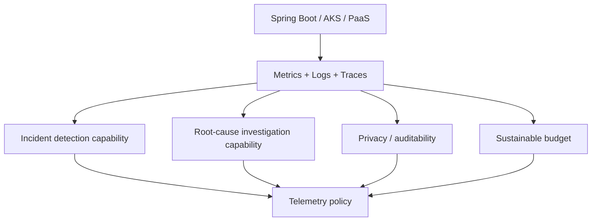
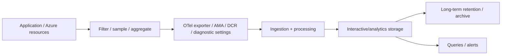
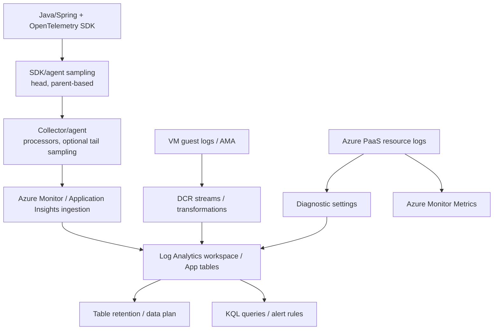
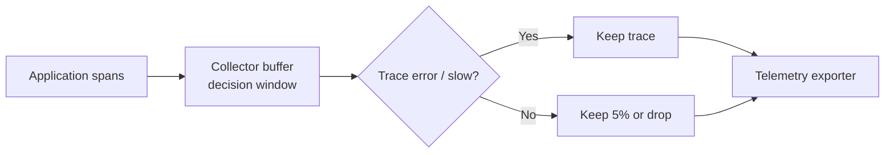
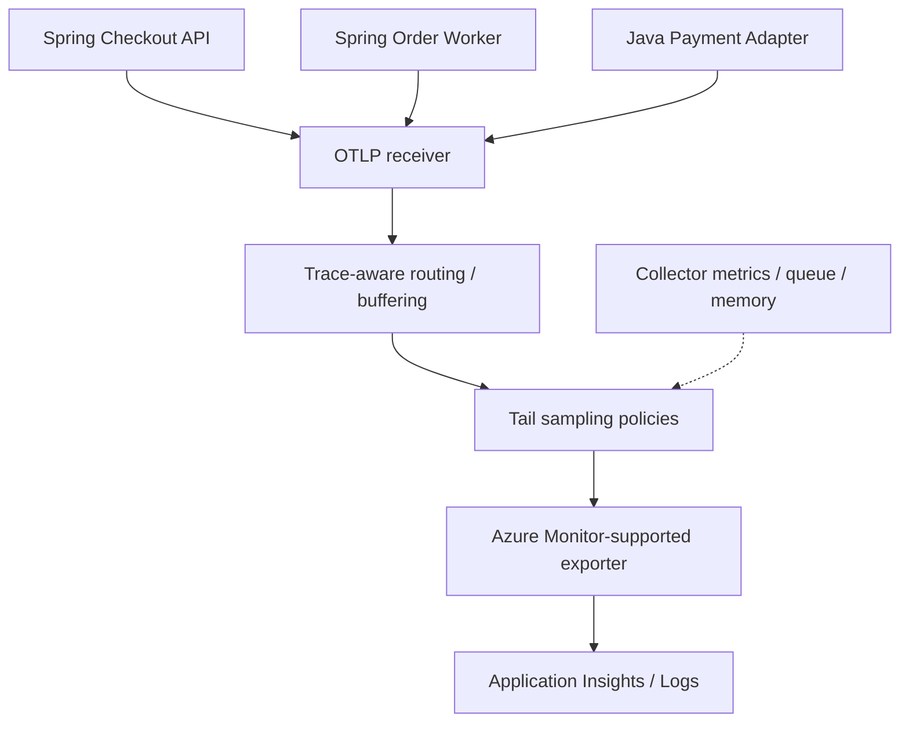
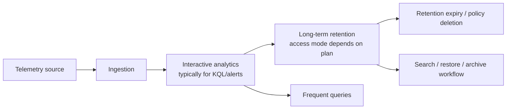
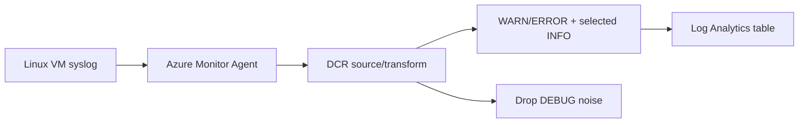
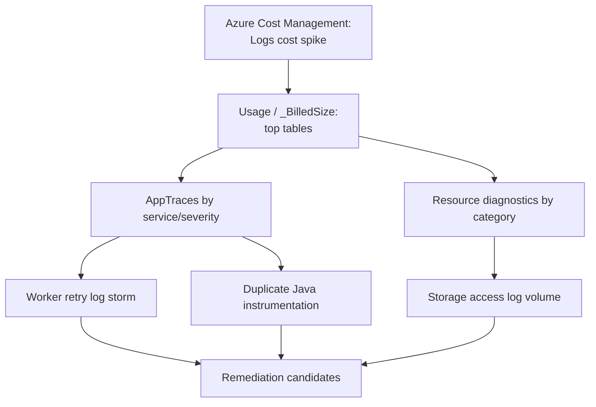

# Telemetry Sampling, Retention, and Cost Control

An ordering system running on Azure comprises a **Spring Boot API**, Azure SQL Database, Azure Service Bus, Azure Functions, and AKS. During peak traffic, the application receives 4,000 requests/second; each request generates a request span, multiple dependency spans, application logs, and custom metrics. When engineers enable `DEBUG` logging to investigate a rare bug, telemetry volume flowing into Log Analytics spikes dramatically, while genuinely useful traces get buried under millions of events. Later, when investigating an incident from three months ago, some logs are no longer available in standard interactive queries.

The answer is neither **logging everything forever** nor **turning off all telemetry to save money**. Instead, teams must co-design three mechanisms: **sampling** to retain representative and diagnostic telemetry, **retention** to define which data stays how long across storage tiers, and **cost governance** to quantify ingestion volume, query behavior, supporting pipeline overhead, and budget limits. Every choice must safeguard alert quality, incident investigation, data privacy, and audit compliance.

Within the **CLOUD_PROVIDERS_AZURE** module, learners explore Microsoft Azure from subscriptions, resource groups, and Entra ID to virtual networks, compute, storage, and data—learning how to deploy, monitor, protect, and govern the cost of Azure architectures. Belonging to the **Monitoring and Observability** chapter, this lesson directly addresses **"Telemetry Sampling, Retention, and Cost Control"** across Azure Monitor, workspace-based Application Insights, Log Analytics, OpenTelemetry, Data Collection Rules, Azure Monitor Metrics, and governance tooling.

> **Scope and caveats:** Pricing rates, min/max retention windows, Analytics/Basic/Auxiliary table capabilities, ingestion-time transformations, sampling options, and alert quotas vary by region, subscription, data plan, table type, and SDK version. Examples illustrate engineering principles rather than quotes or binding policies on your resources. Never alter policies, disable audit logs, or ingest production data into a lab workspace without formal approval.

## 1. Learning Objectives

After completing this lesson, you will be able to:

- Distinguish **sampling**, **filtering**, **aggregation**, **rate limiting**, **retention**, and **archiving** without conflating their roles.
- Explain how **head, parent-based, tail, and adaptive sampling** affect distributed trace completeness and statistical accuracy.
- Identify data that **must not be sampled**—such as security audits and financial ledgers—versus telemetry that can be reduced under controlled policies.
- Configure OpenTelemetry for Spring Boot and recognize control points across the **SDK/agent**, **Collector**, and **Azure Monitor/Application Insights**.
- Estimate **log ingestion, retention, queries, transformations, alerts, export, and networking** costs beyond raw payload size alone.
- Read `Usage`, `_BilledSize`, and `_IsBillable` via KQL where available, and reconcile them against **Azure Cost Management**.
- Design table/log data plans, interactive investigation windows, and governed long-term retention strategies.
- Curb **metric cardinality**, refine structured log fields, calibrate sampling ratios, and eliminate duplicate telemetry.
- Apply **DCR transformations, daily caps/budget alerts, retention policies, and least-privilege access** without creating blind spots.
- Run before/after optimization benchmarks and execute runbooks for unexpected cost spikes or missing observability data.

## 2. Purposeful Observability: Balancing Four Competing Needs



A strong telemetry policy balances four requirements:

1. **Sufficient detection:** SLO breaches and outages are still caught fast enough.
2. **Sufficient diagnosis:** enough traces and logs survive to isolate root causes and cross-service correlation.
3. **Compliance:** sensitive fields are redacted, retained, or purged per policy.
4. **Sustainable cost:** ingestion and storage do not grow unbounded alongside traffic spikes.

For example: retain low-cardinality per-minute **HTTP 5xx error metrics** for alerting; keep a subset of **healthy traces** while prioritizing error traces where the pipeline supports it; route **permission-change audit events** to an immutable, time-bounded, access-controlled pipeline; and strip PII from request bodies.

### Baseline Policy Guide Before Optimizing

| Signal | Purpose | Starting Policy |
|---|---|---|
| **Service-level metrics** | SLIs/SLOs, error rates, p95/p99, throughput | Aggregate consistently with tightly bounded dimensions |
| **Application traces** | Diagnose slow requests and failing dependencies | Purposeful sampling with consistent trace correlation |
| **Application DEBUG/INFO logs** | Fine-grained diagnostics | Filter/rate-limit; enable DEBUG only with time limits |
| **WARN/ERROR logs** | Failure troubleshooting | Prioritize keeping within budget; prevent log floods/duplication |
| **Security/audit logs** | Action attribution and compliance | Never sample arbitrarily; govern retention and access separately |
| **Business financial records** | Transaction reconciliation | Use durable transactional ledgers; never treat sampled traces as ledgers |
| **Platform resource diagnostics** | IAM/network/service failures | Enable essential categories only; choose target and retention carefully |

There is no universal "keep 10% of logs" rule. Every telemetry category differs in **diagnostic value, sensitivity, recoverability, and compliance mandate**.

## 3. Distinguishing Sampling, Filtering, Aggregation, and Retention

These tools sit at different points in the pipeline:

| Mechanism | Action | Effect |
|---|---|---|
| **Sampling** | Keeps a subset of spans/traces/events probabilistically or by rule | Cuts transmitted/stored volume; can introduce statistical bias |
| **Filtering** | Drops unneeded telemetry before ingestion | Dropped records cannot be queried later at that destination |
| **Aggregation** | Rolls individual measurements into counters, histograms, or summaries | Preserves trends/SLIs while discarding per-request detail |
| **Rate limiting** | Caps item count or throughput per interval | Can create blind spots during extreme traffic surges |
| **Retention** | Deletes or transitions data to cheaper tiers after an age limit | Does not reduce upfront ingestion charges |
| **Archive/export** | Copies or moves telemetry to external storage | Incurs storage, retrieval, egress, and lifecycle governance costs |



**Short retention** does not erase charges already incurred to **ingest** huge log volumes. Writing 100 GB/day of `DEBUG` logs to an Analytics table and deleting them after 7 days still incurs 100 GB/day of ingestion fees under standard billing models. Conversely, **pre-export sampling** trims transport and ingestion costs while permanently discarding unselected traces.

### Decision Questions

- Need **exact counts**? Use reliable counters/histograms or transactional stores rather than counting sampled trace rows.
- Need **incident investigation**? Keep contextual records and configure sampling to preserve end-to-end trace correlation.
- Need **regulatory auditability**? Use dedicated non-lossy pipelines and compliant retention—never probabilistic drops.
- Trying strictly to lower **historical storage costs**? Adjust table data plans or long-term retention instead of altering app sampling.

## 4. The Azure Telemetry Pipeline: Where Does Sampling Happen?



Each path has **distinct control points**:

- **Java OTel instrumentation:** makes trace-sampling decisions in the SDK/agent—or delegates to a Collector if un-dropped.
- **Application Insights SDK/distro:** implements version- and exporter-specific sampling, caching, and ingestion behaviors.
- **AMA + DCR:** controls collected guest logs/counters and supported transformations—not trace sampling.
- **PaaS Diagnostic Settings:** selects resource log categories and destinations rather than configuring a Java OTel sampler.
- **Azure Monitor Metrics:** handles numerical time-series metrics and aggregations outside Log Analytics tables.

Do not claim "enabling Log Analytics sampling cuts system volume by 50%" when multiple independent pipelines feed that workspace without sharing a single sampler.

## 5. How Trace Sampling Differs from Log Sampling

A distributed trace spans multiple services. Sampling **span by span** independently can retain the API span while dropping its SQL or Service Bus child spans, breaking diagnosis. Make sampling decisions **at the trace level** and propagate sampling context wherever supported.

### Two Mental Models

```text
Span-by-span random:
  API span       kept
  SQL span       dropped
  Service Bus    kept
  Worker span    dropped
  -> Broken trace tree, hard to diagnose

Consistent trace decision:
  Trace A -> retain instrumented spans of A
  Trace B -> do not export spans per sampling decision
  -> Fewer traces, yet cleanly reconstructible
```

**Log sampling** can filter by severity, event code, ratio, or correlation. Never drop security audit records or critical financial events simply because an associated request trace was head-sampled out.

### "Keeping Full Traces" Still Does Not Guarantee Every Span Exists

Uninstrumented libraries, network exporter failures, timeouts, rate limits, pod restarts, or broken context propagation can still drop child spans on sampled traces. Measure **telemetry completeness** via synthetic tests and missing-data alerts; intentional sampling is only one reason spans disappear.

## 6. Head Sampling: Deciding Early

**Head sampling** makes the keep/drop decision when a trace begins, before knowing the final outcome. A 10% probability keeps roughly one in ten traces at scale—**with no guarantee of keeping literally 1 out of every 10 consecutive requests**.

### Advantages

- Cuts span recording and export overhead immediately (depending on sampler implementation).
- Consumes far fewer resources than tail sampling; scales smoothly for massive traffic.
- Supports consistent trace-ID decisions across services when context propagation and sampler policies align.

### Limitations

- Rare failing requests may be dropped before anyone knows they failed.
- Infrequent tail-latency outliers can vanish from trace storage.
- Mismatched sampling ratios across services without consistent propagation break trace trees.
- Specific SDKs, collectors, or exporters may override or adjust sampling settings—verify live behavior.

### OpenTelemetry SDK/Agent Configuration via Environment Variables

Many **standard OpenTelemetry SDK autoconfigure / Java agent** setups support:

```bash
OTEL_TRACES_SAMPLER=parentbased_traceidratio
OTEL_TRACES_SAMPLER_ARG=0.10
OTEL_SERVICE_NAME=checkout-api
```

This is a **standard OTel SDK/agent example**. Never assume every **Azure Monitor OpenTelemetry distro** or Application Insights Java agent interprets these variables identically; specific distributions may define their own sampling keys or APIs. Confirm compatibility, effective settings, and actual ingested trace counts in staging.

### Parent-Based Sampling

A parent-based sampler generally honors the upstream sampling flag when a valid parent trace context arrives, helping downstream services avoid fragmented trace trees. Watch out for:

- External third parties setting `sampled=false`—define explicit trust policies for remote parents.
- Gateways stripping `traceparent`, forcing every downstream service to start a new disconnected trace.
- Never treating the sampling bit as authorization or tenant trust.
- Async queues and batch jobs often requiring **span links** rather than strict parent-child chains.

## 7. Tail Sampling: Deciding After Observing the Outcome

**Tail sampling** buffers spans until enough context arrives to recognize **errors, slow requests, or rare patterns**—for instance, keeping 100% of error traces or requests exceeding 2 seconds while keeping only 5% of fast healthy traffic.



### Benefits

- Dramatically improves retention of high-value diagnostic traces.
- Supports policies conditioned on final latency, status codes, and collected attributes.
- Fits high-throughput environments that still must capture rare anomalies.

### Costs and Operational Risks

- Collectors require significant **memory, decision wait buffers, CPU throughput, and autoscaling**.
- If upstream apps apply head sampling first, tail samplers **cannot recover already-dropped spans**.
- Long-running traces or delayed spans exceeding the decision window trigger decisions on incomplete trace trees.
- Multi-replica Collector tiers must apply **trace-ID-aware routing** so every span of a trace lands on the same Collector node—otherwise traces split and break.
- Overloaded or restarting Collectors drop telemetry cleanly across buffered windows.

### Illustrative Policy

```text
1. Keep traces with status ERROR.
2. Keep traces with duration > 2000 ms.
3. Keep 5% of short healthy traces.
4. Never use raw userId, orderId, or tokens as sampling keys or metric labels.
5. Monitor Collector CPU/memory and late/incomplete trace counts.
```

This is a **policy outline**, not a drop-in YAML file for every OTel Collector distribution. The `tail_sampling` processor depends on specific Collector builds (typically Contrib), and **Azure Monitor ingestion is not automatically a raw generic OTLP endpoint**. Pair it with a supported exporter or gateway and test end-to-end.

## 8. Adaptive Sampling and Application Insights

**Adaptive sampling** dynamically adjusts capture rates as request volume changes to stay near a target throughput budget. Various Application Insights SDK/agent versions implement adaptive sampling and may populate **`ItemCount`/weights** on stored rows to estimate pre-sampled totals.

### Comparison with Fixed Sampling

| Mode | Best Fit | What to Verify |
|---|---|---|
| **Fixed rate** | Predictable traffic needing steady ratios | Effective rate, statistical bias, trace consistency |
| **Adaptive** | Bursty traffic needing ingestion guardrails | Dynamic effective rate, error prioritization, item weights |
| **Tail policy** | Keeping slow/error traces post-execution | Collector memory/state, incomplete traces, operational cost |
| **No sampling** | Low traffic or mandatory complete records | Ingestion cost, rate limits, compliance |

**Never stack multiple independent samplers blindly.** If an SDK keeps 10% and a downstream exporter samples 20% of what remains, effective survival drops to roughly **2%** while potentially skewing `ItemCount` extrapolation beyond recovery.

### "Estimated Counts" vs. Raw Rows

When one stored record carries `ItemCount=10` to represent 10 sampled events, `count()` returns `1` whereas `sum(ItemCount)` estimates `10`. This works **only when your schema and pipeline preserve accurate sampling weights**—do not apply it blindly to arbitrary logs, metrics, or tail-sampled traces.

## 9. Sampling and SLI/SLO Accuracy

A **Service Level Indicator (SLI)** demands trustworthy measurement. Take checkout success rate:

\[
\text{Success rate}=
\frac{\text{successful eligible requests}}
{\text{total eligible requests}}.
\]

When samplers discard traces, `count()` over stored trace rows **no longer equals actual total requests**. Retaining 100% of failures and 5% of successes **artificially inflates raw trace error rates**.

### Clear Bias Example

Suppose actual traffic in one hour is:

| Outcome | Actual Requests | Stored Under Policy |
|---|---:|---:|
| Success | 99,000 | 5% = 4,950 |
| Failure | 1,000 | 100% = 1,000 |
| **Total** | **100,000** | **5,950** |

True error rate:

\[
\frac{1000}{100000}=1\%.
\]

Naive error rate computed directly on sampled trace rows:

\[
\frac{1000}{5950}\approx16.8\%.
\]

Never compute SLAs from **raw sampled trace row counts** when keep rates differ by outcome. Rely on **pipeline-preserved weighted counts** or—far better—**unsampled counters/histograms** captured at the source with clear semantics.

### A Resilient SLO Architecture

- **Counts & error rates:** unsampled platform, ingress, or app metrics with verified completeness.
- **Latency p95/p99:** pre-sampling metrics histograms/distributions capturing all eligible requests.
- **Traces:** sampled diagnostic evidence—never the financial or SLA source of truth.
- **Transaction audits:** dedicated databases/event ledgers for billing and order correctness.

**Percentiles computed over sampled traces** skew upward whenever tail samplers prioritize slow requests. Never compare biased trace percentiles directly against global p95 SLOs without verified weighting across the full distribution.

### Aggregating Across Multiple Instances

Compute fleet-wide error rates as:

\[
\frac{\sum_i \text{failed}_i}{\sum_i \text{total}_i}
\]

rather than taking the **unweighted mean of per-pod error rates** when pods serve uneven request volumes. Likewise, averaging per-pod p95 latencies never produces the true fleet p95.

## 10. KQL: Checking Sampling Coverage Before Trusting Numbers

In workspace-based Application Insights, certain tables expose `ItemCount`. The query below **compares raw rows against estimated original items** when your pipeline populates that column:

```kusto
AppRequests
| where TimeGenerated >= ago(24h)
| extend Weight = tolong(coalesce(ItemCount, 1))
| summarize
    StoredRows=count(),
    EstimatedOriginalItems=sum(Weight),
    MinWeight=min(Weight),
    MaxWeight=max(Weight)
  by AppRoleName, bin(TimeGenerated, 1h)
| extend ApproxKeepRatio =
    iff(EstimatedOriginalItems == 0, real(null),
        todouble(StoredRows)/todouble(EstimatedOriginalItems))
| order by TimeGenerated asc
```

**Limitations:** This yields an **approximation from sampling weights**, not proof of complete visibility across head/tail sampling. If an SDK/Collector drops spans before computing `ItemCount`, or if ingestion drops occur, `EstimatedOriginalItems` cannot recover missing counts. Never cite this ratio to claim 100% observability coverage.

### Weighted Error Rate Estimate

```kusto
AppRequests
| where TimeGenerated >= ago(2h)
| extend Weight = tolong(coalesce(ItemCount, 1))
| summarize
    EstimatedTotal=sum(Weight),
    EstimatedFailures=sumif(Weight, Success == false),
    StoredSamples=count()
  by AppRoleName, bin(TimeGenerated, 5m)
| extend EstimatedErrorRatePercent =
    iff(EstimatedTotal == 0, real(null),
        100.0 * todouble(EstimatedFailures)
              / todouble(EstimatedTotal))
| order by TimeGenerated asc
```

This estimate remains valid only insofar as **samples stay representative and weights stay intact**. Under error-biased tail sampling, uniform weighting still distorts ratios. Use **unsampled request counters/histograms** for formal SLO reporting.

### Cross-Checking Against an Independent Source

In a lab:

1. Send a known volume of traffic from a load generator.
2. Read the gateway/platform ingress request metric.
3. Compare `count()`, `sum(ItemCount)`, and known request totals.
4. Test success, 5xx failure, and slow-request cohorts separately.
5. Confirm parent/child span integrity after sampling.
6. Document all discrepancies before picking production sampling rates.

## 11. Java and Spring Boot: Controlled Head Sampling

Assume a Spring Boot service runs compatible OpenTelemetry Java agent/SDK autoconfiguration. In a **standard OTel configuration**:

```properties
OTEL_SERVICE_NAME=checkout-api
OTEL_TRACES_SAMPLER=parentbased_traceidratio
OTEL_TRACES_SAMPLER_ARG=0.10
```

Pair the app with an **organization-approved agent/exporter** and configured credentials; **never assume** a generic OTel agent exports to Azure Monitor automatically via `APPLICATIONINSIGHTS_CONNECTION_STRING` alone. If using the Azure Monitor OpenTelemetry Distro, verify the exact sampling properties supported by that distro version.

### Adding a Custom Java Span

```java
package example.observability;

import io.opentelemetry.api.GlobalOpenTelemetry;
import io.opentelemetry.api.trace.Span;
import io.opentelemetry.api.trace.StatusCode;
import io.opentelemetry.api.trace.Tracer;
import io.opentelemetry.context.Scope;
import org.springframework.stereotype.Service;

@Service
public final class CheckoutValidator {
    private final Tracer tracer = GlobalOpenTelemetry.getTracer(
            "checkout-api.business");

    public void validate(String orderCategory) {
        Span span = tracer.spanBuilder("checkout.validate").startSpan();
        try (Scope scope = span.makeCurrent()) {
            String normalized = "other";
            if ("standard".equals(orderCategory)) {
                normalized = "standard";
            } else if ("subscription".equals(orderCategory)) {
                normalized = "subscription";
            }
            span.setAttribute("checkout.order.category", normalized);

            if (orderCategory == null || orderCategory.isBlank()) {
                throw new IllegalArgumentException("Missing order category");
            }
            // Actual business validation belongs here.
        } catch (RuntimeException ex) {
            span.recordException(ex);
            span.setStatus(StatusCode.ERROR);
            throw ex;
        } finally {
            span.end();
        }
    }
}
```

This creates a **span via the OTel API**; exporting it to Azure requires a configured **OTel SDK/agent, propagator, and exporter**. Active samplers may still drop the trace containing this span. Note how attributes are **normalized** to avoid cardinality explosion from user or order IDs.

### Double Instrumentation Counting

Applications can accidentally enable multiple layers simultaneously:

- The Azure Monitor Java distro auto-instrumenting HTTP/JDBC.
- A generic OpenTelemetry Java agent also instrumenting HTTP/JDBC.
- A Spring/Micrometer bridge emitting an extra layer of telemetry.

Without checking, you receive **duplicate request spans**, multiplied dependency rows, and inflated bills. Compare staging request totals against root-span counts and record volumes after wiring instrumentation. Aim for **one clear pipeline owner**, not "turn on everything just in case."

## 12. Tail Sampling with OpenTelemetry Collector: Operational Design

Multi-service architectures can forward spans to an intermediate Collector tier to apply tail-sampling rules.



### Readable Pseudoconfiguration

```yaml
# PSEUDOCONFIG — do not deploy directly; omits receivers/exporters,
# authentication, TLS, memory limiter, scaling, and routing.
processors:
  tail_sampling:
    decision_wait: 10s
    policies:
      - name: retain-errors
        type: status_code
        status_code:
          status_codes: [ERROR]
      - name: retain-slow
        type: latency
        latency:
          threshold_ms: 2000
      - name: sample-others
        type: probabilistic
        probabilistic:
          sampling_percentage: 5
```

**Never copy this YAML directly into production**: verify schema, processor distribution/version compatibility, `service.pipelines`, exporters, memory limiters, TLS, and drop policies. With multi-policy rules, confirm **OR-combination semantics** and evaluation ordering supported by your processor version.

### Monitoring the Collector Itself

- Spans received, exported, and dropped per receiver, processor, and exporter.
- Traces awaiting decision, memory consumption, and queue depth.
- Decision latency and incomplete-trace counts.
- Export retries, throttling, and drops caused by restarts or scaling.
- Traffic distribution by sanitized service/region/tenant metadata.

**Collectors become telemetry single points of failure** when under-provisioned. Placing tail sampling between production services and Azure Monitor requires HA planning, trace-ID consistent hashing, backpressure handling, and tested upgrades.

## 13. Value-Based Sampling Policies Instead of One Flat Percentage

A well-designed policy classifies telemetry by value:

| Trace / Log Category | Evaluation Recommendation | Rationale |
|---|---|---|
| High-volume healthy requests | Sample 1–10% *after benchmarking* | Usually sufficient for diagnostic trends |
| HTTP 5xx responses | Retain all *where supported by pipeline* | Needed for root-cause correlation |
| Slow requests exceeding SLO | Retain via tail sampling | Captures tail-latency outliers |
| Batch reconciliation traces | Higher retention rate when audited | Low volume with high business criticality |
| Liveness/readiness probes | Filter/drop or keep minimal ratio | Extremely noisy with little diagnostic value |
| Routine SQL dependency spans | Inherit parent trace sampling decision | Prevents incomplete trace context |
| Security access-denied events | Dedicated security/audit stream | Never sample arbitrarily |
| Financial state transitions | Durable ledger/audit + ops telemetry | Never treat sampled traces as accounting records |

**The 1–10% figures are illustrative**, not Azure Monitor defaults or universal rules. Low-traffic apps, rare bugs, or regulated flows may need 100% trace capture in narrow scopes, while huge workloads need careful multi-tier instrumentation backed by exact metrics.

### Four Questions Before Lowering Rates

1. Will a rare bug occurring **once in 100,000 requests** still have a reasonable chance of capture?
2. Do retained healthy traces still cover all routes, regions, and versions—or only the busiest endpoint?
3. Do all distributed services honor consistent trace sampling decisions?
4. Do SLO, financial, and security reports rely on unsampled sources rather than sampled traces?

If you cannot answer yes, **do not slash production sampling** solely to trim this week's bill.

## 14. Logs: Pre-Ingestion Filtering Often Matters More Than Trace Sampling

Excessive log volume typically stems from:

- Accidental logging of full HTTP request/response bodies.
- Leaving `DEBUG` or `TRACE` enabled indefinitely.
- Tight retry loops logging identical stack traces many times per second.
- High-frequency HTTP health-check access logs.
- ORM/SQL logging dumping every statement with parameters and pool chatter.
- Duplicate log shipping across stdout, file agents, and OTel exporters.
- Enabling high-volume PaaS access diagnostics indiscriminately.

### Java Logging Levels

In Spring Boot:

```properties
# Sample application-prod.properties; test against your logging framework.
logging.level.root=INFO
logging.level.org.springframework.web=WARN
logging.level.org.hibernate.SQL=WARN
logging.level.com.example.checkout=INFO
```

**Never turn off all `ERROR` logs.** Instead of printing identical stack traces 10,000 times per second, combine:

1. Rate-limited detailed error logging.
2. An unsampled **counter** tracking total occurrences.
3. Exemplars and correlation IDs for deep diagnosis.
4. Alerts triggered on rising error rate alongside spam suppression.

### Log Category Policy

| Category | Recommended Dev/Prod Policy |
|---|---|
| `app.business.critical` | Structured, business-governed retention, zero secrets |
| `app.error` | Prioritize retention with duplicate flood rate-limiting |
| `app.info` | Essential lifecycle and milestone events only |
| `app.debug` | Disabled by default in prod; time-boxed during incidents |
| `http.access` | Minimal fields; replace raw IDs with templates; forecast volume |
| `security.audit` | Dedicated audit pipeline; zero probabilistic drops |

**Filter logs as close to the source as possible**: dropping records at the workspace after shipping them through exporters and agents still burns CPU, memory, and network bandwidth, and not all log types support ingestion-time transforms equally.

## 15. Metric Cardinality: Costs Don't Come Only from Logs

A custom metric carrying unbounded labels:

```text
http.server.duration{
  route="/orders/548321",
  userId="u-100209",
  status="200",
  pod="checkout-7f9c"
}
```

creates massive numbers of distinct time series whenever `route` embeds raw IDs and `userId` grows unbounded. This inflates memory, storage, scrape payloads, query latency, and metrics backend bills (including managed Prometheus).

### Refactor to Low-Cardinality Dimensions

```text
http.server.duration{
  route="/orders/{orderId}",
  status_class="2xx",
  service="checkout-api",
  environment="production"
}
```

**Never use raw URLs instead of route templates.** Pod/instance names may be justified on infrastructure metrics when instance counts and retention stay controlled, but never put user or request IDs into metric dimensions.

### Estimating Label Combinations

A metric with 12 routes × 5 status classes × 4 regions × 3 deployment rings theoretically multiplies to:

\[
12\times5\times4\times3=720\text{ series}
\]

before even factoring HTTP methods, pods, namespaces, or extra tags. Adding a `customerId` label across 100,000 active customers explodes series counts enormously; actual observed series depend on traffic overlap, yet **multiplicative cardinality risk** must be engineered out upfront.

### When to Choose Logs or Traces Instead of Metrics

- Finding request `order-123`: use access-controlled logs or traces.
- Tracking checkout p95 per region: use a low-dimension metric histogram.
- Auditing who modified permissions: use immutable audit logs, not counters.
- Summarizing financial settlements: use databases/ledgers rather than resettable Prometheus counters.

## 16. Eliminating Duplication and Misrouted Destinations

Incidents often lead developers, SREs, and security teams to flip on redundant telemetry at once—producing three copies of a single Java exception:

1. Spring logger prints to stdout.
2. Container agent ships stdout into Log Analytics.
3. OTel logging exporter sends the exact same event into Application Insights.

Landing both in the same workspace generates **duplicate records** and double charges for one event.

### How to Detect Duplicates

In staging with a known unique request ID:

1. Trigger one controlled request throwing a single exception.
2. Search that `traceId` across `AppTraces`, container log tables, and `AppExceptions`.
3. Distinguish **complementary telemetry roles** from identical duplicate payloads/timestamps.
4. Consolidate onto one primary ingestion path without breaking required audit or container diagnostics.
5. Compare counts, trace coverage, and error detail before and after cleanup.

**One trace span and one structured error log for the same failure are not necessarily wasteful duplication**—they complement one another. Remove only truly redundant or low-value copies.

## 17. What Is Retention? Interactive Analytics vs. Long-Term Access

**Retention** governs how long ingested data remains available, when it supports fast interactive queries, and when it transitions to colder tiers or gets purged by policy. Inside Azure Monitor Logs, exact capabilities differ by **table plan, workspace, region, and table type**.

### Two Distinct Needs

- **Interactive analytics retention:** the hot window used frequently for dashboards, live troubleshooting, and log alerts under the plan's query model.
- **Long-term retention:** preserving infrequently accessed history for audits or forensics, often via different access workflows and search/restore charges.



This illustrates **logical data lifecycle**, not a guarantee that Azure executes identical hot → cold steps automatically across every table. Beyond interactive retention, table plans impose distinct search/restore workflows and constraints.

### Key Policy Questions

1. How far back do **incident investigations** typically look?
2. What lookback window do alerts and SLO queries require?
3. How long must **audit, security, and compliance** records remain under legal hold?
4. Do investigators need lookups by redacted tenant or order IDs?
5. Can metrics or events be recomputed from source databases or data lakes?
6. If queried years later, do **retrieval speed and restore cost** fit operational SLAs?
7. Once expired, must records be **hard-deleted** or merely moved to cold storage?

### Retention Changes Carry Risk

Slashing retention from 90 days to 14 days leaves real-time alerts untouched while blinding security teams investigating last month's intrusion. Retaining PII indefinitely can breach privacy regulations. **Align retention policies across Security, Compliance, Data Owners, and SRE**—not budget owners alone.

## 18. Azure Monitor Logs Data Plans: Analytics, Basic, and Auxiliary

Azure Monitor Logs offers multiple **table plans**—commonly **Analytics, Basic, and Auxiliary** depending on table, region, and current service support—tailored to different query patterns and price points.

| Criterion | **Analytics** | **Basic** | **Auxiliary** |
|---|---|---|---|
| Typical purpose | Frequent interactive queries, alerts, deep investigation | Diagnostic logs rarely queried | Very high-volume logs with minimal/focused lookups |
| Pricing & capabilities | Plan-specific ingestion, retention, and query model | Different ingestion and per-query pricing model | Typically lower ingestion pricing with stricter query constraints |
| Query operators | Full workspace KQL capabilities per resource | Subset/restrictions compared to Analytics | Dedicated query limitations |
| Alerts / cross-table joins | Broadly supported for alerting/joins | Typically restricted vs. Analytics | Typically restricted vs. Analytics |
| Retention | Configurable Analytics & total retention | Plan-specific rules and caps | Plan-specific rules and caps |
| Best-fit data | `AppRequests`/`AppDependencies` or critical security logs | Low-frequency access logs | Extremely noisy verbose logs where supported |

**This serves as a selection guide, not an exhaustive feature matrix.** Not every table supports plan switching, and transitions carry **eligibility constraints, cooldown periods, and alert/query impacts**. Verify exact table rules via the Azure Portal or API.

### When Not to Downgrade a Plan Simply for Lower Ingestion Rates

If a table drives **5-minute scheduled query alerts**, cross-table joins, and constant incident triage, switching it to a restricted-query plan breaks detection. Evaluate **query frequency, scanned GB, detection SLOs, and required KQL operators**—never just ingestion GB.

### Tiered Data Strategy

```text
Critical application request / dependency telemetry
  -> Analytics plan, retention aligned with MTTR/SLO

Security/audit records
  -> Plan + archival/retention meeting compliance mandates

Verbose raw access logs
  -> Trim at source; evaluate Basic/Auxiliary where supported
  -> Or archive to storage if long-term preservation is needed
```

**Never treat table plans as substitutes for data classification.** Mixing PII with noisy diagnostics in a cheap table still leaks data if workspace RBAC is overly permissive.

## 19. Table-Level Retention and Long-Term Access

Different tables inside one workspace have very different needs:

| Table / Group | Use Case | Illustrative *Approved* Retention Goal |
|---|---|---|
| `AppRequests` | SLO/incident metrics | Interactive window covering release comparisons |
| `AppDependencies` | SQL/HTTP latency diagnosis | Interactive window aligned with MTTR targets |
| `AppTraces` | App DEBUG/INFO logs | Shorter interactive window unless audit-critical |
| `AppExceptions` | Failure root-cause analysis | Long enough for post-incident reviews |
| Audit logs | Compliance/forensics | Governed by legal and security policy |
| VM syslog / noisy diagnostics | Operational troubleshooting | Justified by diagnostic value without bloat |

### Adjusting Workspace Retention vs. Archiving to Storage

In Log Analytics, **long-term retention** is a built-in Logs capability available on supported plans and tables. **Exporting diagnostic logs to Azure Blob Storage** creates a separate storage pipeline requiring lifecycle management, RBAC, encryption, immutability, and query/re-ingestion tooling. Never treat the two as interchangeable in cost, searchability, or compliance.

### Portal Workflow Outline

1. Open the target environment's **Log Analytics workspace**.
2. Go to **Tables** and select the table to configure.
3. Inspect its **table plan**, interactive/total retention, and current settings.
4. Check dependent alert rules, dashboards, query lookbacks, and RBAC.
5. Apply approved retention settings on **eligible tables**.
6. Re-read saved settings and test queries across pre- and post-window bounds.
7. Document the change ticket and rollback plan.

Never blindly apply legacy snippet properties like `retentionInDays` across every table—APIs and table scopes evolve. Verify the Azure Monitor Logs table configuration API/CLI supported in your subscription before automating.

## 20. Auditing and Immutability: Retention Is Not WORM

Retaining a table for 365 days **does not automatically make records immutable** or satisfy strict regulatory mandates. For audit and forensics:

- Track authoritative ingestion sources and write-permitted identities.
- Implement **immutability/WORM/legal holds** in compliant storage where mandated.
- Preserve timestamps, origin metadata, checksums, and integrity proofs.
- Enforce read authorization and audit logging whenever sensitive logs are queried.
- Ensure records remain retrievable within regulatory SLA windows.
- Support compliant deletion/hold workflows for privacy and legal requests.

**Never sample security audit logs simply because an app generates bursts of events.** When audit volume spikes, fix **noisy triggers, normalization, capacity, and archival tiering** rather than dropping 90% of security evidence.

### Logs Can Accidentally Capture Secrets Too

If an app logs an `Authorization` header, shortening retention to 7 days still leaves exposed credentials readable for 7 days. **Prevent emission at the source, redact before export, lock down access**, and follow security incident response procedures whenever a real secret leaks.

## 21. Cost of a Gigabyte of Telemetry: Think in Total Cost of Ownership

A practical model:

\[
\begin{aligned}
\text{Telemetry TCO} ={}&
\text{Ingestion}+\text{Analytics retention}\\
&+\text{Long-term storage/access}\\
&+\text{Queries/search/restore}\\
&+\text{Metrics/alerts/exemplars}\\
&+\text{Export/network/processing}.
\end{aligned}
\]

Real charges vary by data plan, region, commitment tiers, free grants, data types, and service integrations. **Never apply a single "price per GB" across every signal**: Azure Monitor Metrics, Managed Prometheus, Log Analytics, and Application Insights follow distinct billing models.

### Evaluate Cost Reductions End to End

| Decision | Potential Savings | Added Cost / Risk |
|---|---|---|
| Head-sample 10% of traces | Ingestion, transport, trace storage | Misses rare errors; weakens correlation |
| Tail-sample errors/slow traces | Cuts persisted noise while preserving high-value traces | Collector CPU, memory, operational complexity |
| Disable DEBUG by default | Lower app log ingestion and noise | Slower diagnosis if dynamic debug enablement is hard |
| DCR ingestion transforms | Drops unwanted rows before table billing | Transformation overhead; permanent data loss if wrong |
| Shorter Analytics retention | Lower interactive retention spend | Harder historical incident triage |
| Switch table plans | Changes ingestion/query cost profile | Restricts KQL operators, joins, and alerts |
| Archive to Blob Storage | Potentially cheaper cold storage | Retrieval, egress, storage transaction, and governance costs |
| Raise sampling on one service | Cuts that service's trace volume | Fragments distributed traces across mismatched services |
| Disable platform audit logs | Lower log ingestion | Destroys IAM/security trail; breaches compliance |

### Cost Avoidance vs. Cost Shifting

Dumping high-volume logs from Log Analytics to Blob Storage shrinks your **workspace bill** while adding storage transactions, retention charges, retrieval tooling, pipeline compute, and SRE investigation delays. Compare full **TCO and time-to-diagnose**, not just one workspace chart.

## 22. Estimating Ingestion Volume from Application Traffic

Consider an illustrative API workload:

| Parameter | Simulated Value |
|---|---:|
| Requests / day | 5,000,000 |
| Pre-sampling spans / request | 12 |
| Logical encoded span size | 1 KiB (assumed) |
| Head sampling rate | 10% |
| App logs / request | 2 records × 0.5 KiB |
| Retained logs | 100% (for cost comparison) |

Spans generated before sampling:

\[
5{,}000{,}000\times12=60{,}000{,}000\ \text{spans/day}.
\]

Keeping 10% simply:

\[
6{,}000{,}000\ \text{spans/day}
\times 1\ \text{KiB}\approx 5.72\ \text{GiB/day}.
\]

Additional application logs:

\[
5{,}000{,}000\times 2\times0.5\ \text{KiB}
\approx4.77\ \text{GiB/day}.
\]

Total **assumed logical payload** is roughly 10.49 GiB/day—**not identical to billable Azure GB**, which reflects compression, wire/table schemas, metadata columns, billing rules, and sampling behavior.

### Two Lessons from This Exercise

1. Cutting traces by 90% while leaving verbose logs untouched trims only part of the bill—measure **per table, per service, and per signal**.
2. Adding just one extra 1 KiB log line per request adds roughly **4.77 GiB/day** here without any traffic growth.

Never treat "1 KiB/span" as a universal constant. Measure real sizes via **`_BilledSize` / `Usage` + Cost Management** in staging with authentic payloads and attributes.

## 23. KQL: Reading the `Usage` Table and Units Correctly

In many Log Analytics workspaces, `Usage` tracks ingestion volume by `DataType`, `Quantity`, `QuantityUnit`, and billable flags. It is an analytical breakdown **not replacing your official invoice**, and schemas can vary across workspaces.

### Inspect Schema and Units First

```kusto
Usage
| where TimeGenerated >= ago(7d)
| project TimeGenerated, DataType, Quantity,
          QuantityUnit, IsBillable
| take 30
```

Next, aggregate **grouped by `QuantityUnit`** so you never add megabytes and other units together nonsensically:

```kusto
Usage
| where TimeGenerated >= ago(7d)
| where tostring(IsBillable) =~ "true"
| summarize TotalQuantity=sum(Quantity)
    by DataType, QuantityUnit
| order by TotalQuantity desc
```

### Converting Only After Verifying Units

Once confirmed `QuantityUnit` reports `MBytes` (or the table's exact unit), aggregate cleanly—checking whether units are **decimal MB vs. binary MiB** under platform billing docs first:

```kusto
Usage
| where TimeGenerated >= ago(30d)
| where tostring(IsBillable) =~ "true"
| where QuantityUnit == "MBytes"
| summarize RecordedMB=sum(Quantity) by DataType
| order by RecordedMB desc
```

**Do not claim `RecordedMB/1024` always equals invoiced GiB** without verifying unit conventions and billing rules; use this query primarily to identify **which `DataType` is growing**.

### Limitations of `Usage`

- Different table plans apply distinct usage/billing accounting.
- Workspaces may have free grants, commitment tiers, or credits.
- `Usage` records update with ingestion latency.
- Query, long-term retention, and egress charges sit outside simple ingestion sums.
- Non-billable tables still consume analytical query resources.

Always reconcile budget decisions against **Azure Cost Management** at the matching subscription, resource, and meter level.

## 24. KQL: Measuring `_BilledSize` Across Key Tables

Many Azure Monitor Logs tables include system columns **`_BilledSize`** (estimated billable bytes per row under table semantics) and **`_IsBillable`**. These pinpoint which apps drive volume, though calculation details can vary across table plans.

### Across Application Insights Tables

```kusto
union withsource=SourceTable
    AppRequests,
    AppDependencies,
    AppTraces,
    AppExceptions
| where TimeGenerated >= ago(24h)
| where tostring(_IsBillable) =~ "true"
| summarize
    Rows=count(),
    ApproxBillableGiB=sum(_BilledSize) / pow(1024.0, 3)
    by SourceTable
| order by ApproxBillableGiB desc
```

**Prerequisites:** those tables and columns exist in your workspace and you hold read permissions; adjust table names if your workspace omits `AppExceptions` or uses classic schemas. `_BilledSize` reflects record-level sizing rather than **currency charges**, which depend on pricing plans and commitment adjustments.

### Breakdown by Service and Log Severity

```kusto
AppTraces
| where TimeGenerated >= ago(24h)
| where tostring(_IsBillable) =~ "true"
| summarize
    Records=count(),
    ApproxGiB=sum(_BilledSize)/pow(1024.0, 3)
  by AppRoleName, SeverityLevel
| order by ApproxGiB desc
```

If `checkout-api` `INFO` logs account for 80% of billable bytes, examine **per-request INFO logging**. Never mute all `INFO` blindly—inspect event codes, diagnostic needs, and security requirements first.

### Avoid Scanning Entire Workspaces Recklessly

Running `union *` over hundreds of tables and months of history is **heavy and slow**. In large workspaces:

1. Target suspected tables first.
2. Filter `TimeGenerated` early.
3. Inspect a single day or narrow window around a cost jump.
4. Let Cost Management/`Usage` point you to the noisy source before scanning rows.
5. Monitor query execution cost under your workspace plan.

## 25. KQL: Pinpointing Which Service or Version Spiked Telemetry

Suspect a new deployment flooded logs? Group by **`AppRoleName`**, severity, and hour:

```kusto
AppTraces
| where TimeGenerated >= ago(3d)
| summarize
    Rows=count(),
    ApproxGiB=sum(_BilledSize)/pow(1024.0, 3)
  by AppRoleName, SeverityLevel, bin(TimeGenerated, 1h)
| order by TimeGenerated asc
```

To correlate by deployment version, group only on a field actually emitted by your exporter (often inside `Properties` or resource attributes)—never assume `service.version` exists as a top-level column in every `AppTraces` table.

### Top-Talkers Cost Triage Tree

```text
Total volume ↑
  |
  +-- AppTraces ↑?
  |     +-- which service / version / severity?
  |     +-- which event code is spamming?
  |
  +-- AzureDiagnostics / resource tables ↑?
  |     +-- which diagnostic category was newly enabled?
  |
  +-- AppDependencies ↑?
        +-- duplicate instrumentation or retry storm?
```

Target changes backed by **evidence**: dial back noisy `DEBUG`, suppress health-check spans, fix retry storms, trim access logs, or refine sampling. Afterward, verify **error detection and trace completeness**, not merely smaller GB numbers.

## 26. DCR Transformations: Filtering Before Data Reaches Tables

Azure Monitor **Data Collection Rules (DCRs)** define streams, destinations, and **ingestion-time transformations** for supported ingestion pipelines and tables. Filtering here drops unwanted logs **before table storage and billing**, unlike dashboard KQL filters that only hide already-ingested rows.

### Scenario Example

A VM emits 20 million syslog events daily, 70% being `DEBUG` chatter from a non-critical daemon. Options in priority order:

1. Disable `DEBUG` in the daemon itself (preferred).
2. Configure the AMA/DCR data source to collect only required facilities and severities.
3. Apply a DCR transform to filter rows where the stream/table supports transforms.



### Sample Transformation KQL

```kusto
source
| where SeverityLevel in ("Warning", "Error", "Critical")
| project TimeGenerated, Computer, Facility, SeverityLevel, SyslogMessage
```

This illustrates **logic for a stream exposing those exact field names**, **not a complete deployable DCR JSON definition**. DCR transforms support only a KQL subset and must output a **schema matching the target table** (`SeverityLevel` names and types vary across streams). Never copy blindly into production DCRs; test against real source schemas and API validation.

### Safety Guardrails

- **Never filter security audits** or failure events purely on inconsistent severity strings.
- Test against a representative dataset in staging/canary first.
- Measure dropped vs. kept counts against the origin source.
- Manage DCR definitions in version control/IaC.
- Once a transform drops a row, **no later KQL query can recover it from that workspace**.
- Note that transforms are not uniformly available across every PaaS diagnostic category or Application Insights path.

### Small Edits Can Cause Big Blind Spots

For instance, an app logs `Unauthorized` failures at `Information` severity. A DCR keeping only `Error` silently wipes out every failed sign-in record. **Filter by explicit event codes and categories**, not severity labels alone.

## 27. Diagnostic Settings: Which Categories Belong in Log Analytics?

Azure PaaS services emit varied resource logs: Key Vault audits, Storage transactions, Service Bus operations, firewall/gateway access logs. Diagnostic Settings let you select **log categories or category groups** and supported destinations.

### Picking Categories by Use Case

| Service | Investigation Need | Considerations |
|---|---|---|
| **Key Vault** | Failed secret reads, config updates | Enable relevant audit categories with security-aligned retention |
| **Storage** | Authorization failures, latency spikes | High read traffic can create huge logs |
| **Service Bus** | Network, auth, and operational errors | Pair with broker metrics; never log message bodies |
| **Azure SQL** | Auditing, query tuning, metrics | Keep diagnostic/audit trails separate from business data |
| **Azure Firewall / App Gateway** | Blocked traffic, 4xx/5xx diagnostics | High-volume access logs; filter intentionally |
| **AKS / VMs** | Pod/container/OS failures | Govern AMA/Container Insights pipelines and log verbosity |

### Inspect Available Categories Before Guessing Names

```bash
az login
az account set --subscription "<lab-subscription-id>"

RESOURCE_ID=$(az keyvault show \
  --resource-group "rg-telemetry-lab" \
  --name "kv-telemetry-lab" \
  --query id --output tsv)

az monitor diagnostic-settings categories list \
  --resource "$RESOURCE_ID" \
  --output json

az monitor diagnostic-settings list \
  --resource "$RESOURCE_ID" \
  --output json
```

Both commands above are **read-only**. Modify Diagnostic Settings via IaC or Portal only after confirming exact categories and destinations. A newly enabled noisy category can spike bills quickly—benchmark in a **pilot window** with an assigned owner.

### Multi-Destination Routing

```text
PaaS resource diagnostic log
   ├── Log Analytics (KQL / alert)
   ├── Storage archive (retention/compliance)
   └── Event Hubs (SIEM pipeline)
```

Every destination adds operational overhead, fees, and access controls. Compliance logs may legitimately require two destinations, while shipping debug noise to three places wastes money. **Never delete an archive destination simply because Log Analytics holds logs**, unless retention, immutability, RBAC, and retrieval requirements are verified satisfied.

## 28. Daily Cap: Emergency Circuit Breaker, Not a Cost Strategy

Some Application Insights / Log Analytics setups offer a **daily cap** or ingestion limit. Exact enforcement scope, grace periods, and notifications **depend on resource tier and configuration**.

### Why a Daily Cap Is Not a Hard Budget Guarantee

- Latency occurs between ingestion arrival and cap enforcement.
- Not every pipeline or data category falls under the exact same cap mechanism.
- Charges for retention, queries, metrics, private endpoints, and exports continue accruing.
- Stopping ingestion **blinds investigations precisely during extreme traffic surges or outages**.
- Dashboards can stay falsely green because telemetry halted rather than because errors stopped.

### Safe Governance Practices

1. Forecast baseline and peak ingestion.
2. Configure **budget alerts and ingestion anomaly monitors** well below any daily cap.
3. Monitor **ingestion pipeline health** (latest timestamp and dropped events).
4. If using a cap, align it with risk tolerance and understand the exact outage impact when triggered.
5. Write a runbook for "telemetry halted by daily cap"—never mute missing-data alerts.
6. Ensure critical SLO and audit metrics do not rely solely on a cappable ingestion stream.

**Never treat a daily cap as the fix for an app suddenly dumping 20 GB/hour of `DEBUG` logs.** Fix the log storm or duplicate instrumentation at the source.

## 29. Azure Cost Management: Connecting `Usage` Telemetry to Real Invoices

**Azure Cost Management** tracks actual spend by subscription, resource group, service, tag, or meter charge type according to permissions. Pair it with Log Analytics `Usage` because each answers a different question:

| Source | Question Answered |
|---|---|
| **`Usage` / `_BilledSize` KQL** | Which table or service emits the most telemetry bytes? |
| **Cost Analysis** | What monetary charges occurred per meter, service, and billing period? |
| **Azure Budgets** | Are we tracking to breach monthly or quarterly spend thresholds? |
| **Azure Monitor metrics/alerts** | Are ingestion rates, errors, or source volumes behaving abnormally? |
| **IaC / change logs** | Who recently enabled a diagnostic category or altered sampling? |

### Cost Investigation Workflow

1. Select **before** and **after** intervals around the spend jump in Cost Analysis.
2. Group by service, resource, and meter/charge type to verify telemetry vs. compute/SQL spend.
3. Query workspace `Usage` and suspected tables by `DataType` and `AppRoleName`.
4. Correlate with recent **deployments, DCR edits, Diagnostic Settings, and sampling changes**.
5. Measure what share of ingested data drives real alerts, triage, or compliance.
6. Design targeted fixes and roll out via canary.
7. Verify both **Cost Analysis and observability quality** across a representative traffic cycle.

### Tags and Chargeback

Tags such as `team`, `environment`, and `costCenter` aid resource governance and coarse spend allocation. However, **resource tags on a shared Log Analytics workspace cannot automatically split ingestion bills by application**. Accurate chargeback requires custom attribution by `AppRoleName`, table, or resource reconciled against invoice credits and shared overhead.

### Budget Alerts Are Notifications, Not Hard Quotas

Azure Budget alerts **notify** when actual or forecasted spend crosses thresholds (per configuration); they do not automatically halt telemetry ingestion or scale down apps. Automated reactions require separate approved workflows with strict safety guardrails.

## 30. Budget Exercise: Cutting Ingestion by 40% Without Losing SLOs

Suppose a workspace roughly breaks down as:

| Data Type | Initial Share | Observation |
|---|---:|---|
| `AppTraces` INFO/DEBUG | 40% | Heavy health-check and per-request logs |
| `AppDependencies` & `AppRequests` | 30% | Unoptimized trace sampling |
| Platform diagnostics | 20% | One huge access-log category |
| Audit / security logs | 10% | Mandatory compliance retention |

These are **hypothetical proportions** for learning methodology, not live measurements.

### Proposed Optimization Plan

- Cut `AppTraces` INFO/DEBUG by 50% **after confirming safe-to-drop chatter** → saves ~20 percentage points of total baseline volume.
- Trim `AppRequests`/`AppDependencies` by one-third via consistent trace sampling while **keeping unsampled SLO metrics** → saves ~10 percentage points.
- Refine diagnostic categories or apply verified transforms to halve platform noise → saves ~10 percentage points.
- **Leave audit/security datasets untouched.**

Simulated total reduction = **40% of initial ingestion volume**. Even so, **this does not guarantee a literal 40% invoice cut**, because retention, queries, metric storage, commitment tiers, and fixed charges do not all scale linearly per GB. If already paying for a fixed capacity commitment tier, invoice savings may wait until commitment tier rightsizing.

### Acceptance Criteria

After cutting volume, verify:

1. HTTP error counts and p95 SLOs remain complete.
2. Error and slow traces retain sufficient context for root-cause analysis.
3. Key Vault, Storage, and Service Bus access denials remain investigable.
4. Audit/security event completeness is 100% preserved.
5. Dashboards, KQL queries, and alerts do not break on removed fields.
6. Real workspace ingestion and spend decline over a representative cycle.

**Cutting costs without verifying diagnostic fidelity is a broken optimization.**

## 31. Metric Costs and Managed Prometheus

Azure Monitor handles **platform metrics**, **custom app metrics**, and **Azure Monitor managed service for Prometheus** under distinct engines, features, and pricing models. Collecting Prometheus metrics from AKS flows like this:

```text
AKS workloads
  -> metrics scrape endpoints
  -> managed Prometheus collector pipeline
  -> Azure Monitor workspace
  -> PromQL queries / dashboards / alerts
```

**Do not confuse an Azure Monitor workspace (used for Managed Prometheus) with a Log Analytics workspace (used for KQL logs)**—despite similar names, their roles and backends differ.

### Three Drivers of Metric Load

- **Time-series cardinality:** multiplying labels and label values.
- **Scrape frequency:** shorter intervals multiply sample volume.
- **Metric churn:** rapidly created/destroyed series from transient pods and namespaces.

### Governance Practices

1. Keep only metrics driving real SLOs, dashboards, or alerts.
2. Scope scrape jobs and targets tightly.
3. Standardize route and status labels; drop raw user/order IDs.
4. Test changes to scrape intervals or retention so short spikes aren't averaged away.
5. Protect core SLO metrics independently of trace sampling.
6. Watch query latency and tier rate limits/quotas.

Never apply Log Analytics per-GB math to Managed Prometheus sample/series billing—consult the **specific product pricing model**.

## 32. Alerting and Sampling: Preventing "Healthy" Dashboards Caused by Data Loss

A dashboard can report `0 errors` simply because **no telemetry reached the workspace**. Alerts must monitor both **service errors** and **data freshness**.

### Four Complementary Alerts

| Alert | Purpose |
|---|---|
| **HTTP 5xx / error rate metric** | Catches active SLO degradation |
| **Trace / exporter failure** | Catches apps failing to ship telemetry |
| **Last ingestion age / heartbeat** | Detects broken telemetry pipelines |
| **Usage / cost anomaly** | Flags spend jumping above baseline |

### KQL Freshness Check

```kusto
AppRequests
| where TimeGenerated >= ago(30m)
| summarize LastEvent=max(TimeGenerated), Rows=count()
| extend AgeMinutes =
    datetime_diff("minute", now(), LastEvent)
```

**Watch out:** When the table returns zero rows, `LastEvent` becomes null; queries and alerts must explicitly handle null/empty states. Measuring age on event timestamps **does not measure ingestion lag directly**, and scheduled batch workloads legitimately go idle for 30 minutes. Define freshness against **expected signal cadence**, backed by synthetic heartbeats or independent platform metrics.

### Account for Sampling Rates in Alert Windows

If a low-traffic service gets 20 requests/hour at 5% sampling, hours can pass without a stored trace. Never alert "AppRequests count == 0 in 10 minutes equals outage." Rely on synthetic availability, ingress metrics, and verified no-data semantics.

### What Happens When a Daily Cap Triggers?

The application keeps running while capped trace/log pipelines stop ingesting. Never certify SLO compliance from truncated datasets. Your observability stack must monitor ingestion health and display **data quality degraded** rather than false green.

## 33. Data Governance: Sampling Is Not Privacy; Retention Is Not Access Control

Telemetry can capture IPs, raw URLs, SQL error texts, HTTP headers, user IDs, stack traces, connection strings, or request bodies if misconfigured. Keeping only 10% or purging after 7 days **never makes stored secrets or PII harmless while present**.

### Classify Telemetry at the Source

| Data Tier | Examples | Handling Policy |
|---|---|---|
| Public / operational | Service name, deploy version, status class | Safe for low-cardinality metrics |
| Internal | Route template, error code, dependency name | Role-restricted access |
| Sensitive | IP, user ID, tenant context, payment metadata | Data minimization, tokenization/pseudonymization |
| Secret | Authorization headers, SAS tokens, private keys, passwords | **Never ingest** |
| Regulated / audit | Permission changes, financial/security events | Policy-governed retention, immutability, audited access |

### Controls in Priority Order

1. **Avoid collecting** unneeded fields.
2. **Redact at the source** before spans or logs exit the process.
3. Normalize field values and route templates.
4. Apply supported transforms/filters as defense-in-depth.
5. Enforce workspace, table, and query RBAC where supported.
6. Pin workspace regions and retention to data-residency mandates.
7. Audit log access and maintain a data-leak incident response plan.

**Never treat a Workbook `tenantId` filter as a security wall** when viewers hold query access across the entire workspace. Multi-tenant telemetry requires verified backend/workspace/table isolation.

### Retention and Deletion Requests

Privacy deletion requests can span **`AppTraces`, exported archives, SIEMs, backups, snapshots, and diagnostic destinations**. Map your complete telemetry data flow, legal holds, and supported purge capabilities—never assume deleting a row in the app database removes telemetry everywhere.

## 34. Tailoring Policies Across Environments and Criticality

Never apply identical sampling and retention across development, staging, and production.

### Reference Matrix

| Dimension | Development | Staging | Production |
|---|---|---|---|
| Trace sampling | High/full for debugging with synthetic data | High enough to validate correlation | Controlled ratio prioritizing errors/slow traces |
| Application DEBUG logs | Enabled briefly during active debugging | Enabled for test windows | Disabled by default; time-boxed with approval |
| Audit logs | Policy-based; zero real secrets | Validate completeness | Retained strictly per compliance |
| SLO metrics | Verify instrumentation | Benchmark against load tests | Reliable unsampled coverage required |
| Retention | Short as needed | Sufficient for QA/regression cycles | Driven by MTTR, postmortems, and legal rules |
| Workspace | Non-production workspace | Optionally isolated | Hardened security and data-residency region |
| Budget | Low with regular cleanup | Sized for peak load tests | Baselined, forecasted, and anomaly-alerted |

This matrix is a **policy framework**, not mandated fixed numbers. Security-critical IoT pipelines might keep 100% of specific events in production, whereas noisy frontends can sample most healthy traces.

### Governance Metadata Belongs in Every Policy

```yaml
# Internal governance policy sample, not an Azure resource schema.
service: checkout-api
environment: production
owner: checkout-platform
data_classification: internal
metric_dimensions_allowlist:
  - service
  - region
  - route_template
  - status_class
trace_sampling:
  strategy: "parent_based_or_tail_policy_after_review"
  objective: "retain representative success and investigate errors"
log_levels:
  root: INFO
  noisy_http_health: filtered
retention:
  app_traces: "approved incident window"
  security_audit: "approved compliance policy"
cost:
  budget_owner: platform-finops
  anomaly_alert: enabled
validation:
  must_pass:
    - "SLI coverage"
    - "error trace availability"
    - "audit completeness"
    - "privacy redaction"
```

Never submit this YAML to Azure CLI—it is a **decision-record artifact** for Engineering, Security, and FinOps review, version control, and diff tracking.

## 35. Case Study: Cutting Azure Monitor Costs for an E-Commerce Platform

### Context

A company operates:

- **Checkout API** (Spring Boot on App Service).
- **Order Worker** consuming Azure Service Bus.
- **Product Catalog** on AKS.
- **Azure SQL** and **Storage** backends.
- **Workspace-based Application Insights** and Log Analytics for logs/diagnostics alongside Metrics for SLOs.

Over one month, business traffic tripled while log ingestion jumped **8×**. A retry bug caused the worker to log full stack traces on every retry; meanwhile, ops turned on Storage read diagnostics and deployed a second Java agent in checkout.

### Data-Driven Diagnosis



**Step 1:** Cost Analysis confirms Azure Monitor Logs spend jumped above baseline across ingestion, retention, and query meters rather than compute alone.

**Step 2:** Daily `Usage` and `_BilledSize` queries point straight to `AppTraces`, highlighting an `ERROR` flood from `orders-worker`.

**Step 3:** Code inspection reveals every failing command retries 10 times, emitting 10 stack traces. Replace with **one structured terminal error log** carrying attempt count while a metric counter tracks every retry—leaving order audit records untouched.

**Step 4:** Audit confirms `checkout-api` doubled request spans after adding a second agent. Consolidate onto one instrumentation pipeline and verify SQL/Service Bus child spans remain intact.

**Step 5:** Storage read diagnostics spiked massively. Verify with Security whether 100% read logging is required; narrow categories or apply supported transforms while isolating security-critical audits.

**Step 6:** Set a trace sampling policy keeping representative healthy traces and prioritizing errors/slow calls—keeping **unsampled request counters and SLO metrics** separate.

**Step 7:** Tune retention per table: retain `AppRequests`/`AppDependencies` across postmortem windows, shorten verbose debug logs, and preserve security-approved audit retention.

**Step 8:** Validate in staging, roll out via canary, and measure against three gates:

| Metric | Before | Target After |
|---|---|---|
| Azure Monitor GB ingestion / cost | Real baseline | Reduced per approved target |
| HTTP SLO source fidelity | Independently verified | Zero degradation |
| Error/slow trace coverage | Reference samples | Sufficient for RCA workflows |
| Audit log completeness | 100% mandatory events | Zero degradation |
| Collector drops / queue errors | Monitored | Within healthy bounds |
| KQL / alert compatibility | Existing dashboards | Zero regressions |

### Realistic Expectations

Do not promise "exactly 50% off the bill." **Actual savings** depend on data mix, commitment plans, retention charges, and live traffic. What matters is optimizing from a **measured baseline, quantified metrics, data-owner sign-off, and SLO verification tests**.

### When Not to Optimize Mid-Incident

If production just lost telemetry due to an ingestion outage, never tweak DCRs, sampling, and retention simultaneously—you will obscure root cause. **Restore trustworthy telemetry first**, confirm alerts and forensics work, then optimize one piece at a time.

## 36. Runbook 1: Sudden Telemetry Cost Spike

### Symptoms

- Cost Management forecasts a budget breach.
- Daily `Usage`/`_BilledSize` climbs steeply.
- Workspace queries slow down or dashboards fill with `INFO`/`DEBUG` noise.

### Remediation Steps

1. Record **start timestamp**, subscription, workspace, region, and meter charge types.
2. Verify in Cost Management that telemetry—not SQL or compute—drove the jump.
3. Query `Usage` by `DataType` and `QuantityUnit`, comparing week-over-week at matching traffic.
4. Query `_BilledSize` on **identified tables only** rather than scanning months workspace-wide.
5. Isolate the top `AppRoleName`, severity, category, and deployment version.
6. Audit recent edits to `application.properties`, OTel agents, DCRs, Diagnostic Settings, and retry configs.
7. Distinguish **legitimate traffic surges** from **duplicate or noisy telemetry**.
8. Ship the smallest targeted fix: curb retry log floods, time-box `DEBUG`, remove duplicate exporters.
9. Canary-test error trace coverage, missing-data alerts, and audit completeness.
10. Re-check spend after one full traffic cycle; update runbooks and budget alerts.

### What Not to Do

- Never delete a workspace holding active audit records.
- Never slash retention below compliance mandates.
- Never turn off Application Insights across production just to slash today's bill.
- Never switch every table to a cheaper plan without checking KQL/alert compatibility.
- Never use a daily cap in place of fixing an application log storm.

## 37. Runbook 2: Missing Traces After Enabling Sampling

### Symptoms

SREs see `checkout-api` request spans but lose SQL/Service Bus child spans, or cannot locate known failure traces.

### Investigation Steps

1. Confirm instrumentation coverage across HTTP, JDBC, messaging, and worker layers.
2. Inspect the **effective sampler** active in every service and exporter—never assume from one env var.
3. Verify W3C `traceparent` propagation and async messaging trace context.
4. Check parent-based sampler logic and trace-aware tail-routing configuration.
5. Inspect Collector spans received/dropped, memory limits, decision wait times, and late spans.
6. Check for **multiple agents** or accidental double sampling.
7. Send a synthetic trace with a known ID in staging and compare expected vs. stored spans.
8. If required, raise capture selectively at the failing component rather than turning on 100% everywhere indefinitely.
9. Confirm SLO metrics/alerts stay intact and no secrets/PII leak into spans.

**Once an upstream head sampler drops a trace**, cranking up downstream tail sampling cannot restore it. Adjust policy at the **upstream entry point** or ship full spans to the tail-sampling tier.

## 38. Runbook 3: Investigating Data Past Interactive Retention

### First Steps

Verify:

- Exact workspace, table, table plan, and retention config active when the incident occurred.
- Whether records still sit in supported **long-term retention** or have been permanently purged.
- Whether parallel **Storage archives, Event Hubs, or SIEM** copies exist.
- Requestor authorization, legal/incident justification, and data classification.

### If Records Remain in Long-Term Retention

Depending on plan capabilities, run a supported **search job, restore job, or long-term access workflow**. Expect slower turnaround, search/restore fees, and different query ergonomics compared to hot interactive KQL.

### If Records Exist Only in Blob Archives

Locate the right container, prefix, and time range; check lifecycle and immutability rules; extract via approved tooling. Never copy archives containing PII onto personal laptops or open public Log Analytics workspaces "for convenience."

### If Retention Expired Across Every Store

Never claim records can be pulled back from Azure Monitor after actual deletion. Document the **evidence gap**, inspect fallback transactional logs or change histories where available, and update retention policies post-incident—never fabricate log lines.

### Common Misconception

"The workspace still exists, so logs from two years ago must still be there." **Resource existence does not imply historical log retention**; inspect table retention and archival exports.

## 39. Common Failure Matrix: Symptoms and Fixes

| Symptom | Possible Cause | Where to Check / Action |
|---|---|---|
| Trace count drops post-release | Sampler/exporter change or broken instrumentation | Check effective OTel config, synthetic trace, exporter health |
| API span exists, SQL span missing | Broken parent sampling or missing JDBC instrumentation | Check W3C propagation, agent modules, child span capture |
| Tail sampler misses errors | Head-sampled upstream or spans arrived after `decision_wait` | Inspect SDK sampler and Collector decision window |
| Collector memory climbs rapidly | Huge tail buffer or traffic spike | Tune memory limiter, decision policies, scaling/routing |
| Traces split across Collectors | Missing trace-ID sticky routing | Fix load-balancing topology and check trace completeness |
| `AppRequests.count()` ≠ gateway count | Sampling, ingestion drops, or differing request definitions | Compare `ItemCount`, ingress metrics, traffic reconciliation |
| Error rate from traces looks huge | Retaining errors while sampling out successes | Switch to unsampled SLO metrics or valid weights |
| `AppTraces` volume doubles | Duplicate log pipeline or `INFO` flood | Inspect stdout/OTel/agents and deployment diffs |
| `Usage` disagrees with invoice | Pricing meters, free tiers, credits, lag, query fees | Compare meters and charges in Cost Management |
| Unexpected `QuantityUnit` | Workspace schema/unit variations | Inspect schema before converting MB/GiB |
| `_BilledSize` missing | Different table plan/metadata | Inspect schema; fall back to `Usage`/Cost Analysis |
| DCR transform has no effect | Unsupported stream/table or missing association | Verify DCR schema, association, and error logs |
| DCR drops security events | Filtering aggressively on `SeverityLevel` | Roll back, filter by category/event ID, test audit coverage |
| Diagnostic logs stop arriving | Disabled setting, renamed category, broken destination | Audit Activity Log, settings, and target health |
| App Insights stops receiving data | Agent/exporter/firewall failure or daily cap | Test freshness signal and check ingestion errors |
| Logs cut off mid-day | Daily cap or ingestion throttling | Review caps, throttling metrics, and heartbeats |
| p95 jumps after enabling sampling | Biased sampling skewing distribution | Use pre-sampled histograms/metrics or proper weights |
| Metric series count explodes | High-cardinality label (`userId`/raw path) | Normalize dimensions to route templates |
| Prometheus storage spend surges | Too-short scrape interval or pod churn | Tune targets, labels, intervals, and plan sizing |
| KQL alert stops firing | Table plan switch broke query compatibility | Validate alert queries in staging before plan changes |
| Cannot find 180-day-old logs | Past interactive retention or purged | Check table retention, long-term tier, and archives |
| Lowering retention didn't cut ingest bill | Retention and ingestion are billed separately | Trim noise at source/DCR and review bill breakdown |
| Archive queries run very slowly | Cold-tier retrieval workflow differs from hot KQL | Align search/restore SLAs and extraction tooling |
| Workbooks expose cross-tenant PII | Overly broad workspace permissions | Enforce RBAC/table isolation and source redaction |
| Alerts stay "green" during outage | Daily cap hit, exporter down, stale dashboard | Pair independent SLO metrics with freshness monitors |
| Costs dropped, yet triage fails | Over-aggressive sampling/filtering dropped error context | Roll back policy and validate observability test gates |

### Five-Layer Isolation Framework

```text
Telemetry source
  -> Instrumentation / logs / metrics
  -> Sampler / filter / DCR / Collector
  -> Export / ingestion / authorization / network
  -> Data plan / retention / table storage
  -> KQL / alerts / dashboard / cost accounting
```

Never debug only the top query layer. Zero rows from KQL could mean the app never emitted events, a sampler dropped them, an exporter broke, a daily cap triggered, you queried the wrong workspace, a table plan restricted access, or retention expired.

## 40. Exercises and Self-Check Questions

### A. Head Sampling and Rare Bugs

An app receives 500,000 requests/day and a bug occurs twice. With 5% head sampling, are you guaranteed to capture at least one failing trace?

**Hint:** No. A 5% trace keep probability never guarantees capturing rare failures. Keep full error count metrics and consider error-prioritized tail sampling where supported.

### B. Double Sampling

A Java SDK keeps 10% of traces, and a downstream Collector keeps 20% of received traces. Roughly what fraction survives if both decisions are independent and random?

**Hint:** Roughly `0.10 × 0.20 = 0.02`, or 2% of original traces here—subject to actual policy consistency.

### C. Error Rate Bias

Out of 1,000 requests, 990 succeed and 10 fail. A sampler retains 10% of successes and 100% of failures. Does raw `count()` on sampled traces reflect the true error rate?

**Hint:** No. True error rate is 1%, while sampled rows hold 99 successes + 10 failures (~9.17% raw error rate). Always use unbiased SLI sources.

### D. Retention vs. Ingestion

A workspace ingests 20 GB/day of `DEBUG` logs; does cutting retention from 90 days to 7 days stop 20 GB/day from being ingested?

**Hint:** No. Shorter retention affects storage charges rather than halting the 20 GB/day stream; trim at source or pre-ingest filters.

### E. Analytics vs. Basic/Auxiliary

A table powers KQL joins and 5-minute log alerts. Should you immediately switch it to Auxiliary for lower ingestion rates?

**Hint:** No. Check plan feature limits, query/alert restrictions, scan volume, costs, and SLO requirements first—it will likely break alerting.

### F. DCRs and Audit Coverage

Security `Unauthorized` events log at `Information` severity. A DCR filter keeps only `Error`. What is the risk?

**Hint:** Complete loss of failed-auth audit trails. Filter by event ID/category rather than severity alone and verify completeness.

### G. Daily Cap

A workspace hits its daily cap at 14:00 and drops `AppRequests` until midnight. Does a dashboard showing zero errors prove the API is healthy?

**Hint:** No. Dropped telemetry creates a blind spot; rely on independent SLO metrics, heartbeats, and pipeline-health alerts.

### H. Querying Billable Bytes

Write KQL summing `_BilledSize` in `AppTraces` by `AppRoleName` and severity over 24 hours, filtering on `_IsBillable`.

**Hint:**

```kusto
AppTraces
| where TimeGenerated >= ago(24h)
| where tostring(_IsBillable) =~ "true"
| summarize Bytes=sum(_BilledSize)
    by AppRoleName, SeverityLevel
| order by Bytes desc
```

### I. Unit Conversion

`Usage.QuantityUnit` returns `MBytes`. Should you sum those numbers directly alongside rows reporting `Bytes` without conversion?

**Hint:** No. Group by `QuantityUnit`, verify decimal vs. binary definitions, then convert consistently.

### J. Metric Cardinality

A metric attaches `userId` (1 million unique values) and `route` (20 values). What breaks?

**Hint:** Series cardinality explodes, inflating memory, storage, and query costs. Use route templates and drop `userId` from metric dimensions.

### K. Long-Term Forensics

A breach is discovered 14 months later, yet the interactive audit table keeps only 30 days. Where should responders look?

**Hint:** Supported long-term retention search/restore workflows, Storage archives, or SIEM stores—checking access permissions and legal holds. If expired everywhere, record the evidence gap clearly.

### L. Double Instrumentation

A Java app activates two agents simultaneously instrumenting HTTP/JDBC. What symptoms appear, and how do you fix it?

**Hint:** Duplicate spans and `AppDependencies`/`AppRequests` counts exceeding real traffic. Standardize on one instrumentation pipeline and compare trace coverage before and after.

### M. Export Costs

A company shifts 90% of access logs to Blob Storage to cut Log Analytics spend. Why might total TCO not drop as much as expected?

**Hint:** Account for Blob storage/retention, export pipelines, retrieval/egress, query compute, SRE triage time, and compliance controls.

### N. SLOs and Low Traffic

A service gets only 10 requests/hour at 10% sampling. Why shouldn't "zero request traces in 5 minutes" page as an outage?

**Hint:** Zero sampled traces is statistically expected at low volume. Use synthetic probes, ingress metrics, and cadence-aware heartbeats instead.

### O. Policy Design

Draft a policy matrix for `checkout-api`, `orders-worker`, and `security.audit` specifying owner, diagnostic value, sensitivity, sampling strategy, retention tier, KQL/alert dependencies, budget, and required validation tests.

**Hint:** Separate unsampled SLO metrics and audit streams from sampled traces; secure joint SRE, Security, and FinOps sign-off; test privacy redaction and data completeness.

## 41. Lab: Measuring Telemetry Cost and Quality Before and After Optimization

### Goal

Deploy a **Spring Boot demo in an authorized lab environment**, ship telemetry through an approved OpenTelemetry/Azure Monitor pipeline using synthetic non-sensitive traffic, and compare sampling, log filtering, and retention trade-offs without degrading SLO accuracy or trace coverage.

### Infrastructure and Permissions

| Component | Lab Example | Notes |
|---|---|---|
| Resource group | `rg-telemetry-lab` | Never use production |
| Spring Boot App Service / Container App | `checkout-telemetry-lab` | Compatible agent/distro attached |
| Application Insights | `appi-checkout-lab` | Workspace-based, linked to lab workspace |
| Log Analytics workspace | `law-telemetry-lab` | Read access to tables and KQL |
| Load generator | Approved test script | Zero real PII or payments |
| Azure Cost Management | Scoped Cost Reader | Monitor spend/usage accounting for delay |
| DCR / diagnostic resources | Only if lab allows | Never modify org-wide policies |

### Step 1 — Establish Baseline

1. Record exact Java, Spring, OpenTelemetry, and agent versions.
2. Verify the target Application Insights connection string/exporter.
3. Generate 5,000 synthetic requests with known distribution: e.g., 95% success, 3% slow, and 2% error.
4. Compare ingress metric request counts, `AppRequests.count()`, `sum(ItemCount)`, and actual error rates.
5. Capture baseline `_BilledSize`/`Usage` with exact timestamps.
6. Inspect sample traces showing HTTP, SQL, and messaging child spans.
7. Record app/Collector CPU/memory and baseline trace/log ingestion.

### Step 2 — Test Head Sampling

Strictly in the lab, enable a supported sampler (e.g., `parentbased_traceidratio=0.10`) and replay the exact workload.

Verify:

- Does stored trace count align statistically with the configured ratio?
- Were error traces dropped?
- Do retained traces still contain all expected child spans?
- Do independent request SLO metrics preserve exact total counts and error rates?
- Did `AppTraces` log volume drop too, or only trace spans?

### Step 3 — Test Tail Sampling (If Collector Infrastructure Is Available)

Where the lab includes a Collector with trace-aware routing and sufficient resources:

1. Disable/adjust upstream head sampling so error traces reach the tail Collector intact.
2. Configure rules keeping errors, slow traces, and a fraction of healthy traffic.
3. Send test traces with known fast/slow/error IDs.
4. Monitor Collector memory, queue depth, decision latency, and incomplete traces.
5. Compare retained error/slow trace counts against head sampling.

If no Collector tier exists, **skip this step**—never simulate tail sampling by filtering `AppRequests` in a dashboard post-ingestion and claiming ingestion savings.

### Step 4 — Filter Log Spam

Emit controlled synthetic `DEBUG`/`INFO` chatter in the lab service. Silence a noisy logger or test a DCR transform on a supported stream and measure:

- How much did record counts and `_BilledSize` shrink?
- Are test `ERROR` and security events still captured cleanly?
- Did any KQL dashboard or alert lose required fields?
- Did app CPU/network or Collector load drop?

### Step 5 — Review Retention and Data Plans (Read-Only Unless Permitted)

Inspect **Tables** in the lab workspace:

1. Which tables use Analytics, Basic, or Auxiliary, and which allow switching?
2. What are current interactive and total retention periods?
3. Which queries or alerts depend on a table before changing its plan?
4. What retrieval SLA applies to long-term records?
5. Document proposed retention tiers without forcing unauthorized live policy edits.

### Step 6 — Test Ingestion Health and Privacy

- Trigger synthetic 5xx responses and confirm SLO alert firing plus trace/log correlation.
- Test a missing-data or pipeline-freshness check in the lab.
- Confirm zero `Authorization` headers, SAS tokens, PII, or raw DB credentials appear in stored telemetry.
- If inspecting daily caps, **read settings and warning alerts only**—never blast gigabytes of junk logs just to trip a cap.

### Step 7 — Summarize Results

```text
LAB: telemetry-cost-sampling-001
Environment: staging/lab
OpenTelemetry/Azure Monitor agent: <approved versions>
Test traffic: <N requests, RPS, % failures, % slow>

BASELINE:
  Ingress request count: <N>
  Stored AppRequests rows: <N>
  Estimated samples (if ItemCount valid): <N>
  AppTraces/AppDependencies billable volume: <GiB>
  Audit/security records present: <PASS/FAIL>
  P95 SLO fidelity: <PASS/FAIL>

CHANGE:
  Sampling strategy: <head/tail/adaptive> + effective rate
  Log filtering/retention proposals: <details>

AFTER:
  Ingestion reduction: <observed %>
  Actual Cost Management impact: <measured or pending>
  Error/slow trace coverage: <PASS/FAIL>
  Distributed trace completeness: <PASS/FAIL>
  Collector/exporter drops: <count>
  Alert/KQL regression tests: <PASS/FAIL>
  Privacy and audit coverage: <PASS/FAIL>

BLOCKERS: <details or NONE>
ROLLBACK PLAN: <policy/agent settings>
```

This is a **reporting template**, not a claim of completed lab execution. If Cost Management has not yet updated due to billing lag, write `PENDING` rather than inventing dollar savings.

## 42. Production Checklist: Sampling, Retention, and Cost Governance

### Signal Design and Sampling

- [ ] Maintain an explicit list of **SLOs/SLIs, user journeys**, and required failure-detection signals.
- [ ] Separate metrics, logs, traces, and audit/financial ledgers cleanly with verified accuracy.
- [ ] Choose head, tail, or adaptive sampling based on workload profile rather than copying arbitrary ratios.
- [ ] Verify consistent trace sampling propagation across distributed services and async links.
- [ ] Confirm pipelines avoid accidental double sampling and meet error/slow trace capture goals.
- [ ] Ensure tail-sampling tiers enforce trace-ID routing, capacity headroom, and incomplete-trace tracking.
- [ ] Never derive financial totals or naive raw error rates from sampled trace counts.
- [ ] Never probabilistically sample or discard security audit or regulated records.
- [ ] Confirm Java/Spring services do not run duplicate agents/exporters simultaneously.
- [ ] Ban high-cardinality values (`orderId`, `userId`, `traceId`, raw URLs) from metric dimensions.

### Log Filtering, DCRs, and Source Controls

- [ ] Keep `DEBUG`/`TRACE` disabled by default in production; enable only time-boxed with approval.
- [ ] Govern verbosity on health checks, retries, ORM SQL logs, and HTTP access logs explicitly.
- [ ] Apply DCR/AMA transformations only on **verified supported sources, streams, and tables**.
- [ ] Regression-test ingestion transforms to protect `ERROR`/audit records and target table schemas.
- [ ] Enable Diagnostic Settings categories and destinations strictly where justified by operations or compliance.
- [ ] Track all changes in version control/IaC with documented rollback steps.
- [ ] Maintain telemetry-on-telemetry monitoring: exporter drops, ingestion freshness, cap warnings.

### Retention and Access Controls

- [ ] Classify logs by diagnostic utility, security sensitivity, compliance mandate, and legal hold.
- [ ] Verify interactive, total, and long-term retention settings per **table and data plan**.
- [ ] Confirm KQL operator and alert compatibility before moving tables between Analytics, Basic, and Auxiliary.
- [ ] Validate search/restore procedures and retrieval costs before tightening interactive retention.
- [ ] Enforce lifecycle, encryption, access audits, and data residency on Blob Storage/Event Hubs archives.
- [ ] Never rely on one shared workspace/table as a fake multi-tenant security boundary.
- [ ] Block secrets, `Authorization` headers, SAS tokens, and unneeded PII at the source.
- [ ] Document and test privacy deletion and legal-hold workflows across all telemetry sinks.

### Cost Governance and SLOs

- [ ] Establish a **billable ingestion baseline by service, table, and data type** including peak windows.
- [ ] Reconcile `Usage`/`_BilledSize` with **Azure Cost Management** rather than treating KQL alone as an invoice.
- [ ] Set budgets, forecasts, and cost-anomaly alerts with assigned owners and scopes.
- [ ] Treat daily caps strictly as emergency fuses carrying known **data blind-spot risks**.
- [ ] Govern Prometheus/custom metric cardinality and scrape intervals.
- [ ] Track secondary costs across **Collectors, archival storage, queries/restores, exports, and networking**.
- [ ] Validate every optimization before and after across **cost, SLO fidelity, trace completeness, and audit coverage**.
- [ ] Roll out sampler, agent, DCR, diagnostic, retention, and plan changes via canary with rollback paths.
- [ ] Maintain runbooks for cost spikes, missing traces, halted ingestion, and historical retrieval.
- [ ] Keep telemetry policies reviewed and signed off jointly by SRE, Security, FinOps, and data owners.

## 43. Conclusion

**Telemetry sampling, retention, and cost control** form a data architecture and reliability challenge—not merely shrinking log gigabytes on an invoice. **Sampling** governs which traces and events survive and shapes both root-cause triage and statistical validity; **retention** determines how long evidence stays searchable or archived; and **cost governance** spans generation sources, ingestion, table plans, cold retrieval, metric cardinality, queries, alerts, and pipeline infrastructure.

On Azure, treat **Application Insights/OpenTelemetry, Log Analytics workspaces, Azure Monitor Metrics, AMA/DCR, Diagnostic Settings, and Cost Management** as distinct layers with their own data paths and billing models. Sound optimization starts with **reliable low-cardinality SLO metrics, lean structured logs, error/slow-preserving trace sampling, pre-ingestion noise filtering, purpose-driven retention, and real Cost Management validation**—while fiercely protecting **security/audit evidence**, privacy, completeness, and pipeline-health alerts.

The true measure of success is **cutting observability waste while still catching incidents fast, isolating root causes, meeting compliance retention, and proving data quality after every change**.
