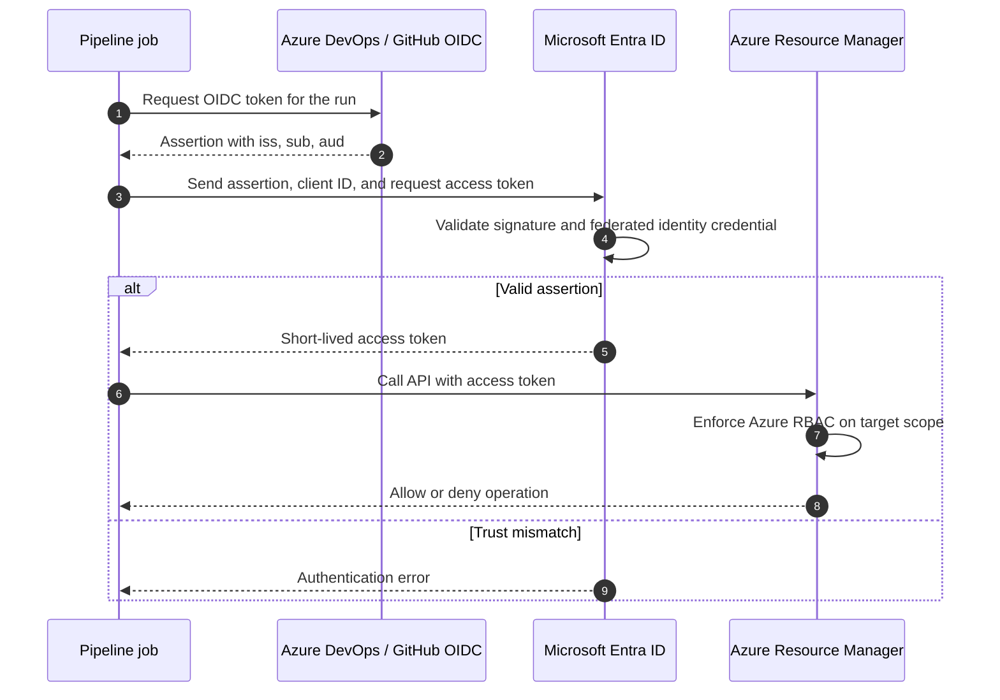

# Service Connections and Federated Pipeline Login

## 1. Problem statement and learning outcomes

In the **CI/CD and Software Supply Chain** chapter of the **CLOUD_PROVIDERS_AZURE** module, pipelines must deploy applications to Microsoft Azure in an automated, controllable, and auditable manner. This workflow connects subscriptions, resource groups, Microsoft Entra ID, networking, compute, storage, data, monitoring, and cost management into a practical application release chain.

For example, the store API source code lives in the repository `acme/shop-api`. On every release, the pipeline must sign in to the Azure subscription, inspect the resource group `rg-shop-prod`, and deploy infrastructure and application changes. Using personal accounts or storing a long-lived **client secret** in pipeline variables forces the team to guard and rotate a sensitive credential that could leak via logs, config backups, or repository permissions.

**Workload identity federation** enables a pipeline to prove its identity using an OpenID Connect (OIDC) token issued by the CI/CD platform and exchange that token for a Microsoft Entra ID access token. Properly configured, pipelines do not store Azure account passwords, client secrets, or long-lived private keys.

After this lesson, you will be able to:

- Distinguish **service connection**, **service principal**, **managed identity**, **federated identity credential**, OIDC token, and Azure access token.
- Explain the trust mechanism based on `issuer`, `subject`, and `audience`, as well as the distinct role of Azure RBAC.
- Create a federated Azure Resource Manager connection for **Azure DevOps Pipelines**, and configure OIDC login for **GitHub Actions**.
- Constrain pipeline permissions, verify access, and troubleshoot common authentication and authorization failures.

**Prerequisites:** subscriptions/resource groups; Azure RBAC roles; applications and service principals in Microsoft Entra ID; basic YAML pipelines. Names such as `acme`, `shop-api`, `production`, `rg-shop-prod`, and `sc-az-rg-prod-wif` below are examples and should be replaced with values from your actual environment.

## 2. Components to understand

| Component | Meaning | Key point |
| --- | --- | --- |
| **Pipeline / runner** | Automated job running on Azure DevOps or GitHub Actions | This is the workload requesting access to Azure. |
| **Azure DevOps service connection** | Managed configuration inside an Azure DevOps project allowing tasks to access external resources like Azure Resource Manager | It is an Azure DevOps config and access-control object; it is **not synonymous** with a service principal. |
| **App registration and service principal** | App registration defines the app in Entra ID; service principal is the app's identity in the tenant granted Azure access | Federation can bind to an app registration, and Azure RBAC is assigned to the corresponding identity. |
| **User-assigned managed identity** | Azure-managed identity usable in platform-supported federation models | Alternative to app registration in some flows; still requires configuring trust and RBAC. |
| **OIDC token / ID token** | Signed token issued by the CI/CD provider describing the run's origin | Used as identity proof for token exchange; not the token used to call Azure Resource Manager APIs. |
| **Federated identity credential** | Trust rule in Entra ID bound to an app or managed identity | Accepts assertions only when issuer, subject, and audience match the configured values. |
| **Entra access token** | Token issued by Microsoft Entra ID after validating the assertion | Used by Azure CLI, SDKs, or tasks when calling Azure APIs. |
| **Azure RBAC** | Governs what the signed-in identity can do on a subscription, resource group, or resource | Successful login **does not automatically** grant deployment permissions. |

In practice, **secretless login** means the pipeline holds no **long-lived credential for an Azure identity**. The pipeline still handles short-lived tokens at runtime, so logs, artifacts, and running processes must still be protected.

## 3. How the federation flow works



Three key claims in an OIDC assertion:

| Claim | Question answered | Example |
| --- | --- | --- |
| `iss` (issuer) | Who issued the token? | GitHub: `https://token.actions.githubusercontent.com` |
| `sub` (subject) | Which pipeline/job/repository or environment originated the token? | GitHub: `repo:acme/shop-api:environment:production` |
| `aud` (audience) | Which recipient was this token issued for? | Common for Azure public cloud: `api://AzureADTokenExchange` |

When configuring a federated identity credential, copy the **exact** issuer, subject, and audience for your platform, job type, environment, and cloud. Notably, renaming a repository, project, service connection, or environment can break the subject match. Examples here use **Azure public cloud**; for sovereign clouds, match the corresponding endpoints, audiences, and login settings.

There are two separate gates:

1. **Authentication:** Does Microsoft Entra ID trust the pipeline's assertion and issue an access token for the right identity?
2. **Authorization:** Does Azure RBAC allow that identity to operate on the target resource group or resource?

Adding a federated identity credential satisfies the first gate; a **role assignment** satisfies the second. In addition, the CI/CD platform governs **who may run jobs and who may use the connection**, which must be configured separately.

## 4. Azure DevOps: federated Azure Resource Manager service connection

In Azure DevOps, the standard approach is creating an **Azure Resource Manager service connection** using workload identity federation. Tasks such as `AzureCLI@2` reference the connection name; Azure DevOps and supporting tasks handle token acquisition so scripts do not manage client secrets.

### 4.1. Creating the service connection

In the Azure DevOps project, an administrator with service connection permissions performs:

1. Open **Project settings → Service connections → New service connection**.
2. Select **Azure Resource Manager** and authentication method **Workload identity federation**. If automatic/manual options appear, prefer **App registration (automatic)** when organization policies and Azure permissions allow.
3. Choose the appropriate subscription and scope. For deploying a single application, prefer **resource group** `rg-shop-prod` instead of subscription-wide permissions.
4. Give it a meaningful name, e.g. `sc-az-rg-prod-wif`, save the configuration, and verify the connection using available UI checks.
5. Under **Pipeline permissions**, authorize only the pipelines that genuinely need this connection. Avoid granting access to every pipeline in the project.
6. Review the identity's Azure role assignment. Read-only checks may need only **Reader**; deployments require appropriate write permissions, often a narrower role or custom role on that resource group. **Contributor** on a resource group is easy to understand, though broader than strictly necessary for many tasks.

Depending on the option selected and creator privileges, the automatic flow can create the app/service principal, federated identity credential, and role assignment. Never assume all permissions are right merely because saving the service connection succeeded; verify with actual operations.

**Manual method:** If the organization forbids automatic app creation or uses a dedicated identity model, administrators can create an app registration or supported user-assigned managed identity, configure RBAC, and add a federated credential using the exact issuer/subject/audience displayed by the service connection wizard. In Azure DevOps, the subject typically takes the form:

```text
sc://<organization>/<project>/<service-connection-name>
```

The issuer is typically `https://vstoken.dev.azure.com/<organization-id>` and the audience is typically `api://AzureADTokenExchange`. **Always copy the exact values shown by Azure DevOps**, as names, organization IDs, and platform token issuance determine what must be registered in Entra ID. If you rename the service connection or project, inspect and update the trust accordingly.

### 4.2. Using the service connection in Azure Pipelines

Assume `sc-az-rg-prod-wif` is authorized for the pipeline and its identity has read access to resource group `rg-shop-prod`.

```yaml
# azure-pipelines.yml
trigger:
  branches:
    include:
      - main

pool:
  vmImage: ubuntu-latest

steps:
  - task: AzureCLI@2
    displayName: 'Verify Azure login via federation'
    inputs:
      azureSubscription: 'sc-az-rg-prod-wif'
      scriptType: bash
      scriptLocation: inlineScript
      inlineScript: |
        az account show \
          --query '{subscription:id,tenant:tenantId}' -o json
        az group show \
          --name 'rg-shop-prod' \
          --query '{name:name,id:id}' -o json
```

**Explanation:**

- `azureSubscription` is the **service connection name** the task must be authorized to use, not a subscription ID.
- `AzureCLI@2` uses the service connection to sign in to Azure before executing `inlineScript`. This YAML pipeline declares no client secret.
- `az account show` confirms the selected tenant/subscription; `az group show` verifies the identity can read the resource group. A read check **does not prove** permissions to create or update resources.
- The service connection name must match exactly; referencing it in YAML is also subject to Azure DevOps **pipeline → service connection** authorization checks.

When moving from verification to deployment, the task can run `az deployment group what-if` or `az deployment group create` against Bicep/ARM templates in the repository. Enable deployment steps only after confirming roles and appropriate branch, environment, and approval protections.

### 4.3. Protecting connection usage

Azure RBAC restricts the target scope, yet a pipeline edited by an untrusted actor can still invoke Azure using an authorized service connection. Combine **branch policies/reviews**, **Pipeline permissions**, YAML edit restrictions, and **approvals/checks** for production environments. Across multiple environments, maintain separate connections and identities for dev, staging, and prod so a compromise in dev never escalates to prod.

## 5. GitHub Actions: signing in to Azure via GitHub OIDC

GitHub Actions does not require an Azure DevOps-style *service connection* object. A workflow receives an OIDC token issued by GitHub and uses the `azure/login` action to exchange it for Azure access.

### 5.1. Configuring trust and Azure RBAC

Example: repository `acme/shop-api` releasing from a job targeting GitHub Environment `production`.

1. In **Microsoft Entra ID → App registrations**, create or select a deployment app registration (or use a federation-supported user-assigned managed identity). Record the **Application (client) ID**, **Directory (tenant) ID**, and **Subscription ID**.
2. Under **Federated credentials**, add a credential for **GitHub Actions**. Specify organization `acme`, repository `shop-api`, and entity type **Environment** named `production`. Verify issuer, subject, and audience before saving.
3. On resource group `rg-shop-prod`, assign the deployment service principal/identity a role sufficient for the actual task at the narrowest feasible scope.
4. In the GitHub repository, create **Environment** `production` with allowed deployment branch rules and required reviewers if needed. Store `AZURE_CLIENT_ID`, `AZURE_TENANT_ID`, `AZURE_SUBSCRIPTION_ID`, and `AZURE_RESOURCE_GROUP` as **Environment variables** (or via your organization's approved variable mechanism).
5. Grant the job `id-token: write` so GitHub issues an OIDC token and use `azure/login@v2` to sign in. This permission does not grant Azure RBAC on its own.

For the example above, the federated identity credential is expected to match:

```text
issuer   = https://token.actions.githubusercontent.com
subject  = repo:acme/shop-api:environment:production
audience = api://AzureADTokenExchange
```

**Distinguish subjects by context:** For a job with `environment: production`, the subject takes the form `repo:OWNER/REPO:environment:ENVIRONMENT`. If trust is configured for a branch instead, the subject may look like `repo:OWNER/REPO:ref:refs/heads/main`. Those two subjects are **not equivalent**. Configure the credential to match the actual job structure combined with environment protections—never create overly broad trust.

### 5.2. Complete sample workflow

```yaml
# .github/workflows/verify-azure-oidc.yml
name: Verify Azure federation

on:
  workflow_dispatch:

jobs:
  verify:
    if: github.ref == 'refs/heads/main'
    runs-on: ubuntu-latest
    environment: production

    permissions:
      contents: read
      id-token: write

    steps:
      - name: Checkout
        uses: actions/checkout@v4

      - name: Sign in to Azure using OIDC
        uses: azure/login@v2
        with:
          client-id: ${{ vars.AZURE_CLIENT_ID }}
          tenant-id: ${{ vars.AZURE_TENANT_ID }}
          subscription-id: ${{ vars.AZURE_SUBSCRIPTION_ID }}

      - name: Verify Azure context and resource group access
        env:
          RESOURCE_GROUP: ${{ vars.AZURE_RESOURCE_GROUP }}
        run: |
          az account show \
            --query '{subscription:id,tenant:tenantId}' -o json
          az group show \
            --name "$RESOURCE_GROUP" \
            --query '{name:name,id:id}' -o json
```

The workflow is triggered manually on `main`; the job is bound to Environment `production`, so GitHub enforces Environment restrictions and approvals before running protected steps. `id-token: write` lets the job request an OIDC token, and `azure/login@v2` signs in to Azure using the three configured IDs. Those IDs are configuration identifiers, **not client secrets**. Depending on organizational policy, they may be stored in approved variables or secrets; either way, **never place long-lived credentials in the repository**.

You can follow this with `az deployment group what-if`/`create` after checking out Bicep/ARM templates and confirming required permissions. Before adopting a workflow in production, consider **pinning actions to audited commit SHAs** per your software supply-chain policy; major tags like `@v2` make examples readable but are not immutable like SHAs.

### 5.3. Why protecting the Environment matters

If a workflow can run on arbitrary code while a federated credential permits logging in with production access, anyone able to modify the workflow can call Azure APIs within that identity's RBAC scope. Therefore, combine workflow review, release branch/tag controls, Environment protections, reviewer limits, and narrow role scopes. Pay special attention to workflows handling external pull requests, especially any flow capable of exposing elevated permissions to unreviewed code.

## 6. Comparing the two implementations

| Aspect | Azure DevOps Pipelines | GitHub Actions |
| --- | --- | --- |
| Connection setup | Azure Resource Manager **service connection** using workload identity federation | Federated credential in Entra ID + `azure/login` in workflow |
| Where job identity is declared | Usually via service connection name on task input, e.g. `azureSubscription` | `client-id`, `tenant-id`, `subscription-id` in `azure/login` |
| Identity proof | OIDC assertion issued by Azure DevOps for the service connection | OIDC token issued by GitHub for the job |
| Illustrative subject | `sc://org/project/service-connection` | `repo:owner/repo:environment:name` or `repo:owner/repo:ref:refs/heads/branch` |
| Connection access control | Pipeline permissions, service connection security, checks | Workflow/job permissions, branch protection, Environment rules |
| Azure permissions | Azure RBAC of the service principal or managed identity | Azure RBAC of the service principal or managed identity |
| Long-lived Azure credential in pipeline | Not needed when WIF is properly configured | Not needed when OIDC is properly configured |

Both platforms share the core model: **CI/CD provider issues short-lived proof → Microsoft Entra ID verifies trust → Azure RBAC constrains resources**. They differ primarily in platform configuration objects and how jobs request tokens.

## 7. Designing secure access controls

### 7.1. Separate identities by environment and privilege

Suppose a project has `rg-shop-dev`, `rg-shop-staging`, and `rg-shop-prod`. Use separate controlled service connections/federated credentials and identities per environment. For example, an identity running `what-if` checks may need different permissions than an identity allowed to deploy. For production, restrict to the exact resource group, service, or custom role rather than assigning subscription-wide `Owner` or `Contributor`.

To avoid ambiguity, draft a permission matrix before implementation:

| Job | Trust source | Azure scope | Desired least privilege |
| --- | --- | --- | --- |
| Infrastructure validation | `main` branch or controlled validation job | Test resource group | Read config and permissions for required validation checks |
| Staging deployment | Staging pipeline/environment | `rg-shop-staging` | Create/update exact staging resources |
| Production deployment | Protected production pipeline/environment | `rg-shop-prod` | Create/update exact production resources; separate special role assignments if needed |

A role like **Contributor** does not permit assigning new Azure RBAC roles; tasks needing `Microsoft.Authorization/roleAssignments/write` require explicit permissions and separate governance. Never elevate a pipeline to Owner merely to bypass an unanalyzed permission error.

### 7.2. Software supply-chain controls

- Permit only approved pipelines/workflows to use deployment identities; require reviews on YAML and critical build/deploy files.
- Restrict federation subjects, repositories, branches, and environments; enforce production approvals and re-verify trust after renames.
- Scope `id-token: write` in GitHub to the **exact jobs needing Azure**, rather than enabling it workflow-wide unnecessarily.
- Restrict log/artifact access; never print OIDC tokens, access tokens, sensitive variables, or raw credential contents to stdout.
- Audit changes to federated credentials, role assignments, service connections, and pipeline run permissions; use Entra ID audit/sign-in logs and CI/CD logs for investigations.
- Periodically revoke unused connections, federated credentials, and role assignments. Federation does not eliminate access lifecycle management.

## 8. Post-configuration verification

A thorough test verifies **right identity, right subscription, right scope, and right boundaries**:

1. **Configuration check:** verify client ID, tenant ID, subscription, service connection name or GitHub Environment; compare actual `issuer`/`subject`/`audience` against the federated credential.
2. **Successful login:** run the pipeline on an authorized branch/job; inspect `az account show` output to confirm tenant and subscription.
3. **Target resource access:** run `az group show --name rg-shop-prod` to verify read access. For deployment pipelines, run `what-if` or a controlled test deployment to prove actual write access.
4. **Negative test (blocked path):** confirm an unauthorized pipeline, branch, or unapproved job cannot access production permissions. Do not test this by granting broad extra permissions.
5. **Observability:** inspect Azure DevOps/GitHub Actions logs, Entra ID workload identity sign-in logs (if available), Azure Activity Logs, and deployment logs. Record only identifiers or error codes for diagnostics—never expose tokens.

Concrete boundary test example: if an identity holds only Reader on `rg-shop-prod`, `az group show` succeeds while Azure Resource Manager write operations fail with permission denied. That proves RBAC is working, not that federation is broken.

## 9. Troubleshooting common issues

| Symptom | Causes to check | Resolution |
| --- | --- | --- |
| Entra ID reports no matching federated identity credential (e.g., `AADSTS70021` or variant) | Mismatched `issuer`, `subject`, or `audience`, different environment/branch, deleted credential, or renamed connection | Compare the job's actual claims against the credential; align trust with the chosen identity and trusted source. |
| GitHub `azure/login` cannot obtain OIDC token | Job lacks `permissions: id-token: write`, unsupported workflow/job, or overridden permissions | Grant permission on the exact job and inspect run conditions and workflow OIDC settings. |
| Azure DevOps reports service connection is unauthorized | Pipeline lacks permission or editor lacks rights to authorize connection | Inspect **Pipeline permissions**, service connection security, and checks; authorize only the intended pipeline. |
| Login succeeds, Azure API call returns HTTP **403** | Identity lacks sufficient role or role assigned at wrong scope; recent change not yet propagated | Verify principal ID, role assignment, resource scope, and exact action; wait briefly if recently updated. |
| `az account show` shows wrong tenant/subscription | IDs or service connection point to wrong environment; Azure CLI context altered | Fix configuration values, select the right subscription, and re-verify before deploying. |
| App/tenant not found error (e.g., `AADSTS700016`) | Wrong Client ID, deleted app, or mismatched tenant ID | Check app registration, enterprise application, and actual tenant ID. |
| Worked previously, broke after renaming repo/project/Environment | Token subject changed relative to registered credential | Update federated credential, confirm pipeline permissions, and rerun a controlled test. |

**Quick triage flow:** First determine whether the failure occurs **before or after** receiving an Azure access token. If it fails during token exchange, focus on OIDC and trust claims. If login succeeds and Azure commands return `403`, check Azure RBAC. If the job lacks permission to use the service connection or failed an Environment approval, resolve CI/CD platform authorization before inspecting Entra ID.

## 10. Practice exercise and completion criteria

**Scenario:** The team wants a release pipeline from `main` to validate and deploy into resource group `rg-shop-prod`. Security requirements: no client secrets stored; production deployment must be protected; other pipelines must not reuse the same access without approval.

Practice on either platform—or both to compare:

1. Select a production identity and register federation matching the Azure DevOps service connection **or** GitHub job/Environment; record issuer, subject, and audience.
2. Assign RBAC at scope `rg-shop-prod` matching actual tasks, then verify that exact principal's permissions.
3. Configure the YAML pipeline per Section 4 or 5; add branch protection, connection authorization, or Environment approval as appropriate.
4. Run a test on `main`, observe the subscription ID and resource group read output; if testing template deployment, run `what-if` or a controlled deployment to verify write permissions.
5. Verify an unapproved case is blocked. Record outcomes without capturing tokens in reports.

**Completion criteria:** the job logs in via federation, targets the right tenant/subscription, executes permitted Azure operations within scope, and unauthorized cases cannot bypass protection controls. If only resource group reads were tested, conclude that **login and read access are verified**; deployment write rights still require a separate test.

### Self-check questions

**1. If an Azure DevOps service connection exists but `AzureCLI@2` reports it is not permitted to use the connection, what should you check first?**  
Check Pipeline permissions and the pipeline/job's authorization to use that service connection. This is usually an Azure DevOps authorization check occurring before any Azure API call.

**2. A GitHub federated credential uses subject `repo:acme/shop-api:ref:refs/heads/main`, while the job declares `environment: production`. Why might it fail?**  
A job bound to an Environment typically emits subject `repo:acme/shop-api:environment:production`. Because the values mismatch, Entra ID rejects the assertion against a branch-only credential.

**3. Azure login succeeds, but creating a resource returns `403`. Should you change the audience or switch from federation to a client secret?**  
No. Since authentication succeeded, inspect the role assignment, resource scope, and required action permissions; changing the credential type will not fix missing Azure RBAC.

**4. Does federation replace branch protection rules and pipeline edit controls?**  
No. Federation validates the assertion's origin against registered trust; the CI/CD platform must still restrict who can create/modify trusted jobs and who can release to production.

## 11. References for real-world implementation

- Microsoft Learn: **Workload identity federation for Azure Resource Manager service connections** in Azure Pipelines.
- Microsoft Learn: **Configure a federated identity credential on an app** and Microsoft Entra **Workload identity federation** documentation.
- Microsoft Learn: **Azure RBAC overview** and assigning roles at the resource group scope.
- GitHub Docs: **Configuring OpenID Connect in Azure** and **Deployments / Environments**.
- `Azure/login` repository on GitHub: supported action parameters and versions.

Configuration UIs, app registration vs. managed identity capabilities, and tenant conditions evolve across services. When implementing in an organization, always cross-check official documentation and the actual trust claims emitted by your platform.
