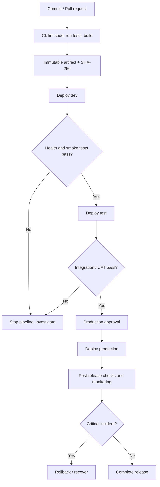

# Deploying Across Dev, Test, and Production Environments

## 1. Objectives and context

When developing an application on Microsoft Azure, getting source code to run on a developer's laptop is only the starting point. A release must be **built, tested, deployed, and verified** across multiple environments before serving real users. In the **CI/CD and Software Supply Chain** chapter of the `CLOUD_PROVIDERS_AZURE` module, we design a controlled deployment flow for a web application on Azure from development through production.

After this lesson, you will be able to:

- Explain the purpose of **dev**, **test**, and **production** environments, along with the promotion criteria between them.
- Design separate resource boundaries, identities, configurations, data, and access permissions for each environment on Azure.
- Build a CI/CD pipeline following the **build once, deploy the same artifact** principle across all environments.
- Use GitHub Actions, OpenID Connect (OIDC), Azure App Service, and approval rules to illustrate the promotion workflow.
- Determine how to monitor, handle failures, roll back, and manage database changes during releases.

**Running scenario:** the team operates `Shop API`, a .NET API on Azure App Service. The application uses Azure databases, storage, and monitoring services. The team needs to test new versions against synthetic data before exposing them to real users. Examples use GitHub Actions for readability; the same model applies to Azure Pipelines or equivalent CI/CD tools.

## 2. Role of each environment

| Environment | Purpose | Data and access permissions | Promotion gate | Common deployment cadence |
|---|---|---|---|---|
| **dev** (development) | Early integration checks, catching config or Azure runtime issues | Synthetic data; dev team holds appropriate operational access | Deploy succeeds, smoke tests and health checks pass | Automated after changes merge into integration branch |
| **test** (QA/UAT/pre-production) | Integration, API contract, baseline performance, business, and compatibility testing | Test datasets; tighter access than dev; prod-like configuration | Test suites and acceptance criteria pass | Automated after dev or on a release schedule |
| **production** (prod) | Serves live traffic; prioritizes availability, security, and recoverability | Real data; least privilege; full monitoring and auditing | Authorized approval, verified artifact, rollback plan | Approved deployment favoring safe rollout |

Environment names do not guarantee safety. For instance, an environment named `staging` is useful only if critical configuration—runtime, authentication, networking, dependent resources, and deployment process—resembles production. Define concrete testing criteria rather than relying on naming.

**Promotion** means authorizing an *already-built version* to advance to the next environment. It is a decision about version quality and risk, not an operation to recompile source code in each environment.

## 3. Reference architecture on Azure



Illustrative resource layout:

| Component | dev | test | production |
|---|---|---|---|
| Resource group | `rg-shop-dev` | `rg-shop-test` | `rg-shop-prod` |
| Azure App Service | `app-shop-dev` | `app-shop-test` | `app-shop-prod` |
| Database | `shop_dev` | `shop_test` | `shop_prod` |
| Key Vault | Secret store for dev | Secret store for test | Secret store for production |
| Telemetry | Dev logs and metrics | Test logs and metrics | Production logs, metrics, tracing, and alerts |

Names above are examples and must satisfy Azure global uniqueness where required. Three resource groups in one subscription may suffice for lab exercises; critical systems commonly separate production and non-production subscriptions to delineate permissions, policies, and costs cleanly. Resource groups manage resource lifecycles, **not automatic network security boundaries**. Configure Azure RBAC, Managed Identities, VNets, private endpoints, firewalls, and Azure Policy according to real requirements.

In a complete system, each environment also needs dedicated data resources, storage, secrets, application identities, and connection strings. Never allow dev or test to connect accidentally to the production database. When realistic data is needed, anonymize or synthesize datasets under data-protection policies.

## 4. Safe deployment principles

### 4.1. Build once, promote the same artifact

For example, CI compiles commit `abc123` into `app.zip`. The pipeline computes a checksum, stores `app.zip` as an artifact, and uses **that exact ZIP file** to deploy to dev, test, and production. Every promotion verifies the checksum before deploying.

```text
Commit abc123
   -> CI: app.zip (SHA-256: H)
   -> dev: app.zip (H)
   -> test: app.zip (H)
   -> production: app.zip (H)
```

This avoids drift from recompiling with different library versions, runtimes, or environment variables. For container apps, reuse the same image in Azure Container Registry and deploy by **image digest** instead of mutable tags. Checksums detect accidental file corruption; for higher supply-chain assurance, add artifact signatures, provenance, SBOMs, and origin-verification policies.

### 4.2. Configuration changes per environment; application code stays identical

Values such as service URLs, log levels, database names, or feature flags should come from App Service application settings or Azure App Configuration. Sensitive passwords, tokens, and connection strings belong in **Azure Key Vault**, accessed via each app's **Managed Identity**—never hardcoded or baked into artifacts.

Example App Service application settings:

```text
APP_ENV=dev | test | production
CATALOG_API_URL=https://<environment-appropriate-endpoint>
FEATURE_NEW_CHECKOUT=false
```

Each App Service holds its own values. Never hardcode environment URLs or secrets in source and build three separate binaries. Feature flags help separate **code deployment** from **feature activation**: ship new builds to production first, then enable capabilities for controlled user groups.

### 4.3. Access permissions and authentication must be per environment

- Each environment uses its own deployment identity with Azure RBAC scoped strictly to the target App Service or resource group. CI accounts need deployment rights only, not default subscription `Owner`.
- OIDC lets GitHub Actions obtain short-lived tokens via **Microsoft Entra ID**, minimizing long-lived client secrets. Trust rules (*federated credentials*) must match repository, environment, and audience.
- Production enforces required approvers, allowed deployment branch rules, and audit trails. Separate code author, approver, and operator roles as scale or compliance dictates.
- Production networking, secrets, and data require stricter policies than dev; never share privileged accounts across environments.

## 5. Practice: GitHub Actions deploying to Azure App Service

### 5.1. Preparation

Assume the repository contains solution `Shop.sln` and project `src/Shop.Api/Shop.Api.csproj`, and the API exposes `GET /health` returning HTTP success when ready. The example uses **.NET 10**; adjust SDK versions and paths to match your application.

Before running the workflow, complete these one-time setup steps:

1. Provision three Azure App Services with the proper runtime and separate networking, databases, and application settings; note each Web App name and HTTPS hostname.
2. Create deployment identities in Microsoft Entra ID and assign least-privilege Azure RBAC per Web App. Prefer separate identities or federated credentials per environment to prevent cross-environment access.
3. In Entra ID, configure GitHub OIDC **federated credentials** with issuer `https://token.actions.githubusercontent.com`, audience `api://AzureADTokenExchange`, and the matching subject—e.g., `repo:ORG/REPO:environment:production`. Create corresponding subjects for `dev` and `test`. Replace `ORG/REPO` with your real owner and repository name.
4. In the GitHub repository, create three **Environments** named `dev`, `test`, and `production`. In each environment, set secrets `AZURE_CLIENT_ID`, `AZURE_TENANT_ID`, `AZURE_SUBSCRIPTION_ID` pointing to the authorized identity and subscription. Set variables `WEBAPP_NAME` and `HEALTH_URL`, e.g., `HEALTH_URL=https://app-shop-dev.azurewebsites.net/health`.
5. Configure **required reviewers** and deployment branch restrictions for the `production` environment (per features available on your GitHub plan). Declaring `environment: production` in YAML **does not create an approval gate** unless protection rules are enabled in repository settings.
6. Ensure App Service supports ZIP deployment of `dotnet publish` outputs; grant CI identity permissions, enable TLS, and configure per-environment connectivity.

### 5.2. Sample workflow

Place the following in `.github/workflows/promote-azure.yml` in the application repository. This is a **reference example** illustrating the flow; in real projects, pin actions to evaluated commit SHAs, add SAST/SCA, add thorough tests, and scope permissions per organizational policy.

```yaml
name: Promote Shop API on Azure

on:
  pull_request:
    branches: [main]
  push:
    branches: [main]

permissions:
  contents: read

jobs:
  build:
    runs-on: ubuntu-latest
    steps:
      - name: Checkout source
        uses: actions/checkout@v4
      - name: Install .NET SDK
        uses: actions/setup-dotnet@v4
        with:
          dotnet-version: '10.0.x'
      - name: Run tests
        run: dotnet test ./Shop.sln --configuration Release
      - name: Publish and checksum
        run: |
          dotnet publish ./src/Shop.Api/Shop.Api.csproj --configuration Release --output ./publish
          cd publish
          zip -r ../app.zip .
          cd ..
          sha256sum app.zip > app.zip.sha256
      - name: Preserve deployable artifact
        uses: actions/upload-artifact@v4
        with:
          name: shop-${{ github.sha }}
          path: |
            app.zip
            app.zip.sha256
          if-no-files-found: error

  deploy-dev:
    if: github.event_name == 'push'
    needs: build
    runs-on: ubuntu-latest
    environment: dev
    permissions:
      contents: read
      id-token: write
    steps:
      - uses: actions/download-artifact@v4
        with:
          name: shop-${{ github.sha }}
          path: ./release
      - name: Verify artifact
        working-directory: ./release
        run: sha256sum -c app.zip.sha256
      - uses: azure/login@v2
        with:
          client-id: ${{ secrets.AZURE_CLIENT_ID }}
          tenant-id: ${{ secrets.AZURE_TENANT_ID }}
          subscription-id: ${{ secrets.AZURE_SUBSCRIPTION_ID }}
      - name: Deploy dev
        uses: azure/webapps-deploy@v3
        with:
          app-name: ${{ vars.WEBAPP_NAME }}
          package: ./release/app.zip
      - name: Smoke test dev
        env:
          HEALTH_URL: ${{ vars.HEALTH_URL }}
        run: curl --fail --silent --show-error --retry 6 --retry-delay 5 --retry-all-errors "$HEALTH_URL"

  deploy-test:
    needs: deploy-dev
    runs-on: ubuntu-latest
    environment: test
    permissions:
      contents: read
      id-token: write
    steps:
      - uses: actions/download-artifact@v4
        with:
          name: shop-${{ github.sha }}
          path: ./release
      - name: Verify artifact
        working-directory: ./release
        run: sha256sum -c app.zip.sha256
      - uses: azure/login@v2
        with:
          client-id: ${{ secrets.AZURE_CLIENT_ID }}
          tenant-id: ${{ secrets.AZURE_TENANT_ID }}
          subscription-id: ${{ secrets.AZURE_SUBSCRIPTION_ID }}
      - name: Deploy test
        uses: azure/webapps-deploy@v3
        with:
          app-name: ${{ vars.WEBAPP_NAME }}
          package: ./release/app.zip
      - name: Smoke test and readiness check
        env:
          HEALTH_URL: ${{ vars.HEALTH_URL }}
        run: curl --fail --silent --show-error --retry 6 --retry-delay 5 --retry-all-errors "$HEALTH_URL"
      # Add API integration / contract / end-to-end tests here.

  deploy-production:
    needs: deploy-test
    runs-on: ubuntu-latest
    environment: production
    permissions:
      contents: read
      id-token: write
    steps:
      - uses: actions/download-artifact@v4
        with:
          name: shop-${{ github.sha }}
          path: ./release
      - name: Verify artifact
        working-directory: ./release
        run: sha256sum -c app.zip.sha256
      - uses: azure/login@v2
        with:
          client-id: ${{ secrets.AZURE_CLIENT_ID }}
          tenant-id: ${{ secrets.AZURE_TENANT_ID }}
          subscription-id: ${{ secrets.AZURE_SUBSCRIPTION_ID }}
      - name: Deploy production
        uses: azure/webapps-deploy@v3
        with:
          app-name: ${{ vars.WEBAPP_NAME }}
          package: ./release/app.zip
      - name: Post-deployment health check
        env:
          HEALTH_URL: ${{ vars.HEALTH_URL }}
        run: curl --fail --silent --show-error --retry 6 --retry-delay 5 --retry-all-errors "$HEALTH_URL"
```

### 5.3. How does the pipeline execute?

1. On a pull request to `main`, the `build` job runs tests and packages early to catch errors; the three deploy jobs do not run because the condition restricts deployment to `push` events.
2. After merging into `main`, CI builds `app.zip` and `app.zip.sha256` exactly once. The artifact is tied to the commit SHA within the same workflow run.
3. `deploy-dev` downloads the artifact, verifies its checksum, acquires an OIDC token via `azure/login@v2`, deploys via `azure/webapps-deploy@v3`, and checks `/health`. Any step failure blocks downstream jobs.
4. `deploy-test` receives the **exact same artifact**, confirms the test system is up, and runs additional integration, contract, or end-to-end tests built by the team. The example includes only a health check; add business test suites for real-world coverage.
5. `deploy-production` becomes eligible only after `deploy-test`. With required reviewers enabled, GitHub pauses the job at the production approval gate. Once approved, the job uses production's credentials and variables to deploy the verified artifact.

Note: the checksum stored alongside the artifact detects file corruption in transit; it does **not** replace verifying creator identity or release signatures. GitHub artifacts have retention limits; for long-term rollbacks, archive approved releases in a release repository with dedicated retention and access controls.

### 5.4. Promotion criteria (*quality gates*)

| Gate | Minimum checks | Action on failure |
|---|---|---|
| CI → dev | Compile, unit tests, code/dependency analysis, artifact and checksum generation | Block build and notify owner |
| dev → test | Deployment succeeds, `/health` returns success, API smoke test passes | Halt pipeline; inspect dev logs and config |
| test → production | Integration, contract, regression, data/schema migration tests; UAT criteria where applicable | Hold release in test for remediation |
| Production approval | Authorized approver, QA results, change scope, release window, rollback plan | Block deploy until approved |
| Post-production deploy | Health, error rate, latency, business behavior, and alerts | Trigger incident response or rollback |

An HTTP 200 from `/health` is only an initial check. It does not prove order flows, payments, authorization, or downstream integrations work properly. Expose *liveness* and *readiness* endpoints with appropriate check scopes without leaking internal details publicly.

## 6. Infrastructure and data in the promotion flow

### 6.1. Managing infrastructure as code

Define the App Service Plan, Web App, Managed Identity, Key Vault, networking, and dependent components using **Bicep**, ARM templates, or Terraform. Share the same infrastructure modules with separate parameter files for `dev`, `test`, and `production`. A dedicated CI/CD step can run `what-if` (Bicep/ARM) or `terraform plan`, inspect unexpected changes, and request approval before applying to production.

Intentional differences—SKU, instance counts, backups, private endpoints, log retention, and budgets—belong in parameters. Avoid creating resources directly in the portal without syncing back to IaC, as environments will drift and become hard to reproduce during incidents.

### 6.2. Database changes do not always roll back by swapping app versions

Suppose a new API version replaces column `customer_name` with `first_name` and `last_name`. If you drop the old column immediately and then roll back the app, the old binary may crash. Use the **expand → migrate → contract** strategy:

1. **Expand:** add new columns or structures compatibly alongside old code; do not delete actively used data.
2. **Migrate:** deploy code capable of safely reading/writing during the transition, backfill data, and verify in test before running in production.
3. **Contract:** once all apps and background jobs have switched to the new schema, drop the old schema in a later controlled release.

Configure backups/restores and test recovery against RPO/RTO targets; restoring a database can affect transactions recorded after the backup, so it is never a trivial rollback. Production requires clear data ownership and a failure plan for migrations.

### 6.3. Secrets and software supply chain

CI/CD is part of the software supply chain: code, libraries, build tools, runners, artifacts, and deployment identities are all potential attack surfaces. At minimum, control:

- Dependency lockfiles and vulnerability scanning; restrict trusted package sources.
- Least-privilege workflow tokens and Azure RBAC; require reviews on workflow or sensitive IaC changes.
- Third-party actions pinned by commit SHA and audited periodically; avoid running unverified remote scripts.
- Secrets fetched at runtime via Key Vault and Managed Identity—never placed in ZIPs, logs, or workflow outputs.
- Recording commit SHA, artifact digest, release timestamp, environment, test outcomes, and approver for incident traceability.

## 7. Production rollout, observability, and rollback

The workflow above deploys directly to the production Web App to clarify promotion order. For high-uptime services, upgrade the final step to **deploy to a `staging` deployment slot on the production App Service**, warm it up, verify endpoints, and perform a planned **slot swap**. A deployment slot lives inside the same app and shares the App Service Plan; it does not replace an independent test environment.

Illustrative swap command, **run only after creating the slot and checking slot-specific settings**:

```bash
az webapp deployment slot swap \
  --resource-group rg-shop-prod \
  --name app-shop-prod \
  --slot staging \
  --target-slot production
```

Mark slot-sensitive settings as *deployment slot settings*, such as connection strings or Key Vault references targeting data that must not swap. Verify impact on in-flight requests, background jobs, and connections before automating swaps. On Azure Container Apps or AKS, use revisions/traffic splitting or rolling/canary strategies respectively.

After every release, monitor **Azure Monitor** and **Application Insights**: request rate, 5xx error rate, p95/p99 latency, failed dependency calls, exceptions, CPU/memory, database utilization, and key business metrics. Tag telemetry with release ID / commit SHA to separate new regressions from pre-existing errors. Configure alerts with meaningful thresholds and clear operator runbooks.

Test the rollback procedure in advance:

1. **Detect:** health checks, smoke tests, or production alerts signal a faulty release; identify blast radius and active version.
2. **Mitigate:** disable faulty feature flags or halt rollout; if using slots and safe, swap back to the stable slot. If deploying directly, redeploy the **previously archived artifact**.
3. **Protect data:** verify migrations and schema compatibility with the older version; never run destructive schema reversals without evaluating data impact.
4. **Confirm recovery:** check health, live requests, error rate, latency, business transactions, and update incident logs; restore full traffic under agreed criteria.

A common pitfall occurs when deployment finishes and the health check fails: a **failed** job status does not automatically restore the old version. Define explicit rollback automation or procedures and test them in `test` before relying on them in production. Additionally, when multiple commits await approval, serialize release ordering so an older run never overwrites a newer production deployment.

## 8. Failure scenarios and diagnostics

| Symptom | Causes to check | Resolution |
|---|---|---|
| `azure/login` fails to obtain token | OIDC subject mismatches `environment`, wrong tenant/client ID, missing federated credential | Compare issuer, audience, subject, GitHub environment, and Entra ID config |
| Login succeeds, deployment denied | Azure RBAC lacks permissions on Web App / resource group, or assignment not yet propagated | Verify assignment for exact principal, scope, and required role |
| Dev deploy succeeds, test fails | Environment variables, DB connections, DNS/network, or secrets differ between dev and test | Inspect test-specific config, telemetry, and dependencies; never borrow prod secrets |
| Tests pass, production fails minutes later | Different traffic patterns, insufficient warmup, slot settings, performance, or live dependencies | Monitor error rate/latency, halt rollout, evaluate rollback, and add prod-like tests |
| App rolled back, still failing | Incompatible database schema change or external side effects | Apply compatible migrations, coordinate data recovery, and handle side effects |
| Production overwritten by older version | Concurrent workflows or stale pending approvals | Enforce concurrency controls, release ordering, and approved commit checks |

Never print access tokens, connection strings, or secret contents while debugging. Use sanitized logs, Azure Activity Logs, App Service deployment logs, and Application Insights to isolate root causes.

## 9. Practice exercise and completion criteria

**Exercise:** Extend the `Shop API` model for a team with three environments and three permission groups: developer, QA, and release approver. Every change to `main` must progress through dev, test, and enter production only upon approval.

1. Diagram resource groups, Web Apps, Key Vaults, and databases for each environment. Explain which resources can be shared and which must remain isolated to protect data.
2. Create three GitHub Environments with separate `WEBAPP_NAME` and `HEALTH_URL` values. Configure OIDC so a dev deployment identity cannot modify the production Web App.
3. Update the sample workflow so post-test deployment calls a business endpoint (e.g., `GET /api/products`) and validates response structure; if that test fails, production must remain blocked.
4. Simulate a faulty release by making `/health` return an error code in `test`. Observe the job stop, fix the cause, and release a new commit.
5. Write a one-page rollback runbook: trigger signals, decision maker, last known stable version, app recovery steps, database compatibility checks, and recovery verification.

**Completion criteria:** one commit-bound artifact whose checksum is verified across all three environments; isolated permissions and data; any failing test blocks promotion; production enforces real approval rules; the team can identify the live release and execute a tested recovery plan.

**Self-assessment questions:**

- Why does rebuilding in production weaken traceability even when source code is unchanged?
- What happens if a workflow declares `environment: production` without configuring required reviewers on the repository?
- Why does moving application settings into Key Vault not mean an app can share one Managed Identity between dev and production?
- Once a migration drops a column, why is redeploying the old ZIP insufficient to roll back?

## 10. References for further reading

- Microsoft Learn — [Set up staging environments in Azure App Service](https://learn.microsoft.com/azure/app-service/deploy-staging-slots).
- Microsoft Learn — [Deploy to Azure App Service with GitHub Actions](https://learn.microsoft.com/azure/app-service/deploy-github-actions).
- Microsoft Learn — [Use OpenID Connect to connect GitHub Actions to Azure](https://learn.microsoft.com/azure/developer/github/connect-from-azure-openid-connect).
- GitHub Docs — [Using environments for deployment](https://docs.github.com/actions/deployment/targeting-different-environments/using-environments-for-deployment).
- Microsoft Learn — [Use Key Vault references for App Service](https://learn.microsoft.com/azure/app-service/app-service-key-vault-references).
