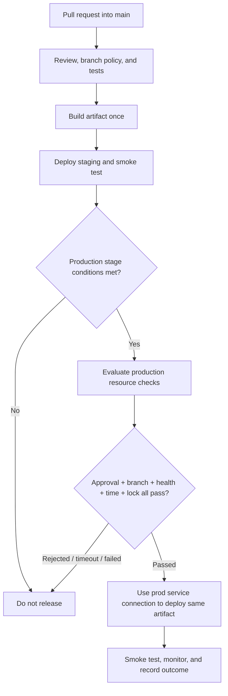

# Approvals, Environment Checks, and Deployment Access Control

> **Chapter:** CI/CD and Software Supply Chain  
> **Module:** `CLOUD_PROVIDERS_AZURE` — exploring the Microsoft Azure ecosystem from subscriptions, resource groups, Microsoft Entra ID, networking, compute, storage, and data through deployment, monitoring, security, and cost control.

## Learning objectives

After this lesson, you will be able to:

1. Distinguish **approvals**, **checks**, **pipeline permissions**, and **Azure RBAC** in an Azure release workflow.
2. Design production approval gates using **Azure DevOps Pipelines Environments** and **Approvals and checks**, understanding what lives in YAML versus what administrators configure outside YAML.
3. Use **service connections**, **workload identity federation**, least privilege, and separation of duties to restrict who and which pipelines can deploy.
4. Apply branch checks, deployment windows, system health gates, and exclusive concurrency locks; interpret outcomes when a stage is blocked, rejected, or timed out.
5. Apply a pipeline template with build, staging, and production stages, ensuring only tested artifacts reach production.

## 1. Real-world problem: a runnable pipeline does not mean permission to release

Suppose a team operates the `myweb` application on Azure App Service. Whenever a pull request merges into `main`, the pipeline automatically builds, tests, and deploys to staging. Once staging tests pass, the production release must be approved by an authorized person. The team also wants releases only within approved hours, blocked during active system alerts, and serialized so two production deployments never overlap.

If you only write a `condition` or a `script` step inside `azure-pipelines.yml`, anyone authorized to edit the pipeline could accidentally or intentionally alter that logic. Azure DevOps provides **Approvals and checks** configured directly on the resources a stage consumes. Resource owners govern these gates outside YAML; any pipeline entering the stage must satisfy the checks before the stage starts.

Additionally, the account used to deploy must actually hold permissions on Azure. An Azure DevOps approval does not grant Azure RBAC roles, and holding Azure RBAC does not automatically allow a pipeline to use a locked-down service connection.

### Four control layers to distinguish

| Layer | Question addressed | Typical configuration location |
|---|---|---|
| **Branch policy / source control** | Who can change code and pipeline definitions before merging? | Azure Repos branch policies or equivalent Git platform |
| **Approvals and checks** | When may a stage start against a protected resource? | Azure DevOps → Environment / service connection → **Approvals and checks** |
| **Azure DevOps security and pipeline permissions** | Who administers the environment or service connection? Which pipelines may use it? | Resource Security and Pipeline permissions |
| **Azure permissions** | Which Azure resources may the deployment identity create, edit, or delete? | Microsoft Entra ID, Azure RBAC at subscription/resource group/resource |

**An Environment in Azure Pipelines** is a logical object that tracks and governs a deployment target, such as `myweb-prod`. It is **not synonymous** with an Azure subscription, resource group, or Azure App Service. An environment can exist purely as a logical target without bound resources; a deployment job can still reference it to record deployment history and enforce checks.

### Target release flow



## 2. Where do Approvals and checks operate?

In a YAML pipeline, a **stage** contains jobs. When a stage references a protected resource—such as an **environment**, **service connection**, **variable group**, **secure file**, **repository**, or **agent pool**—Azure Pipelines evaluates all checks configured on those resources. The stage executes only after mandatory checks succeed; otherwise, the stage waits, is skipped, or fails depending on the check type and result.

Checks are set by **resource administrators** in the management UI; they are not declared as an `approval:` block inside `azure-pipelines.yml`. This separates authoring workflow logic from authorizing sensitive resource usage.

### Common check categories

| Category | Purpose | Release example |
|---|---|---|
| **Static checks** | Evaluates rules against pipeline/artifact metadata before running the stage | **Branch control** allows only protected `main`; **Required template** enforces a standard template |
| **Pre-check approvals** | Requires designated users/groups to approve before the stage runs | Release Managers review changelog and approve production |
| **Dynamic checks** | Evaluates conditions that can change over time | **Business Hours**, REST API / Azure Function, **Azure Monitor alerts** |
| **Post-check approvals** | Adds a human sign-off after earlier automated checks pass, before resource use | Operations confirms readiness after automated checks |
| **Exclusive lock** | Serializes exclusive access so stages do not contend over sensitive resources | Only one production deployment runs at a time |

A stage consuming multiple resources must pass checks on **all** referenced resources. For example, a `Production` stage may reference both environment `myweb-prod` and service connection `sc-myweb-prod`; checks on the service connection still protect production even if someone edits the environment reference in YAML.

Checks enforce timeouts, re-evaluation intervals, and failure behaviors per check type. When designing workflows, account for timeouts and re-evaluation cadence rather than assuming every check retries indefinitely until passing.

### How do Approvals differ from `ManualValidation`?

- **Environment approvals** are governed on the resource and block the stage **before the stage starts**. This is the standard control for protecting production.
- **`ManualValidation@1`** is a task pausing **inside a pipeline**, typically inside an agentless/server job for an in-workflow manual check. Because it lives in YAML, it should never be the sole permission boundary for production.
- **`condition:`** on a stage/job controls execution flow—useful for filtering branches or test results—but does not replace approvals or resource permissions.

A sound design combines all three appropriately: `condition` for flow logic, tasks for internal steps, and resource checks for release authorization.

## 3. Configuring a production environment and checks

Suppose we use two Azure DevOps environments: `myweb-staging` and `myweb-prod`. Administrators pre-create them so pipelines do not auto-create environments unexpectedly.

**Step 1 — Create environments.** In the Azure DevOps project, open **Pipelines → Environments → New environment** and create `myweb-staging` and `myweb-prod`. Configure Security on each environment, restricting who can administer and use it; check **Pipeline permissions** so only selected pipelines may target the production environment.

**Step 2 — Configure approvals.** Open `myweb-prod` → **Approvals and checks** → add **Approvals**. Assign the release owners/group, write approval instructions (e.g., link change request, staging results, rollback plan), and set a sensible timeout. Where available, disallow run initiators from self-approving; never grant full check administration rights to pipeline authors.

**Step 3 — Block invalid branches.** Add **Branch control** allowing only approved release branches such as `refs/heads/main`, and require branch protection if mandated by policy. Simultaneously enforce branch policies on the code repo: required pull requests/reviewers, CI tests, and restricted bypasses. Branch checks and branch policies complement each other at different stages.

**Step 4 — Control operational conditions.** Where appropriate, add **Business Hours** (release only during maintenance windows), **Azure Monitor alerts** (prevent deployments while critical alerts fire), or a REST API / Azure Function check for change management. External check services must be operated and secured independently; API call failures must fail safely.

**Step 5 — Prevent overlapping deployments.** Configure **Exclusive lock** on production resources. For stages that should queue, declare `lockBehavior: sequential` in YAML. Choose explicitly whether to queue every run sequentially or let only the latest run proceed under the lock policy.

**Step 6 — Check other resources.** Open **Project settings → Service connections** and protect `sc-myweb-prod` with appropriate security roles and pipeline permissions. If the production boundary rests on the service connection, consider placing checks directly on the service connection too so renaming or omitting the environment in YAML cannot open an unguarded path to production Azure. Avoid blindly duplicating human approvals across every resource if it forces redundant sign-offs for a single release.

> **Key takeaway:** Screens and button labels may vary across Azure DevOps versions. The invariant principle is that **resource administrators own checks; YAML editors cannot unilaterally disable a resource's checks**.

## 4. Controlling deployment permissions from Azure DevOps to Azure

A release is safe only when **the right pipeline uses the right identity with the right permission scope**. Four questions must be answered:

1. **Who can edit the pipeline?** Restrict edits to `azure-pipelines.yml` and templates via reviews and branch policies. Across multiple teams, consider **Required templates** to enforce standardized pipelines.
2. **Which pipelines may use the environment or service connection?** Disable open access for all pipelines on production resources and authorize only vetted pipelines via **Pipeline permissions**.
3. **Who approves releases and who edits checks?** Separate app developers, release approvers, and resource administrators. Prevent one person from editing YAML, removing checks, and self-approving.
4. **What can the deployment identity do on Azure?** Assign Azure RBAC at the narrowest scope needed—such as the target resource group or specific production App Service; never grant subscription-wide `Owner` just to deploy an app.

### Suggested permission matrix

| Role / Actor | Needed permissions | Permissions to restrict |
|---|---|---|
| Developer | Open PRs, run builds/tests, view needed logs | Modifying production checks; unrestricted use of prod service connections |
| Release approver | Review release evidence, approve/reject gates | Implicit ability to edit Azure RBAC or delete policies |
| Platform/DevOps admin | Administer environments, service connections, checks, pipeline permissions | Using admin privileges routinely for everyday deploys |
| Staging CI/CD identity | Deploy within staging resource scope | Modifying production |
| Production CI/CD identity | Deploy to exact production App Service / resource group | Managing subscription access or modifying out-of-scope resources |

### Service connections and workload identity federation

An **Azure Resource Manager service connection** defines the Azure identity and scope available to Azure Pipelines tasks. Wherever supported, prefer **workload identity federation (OIDC)** instead of storing long-lived client secrets in variable groups or YAML. Azure DevOps exchanges short-lived tokens for authorized connections; Azure RBAC on target resources is still required.

Create separate connections, for example:

- `sc-myweb-staging` → identity deploying solely to staging.
- `sc-myweb-prod` → identity deploying solely to production.

On both, restrict authorized pipelines, assign proper service connection administrators, and verify Azure RBAC. **"User" permission in Azure DevOps does not grant Azure permissions**, and Azure RBAC does not bypass Azure DevOps checks.

Be cautious of **script-only deployment jobs** capable of fetching unprotected credentials, variable-stored secrets, or repo-embedded keys: those paths can bypass approval designs. Centralize production access in protected service connections and audit every credential path.

## 5. Sample pipeline: one artifact, two deployment targets

Assume:

- The repo contains an `app/` directory prepared for packaging into `app.zip` compatible with the App Service runtime. In a real project, add framework-appropriate restore/build/test steps before archiving the artifact.
- Two Linux Azure App Services already exist: `web-myweb-staging` and `web-myweb-prod`.
- Service connections are configured: `sc-myweb-staging` and `sc-myweb-prod`.
- Two environments exist: `myweb-staging` and `myweb-prod`; **approvals and checks are configured on the environment/service connection in the Azure DevOps UI**, not inside the YAML sample.

Illustrative `azure-pipelines.yml`:

```yaml
trigger:
  branches:
    include:
      - main

pool:
  vmImage: ubuntu-latest

stages:
  - stage: Build
    displayName: Build and publish artifact
    jobs:
      - job: Package
        steps:
          # Real-world: run automated build and tests before packaging.
          - task: ArchiveFiles@2
            displayName: Package deployable app
            inputs:
              rootFolderOrFile: '$(Build.SourcesDirectory)/app'
              includeRootFolder: false
              archiveType: zip
              archiveFile: '$(Build.ArtifactStagingDirectory)/app.zip'
              replaceExistingArchive: true

          - publish: '$(Build.ArtifactStagingDirectory)/app.zip'
            artifact: drop

  - stage: Staging
    displayName: Deploy to staging
    dependsOn: Build
    condition: succeeded()
    jobs:
      - deployment: DeployStaging
        displayName: Deploy staging artifact
        environment: 'myweb-staging'
        strategy:
          runOnce:
            deploy:
              steps:
                - download: current
                  artifact: drop

                - task: AzureWebApp@1
                  displayName: Deploy Azure App Service staging
                  inputs:
                    azureSubscription: 'sc-myweb-staging'
                    appType: webAppLinux
                    appName: 'web-myweb-staging'
                    package: '$(Pipeline.Workspace)/drop/app.zip'

                # Real-world: add staging smoke tests and fail if they do not pass.

  - stage: Production
    displayName: Release to production
    dependsOn: Staging
    condition: and(succeeded(), eq(variables['Build.SourceBranch'], 'refs/heads/main'))
    lockBehavior: sequential
    jobs:
      - deployment: DeployProduction
        displayName: Deploy approved artifact
        environment: 'myweb-prod'
        strategy:
          runOnce:
            deploy:
              steps:
                - download: current
                  artifact: drop

                - task: AzureWebApp@1
                  displayName: Deploy Azure App Service production
                  inputs:
                    azureSubscription: 'sc-myweb-prod'
                    appType: webAppLinux
                    appName: 'web-myweb-prod'
                    package: '$(Pipeline.Workspace)/drop/app.zip'

                # Real-world: add post-deploy smoke tests and health monitoring.
```

**How to read this example:**

1. `Build` produces **one** artifact named `drop`. Both `Staging` and `Production` download that exact run's artifact via `download: current`; production does not rebuild.
2. The `deployment` job references `environment: 'myweb-prod'`. Once the production stage becomes eligible, Azure Pipelines evaluates checks on the environment and any other protected resources used by the stage.
3. `AzureWebApp@1` uses service connection `sc-myweb-prod` to authenticate to Azure. That connection's identity requires matching Azure RBAC on the production App Service.
4. `condition` allows production only from `main` after staging succeeds; admin-configured **Branch control and approvals** remain essential to guard the resource.
5. `lockBehavior: sequential` controls how concurrent runs queue **when an Exclusive lock check is configured** on the corresponding resource. Declaring the YAML property alone without configuring the lock check does not create an exclusive lock.

Because this example focuses on control gates, it omits language-specific build/test commands, app code, and rollback steps. Real systems must add automated pre-package testing, artifact versioning, post-deploy health checks, and recovery procedures. Staging must fail when smoke tests fail; a comment line does not enforce a test check.

## 6. Operational scenarios and diagnostics

### Scenario A — Developer merges a change following the process

1. The pull request is reviewed and satisfies branch policy.
2. CI builds, tests, and emits an artifact traceable to commit and pipeline run.
3. Staging deploys the artifact and smoke tests pass.
4. Production reaches the gate: branch, approvers, business hours, health, resource permissions, and lock are evaluated.
5. The approver checks the change request, version, test evidence, and rollback plan, then approves.
6. The production stage uses the scoped service connection identity to deploy the tested artifact; the team watches logs, metrics, traces, and alerts in Azure Monitor / Application Insights.
7. Run ID, commit, approver, deploy timestamp, and smoke test results are recorded for auditing.

### Scenario B — Someone edits YAML to omit the production environment

If they remove `environment: 'myweb-prod'` and switch to a regular job, checks placed **solely on the environment** will not guard the new path. Therefore, also protect the **production service connection** with pipeline permissions, appropriate checks, YAML change policies, and least-privilege Azure RBAC. Without any unguarded path to production credentials outside controlled resources, dropping the environment reference is insufficient for unauthorized deployment.

### Scenario C — Approval was granted, yet deployment still fails

Approval means only that the run is permitted to proceed at check time. The task can still fail if the identity lacks Azure RBAC, the App Service does not exist, the artifact format is wrong, configuration is broken, or the app is unhealthy. Inspect the task error, verify Azure permissions, and check app health; **never broaden permissions unconditionally to fix an error**.

### Troubleshooting table

| Symptom | Common cause | Check / resolution |
|---|---|---|
| Stage waiting on `Approval` | Pending approver, unmet conditions, or invalid approver | Inspect stage **Checks**, assigned approvers, timeout, and change requirements |
| Stage does not run, reports check failure | Branch control, Business Hours, REST/Azure Function, or Azure Monitor check failed | Open check details; confirm branch and external condition state |
| Pipeline reports unauthorized environment/service connection | Pipeline not authorized or insufficient resource user permission | Check **Pipeline permissions** and Security; authorize only the intended pipeline |
| Azure task returns `AuthorizationFailed` or `Forbidden` | Service connection identity lacks Azure RBAC at target scope | Verify principal and scope; assign least-privilege role for the task |
| Multiple releases race each other | Missing or misconfigured Exclusive lock; inappropriate `lockBehavior` | Configure lock on production resource and verify queuing policy |
| Approval expired or rejected | Not approved within timeout, or reviewer rejected | Inspect check history; resolve cause and initiate a fresh release per process |

**Audit note:** Azure DevOps approval, check, and deployment histories trace governance decisions; Azure Activity Logs and application telemetry trace Azure-side impact. Both sources answer distinct questions: *who authorized the pipeline to proceed?* and *which identity performed what operation on Azure?*

## 7. Practical production design

### Before allowing a release

- **Protect code and YAML:** accept changes only via code review; require CI; consider Required templates across multiple repos.
- **Protect resources:** create the production environment with required approvals/checks; restrict who administers them and which pipelines may use them.
- **Protect identities:** separate staging and production service connections, prefer workload identity federation, scope Azure RBAC narrowly, and never store tokens/secrets in code or logs.
- **Protect artifacts:** test then release the exact same version; tie to commit/run, store provenance, and verify checksums/signatures if required by policy.
- **Protect operations:** health checks, release windows, Exclusive locks, smoke tests, and controlled rollbacks. Test failure paths too, not just happy paths.

### Does rollback require approval?

A production rollback is still a production change. Define an emergency path upfront per organizational policy: who can trigger it, who approves or handles emergencies, using a known-good artifact, and post-incident auditing. Avoid embedding production credentials inside an unguarded rollback script that bypasses all checks. Instead, redeploy the prior artifact version through the same protected resources and controls.

### What to watch out for with administrative permissions?

Certain resource administrator roles can edit, manage, or in specific scenarios bypass checks. **Separation of duties** is therefore foundational: keep admin accounts minimal, govern check modifications, review permissions periodically, and monitor configuration changes. Never treat an approval button alone as a substitute for overall access design.

## 8. Guided practice exercise

**Context:** You manage the `orders-api` application with two App Services: `orders-staging` and `orders-prod`. Requirements: auto-deploy staging after merging to `main`; production requires Release group approval, runs only from protected `main`, and allows no concurrent production deployments.

**Steps:**

1. Create `orders-staging` and `orders-prod` environments. Grant production usage permissions only to the selected deployment pipeline.
2. Create two Azure Resource Manager service connections with separate identities, scoping Azure RBAC to the staging and production resource groups respectively. Prefer workload identity federation.
3. On `orders-prod`, configure **Approvals** for the Release group, **Branch control** for `main`, and **Exclusive lock**. Choose timeout and rejection behavior.
4. Adapt the YAML template in Section 5 to the `orders` resource names, keeping one shared artifact and verifying the production deployment job references the exact environment and service connection. Add an executable check that exits non-zero if the app is unhealthy.
5. Test using a test account and safe artifact: one rejected run, one approved run; also test an unauthorized pipeline or invalid branch to confirm production does not start.

**Completion criteria:** Evidence in Azure DevOps that production pauses until approvals/checks pass; after approval, the stage deploys the exact artifact verified in staging; Azure deployment uses only a narrowly scoped identity; two competing releases cannot modify production simultaneously. If you lack permissions to create/test real resources, document the design and expected states without deploying live infrastructure.

**Self-check questions:**

1. Why is adding `condition: eq(variables['Build.SourceBranch'], 'refs/heads/main')` insufficient as a security boundary?
2. Does an environment approval stop another pipeline from using the same production service connection? What else is needed?
3. If an approver signs off yet the task returns `AuthorizationFailed`, which permission layer should you inspect?
4. Why must `lockBehavior: sequential` be paired with an Exclusive lock check?
5. How should an emergency rollback change be controlled and traced?

## 9. Key takeaways

An approval decides **whether a stage may consume a protected resource**. Environment and resource checks add automated conditions and deployment locking. Pipeline permissions govern **which pipelines can use an Azure DevOps resource**; Azure RBAC governs **what that identity can modify on Azure**. Combine these layers with branch policies, tested artifacts, and post-release monitoring to build a controllable, verifiable, and traceable production CI/CD workflow.
