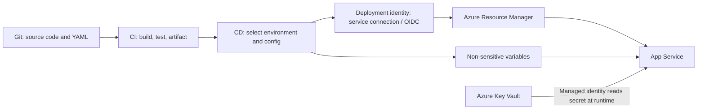

# Managing Pipeline Variables, Secrets, and Configuration

In the Microsoft Azure ecosystem, a CI/CD pipeline typically needs to know **which version to build**, **which resources to deploy to**, **which configuration to apply per environment**, and **where to obtain credentials**. Hardcoding all of that into source code or a single YAML file makes environment changes error-prone and risks leaking tokens, passwords, and access keys via Git history, logs, or artifacts.

This lesson belongs to the **CI/CD and Software Supply Chain** chapter, focusing on how to organize variables, secrets, and configuration when deploying applications on Azure. **Azure Pipelines** (in Azure DevOps) and **GitHub Actions** serve as the two example platforms, though the principles apply equally to other CI/CD engines.

## 1. Learning objectives

After this lesson, you will be able to:

1. Distinguish regular variables, secrets, pipeline parameters, application configuration, and deployment identities.
2. Choose appropriate storage scopes for shared configuration, per-environment settings, and sensitive data.
3. Use variables and secrets safely in Azure Pipelines and understand when YAML expressions are evaluated.
4. Integrate Azure Key Vault, service connections, and passwordless authentication without long-lived secrets.
5. Configure GitHub Actions with environments, repository variables, secrets, and OpenID Connect (OIDC) for Azure deployments.
6. Design workflows for verifying, scoping, and rotating secrets without leaking values.

## 2. Running scenario: deploying Orders API

Suppose a team develops a Java service `orders-api` and deploys it to Azure App Service across three environments:

| Property | Development | Staging | Production |
| --- | --- | --- | --- |
| Azure resource group | `rg-orders-dev` | `rg-orders-stg` | `rg-orders-prod` |
| App Service | `app-orders-dev` | `app-orders-stg` | `app-orders-prod` |
| Application mode | `development` | `staging` | `production` |
| Key Vault | `kv-orders-dev` | `kv-orders-stg` | `kv-orders-prod` |
| Deployment approval | Can be automated | Per team rules | Mandatory per release policy |

These resource names are examples; replace them with your real resources and permissions during practice.

The pipeline should produce one tested artifact and promote **that exact artifact version** across environments. Endpoints, resource names, and operational settings may differ; database passwords and third-party service tokens must be managed separately per environment. Never recompile code merely to swap an environment password or URL.



The Key Vault-to-application path is the preferred pattern whenever supported by the platform: the app fetches secrets at runtime using an authorized identity. The pipeline only deploys code and references, shrinking the number of jobs exposed to secret values.

## 3. Classifying data before creating pipelines

| Category | Example | Appropriate management | Notes |
| --- | --- | --- | --- |
| Build constants | `BUILD_CONFIGURATION=Release`, Java version | YAML, templates, reviewed config files | Contains no credentials |
| Deployment environment variables | `RESOURCE_GROUP`, `WEB_APP_NAME`, region | Variable groups, environment/repository variables | Values vary across dev/stg/prod |
| Flow-selection parameters | Choose `deployEnvironment`, toggle test steps | `parameters` in Azure Pipelines, `workflow_dispatch.inputs` in GitHub Actions | Constrain allowed values |
| Secrets | API tokens, passwords, private keys | Azure Key Vault or CI/CD secret store | Restrict scope, lifetime, and read access |
| Deployment identities | Service connections, federated identities | Azure DevOps/GitHub and Microsoft Entra ID | Prefer OIDC/workload identity federation |
| Runtime configuration | Feature flags, environment-specific URLs | Azure App Configuration, App Service app settings | Updatable independently of artifacts |
| Certificates and cryptographic keys | TLS certificates, encryption keys | Key Vault with appropriate access policies | Never embed private keys in artifacts |

**A variable is not automatically a secret.** A variable named `DB_PASSWORD` remains sensitive even when declared under `variables:`. Conversely, subscription IDs, tenant IDs, and client IDs are usually identifiers rather than passwords, yet still require controlled write governance.

**Masking values in logs does not secure a secret.** CI/CD masking replaces known strings with `***`, but can miss encoded, split, or transformed strings. Real security starts with where secrets live, which identities can read them, and how scripts consume them.

### What should and should not go into Git

Commit pipeline structures, templates, variable name inventories, and non-sensitive defaults—for example, an `.env.example` containing no real credentials. Never commit `.env` files with passwords, service account keys, downloaded cloud credential files, `secrets.json`, or logs containing tokens. If a secret was ever committed, **deleting it in a new commit is not enough**: revoke or rotate the secret, assess exposure scope, and clean repository history per team process.

## 4. Variables in Azure Pipelines: scopes and evaluation timing

Azure Pipelines lets you declare variables at pipeline, stage, and job levels, or manage them in the UI and variable groups. A simple configuration:

```yaml
trigger:
  - main

variables:
  - name: buildConfiguration
    value: Release
  - name: appName
    value: orders-api

pool:
  vmImage: ubuntu-latest

steps:
  - bash: |
      echo "Application: $APP_NAME"
      echo "Build mode: $BUILD_CONFIGURATION"
    displayName: Display non-sensitive build settings
    env:
      APP_NAME: $(appName)
      BUILD_CONFIGURATION: $(buildConfiguration)
```

In this example, `$(appName)` and `$(buildConfiguration)` are expanded by Azure Pipelines when the step runs. Inside Bash, `$APP_NAME` and `$BUILD_CONFIGURATION` are **process environment variables** explicitly mapped via `env:`. Explicit mapping clarifies exactly which inputs a script receives.

Three commonly confused expression syntaxes:

| Azure Pipelines syntax | Timing / usage | Example |
| --- | --- | --- |
| `${{ variables.appName }}` | Template expression, expanded when the pipeline compiles YAML | Selecting task names, templates, or known static values |
| `$(appName)` | Macro syntax, expanded right before the task runs | Passing variable values into task inputs or `env:` |
| `$[ variables.isMain ]` | Runtime expression; typically used as the full right-hand side of a variable or condition | Computing variables from runtime state |

Runtime expression example:

```yaml
variables:
  isMain: $[eq(variables['Build.SourceBranch'], 'refs/heads/main')]
```

Variables created or updated at runtime cannot retroactively alter YAML already expanded during template compilation. Therefore, **never pass secrets as template parameters or embed secrets into stage names, job names, or YAML structure**. Pass secrets into secret-aware task inputs or map them into the environment of only the specific step that needs them.

When the same variable name exists at multiple levels, narrower job-level scopes can override broader scopes; UI variables, variable groups, and runtime variables also follow specific precedence rules. Avoid colliding names across variable groups—especially for secrets. Use consistent prefixes like `ORDERS_` and document an owner for every variable.

### Output variables between tasks

A step can emit a **non-sensitive value** for subsequent steps:

```yaml
steps:
  - bash: |
      echo "##vso[task.setvariable variable=artifactLabel]orders-api-$(Build.BuildId)"
    displayName: Create artifact label

  - bash: |
      echo "Artifact label: $ARTIFACT_LABEL"
    env:
      ARTIFACT_LABEL: $(artifactLabel)
```

This passes a variable to a later step **within the same job**. To share values across jobs or stages, declare an output variable (`isOutput=true`) and use `dependencies` or `stageDependencies` syntax at the proper scope. Never abuse logging commands as an arbitrary secret transport channel.

## 5. Managing variable groups and secrets in Azure DevOps

A **variable group** in the Azure Pipelines Library bundles variables shared across pipelines. For example, group `vg-orders-dev` contains:

| Name | Type | Illustrative value |
| --- | --- | --- |
| `RESOURCE_GROUP` | Regular | `rg-orders-dev` |
| `WEB_APP_NAME` | Regular | `app-orders-dev` |
| `APP_ENV` | Regular | `development` |
| `THIRD_PARTY_TOKEN` | Secret | Stored in UI / Key Vault; never written in YAML |

To use the group, a pipeline needs authorization; grant access **per pipeline** rather than enabling access for all pipelines. Controlling who can edit variable groups matters just as much as who can run pipelines: anyone able to alter deployment targets or secrets can alter release behavior.

```yaml
trigger:
  - main

variables:
  - group: vg-orders-dev

stages:
  - stage: Configure_Dev
    displayName: Configure development App Service
    jobs:
      - deployment: ApplySettings
        environment: orders-dev
        pool:
          vmImage: ubuntu-latest
        strategy:
          runOnce:
            deploy:
              steps:
                - task: AzureCLI@2
                  displayName: Set non-sensitive application settings
                  inputs:
                    azureSubscription: sc-orders-dev
                    scriptType: bash
                    scriptLocation: inlineScript
                    inlineScript: |
                      set -euo pipefail
                      az webapp config appsettings set \
                        --resource-group "$RESOURCE_GROUP" \
                        --name "$WEB_APP_NAME" \
                        --settings APP_ENV="$APP_ENV" \
                        --output none
                  env:
                    RESOURCE_GROUP: $(RESOURCE_GROUP)
                    WEB_APP_NAME: $(WEB_APP_NAME)
                    APP_ENV: $(APP_ENV)

                - bash: |
                    set -euo pipefail
                    if [ -z "${THIRD_PARTY_TOKEN:-}" ]; then
                      echo "Missing THIRD_PARTY_TOKEN secret" >&2
                      exit 1
                    fi
                    echo "Verified secret availability for authenticated step."
                  displayName: Validate secret availability
                  env:
                    THIRD_PARTY_TOKEN: $(THIRD_PARTY_TOKEN)
```

Here, `sc-orders-dev` is an **already-created and authorized service connection in the project**. `AzureCLI@2` uses that connection to sign in to Azure and update a non-sensitive app setting. The secret check verifies presence only without printing length, patterns, or value. When adding real tasks, let scripts read tokens from process environment variables; avoid passing tokens on the command line where arguments can appear in logs or process lists.

A variable marked secret in Azure DevOps **is not automatically exported as an environment variable to every script**. Map it explicitly in `env:` on the authorized step. Never embed `$(THIRD_PARTY_TOKEN)` directly inside inline Bash YAML where it can be interpolated and logged before execution.

### Using Azure Key Vault in Azure Pipelines

Two common approaches:

1. **Link a variable group to Azure Key Vault:** manage secret names in Library; at runtime, the platform fetches values from the vault through an authorized service connection. When adding new secrets, verify the variable group's secret selection list.
2. **Use the `AzureKeyVault@2` task:** fetches specified secrets into the job context at runtime.

Example of the second approach, placed after creating the vault and matching service connection:

```yaml
steps:
  - task: AzureKeyVault@2
    displayName: Load API token from Key Vault
    inputs:
      azureSubscription: sc-orders-dev
      KeyVaultName: kv-orders-dev
      SecretsFilter: third-party-token
      RunAsPreJob: false

  - bash: |
      set -euo pipefail
      test -n "${THIRD_PARTY_TOKEN:-}" || {
        echo "Failed to read token from Key Vault" >&2
        exit 1
      }
      echo "Token is ready for the integration step."
    env:
      THIRD_PARTY_TOKEN: $(third-party-token)
```

The task needs vault access and secret-read permissions under the active Azure RBAC or access policy model; some integrations also require list permissions. Constrain `SecretsFilter` rather than fetching `*`, grant least privilege to the service connection, and separate vaults by environment. If Key Vault uses a private endpoint or firewall, pipeline agents also need a matching network path. Never treat one successful connection as proof that other agents or environments have reachability.

**When does a pipeline actually need a secret value?** Only when the CI/CD step itself requires the secret—such as authenticating to an external build system lacking federated identity. When the application needs a password *after deployment*, let the application or Azure platform fetch it at runtime using a managed identity.

## 6. Azure Key Vault, App Configuration, and runtime settings

These services solve distinct problems:

| Azure component | Primary function | Orders API example |
| --- | --- | --- |
| **Azure Key Vault** | Manages secrets, keys, certificates, and access policies | DB passwords, integration keys |
| **Azure App Configuration** | Centralized configuration and feature flags | Timeout thresholds, toggling new features |
| **App Service app settings** | Supplies settings to an app, typically as environment variables | `APP_ENV`, Key Vault references |
| **Managed identity** | Azure workload identity used to acquire resource access tokens | App Service reads Key Vault without storing client secrets |
| **Microsoft Entra ID / Azure RBAC** | Authenticates and authorizes identities on resources | Allows the exact workload to read the exact vault |

Example App Service app setting holding a **reference**, not a password:

```bash
az webapp config appsettings set \
  --resource-group rg-orders-prod \
  --name app-orders-prod \
  --settings 'DB_PASSWORD=@Microsoft.KeyVault(VaultName=kv-orders-prod;SecretName=db-password)' \
  --output none
```

Prerequisites: App Service has a managed identity enabled, that identity holds secret-read permissions on `kv-orders-prod`, and networking rules permit vault access. App Service resolves the Key Vault reference so the app receives the configured value. Because secrets may be cached, rotating a value in the vault does not guarantee every process sees the new value instantaneously; understand the service's refresh mechanics and test rotation paths.

In Azure App Configuration, non-sensitive keys are commonly organized by environment labels alongside feature flags. Key Vault references for sensitive values must be resolved by the app or SDK with matching identities and permissions. Never move passwords into App Configuration as plain strings just for easier querying.

This architecture draws a clean boundary: **the pipeline has permission to deploy**, while **the application has permission to read runtime secrets**. Both identities can—and should—be distinct and independently scoped.

## 7. Authenticating to Azure: service connections and OIDC

To update Azure resources, a pipeline must prove its identity. Common approaches:

- **Azure DevOps service connection:** a connection resource referenced by tasks like `AzureCLI@2` via `azureSubscription`. Whenever possible, configure service connections using workload identity federation and restrict subscription/resource group scope and authorized pipelines.
- **GitHub Actions OIDC:** GitHub issues a short-lived OIDC token to authorized workflows; Microsoft Entra ID verifies the trust relationship (federated credential) and issues an Azure access token.
- **Service principal with long-lived client secret:** still exists in legacy scenarios, but creates storage, rotation, and revocation overhead. Prefer migrating to federated identities where supported.

OIDC **does not automatically grant Azure permissions**: you need both a matching federated identity trust in Entra ID and an appropriately scoped role assignment on target resources. For example, a pipeline configuring only App Services in `rg-orders-dev` should be scoped strictly to those resources rather than receiving subscription-wide `Owner`.

### GitHub Actions example deploying non-sensitive configuration

The workflow below illustrates OIDC with GitHub environment `production`. Create the environment, set `AZURE_CLIENT_ID`, `AZURE_TENANT_ID`, `AZURE_SUBSCRIPTION_ID`, `AZURE_RESOURCE_GROUP`, and `AZURE_WEBAPP_NAME`, configure a federated credential trusting that exact repository and environment, and assign an appropriate Azure role to the identity.

```yaml
name: Configure Azure App Service

on:
  workflow_dispatch:

permissions:
  contents: read
  id-token: write

jobs:
  configure:
    runs-on: ubuntu-latest
    environment: production
    env:
      RESOURCE_GROUP: ${{ vars.AZURE_RESOURCE_GROUP }}
      WEB_APP_NAME: ${{ vars.AZURE_WEBAPP_NAME }}
    steps:
      - name: Sign in with OIDC
        uses: azure/login@v2
        with:
          client-id: ${{ vars.AZURE_CLIENT_ID }}
          tenant-id: ${{ vars.AZURE_TENANT_ID }}
          subscription-id: ${{ vars.AZURE_SUBSCRIPTION_ID }}

      - name: Apply non-sensitive runtime setting
        shell: bash
        run: |
          set -euo pipefail
          az webapp config appsettings set \
            --resource-group "$RESOURCE_GROUP" \
            --name "$WEB_APP_NAME" \
            --settings APP_ENV=production \
            --output none
```

Here `vars` holds **non-sensitive configuration**, while `secrets` holds sensitive values. If a step genuinely needs a third-party API key, pass it strictly to that step:

```yaml
- name: Check external integration credential
  shell: bash
  env:
    THIRD_PARTY_TOKEN: ${{ secrets.THIRD_PARTY_TOKEN }}
  run: |
    set -euo pipefail
    test -n "${THIRD_PARTY_TOKEN:-}" || exit 1
    echo "Secret is present; value not written to logs."
```

This snippet is an **additional step** inside a GitHub Actions workflow, not a standalone workflow. Store the secret on the corresponding GitHub environment, restrict who can edit the environment, and enforce reviewers and branch/tag rules before the production job can start. If a secret is unconfigured, the expression evaluates to an empty string; validating inputs ensures the step fails fast.

**Supply-chain note:** examples use major tag `azure/login@v2` for readability. For systems needing strict dependency control, pin third-party actions to audited commit SHAs and update them through reviews.

## 8. Separating environments and controlling releases

A secure layout typically looks like:

```text
orders-api/
  .github/workflows/deploy.yml     # or azure-pipelines.yml
  config/
    defaults.example.yml           # non-sensitive sample values only

Azure / CI-CD:
  dev  -> rg-orders-dev  -> kv-orders-dev
  stg  -> rg-orders-stg  -> kv-orders-stg
  prod -> rg-orders-prod -> kv-orders-prod
```

Config templates in the repo let teams review configuration **shape**; actual environment values live in the corresponding config store or cloud. Ensure at minimum:

1. **Separate identities and permissions per environment:** a dev service connection or federated credential must never write to production.
2. **Need-based secret access:** routine build steps never read production tokens. Production vaults grant specific secrets only to approved identities.
3. **Approval gates at deployment targets:** Azure DevOps environment approvals/checks or GitHub environment protection rules govern who can release to production.
4. **Immutable artifacts:** build/test once, promote across staging then production, and track via version numbers, digests, or checksums.
5. **Explicitly named and typed input variables:** scope `RESOURCE_GROUP`, `WEB_APP_NAME`, and `APP_ENV` per environment rather than creating vague org-wide `PASSWORD` or `URL` variables.

If operators can select a target environment, constrain choices to `dev/stg/prod` via controlled parameters and bind each choice to its matching environment and permissions. **A YAML condition never replaces Azure RBAC or approval policies**: without branch protection and approval controls, workflow editors can modify conditions.

## 9. Common leakage patterns and misconfigurations

| Scenario | Consequence | Prevention |
| --- | --- | --- |
| Running `echo $TOKEN`, `set -x`, or CLI debug flags | Secret appears in logs | Disable tracing/debug in secret-handling steps; log status only |
| Writing tokens into YAML or `.env` and committing | Exposed in Git history and clones | Use Key Vault / secret stores; run secret scans pre-merge |
| Passing secrets as CLI arguments | Exposed in logs, process lists, or error traces | Pass via secret inputs, stdin, or environment variables |
| Using one identity across all subscriptions | Compromised workflow gains broad blast radius | Separate identities per environment with least-privilege RBAC |
| Allowing untrusted PR workflows to access secrets | Contributor code can exfiltrate secrets | Restrict triggers, token permissions, and environment protection |
| Fetching every secret in a vault via wildcard | Unnecessary exposure through build agents | Fetch only required secret names and separate vaults |
| Rotating a secret without updating consumers | Application authentication breaks | Build rotation, refresh, and rollback procedures |
| Interpolating untrusted inputs into shell commands | Command injection risk | Bind via `env:`, quote shell variables, and validate inputs |
| Uploading secrets to artifacts, caches, or output variables | Values persist after job finishes | Exclude sensitive files from artifacts/caches and limit retention |

Log masking can fail to catch encoded, split, or concatenated tokens. Furthermore, environment variables pass data to processes—**they are not a security vault**: malicious code running inside the same job can read any variable granted to that job. Avoid running untrusted code in jobs holding secrets; isolate agents and trust boundaries.

## 10. Guided practice

**Objective:** configure `orders-api` for development without storing secrets directly in the repository. You may use either Azure DevOps or GitHub Actions; the two YAML examples above provide corresponding templates.

**Step 1 — Build the configuration table.** List dev variable names: `RESOURCE_GROUP`, `WEB_APP_NAME`, `APP_ENV`, `THIRD_PARTY_TOKEN`. Mark the first three non-sensitive and the token secret. Answer: which component genuinely needs to read that token?

**Step 2 — Create identities and assign permissions.** Set up a federated Azure DevOps service connection or a GitHub Actions OIDC federated credential. Assign an Azure role sufficient to update App Service settings in the dev resource group—never grant production access to the dev identity.

**Step 3 — Configure variable and secret stores.**

- For **Azure DevOps**, create `vg-orders-dev` with three regular variables and one secret variable; authorize the target pipeline only. Optionally back the secret with Azure Key Vault and matching read permissions.
- For **GitHub Actions**, create the `development` GitHub environment, add non-sensitive values to environment variables, and put the token in an environment secret if a step requires it. Adjust the environment name in the sample workflow to match.

**Step 4 — Run the matching YAML pipeline.** Substitute your project's service connection or OIDC variables. Verify logs print app name/status only and never the token, and confirm App Service receives `APP_ENV=development`.

**Step 5 — Test missing-secret behavior.** In a test environment, temporarily revoke read access or reference a nonexistent secret and run the token check step. Expect the job to fail clearly without leaking sensitive data. Restore valid configuration afterward.

**Step 6 — Verify environment isolation.** Confirm the dev identity cannot modify the production App Service. Review approval gates before letting any pipeline target the `production` environment.

**Step 7 — Practice rotation.** Create a new secret version in the test environment, confirm the consumer picks up the new value through its real refresh path, and revoke the old version once verified. Document the owner and rollback steps.

### Completion criteria

| Check | Expected outcome |
| --- | --- |
| Repository | Contains no real secrets or long-lived credential files |
| Pipeline logs | Never display secrets, even on job failure |
| Access controls | Dev identity and pipeline touch only authorized resources |
| Deployment config | App Service receives `APP_ENV` matching the selected environment |
| Missing secret test | Job fails clearly without printing values |
| Secret lifecycle | Documented process to rotate, revoke, and verify consumers adopt new versions |

## 11. Self-check questions

1. Why does naming a variable `SECRET_KEY` in YAML not turn it into a protected secret?
2. In Azure Pipelines, how do `${{ variables.x }}` and `$(x)` differ in evaluation timing? Why avoid placing secrets in template expressions?
3. When an App Service needs a database password at runtime, why does a managed identity paired with a Key Vault reference reduce risk compared to passing the password through the pipeline?
4. With GitHub Actions OIDC, besides `id-token: write`, what else must be configured in Microsoft Entra ID and Azure RBAC?
5. If a token once appeared in logs or Git history, why is deleting that line insufficient?
6. When promoting one artifact from staging to production, which data should remain identical and which should vary by environment?

**Reference answers:** (1) variable names do not determine security storage/handling; (2) template expressions expand at compile time whereas macros expand at task runtime; (3) secret access stays bound to the runtime workload directly; (4) a matching federated credential trusting the exact source and a scoped role assignment; (5) credentials must be revoked/rotated and copies audited; (6) code and artifact stay identical while targets and environment settings vary.

## 12. Key principles to remember

Good variable management makes pipelines reusable; good secret management limits which people and tasks touch sensitive data; good configuration management lets applications adapt across environments without editing source code. On Azure, combine **variable groups or GitHub environments**, **Key Vault**, **workload identity federation/managed identities**, and **Azure RBAC** to separate build permissions, deployment permissions, and runtime secret access. Every time you add a new variable, ask first: **is this data sensitive, who truly needs to read it, when, and in which environment?**
