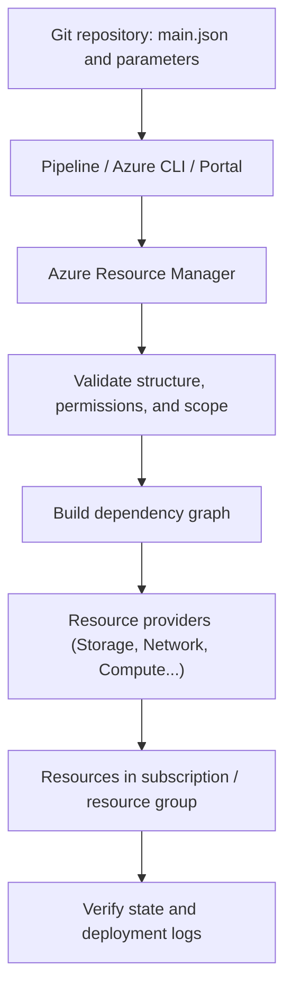
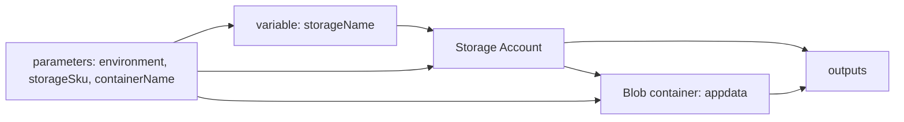
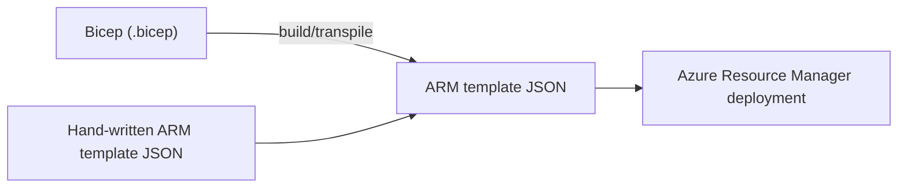
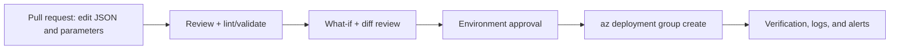

# Declarative Resource Modeling with ARM Templates

## 1. Objectives and Context

In the **Infrastructure as Code (IaC)** chapter of the **CLOUD_PROVIDERS_AZURE** module, we explore how to describe Azure infrastructure as versioned, reviewable, and repeatable configuration. This is the foundation for building application architectures on Azure—from subscriptions, resource groups, and Microsoft Entra ID to virtual networks, compute services, storage, data, monitoring, security, and cost management.

Suppose an application needs a Storage Account to hold files, a blob container to store data, and later adds App Service, networking, and monitoring. Creating each resource by clicking through the Azure Portal may work for experimentation, but it makes it difficult to keep dev, test, and production environments consistently configured. **Azure Resource Manager (ARM) templates** let you declare the desired resources and properties in a JSON file, then instruct Azure Resource Manager to deploy that declaration.

After this lesson, learners will be able to:

- Explain how the **declarative desired-state** model differs from writing sequential resource-creation steps.
- Read the structure of an ARM template consisting of `$schema`, `contentVersion`, `parameters`, `variables`, `resources`, and `outputs`.
- Author and deploy a JSON ARM template with parent/child resources, deployment dependencies, environment parameterization, and baseline security configuration.
- Use Azure CLI to **validate → what-if → create → verify** and understand how redeployments affect resource state.
- Recognize limitations around drift, deployment modes, sensitive data, RBAC permissions, and infrastructure lifecycle.

**Example scope:** Azure public cloud, deploying at **resource group scope**. Names such as `rg-arm-demo`, `appdata`, and `dev` are illustrative placeholders; they do not represent existing resources in your account. To run the hands-on exercise, you need Azure CLI, a subscription with appropriate permissions, and organizational policies that allow creating a Storage Account.

## 2. Declarative Mindset: Describing "What", Letting Azure Handle "How"

An imperative script typically says "create a resource group; create a Storage Account; create a container; update properties…". An ARM template says "in this resource group there must be a Storage Account with the specified name, SKU, security configuration, and container". **ARM** receives the template, validates syntax and deployment preconditions, builds the dependency graph, and sends requests to the **resource providers** to create or update the resources.

| Aspect | Imperative Command Approach | Declarative ARM Template Approach |
| --- | --- | --- |
| Primary input | Sequential "create/modify" operation steps | Configuration describing desired resource types and properties |
| Dependency relationships | Script author manually ensures ordering | ARM analyzes the dependency graph from `dependsOn` and resource references |
| Reusability | Requires conditional logic for existing resources | Can redeploy the same template/parameters to synchronize managed properties |
| Pre-apply checks | Custom-built in each script | Built-in validation and `what-if` support |
| Review, audit | Review scripts and runtime variables | Review JSON, parameters, and projected changes in pipelines |
| Key caveat | Scripts must handle idempotency | Templates must still be designed properly; Azure may restrict immutable changes or cause impact during updates |

**Declarative does not mean "Azure continuously maintains desired state on its own".** An ARM template is the **input to a single deployment**. After deployment, someone can still modify resources out of band. To detect or remediate drift, you need to re-run deployments, use `what-if`, enforce policies, or adopt appropriate lifecycle management mechanisms.

An ARM deployment is evaluated at a **scope**:

- **Resource group scope:** commonly used for an application's group of resources; deployed using `az deployment group ...`.
- **Subscription scope:** can create resource groups, policies, role assignments, and certain subscription-level resources.
- **Management group / tenant scope:** used for corresponding governance resources, with scope-specific schemas and deployment methods.

This lesson uses resource group scope, so the `resourceGroup()` and `resourceId()` functions in the examples operate in the context of the target resource group.

## 3. Where Do ARM Templates Fit in Azure Architecture?



The **control plane** (ARM) receives resource management requests; the **data plane** is where applications read and write actual data, such as blobs in Storage. A template can declare containers and permissions on the control plane, but that does not mean the template automatically loads data, migrates data, or tests the application.

When a template describes two independent resources, ARM can process them in parallel. When resource B requires A to exist, `dependsOn` (or dependency references inferred by ARM in applicable cases) determines the order. Line order in the `resources` array is **not** an execution contract.

## 4. Core Structure of a JSON ARM Template

A traditional ARM template is a JSON object. A minimal template has the structure:

```json
{
  "$schema": "https://schema.management.azure.com/schemas/2019-04-01/deploymentTemplate.json#",
  "contentVersion": "1.0.0.0",
  "parameters": {},
  "variables": {},
  "resources": [],
  "outputs": {}
}
```

| Field | Role | How It Is Used |
| --- | --- | --- |
| `$schema` | Template schema and deployment scope | The example above is for a resource group deployment. |
| `contentVersion` | Team-managed template content version | Useful for release tracking; not the resource `apiVersion`. |
| `parameters` | External inputs such as environment, SKU, container name | Enables reusing the same code across dev/test/prod and validating inputs. |
| `variables` | Expressions and intermediate values inside the template | Avoids repeating name concatenation and creates stable computed values. |
| `resources` | Resource types, names, properties, conditions, and dependencies | The core section describing desired state. |
| `outputs` | Values returned after deployment | Used to pass IDs, endpoints, or resource names to downstream steps; do not output secrets. |

Advanced elements may include `metadata`, `functions` (user-defined functions), `condition`, `copy` (loops), nested/linked templates, and resource references. These are useful as architectures grow, though not required for your first deployment.

### 4.1. Distinguishing Three Easily Confused "Versions"

- `contentVersion`: version assigned by the team to the **entire template**, for example `1.0.0.0`.
- `apiVersion`: the **resource provider** API version for a specific resource type, such as `Microsoft.Storage/storageAccounts`. It determines the schema and properties understood by the provider at deployment time.
- The version of **Azure CLI**, pipeline tasks, or build tools: determines the capabilities of the tool submitting the deployment. It cannot substitute for `apiVersion` in JSON.

### 4.2. ARM Expressions

Strings of the form `"[...]"` are **ARM expressions**. For example:

```json
{
  "name": "[variables('storageName')]",
  "location": "[resourceGroup().location]"
}
```

Common functions:

| Function | What Is It Used For? |
| --- | --- |
| `parameters('environment')` | Reads a parameter value for the current deployment |
| `variables('storageName')` | Reads a computed variable |
| `resourceGroup().location` | Retrieves the region metadata of the target resource group |
| `concat('st', 'demo')` or `format('{0}-{1}', 'app', 'dev')` | Joins names according to naming rules |
| `uniqueString(resourceGroup().id, 'dev')` | Generates a **deterministic** hash string from inputs to assist naming |
| `resourceId('Microsoft.Storage/storageAccounts', 'myaccount')` | Builds a properly formatted resource ID for the scope |
| `reference(...)` | Reads runtime properties of a referenced resource when supported by the API |
| `if(...)`, `equals(...)` | Implements conditional selection logic based on parameters |

**Note:** `uniqueString` returns the same result for the same inputs, but **does not guarantee** global availability of the resource name. For a Storage Account, the name must be globally unique across Azure, so name collisions or naming policy rejections can still occur.

## 5. Complete Example: Storage Account with a Blob Container

Objective: use a single template to create a **StorageV2 Account** and an `appdata` container, enforce HTTPS/TLS settings, and disallow blob public access. Select the SKU via a parameter, and output the Storage Account name and container resource ID for downstream steps.

Example file: `main.json`.

```json
{
  "$schema": "https://schema.management.azure.com/schemas/2019-04-01/deploymentTemplate.json#",
  "contentVersion": "1.0.0.0",
  "metadata": {
    "description": "Storage Account and blob container for ARM template lesson"
  },
  "parameters": {
    "environment": {
      "type": "string",
      "defaultValue": "dev",
      "allowedValues": ["dev", "test", "prod"],
      "metadata": {
        "description": "Target deployment environment"
      }
    },
    "storageSku": {
      "type": "string",
      "defaultValue": "Standard_LRS",
      "allowedValues": ["Standard_LRS", "Standard_GRS"],
      "metadata": {
        "description": "Storage redundancy for demo"
      }
    },
    "containerName": {
      "type": "string",
      "defaultValue": "appdata",
      "minLength": 3,
      "maxLength": 63,
      "metadata": {
        "description": "Blob container name; provider validates character rules"
      }
    }
  },
  "variables": {
    "storageName": "[concat('st', uniqueString(resourceGroup().id, parameters('environment')))]"
  },
  "resources": [
    {
      "type": "Microsoft.Storage/storageAccounts",
      "apiVersion": "2023-05-01",
      "name": "[variables('storageName')]",
      "location": "[resourceGroup().location]",
      "sku": {
        "name": "[parameters('storageSku')]"
      },
      "kind": "StorageV2",
      "tags": {
        "environment": "[parameters('environment')]",
        "managedBy": "arm-template"
      },
      "properties": {
        "supportsHttpsTrafficOnly": true,
        "minimumTlsVersion": "TLS1_2",
        "allowBlobPublicAccess": false,
        "allowSharedKeyAccess": false
      }
    },
    {
      "type": "Microsoft.Storage/storageAccounts/blobServices/containers",
      "apiVersion": "2023-05-01",
      "name": "[format('{0}/default/{1}', variables('storageName'), parameters('containerName'))]",
      "dependsOn": [
        "[resourceId('Microsoft.Storage/storageAccounts', variables('storageName'))]"
      ],
      "properties": {
        "publicAccess": "None"
      }
    }
  ],
  "outputs": {
    "storageAccountName": {
      "type": "string",
      "value": "[variables('storageName')]"
    },
    "blobContainerResourceId": {
      "type": "string",
      "value": "[resourceId('Microsoft.Storage/storageAccounts/blobServices/containers', variables('storageName'), 'default', parameters('containerName'))]"
    }
  }
}
```

### 5.1. Reading the Template Section by Section

**Parameters.** `environment` accepts one of `dev`, `test`, or `prod`; `storageSku` is constrained to two illustrative SKUs; `containerName` enforces length bounds. ARM validates parameter constraints, while the resource provider further enforces resource-specific rules (for example, container names must follow character and hyphen rules).

**Variables.** `storageName` concatenates the prefix `st` with `uniqueString(resourceGroup().id, environment)`. Given the same resource group and environment, the generated name remains stable across deployments. The name is not hardcoded in the documentation and must still pass Azure Storage's global uniqueness check.

**Resources.** The first resource declares the Storage Account. `sku` affects redundancy level and cost; `location` inherits the resource group's region; `tags` support traceability and governance. The properties `supportsHttpsTrafficOnly`, `minimumTlsVersion`, `allowBlobPublicAccess`, and `allowSharedKeyAccess` demonstrate several data-protection settings. When shared key access is disabled, data access workflows must use an appropriate authentication mechanism, such as Microsoft Entra ID combined with **data-plane RBAC**.

**Parent/child resources.** The blob container is a child resource with the full type `Microsoft.Storage/storageAccounts/blobServices/containers` and a three-part name in order: `<storage-account>/default/<container>`. `default` is the default blob service of the Storage Account.

**Dependencies.** The container depends on the Storage Account via `dependsOn` with `resourceId(...)`. ARM deploys the Storage Account first and only then deploys the container; JSON line order does not determine dependencies.

**Outputs.** The Storage Account name and container resource ID are output for downstream steps, such as application configuration. Never output access keys, connection strings containing secrets, or tokens, because outputs can appear in deployment history and pipeline logs.

### 5.2. Dependency Graph of the Example



Here `dependsOn` expresses deployment dependencies **between resources**, whereas arrows from parameters/variables to resources only represent **configuration data flow**. ARM does not automatically create network security groups, diagnostic settings, or policies unless they are explicitly declared or applied separately.

## 6. Deploying with Azure CLI in a Safe Sequence

Assume you save the JSON locally as `main.json` and are signed in to Azure CLI. The commands below illustrate running in an appropriate subscription and region; they are **executed only when you actively run them**—this lesson does not automatically provision resources.

### 6.1. Select a Subscription and Create a Resource Group

```bash
az login

az account list --output table
az account set --subscription "<SUBSCRIPTION_ID>"

az group create \
  --name rg-arm-demo \
  --location southeastasia
```

The resource group is the **container scope** for this lesson. When using `resourceGroup().location`, the Storage Account deploys into the resource group's metadata region; in real architectures, not every service needs the same region and location can be passed as a separate parameter.

### 6.2. Pre-Deployment Checks

```bash
az deployment group validate \
  --resource-group rg-arm-demo \
  --template-file main.json \
  --parameters environment=dev storageSku=Standard_LRS containerName=appdata

az deployment group what-if \
  --resource-group rg-arm-demo \
  --template-file main.json \
  --parameters environment=dev storageSku=Standard_LRS containerName=appdata
```

- `validate` checks inputs, certain configuration constraints, permissions, and whether ARM can accept the deployment request.
- `what-if` predicts whether resources will result in **Create**, **Modify**, **Delete**, **NoChange**, or other change types depending on the diff and evaluation capability. The output is a **prediction** and must be reviewed; some expressions or runtime properties cannot be fully resolved before execution.
- If organizational policies, RBAC permissions, quotas, or name availability block the operation, deployment can still fail even when JSON syntax is valid. Thus, validate/what-if are helpful but do not replace post-deployment verification.

### 6.3. Execute the Deployment and Read Outputs

```bash
az deployment group create \
  --name demo-arm-storage \
  --resource-group rg-arm-demo \
  --template-file main.json \
  --parameters environment=dev storageSku=Standard_LRS containerName=appdata

az deployment group show \
  --resource-group rg-arm-demo \
  --name demo-arm-storage \
  --query properties.outputs \
  --output json
```

The first deployment typically creates the Storage Account and container. If repeated with the **same template and parameters**, ARM evaluates the target resources, applies the corresponding request, and generally does not need to recreate existing resources that match the configuration. This is the value of **deployment-level idempotency**, though it does not guarantee every run produces zero changes: a resource provider may apply default values, update properties, or reject immutable property changes.

To inspect the results, you can use the Azure Portal or Azure CLI to verify the newly output Storage Account name, the `appdata` container, access settings, and the Azure Activity Log. Successful resource creation by a template **does not guarantee** the application has permission to read/write blobs: roles such as **Storage Blob Data Reader** or **Storage Blob Data Contributor** belong to **data-plane permissions** and must be configured separately for the application's identity.

### 6.4. Parameterizing via Files Instead of Editing Templates

When deploying to multiple environments, keep `main.json` immutable and supply environment-specific parameter sets. For example, an ARM parameters file such as `dev.parameters.json`:

```json
{
  "$schema": "https://schema.management.azure.com/schemas/2019-04-01/deploymentParameters.json#",
  "contentVersion": "1.0.0.0",
  "parameters": {
    "environment": {
      "value": "dev"
    },
    "storageSku": {
      "value": "Standard_LRS"
    },
    "containerName": {
      "value": "appdata"
    }
  }
}
```

Using the parameter file:

```bash
az deployment group what-if \
  --resource-group rg-arm-demo \
  --template-file main.json \
  --parameters @dev.parameters.json

az deployment group create \
  --name demo-arm-storage \
  --resource-group rg-arm-demo \
  --template-file main.json \
  --parameters @dev.parameters.json
```

The production parameter set can use `environment=prod`, a different SKU, tags, and a dedicated scope. Never put raw passwords, keys, or connection strings into parameter files committed to Git.

## 7. What Happens When Re-running a Template?

Consider three scenarios:

| Input or State Change | Expected Outcome | What to Verify |
| --- | --- | --- |
| No changes to JSON or parameters | Azure generally keeps the same resources; submitted properties may still be reapplied | Run `what-if`, verify state and provider defaults |
| Change `storageSku` from `Standard_LRS` to `Standard_GRS` | ARM requests a SKU update on the existing Storage Account | Verify redundancy conversion validity, region support, cost, duration, and data impact |
| Change `environment` from `dev` to `prod` in the same resource group | The `storageName` expression generates a **different name**, causing Azure to treat it as a **different** Storage Account | Check that the old dev resource still exists; do not assume ARM automatically deletes old resources |

### 7.1. Incremental Mode

**Incremental** is the standard and default deployment mode for ARM templates at resource group scope. It creates/updates resources declared in the template; **resources removed from the template are generally not deleted merely because a new incremental deployment omits them**.

However, you must distinguish between **removing an entire resource from the template** and **removing a property from a resource that remains in the template**. For a resource that is still deployed, an omitted property may be reset to its provider default or altered according to API behavior. Therefore, deleting a JSON line cannot be treated as a safe way to "preserve whatever configuration is currently live".

### 7.2. Complete Mode and Lifecycle Management

Some legacy documentation or systems mention **Complete deployment mode** to handle resources no longer declared, but that approach carries resource-deletion risks and is not the recommended design choice for new workflows. When you need to manage resource decommissioning in the application lifecycle, consider **deployment stacks** or an explicit deletion workflow with peer review, dependency confirmation, and required data backups.

**There is no "automatic absolute rollback"** simply from using ARM templates. A deployment can partially succeed before failing. To return to a prior state, teams must design a recovery strategy, protect data, and verify redeployment capability.

### 7.3. Drift Does Not Disappear on Its Own

For example, suppose an administrator enables public access outside the pipeline. A subsequent ARM template run **can** restore the declared property back to `false`, provided the resource provider permits it and the template explicitly sends that property. However, if no deployment runs, ARM templates do not continuously monitor or remediate drift. Azure Policy, change tracking, scheduled `what-if` runs, and review processes help detect unintended changes.

## 8. Dependencies, References, and Structuring Large Templates

### 8.1. `dependsOn` Represents a Graph, Not Source Order

For example, the container requires the Storage Account, so the template uses:

```json
{
  "dependsOn": [
    "[resourceId('Microsoft.Storage/storageAccounts', variables('storageName'))]"
  ]
}
```

Avoid declaring unnecessary dependencies: they can prevent ARM from parallelizing work and slow down deployments. Conversely, if a resource requires another resource to be ready without an appropriate dependency, the deployment can fail due to concurrent execution.

In certain `reference()` expressions or resource-access forms, ARM can infer an implicit dependency; however, you must understand how ARM handles each reference form rather than assuming every ID string creates a dependency. `resourceId()` by itself only **constructs an ID string**—it does not guarantee provisioning order.

### 8.2. `condition` and `copy`

- `condition` enables conditional declarations, such as creating a resource only in production. You must clearly understand how conditions interact with references, dependencies, and redeployments.
- `copy` supports deploying multiple instances of a declaration by count, such as several similar configurations. Resource names must be valid and unique within the relevant scope.
- **Nested/linked templates** split solutions into modular parts and promote reuse. Managing URIs, content versions, and access permissions for linked templates should be part of the CI/CD workflow.

For large systems, group templates by lifecycle: **shared foundation**, **networking**, **identity and access**, **application services**, and **observability/monitoring**. Each deployment scope should have clear ownership to reduce the risk of a small change affecting an entire subscription.

### 8.3. ARM JSON and Bicep

**Bicep** is a higher-level declarative language for Azure; the Bicep compiler transpiles code into ARM template JSON for deployment through Azure Resource Manager. Therefore:



Learning ARM JSON helps you understand the resource model, properties, API versions, scopes, and dependencies even when you later write Bicep for maintainability. Choosing Bicep does not alter Azure RBAC principles, data lifecycle rules, or provider limitations.

## 9. Security, Access Control, and Cost Governance

### 9.1. Control-Plane vs. Data-Plane Access

To create a Storage Account via ARM, the deploying identity needs appropriate permissions on the target **scope**, such as a suitable role at the resource group level. If a pipeline only has Reader permissions, `what-if` or reading resources may work in some situations, but `create` requires corresponding write permissions.

Accessing blob data is a separate concern: after creating a container, an application that needs to read/write blobs must have data-plane access. Do not grant broad permissions at the subscription level just to fix a blob access error; verify the required permission type and scope, then use Microsoft Entra ID / managed identity and appropriate data roles.

### 9.2. Protecting Sensitive Information

- Sensitive parameters should use `secureString` or `secureObject` where appropriate, and be passed from controlled secret-management mechanisms (such as Azure Key Vault or pipeline secrets). **Secure types do not replace log controls, shell history hygiene, and user access controls**.
- Do not store secrets in regular `variables`, `outputs`, or Git repositories. Avoid using functions that return keys, such as `listKeys()`, to expose sensitive data in outputs.
- Use identities without long-lived secrets for pipelines whenever possible, such as workload identity federation; assign least-privilege Azure RBAC and control who can modify templates or trigger deployments.
- Security settings in templates must be evaluated per service: network restrictions, private endpoints, TLS, diagnostic settings, encryption, and organizational policies. The sample lesson covers only a subset of storage properties.
- Never blindly trust JSON files downloaded from untrusted sources: review resource types, role assignments, nested/linked template URLs, and any scripts that a deployment might execute.

Example of declaring a sensitive parameter in ARM JSON:

```json
{
  "parameters": {
    "adminPassword": {
      "type": "secureString",
      "metadata": {
        "description": "Syntax example; not used in the Storage template above"
      }
    }
  }
}
```

The snippet above is an **illustrative fragment**—do not add it to `main.json` in the Storage Account example, as a Storage Account does not use an admin password.

### 9.3. Cost and Resource Lifecycle

Templates provision real resources and can incur charges even before any application runs. Specifically:

- `Standard_LRS` and `Standard_GRS` have different redundancy and pricing characteristics; choose based on requirements and regional availability.
- Apply `tags` such as `environment`, `owner`, or `costCenter` consistently to support Cost Management. Tags do not cap spending on their own, and not all billing line items inherit tags as expected.
- Configure appropriate budgets and cost alerts; check quotas, policies, SKUs, and regions before deploying.
- For hands-on environments, verify resources are no longer needed before deleting a resource group. **Deleting a resource group destroys every resource inside it**, which may include resources unrelated to this lesson if a team shares a scope.

## 10. CI/CD Workflow with ARM Templates

An infrastructure deployment pipeline might include:



Repositories typically store templates alongside per-environment parameter files. Pipelines authenticate via service connections or workload identity federation, verify Azure RBAC, and execute deployments within allowed scopes. For production, require approvals for critical infrastructure changes—especially networking, storage, access permissions, deletions, or resource replacements.

A key operational principle: **`what-if` output must be compared against the template and policies before approval**. A "Modify" diff on a Storage Account can affect redundancy or application connectivity; a "Delete" diff must be treated as a potentially data-destructive change.

## 11. Common Errors and Triage

| Symptom | Possible Cause | How to Address |
| --- | --- | --- |
| Template reports JSON or schema error | Trailing comma, missing brace, misplaced field, `$schema` mismatched with scope | Check JSON syntax and `az deployment group validate`; match schema to scope. |
| `InvalidTemplate` or `InvalidTemplateDeployment` | Invalid ARM expression, bad parameter, or provider/policy/quota rejected deployment | Inspect detailed error messages in deployment operations; fix the failing component. |
| `AuthorizationFailed` / HTTP 403 | Identity lacks deployment permissions on the resource group/subscription | Check principal, role assignment, and scope; do not over-privilege unnecessarily. |
| `StorageAccountAlreadyTaken` or invalid name | Storage Account name already taken globally on Azure or violates naming rules | Change inputs used to derive the name, check length/charset, and re-run what-if. |
| `NoRegisteredProviderFound` or unsupported type/API | Provider not registered, or `apiVersion`/region/SKU not supported | Verify resource provider registration, API version, region, and subscription policies. |
| Storage Account created, but container deployment fails | Invalid container name, dependency/role/policy issue, or Storage provider rejected request | Verify `dependsOn`, full name `account/default/container`, and deployment operations. |
| Re-running template creates a new Storage Account | Naming expression or `environment`/resource group parameter changed | Compare inputs and `what-if`; keep resource names stable when reusing existing resources. |
| Resource removed from template still exists | Deployment is running in **Incremental** mode | Plan intentional lifecycle/deletion steps; do not assume ARM cleans everything up. |
| Deployment succeeds, but app cannot write blobs | Missing data-plane RBAC, network/TLS mismatch, or auth misconfiguration | Check app identity, Storage Blob Data role, firewall/private endpoint, and auth settings. |

When a deployment fails, inspect **deployment operations** and the **Azure Activity Log** first to find the exact resource type, error code, and request ID. Never assume every error is in the JSON: the exact same template can succeed in one environment yet be blocked by policy, quota, or permissions in another.

## 12. Guided Hands-On Exercise

**Scenario:** An application team needs to provision a Storage Account + container for the dev environment using an ARM template, then prepare the same template for test and production.

1. Read `main.json` in Section 5 and explain the role of each `parameters`, `variables`, `resources`, and `outputs` block.
2. Create a dedicated practice resource group. Run `validate` and `what-if` with `environment=dev` before deploying.
3. Run `az deployment group create` after reviewing the diff. Record the Storage Account name and container resource ID from outputs.
4. Re-run `what-if` with the same parameters. Explain why the output may not request creating new resources for those declarations.
5. Try changing `storageSku` to `Standard_GRS` in **what-if**; analyze cost, SKU/region support, and impact if actually applied. You do not need to deploy the change to answer this step.
6. Run `what-if` with `environment=test` in the same resource group and predict what happens to the Storage Account name. Discuss why production usually has a separate resource group.
7. Propose how to pass parameters in a pipeline, protect deployment permissions, and monitor drift. Write a short explanation distinguishing ARM control-plane permissions from an application's blob read/write permissions.

**Completion criteria:** Learners accurately understand template structure, dependency relationships, and parameter constraints; can interpret `what-if`; and clearly distinguish resources created/updated from resources omitted in an incremental deployment. If practicing on a real subscription, evaluate costs and clean up in a controlled manner within the assigned scope.

## 13. Self-Check Questions

**Q1. If the `resources` array lists the container before the Storage Account, will ARM necessarily create the container first?**  
No. ARM deploys according to the dependency graph. `dependsOn` in the example requires the Storage Account to be processed before the container.

**Q2. Why is `apiVersion` needed on each resource when `contentVersion` is already present?**  
`contentVersion` is the team-managed version of the template itself; `apiVersion` selects the interface version the resource provider uses to interpret the resource type and properties.

**Q3. After deleting the container declaration from the template and running an incremental deployment, is the container guaranteed to be deleted?**  
No. In incremental mode, resources no longer declared generally remain intact. Deletion requires a separate lifecycle management plan.

**Q4. If deployment succeeds but the application receives a 403 error when uploading a blob, what should you check?**  
Check the application identity, Storage Blob data-plane role, role assignment scope, and network/auth restrictions. Control-plane deployment permissions do not automatically grant data access.

**Q5. `what-if` reports no significant changes; does that guarantee zero cost or no post-deployment failures?**  
No. `what-if` is a resource-state prediction and does not replace checking usage charges, quotas, policies, service health, and post-deployment operational verification.

## 14. Official Reference Documentation

- Microsoft Learn — [ARM templates overview](https://learn.microsoft.com/azure/azure-resource-manager/templates/overview): concepts, tooling, scopes, and deployment workflows.
- Microsoft Learn — [ARM template structure and syntax](https://learn.microsoft.com/azure/azure-resource-manager/templates/syntax): JSON fields and expressions in templates.
- Microsoft Learn — [ARM deployment what-if](https://learn.microsoft.com/azure/azure-resource-manager/templates/deploy-what-if): previewing infrastructure changes.
- Microsoft Learn — [ARM deployment modes](https://learn.microsoft.com/azure/azure-resource-manager/templates/deployment-modes): incremental, complete, and lifecycle considerations.
- Microsoft Learn — [Bicep overview](https://learn.microsoft.com/azure/azure-resource-manager/bicep/overview): relationship between Bicep and ARM templates.

API versions and properties of each Azure resource provider evolve over time. Before promoting templates to production systems, verify the schema for the exact API version, review security and rollback procedures, and run validate/what-if in an appropriate environment.
