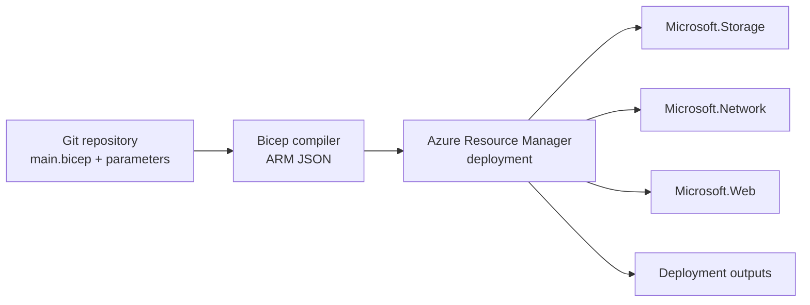
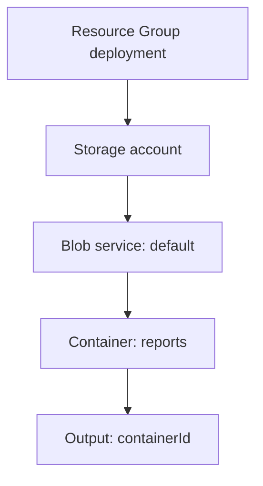
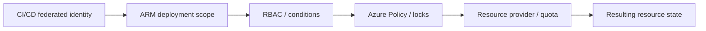
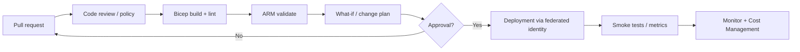
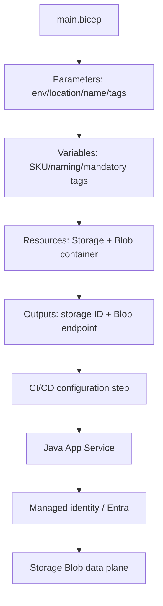

# Bicep with Resource, Parameter, Variable, and Output

A Java/Spring Boot application team on Microsoft Azure needs **development**, **staging**, and **production** environments with a consistent infrastructure layout: resource groups, Storage accounts, App Service, networking, and baseline security settings. If every team member creates resources in the Azure portal from memory, just one difference—such as enabling public Blob access in production, changing a region, or forgetting a cost-management tag—increases operational risk. **Infrastructure as Code (IaC)** describes infrastructure in code so deployments are repeatable, auditable for changes, and managed within a release workflow.

**Bicep** is a declarative language for defining Azure resources through **Azure Resource Manager (ARM)**. Its four most fundamental building blocks are:

- **`resource`:** declares an Azure resource to create/update or references an existing resource.
- **`param` (parameter):** input passed at deployment time, such as environment name, region, and SKU.
- **`var` (variable):** intermediate expressions/values computed inside the template to reduce repetition.
- **`output`:** values returned from a deployment, such as a resource ID, hostname, or URL for downstream steps to consume.

In the **CLOUD_PROVIDERS_AZURE** module, learners explore Microsoft Azure from subscriptions, resource groups, and Microsoft Entra ID through virtual networking, compute, storage, data, deployment, monitoring, security, and application architecture cost control. This lesson belongs to the **Infrastructure as Code** chapter and focuses specifically on **"Bicep with resource, parameter, variable, and output"**: how to write structured Bicep, reference resources, deploy with Azure CLI, protect sensitive data, and verify results.

> **Note:** Bicep declares **desired state**, yet a deployment still modifies real resources and can incur costs. Names, SKUs, regions, resource types, and API versions in the examples are for lab purposes. Verify subscription/region availability, Azure Policy, RBAC, and your actual Bicep/CLI versions before running create/update/delete commands.

## 1. Learning Objectives

Upon completion, you will be able to:

1. Explain **Bicep → ARM template → Azure Resource Manager → Resource Provider** and the difference between declarative templates and imperative scripts.
2. Read **`targetScope`, `param`, `var`, `resource`, `output`** syntax, typing, and property expressions.
3. Create a Storage account with baseline security properties, tags, and a test Blob container.
4. Declare parameters with **type, default, `@description`, `@allowed`, `@minLength`, `@maxLength`, `@secure`**.
5. Use variables to compute names, tags, and SKUs per environment without using variables to hide secrets.
6. Return **non-sensitive IDs and endpoints** via `output`; distinguish outputs from credentials.
7. Understand **symbolic names**, actual resource names, API versions, property access, and implicit/explicit dependencies.
8. Reference **`existing`** resources; understand **scope**, module, and resource-group deployment boundaries.
9. Author **`.bicepparam`** files, run build/lint/validate/what-if, and deploy with approvals.
10. Enforce safety through Azure RBAC, Azure Policy, secure parameters, Key Vault, and cost controls.
11. Diagnose template errors, type mismatches, resource name collisions, policy denials, and deployment failures.
12. Design an end-to-end lab with clear verification and rollback criteria.

## 2. What Is Bicep and Where Does It Fit in Azure?

When writing Bicep, you do not issue step-by-step instructions like "click create Storage account, wait, then click next". You describe **which resources must exist and their desired properties**. The Bicep compiler generates an ARM JSON template; Azure Resource Manager deploys it through Resource Providers such as `Microsoft.Storage`, `Microsoft.Network`, or `Microsoft.Web`.



### Declarative vs. Imperative

| Perspective | Bicep/ARM Declarative | Imperative Azure CLI Sequence |
|---|---|---|
| Intent | State **what end state is required** | State **what steps to run, in what order** |
| Reusability | Templates + parameters/modules | Scripts + variables |
| Change inspection | Build, lint, validate, what-if, and diff review | Inspect scripts and command output |
| Dependencies | ARM infers from references; supports explicit dependencies | Scripts usually coordinate ordering manually |
| Maintainability | Resource properties defined centrally | Prone to complex if/else branching logic |
| Risk | A faulty template can update resources at scale | A faulty command can also modify resources |

**Bicep is not Terraform**: Bicep leverages ARM's deployment engine and **does not maintain a separate state file like some other IaC tools**. This does not mean Azure keeps every resource state "immune to drift"; resources can still be modified out of band, policies/permissions can change, and properties still need reconciliation.

### What Does a Bicep File Do?

```bicep
targetScope = 'resourceGroup'

@description('Azure region for deploying resources')
param location string = resourceGroup().location

@description('Globally unique Storage account name')
param storageName string

var commonTags = {
  owner: 'java-platform'
  environment: 'lab'
}

resource storage 'Microsoft.Storage/storageAccounts@2023-05-01' = {
  name: storageName
  location: location
  sku: {
    name: 'Standard_LRS'
  }
  kind: 'StorageV2'
  tags: commonTags
  properties: {
    minimumTlsVersion: 'TLS1_2'
    supportsHttpsTrafficOnly: true
    allowBlobPublicAccess: false
  }
}

output storageId string = storage.id
output blobEndpoint string = storage.properties.primaryEndpoints.blob
```

This is an **illustrative Bicep template usable at resource group scope** once a valid Storage account name is supplied, subject to API/region support and permissions. A single resource already demonstrates all four concepts: `param` accepts inputs, `var` computes tags, `resource` defines the resource, and `output` returns the ID and endpoint.

## 3. Prerequisites and Deployment Safety

To test on Azure, you need:

- An Azure subscription/resource group **authorized for lab use**.
- Compatible Azure CLI and Bicep CLI (typically bundled or installable via Azure CLI).
- A signed-in Microsoft Entra ID identity with permissions to **deploy resources at the right scope**.
- Availability of the chosen resource type/region/SKU, sufficient quota, and compatible Azure Policy rules.
- Naming/tagging conventions, a lab budget, and a cleanup plan for resources created during practice.

### Initializing CLI Context

```bash
az login
az account list --output table
az account set --subscription "<lab-subscription-id>"
az account show \
  --query "{subscription:id,tenant:tenantId,name:name}" \
  --output json

# Verify Bicep CLI through Azure CLI.
az bicep version
```

If the version command reports Bicep is missing, install it via your organization's approved process (e.g., `az bicep install` if permitted) and verify the installed version. **Do not request Owner across the entire subscription** just to deploy a Storage account; scope deployment permissions to the resource group when sufficient.

### Creating a Resource Group Is a Real Change

```bash
# Run only when authorized to create a resource group in the lab:
az group create \
  --name "rg-bicep-lab" \
  --location "southeastasia" \
  --tags environment=lab owner=java-platform
```

If the resource group already exists (provisioned by an admin or IaC), simply inspect it with `az group show`; **do not recreate duplicates or overwrite tags** outside your responsibility. Subsequent examples use `rg-bicep-lab` and illustrative resource names without assuming that group already exists.

## 4. Bicep Syntax Structure

Bicep uses concise syntax and **does not use commas between object properties** like JSON. A typical template looks like:

```bicep
targetScope = 'resourceGroup'

@description('Deployment environment')
@allowed([
  'dev'
  'staging'
  'prod'
])
param environment string = 'dev'

param location string = resourceGroup().location

var isProduction = environment == 'prod'
var tags = {
  environment: environment
  managedBy: 'bicep'
}

resource sampleStorage 'Microsoft.Storage/storageAccounts@2023-05-01' = {
  name: 'st${uniqueString(resourceGroup().id, environment)}'
  location: location
  tags: tags
  sku: {
    name: 'Standard_LRS'
  }
  kind: 'StorageV2'
  properties: {
    minimumTlsVersion: 'TLS1_2'
    supportsHttpsTrafficOnly: true
    allowBlobPublicAccess: false
  }
}

output resourceId string = sampleStorage.id
output isProd bool = isProduction
```

**Reading each block:**

1. `targetScope` specifies the deployment scope.
2. `@description`/`@allowed` annotate and constrain `environment`.
3. `param` defines the input interface.
4. `var` creates computed values.
5. `resource` defines the Azure entity and its configuration.
6. `output` exports results.

### Using Strings and Expressions

| Element | Example | Meaning |
|---|---|---|
| String | `'dev'` | String literal |
| Boolean | `true`, `false` | Boolean value |
| Integer | `3` | Integer |
| Object | `{ owner: 'team-a' }` | Key/value fields |
| Array | `['dev', 'prod']` | List |
| Property access | `resourceGroup().location` | Expression |
| String interpolation | `'st${uniqueString(resourceGroup().id)}'` | Build a string from an expression |
| Conditional | `isProduction ? 'Standard_GRS' : 'Standard_LRS'` | Value selection |

**Bicep syntax differs from JSON/YAML**: do not put commas in arrays/objects in Bicep code; braces and indentation define objects. Bicep does not use directives like `terraform init` and will not create child resources merely by writing a JSON body unsupported by the provider.

## 5. Understanding `resource`: Declaring Desired State

General syntax:

```bicep
resource symbolicName 'ResourceProvider/type@apiVersion' = {
  name: 'actual-azure-resource-name'
  location: 'southeastasia'
  properties: {
    // Fields depend on resource type/API version.
  }
}
```

### Five Key Parts

| Component | Meaning | Example |
|---|---|---|
| `resource` | Declares a resource | `resource storage ...` |
| Symbolic name | Internal identifier inside the Bicep file | `storage` |
| Resource type | ARM resource type | `Microsoft.Storage/storageAccounts` |
| API version | Schema/resource API used | `2023-05-01` in the example |
| Resource body | Actual name, region, SKU, tags, and properties | `name`, `location`, `properties` |

**The symbolic name is not the Azure resource name.** You can rename `storage` to `reportStorage` in Bicep while keeping the actual Azure name `stexample123` if the `name` property stays unchanged. The symbolic name is used by other expressions to reference the resource, such as `storage.id`.

### Resource Provider and API Version

```bicep
resource vault 'Microsoft.KeyVault/vaults@2023-07-01' = {
  name: 'kv-example-lab'
  location: resourceGroup().location
  properties: {
    tenantId: subscription().tenantId
    sku: {
      family: 'A'
      name: 'standard'
    }
    accessPolicies: []
    enableRbacAuthorization: true
  }
}
```

This Key Vault example illustrates how a different provider/schema differs from Storage. **Do not deploy it verbatim** without designing permissions, soft delete/purge protection, networking, and policy. The API version is not the "Bicep version"; it is the API contract for each resource type—you must choose an Azure-supported API version matching the features you need.

### Why Does the Schema Matter?

The `minimumTlsVersion` field of a Storage account cannot simply be copied into an App Service `properties` block and expected to compile. The Bicep type system and linter can flag errors at build time; even if compilation succeeds, ARM/the resource provider may reject invalid values at deployment time.

## 6. Resource Symbolic Names, IDs, and Property Access

Suppose:

```bicep
param storageName string
param location string = resourceGroup().location

resource reportsStorage 'Microsoft.Storage/storageAccounts@2023-05-01' = {
  name: storageName
  location: location
  sku: {
    name: 'Standard_LRS'
  }
  kind: 'StorageV2'
  properties: {
    minimumTlsVersion: 'TLS1_2'
    supportsHttpsTrafficOnly: true
    allowBlobPublicAccess: false
  }
}

output actualName string = reportsStorage.name
output resourceId string = reportsStorage.id
output blobUrl string = reportsStorage.properties.primaryEndpoints.blob
```

**Distinguishing them:**

- `reportsStorage`: symbolic name used internally in Bicep.
- `reportsStorage.name`: actual resource name used by Azure.
- `reportsStorage.id`: ARM resource ID containing subscription/resource group/provider/type/name.
- `reportsStorage.properties.primaryEndpoints.blob`: endpoint returned by the provider after creation—**not an account key**.

### Azure Resource ID

Formal example:

```text
/subscriptions/<subscription-id>
/resourceGroups/rg-bicep-lab
/providers/Microsoft.Storage/storageAccounts/stexample123
```

In practice, the ID is a **single continuous string** with no line breaks between segments. IDs are commonly useful for granting permissions, querying resources, or passing into other modules; **they do not grant data access permissions on their own**.

### Deployment-Time References

Some properties are only returned by the provider during deployment/runtime. Bicep handles references for many supported properties, but **not every property exists in every API version**. Before outputting a deep property path, check type completions, the provider schema, and lab results.

## 7. Declaring `param`: Typed Inputs

Parameters let you reuse the same template across multiple environments without modifying code:

```bicep
@description('Deployment environment name')
param environment string = 'dev'

@description('Resource deployment region')
param location string = resourceGroup().location

@description('Valid, globally unique Storage account name across Azure')
param storageName string

@description('Enable diagnostic collection when accompanying configuration exists')
param diagnosticsEnabled bool = false

@description('Minimum instance count for the workload, where applicable to the resource')
param minimumInstances int = 1

@description('Tags supplied by the deployment pipeline')
param additionalTags object = {}
```

### Basic Type Table

| Type | Example | Meaning |
|---|---|---|
| `string` | `'dev'` | Text |
| `int` | `2` | Integer |
| `bool` | `false` | Boolean |
| `object` | `{ owner: 'team-a' }` | Property map |
| `array` | `['dev', 'prod']` | List |
| `string?` | Value that can be `null` (when syntax/version supports it) | Nullable type |

Do not make everything a `string` and rely on ad-hoc type coercion; for example, `enablePublicAccess` should be `bool` to avoid accidentally passing the string `'false'`. When using advanced types such as user-defined types, unions, or nullable types, verify your Bicep compiler version.

### Required vs. Default Values

```bicep
param storageName string
param environment string = 'dev'
```

- Without a default: the caller must supply a value (unless another mechanism provides it).
- With a default: the caller may omit it and the template uses the default.
- A default **does not mean safe**: production should require callers to explicitly specify environment/SKU when policy demands it.
- Parameter values can come from the CLI, a JSON parameter file, or `.bicepparam`.

### Parameters Are Not Resource Properties

`param storageName string` **does not create a Storage account**. Only when that name is wired into `resource ... { name: storageName }` and deployed at a valid scope does Azure perform the described change.

## 8. Parameter Decorators: Describing and Blocking Invalid Values

Bicep provides **decorators** starting with `@` to document and constrain inputs:

```bicep
@description('Approved environment')
@allowed([
  'dev'
  'staging'
  'prod'
])
param environment string = 'dev'

@description('Storage account name, lowercase letters and numbers only')
@minLength(3)
@maxLength(24)
param storageName string

@description('Replica count for scalable workload contexts')
@minValue(1)
@maxValue(10)
param replicaCount int = 1

@description('Tenant and billing metadata as an object')
param commonTags object = {
  owner: 'java-team'
}
```

### When to Use Each Decorator

| Decorator | Effect | Example |
|---|---|---|
| `@description('...')` | Documents inputs/outputs | How to select an SKU |
| `@allowed([...])` | Restricts accepted values to a list | `dev`, `staging`, `prod` |
| `@minLength(n)` / `@maxLength(n)` | Bounds string/array length where supported | Storage name |
| `@minValue(n)` / `@maxValue(n)` | Bounds numeric values | Replica count |
| `@secure()` | Marks a parameter as containing sensitive data | Secret/config object |

**Length constraints are not equivalent to regex validation.** A 15-character Storage name containing hyphens still violates Azure Storage account naming rules. Bicep decorators catch mistakes early, while the resource provider and Azure Policy continue enforcing actual constraints.

### Constraining Location with `@allowed`

```bicep
@allowed([
  'southeastasia'
  'eastasia'
])
param location string = 'southeastasia'
```

This is an example of a team policy, not a global list of supported Azure regions. Not every resource type or SKU is available in both regions; **`@allowed` only validates the input**—it does not add capacity or enable features in an unsupported region.

## 9. Sensitive Parameters: `@secure()` and Key Vault

Some resources require sensitive values, such as SQL/VM admin passwords or third-party API tokens. Bicep supports **secure parameters** to reduce exposure during deployment management.

```bicep
@description('Secret example only when the resource API genuinely requires it')
@secure()
param adminPassword string

@description('Sensitive configuration object example')
@secure()
param sensitiveSettings object
```

### What `@secure()` Does and Does Not Do

- Signals to ARM that the value must be handled as a **secure parameter**.
- Reduces the risk of the value appearing in plain text in certain deployment metadata / parameter history surfaces.
- **Does not** automatically encrypt secrets in Git sources, CI/CD logs, or inside the provisioned resource.
- **Does not** automatically grant Key Vault permissions; the deployment identity still needs appropriate access.
- **Does not** prevent leaks if your code concatenates the secret into a resource name, tag, output, or non-secure property.

### Safety Rules

**Never do this:**

```bicep
// ANTI-PATTERN: Do NOT follow this.
@secure()
param adminPassword string

output leakedPassword string = adminPassword
```

Deployment outputs **are not a place to store secrets**. Only output resource IDs, hostnames, token-free URIs, or approved metadata. When services need secrets, prefer Azure Key Vault and Microsoft Entra managed identities where supported, rather than printing them in pipeline logs.

### Replace Secrets with Identities Whenever Possible

Instead of passing a `storageAccountKey` to a Java application, consider:

1. Bicep creates a Storage account with public Blob access disabled.
2. Bicep/IaC creates a managed identity or uses the existing App Service identity.
3. A properly authorized deployment identity creates an Azure RBAC role assignment such as **Storage Blob Data Contributor/Reader** as needed.
4. Java uses `DefaultAzureCredential` or `ManagedIdentityCredential` to access the storage data plane.

Identity/RBAC is its own architectural layer requiring scoped review. **A successfully created role assignment does not guarantee network connectivity is properly configured.**

## 10. When Parameters Are Passed and Default Values

Bicep parameters are declared in the template, while **values** are supplied from:

- Command-line flags on `az deployment ... create` or `what-if`.
- An ARM JSON parameter file.
- A `.bicepparam` Bicep parameters file.
- A pipeline/CD workflow with secret-protection mechanisms.
- A module caller inside another Bicep template.

### Same Template, Two Environments

```bicep
@allowed([
  'dev'
  'prod'
])
param environment string

param location string = resourceGroup().location

var storageSku = environment == 'prod'
  ? 'Standard_GRS'
  : 'Standard_LRS'
```

When a caller passes `environment='dev'`, the `storageSku` variable evaluates to `Standard_LRS`; when `prod` is passed, it evaluates to `Standard_GRS` in this example. **This is only an illustrative policy**, because choosing GRS affects cost, replication, and data/region compliance requirements. Production should not rely solely on a single conditional operator if zone redundancy or specific failover SLAs are needed.

### Defaults Are a Governance Decision

For production:

```bicep
@allowed([
  'dev'
  'staging'
  'prod'
])
param environment string
```

Omitting a default forces the deployer **to explicitly choose the environment**. This is safer than defaulting to `prod` when someone runs a test command. For values that are consistently safe, such as `location = resourceGroup().location`, a default helps reduce boilerplate.

## 11. `var`: Creating Intermediate Values Instead of Repeating Expressions

A variable is a **value or expression defined inside the template**:

```bicep
param environment string
param teamName string = 'java-platform'
param location string = resourceGroup().location

var environmentShort = environment == 'prod' ? 'prd' : 'dev'
var namePrefix = 'java-${environmentShort}'
var commonTags = {
  environment: environment
  owner: teamName
  managedBy: 'bicep'
}

output prefix string = namePrefix
output tags object = commonTags
```

### How Do Parameters and Variables Differ?

| `param` | `var` |
|---|---|
| Passed into the deployment by the caller | Computed from code/template |
| Defines the template/module interface | Reduces repetition and expresses internal logic |
| Can have defaults and decorators | Does not replace parameter validation |
| Example: selectable region/environment/SKU | Example: name prefix, merged tags, computed SKU |

A variable is not a mutable state variable like in Java:

```java
int count = 0;
count++;
```

Bicep is a declarative language: **you do not write loops that mutate `count++`** or drive deployment flow via imperative program state. Use Bicep expressions and loop syntax when creating multiple resources.

### Do Not Overuse Variables

There is no need to create `var name1 = name2` for every line, as that hurts readability. Create a variable when it carries **business meaning**, is reused, or reduces configuration mistakes. Never write `var secret = ...` expecting to make a literal secret "safe"; variables are not a secret store.

## 12. Naming Techniques and String Interpolation

Resource names must obey each provider's rules. For example, a Storage account requires a **globally unique** name using only lowercase letters and digits within length limits. A template can generate a name using a prefix and a deterministic hash:

```bicep
param environment string = 'dev'
param location string = resourceGroup().location

var suffix = uniqueString(resourceGroup().id, environment)
var storageName = 'st${suffix}'

output generatedStorageName string = storageName
```

**`uniqueString(...)` produces a deterministic string from inputs**—it is not a random UUID, not a secret, and **does not guarantee the name is unused across all of Azure**. If an account with that name already exists in another subscription, the deployment can still hit a name collision.

### Stable Names Enable Idempotency

When re-running the same template against the same resource group/environment, the generated name stays the same, allowing ARM to **update the existing resource** instead of creating a new randomly named one. This is a major advantage for long-lived environments.

### Watch Out for Name Length

```bicep
param applicationName string = 'long-enterprise-application-name'
var fullName = 'st${applicationName}-${uniqueString(resourceGroup().id)}'
```

The name above would **violate Storage account constraints** due to hyphens and length. When naming rules are complex, normalize/truncate with appropriate functions, validate before deploying, and maintain a consistent naming convention. Do not treat `uniqueString()` as a shortcut that bypasses provider rules.

## 13. Generating Tags with Parameters and Variables

Tags support ownership tracking, environment identification, chargeback, and governance. Bicep can merge base tags with additional tags:

```bicep
@description('Environment')
param environment string = 'dev'

@description('Responsible team')
param team string = 'java-platform'

@description('Additional tags from pipeline')
param extraTags object = {}

var baseTags = {
  environment: environment
  owner: team
  managedBy: 'bicep'
}

var tags = union(extraTags, baseTags)

output effectiveTags object = tags
```

### Why Does Argument Order in `union` Matter?

When two objects share the same key, **merge precedence** depends on the function semantics and argument order. For example, `union(extraTags, baseTags)` aims to preserve critical tags from `baseTags` on key collisions according to the function's precedence rules. Under strict governance, **do not allow callers to arbitrarily override `environment`/`owner`** via `extraTags`. Verify the output with build/tests before putting it into a pipeline.

### Tags Are Not Access Control

A resource tagged `environment=prod` is not automatically locked down by Azure based on that tag alone. Use **Azure RBAC, Azure Policy, network controls, and identities** as needed; tags serve metadata, governance, and cost tracking.

## 14. `output`: Returning Data After Deployment

Output syntax:

```bicep
output outputName string = someExpression
```

A practical template:

```bicep
param storageName string
param location string = resourceGroup().location

resource storage 'Microsoft.Storage/storageAccounts@2023-05-01' = {
  name: storageName
  location: location
  sku: {
    name: 'Standard_LRS'
  }
  kind: 'StorageV2'
  properties: {
    minimumTlsVersion: 'TLS1_2'
    supportsHttpsTrafficOnly: true
    allowBlobPublicAccess: false
  }
}

output storageId string = storage.id
output storageAccountName string = storage.name
output blobServiceEndpoint string = storage.properties.primaryEndpoints.blob
```

### Useful Outputs for Downstream Steps

| Output | Example Use |
|---|---|
| Resource ID | Wiring dependencies, reading resources, scoping RBAC assignments |
| Endpoint/hostname | Configuring `AZURE_STORAGE_BLOB_ENDPOINT` for a Java app |
| Resource name | Cross-checking in Azure portal, querying metrics/diagnostics |
| Environment/region metadata | Smoke tests, deployment logging |

**Outputs do not automatically create environment variables inside App Service.** A pipeline or caller module must read the output and pass it to the next configuration step if needed. Outputs are stored in ARM deployment metadata/history, so never return:

- Account keys/SAS tokens;
- Database admin passwords or connection strings containing secrets;
- API bearer tokens;
- Private key/certificate contents;
- User PII or secrets retrieved from Key Vault.

### A Dangerous Security Mistake

```bicep
// ANTI-PATTERN: do not deploy.
@secure()
param dbPassword string

output password string = dbPassword
```

`@secure()` on a parameter does not make an output named `password` secure. **Do not output secrets**; deliver secrets to applications via Key Vault / managed identity or approved secret-exchange mechanisms.

## 15. Bicep Expressions and Evaluation at Deployment

Common functions and syntax:

| Expression | Purpose | Notes |
|---|---|---|
| `resourceGroup().location` | Retrieves the deployment resource group's region | Use at an appropriate resourceGroup scope |
| `resourceGroup().id` | Resource group ID | Stable within the group |
| `subscription().subscriptionId` | Current subscription ID | Grants no new permissions |
| `uniqueString(...)` | Deterministic hash for naming | Not guaranteed globally unique |
| `toLower('ABC')` | Lowercase normalization | Does not strip invalid characters |
| `length('abc')` | Returns length | Does not enforce provider rules by itself |
| `union(objectA, objectB)` | Merges objects | Check precedence on duplicate keys |
| `condition ? a : b` | Ternary conditional operator | Both branches must have compatible types |
| `contains(array, value)` | Checks membership | Ensure accurate types and semantics |

### Expressions Inside Resources

```bicep
@allowed([
  'dev'
  'prod'
])
param environment string = 'dev'

param location string = resourceGroup().location

var skuName = environment == 'prod' ? 'Standard_GRS' : 'Standard_LRS'
var accountName = 'st${uniqueString(resourceGroup().id, environment)}'

resource storage 'Microsoft.Storage/storageAccounts@2023-05-01' = {
  name: accountName
  location: location
  sku: {
    name: skuName
  }
  kind: 'StorageV2'
  properties: {
    minimumTlsVersion: 'TLS1_2'
    supportsHttpsTrafficOnly: true
    allowBlobPublicAccess: false
  }
}

output name string = storage.name
output sku string = skuName
```

**Cost warning:** `Standard_GRS` typically has different characteristics and higher cost than `Standard_LRS`. Do not assume "production should always use GRS"; replication choices must align with RPO/RTO, data residency policies, availability needs, and budget.

### Evaluation Timing

Some expressions resolve at compile time from literals or parameters, while references to provider-returned properties may only become available at **deployment runtime**. Bicep/ARM handles this automatically in supported cases, but do not use a runtime-only property where a compile-time-known value is required if the compiler rejects it.

## 16. Resource Dependencies

If a Blob container lives inside a Storage account, Azure must have the Storage account before creating the container. Bicep can **infer dependencies** from symbolic resource references, such as the `parent` property:

```bicep
param storageName string
param containerName string = 'reports'

resource storage 'Microsoft.Storage/storageAccounts@2023-05-01' = {
  name: storageName
  location: resourceGroup().location
  sku: {
    name: 'Standard_LRS'
  }
  kind: 'StorageV2'
  properties: {
    minimumTlsVersion: 'TLS1_2'
    supportsHttpsTrafficOnly: true
    allowBlobPublicAccess: false
  }
}

resource blobService 'Microsoft.Storage/storageAccounts/blobServices@2023-05-01' = {
  parent: storage
  name: 'default'
}

resource reportsContainer 'Microsoft.Storage/storageAccounts/blobServices/containers@2023-05-01' = {
  parent: blobService
  name: containerName
  properties: {
    publicAccess: 'None'
  }
}

output containerId string = reportsContainer.id
```



In the example above, `parent: storage` and `parent: blobService` express the resource hierarchy; the engine knows the required dependency boundaries. **Do not add redundant `dependsOn` entries that merely repeat an existing relationship.**

### Explicit `dependsOn`

When a genuine dependency is not expressed through a property/reference, Bicep allows declaring it explicitly:

```bicep
resource first 'Microsoft.Storage/storageAccounts@2023-05-01' = {
  name: 'st${uniqueString(resourceGroup().id, 'first')}'
  location: resourceGroup().location
  sku: {
    name: 'Standard_LRS'
  }
  kind: 'StorageV2'
}

resource second 'Microsoft.Storage/storageAccounts@2023-05-01' = {
  name: 'st${uniqueString(resourceGroup().id, 'second')}'
  location: resourceGroup().location
  sku: {
    name: 'Standard_LRS'
  }
  kind: 'StorageV2'
  dependsOn: [
    first
  ]
}
```

This snippet illustrates **syntax**, not a recommended business dependency. Two independent Storage accounts should not be forced to deploy sequentially without a valid reason. Overusing `dependsOn` reduces parallelism, slows deployments, and allows an unrelated failure to block other resources.

### Dependencies Are Not Data

`dependsOn` only controls deployment order—it does not pass endpoints, passwords, or role assignments to another resource. To consume values, reference properties or use module outputs properly.

## 17. `existing` Resources: Referencing Without Recreating

Many projects have a Storage account, Key Vault, or VNet already provisioned by a platform team. Applications only need to **reference** them rather than own their creation:

```bicep
param existingStorageName string

resource storage 'Microsoft.Storage/storageAccounts@2023-05-01' existing = {
  name: existingStorageName
}

output storageResourceId string = storage.id
output accountName string = storage.name
```

With `existing`, ARM/Bicep **does not redeploy the Storage account** from this declaration. However, the resource must still exist at the expected scope and resource ID; if runtime properties are queried on a non-existent resource, the deployment/reference will fail.

### Cross-Resource-Group References

```bicep
param sharedResourceGroupName string
param sharedStorageName string

resource sharedStorage 'Microsoft.Storage/storageAccounts@2023-05-01' existing = {
  name: sharedStorageName
  scope: resourceGroup(sharedResourceGroupName)
}

output sharedStorageId string = sharedStorage.id
```

Here `resourceGroup(sharedResourceGroupName)` targets a resource group **within the applicable subscription** based on deployment context. For cross-subscription access, use the Bicep-supported scope overload and verify the deployment identity's permissions; do not assume all subscriptions share the same tenant or permissions.

### What Can You Do with an `existing` Resource?

- Pass its resource ID to outputs or modules.
- Use its ID as a reference scope in supported resources.
- Read provider-exposed properties when needed.
- Deploy child resources subject to permissions and resource scope.

### Common Misconception

**`existing` does not create or update the referenced resource.** If you need to enforce a newer TLS version on an existing Storage account, merely declaring `existing` without a corresponding resource configuration/update will not modify that property.

## 18. `targetScope` and Deployment Boundaries

Bicep can target several ARM scopes:

- **Resource group**: most common for application workloads.
- **Subscription**: e.g., creating resource groups and applicable policy/role assignments.
- **Management group**: certain governance resources.
- **Tenant**: resource types supporting tenant-level deployment.

### Resource Group Scope

```bicep
targetScope = 'resourceGroup'

param location string = resourceGroup().location

output deploymentRegion string = location
```

Deployed using the `az deployment group ...` command group.

### Subscription Scope

```bicep
targetScope = 'subscription'

param location string = 'southeastasia'
param resourceGroupName string

resource appRg 'Microsoft.Resources/resourceGroups@2022-09-01' = {
  name: resourceGroupName
  location: location
  tags: {
    managedBy: 'bicep'
  }
}

output groupId string = appRg.id
```

Deployed using `az deployment sub ...` with an appropriate **deployment location** for the deployment record. **Never run a subscription-scope template with `az deployment group create`.** Broader scopes carry greater permissions and a larger blast radius.

### `targetScope` Cannot Be Passed as a Parameter

`targetScope` is a template-level directive, unlike `param location`. You cannot write `targetScope = environment` to dynamically switch between resourceGroup and subscription in the same template; design clear entrypoints/modules for each deployment scope.

## 19. Resource IDs and Scope: Why Can Permissions Block a Deployment?

An identity with **Contributor** on resource group A can create a Storage account in A, yet by default cannot:

- Create a new resource group in the subscription if it lacks subscription-level permissions;
- Assign Azure RBAC roles (requires `Microsoft.Authorization/roleAssignments/write`, typically tied to Role Based Access Control Administrator, User Access Administrator, or Owner with appropriate scope and conditions);
- Read or configure a Key Vault in resource group B;
- Bypass an Azure Policy that denies public IPs or specific SKUs.



### "Valid Template, Failed Deployment" Errors

Bicep build checks language syntax and schemas to the extent possible. An ARM deployment must still pass authorization, policy, quotas, provider registration, and network/service capability checks. Therefore, **a passing build does not guarantee a passing deployment**.

### A Governance Principle

Separate the **deployment identity** authorized to create/update infrastructure from the Java application's **runtime managed identity**. A checkout API does not need permission to create Storage accounts or assign Azure RBAC roles just to upload files.

## 20. Core Lab: One Template Using All Four Primitives

We will build a private **Storage account** and **Blob container** featuring:

1. Parameters for environment, location, account name, container name, and tags.
2. Variables that compute a Storage account name when the caller does not specify one, plus SKU and tags.
3. Resources for the account, blob service, and container.
4. Outputs returning ID/name/Blob endpoint/container ID **without returning secrets**.

### Illustrative File `main.bicep`

```bicep
targetScope = 'resourceGroup'

@description('Deployment environment')
@allowed([
  'dev'
  'staging'
  'prod'
])
param environment string

@description('Resource region')
param location string = resourceGroup().location

@description('Custom account name; leave empty for deterministic name')
param storageNameOverride string = ''

@description('Blob container name used for reports')
@minLength(3)
@maxLength(63)
param containerName string = 'reports'

@description('Responsible team')
param owner string = 'java-platform'

@description('Additional tags that do not override governance tags')
param additionalTags object = {}

var generatedName = 'st${uniqueString(resourceGroup().id, environment)}'
var storageName = empty(storageNameOverride)
  ? generatedName
  : storageNameOverride

var storageSku = environment == 'prod'
  ? 'Standard_GRS'
  : 'Standard_LRS'

var mandatoryTags = {
  environment: environment
  owner: owner
  managedBy: 'bicep'
  workload: 'java-learning'
}

var allTags = union(additionalTags, mandatoryTags)

resource storage 'Microsoft.Storage/storageAccounts@2023-05-01' = {
  name: storageName
  location: location
  tags: allTags
  sku: {
    name: storageSku
  }
  kind: 'StorageV2'
  properties: {
    minimumTlsVersion: 'TLS1_2'
    supportsHttpsTrafficOnly: true
    allowBlobPublicAccess: false
  }
}

resource blobService 'Microsoft.Storage/storageAccounts/blobServices@2023-05-01' = {
  parent: storage
  name: 'default'
}

resource reports 'Microsoft.Storage/storageAccounts/blobServices/containers@2023-05-01' = {
  parent: blobService
  name: containerName
  properties: {
    publicAccess: 'None'
  }
}

output storageAccountName string = storage.name
output storageAccountId string = storage.id
output blobEndpoint string = storage.properties.primaryEndpoints.blob
output reportsContainerId string = reports.id
output selectedSku string = storageSku
```

### Where Are the Four Primitives?

| Primitive | In `main.bicep` | Responsibility |
|---|---|---|
| `param` | `environment`, `location`, `storageNameOverride`, `containerName`, `owner`, `additionalTags` | Customization at deployment time |
| `var` | `generatedName`, `storageName`, `storageSku`, `mandatoryTags`, `allTags` | Compute reusable values |
| `resource` | `storage`, `blobService`, `reports` | Declare Azure entities |
| `output` | `storageAccountName`, `storageAccountId`, `blobEndpoint`, `reportsContainerId`, `selectedSku` | Return results to users/pipelines |

### Safeguards Already Applied

- Disables public anonymous Blob access at both account and container levels.
- Enables HTTPS-only and enforces a minimum TLS version.
- Never outputs account keys or SAS tokens.
- Applies tags to identify workload and cost ownership.
- Derives the Storage account name deterministically from resource group and environment for stability.

**Not yet included:** Private Endpoints, firewall restrictions, Azure Policy, Key Vault, RBAC for the Java app, customer-managed keys, or advanced monitoring. Therefore, this template is a **lab with a security baseline**, not a complete production Storage architecture. The Storage account can still expose a public network endpoint to authenticated clients if network rules are not configured; `allowBlobPublicAccess: false` does not mean public network access is disabled.

## 21. Explaining the Lab Template Section by Section

### Part A — Environment Input

```bicep
@allowed([
  'dev'
  'staging'
  'prod'
])
param environment string
```

No default: the pipeline **must** specify the environment. The `@allowed` constraint catches typos such as `prodd` during validation.

### Part B — Deterministic Naming

```bicep
var generatedName = 'st${uniqueString(resourceGroup().id, environment)}'
var storageName = empty(storageNameOverride)
  ? generatedName
  : storageNameOverride
```

When `storageNameOverride = ''`, the generated name is used. When an explicit name is passed, the override is used; the caller is responsible for uniqueness, validity, and resource ownership.

### Part C — Environment-Driven SKU

```bicep
var storageSku = environment == 'prod'
  ? 'Standard_GRS'
  : 'Standard_LRS'
```

This shows how variables express policy rules, though they **do not replace infrastructure decision-making**. When an organization requires ZRS/GZRS or prohibits certain replication types, adjust the policy and verify regional availability and costs.

### Part D — Parent/Child Resources

```bicep
resource blobService 'Microsoft.Storage/storageAccounts/blobServices@2023-05-01' = {
  parent: storage
  name: 'default'
}

resource reports 'Microsoft.Storage/storageAccounts/blobServices/containers@2023-05-01' = {
  parent: blobService
  name: containerName
  properties: {
    publicAccess: 'None'
  }
}
```

Here `reports` is the **symbolic name**, while the actual container name is `containerName`, defaulting to `reports`. You can rename the symbolic name to `reportContainer` without renaming the container in Azure.

### Part E — Outputs

```bicep
output storageAccountId string = storage.id
output blobEndpoint string = storage.properties.primaryEndpoints.blob
```

These two outputs can be used by pipelines to configure applications. **Never output** `listKeys(...)` or passwords.

## 22. Safely Adding Resource Properties

Storage accounts have many additional options: networking, soft delete, blob versioning, access tiers, encryption, and replication. Do not copy-paste blocks into a template without understanding them.

Example of adding properties supported by the API version:

```bicep
// Snippet — place inside resource storage.properties in an appropriate template.
properties: {
  minimumTlsVersion: 'TLS1_2'
  supportsHttpsTrafficOnly: true
  allowBlobPublicAccess: false
}
```

This is a **property-block snippet**, not a standalone template. For containers, you still need `publicAccess: 'None'` and data-plane authorization policies; for private-only services, design `publicNetworkAccess`, Private Endpoints, and Private DNS.

### Avoid Changing Many Settings in One Untested Deployment

If you simultaneously change the SKU, DNS, encryption policy, versioning, and network access, diagnosing why an app can no longer upload files becomes difficult. With IaC, favor **clear single-intent changes, `what-if` previews, staging tests, and incremental rollouts**.

## 23. Parameter Files: Separating Code from Environment Values

The `main.bicep` template should define **structure**, while environments supply **values**. In modern Bicep CLI, `.bicepparam` files offer clean, readable syntax:

### Illustrative File `dev.bicepparam`

```bicep
using './main.bicep'

param environment = 'dev'
param location = 'southeastasia'
param containerName = 'reports'
param owner = 'java-platform'
param additionalTags = {
  costCenter: 'learning'
  project: 'azure-bicep'
}
```

### Illustrative File `prod.bicepparam`

```bicep
using './main.bicep'

param environment = 'prod'
param location = 'southeastasia'
param containerName = 'reports'
param owner = 'commerce-platform'
param additionalTags = {
  costCenter: 'commerce'
  criticality: 'high'
}
```

**These two files are in-lesson examples**, not extra files to be created outside the assigned scope. In a real project, you store `main.bicep` and parameter files in your source repository and manage changes via PRs.

### Benefits of Bicep Params

- Review environment values **separately** from template code.
- Easily reuse the same module across dev/staging/prod.
- Editor and Bicep compiler check types and missing/unused parameters where supported.
- Avoid constructing unwieldy CLI parameter strings.

### Secrets Warning

`.bicepparam` files are still **plain text** that can be committed by mistake. Never write:

```bicep
// ANTI-PATTERN: Do not commit secrets into bicepparam.
param adminPassword = 'MyVerySecretPassword!'
```

Instead, prefer workload identity, Key Vault references, or secure parameter injection through an approved CI/CD system. If using Key Vault `getSecret` in `.bicepparam` where supported by features/compiler, verify permissions, syntax, and how the deployment pipeline protects values; do not assume all versions behave identically.

## 24. Are JSON ARM Parameters Still Used?

Yes. A `dev.parameters.json` file following the ARM parameters schema looks like:

```json
{
  "$schema": "https://schema.management.azure.com/schemas/2019-04-01/deploymentParameters.json#",
  "contentVersion": "1.0.0.0",
  "parameters": {
    "environment": {
      "value": "dev"
    },
    "location": {
      "value": "southeastasia"
    },
    "containerName": {
      "value": "reports"
    },
    "owner": {
      "value": "java-platform"
    },
    "additionalTags": {
      "value": {
        "costCenter": "learning",
        "project": "azure-bicep"
      }
    }
  }
}
```

JSON parameter files and `.bicepparam` are two formats for passing values—**not two different resource types**. Pick the format that fits your toolchain and CI/CD pipeline, and avoid manually duplicating values across multiple places.

### Keep Sensitive Information Out of Public Parameter Files

JSON parameter files support Key Vault references in supported ARM scenarios, though referencing and access depend on resource/schema rules. **Never use literal passwords** in a parameter file committed to Git or saved as a public build artifact.

## 25. From Bicep to ARM JSON: Build and Lint

Bicep compiles into ARM JSON so ARM can understand the declared resources.

```bash
# Assuming main.bicep already exists in a real project repository:
az bicep version

# Check syntax and compile.
az bicep build --file main.bicep

# If the toolchain enables the linter, build may emit warnings.
# To write to a chosen build directory:
az bicep build --file main.bicep --outfile out/main.json
```

**All commands above are illustrative** and should not be executed during this task. With `--outfile`, the target directory must exist or be configured appropriately, and the output file can become a CI artifact.

### What Does a Passing Build Prove?

- Bicep syntax is largely valid according to the compiler.
- The compiler could validate many types and API schemas.
- Expressions and sections can be transpiled into ARM JSON.

A passing build **does not prove**:

- The Storage account name is globally unique;
- The Resource Provider/SKU exists in the chosen region;
- The identity holds the required RBAC permissions;
- Azure Policy will allow the deployment;
- Subnet names or IP addresses do not collide;
- Costs stay within budget;
- No drift or production data impact will occur.

### Treat Linter Warnings as Part of Code Review

Do not disable the entire linter just because warnings appear. Warnings about hard-coded secrets, missing decorators, hardcoded locations, or sensitive resource properties often highlight real issues. However, a linter does not replace threat modeling or security review.

## 26. Validate, What-If, and Create: Three Steps Not to Confuse

### Validate

```bash
RG="rg-bicep-lab"

az deployment group validate \
  --resource-group "$RG" \
  --template-file main.bicep \
  --parameters environment=dev \
               location=southeastasia
```

This step checks **template, parameters, deployment authorization, and ARM preconditions** depending on the validation level. It does not necessarily catch every error that can happen during actual resource provisioning.

### What-If

```bash
az deployment group what-if \
  --resource-group "$RG" \
  --template-file main.bicep \
  --parameters environment=dev \
               location=southeastasia
```

`what-if` forecasts changes (create/modify/delete/no-change where evaluable) before running the actual deployment. **What-if is a preview, not a 100% guarantee**: some properties are only returned by the provider after deployment, so `what-if` may show noise or miss certain runtime-computed differences.

### Create

```bash
az deployment group create \
  --name "bicep-lab-storage-001" \
  --resource-group "$RG" \
  --template-file main.bicep \
  --parameters environment=dev \
               location=southeastasia \
  --output json
```

**`create` makes real changes**: it can create or update resources and incur charges. Run it **only after approval** and after reviewing the target subscription, resource group, and `what-if` output. If a generated Storage name collides globally, deployment can fail, and partially created resources are not necessarily rolled back automatically.

### When Using `.bicepparam`

Supported Azure CLI/Bicep versions can deploy directly from a parameter file containing `using './main.bicep'`:

```bash
az deployment group what-if \
  --resource-group "rg-bicep-lab" \
  --parameters ./dev.bicepparam

az deployment group create \
  --resource-group "rg-bicep-lab" \
  --parameters ./dev.bicepparam
```

Verify Azure CLI/Bicep version compatibility and `.bicepparam` syntax before running; on older toolchains, you may need `--template-file main.bicep` with JSON parameters instead of `.bicepparam`.

## 27. Reading Deployment Outputs with Azure CLI

After a successful deployment, ARM stores metadata and outputs in the deployment record.

### Viewing Outputs of a Named Deployment

```bash
az deployment group show \
  --resource-group "rg-bicep-lab" \
  --name "bicep-lab-storage-001" \
  --query "properties.outputs" \
  --output json
```

Example output format (simulated):

```json
{
  "storageAccountName": {
    "type": "String",
    "value": "stxxxxxxxxxxxxx"
  },
  "storageAccountId": {
    "type": "String",
    "value": "/subscriptions/.../resourceGroups/.../providers/Microsoft.Storage/storageAccounts/..."
  },
  "selectedSku": {
    "type": "String",
    "value": "Standard_LRS"
  }
}
```

### Retrieving a Specific Output

```bash
STORAGE_NAME=$(az deployment group show \
  --resource-group "rg-bicep-lab" \
  --name "bicep-lab-storage-001" \
  --query "properties.outputs.storageAccountName.value" \
  --output tsv)

echo "Deployed storage account: $STORAGE_NAME"
```

**Only echo non-sensitive resource names.** Never put any `password`/`sas`/`privateKey` in outputs or templates and read them in CLI or CI logs. Misconfigured CI/CD pipelines can save command output and deployment JSON as artifacts.

### Outputs Do Not Guarantee Workload Readiness

A deployment status of `Succeeded` proves ARM completed the provider operations—it does not guarantee:

- Data-plane RBAC permissions have propagated;
- DNS/private endpoints resolve properly;
- The Java App Service has compatible configuration;
- Data is seeded or business smoke tests pass.

Post-deployment integration testing is still required.

## 28. Resource Deployment Modes and Drift

A template describes **declared resources**. When redeployed to the same resource group, ARM compares state and updates according to the selected mode and provider behavior.

### Incremental Deployment

Standard incremental mode aims to create/update resources present in the template; resources absent from the template **are not automatically deleted merely by their absence** under incremental semantics. However, **properties of a declared resource can still be reset or altered** according to the full resource declaration and API behavior. Never assume "incremental only adds and never modifies or deletes data".

### Avoid Misunderstanding Complete Mode

Do not run a template in "complete mode so everything gets cleaned up automatically" in production without fully understanding its scope, behavior, and blast radius. For large systems, consider **deployment stacks** or lifecycle management with explicit deny/delete policies where supported by Azure rather than relying on risky cleanup shortcuts.

### Drift

**Drift** occurs when live resources are modified outside IaC: someone changes TLS settings, tags, firewall rules, or SKUs via the Azure portal. Consequences:

1. The template in Git no longer reflects production.
2. The next deployment may overwrite manual changes.
3. Security and cost assumptions are broken.

Use Azure Policy, Activity Logs, `what-if`, peer review, and change-management processes to detect and limit drift.

## 29. Introducing Modules to Separate Responsibilities in Large Templates

If a single template holds a Storage account, VNet, SQL, App Service, and Application Insights, the file becomes long and hard to review. Bicep supports **`module`** to decompose templates.

```bicep
// Illustrative file app.bicep, referencing a storage.bicep module
// whose contents must be managed in a real project repository.
param environment string
param location string = resourceGroup().location

module reportsStorage './storage.bicep' = {
  name: 'deploy-reports-storage'
  params: {
    environment: environment
    location: location
  }
}

output storageAccountId string = reportsStorage.outputs.storageAccountId
```

### How Modules and Resources Differ

- `resource` declares an ARM resource.
- `module` invokes another Bicep template as a nested deployment.
- `params` on a module passes inputs to the child template.
- `module.outputs.<name>` reads an output from the child template.
- Modules can have their own `scope` within supported Bicep/ARM boundaries.

**The snippet above is illustrative only**, as `storage.bicep` is not provided; compiling it without that file will fail. In this lesson task, **do not create extra files in the workspace**. When practicing on your own, create real module files and keep parameter/output interfaces aligned.

### A Design Principle

A single module should not simultaneously create a VNet, grant broad admin roles, store secrets, and deploy unrelated database schemas. Split modules by **lifecycle, ownership, and trust boundaries**, while avoiding splitting into hundreds of tiny modules with little benefit.

## 30. `if` and Loops: Extending Beyond the Four Core Primitives

Bicep provides conditional resource declarations and loops to provision multiple resources from a list.

### Conditional Container Creation

```bicep
param containerName string = 'reports'
param createContainer bool = true
param storageName string

resource storage 'Microsoft.Storage/storageAccounts@2023-05-01' existing = {
  name: storageName
}

resource blobService 'Microsoft.Storage/storageAccounts/blobServices@2023-05-01' existing = {
  parent: storage
  name: 'default'
}

resource reportContainer 'Microsoft.Storage/storageAccounts/blobServices/containers@2023-05-01' = if (createContainer) {
  parent: blobService
  name: containerName
  properties: {
    publicAccess: 'None'
  }
}
```

When `createContainer=false`, the conditional declaration does not request creating the container. **Outputs referencing a conditional resource** must handle nullability or conditional execution appropriately; do not unconditionally output `reportContainer.id` assuming the container always exists.

### Loop for Creating Multiple Containers

```bicep
param storageName string
param containerNames array = [
  'reports'
  'invoices'
]

resource storage 'Microsoft.Storage/storageAccounts@2023-05-01' existing = {
  name: storageName
}

resource blobService 'Microsoft.Storage/storageAccounts/blobServices@2023-05-01' existing = {
  parent: storage
  name: 'default'
}

resource containers 'Microsoft.Storage/storageAccounts/blobServices/containers@2023-05-01' = [
  for containerName in containerNames: {
    parent: blobService
    name: containerName
    properties: {
      publicAccess: 'None'
    }
  }
]
```

**Verify** container names are valid and distinct; duplicate names cause deployment errors. Loops are subject to ARM/Bicep and resource provider limits—they are not imperative state-mutating loops. In this lesson, `if` and loops are extensions; the core focus remains **`resource` + `param` + `var` + `output`**.

## 31. Bicep Security: Secrets, Identity, Networking, and Least Privilege

Bicep helps describe infrastructure consistently, but **templates are not inherently secure** if they define overly broad permissions or open public endpoints. Distinguish these layers:

| Layer | Example Controls |
|---|---|
| **Source control** | PR reviews, no committed secrets, branch protection |
| **Deployment identity** | Entra federation / least-privilege RBAC per resource scope |
| **Resource properties** | TLS, public access, encryption, secure settings |
| **Runtime identity** | Managed identity for the Java app/worker |
| **Network** | Private Endpoint, subnet, DNS, NSG, firewall/egress policy |
| **Data plane** | Storage Blob Data Reader/Contributor, Key Vault Secrets User |
| **Governance** | Azure Policy, locks where appropriate, tags, audit trail |

### Bad Practice: Returning Account Keys as Outputs

```bicep
// ANTI-PATTERN: do not use templates like this.
param storageName string

resource storage 'Microsoft.Storage/storageAccounts@2023-05-01' existing = {
  name: storageName
}

output storageKey string = listKeys(storage.id, storage.apiVersion).keys[0].value
```

Technically, certain ARM functions can retrieve keys if the deployment identity has sufficient rights, but **this is a severe anti-pattern**: outputs can be persisted in deployment metadata and pipeline logs. A much better model is granting **Microsoft Entra data-plane RBAC** to the application.

### Role Assignments in IaC Require Separate Permissions

To deploy `Microsoft.Authorization/roleAssignments`, the pipeline identity must have permission to assign roles at the target scope, which is typically separated from standard resource-creation rights. **Contributor alone does not grant permission to assign Azure RBAC roles.** Design:

1. Platform deployment identity creates resources.
2. Authorized role-assignment identity/approval creates data-plane bindings.
3. The app's runtime managed identity accesses only Storage/Key Vault as required by its workload.

Do not hardcode **principal IDs** of an App Service system-assigned identity and reuse them across environments; principal IDs change if a resource is deleted and recreated.

### Public Access Means Two Different Things

`allowBlobPublicAccess: false` blocks anonymous Blob access via policy, but **does not close the public network endpoint**. If your organization requires private-only access, configure network rules, Private Endpoints, and DNS as supported by the service and region.

### Pre-Merge Security Checklist

- Check for **secrets in parameters, outputs, and tags**.
- Verify deployment scope and which resources may be modified.
- Review network or data retention changes.
- Run Bicep compiler/linter, ARM validate, and `what-if`.
- Check Azure Policy compliance and least-privilege role assignments.
- Plan public/private connectivity tests for HTTP/Storage access after deployment.

## 32. Controlling Cost When Using `resource` and `param`

A template can create valid resources while **choosing SKUs that cost much more than expected**. For example:

- Storage `Standard_GRS` has different characteristics and pricing than `Standard_LRS`.
- An App Service Plan has more instances or a higher tier than required.
- Log Analytics retention is set too long.
- A SQL Database uses an oversized vCore or service tier.
- Public IPs, Private Endpoints, or cross-region traffic incur charges.

### Decision Pattern

```bicep
@allowed([
  'dev'
  'staging'
  'prod'
])
param environment string

var storageSku = environment == 'prod'
  ? 'Standard_GRS'
  : 'Standard_LRS'

output selectedSku string = storageSku
```

This is **not a cost-optimization formula**; it merely controls SKU selection by environment. Whenever changing SKUs, check throughput, availability, RPO/RTO, service limits, and projected costs.

### Cost Cannot Be Inferred from `what-if` Alone

`what-if` predicts resource changes; it does not estimate your actual bill across storage capacity, request volume, egress, or future retention. Combine:

1. Azure Pricing Calculator by region, service, and tier.
2. Cost Management/budgets and tags post-deployment.
3. SLO/usage metrics to right-size capacity.
4. Change review reports from templates and parameters.

### Deleting a Resource Does Not Immediately Erase All Billing or Data Implications

If a lab creates a Storage account, deletion can cause **permanent data loss or run into soft-delete, lock, or retention constraints**. Clean up only resources owned by the lab after checking all dependencies and organizational policies. Never delete an entire shared resource group just to "finish the lab".

## 33. Bicep in CI/CD: From PR to Azure

A controlled deployment workflow:



### Checks Worth Automating

- **Syntax/type check** for Bicep.
- **Lint/security**: warnings for secrets, secure parameters, and naming conventions.
- **Policy-as-code** aligned with Azure Policy and organizational rules.
- **Parameter validation**: dev/staging/prod have valid values and allowed sets.
- **What-if review**: are there unexpected creates, deletes, or modifies?
- **Least privilege**: does the pipeline identity match the target scope?
- **Smoke tests**: hostnames/IDs are valid and the app has authorized access.

### Avoid Long-Lived Client Secrets When OIDC Federation Is Available

CI/CD on GitHub Actions, Azure DevOps, or other platforms can use **workload identity federation** where supported, avoiding stored long-lived service principal client secrets. However, **the pipeline identity is not the App Service runtime managed identity**; each principal has distinct permissions and lifecycles.

### Practice: Staging Before Production

Test `minimumTlsVersion`, network rules, or SKU changes in a production-like staging environment, verify the Java SDK works, and only then deploy to production with approval. **Passing build/what-if does not replace application compatibility testing.**

## 34. Change Management, Rollback, and Repeatability

An IaC deployment can report **Succeeded** while breaking application connectivity, and a failed deployment can leave partially created resources behind. You need a clear rollback strategy:

1. Record the **Bicep version** and non-secret parameter values deployed.
2. Record the deployment name/timestamp, subscription, resource group, and deploying principal.
3. Archive `what-if` output and change approvals.
4. Run smoke tests against live resources.
5. If an incident occurs, redeploy the **last known good template/parameters** when safe or execute targeted remediation.
6. Verify data and storage state are intact before re-running.

### Rollback Is Not Automatic Undo

If a new template **changes SKUs, deletes resources, alters networking, or modifies data**, redeploying the old template **will not automatically restore deleted data** or revert every property to its exact prior state. Some operations are irreversible and require backup/restore, migration, or dedicated support processes.

### Repeatability Requires Stable Naming

If every deployment generates `storageName = 'st' + randomString()`, it will spin up extra unintended Storage accounts. Use deterministic naming such as `uniqueString(resourceGroup().id, environment)` and manage ownership for consistent redeployments.

## 35. Common Errors and How to Handle Them

| Symptom | Cause | Diagnostic Direction |
|---|---|---|
| `BCP... expected token` | Invalid Bicep syntax | Check braces, arrays/objects, string interpolation |
| Property unknown/invalid | Wrong API version or resource schema | Verify resource provider and API version |
| Parameter missing | No default and caller omitted it | Check `.bicepparam`/CLI values |
| Parameter wrong type | Passing `'false'` instead of bool, invalid object | Use `bool`/`int`/`object` and validate |
| `@allowed` validation failed | Input outside allowed list | Check environment/region policy |
| Storage name invalid | Hyphens, uppercase, or wrong length | Follow Storage naming rules |
| Storage name unavailable | Name already exists globally | Change naming strategy or use pre-allocated account |
| SKU not available | Region/subscription/tier unsupported | Check availability, quota, policy, or allowed SKU |
| AuthorizationFailed | Deployment identity lacks RBAC | Check scope and resource operation permissions |
| PolicyViolation/RequestDisallowedByPolicy | Denied by Azure Policy | Inspect policy assignment and noncompliant property |
| Provider not registered | Resource provider not registered | Follow approved registration procedure |
| `ResourceNotFound` using `existing` | Wrong name, scope, or region | Verify resource ID and subscription/group |
| Child resource deployment fail | Wrong `parent`, provider/schema, or permissions | Verify parent ID and API version |
| Circular dependency | Resources reference each other in a cycle | Break dependency, use outputs/modules appropriately |
| `what-if` reports unexpected modify | Provider-computed/read-only fields or drift | Compare properties, run validate, check for noise |
| Output missing/null | Deployment did not succeed or conditional resource skipped | Check deployment status and conditional branches |
| Output contains secret | Flawed template design | Remove sensitive output, run incident response if exposed |
| Java app cannot access Blob | Missing data RBAC, firewall/Private DNS | Verify managed identity and networking |
| Cost spikes after deploy | SKU/replicas/retention changed | Compare parameter diff, pricing, Cost Management |
| Redeploy creates extra resources | Unstable generated names | Use deterministic names and review scope |
| Resource persists after removal from Bicep | Incremental deployment semantics | Check ownership, lifecycle, and deletion workflow |

### Investigation Order

```text
1. Are subscription / resource group / targetScope correct?
2. Are input parameters / decorators / template version correct?
3. Are there any Bicep build/lint errors?
4. What changes do ARM validate/what-if predict?
5. Are Azure RBAC, Policy, quotas, or providers blocking?
6. Are resource names, API versions, and property types valid?
7. What do deployment operations and error details show?
8. Post-deploy: application RBAC/network, smoke tests, cost?
```

**Do not "fix" `AuthorizationFailed` by granting yourself Owner on the subscription** when duties are separated. Deployment identity and data-plane identity are distinct layers; investigate exactly which permission is missing.

## 36. Case Study: Standardizing Infrastructure for a Reporting API

### Business Requirements

A Java team is building a customer-reporting API. The App Service application needs to:

- Write reports to a Blob container named `reports`.
- Scale across dev through production in approved subscriptions and regions.
- Disallow anonymous Blob access.
- Use managed identity instead of account keys.
- Provide tags and outputs so pipelines can configure the endpoint.
- Prevent unapproved SKU or network changes outside the review process.

### Design



### Ownership Split

| Component | Responsible Party |
|---|---|
| Bicep templates and naming policy | Platform/IaC team |
| Environment parameters | Platform + application owners |
| RBAC role assignments | Authorized identity admin/IaC |
| Java SDK Storage access | Application team |
| Network/Private Endpoint/DNS | Network/platform team |
| Monitoring/budget/retention | SRE + FinOps + Security |

### Deployment Workflow

1. Developer edits the template with no secrets.
2. PR runs build/lint/validate; reviewers verify API version, SKU, and parameters.
3. Pipeline runs `what-if` on dev to inspect Storage/container creation and cost implications.
4. Authorized approver approves and deploys dev.
5. Pipeline reads `blobEndpoint` output and injects it as a **non-sensitive** Java app setting.
6. Admin/IaC assigns **Storage Blob Data Contributor** to the runtime managed identity at the right scope.
7. Java app uploads a test file using an Entra token instead of an account key connection string.
8. Staging/prod use separate parameter values, with changes gated by approval.
9. Monitor throughput, errors, Storage costs, and application telemetry.

### Common Business Mistakes

**Mistake 1 — Treating the endpoint like a secret:** The endpoint `https://st...blob.core.windows.net` is not a bearer credential; Java must authenticate with managed identity/RBAC.

**Mistake 2 — Misunderstanding public access:** `allowBlobPublicAccess: false` does not automatically deploy a Private Endpoint; private networking requires dedicated modules/configuration and DNS verification.

**Mistake 3 — Reusing the same Storage name across dev/prod:** Storage names are globally unique. Use a proper naming strategy with clear ownership and account IDs.

**Mistake 4 — Deleting the resource group during lab cleanup:** In a shared resource group, deleting the group can destroy another team's database or network; delete only resources you own.

### Evaluation Outcome

A successful lab is not merely `az deployment ... create` returning `Succeeded`. You must verify **accurate IDs/endpoints, accurate tags, blocked anonymous Blob access, successful Java managed-identity uploads, proper networking, clean `what-if` re-runs without unexpected diffs, and controlled costs**.

## 37. Exercises and Self-Check Questions

### A. Distinguishing the Four Concepts

In the template:

```bicep
param environment string
var namePrefix = 'api-${environment}'
resource storage 'Microsoft.Storage/storageAccounts@2023-05-01' = {
  name: 'st${uniqueString(resourceGroup().id, environment)}'
  location: resourceGroup().location
  sku: {
    name: 'Standard_LRS'
  }
  kind: 'StorageV2'
}
output storageId string = storage.id
```

Identify which line is a **parameter, variable, resource, and output**. Explain why `namePrefix` does not currently affect the resource.

*Hint:* Parameters and variables affect resources only when actually referenced. `namePrefix` is not yet used in any name or property.

### B. Symbolic Name vs. Resource Name

Rename `resource storage` to `resource reportsStorage` while keeping `name` identical. Will Azure create a different Storage account?

*Hint:* Changing the symbolic name only changes the template's internal identifier; resource identity depends on type, scope, and actual name. You must update all references from `storage.id` to `reportsStorage.id`.

### C. Parameter Default

Why can `param environment string = 'prod'` be dangerous in a template used for developer labs?

*Hint:* Anyone who forgets to pass the parameter may unintentionally provision production SKUs, regions, or rules. For critical environments, require explicit selection and approval.

### D. Resource Provider Type

What is wrong with the following snippet?

```bicep
resource myStorage 'Microsoft.Storage/storageAccounts@2023-05-01' = {
  name: 'stexample'
  location: 'southeastasia'
  sku: {
    name: 'Standard_LRS'
  }
  kind: 'StorageV2'
  properties: {
    someUnrecognizedProperty: true
  }
}
```

*Hint:* The Bicep type system can warn about properties outside the provider API; if the schema permits an invalid runtime value, ARM/the provider can still reject it. Check the exact API version and property documentation.

### E. Storage Account Naming

Someone passes `storageName='My-Storage-Account'`. Why are `@minLength(3)` and `@maxLength(24)` insufficient?

*Hint:* Storage accounts do not allow hyphens or uppercase letters and also require global uniqueness; the resource provider enforces these rules.

### F. Secret Outputs

An application needs a Storage key. An engineer writes `output storageKey string = listKeys(...).keys[0].value`. Should this be done?

*Hint:* No. Use Entra ID / managed identity and data roles wherever possible; if a secret is strictly unavoidable, use a secure store/delivery mechanism rather than an output.

### G. `existing`

When Bicep declares `resource sharedStorage ... existing`, will the deployment automatically create the Storage account if it does not exist yet?

*Hint:* No. The template references a pre-existing resource; an incorrect name or scope will cause the reference to fail.

### H. Dependencies

You create a container using `parent: blobService`. Do you also need to add `dependsOn: [blobService]`?

*Hint:* Usually no; the `parent` reference already establishes the dependency. Avoid redundant explicit dependencies.

### I. Deployment Scope

A file with `targetScope = 'subscription'` is invoked with `az deployment group create`. What is wrong?

*Hint:* The scope is mismatched. Use the deployment command group matching the scope and approved subscription permissions.

### J. Parameter Files

Two environments share `main.bicep`. Write `dev.bicepparam` and `prod.bicepparam` with distinct `environment`, `owner`, and `location`. Which values should never appear in Git?

*Hint:* Never commit plaintext passwords, client secrets, SAS tokens, or bearer tokens; public configuration values like region, environment, and tags belong in version control for review.

### K. What-If

`what-if` predicts a Storage SKU modification. Should you run `create` immediately just because compilation passed?

*Hint:* No. Review replication, SLA, cost, data, region, and operational impact, and obtain approval first.

### L. Outputs and Roles

A pipeline reads the `storageId` output and attempts a role assignment for a Java managed identity. Why might the pipeline fail with `AuthorizationFailed` even though creating the Storage account succeeded?

*Hint:* Resource-creation permissions do not inherently include `roleAssignments/write`. You need an appropriately scoped identity and authorization.

### M. Repeatability

You append a new random suffix to the Storage name on every template run. What happens after 10 deployments?

*Hint:* You end up with multiple unintended resources, inflating cleanup overhead and cost; use deterministic naming instead.

### N. Cost

Dev uses `Standard_LRS`, while prod uses `Standard_GRS`. Can you conclude prod is always safer in every scenario?

*Hint:* No. You must evaluate data residency, replication behavior, RPO/RTO, availability requirements, region, tier, and cost.

### O. Extension Exercise

Design a template with parameters for Storage, Key Vault, and a Java hosting plan, variables for mandatory tags, and outputs containing only IDs/endpoints. List the controls to review before adding **Private Endpoints/RBAC**.

*Hint:* Separate scopes/modules, least privilege, DNS, network routing, region, Azure Policy, safe outputs, `what-if`, budgets, and rollback.

## 38. End-to-End Lab: Authoring, Validating, and Deploying a Bicep Template

**Objective:** Using an authorized lab resource group and `main.bicep` from Section 20, create a Storage account and container, then read outputs and verify properties. These steps **describe a hands-on exercise only**; do not run Azure CLI or create extra files during this task.

### Preparation

| Item | Lab Example | Must Verify |
|---|---|---|
| Subscription | `<lab-subscription-id>` | Valid permissions |
| Resource group | `rg-bicep-lab` | Lab-owned resources |
| Region | `southeastasia` | SKU/account availability |
| Bicep template | `main.bicep` | Contents from Section 20 |
| Parameters | `dev.bicepparam` or CLI | `environment=dev` |
| Operator | Authorized deployment principal | Permission to create Storage/container |
| Cost budget | Approved lab budget | Cleanup plan ready |

### Step 1 — Verify CLI and Scope

```bash
az login
az account set --subscription "<lab-subscription-id>"
az account show --output json
az group show --name "rg-bicep-lab" --output json
az bicep version
```

**Do not proceed** if the subscription or resource group is wrong. Never use a production subscription to test your first template.

### Step 2 — Build the Template

Save the `main.bicep` example in your lab repository when practicing, then run:

```bash
az bicep build --file main.bicep
```

If errors appear, fix them in your lab template. Continue only once the build passes, after reviewing linter warnings and ensuring no secrets exist in source.

### Step 3 — Validate and What-If

```bash
RG="rg-bicep-lab"

az deployment group validate \
  --resource-group "$RG" \
  --template-file main.bicep \
  --parameters environment=dev location=southeastasia

az deployment group what-if \
  --resource-group "$RG" \
  --template-file main.bicep \
  --parameters environment=dev location=southeastasia
```

Review the forecast to confirm it creates **one Storage account**, the associated Blob service/container, and performs no unexpected actions outside the lab. Record approvals per policy if required.

### Step 4 — Controlled Deployment

```bash
az deployment group create \
  --name "bicep-storage-lab-001" \
  --resource-group "rg-bicep-lab" \
  --template-file main.bicep \
  --parameters environment=dev location=southeastasia \
  --output json
```

This command **makes real changes and can incur charges**. Run it only when authorized. If it fails, inspect deployment operations and error details; do not randomly change names or scopes in production just to "make it pass".

### Step 5 — Read Outputs

```bash
az deployment group show \
  --resource-group "rg-bicep-lab" \
  --name "bicep-storage-lab-001" \
  --query "properties.outputs" \
  --output json
```

Verify `storageAccountName`, `storageAccountId`, `blobEndpoint`, and `reportsContainerId`. Ensure no account keys, passwords, or SAS tokens appear in outputs.

### Step 6 — Verify the Azure Resource

```bash
STORAGE_NAME=$(az deployment group show \
  --resource-group "rg-bicep-lab" \
  --name "bicep-storage-lab-001" \
  --query "properties.outputs.storageAccountName.value" \
  --output tsv)

az storage account show \
  --resource-group "rg-bicep-lab" \
  --name "$STORAGE_NAME" \
  --query "{name:name,location:location,sku:sku.name,httpsOnly:enableHttpsTrafficOnly,allowBlobPublicAccess:allowBlobPublicAccess,tags:tags}" \
  --output json
```

Response field names can vary across Azure CLI/API versions. Inspect the raw output and actual property names if a query returns null; **never assume null means false or true**. You can also check the Azure portal to verify container private access and tags.

### Step 7 — Test Redeployment (Idempotency)

Re-run `what-if` with the exact same parameters:

```bash
az deployment group what-if \
  --resource-group "rg-bicep-lab" \
  --template-file main.bicep \
  --parameters environment=dev location=southeastasia
```

Evaluate whether any unexpected resource creations or modification noise appear, and why. Do not expect a completely empty `what-if`: provider-computed properties can produce diffs. If you want to test changing a tag, try it in the lab and inspect the change preview.

### Step 8 — Safely Clean Up Lab Resources

Once the lab is finished, list the resources **created exclusively by the lab**, confirm no shared data is affected, and follow the approved cleanup process. **Do not delete the entire resource group if other teams share it**; if your organization requires cleanup via IaC or deployment stacks, follow that procedure.

### Sample Lab Report

```text
Lab ID: azure-bicep-four-primitives-001
Subscription/Resource Group: <lab-only>
Template: main.bicep
Parameters: environment=dev, location=southeastasia

Bicep build/lint: <PASS/FAIL>
ARM validate: <PASS/FAIL>
What-if reviewed: <PASS/FAIL>
Deployment status: <SUCCEEDED/FAILED/NOT_RUN>
Storage account name: <value>
Resource ID output: <value>
Blob endpoint output: <value>
Container private access: <VERIFIED/NOT_VERIFIED>
HTTPS/TLS settings: <VERIFIED/NOT_VERIFIED>
Secrets in outputs: <NONE/REQUIRES_REVIEW>
Cost estimate/budget: <details>
Cleanup status: <details>
Blockers: <details or NONE>
```

This is a **report template**, not the output of a real executed deployment. Only record `SUCCEEDED` and `VERIFIED` after actually verifying them in a lab subscription.

## 39. Checklist Before Promoting Bicep to Production

### Resources and Templates

- [ ] `targetScope` matches the deployment pipeline and authorized permissions.
- [ ] Every `resource` uses a supported provider, type, and API version.
- [ ] Symbolic names are clear; actual Azure resource names are stable, valid, and collision-free.
- [ ] Resource properties include secure defaults (TLS, public access, networking, encryption where applicable).
- [ ] Child resources specify `parent`/dependencies properly; no redundant `dependsOn`.
- [ ] `existing` references only real resources at the right scope.
- [ ] No modifications or deletions to resources outside the template's ownership.

### Parameters and Variables

- [ ] Parameters have explicit types, `@description`, and necessary validation decorators.
- [ ] Production parameters avoid dangerous defaults.
- [ ] `.bicepparam`/JSON params contain no plaintext secrets.
- [ ] Variables are used only for internal logic, never to hide credentials.
- [ ] Naming and tags are checked for cardinality, length, and collisions, preventing mandatory tag overrides.
- [ ] Dev/staging/prod have distinct values, regions, SKUs, and cost profiles.

### Outputs and Security

- [ ] Outputs contain only non-sensitive identifiers/metadata.
- [ ] Never output SAS tokens, account keys, connection strings with passwords, or bearer tokens.
- [ ] Runtime apps use managed identity / data RBAC wherever possible.
- [ ] Deployment identity has least privilege, with role assignment permissions separated.
- [ ] Network Private Endpoints, DNS, and public access rules are reviewed where needed.
- [ ] Azure Policy, audit logs, and locks / cross-subscription implications are verified.

### Deployment and Operations

- [ ] Build/lint/validate/what-if ran in a real pipeline with recorded evidence.
- [ ] What-if delete/modify diffs are reviewed by authorized owners.
- [ ] Approvals, drift detection, and release version tracking are in place.
- [ ] Post-deployment smoke tests exist; ARM `Succeeded` is not treated as meeting business SLOs.
- [ ] A rollback/restore plan exists for stateful resources.
- [ ] Tags, Cost Management/budgets, and cost alerts are configured.
- [ ] A cleanup plan exists strictly for owned resources.
- [ ] Ownership, dependencies, and environment differences are documented.

## 40. Conclusion

**Bicep with `resource`, `param`, `var`, and `output`** provides the foundation for turning hard-to-reproduce manual Azure clicks into a reviewable, controlled infrastructure workflow. **`resource`** declares desired resource state; **`param`** defines the input interface; **`var`** computes intermediate values to reduce duplication; and **`output`** exposes non-sensitive IDs and endpoints for post-deployment steps. Symbolic names, API versions, dependencies, scopes, and `.bicepparam` files bind these pieces into a structured template.

A template that **compiles cleanly** is only the first step. Before deploying, check **RBAC, Azure Policy, region/SKU support, `what-if`, cost, networking, secret security, and resilience**. After deploying, verify the resources, runtime identity, data-plane access, and application smoke tests—never use deployment outputs for credentials or treat ARM `Succeeded` as proof that the entire system is secure.

By mastering these four core primitives alongside **CI/CD, least privilege, peer review, Cost Management, and observability**, you can build Azure environments that are **consistent, repeatable, easy to audit for changes, and less prone to misconfiguration** from development through production.
