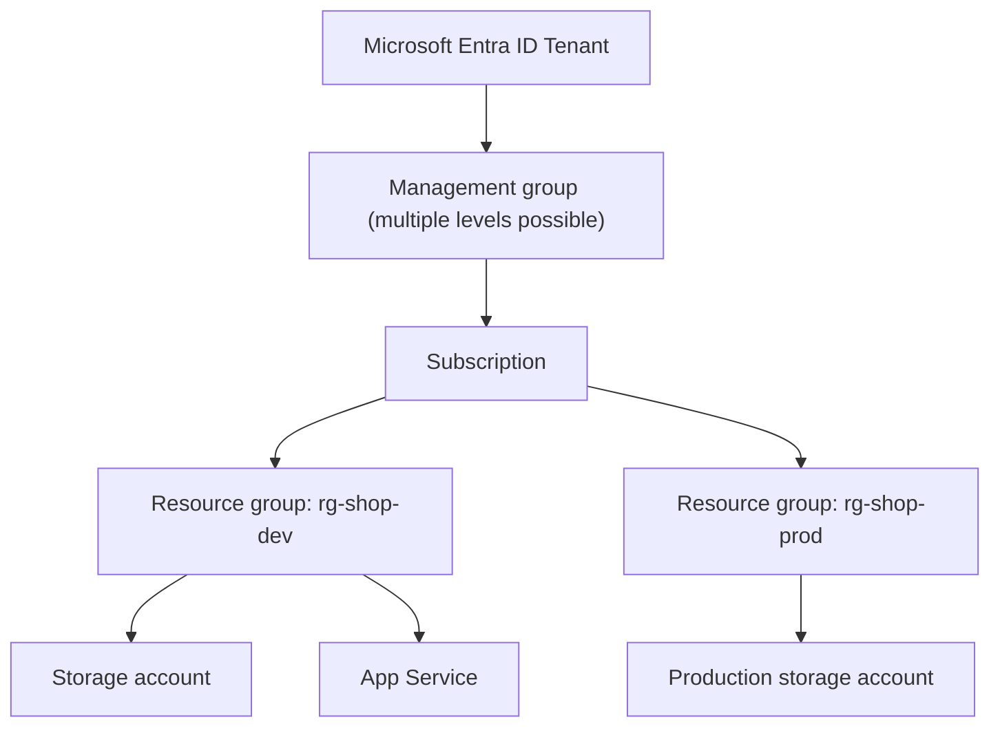
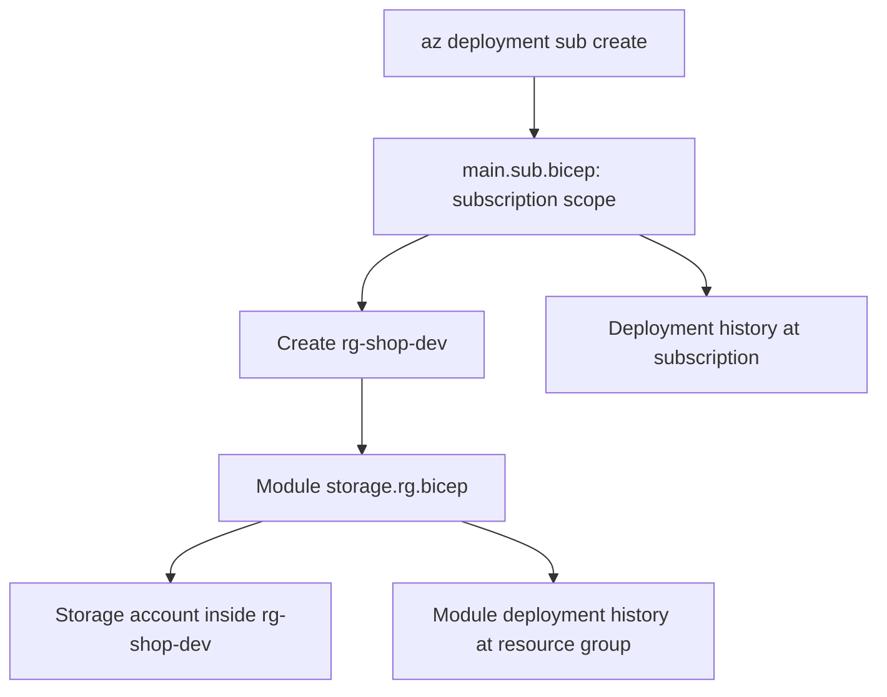
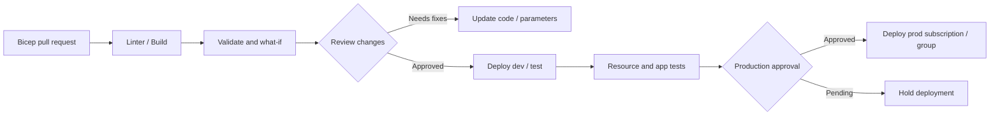

# Deploying at Resource Group and Subscription Scopes

## 1. Problem Statement and Learning Objectives

When describing infrastructure as code (*Infrastructure as Code* – IaC) on Microsoft Azure, a key question comes up before even defining resources: **at what scope will this deployment run?** A storage account belongs to a resource group, whereas creating resource groups or applying subscription-wide policies requires a broader scope. Picking the wrong scope makes the template invalid, causes insufficient permission errors, or places resources where they were not intended.

In the **Infrastructure as Code** chapter of the `CLOUD_PROVIDERS_AZURE` module, we use **Bicep**, **Azure Resource Manager (ARM)**, and **Azure CLI** to deploy properly across the two most common scopes: **resource group** and **subscription**. This is a foundational building block for organizing Azure applications from subscriptions, resource groups, and Microsoft Entra ID through networking, compute, storage, monitoring, security, and cost management.

Upon completing this lesson, you will be able to:

- Distinguish deployment scope, resource management scope, and Azure RBAC authorization scope.
- Choose `targetScope = 'resourceGroup'` or `targetScope = 'subscription'` based on the resources you want to create.
- Author Bicep to deploy a storage account into an existing resource group.
- Author subscription-scoped Bicep to **create a resource group** and invoke a module deploying into that newly created group.
- Use `az deployment group ...` and `az deployment sub ...` with validate, `what-if`, and create.
- Identify issues involving active subscription selection, regions, permissions, Azure Policy, name collisions, and unexpected changes.

**End-to-end scenario:** the `Shop API` application team wants to create `rg-shop-dev` inside an Azure subscription, then provision a dedicated storage account for the dev environment. When expanding to test and production, the team wants to reuse the same infrastructure module while maintaining clear permission and configuration boundaries.

## 2. Understanding Scopes in Azure Resource Manager

Azure organizes management hierarchically:



In this hierarchy, an ARM resource like a storage account has an identifier structured as:

```text
/subscriptions/<subscription-id>
  /resourceGroups/<resource-group-name>
  /providers/Microsoft.Storage/storageAccounts/<storage-account-name>
```

A resource group is itself an ARM resource, created at **subscription scope**. Governance constructs such as policy assignments or role assignments can exist at multiple scopes depending on resource type, API, and deployer permissions.

| Scope | Bicep `targetScope` | Azure CLI Command | When to Use | Examples |
|---|---|---|---|---|
| Resource group | `'resourceGroup'` (default) | `az deployment group ...` | Create/update resources inside an **existing** resource group | Storage account, virtual network, App Service |
| Subscription | `'subscription'` | `az deployment sub ...` | Create resource groups or configure subscription-level governance resources | Resource groups, certain policy/role assignments, budgets |
| Management group | `'managementGroup'` | `az deployment mg ...` | Govern multiple subscriptions in an organizational hierarchy | Management-group-level policy assignments |
| Tenant | `'tenant'` | `az deployment tenant ...` | Certain tenant-level ARM configurations | Specialized tenant-wide governance resources/roles |

This lesson focuses on the first two rows. Management group and tenant scopes are introduced to show that a subscription is not the topmost level. **Not every resource type is supported at every scope**: for instance, storage accounts live inside resource groups; setting `targetScope = 'subscription'` does not make a storage account a subscription-level resource.

### Distinguishing Three Easily Confused Concepts

1. **Deployment scope:** where ARM executes the deployment and stores deployment history; determines which resources and modules can be declared directly.
2. **Resource scope:** where a resource is owned—for instance, a storage account resides in `rg-shop-dev` even when triggered from a subscription-level deployment via a module.
3. **Authorization scope:** where an identity holds permissions via Azure RBAC. `Contributor` on a resource group does not grant permission to create a new resource group in the subscription.

One more important distinction: **`location` on a subscription deployment specifies where deployment metadata is stored**, whereas `location` inside a storage account or resource group definition specifies where that resource is placed. They can differ and must be specified intentionally.

## 3. Preparing the Practice Environment

You need an authorized Azure subscription, Azure CLI installed and signed in, a compatible Bicep CLI integrated with Azure CLI, and appropriate deployment permissions. For training, use a sandbox subscription or a dedicated lab resource group to cap costs and avoid impacting live systems.

Sign in and **verify your active subscription** before running commands:

```bash
az login
az account list --output table

# Replace with an authorized subscription ID.
SUBSCRIPTION_ID="<subscription-id>"
az account set --subscription "$SUBSCRIPTION_ID"
az account show --query '{name:name,id:id,tenantId:tenantId}' --output table

# Verify Bicep CLI works.
az bicep version
```

In CI/CD automation, pass `--subscription "$SUBSCRIPTION_ID"` explicitly on every deployment command instead of relying on session defaults. Prefer Managed Identity or OIDC workload identity federation over storing long-lived credentials in pipelines.

Examples use the `southeastasia` region (Azure region name). Verify service availability, SKUs, policies, and quotas for your subscription, region, and organization. Storage account names must be **3–24 characters**, lowercase letters and digits only, and **globally unique across Azure**.

## 4. Deploying Directly at Resource Group Scope

### 4.1. When to Choose `resourceGroup`?

Choose this when the resource group already exists, the development team only manages resources inside that group, or a module must be reused across environments. At this scope, Bicep can call `resourceGroup()` to inspect the target group's metadata.

Create an illustrative file **`storage.rg.bicep`** with:

```bicep
targetScope = 'resourceGroup'

@description('Storage account name: 3-24 lowercase letters or digits, globally unique across Azure.')
param storageName string

@allowed([
  'dev'
  'test'
  'prod'
])
@description('Deployment environment.')
param environment string

@description('Region where the storage account is placed.')
param location string = resourceGroup().location

resource storage 'Microsoft.Storage/storageAccounts@2023-05-01' = {
  name: storageName
  location: location
  tags: {
    environment: environment
    managedBy: 'bicep'
  }
  sku: {
    name: 'Standard_LRS'
  }
  kind: 'StorageV2'
  properties: {
    allowBlobPublicAccess: false
    minimumTlsVersion: 'TLS1_2'
    supportsHttpsTrafficOnly: true
  }
}

output storageAccountId string = storage.id
output storageAccountName string = storage.name
```

**Explanation:**

- `targetScope = 'resourceGroup'` specifies the deployment target. It may be omitted because it is Bicep's default, but stating it explicitly prevents confusion with subscription deployments.
- `resourceGroup().location` reads the resource group's metadata region; it does not force every child resource into that region. Here we reuse it for simplicity.
- `Microsoft.Storage/storageAccounts@2023-05-01` is the resource type and API version used in this example; choose an Azure-supported API version in real projects.
- `tags` aid search, reporting, and categorization; they do not enforce cost caps or grant access.
- `output` returns the resource ID and name for verification or downstream pipeline steps.

### 4.2. Create the Group First, Then Deploy

Because a group deployment requires an **existing** resource group, create the group with Azure CLI first:

```bash
RG_NAME="rg-shop-dev"
RG_LOCATION="southeastasia"
STORAGE_NAME="<valid-globally-unique-storage-name>"

az group create \
  --subscription "$SUBSCRIPTION_ID" \
  --name "$RG_NAME" \
  --location "$RG_LOCATION"

az deployment group validate \
  --subscription "$SUBSCRIPTION_ID" \
  --resource-group "$RG_NAME" \
  --template-file storage.rg.bicep \
  --parameters storageName="$STORAGE_NAME" environment=dev

az deployment group what-if \
  --subscription "$SUBSCRIPTION_ID" \
  --resource-group "$RG_NAME" \
  --template-file storage.rg.bicep \
  --parameters storageName="$STORAGE_NAME" environment=dev

az deployment group create \
  --subscription "$SUBSCRIPTION_ID" \
  --resource-group "$RG_NAME" \
  --name shop-storage-dev \
  --template-file storage.rg.bicep \
  --parameters storageName="$STORAGE_NAME" environment=dev
```

Replace `STORAGE_NAME` with an actual valid name—for example combining a prefix, environment code, and deterministic hash suffix; never include literal `<` or `>` characters. `az group create` itself is a subscription-level operation requiring subscription permissions; if you only hold access inside an admin-created resource group, **skip** that command and use the pre-existing group.

After deployment, verify the live resource:

```bash
az deployment group show \
  --subscription "$SUBSCRIPTION_ID" \
  --resource-group "$RG_NAME" \
  --name shop-storage-dev \
  --query '{state:properties.provisioningState,outputs:properties.outputs}'

az storage account show \
  --subscription "$SUBSCRIPTION_ID" \
  --resource-group "$RG_NAME" \
  --name "$STORAGE_NAME" \
  --query '{id:id,location:location,kind:kind}'
```

`validate` checks syntax and deployment preconditions that ARM can verify beforehand. `what-if` forecasts probable changes; **only `create` instructs ARM to execute the deployment**. `what-if` is not an absolute guarantee: runtime expressions or provider behavior can yield differences, so always monitor the live deployment.

## 5. Deploying at Subscription Scope and Calling a Resource-Group Module

### 5.1. Why Use a Subscription Deployment?

When a pipeline must provision both a resource group and the resources inside it, starting at subscription scope fits naturally. From subscription scope, you can create `Microsoft.Resources/resourceGroups` and then invoke a **Bicep module** with `targetScope = 'resourceGroup'` targeting the newly created group.

Execution model:



### 5.2. Subscription Orchestration Bicep File

Create **`main.sub.bicep`** alongside `storage.rg.bicep`:

```bicep
targetScope = 'subscription'

@allowed([
  'dev'
  'test'
  'prod'
])
param environment string

@description('Region for the resource group and storage account.')
param rgLocation string = 'southeastasia'

@description('Application name used for resource naming conventions.')
param workload string = 'shop'

var rgName = 'rg-${workload}-${environment}'
var storageName = 'st${uniqueString(subscription().id, rgName)}'

resource appRg 'Microsoft.Resources/resourceGroups@2022-09-01' = {
  name: rgName
  location: rgLocation
  tags: {
    workload: workload
    environment: environment
    managedBy: 'bicep'
  }
}

module storageModule './storage.rg.bicep' = {
  name: 'deploy-storage-${environment}'
  scope: appRg
  params: {
    storageName: storageName
    environment: environment
    location: rgLocation
  }
}

output resourceGroupName string = appRg.name
output storageAccountId string = storageModule.outputs.storageAccountId
```

Here there are two deployment layers:

1. `appRg` is a resource group declared **directly at subscription scope**.
2. `storageModule` sets `scope: appRg`, executing `storage.rg.bicep` inside the newly created resource group. Bicep infers the required dependency so the module deploys only after the group is ready.

`uniqueString(subscription().id, rgName)` produces a **deterministic** suffix from its inputs, preventing name churn on redeployments. However, it is not a global name reservation service and cannot guarantee zero collisions across Azure; if a name is already taken, adjust your naming scheme or parameters per organizational standards. In this example, `st` plus the 13-character suffix yields a valid name length and character set.

### 5.3. Validate, `what-if`, Then Create at Subscription Scope

```bash
az bicep build --file main.sub.bicep

az deployment sub validate \
  --subscription "$SUBSCRIPTION_ID" \
  --location southeastasia \
  --template-file main.sub.bicep \
  --parameters environment=dev rgLocation=southeastasia

az deployment sub what-if \
  --subscription "$SUBSCRIPTION_ID" \
  --location southeastasia \
  --template-file main.sub.bicep \
  --parameters environment=dev rgLocation=southeastasia

az deployment sub create \
  --subscription "$SUBSCRIPTION_ID" \
  --location southeastasia \
  --name shop-dev-platform \
  --template-file main.sub.bicep \
  --parameters environment=dev rgLocation=southeastasia
```

`--location` on `deployment sub` commands specifies where ARM stores the subscription-level deployment record. `rgLocation` is the template parameter specifying where the resource group and storage account are deployed. When re-running with the **same deployment name**, keep the deployment metadata location consistent; changing `--location` while reusing a deployment name triggers `InvalidDeploymentLocation`.

Inspect the result:

```bash
az deployment sub show \
  --subscription "$SUBSCRIPTION_ID" \
  --name shop-dev-platform \
  --query '{state:properties.provisioningState,outputs:properties.outputs}'

az group show \
  --subscription "$SUBSCRIPTION_ID" \
  --name rg-shop-dev \
  --query '{name:name,location:location,tags:tags}'
```

Expect the subscription deployment to report `Succeeded`, `rg-shop-dev` to exist, and `storageAccountId` in outputs to point to the storage account inside that group. If Bicep reports a subscription-scope error, check `targetScope`, directly declared resource types, and module `scope` settings.

## 6. Reusing Modules Across Multiple Environments and Subscriptions

The exact same `storage.rg.bicep` file serves multiple environments by swapping parameters instead of duplicating code three times:

| Environment | Target Subscription | Resource Group | Governance Goal |
|---|---|---|---|
| dev | Sandbox / non-production | `rg-shop-dev` | Rapid experimentation, capped cost |
| test | Non-production (may share subscription with dev) | `rg-shop-test` | Testing with isolated data and permissions |
| production | Dedicated production subscription if required by policy | `rg-shop-prod` | Least privilege, strict policies, monitoring, and recovery |

When targeting another subscription, **specify the subscription ID explicitly** and confirm the identity holds permissions there. For example, previewing production infrastructure before creation:

```bash
PROD_SUBSCRIPTION_ID="<production-subscription-id>"

az deployment sub what-if \
  --subscription "$PROD_SUBSCRIPTION_ID" \
  --location southeastasia \
  --template-file main.sub.bicep \
  --parameters environment=prod rgLocation=southeastasia
```

For a module in one deployment to target a resource group in a **different subscription**, Bicep supports `resourceGroup(subscriptionId, resourceGroupName)` in supported contexts. However, declaring a cross-subscription deployment **does not automatically grant permissions**: the pipeline identity must hold matching ARM permissions in the source subscription, target subscription, and target resource scopes. Track deployment history, auditing, dependencies, and errors across each subscription.

A helpful practice is maintaining a **Bicep parameter file** (`.bicepparam`) per environment for non-sensitive values such as region, SKU, names, and tags; fetch secrets through supported secret mechanisms such as Key Vault rather than hardcoding them in parameters or committing tokens to source control.

## 7. Permissions, Policies, and Deployment Safety

### 7.1. Azure RBAC Operates by Scope

| Task | Required Permission Scope | Notes |
|---|---|---|
| Create storage account in an existing group | Target resource group or appropriate parent scope | `Contributor` at the RG usually suffices for standard resources, though Azure Policy can still deny |
| Create a new resource group | Target subscription | Permissions confined to one resource group cannot create new groups |
| Create role assignments via IaC | Target scope of the role assignment | Requires `Microsoft.Authorization/roleAssignments/write`, not included in standard `Contributor` |
| Apply policy/locks at subscription | Subscription | Requires dedicated policy/lock permissions; basic deployment roles may not suffice |
| Run a module targeting another subscription | Target scope in the other subscription | Federated credentials or pipeline accounts must be granted access separately |

**Microsoft Entra ID** authenticates identities; **Azure RBAC** governs what an identity may do at each scope. Azure Policy enforces organizational rules such as blocking unapproved regions or requiring mandatory tags. Resource locks can block deletions or updates even when an identity holds write permissions; plan lock management into your deployment lifecycle.

Because subscription-scoped templates have a broad blast radius, separate the **subscription bootstrap** identity/pipeline from identities that only deploy applications inside resource groups. Apply least privilege, restrict production approvers, and audit who created, modified, or deleted resources.

### 7.2. Controlling Drift and Resource Lifecycle

Ideal IaC is **idempotent**: reapplying the same inputs produces the equivalent desired state rather than repeatedly creating unintended duplicates. In practice, idempotency also depends on naming conventions, provider behavior, and whether anyone makes manual edits in the Azure Portal.

- **`what-if` before `create`:** inspect `Create`, `Modify`, `Delete`, and permission changes; if anything looks unexpected, stop and investigate.
- **Deployments default to incremental mode:** resources omitted from the template are generally **not deleted automatically** simply by removing them from code. For controlled deletions, evaluate Azure Deployment Stacks or a dedicated decommissioning process.
- **Drift:** manual changes post-deployment cause configuration divergence. Reconcile live state using `what-if`, Azure Resource Graph, Policy compliance, and activity logs.
- **Locks and data:** avoid deleting a group holding important data just to clean up an environment; confirm backups, retention, and dependent resources before any deletion.

Note that Bicep deployments do not provide an all-or-nothing transactional "undo". A deployment that fails partway through can leave already-created resources in place. When recovering, inspect individual operation results and either re-run a corrected template or execute a controlled rollback plan.

## 8. Integrating into a CI/CD Pipeline

In real systems, IaC deployment should be an auditable pipeline:



For `Shop API`, the platform team can own `main.sub.bicep` to provision resource groups, governance baselines, and RBAC. The application team owns resource-group-scoped modules for storage, web apps, and application components. Pipelines must deploy the **exact template commit and approved parameters** that passed review for each environment.

For production, record the approver, subscription ID, deployment name, template commit, `what-if` output, predicted changes, timestamp, and deployment outcome. Never store secrets in deployment outputs, CLI logs, or pipeline artifacts. Prefer OIDC federation with Microsoft Entra ID or Managed Identity for CI/CD authentication wherever supported.

Never confuse "resources deployed" with "application ready to serve traffic": after provisioning resources, you still need networking, DNS, data-plane permissions, application deployment, telemetry, alerts, backups, and smoke tests.

## 9. Common Issues and Diagnostics

| Symptom | Likely Cause | How to Check / Resolve |
|---|---|---|
| `ResourceGroupNotFound` on group deployment | Resource group not created yet or wrong subscription | Check `az account show`, `--subscription`, and `az group show`; create the group via subscription scope if authorized |
| `AuthorizationFailed` when creating a resource group | Identity only has rights inside an existing resource group | Inspect role assignment scope; ask an admin for required subscription-level permissions |
| Bicep reports invalid resource type at subscription scope | Storage account declared directly under `targetScope = 'subscription'` | Move the resource into a `targetScope = 'resourceGroup'` module and set `scope` to the target group |
| `InvalidDeploymentLocation` | Subscription deployment name already exists with different metadata location | Reuse the original metadata location or pick a new deployment name after checking history |
| `StorageAccountAlreadyTaken` / invalid name | Storage account name taken globally or violates character rules | Choose a 3–24 character lowercase alphanumeric name with a deterministic suffix |
| `RequestDisallowedByPolicy` | Subscription has an Azure Policy blocking the region, SKU, tags, or config | Inspect policy assignments and adjust the template to comply |
| `ScopeLocked` / error modifying or deleting resource | Resource lock or deny assignment present | Check locks/deny assignments at current and parent scopes; modify only through approved processes |
| `what-if` does not match expectations | Wrong parameters, drift, runtime properties, or provider prediction limits | Compare parameters vs. live state; inspect deployment operations and resource API docs |

When investigating a failed deployment, start with the operation list instead of just the top-level summary error:

```bash
# For a resource group deployment:
az deployment operation group list \
  --subscription "$SUBSCRIPTION_ID" \
  --resource-group "$RG_NAME" \
  --name shop-storage-dev \
  --output table

# For a subscription deployment:
az deployment operation sub list \
  --subscription "$SUBSCRIPTION_ID" \
  --name shop-dev-platform \
  --output table
```

Combine operation details with the **Azure Activity Log**, Azure Policy results, and the deploying principal's permissions to isolate root cause. A permission error inside a resource-group module can surface after the subscription-level resource group has already been created—do not assume the entire deployment rolled back.

## 10. Comprehensive Practice

**Requirement:** Build the dev/test infrastructure foundation for `Shop API` using the two Bicep files in this lesson. Run in an authorized test subscription with your own valid storage account name.

1. **Identify scopes:** explain why creating `rg-shop-dev` requires a subscription deployment while the storage account lives inside a resource group. Explain the difference between deployment location and resource location.
2. **Execute at group scope:** create `rg-shop-dev` first (or use an existing group), run `storage.rg.bicep` with `validate`, `what-if`, and `create`; confirm outputs return the storage account in the right subscription and group.
3. **Execute at subscription scope:** run `main.sub.bicep` with `environment=test`; review `what-if`, then create `rg-shop-test` and its storage module. Verify the two environments do not share a storage account.
4. **Verify idempotency:** re-run `what-if` with the exact same parameters; explain any remaining predicted changes (if any) before deciding whether to re-run `create`.
5. **Controlled error test:** run `validate` at group scope with an invalid storage name; inspect the error message and fix it. Never intentionally delete or alter production resources.
6. **Design RBAC:** propose roles and scopes for a platform bootstrap account vs. an application deployment account, explaining how to block a dev account from creating resource groups or modifying production resources.

**Completion criteria:** accurately explains both scopes; Bicep uses matching `targetScope`; group resources deploy to the right location; group and sub commands run cleanly after checks; clear grasp of active permissions and subscription; knows how to interpret `what-if` and operation logs on failure.

**Self-check questions:**

- Can `az deployment group create` create a resource group that does not exist yet? Why or why not?
- Why must a subscription-scoped template invoke a separate module to create a storage account inside a resource group?
- When `az deployment sub create --location` is `southeastasia`, are all resources inside the template automatically placed in that region?
- Does `Contributor` on `rg-shop-dev` grant permission to create `rg-shop-test`? If not, where should permissions be checked?
- If you delete the storage account declaration from Bicep and re-run an incremental deployment, is the storage account guaranteed to be deleted?

## 11. Further Reading

- Microsoft Learn – [Deployment scopes in Azure Resource Manager](https://learn.microsoft.com/azure/azure-resource-manager/templates/deploy-to-resource-group).
- Microsoft Learn – [Deploy resources at subscription scope with Bicep](https://learn.microsoft.com/azure/azure-resource-manager/bicep/deploy-to-subscription).
- Microsoft Learn – [Deploy resources at resource group scope with Bicep](https://learn.microsoft.com/azure/azure-resource-manager/bicep/deploy-to-resource-group).
- Microsoft Learn – [Bicep modules](https://learn.microsoft.com/azure/azure-resource-manager/bicep/modules).
- Microsoft Learn – [Bicep deployment what-if](https://learn.microsoft.com/azure/azure-resource-manager/bicep/deploy-what-if).
- Microsoft Learn – [Azure RBAC scopes](https://learn.microsoft.com/azure/role-based-access-control/scope-overview).
