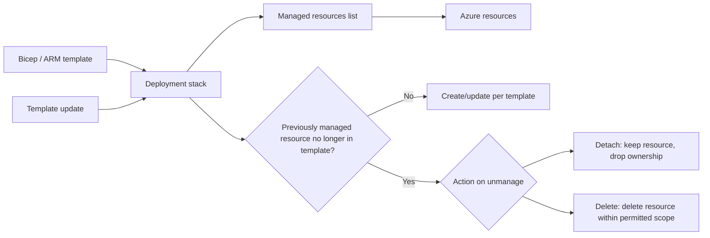
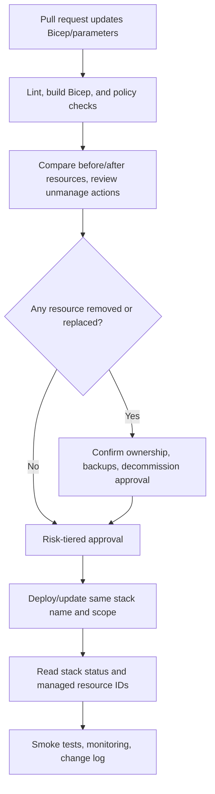

# Deployment Stacks and Resource-Set Lifecycle Management

> **Chapter:** Infrastructure as Code (IaC)  
> **Module:** `CLOUD_PROVIDERS_AZURE` — learn how to design, deploy, monitor, secure, and control costs for systems on Microsoft Azure, from subscriptions, resource groups, and Microsoft Entra ID through networking, compute, storage, and data.

## Lesson Objectives

Upon completing this lesson, learners will be able to:

1. Explain which resource lifecycle problems **Azure Deployment Stacks** solve in ARM template and Bicep workflows.
2. Distinguish **stacks**, standard **deployments**, **resource groups**, **Azure Policy**, **RBAC**, and **resource locks**.
3. Identify the **set of resources managed by a stack**, and what happens when resources are added, updated, removed from the definition, or when the entire stack is deleted.
4. Deliberately choose among **`detachAll`**, **`deleteResources`**, and **`deleteAll`**, especially for stateful data resources.
5. Understand the protection modes **`none`**, **`denyDelete`**, and **`denyWriteAndDelete`**, along with their effects on out-of-band changes outside the IaC pipeline.
6. Create and update an illustrative stack with Bicep/Azure CLI, reconcile live resources against desired configuration, and plan safe decommissioning.

## 1. Why Manage Lifecycle by Resource Set?

An Azure application may span an App Service, Storage Account, Azure SQL, Key Vault, virtual network, Application Insights, and related configuration. Teams typically manage them using **Bicep** or **ARM templates**. As the application grows, three questions emerge:

- **Which resources belong to a single deployment?** The same resource group can hold resources managed by multiple teams, manually created resources, and shared services.
- **When a resource is removed from IaC code, does it disappear from Azure?** With standard ARM deployments in incremental mode, deleting a declaration line does not delete the existing Azure resource.
- **How do you protect IaC-managed resources?** Someone else or another pipeline might edit or delete a resource directly, introducing drift between source code and live state.

**Azure Deployment Stacks** provide an Azure resource that manages a collection of Azure resources deployed from an ARM template or Bicep file. A stack tracks the resources in its managed set, handles **resources dropped from the set**, and can apply **deny settings** to restrict direct modifications.

Think of a stack as a **lifecycle ownership boundary** over declared resources. It does not replace templates: templates still describe desired configuration; stacks add tracking for **which resources are managed** and **what to do when a resource is no longer managed**.

### Scenario

The `orders` team owns three resources in a resource group: an App Service Plan, a Web App, and a Storage Account. The platform team also keeps a shared Key Vault in the same resource group. When the `orders` team retires its Storage Account:

- **Standard incremental deployment:** The Storage Account remains live even though it is no longer in the template.
- **Deployment Stack with `detachAll`:** The Storage Account leaves the stack's managed list yet remains intact in Azure.
- **Deployment Stack with a deletion mode:** The Storage Account can be deleted per the configured action once no longer managed by the stack.

Choosing the second or third policy must be a **deliberate decision** based on data ownership, backup strategy, and decommissioning plans.

## 2. Core Concepts and Boundaries

| Concept | Role | What Not to Confuse It With |
|---|---|---|
| **Bicep / ARM template** | Describes the desired configuration state of resources | Does not inherently track lifecycle ownership of a resource set across runs |
| **Standard ARM deployment** | Executes a template at a specified scope | Removing a declaration from an incremental deployment generally does not delete existing Azure resources |
| **Deployment stack** | An Azure resource tracking and managing a set of template resources, with actions on unmanage | Not the same as a resource group or a single CI/CD run |
| **Resource group** | Logical container for Azure resources and attachment point for group-level RBAC, policy, and lifecycle | Does not imply every resource inside is owned by the same stack |
| **Azure RBAC** | Determines which principal can perform actions at a scope | Does not deploy Bicep desired state and does not replace deny settings |
| **Azure Policy** | Audits/enforces organizational governance rules per assignment | Not an ownership inventory of resources declared by a stack |
| **Resource lock** | Administrative lock preventing deletion or edits on resources | A separate mechanism from deny assignments created by a deployment stack |

**A stack is its own resource:** it has a name, scope, deployment state, and list of managed resources. Do not equate a stack name with a resource group name—they are two distinct entities with separate lifecycles.

A **managed resource** is one tracked by the stack. Resources residing in the same resource group that are absent from the template or no longer managed by the stack sit outside that set. Removing a resource from the definition makes it **unmanaged** on the next stack update, triggering detach or delete depending on configuration.

### Desired Configuration vs. Live State



A stack **does not run continuously to auto-remediate every out-of-band edit**. Template reconciliation happens when a deployment/update runs; deny settings help block certain out-of-band modifications. Pair stacks with Azure Activity Logs, configuration monitoring, and review processes to detect drift.

## 3. Scope of a Deployment Stack

Azure deploys resources by **scope**. Deployment stacks support operations at **resource group**, **subscription**, and **management group** scopes depending on deployed resource types and granted permissions.

| Stack Scope | Typical Use Case | What to Verify |
|---|---|---|
| **Resource group** | An application/team operating a set of resources within a resource group | Existing resources in the group, create/update/delete RBAC on the group, boundaries with other teams' resources |
| **Subscription** | Infrastructure spanning multiple resource groups or subscription-level resources | Permissions on subscription and target scopes, impact on managed resource groups |
| **Management group** | Governing configurations/resources aligned with organizational hierarchy | Management-group permissions, multi-subscription blast radius, centralized change plans |

Do not pick a higher scope merely for convenience. Broader scopes carry far greater risk if a template or delete action is misconfigured.

**Design principle:** each stack should have a clear purpose and owning team; avoid letting multiple stacks or independent pipelines overlap management of the same resource. For shared resources, designate a dedicated owner and reference them as existing rather than accidentally pulling them into an application's deletion lifecycle.

**Bicep modules** organize code into reusable components. However, **a module is not a separate stack** merely because it lives in its own file: the set of stack-managed resources depends on the actual stack deployment and its scope.

## 4. Lifecycle of a Resource Set

### 4.1. Creating a Stack Initially

You supply a template, parameters, scope, stack name, action on unmanage, and deny settings. Azure Resource Manager executes the deployment and records the resources in the managed set.

If the template declares `web-app` and `storage`, the stack manages both. Pre-existing resources that happen to sit in the same resource group outside that deployment do not automatically become managed resources.

### 4.2. Updating a Resource Still in the Template

For example, scaling an App Service Plan up to a larger tier or updating tags. When updating the stack from updated Bicep, ARM applies changes to the still-managed resource subject to resource type, permissions, and Azure constraints.

This is a **normal update**; `actionOnUnmanage` does not trigger on every property edit. That action applies only when resources leave management or when the entire stack is deleted.

### 4.3. Adding a New Resource

When an application-owned Key Vault is added to Bicep, updating the stack provisions the Key Vault and adds it to the managed list. Check beforehand whether the name or resource ID already exists or is managed elsewhere.

### 4.4. Removing a Resource from the Template (Unmanaging)

This is the core differentiator. Suppose a previous version declared `storage`, and the new version omits it. After the update succeeds, the stack detects that the old resource is absent from the new list and applies the configured **action on unmanage**.

| Mode | When a Resource Leaves the Managed Set | When Deleting the Stack | Best Suited When |
|---|---|---|---|
| **`detachAll`** | Keeps the resource in Azure; stops tracking it in the stack | Deletes the stack; keeps previously managed resources | Transferring ownership, safe testing, or data whose deletion safety is unverified |
| **`deleteResources`** | Deletes unmanaged resources; keeps any managed resource groups | Deletes managed resources while keeping associated resource groups | Decommissioning app resources while preserving container groups |
| **`deleteAll`** | Deletes unmanaged resources and managed resource groups where applicable | Deletes managed resources and managed resource groups within scope | Tearing down an entire stack-owned infrastructure footprint |

**Common pitfall:** `deleteAll` does not automatically delete whichever resource group contains the stack. For example, a stack deployed **at resource-group scope** does not own its containing resource group as a declared resource; deleting that container group is a separate lifecycle action. Deletion scope depends on which resources are actually managed by the stack.

**Data risk:** deleting a Storage Account, Azure SQL database, or Key Vault can destroy data, disrupt services, and lose access keys. Service-level soft delete, backups, and retention are secondary recovery nets—never an excuse to skip pre-deletion reviews.

### 4.5. Deleting the Entire Stack

Deleting a stack has consequences governed by **action on unmanage**. If detach is chosen, resources stay intact; if a delete mode is chosen, Azure can delete every resource in the managed list. These are radically different outcomes behind the same "delete stack" action.

Before deleting, review the **entire list of managed resource IDs**, verify backups and dependencies, choose the right unmanage action, verify operator permissions, and record the change decision.

## 5. Deny Settings: Protecting Stack-Managed Resources

Deployment Stacks can create **deny assignments** that block direct edits or deletions through Azure Resource Manager. This adds an administrative guardrail on managed resources alongside RBAC and pipeline controls.

| `deny-settings-mode` | General Effect | Example |
|---|---|---|
| **`none`** | No stack-enforced deny protection applied | Useful for labs or early testing; Azure RBAC still applies |
| **`denyDelete`** | Blocks delete actions on protected resources per deny assignment | Prevents someone from manually deleting a production App Service out of band |
| **`denyWriteAndDelete`** | Blocks both writes/modifications and deletes per deny assignment | Forces all infrastructure changes through the governed IaC pipeline |

Deny configuration can include child scopes as well as excluded principals or actions. **Never add broad exclusions** just to bypass a permission error; every exclusion needs an explicit owner and justification.

### How Do Deny Settings Differ from RBAC and Resource Locks?

- **RBAC** grants actions when a principal holds a role at an appropriate scope, whereas a **deny assignment** blocks actions even when a role would otherwise allow them. Only explicitly configured excluded principals or actions bypass the deny.
- **Azure resource locks** (`CanNotDelete` or `ReadOnly`) are independent administrative locks with separate management rules. Never confuse deleting a lock with modifying a stack-managed deny assignment.
- **Azure Policy** evaluates whether resources comply with organizational rules; it does not maintain the lifecycle ownership list of a stack.

Strict deny settings can block emergency operational actions or monitoring/configuration agents that write to resources. Always test real-world updates, backups, restores, secret rotation, and scaling workflows before enabling broad enforcement.

### Permissions for Administering Stacks

Operators need permissions to manage `Microsoft.Resources/deploymentStacks` at the stack scope, permissions to deploy/modify target resources, and any extra permissions required to create or manage deny assignments. **Standard `Contributor` at resource group scope does not guarantee permission for every stack configuration.**

In production, separate Bicep authors, change approvers, CI/CD deployment identities, and access administrators. Production pipelines should use dedicated service connections with scoped identities protected by approvals and checks, keeping Azure RBAC tightly bound to the target scope.

## 6. Hands-On Lab: Bicep Stack Managing a Storage Account

Objective: create a **resource-group-scoped stack** using the safe `detachAll` mode, verify stack-managed resources, and then test modifying the template. Examples use Azure CLI and Bicep (runnable in Azure Cloud Shell or locally with Azure CLI installed).

> **Cost and data notice:** Storage Accounts can incur charges. Use only an authorized lab subscription, dedicated resource names, and non-critical test data. Never test resource-deletion behaviors on environments holding real data.

### 6.1. Bicep File

Create the following `main.bicep` file **in your practice workspace**:

```bicep
targetScope = 'resourceGroup'

@description('Lowercase alphanumeric prefix; recommended 3-11 characters.')
param namePrefix string = 'iaclab'

@description('Set to false to simulate a resource leaving management.')
param createStorage bool = true

param location string = resourceGroup().location

var storageName = toLower('${namePrefix}${uniqueString(resourceGroup().id)}')

resource storage 'Microsoft.Storage/storageAccounts@2023-05-01' = if (createStorage) {
  name: storageName
  location: location
  sku: {
    name: 'Standard_LRS'
  }
  kind: 'StorageV2'
  tags: {
    purpose: 'deployment-stack-lab'
    owner: 'training'
  }
  properties: {
    supportsHttpsTrafficOnly: true
    minimumTlsVersion: 'TLS1_2'
    allowBlobPublicAccess: false
  }
}
```

**Code explanation:**

- `targetScope = 'resourceGroup'` aligns with creating the stack at resource group scope.
- Storage Account names must be globally unique across Azure, 3–24 lowercase letters/digits. Combining a prefix with `uniqueString(resourceGroup().id)` lowers collision likelihood; still pick a valid prefix.
- When `createStorage = true`, the template declares the Storage Account. When `false`, ARM omits that conditional resource; on the stack update, the previously managed resource becomes **unmanaged** and is handled per `actionOnUnmanage`.
- Properties like HTTPS-only, TLS 1.2, and disabling public blob access provide baseline hardening; they do not replace network isolation, RBAC, and application data policies in real workloads.

### 6.2. Create the Resource Group

Sign in to Azure with an authorized account and verify the active subscription:

```bash
az login
az account show --query "{subscription:id, name:name}" --output table

az group create --name rg-stack-lab --location southeastasia
```

This resource group is created separately via Azure CLI **before** deploying the stack; it does not automatically become a managed resource of a stack placed inside it. In your lab, choose names and regions permitted by organizational policy.

### 6.3. Initial Stack Creation

Run from the directory containing `main.bicep`:

```bash
az stack group create \
  --name ds-storage-lab \
  --resource-group rg-stack-lab \
  --template-file main.bicep \
  --parameters namePrefix=iaclab createStorage=true \
  --action-on-unmanage detachAll \
  --deny-settings-mode none
```

Here:

- `group create` targets **resource-group scope** for the stack.
- `--template-file` points to the Bicep resource definition.
- `--action-on-unmanage detachAll` preserves the resource if it later leaves stack management—a safe starting choice for a lab.
- `--deny-settings-mode none` simplifies observation and testing; production may require stricter deny modes after validating permissions and operational impact.

Azure CLI and deployment stacks flags can evolve across versions; if commands or parameters differ in your environment, inspect `az stack group create --help` and your Azure CLI version before running. Never switch to a deletion mode just because a command reports a missing parameter.

### 6.4. Verify Which Resources the Stack Manages

```bash
az stack group show \
  --name ds-storage-lab \
  --resource-group rg-stack-lab \
  --output json

az resource list \
  --resource-group rg-stack-lab \
  --output table
```

Cross-check stack metadata (provisioning state, managed resources list, scope, action/deny settings) against the live resource inventory. Distinguish clearly:

1. Stack `ds-storage-lab` is a **management resource**.
2. The Storage Account is a **resource managed by the stack**.
3. Resource group `rg-stack-lab` is the **container** holding both the stack and the Storage Account.

A separate resource created manually inside `rg-stack-lab` by someone else does not automatically join `ds-storage-lab`'s managed list.

### 6.5. Simulating Dropping a Resource from the Stack

Using safe lab data, update the same stack while switching `createStorage=false`:

```bash
az stack group create \
  --name ds-storage-lab \
  --resource-group rg-stack-lab \
  --template-file main.bicep \
  --parameters namePrefix=iaclab createStorage=false \
  --action-on-unmanage detachAll \
  --deny-settings-mode none
```

**Expected outcome:** the template no longer declares the Storage Account, the stack updates its managed resource set, and **the Storage Account stays intact in Azure** thanks to `detachAll`. Re-verify with both `show` and `resource list`; never infer success solely from the deployment command's exit code.

If `detachAll` were replaced with `deleteResources` or `deleteAll`, unmanaging the resource could **delete the Storage Account**. Never test that on resources holding valuable data.

### 6.6. Controlled Lab Cleanup

When finished, decide the exact cleanup goal:

- **Keep resource, remove management:** delete the stack with `detachAll` and confirm the Azure resource remains. If you already detached in Step 6.5, the Storage Account is no longer managed by the stack and requires its own decommissioning plan.
- **Decommission resource:** delete the Storage Account only after verifying it holds no important data, has no active dependencies, and targets the exact resource ID. Any resource group created outside the stack must also be managed/deleted separately once unused.

Illustrative command to **delete the stack while keeping any remaining managed resources**:

```bash
az stack group delete \
  --name ds-storage-lab \
  --resource-group rg-stack-lab \
  --action-on-unmanage detachAll \
  --yes
```

After running it, re-check live resources. **Deleting the stack does not delete a previously detached Storage Account.** Read CLI help and verify resource lists carefully before cleanup; never blindly delete an entire resource group if other teams share it.

## 7. Safe Change Workflow Before Updating or Deleting

A deployment stack may contain stateful resources holding data, secrets, or network links. Any edit that causes a resource to become "unmanaged" demands careful review.

### Decision Matrix

| Projected Change | Pre-Apply Checks | Typical Safe Choice |
|---|---|---|
| Change tag or SKU of a resource still in template | Check in-place support, downtime, cost, and permissions | Update stack via standard pipeline |
| Add a new resource | Check name/ID collisions, policies, and quotas | Update and verify new resource appears in managed list |
| Remove a stateless resource | Confirm ownership, dependencies, and recreatability | Delete after review if no longer needed |
| Remove Storage/Database/Key Vault | Verify backups, retention, data owner, and rollback options | Prefer `detachAll` first before a separate deletion step |
| Rename a resource | Azure may treat it as a new resource ID and unmanage the old one | Treat as resource replacement; inspect old vs. new IDs carefully |
| Transfer ownership to another stack | Define clear handoff and resource ID path | Detach from old stack first, then adopt into new stack per process |
| Delete a production application stack | Inventory all managed resources, dependencies, and data | Review delete/detach behavior; require appropriate approvals |

**Note on `what-if`:** a standard ARM template `what-if` helps inspect resource changes expressed in the template, yet **should not be treated as a full simulation of deployment-stack unmanage behavior**. Before applying changes that delete resources, use deployment-stack preview/`what-if` capabilities where supported by your CLI/API version, and compare the before/after managed resource lists.

### Recommended CI/CD Workflow



For full auditability across runs, record in the release log: Bicep commit SHA, parameter set, scope/stack name, resources created/updated/unmanaged, action on unmanage, deny settings, approver, and deployment outcome.

Use separate stacks, separate parameter files, and scope-restricted CI/CD identities for `dev`, `test`, and `prod`. Never let an accidental dev edit trigger a deletion action against production resources.

## 8. Common Pitfalls

| Symptom | Possible Cause | Remediation |
|---|---|---|
| Resource removed from Bicep, yet still exists in Azure | Stack uses `detachAll`, or a standard incremental ARM deployment was run instead | Check deployment type, unmanage action, and managed resources list; handle decommissioning explicitly |
| Resource deleted during stack update | `deleteResources`/`deleteAll` was set and the resource left the definition | Restore via service recovery options if available; inspect deployment history and IaC diff; tighten approval gates |
| Cannot edit or delete resource in Portal | Stack deny assignment or another lock/policy is active | Check deny settings, RBAC, resource locks, and Policy; apply controlled updates via the stack |
| Create/update reports insufficient permissions | Principal lacks stack permissions, target resource permissions, or deny-management rights | Identify the denied action and scope; grant least-privilege roles instead of broad Owner |
| Adding a resource triggers ownership conflict | Resource is already managed by another pipeline or stack | Align ownership, inspect IDs, and plan a clean handoff |
| Resource group remains after stack deletion | Group was created outside the stack or wasn't in its managed set | Manage the group's lifecycle separately; do not assume it's a leak |
| Stack succeeds, yet application breaks | Template deployment does not replace app and data testing | Run smoke tests, health checks, metrics/logs review, and planned rollback |
| Charges continue after detaching a resource | Detached resources stay active and billed | Assign owner/tags, track in Azure Cost Management, and schedule decommissioning |

### Drift and Out-of-Band Edits

If someone edits a property directly (e.g., SKU), the next stack run can reapply the template value if the resource remains declared and ARM supports updating it. To prevent manual edits, apply appropriate deny settings and RBAC design. Azure Resource Graph, Activity Logs, Policy, and state checks help detect drift, though they never replace clear ownership and release discipline.

### When Should Automatic Deletion Never Be Used?

Never use automatic deletion on resources holding long-lived data, shared infrastructure, or unclear ownership—for example, a Storage Account storing customer files, a Key Vault holding encryption keys, or a shared Private DNS zone. Whenever consequences are uncertain, **`detach`** preserves the resource so it can be handled in a separate, controlled change.

## 9. Scenario Exercise

**Context:** A team operates an e-commerce platform in subscription `sub-prod`. Stack `orders-prod` declares a Web App, App Service Plan, Storage Account holding invoices, and a Log Analytics Workspace. Now the team wants to remove Storage from Bicep after migrating to another service, while protecting the Web App from manual deletion.

**Task:** Propose a scope, `action-on-unmanage`, deny mode, and execution process answering these questions:

1. If `deleteAll` is selected and Bicep is updated without the Storage Account, what is the primary risk?
2. If `detachAll` is selected, what follow-up steps prevent the Storage Account from being orphaned and incurring ongoing charges?
3. If `denyDelete` is enabled, are Web App configuration updates still allowed? How does it differ from `denyWriteAndDelete`?
4. What must the team check before letting the stack manage a shared Private DNS zone?
5. How do you prove a production update used the exact approved Bicep version, scope, action, and sign-off?

**Suggested solution:** For a Storage Account holding invoices, prioritize **detach**, document ownership handoff with resource IDs, verify backups/migration completion, and decommission via a dedicated workflow once retention expires. Enable `denyDelete` (or stricter modes after testing operational tasks) for resources needing protection. Keep shared resources under a separate owner. CI/CD should verify `what-if`/managed resource diffs, require approval for deletions, and record release evidence.

## 10. Summary

Azure Deployment Stacks bring **resource-set ownership and lifecycle management** to Bicep/ARM infrastructure deployments. The key design choices center on two policies:

- **Action on unmanage**: when a resource leaves the template or the stack is deleted, choose between **keeping the resource and dropping management** (`detachAll`) vs. **deleting managed resources/groups within scope** (`deleteResources`, `deleteAll`).
- **Deny settings**: govern whether others can **write or delete stack-managed resources** via Azure Resource Manager (`none`, `denyDelete`, `denyWriteAndDelete`).

In Azure production environments, treat removing a resource from Bicep as a **potentially data-impacting lifecycle change**: always cross-check managed resource IDs, verify permissions, and approve actions prior to deployment. Stacks give IaC clear lifecycle boundaries, while overall system quality still depends on resource ownership, least-privilege access, backups, and tested recovery.
