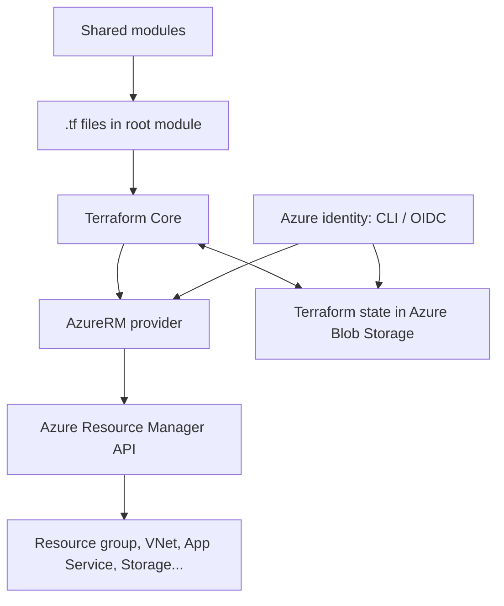
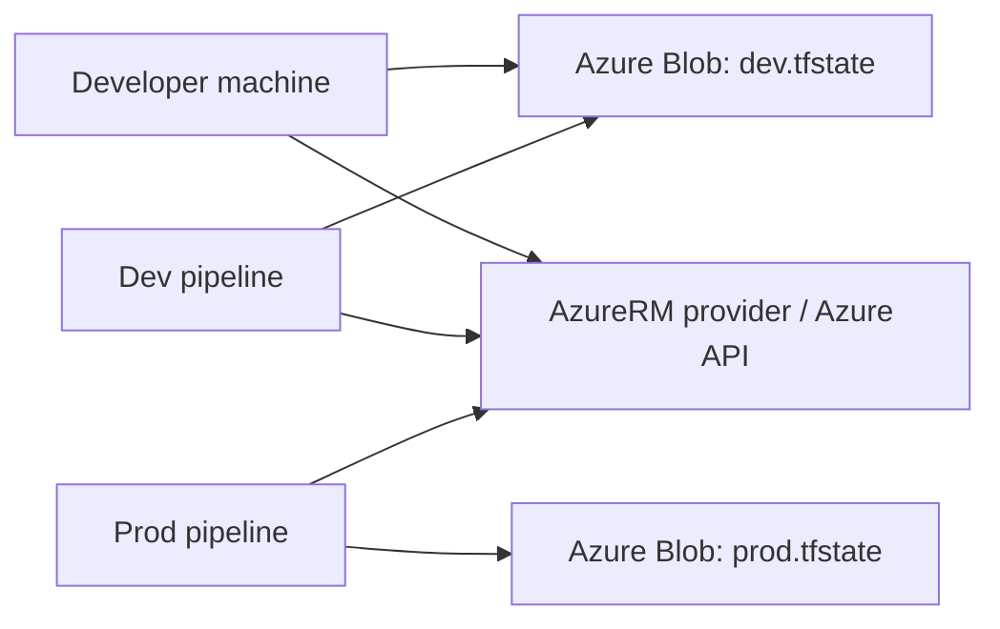
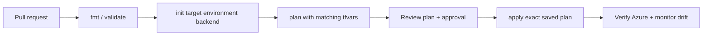

# Terraform Azure Provider and Configuration Organization

## 1. Why Use Terraform When Working with Azure?

On Microsoft Azure, an application platform can span a **subscription**, **resource group**, virtual network, subnets, App Service, storage account, databases, Key Vault, and monitoring components. Creating each resource manually in the Azure Portal works for quick experiments, but when replicating the same architecture across development, staging, and production, manual operations easily introduce configuration drift and make it hard to trace who changed what.

**Terraform** is an Infrastructure as Code (IaC) tool that declares infrastructure using HCL (HashiCorp Configuration Language). Engineers describe the **desired state** of resources in `.tf` files; Terraform compares that configuration against its managed state and live resources, builds an execution plan, and invokes Azure APIs to apply changes. Configuration can be reviewed via pull requests, reused through modules, and tested in pipelines.

This lesson belongs to the **Infrastructure as Code** chapter of the Azure learning track—covering subscriptions, resource groups, and Microsoft Entra ID through networking, compute, storage, data, security, monitoring, and cost control. Here the focus is the **Terraform AzureRM provider** and **how to organize Terraform configuration** so multiple environments share infrastructure definitions while maintaining separate state, permissions, and parameters.

### Learning Objectives

Upon completing this lesson, you will be able to:

1. Explain the roles of Terraform Core, the AzureRM provider, state, backend, resources, data sources, and modules.
2. Write a root Terraform configuration to create a resource group, virtual network, and subnet on Azure.
3. Declare and pin provider versions; distinguish `terraform init`, `validate`, `plan`, and `apply`.
4. Structure directories for a root module, shared modules, and `dev`, `stg`, and `prod` configurations.
5. Store Terraform state remotely in Azure Blob Storage and separate state access permissions from resource deployment permissions.
6. Authenticate with Azure CLI or workload identity federation without placing client secrets in Git.
7. Identify configuration drift, state issues, environment mismatches, and common structural pitfalls.

## 2. Components of a Terraform Project on Azure



| Component | Function | Example |
| --- | --- | --- |
| Terraform Core | Parses HCL, builds the dependency graph, creates and executes plans | `terraform plan` |
| Provider | Plugin translating Terraform resource types into service API operations | `hashicorp/azurerm` |
| Resource | Azure resource created or managed by Terraform | `azurerm_resource_group`, `azurerm_virtual_network` |
| Data source | Reads attributes of an existing resource without owning its lifecycle | `data "azurerm_resource_group" ...` |
| Variable | Parameterizes configuration | `var.environment`, `var.location` |
| Local value | Computed expression reused within a module | `local.common_tags` |
| Output | Exposes useful values to operators or calling modules | `output "subnet_id"` |
| Module | Bundles resources, variables, and outputs into a reusable unit | `modules/network` |
| State | Maps Terraform declarations to live objects and tracks management metadata | `terraform.tfstate` in Azure Blob |
| Backend | How Terraform stores and retrieves state | `azurerm` backend |

**Important distinction:** `azurerm` under `required_providers` is the **provider** managing Azure resources; `azurerm` under `backend` is the **backend storing state in Azure Blob Storage**. They share a name, yet are configured, initialized, and authenticated through two separate mechanisms.

### Terraform, AzureRM, and AzAPI

The AzureRM provider offers strongly typed HCL schemas for most Azure services, such as `azurerm_linux_web_app` or `azurerm_virtual_network`. When a newer Azure resource type or property is not yet supported as needed in AzureRM, teams can evaluate the **AzAPI provider** to interact more directly with the Azure Resource Manager API. Do not default to AzAPI for every resource: prefer the option whose schema, lifecycle behavior, and governance fit your requirements.

Terraform and Azure Bicep/ARM templates both model resources as code. Terraform maintains its own state to track mappings and diffs, whereas Bicep relies on Azure Resource Manager's native deployment model. Choosing between them depends on your existing ecosystem, operational workflows, and multi-cloud scope.

## 3. Prerequisites: Azure Permissions, Tooling, and Sample Resources

Assume a team is deploying infrastructure for the `orders-api` application into a development subscription:

| Attribute | Illustrative Value |
| --- | --- |
| Project | `orders` |
| Environment | `dev` |
| Azure region | `southeastasia` |
| Resource group | `rg-orders-dev` |
| Virtual network | `vnet-orders-dev` |
| VNet CIDR | `10.30.0.0/16` |
| Application subnet | `10.30.1.0/24` |

These names and address ranges are illustrative only. Before applying them, verify naming policies, non-overlapping IP ranges with peered networks, quotas, approved regions, and organizational budgets.

Your workstation needs **Terraform CLI**, **Azure CLI**, and an Azure account with appropriate permissions on the target subscription/resource group. Locally:

```bash
terraform version
az version
az login
az account list --output table
az account set --subscription "<subscription-id>"
az account show --query "{name:name,id:id,tenantId:tenantId}" --output table
```

`az login` launches an interactive sign-in flow. Being able to sign in to Azure does not grant permission to create resource groups or modify networks; those actions require matching Azure RBAC roles. Never use subscription-wide `Owner` just to practice when a narrower scope suffices.

In CI/CD environments, prefer **workload identity federation / OIDC** or an agent's managed identity over long-lived service principal passwords. Never commit tokens, `client_secret` values, private keys, or credential files to a repository.

## 4. Minimal Root Module with the AzureRM Provider

In Terraform, the **root module** is the directory where you run Terraform commands. All `.tf` files in that directory form **one logical configuration** and do not execute independently by filename. Terraform reads definitions across multiple files, resolving cross-references by HCL identifiers rather than alphabetical filename order.

A small project can start as:

```text
infra/
├── versions.tf
├── providers.tf
├── variables.tf
├── locals.tf
├── main.tf
├── outputs.tf
├── terraform.tfvars.example
└── .terraform.lock.hcl      # generated by terraform init; should be committed
```

### `versions.tf`: Pinning Terraform and AzureRM

```hcl
terraform {
  required_version = ">= 1.6.0"

  required_providers {
    azurerm = {
      source  = "hashicorp/azurerm"
      version = "~> 4.0"
    }
  }
}
```

`source` identifies the publisher and provider name in the Terraform Registry. The constraint `~> 4.0` allows compatible `4.x` releases while preventing jumps to `5.x`. This is an **illustrative version constraint**, not a claim about the latest release. In real projects, pick a tested provider release line, check release notes, and upgrade deliberately.

The **`.terraform.lock.hcl`** file records the resolved provider version and package checksums. Commit it so local machines and CI runners use identical dependencies. `terraform init -upgrade` can select newer versions matching your constraint; always inspect lock-file diffs and verify `plan` before merging.

### `providers.tf`: Selecting the Subscription

```hcl
provider "azurerm" {
  features {}
  subscription_id = var.subscription_id
}
```

`features {}` is a required configuration block for the AzureRM provider. `subscription_id` binds the provider to the intended subscription; with AzureRM 4.x, supply this explicitly or via supported environment variables. A subscription ID is an identifier, not a secret; authentication credentials still flow through Azure CLI, OIDC, or another approved method.

A project may declare multiple provider blocks, yet **never hardcode keys or passwords inside a `provider` block**. The provider authenticates to Azure Resource Manager APIs; the state backend may require its own separate permissions and authentication settings.

### `variables.tf`: Input Contract

```hcl
variable "subscription_id" {
  description = "Azure subscription ID for the target environment"
  type        = string
}

variable "project" {
  description = "Short name used in resource naming conventions"
  type        = string
  default     = "orders"
}

variable "environment" {
  description = "Deployment environment"
  type        = string

  validation {
    condition     = contains(["dev", "stg", "prod"], var.environment)
    error_message = "environment must be dev, stg, or prod."
  }
}

variable "location" {
  description = "Azure region for resources"
  type        = string
}

variable "vnet_cidr" {
  description = "CIDR block of the virtual network"
  type        = string
}

variable "app_subnet_cidr" {
  description = "CIDR block of the application subnet"
  type        = string
}
```

Declaring `type`, `description`, and `validation` clarifies and constrains inputs for callers. Only set a `default` for safe, environment-agnostic values; per-environment settings should come from separate variable files or pipeline inputs.

### `locals.tf`: Derived Values and Shared Tags

```hcl
locals {
  name_suffix = "${var.project}-${var.environment}"

  common_tags = {
    project     = var.project
    environment = var.environment
    managed_by  = "terraform"
  }
}
```

`locals` fits values derived from input variables, such as name suffixes or cost-allocation tags. It does not create a secure boundary for secrets; sensitive values must still be handled separately.

### `main.tf`: Creating a Resource Group, VNet, and Subnet

```hcl
resource "azurerm_resource_group" "main" {
  name     = "rg-${local.name_suffix}"
  location = var.location
  tags     = local.common_tags
}

resource "azurerm_virtual_network" "main" {
  name                = "vnet-${local.name_suffix}"
  location            = azurerm_resource_group.main.location
  resource_group_name = azurerm_resource_group.main.name
  address_space       = [var.vnet_cidr]
  tags                = local.common_tags
}

resource "azurerm_subnet" "app" {
  name                 = "snet-app"
  resource_group_name  = azurerm_resource_group.main.name
  virtual_network_name = azurerm_virtual_network.main.name
  address_prefixes     = [var.app_subnet_cidr]
}
```

Identifiers like `azurerm_resource_group.main` or `azurerm_virtual_network.main` are **addresses in Terraform state**, while the `name` attribute is the **actual resource name in Azure**. Referencing `azurerm_resource_group.main.name` lets Terraform infer the dependency and order resource creation accordingly. Never rely on block order in a file to dictate provisioning order.

### `outputs.tf`: Exposing Post-Deployment Values

```hcl
output "resource_group_name" {
  description = "Resource group managed by Terraform"
  value       = azurerm_resource_group.main.name
}

output "vnet_id" {
  description = "Azure resource ID of the virtual network"
  value       = azurerm_virtual_network.main.id
}

output "app_subnet_id" {
  description = "Azure resource ID of the application subnet"
  value       = azurerm_subnet.app.id
}
```

Outputs serve as the root module's API for operators or downstream pipelines. Avoid exporting passwords, tokens, or connection strings unless genuinely required and properly protected. Marking an output `sensitive = true` only masks it from certain CLI displays; it **does not remove that value from Terraform state**.

### `terraform.tfvars.example`: Parameter Template

```hcl
subscription_id = "00000000-0000-0000-0000-000000000000"
project          = "orders"
environment      = "dev"
location         = "southeastasia"
vnet_cidr        = "10.30.0.0/16"
app_subnet_cidr  = "10.30.1.0/24"
```

When running for real, replace the placeholder subscription ID with your real ID. This example file can be committed safely because it contains no credentials. If you create a local `terraform.tfvars` containing secrets, exclude it from Git; better yet, avoid passing secrets into Terraform altogether when Azure services can retrieve secrets via managed identity or Key Vault references.

## 5. Terraform Workflow Lifecycle

Inside the `infra` directory, after creating the configuration from Section 4 and filling in variables for a test environment:

```bash
# Use only before declaring the remote backend in Section 6
terraform init

# Standardize formatting and validate syntax/schema
terraform fmt -recursive
terraform validate

# Preview projected changes before applying
terraform plan -var-file="terraform.tfvars"

# Apply after carefully reviewing the plan
terraform apply -var-file="terraform.tfvars"

# Inspect outputs; compare state against Azure
terraform output
terraform state list
```

| Command | Meaning | Notes |
| --- | --- | --- |
| `terraform init` | Downloads providers/modules and initializes the backend | Re-run whenever providers, modules, or backend config change |
| `terraform fmt` | Formats HCL files | Use `terraform fmt -check -recursive` in CI |
| `terraform validate` | Checks configuration syntax and internal consistency | Does not verify Azure permissions, quotas, or runtime values |
| `terraform plan` | Proposes create, update, replace, or destroy actions | Inspect `-/+` replacements and warnings before approving |
| `terraform apply` | Executes the plan | Requires write permissions; can incur costs |
| `terraform output` | Reads outputs from state | Avoid printing sensitive outputs to logs |
| `terraform state list` | Lists resources tracked in Terraform state | Never edit state manually on a whim |
| `terraform destroy` | Plans and executes deletion of managed resources | Run only after understanding impact and obtaining approval |

**A plan is not a guarantee that nothing changed externally** between `plan` and `apply`. For production, pipelines should generate a **saved plan** and apply that exact reviewed plan file:

```bash
terraform plan -var-file="environments/prod.tfvars" -out="prod.tfplan"
terraform apply "prod.tfplan"
```

A `.tfplan` file can hold sensitive values and backend metadata; protect the artifact, restrict read access, and limit retention. Never publish it openly or commit it to Git. If external changes occur after `plan`, generate and review a fresh plan rather than forcing an outdated plan.

### How to Read a Plan

Common Terraform plan symbols:

```text
  + create
  ~ update in-place
  - destroy
  -/+ destroy and then create replacement
  +/- create replacement and then destroy
```

Changing a location, name, or immutable Azure property can force resource replacement. If a plan proposes destroying an active subnet, network, or storage resource used by an application, assess blast radius and plan a migration before applying. Never use `-auto-approve` as a shortcut to skip review in production.

## 6. Terraform State and the Azure Blob Storage Backend

**Terraform state** tracks the mapping between HCL declarations and live Azure resources; it can hold resource IDs, attributes, sensitive configuration values, and metadata. When multiple engineers or pipelines run Terraform, local state files on laptops quickly diverge and overwrite each other. On Azure, the **`azurerm`** backend uses Azure Blob Storage to centralize state and leverages blob lease locking during operations.



A state file should have **at most one writer at a time**. Terraform backend locking prevents concurrent state mutations, yet does not replace change approvals or cloud access controls. Never pass `-lock=false` to "bypass" a lock while another pipeline is running.

### Prerequisite: Bootstrapping State Storage

Before running `terraform init` with a remote backend, you must already have the **resource group, storage account, and blob container for state**. Provision these beforehand via a controlled bootstrap step (e.g., Azure CLI or a dedicated bootstrap Terraform project), because the backend must exist before the root module initializes.

Suggested layout:

```text
rg-tfstate-shared
└── st<unique-name>           # Actual storage account name must be valid and globally unique
    └── tfstate               # Blob container
        ├── orders/dev/infra.tfstate
        ├── orders/stg/infra.tfstate
        └── orders/prod/infra.tfstate
```

For production environments with stricter isolation needs, separate storage accounts, subscriptions, or permission boundaries instead of merely using different keys in the same container. Configure access controls, encryption, network rules, logging/monitoring, and recovery features per policy; enabling blob versioning and soft delete helps recover state after accidental corruption or deletion.

### Declaring the Backend

Add to `versions.tf` in the root module:

```hcl
terraform {
  required_version = ">= 1.6.0"

  required_providers {
    azurerm = {
      source  = "hashicorp/azurerm"
      version = "~> 4.0"
    }
  }

  backend "azurerm" {}
}
```

This is a **complete replacement** for the `terraform { ... }` block from Section 4 once migrating to a remote backend. Never declare two conflicting `terraform` blocks or two backends in one root module.

Create a non-sensitive `environments/dev.backend.hcl` file:

```hcl
resource_group_name  = "rg-tfstate-shared"
storage_account_name = "stordersiacexample"
container_name       = "tfstate"
key                  = "orders/dev/infra.tfstate"
use_azuread_auth     = true
```

Here, the storage account name is a placeholder: replace it with your actual provisioned name meeting Azure naming rules. `use_azuread_auth = true` enables Microsoft Entra ID authentication to Blob Storage. The identity running Terraform needs appropriate **data-plane** permissions—such as `Storage Blob Data Contributor` on the state container; `Contributor` on an application resource group is a separate control-plane role and does not automatically grant blob read/write access.

Initialize:

```bash
terraform init -backend-config="environments/dev.backend.hcl"
terraform plan -var-file="environments/dev.tfvars"
```

Backends are configured during `init` and **cannot directly reference `var.environment` or `local.name_suffix`** inside the `backend` block. Therefore, supply per-environment `*.backend.hcl` files or backend flags. Sensitive backend values passed via `-backend-config` may be cached under `.terraform` or in plans; prefer OIDC/CLI, environment variables, and managed identities over putting secrets into backend files.

When migrating from local to remote state, Terraform may prompt for migration confirmation. Before migrating, verify which environment the local state belongs to, take a protected backup, pause any concurrent jobs, and verify the migrated objects with `terraform state list` afterward.

## 7. Organizing Configuration for Multiple Environments

As an application grows from a single example to multiple environments, separate **reusable infrastructure modules** from **root configurations representing deployment boundaries**.

An approachable starting layout:

```text
infra/
├── versions.tf
├── providers.tf
├── variables.tf
├── locals.tf
├── main.tf
├── outputs.tf
├── .terraform.lock.hcl
├── environments/
│   ├── dev.tfvars
│   ├── dev.backend.hcl
│   ├── stg.tfvars
│   ├── stg.backend.hcl
│   ├── prod.tfvars
│   └── prod.backend.hcl
└── modules/
    └── network/
        ├── main.tf
        ├── variables.tf
        └── outputs.tf
```

`*.tfvars` files should contain only non-sensitive configuration values. Any secret that must be passed to Terraform should come from secure pipeline secret mechanisms, never stored in Git.

Example `environments/dev.tfvars`:

```hcl
subscription_id = "00000000-0000-0000-0000-000000000000"
project          = "orders"
environment      = "dev"
location         = "southeastasia"
vnet_cidr        = "10.30.0.0/16"
app_subnet_cidr  = "10.30.1.0/24"
```

For staging and production, update the subscription ID, environment, and CIDRs to match your network plan. Never reuse overlapping CIDRs if networks will connect via peering, VPN, or ExpressRoute.

### One Root with Multiple `tfvars` vs. Multiple Roots?

| Approach | When It Fits | Limitations to Watch |
| --- | --- | --- |
| One root, separate `*.tfvars` and backend keys | Environments are structurally similar; small team | Easy to mismatch var/backend files manually; must enforce environment pairing |
| Multiple roots (`live/dev`, `live/prod`) calling shared modules | Environments need distinct permissions, states, pipelines, and release cadences | Slight duplication of root module wiring, in exchange for cleaner isolation |
| Terraform workspaces | Multiple states sharing one backend and structure matching workspace semantics | Workspaces do not create independent RBAC or security boundaries |

No single layout fits every team. When production lives in a separate subscription with dedicated approval gates and release schedules, **separate roots calling shared modules** are usually easier to govern. The single-root + `tfvars` layout here illustrates the core mechanics, yet pipelines must still guarantee each environment pairs its exact backend and variable file.

## 8. Extracting the VNet into a Reusable Module

Suppose networking is reused across multiple systems. Let's move the VNet and subnet resources from Section 4 into `modules/network`, keeping the resource group in the root.

**`modules/network/variables.tf`**

```hcl
variable "name" {
  type = string
}

variable "resource_group_name" {
  type = string
}

variable "location" {
  type = string
}

variable "address_space" {
  type = string
}

variable "app_subnet_prefix" {
  type = string
}

variable "tags" {
  type    = map(string)
  default = {}
}
```

**`modules/network/main.tf`**

```hcl
resource "azurerm_virtual_network" "this" {
  name                = var.name
  location            = var.location
  resource_group_name = var.resource_group_name
  address_space       = [var.address_space]
  tags                = var.tags
}

resource "azurerm_subnet" "app" {
  name                 = "snet-app"
  resource_group_name  = var.resource_group_name
  virtual_network_name = azurerm_virtual_network.this.name
  address_prefixes     = [var.app_subnet_prefix]
}
```

**`modules/network/outputs.tf`**

```hcl
output "vnet_id" {
  value = azurerm_virtual_network.this.id
}

output "app_subnet_id" {
  value = azurerm_subnet.app.id
}
```

In **`main.tf` of the root**, **replace** the old VNet and subnet blocks with the module call:

```hcl
resource "azurerm_resource_group" "main" {
  name     = "rg-${local.name_suffix}"
  location = var.location
  tags     = local.common_tags
}

module "network" {
  source = "./modules/network"

  name                = "vnet-${local.name_suffix}"
  resource_group_name = azurerm_resource_group.main.name
  location            = azurerm_resource_group.main.location
  address_space       = var.vnet_cidr
  app_subnet_prefix   = var.app_subnet_cidr
  tags                = local.common_tags
}
```

In **`outputs.tf` of the root**, replace the network outputs with:

```hcl
output "vnet_id" {
  value = module.network.vnet_id
}

output "app_subnet_id" {
  value = module.network.app_subnet_id
}
```

Keep the `resource_group_name` output from Section 4. During refactoring, **never leave both the old root VNet/subnet resources and the new module resources pointing at the same Azure resources simultaneously**, as Terraform treats them as distinct state addresses.

### Refactoring Existing Infrastructure Safely

If the VNet and subnet were already managed at the root, moving them into a module changes their **state addresses**. To tell Terraform they refer to the same live resources, add `moved` blocks in the root:

```hcl
moved {
  from = azurerm_virtual_network.main
  to   = module.network.azurerm_virtual_network.this
}

moved {
  from = azurerm_subnet.app
  to   = module.network.azurerm_subnet.app
}
```

Include `moved` blocks in a reviewed change, run `terraform plan`, and verify the plan only moves state addresses instead of destroying and recreating the network. If your live state or configuration differs from this example, never apply `moved` blindly. `moved` remaps addresses for objects already in state; **`import`** brings pre-existing Azure resources that are not yet in Terraform state under management.

### Module Design Principles

A clean module exposes a concise interface: typed, documented inputs with appropriate validations; helpful outputs for callers; consistent naming and tagging; and zero hardcoded subscriptions, tenants, or secrets. Shared modules should never declare their own `backend`: **the backend belongs to the root**, which passes configured providers down to modules.

When consuming modules via Git or a registry, pin `source` and `version` (or an immutable Git ref) and review changes before upgrading. Local path modules such as `./modules/network` track the same commit directly.

## 9. Provider Aliases for Multi-Subscription Architectures

Azure organizations frequently use separate subscriptions for central networking, dev, and production. Terraform supports **aliased provider configurations** so a single root can interact with multiple subscriptions when necessary.

```hcl
# Default provider for the application subscription
provider "azurerm" {
  features {}
  subscription_id = var.subscription_id
}

# Aliased provider "shared" for the shared-resources subscription
provider "azurerm" {
  alias           = "shared"
  features {}
  subscription_id = var.shared_subscription_id
}

data "azurerm_resource_group" "shared" {
  provider = azurerm.shared
  name     = var.shared_resource_group_name
}
```

This extended example assumes the root also declares `shared_subscription_id` and `shared_resource_group_name`. The data source only reads the shared resource group; it does not create a new one.

To pass the `shared` provider into a module call:

```hcl
module "shared_network" {
  source = "./modules/network"

  providers = {
    azurerm = azurerm.shared
  }

  name                = "vnet-shared"
  resource_group_name = data.azurerm_resource_group.shared.name
  location            = data.azurerm_resource_group.shared.location
  address_space       = "10.40.0.0/16"
  app_subnet_prefix   = "10.40.1.0/24"
  tags                = { managed_by = "terraform" }
}
```

This is a **standalone root design variant**, not a block to paste immediately into the dev demo. Here, the module's default `azurerm` provider receives `azurerm.shared` via the `providers` map. If a module itself explicitly selects an aliased provider via `provider = azurerm.<alias>`, it must declare `configuration_aliases` inside its `required_providers` block and receive the corresponding mapping.

**Aliases do not grant additional Azure permissions.** The Terraform execution identity must be authenticated by Microsoft Entra ID and granted matching Azure RBAC in each subscription. Across major organizational boundaries, prefer separating roots, states, and identities rather than giving one root write access across every subscription.

## 10. Securing Identities, State, and Secrets

Terraform has at least two distinct access paths to govern:

1. **Backend identity** requiring read/write and lease-lock permissions on the state blob.
2. **Provider identity** calling Azure Resource Manager to read and modify managed resources.

Both paths may use the same or separate identities depending on architecture, yet their permissions must be evaluated **independently**. Read access to state alone can expose sensitive values even if the reader lacks permissions on live Azure resources.

### Authenticating Without Long-Lived Client Secrets

- **Local development:** sign in with `az login`, select the intended subscription, and configure least-privilege Azure RBAC plus blob backend access.
- **Azure DevOps:** use an Azure Resource Manager service connection backed by workload identity federation whenever possible; verify your Terraform task/wrapper or CLI script propagates identity settings to both provider and backend.
- **GitHub Actions:** grant `permissions: id-token: write`, configure a Microsoft Entra ID federated credential constrained to the exact repository, branch, or environment, and pass the required variables to the AzureRM provider and backend.

For AzureRM OIDC setup in CI/CD, variables like these are commonly involved:

```bash
export ARM_USE_OIDC=true
export ARM_CLIENT_ID="<federated-application-client-id>"
export ARM_TENANT_ID="<entra-tenant-id>"
export ARM_SUBSCRIPTION_ID="<azure-subscription-id>"
```

This snippet **illustrates variable names only**, not a complete OIDC pipeline: the CI/CD platform must still mint an OIDC token for the runner, the Entra federated credential must match the exact issuer/subject/audience, and the backend must use supported auth settings (such as `use_oidc` alongside `use_azuread_auth` where appropriate). When a root sets `subscription_id = var.subscription_id`, you still need to pass the Terraform `subscription_id` variable or align provider configuration consistently with your chosen subscription-selection method.

Never store client secrets or storage account access keys in `terraform.tfvars`, `backend.hcl`, or pipeline YAML. Never assume `sensitive = true` keeps values out of state: many resource and data-source attributes are persisted inside state. When applications need runtime credentials, prefer **Azure Key Vault + managed identity / Key Vault references** so Terraform provisions references and permissions while the app fetches secrets at runtime.

### State Permissions and Protection

| Control | Purpose |
| --- | --- |
| Least-privilege Azure RBAC | Dev pipelines cannot alter production resources |
| Data-plane Blob roles | Only authorized identities can read/write the state container |
| OIDC / workload federation | Eliminates creating and rotating long-lived secrets |
| Separate state keys / accounts | Prevents cross-environment mistakes and limits blast radius |
| Encryption, network rules, logging | Protects state at rest and during access |
| Blob versioning / soft delete & backups | Supports investigation and recovery after state corruption/deletion |
| Branch protection & plan approvals | Prevents unreviewed infrastructure modifications |

Never print `terraform state pull` or raw plan contents into public logs. Anyone able to download state or saved plans can still inspect attributes masked in terminal output.

## 11. Structuring a Terraform CI/CD Pipeline

Reference workflow:



Pipelines can run `fmt` and static checks on pull requests; for `plan` requiring Azure and state access, restrict execution to trusted workflows with scoped identities. Production `apply` should run only from protected branches/tags after explicit human approval.

Example shell sequence for the **dev environment**, once CI has an Azure identity and state storage already exists:

```bash
set -euo pipefail

terraform fmt -check -recursive
terraform init \
  -backend-config="environments/dev.backend.hcl" \
  -input=false
terraform validate

terraform plan \
  -var-file="environments/dev.tfvars" \
  -out="dev.tfplan" \
  -input=false

# Apply must run after an approval gate using the exact saved plan.
terraform apply -input=false "dev.tfplan"
```

In real pipelines, store the saved plan as an access-restricted artifact, run `apply` from the exact reviewed commit and environment, and avoid regenerating an unreviewed plan. State locks prevent concurrent applies on the same key, while production environments should add concurrency controls and approval gates.

**Critical caveat:** when switching to `prod`, update **both** the backend config and `tfvars`, and use a production-scoped identity. Changing only `environment = "prod"` in `tfvars` while the backend still points at dev state risks planning destructive updates against the wrong resources. If reusing one working directory across backends, re-initialize carefully and verify backend metadata; in CI, use a clean working directory per environment.

## 12. Drift, Import, and Common Configuration Errors

**Configuration drift** occurs when Azure resources are modified outside Terraform—for example, an engineer adjusts a network address in the Portal or an automated policy updates tags. `terraform plan` refreshes state to compare against live Azure and may propose reverting resources back to HCL declarations. Review carefully because some out-of-band changes are intentional and require updating HCL before applying.

If an Azure resource already exists outside state, do not try to recreate it with the same name. After writing a matching `resource` block, use an `import` block:

```hcl
import {
  to = azurerm_resource_group.main
  id = "/subscriptions/<subscription-id>/resourceGroups/rg-orders-dev"
}
```

Replace `id` with the actual resource ID. Run `terraform plan` to confirm the import mapping and declared attributes. Importing maps a live object into state—it does not write complete HCL for you or guarantee your HCL captures every live attribute.

| Issue | Common Cause | Remediation |
| --- | --- | --- |
| `terraform init` backend error | State storage missing, missing blob permissions, or network blocked | Verify bootstrap storage, data-plane RBAC, and network rules |
| `plan` prompts for `subscription_id` | Terraform variable not supplied to provider | Pass the target subscription variable and check environment settings |
| Provider `AuthorizationFailed` | Identity lacks Azure RBAC on target scope | Verify role assignments on subscription/RG/resource |
| Provider download/version error | Conflicting version constraints, stale lock file, or network proxy | Review constraints and run controlled `terraform init` |
| Plan wants to recreate VNet after module refactor | Resource address changed in state | Add `moved` blocks and inspect `plan` |
| Plan targets the wrong environment | Backend and `tfvars` from different environments | Enforce backend/var pairing, separate working directories and identities |
| State locked | Previous pipeline still running or stale lease lock | Verify active owner/run before handling lock |
| `sensitive` value appears in state | Sensitive attribute persisted by provider | Secure state storage and remove secrets from IaC where possible |
| Continuous recurring drift | Multiple tools modifying the same property | Establish a single source of truth; fix permissions and configuration |

Commands like `terraform state rm`, `terraform import`, `terraform force-unlock`, and backend migrations can cause state desynchronization if misused. Execute them only after verifying the exact managed object, taking a state backup, and ensuring no other pipelines are writing.

## 13. Guided Hands-On Practice

**Exercise:** Deploy a resource group, VNet, and subnet for `orders-api` in development, then refactor the VNet/subnet into a reusable module and configure remote state.

1. **Prepare Azure and CLI.** Identify your dev subscription, valid region, and permissions to create resource groups/networks. Run `az login` and `az account show` to verify your identity.
2. **Author the root module.** Create `versions.tf`, `providers.tf`, `variables.tf`, `locals.tf`, `main.tf`, and `outputs.tf` from Section 4. Create a local `terraform.tfvars` from the example file, replacing the placeholder subscription ID and verifying CIDRs.
3. **Validate configuration.** Run `terraform init`, `terraform fmt -check -recursive`, `terraform validate`, and `terraform plan`. Confirm projected counts: one resource group, one VNet, and one subnet.
4. **Apply in dev.** Inspect the plan, run `terraform apply`, verify in Azure Portal/CLI, and read `terraform output`. Record resource IDs for comparison.
5. **Refactor into a module.** Move the VNet and subnet into `modules/network` with inputs/outputs from Section 8; add matching `moved` blocks. Run `terraform plan` and verify Terraform recognizes the state move without replacing live networking resources.
6. **Configure remote backend.** Provision state storage via a separate bootstrap step, configure RBAC and `environments/dev.backend.hcl`, and migrate state to the `azurerm` backend. Confirm state exists at the expected key and pipeline access works.
7. **Test a safe change.** Edit a non-sensitive tag, run `terraform plan`, and inspect the diff. Verify networking is neither destroyed nor recreated. Revert if you do not wish to keep the edit.
8. **Design for production.** Document the `prod.tfvars`/`prod.backend.hcl` pair, production identity, and review workflow; do not deploy to real production without authorization.

### Completion Criteria

| Criterion | Expected Outcome |
| --- | --- |
| Declaration | Root module configures AzureRM provider with explicit subscription |
| Resources | RG, VNet, and subnet are managed by Terraform |
| Configuration quality | `fmt -check` and `validate` pass |
| Module | Network module is invoked with clean inputs/outputs |
| Refactor | Plan does not destroy/recreate networking after adding `moved` |
| State | Uses Azure Blob remote backend with proper blob permissions |
| Environment | Backend and `tfvars` strictly target `dev`, never production |
| Security | Zero tokens, client secrets, state files, or plan files in Git |
| Review | Production changes apply only after reviewing an exact saved plan |

## 14. Self-Check Questions

1. Why must `backend "azurerm"` and `provider "azurerm"` be understood as two distinct components?
2. When should you use a `resource` vs. a `data` source in AzureRM?
3. How do `terraform init`, `validate`, `plan`, and `apply` differ?
4. Why should `.terraform.lock.hcl` be committed to Git while `terraform.tfstate` and `*.tfplan` must not be?
5. In a single-root + multiple-`tfvars` setup, what risk arises if `prod.tfvars` is paired with the `dev` backend?
6. Why might moving `azurerm_virtual_network.main` to `module.network.azurerm_virtual_network.this` cause `plan` to propose creating a new resource? How do you fix it?
7. A pipeline holds `Contributor` on the application resource group yet fails to read Azure Blob state: where might the missing permission be?
8. Does `sensitive = true` guarantee passwords are absent from Terraform state?
9. When should you separate roots and states across two subscriptions instead of using provider aliases?
10. If someone edits a tag in the Azure Portal, how does Terraform respond on the next `plan`?

**Hints:** (1) backend stores state, provider manages resources; (2) `resource` manages lifecycle, `data` source only reads; (3) initialize, check, preview, execute; (4) lock file pins dependencies while state/plans contain live operational details that can be sensitive; (5) risk of reconciling and mutating the wrong state; (6) use `moved` blocks to map old addresses to new ones; (7) missing data-plane RBAC on the blob container or network firewall block; (8) no; (9) when independent permission and approval boundaries are needed; (10) `plan` detects drift and proposes restoring the HCL declaration.

## 15. Summary and Reference Documentation

Terraform brings a repeatable workflow to Azure infrastructure: **declare resources in HCL → initialize provider and backend → inspect plan → approve → apply → monitor changes**. The AzureRM provider handles resource API operations, while the Azure Blob backend lets teams share and lock state safely. Root modules should own deployment scope and environment bindings; shared modules should model reusable infrastructure components such as networking with clear inputs and outputs.

When expanding to App Service, Azure Storage, databases, Entra ID, or monitoring services, apply the same core principles: **least privilege, isolated state, per-environment configuration, pinned provider versions, reviewed plans, and protected artifacts/secrets**. These habits keep Azure architectures stable, auditable, and cost-traceable.

Official documentation for schema details, versions, and behavior:

- [Terraform Registry — AzureRM provider](https://registry.terraform.io/providers/hashicorp/azurerm/latest/docs)
- [Terraform — AzureRM backend](https://developer.hashicorp.com/terraform/language/backend/azurerm)
- [Terraform — Modules](https://developer.hashicorp.com/terraform/language/modules)
- [Terraform — State](https://developer.hashicorp.com/terraform/language/state)
- [Microsoft Learn — Terraform on Azure](https://learn.microsoft.com/azure/developer/terraform/)
