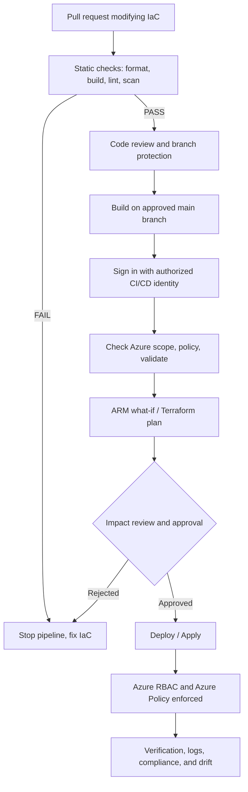

# Checking Policies, Permissions, and IaC Quality in Pipelines

## 1. Why Does IaC Require Multiple Verification Layers?

In the **Infrastructure as Code (IaC)** chapter of the **CLOUD_PROVIDERS_AZURE** module, we use ARM templates, Bicep, or Terraform to describe and deploy Azure infrastructure versioned in Git. When building an application architecture spanning subscriptions, resource groups, Microsoft Entra ID, virtual networks, compute, storage, databases, monitoring, and cost control, a small edit in IaC can impact both security and availability.

Suppose a pull request modifies a Storage Account configuration: removing the TLS restriction, accidentally enabling blob public access, or choosing an expensive SKU. The Bicep file may still be **syntactically valid**. The pipeline identity may still hold **sufficient permissions** to deploy. Yet the change fails organizational security and cost standards. Conversely, a secure configuration may be rejected by Azure because the pipeline lacks permissions at the right scope or because **Azure Policy** requires a mandatory resource tag.

Therefore, a sound pipeline must answer multiple distinct questions before applying changes:

1. **Is the code valid and consistent?** Check formatting, syntax, compilation, schemas, linting, provider versions, and configuration quality.
2. **Does the configuration meet organizational standards?** Verify security rules, naming/tagging, regions, encryption, networking, and cost using static analysis tools and Azure Policy.
3. **Does the pipeline identity hold the right permissions?** Verify Microsoft Entra ID, workload identity federation, Azure RBAC, scope, and service connection authorization.
4. **What does Azure project to change?** Run ARM `what-if` or Terraform `plan`, inspecting creates, updates, replacements, and deletions.
5. **Who approves deployment, and are results verified?** Enforce code review, branch protection, environment approvals, post-deploy verification, and audit trails.

**Learning objectives:** After this lesson, you will be able to design staged quality gates, interpret check results, distinguish policy errors from RBAC errors, build a sample Bicep/Azure DevOps pipeline, and apply the same principles to ARM JSON or Terraform.

**Practice scope:** Azure public cloud; resource examples in resource group `rg-app-prod`, service connection names, and pipelines are illustrative only. Creating resources, assigning roles, or applying policies must be done by authorized operators in real subscriptions; no resources are created merely by reading this lesson.

## 2. The Big Picture: Control Gates



These layers complement one another; **passing one gate does not substitute for the others**:

| Layer | Example Tools / Mechanisms | What Does It Catch? | Limitations |
| --- | --- | --- | --- |
| Syntax quality | `az bicep build`, `az bicep lint`, ARM schema validation, `terraform fmt` and `validate` | Syntax errors, type errors, lint rules, unused parameters | Does not guarantee compliance with assigned Azure Policies |
| Static security/compliance | PSRule for Azure, Checkov, Trivy configuration scan, custom rules | E.g., public access enabled, missing tags, missing encryption, weak networking | Depends on ruleset, tool version, and ability to evaluate dynamic expressions |
| Azure Policy | Policy definitions, initiatives, assignments, exemptions, and effects | Enforces governance rules at Azure scopes | `audit` does not block like `deny`; compliance status can lag |
| Azure RBAC | Role assignments for principals/managed identities at scope | Which identity can perform which actions | Resource write access does not imply data-plane access |
| Impact preview | ARM `what-if`, Terraform `plan` | Resources projected to create, modify, delete, or replace | Predictive only; external changes can occur between preview and apply |
| Release workflow | Peer review, branch policies, approvals/checks, pinned tool versions | Governs who can edit, approve, and deploy | Does not replace Azure-side permission guardrails |

For production, the desired behavior is **fail closed**: if a critical gate errors out or hasn't run, the pipeline must never auto-deploy.

## 3. Distinguishing Azure Policy from Azure RBAC

This distinction is foundational for diagnosing IaC failures.

### 3.1. Azure RBAC: "Who Is Allowed to Perform This Operation?"

**Azure Role-Based Access Control (RBAC)** assigns roles to a security principal (user, group, service principal, or managed identity) at management group, subscription, resource group, or resource scope. Roles grant control-plane actions and optionally data-plane actions.

Examples:

- Identity `iac-preview-prod` holds an appropriately scoped role to preview deployments.
- Identity `iac-deploy-prod` holds least-privilege rights to update application resources inside `rg-app-prod`.
- The application identity needs a role such as **Storage Blob Data Reader** to read blobs; control-plane permission to deploy a Storage Account **does not automatically grant** data read permissions.

In practice, effective permissions depend on multiple factors: inherited assignments from parent scopes, deny assignments, role conditions, PIM activation state, user permissions, and data-plane models. Therefore, **a raw role assignment list is not an absolute guarantee of effective access** across every API.

### 3.2. Azure Policy: "What Rules Must the Resource Satisfy?"

**Azure Policy** evaluates resources against **policy definitions** applied via **assignments** (often grouped into **initiatives**). Policies operate across their assigned governance scope—for example, requiring tags, restricting regions, or denying insecure configurations.

Common effects:

| Effect | Typical Behavior | Pipeline Implication |
| --- | --- | --- |
| `deny` | Rejects noncompliant create/update requests when the rule matches | Deployment is blocked even if the identity holds RBAC write access |
| `audit` | Flags noncompliant resources without necessarily blocking the operation | Pipeline must inspect compliance reports explicitly to turn `audit` into a gate |
| `modify` | Patches supported properties per policy configuration and remediation identity | Inspect live post-deploy results; never assume `what-if` simulates it completely |
| `deployIfNotExists` | Deploys companion components after evaluation using a managed identity with proper rights | Remediation may run asynchronously; do not assume companion resources exist immediately |
| `auditIfNotExists` | Checks for related resources and flags noncompliance when missing | Compliance updates can lag; does not fail the initial deployment |
| `disabled` | Disables enforcement of the definition in that assignment | Must not be counted as an active safeguard |

**Policy compliance and deployment outcome are two separate concepts.** A resource can deploy successfully yet be flagged `NonCompliant` by an `audit` policy. Conversely, a `deny` policy rejects the deployment before the resource is created.

### 3.3. Permissions and Policy Are Two Independent Axes

| Azure RBAC | Azure Policy | Typical Outcome |
| --- | --- | --- |
| Has permission to create Storage Account | Policy `deny` blocks noncompliant config | Request rejected due to policy |
| Lacks permission to create Storage Account | Config satisfies policy | Rejected due to missing RBAC |
| Has permission to create Storage Account | Policy `audit` flags weak config | Deployment succeeds, later reported `NonCompliant` |
| Has permission to create Storage Account | No matching assignment | Passes both checks, yet can still fail on quota, region, provider, or validation |

Never attempt to fix `RequestDisallowedByPolicy` by elevating the pipeline to `Owner`. Broader RBAC roles do not normally override a `deny` policy. Fix the template, pick the right scope, or obtain an approved exemption.

## 4. Aligning Policy Rules with Organizational Lifecycles

### 4.1. Building Blocks

- **Definition:** `if`/`then` rule with effect and parameters; built-in or custom.
- **Assignment:** activates a definition or initiative at a scope and supplies parameter values.
- **Initiative:** bundles multiple definitions into an organizational standard set.
- **Exemption:** scoped exception with justification and optional expiration; requires review and auditing.
- **Compliance state:** Azure Policy evaluation result for existing resources; updates may be asynchronous.
- **Remediation:** brings existing resources into compliance, especially for `modify` or `deployIfNotExists` depending on setup and permissions.

Policies assigned at a subscription or management group flow down to child resource groups. An assignment can also have **exclusions** or valid exemptions; always inspect the exact effective scope rather than reading only high-level policy definitions.

### 4.2. Example Policy Requiring an `environment` Tag on Storage Accounts

Below is an **illustrative `policyRule` fragment** for a custom Azure Policy applying `deny` to Storage Accounts missing an `environment` tag. It is not the full JSON needed to create a policy assignment and must be reviewed by an administrator before use.

```json
{
  "if": {
    "allOf": [
      {
        "field": "type",
        "equals": "Microsoft.Storage/storageAccounts"
      },
      {
        "field": "tags['environment']",
        "exists": "false"
      }
    ]
  },
  "then": {
    "effect": "deny"
  }
}
```

In a matching definition, an administrator might set `mode: Indexed` and assign the policy at the protected scope. If a Bicep template creates a Storage Account without declaring the `environment` tag, policy rejects the request. Note that if the tag exists with an invalid value, **this rule does not validate the tag's value**—add an extra condition or companion policy if needed.

Production policies must account for resource provider behavior, policy aliases, which resource types support tags, and existing resources. Always test in a non-critical scope before enabling `deny` in production, as overly broad rules can block legitimate operations.

### 4.3. Common Policy Categories in IaC

| Control Category | Example Intent | How to Verify |
| --- | --- | --- |
| Location & region | Allow deployments only in approved regions | Review `location` parameter and regional assignments at scope |
| Tagging & ownership | Require `environment`, `owner`, or `costCenter` | Lint/scan rules + Azure Policy, plus post-deploy tag checks |
| Data protection | HTTPS, minimum TLS, encryption, disallow unauthorized public access | Static scans, matching policies, and live property checks |
| Networking | Restrict public IPs, exposure, or require private connectivity | Review network modules, policies, and live connectivity tests |
| Compute | Allow only approved SKUs or OS images | Scanner rules, policies, quotas, and cost reviews |
| Monitoring | Require diagnostic settings or log collection | `auditIfNotExists`/`deployIfNotExists` rules, compliance, and live logs |

An `audit` policy for diagnostic settings will not block a pipeline on its own. If the organization wants to block releases in that case, build a **quality gate** that reads reliable compliance data, handles evaluation lag, and reports clearly whenever verification is incomplete.

## 5. Checking IaC Quality Before Calling Azure

These checks should run on pull requests using runners **without production deployment permissions**.

### 5.1. Formatting, Syntax, and Compilation

For Bicep:

```bash
az bicep version
az bicep lint --file infra/main.bicep
az bicep build --file infra/main.bicep
```

- `lint` emits warnings or errors per Bicep's ruleset and `bicepconfig.json` if present.
- `build` validates and compiles Bicep into ARM JSON; syntax, type, and reference errors fail the build.
- **Default warnings may not fail the pipeline.** To block deployments on a specific rule, promote its severity to `error` in a reviewed config. Never rely on scanning logs manually for the word "warning" to decide PASS/FAIL.
- A clean build only proves Bicep compiles to ARM JSON for your current toolchain—it does not guarantee Azure Policy, RBAC, or subscription quotas.

Partial example of an organizational `bicepconfig.json`:

```json
{
  "analyzers": {
    "core": {
      "enabled": true,
      "rules": {
        "no-hardcoded-env-urls": {
          "level": "error"
        },
        "no-unused-params": {
          "level": "warning"
        },
        "secure-parameter-default": {
          "level": "error"
        }
      }
    }
  }
}
```

This is a lint policy example for **Bicep code**, not an Azure Policy definition. Verify which rules are supported in your project's Bicep version and test pipeline behavior before altering error levels.

For JSON ARM templates, validate JSON syntax, ARM schemas, and parameter constraints with ARM tooling, then run `az deployment group validate` where Azure context is available. For Terraform, run:

```bash
terraform fmt -check -recursive
terraform init -backend=false
terraform validate
```

`terraform init -backend=false` checks configuration without connecting to remote state, though it may still download providers/modules; pin versions, keep lockfiles, and use trusted sources. `validate` does not guarantee provider permissions or Azure Policy compliance.

### 5.2. Security Scanning and Design Rules

Tools such as **PSRule for Azure**, **Checkov**, or **Trivy configuration scanning** analyze IaC against curated rulesets. A typical workflow:

1. Select a versioned ruleset matching your supported IaC format.
2. Scan files understood by the tool; compile Bicep to ARM JSON first if required.
3. Categorize findings by severity, resource, and file path.
4. Block pull requests against agreed thresholds, such as `critical`/`high` findings or mandatory rules.
5. Publish reports for reviewers and track exceptions with rationale, approvers, and expiration dates.

**No static scanner is automatically equivalent to Azure Policy.** Static scanners can miss runtime values, linked templates, or parameter-dependent conditions, whereas Azure Policy evaluates actual assignments and effects at the live target scope.

To prevent security gates from becoming theater, **pin tool and ruleset versions**, test both compliant and noncompliant fixtures, and enforce non-zero exit codes rather than archiving reports while ignoring errors.

### 5.3. Quality Checks Beyond Security

An IaC PR review should also inspect:

- **Name/ID stability:** avoid renaming resources inadvertently via expression or environment changes unless replacement is intentional.
- **Reusability:** separate modules from dev/test/prod parameters; minimize hardcoded subscriptions and regions.
- **API and provider versions:** reasonably current, compatible, and pinned or deliberately managed.
- **Drift and state:** for Terraform, govern backend, locking, and sensitive state; for ARM/Bicep, understand idempotency and redeployment effects.
- **Data safety:** never expose secrets in `outputs`, artifacts, or logs; never delete storage/databases via unapproved edits.
- **Cost and operations:** ensure SKUs, regions, backups, diagnostics, retention, logging, and cost tags reflect requirements.

## 6. Designing Pipeline Identities and Permissions

### 6.1. Who Should Run Each Check?

Separate permissions by stage:

| Stage | Needs Azure Credentials? | Expected Permissions |
| --- | --- | --- |
| PR format, lint, build, static scan | Usually **no** | Read repository and download approved tool versions only |
| Main-branch validate / preview | **Yes** when calling ARM at subscription | Dedicated preview identity holding only actions/scopes needed for validate/`what-if` |
| Post-approval production deploy | **Yes** | Deployment identity with least-privilege roles at target scope |
| Post-deploy verification | Depends on check type | Resource/control-plane read; separate data-plane role if testing data |

In Azure DevOps, create **Azure Resource Manager service connections** using **workload identity federation (OIDC)** so pipelines sign in to Microsoft Entra ID without storing long-lived client secrets. Use distinct names, for example:

- `sc-az-infra-preview` for Azure context checks and previews.
- `sc-az-infra-prod` for approved deployments.

These two connections can map to **two separate identities and role sets**, preventing preview steps from inheriting excessive write permissions. Azure DevOps `Pipeline permissions` should authorize only the specific pipelines that need each connection—never allow every pipeline to access the production connection.

### 6.2. Verifying Principal, Subscription, and Scope

Inside an authenticated job, run simple read checks:

```bash
az account show \
  --query '{subscription:id,tenant:tenantId,user:user.name}' \
  --output json

az group show \
  --name rg-app-prod \
  --query '{name:name,id:id,location:location}' \
  --output json
```

Then inspect role assignments for the **exact object ID** of the service principal or managed identity (e.g., from an admin session authorized to read role assignments):

```bash
az role assignment list \
  --assignee "<PRINCIPAL_OBJECT_ID>" \
  --scope "/subscriptions/<SUBSCRIPTION_ID>/resourceGroups/rg-app-prod" \
  --include-inherited \
  --output table
```

This lists role assignments within the queried scope, including inherited ones when the flag allows. It **does not show the full effect** of deny assignments, role conditions, group/PIM memberships, or provider-specific constraints. Admins creating service connections must also distinguish **client ID** from **service principal object ID** when auditing RBAC.

`az deployment group validate` or `what-if` may require deployment- and resource-inspection actions; **never assume `Reader` alone suffices** in every environment. List the exact required actions, pick or build an appropriate role, and test with the real principal. When deployment fails with `AuthorizationFailed`, identify the exact denied resource, action, and scope before modifying roles.

### 6.3. Three Easily Confused Permission Layers

- **CI/CD system permissions:** who may edit YAML, trigger workflows, use service connections, or approve environments.
- **Azure control-plane permissions:** whether the principal may create/update Storage Accounts, VNets, App Services, or role assignments under Azure RBAC.
- **Azure data-plane permissions:** whether the application may read/write blobs, query databases, or fetch Key Vault secrets under service-specific roles and rules.

A pipeline having permission to deploy a resource **does not mean** the app has data access—and a developer permitted to open a pull request **must not automatically gain access** to the production deployment identity.

## 7. Previewing Changes Before Deployment: ARM `what-if`

After static checks and code review, run **ARM `what-if`** with the exact template, parameters, subscription, and scope targeted for deployment:

```bash
az deployment group validate \
  --resource-group rg-app-prod \
  --template-file infra/main.bicep \
  --parameters environment=prod

az deployment group what-if \
  --resource-group rg-app-prod \
  --template-file infra/main.bicep \
  --parameters environment=prod
```

First confirm the operator is signed in to the right subscription/tenant with matching permissions. `validate` catches configuration, parameter, and permission/provider issues; `what-if` computes which resources and properties are **projected** to change.

| `what-if` Indicator | Questions Reviewers Should Ask |
| --- | --- |
| `Create` | Which region and SKU? Does it incur charges or expose a public endpoint? |
| `Modify` | Which properties change? Any impact on availability, security, or data? |
| `Delete` | Does it delete data or shared resources? Are backups and approvals in place? |
| `NoChange` | Do live values match intent, and are there any compliance warnings? |
| Unresolved expression / `Ignore` or unclear result | Do we need extra testing, provider verification, or to block auto-deploy? |

Exact change categories vary by tool and version, so read **the full property details** instead of glancing at summary counts. `what-if` can report noisy diffs from provider defaults or runtime-only values; it is **not an absolute guarantee** of deployment outcomes.

### 7.1. Terraform `plan` Shares the Goal with a Different Mechanism

For Terraform:

```bash
terraform init
terraform plan -out=tfplan
terraform show -no-color tfplan
```

`plan` uses the provider, HCL configuration, and state to predict changes, including **replace** or destroy actions. Azure Policy is still enforced when Terraform actually calls Azure APIs—a clean `terraform plan` does not guarantee `terraform apply` will be allowed.

**Security note:** plan files and Terraform state can contain sensitive values even when console output partially masks them. Never publish `tfplan`, `terraform show -json`, state, or secret-bearing stdout publicly. If archiving plans as artifacts to apply the exact reviewed plan, restrict read access, limit retention, and protect artifact integrity.

### 7.2. Avoiding Drift Between Preview and Deploy

- Keep the exact commit, modules, and template/provider versions identical between preview and apply.
- Supply environment-specific parameters; re-verify subscription and resource group in the deploy step.
- With Terraform, apply the approved saved plan under state locking and a protected backend when required by policy.
- With ARM/Bicep, if out-of-band edits happen after `what-if`, the preview goes stale; re-run preview close to deployment.
- Never allow auto-bypassing approvals when changes touch networking, IAM, encryption, storage/database deletions, or broad permissions.

## 8. Sample Bicep Code Illustrating Quality Gates

Suppose the repository holds `infra/main.bicep`:

```bicep
targetScope = 'resourceGroup'

@allowed([
  'dev'
  'test'
  'prod'
])
param environment string

param location string = resourceGroup().location

var storageName = concat('st', uniqueString(resourceGroup().id, environment))

resource storage 'Microsoft.Storage/storageAccounts@2023-05-01' = {
  name: storageName
  location: location
  tags: {
    environment: environment
    owner: 'platform-team'
  }
  sku: {
    name: 'Standard_LRS'
  }
  kind: 'StorageV2'
  properties: {
    supportsHttpsTrafficOnly: true
    minimumTlsVersion: 'TLS1_2'
    allowBlobPublicAccess: false
    allowSharedKeyAccess: false
  }
}

output storageAccountId string = storage.id
```

**What gets checked:**

1. **Bicep lint/build:** verifies syntax, types, and baseline design rules; `environment` accepts only approved values.
2. **Static security scan:** verifies `supportsHttpsTrafficOnly`, `minimumTlsVersion`, `allowBlobPublicAccess`, and `allowSharedKeyAccess` within the ruleset's coverage.
3. **Policy:** the sample policy from Section 4 permits the `environment` tag. Additional policies may constrain SKUs, regions, or networking.
4. **RBAC:** the deploying identity must hold required actions at the resource group scope.
5. **`what-if`:** predicts creating or updating the Storage Account named from `resourceGroup().id` and `environment`.
6. **Post-deploy:** verify live properties, tags, Resource ID, and Activity Log. Disabling shared keys may require applications to use Entra ID / data-plane RBAC instead of Storage keys.

**Example scope limits:** This is not a complete production storage architecture. Private endpoints, diagnostic settings, backups, network locks, or retention must still be declared and validated per organizational policy. Linters and static scanners may cover only a subset of those requirements.

## 9. Sample Azure DevOps Pipeline with Staged Gates

The following `azure-pipelines.yml` assumes:

- The repository contains `infra/main.bicep` from Section 8.
- Resource group `rg-app-prod` already exists in the target subscription.
- Service connections `sc-az-infra-preview` and `sc-az-infra-prod` are configured with workload identity federation and scoped RBAC.
- Azure DevOps **Environment** `infra-prod` has **approvals/checks** and branch controls configured in Project Settings; merely naming `environment` in YAML **does not create approvals**.
- Pipeline edit rights, service connection access, and branch protection are locked down. PR static checks never use a service connection with production permissions.

```yaml
# azure-pipelines.yml
trigger:
  branches:
    include:
      - main

# For Azure Repos Git: configure PR build validation in branch policy.
# For GitHub/Bitbucket repos: configure pr: triggers as supported by the platform.

variables:
  resourceGroup: 'rg-app-prod'

stages:
  - stage: StaticChecks
    displayName: 'IaC syntax and lint'
    jobs:
      - job: CheckBicep
        pool:
          vmImage: 'ubuntu-latest'
        steps:
          - checkout: self
          - bash: |
              set -euo pipefail
              az bicep version
              az bicep lint --file infra/main.bicep
              az bicep build --file infra/main.bicep
            displayName: 'Bicep lint and build'

  - stage: Preview
    displayName: 'Azure validate and what-if'
    dependsOn: StaticChecks
    condition: and(succeeded(), eq(variables['Build.SourceBranch'], 'refs/heads/main'))
    jobs:
      - job: InspectChanges
        pool:
          vmImage: 'ubuntu-latest'
        steps:
          - checkout: self
          - task: AzureCLI@2
            displayName: 'Preview resource-group deployment'
            inputs:
              azureSubscription: 'sc-az-infra-preview'
              scriptType: 'bash'
              scriptLocation: 'inlineScript'
              inlineScript: |
                set -euo pipefail
                az account show --query '{id:id,tenant:tenantId}' -o json
                az deployment group validate \
                  --resource-group '$(resourceGroup)' \
                  --template-file infra/main.bicep \
                  --parameters environment=prod
                az deployment group what-if \
                  --resource-group '$(resourceGroup)' \
                  --template-file infra/main.bicep \
                  --parameters environment=prod

  - stage: Deploy
    displayName: 'Deploy approved infrastructure'
    dependsOn: Preview
    condition: and(succeeded(), eq(variables['Build.SourceBranch'], 'refs/heads/main'))
    jobs:
      - deployment: ApplyBicep
        displayName: 'Apply at production scope'
        pool:
          vmImage: 'ubuntu-latest'
        environment: 'infra-prod'
        strategy:
          runOnce:
            deploy:
              steps:
                - checkout: self
                - task: AzureCLI@2
                  displayName: 'Deploy Bicep'
                  inputs:
                    azureSubscription: 'sc-az-infra-prod'
                    scriptType: 'bash'
                    scriptLocation: 'inlineScript'
                    inlineScript: |
                      set -euo pipefail
                      az deployment group create \
                        --name "iac-prod-$(Build.BuildId)" \
                        --resource-group '$(resourceGroup)' \
                        --template-file infra/main.bicep \
                        --parameters environment=prod
```

### 9.1. Explaining Security Boundaries

**`StaticChecks` stage:** runs on an agent reading only the repository, with zero production Azure tokens. `bicepconfig.json` determines which lint rules raise errors. If adding PSRule for Azure or another scanner, run it here and ensure it **exits non-zero** on violations. With **Azure Repos Git**, PR validation is typically enforced via branch policies; `trigger: main` above handles main-branch pushes/merges.

**`Preview` stage:** runs only on `main` after the previous stage succeeds. It authenticates as `sc-az-infra-preview`, confirms Azure context, and runs `validate` and `what-if`. Grant this preview identity only the exact Azure actions it needs rather than assuming `Reader` always suffices. This stage never runs `create`.

**`Deploy` stage:** uses a **deployment job** bound to Environment `infra-prod`. If admins configured approvals/checks on that environment, Azure DevOps enforces them before running. Restrict the production service connection strictly to trusted pipelines, and protect repository/YAML edits with mandatory reviews—anyone able to merge YAML edits could alter commands executed under Azure-privileged jobs.

**Intentional omissions in this minimal sample:** no SARIF reporting, no dedicated static security scanner yet, no artifact signing, no post-deploy smoke tests, and no synchronous policy compliance gate. Add those per organizational standards before considering a pipeline production-complete.

### 9.2. What Else Is Needed for Production?

- Pin exact Azure CLI, Bicep, extension, and scanner versions to prevent surprise updates (`ubuntu-latest` images evolve over time).
- Separate preview and deploy roles/scopes; lock down service connection permissions in Azure DevOps and use OIDC federation instead of long-lived secrets.
- Add static security/configuration scanning with explicit fail thresholds.
- Publish `what-if` output where approvers can inspect it while keeping access restricted so infrastructure metadata isn't exposed publicly.
- Enforce approvals/checks, branch policies, and strict reviews on edits to `azure-pipelines.yml` as well as any referenced templates and scripts.
- Add post-deployment verification: live resource properties, deployment operations, audit events, policy compliance, and core application smoke tests.

## 10. Quality Policies and "Stop-the-Release" Conditions

An effective quality gate requires **measurable pass/fail criteria**, for example:

| Gate | PASS When | FAIL When |
| --- | --- | --- |
| Syntax/build | Bicep/ARM/Terraform checks succeed | Syntax, schema, type, or provider input error |
| Lint | Zero error-level violations | Any error-configured rule fails |
| Static security | Zero blocking findings or valid approved exemption | Blocking finding present, scanner errored, or required report missing |
| Azure scope | Correct tenant/subscription/resource group and verified identity permissions | Wrong scope, permission error, or identity unverified |
| Azure Policy | Required policies enforced without denying the change; compliance gate uses fresh scoped data | `deny` blocks request, critical policy `NonCompliant`, or required status unverified |
| `what-if`/plan | Reviewers understand diffs; zero prohibited operations | Unexpected delete/replace or insufficient data to decide |
| Approval | Authorized approver signs off after reviewing reports | Missing approval, rejected, or expired check |
| Post-deploy | Resources and app pass required smoke checks | Operational checks fail or live configuration diverges |

**Never turn reports into fake gates.** If a scanner exits 1 yet your script uses `|| true`, `continueOnError: true`, or catches errors and exits 0, the stage passes falsely. Allow bypassing a check only via an auditable exception process that preserves overall control integrity.

### 10.1. Policy Evaluation Is Not Always Synchronous

Policy effects execute at different points. `deny` blocks create/update requests synchronously; `audit` and `auditIfNotExists` may evaluate and update compliance state asynchronously afterward. If a pipeline gates on compliance, define **evaluation timing, scope, policy type, unknown states**, and reasonable timeouts/retries.

Never interpret an empty result from `az policy state list` as "compliant"—it can mean missing data, pending evaluation, wrong scope, or an identity lacking Policy Insights read rights. For pre-deployment compliance checks, use static analysis and `what-if` first while keeping live policy evaluation as its own layer.

### 10.2. Exceptions Must Have Owners and Expiration Dates

Suppose a legacy application does not yet support private endpoints. If your organization grants an exception, document:

- Which rule or policy is exempted, on which resource/scope, and in which environment.
- Technical justification, risk owner, approver, and review date.
- Temporary compensating controls (firewalls, monitoring, restricted access).
- Automatic expiration conditions, remediation plan, and decision log.

An Azure Policy exemption at a given scope **does not exempt** static scanner rules or release approvals unless your organization explicitly integrates those mechanisms.

## 11. Troubleshooting Errors by Layer

| Error / Symptom | Layer Involved | Correct Response |
| --- | --- | --- |
| `az bicep build` reports type mismatch or missing symbol | IaC code quality | Fix Bicep or API/resource declaration; not an Azure RBAC issue yet |
| Lint flags hardcoded cloud endpoint | Coding quality rules | Configure per `bicepconfig.json` and parameterize endpoints |
| Scanner flags Storage Account public access | Static security | Inspect finding and Bicep properties; fix config or obtain approved exemption |
| `RequestDisallowedByPolicy` | Azure Policy `deny` | Inspect assignment/definition and failing rule; fix template or request formal exemption |
| `AuthorizationFailed` or HTTP 403 on deploy | Azure RBAC / control plane | Verify principal ID, action, scope, role assignments, and deny assignments |
| Service connection "not authorized" in Azure DevOps | CI/CD connection permissions | Authorize the pipeline and check environment approvals; not an Azure Policy error |
| `what-if` shows unexpected `Delete` or `Modify` | Preview / impact analysis | Halt approval; inspect parameters, scope, resource names, and data lifecycle |
| Terraform `plan` reports state lock | Terraform backend / state | Inspect which job holds the lock; never break locks while an active deploy runs |
| Deploy passes, yet resource is `NonCompliant` | Post-deploy compliance | Inspect policy effect, evaluation timing, assignment, and remediation |
| Deploy passes, yet app cannot read blobs | Data plane / network / app | Check Storage Blob Data role, identity, firewall, private endpoint, and auth |

**Triage order:** identify which pipeline stage failed, read the exact error code and target scope, classify it as static check, token/service connection, RBAC, Policy, provider/region/quota, preview, or application runtime—then fix the exact offending layer. Never grant Owner or disable Policy blindly to bypass an unexplained error.

## 12. Preserving Evidence and Monitoring Post-Deployment

Every IaC release should link **commit → pipeline run → identity → scope → preview → approval → deployment result**. Useful records include:

- Commit SHA, pull request, reviewers, tool/ruleset versions, and check results.
- Tenant/subscription ID, resource group, deployment name, and identity/connection used.
- Lint/scan reports, sanitized `what-if` outputs, and approval justifications for high-risk edits.
- Azure deployment operations, Azure Activity Log, Policy compliance state, and role assignment changes.
- Smoke tests, availability/performance checks, application logs, and alerts.

**Protect logs and artifacts:** never write OIDC tokens, Azure access tokens, Terraform state, private keys, connection strings, or secret-bearing outputs anywhere broadly readable. When IaC manages Key Vault and access policies, also audit IAM change history and rotation schedules.

Post-deploy, **Azure Policy compliance** tracks governance posture, **Azure Monitor / Activity Log** surfaces operations and errors, and **Cost Management / Budgets** flags spend increases from SKUs, regions, or new resources. Combine all three layers to run real Azure architectures safely.

## 13. Hands-On Exercise

**Scenario:** An operations team is preparing to deploy an application into `rg-app-prod`. Policy requires Storage Accounts to carry an `environment` tag, blocks public blob access, and requires peer approval for production infrastructure changes. The team uses Bicep and Azure DevOps.

**Steps:**

1. Create a working branch and add `infra/main.bicep` from Section 8 to the repository. Run `az bicep lint` and `az bicep build`; record the output and tool versions.
2. Identify which rule or policy checks the `environment` tag. Clearly distinguish static scanner rules from the subscription's Azure Policy assignment.
3. Test editing the config by removing the `environment` tag. Predict both the static scan result and the Azure Policy `deny` outcome if the illustrative assignment were active. **Never deploy a noncompliant change to production.**
4. Fix the IaC, open a pull request, review the diff, and verify the main branch is protected.
5. Inspect the `StaticChecks → Preview → Deploy` pipeline in Section 9. Explain which identity each stage uses and why `Preview` needs its own explicitly scoped connection.
6. In an authorized practice environment, run `validate`/`what-if` and analyze diffs across resources, SKUs, regions, tags, and networking. If no subscription is available, describe expected output instead of executing.
7. Configure Environment approvals for production with admin permissions, and deploy only after review and authorization.
8. Verify live resource properties post-deployment, check policy compliance and Activity Logs, and record the commit, deployment name, approver, and outcome.

**Completion criteria:** Accurately distinguishes syntax/lint/scan, Azure Policy, Azure RBAC, and preview; explains why a `deny` policy blocks even a `Contributor`; controls who can use service connections; and defines clear FAIL conditions whenever verification data is incomplete.

## 14. Self-Check Questions

**1. Does a passing `az bicep build` prove Azure Policy will allow the template?**  
No. `build` only checks code and compiles it; policies evaluate against assignments/effects at the target Azure scope and may also depend on runtime values.

**2. A pipeline holds `Contributor` on the resource group yet hits `RequestDisallowedByPolicy`. How should you respond?**  
Inspect the policy definition, assignment, and violated condition, then fix the IaC or request a formal exemption. Elevating RBAC does not resolve a policy `deny`.

**3. `lint` reported a warning, yet the pipeline reported PASS. Is that wrong?**  
Not necessarily. Many lint warnings do not fail the command by default. If a rule is mandatory, configure its severity as `error` or gate explicitly on report findings.

**4. `what-if` reports no changes; can we skip production approval?**  
No. Previews are not absolute guarantees, may omit certain runtime properties, and never waive organizational approval policies.

**5. Does an empty query result from policy state prove compliance?**  
No. Verify scope, Policy Insights read permissions, evaluation cadence, active assignments, and result completeness before concluding compliance.

**6. Why should PR jobs never use the production service connection?**  
Unreviewed code can execute inside PR jobs; if the job has access to the production identity, anyone editing workflow scripts could abuse those Azure permissions. Separate credential-free PR checks from controlled deployment stages, and protect YAML edits.

## 15. Official Reference Documentation

- Microsoft Learn — **Azure Policy overview**, **Understand Azure Policy effects**, and **Policy compliance**: definitions, assignments, evaluation, and remediation.
- Microsoft Learn — **Azure RBAC overview** and **Check access to Azure resources**: principals, roles, scopes, and checking effective permissions.
- Microsoft Learn — **ARM template deployment what-if operation**: previewing changes and prediction limits.
- Microsoft Learn — **Bicep linter** and **Bicep configuration file**: lint rules, severities, and configuration.
- Microsoft Learn — **Azure Pipelines environments**, **Approvals and checks**, and **Workload identity federation for Azure Resource Manager service connections**.
- HashiCorp Developer — **Terraform validate**, **terraform plan**, **State**, and **Backend configuration**: equivalent workflows when using Terraform.
- Documentation for your organization's chosen scanning tool (PSRule for Azure, Checkov, or Trivy), especially input formats, ruleset versions, exit codes, and exception handling.

When applying these practices to live systems, verify exact syntax and behavior against your Azure CLI/Bicep/Terraform versions, active policy assignments, Azure cloud environment, and organizational permissions. Always test pipeline designs in an authorized environment before rolling out to production—template correctness is only one part of safe IaC delivery.
