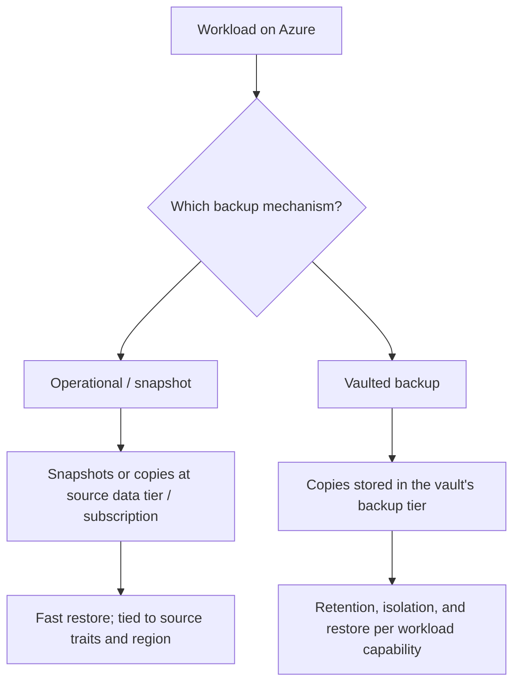
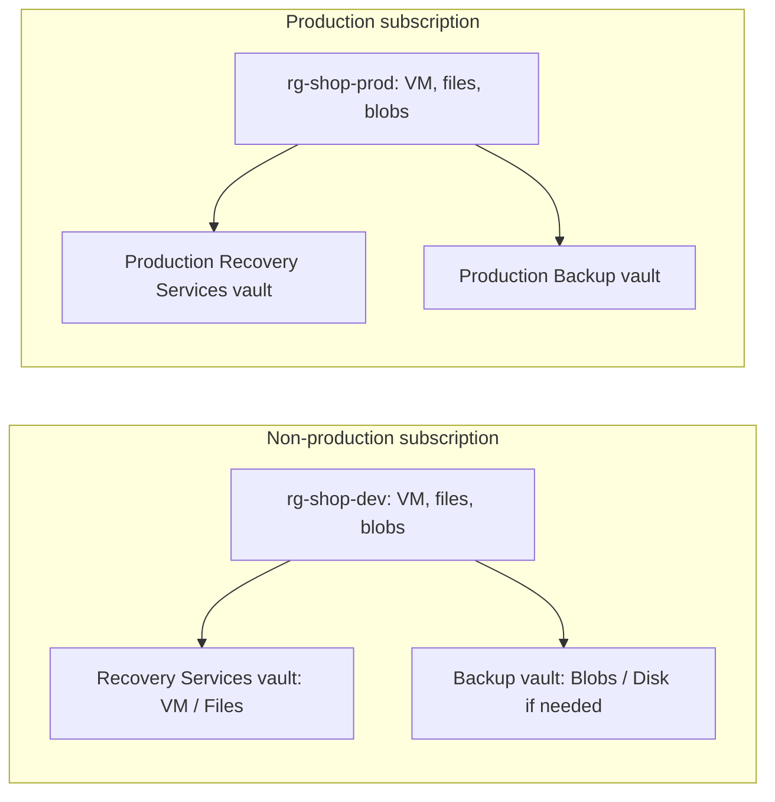

# Azure Backup and Choosing a Vault by Workload

## 1. Why Does Choosing the Right Vault Matter?

A system running on Microsoft Azure can stop serving because of accidental deletion, misconfiguration, ransomware, application bugs, or losing an entire deployment region. **Backups** provide recovery points to return data or systems to a pre-incident state. However, Azure protects each workload type differently; picking the wrong vault can leave you without the backup type, policy, or restore capability you need.

In the **Reliability and Disaster Recovery** chapter of the `CLOUD_PROVIDERS_AZURE` module, this lesson focuses on the two Azure Backup vault types: **Recovery Services vault** and **Backup vault**. We connect vault selection to subscriptions, resource groups, Microsoft Entra ID, Azure RBAC permissions, storage, data, monitoring, security, and cost in an Azure application architecture.

After this lesson, you will be able to:

- Distinguish a **Recovery Services vault** from an Azure Data Protection **Backup vault**.
- Select a vault based on workload type: Azure VMs, managed disks, Azure Files, Blob Storage, AKS, databases running in VMs, and on-premises servers.
- Recognize PaaS services that have their own built-in backup mechanisms rather than needing an Azure Backup vault by default.
- Design policies around **RPO**, retention, copy independence, and security requirements.
- Understand the roles of redundancy, soft delete, immutability, RBAC permissions, and restore testing.
- Create a vault with Bicep/Azure CLI, then verify the follow-up steps needed to actually protect data.

**Running scenario:** the `Shop API` operations team runs VMs for job processing, a managed disk holding critical scratch/working data, product images in Azure Blob Storage, shared Azure Files, and an AKS cluster for background services. Each component has different recovery needs. The team wants to pick the right vault types rather than creating one vault and assuming all resources are backed up.

## 2. Foundational Mindset: Backup, Restore, and Disaster Recovery

### 2.1. Backup Does Not Equal High Availability or Replication

| Mechanism | Primary problem solved | Key limitations |
|---|---|---|
| **Backup/restore** | Restores data from an earlier **recovery point** | Data created after the recovery point may be lost; takes time to restore |
| **High availability (HA)** | Keeps the service running when an instance, zone, or component fails | Accidental deletions can propagate synchronously to HA replicas |
| **Replication** | Maintains a copy of data/systems in another location | Fast replication can also propagate corrupted data or deletions |
| **Disaster recovery (DR)** | Restores operations after major outages, potentially via failover | Requires runbooks, target infra, DNS, networking, permissions, and testing |

**Azure Backup** focuses on data protection and recovery points. **Azure Site Recovery** handles replication, failover, and failback for supported scenarios; Site Recovery is often configured through a Recovery Services vault, yet it is not a point-in-time backup. Depending on targets, a system needs HA, backups, and a DR plan together.

### 2.2. RPO, RTO, and Retention

- **RPO (Recovery Point Objective):** maximum tolerable data loss for the business, measured in time. A 4-hour RPO means designing so data loss never exceeds 4 hours in committed scenarios.
- **RTO (Recovery Time Objective):** maximum time to restore service operation to an agreed level. A 2-hour RTO requires more than having a backup file: it also depends on restore speed, networking, secrets, verification, and traffic switching.
- **Retention:** how long recovery points are kept per technical, legal, and cost policies—such as 30 days short-term plus longer-term periodic points.
- **Recovery point:** a data state Azure Backup can restore from. Consistency levels vary—crash-consistent, file-system-consistent, or application-consistent—depending on the workload and protection method.

For example, if a backup job runs once daily, gaps between recovery points can approach 24 hours. A daily schedule **cannot guarantee a 15-minute RPO**, and even a 4-hour schedule must leave margin for slow or failed jobs. RTO must be **measured via an actual restore** at realistic data volumes.

## 3. The Two Main Vault Types in Azure Backup

A **vault** is an Azure resource for managing backups, policies, backup instances/items, and restore operations for supported workloads. Not every backup copy lives physically inside the vault: some workflows store backups at the snapshot tier or within the source resource while the vault holds orchestration and policy metadata.

| Criterion | Recovery Services vault | Backup vault |
|---|---|---|
| ARM resource type | `Microsoft.RecoveryServices/vaults` | `Microsoft.DataProtection/backupVaults` |
| Service family | Traditional Azure Backup and certain Azure Site Recovery scenarios | Azure Backup built on the **Data Protection** service |
| Typical workloads | Azure VM backup, Azure Files, SQL Server/SAP HANA in Azure VMs, supported on-premises servers | Azure Managed Disks backup, Azure Blobs backup, AKS backup (per supported features/regions) |
| Common management units | Backup policy, backup item/protected item, backup job, recovery point | Backup policy, backup instance, backup job, recovery point |
| Storage tier | Depends on workload and policy; may include snapshots and vault copies | May use **operational backup**, **vaulted backup**, or both depending on workload |
| Chosen when | Backing up VMs, file shares, apps/databases inside VMs, on-prem environments | Backing up standalone disks, blobs, AKS, and Data Protection-supported workloads |
| Interchangeable? | No | No |

The term **Backup vault** here is the name of a specific Azure resource type. **Azure Key Vault** manages secrets, keys, and certificates; **Key Vault is not an Azure Backup storage vault**. Likewise, an **Azure Storage account** supports blob versioning or soft delete, yet enabling them does not create a Recovery Services vault.

### 3.1. Recovery Services Vault

A Recovery Services vault is central to VM backup scenarios and application workloads running inside VMs. For example:

- Backing up an **Azure virtual machine** as a whole VM, often with application-consistent backups when supported by the workload, agent/extension, and platform.
- Backing up **SQL Server in Azure VMs** or **SAP HANA in Azure VMs** via supported workload-aware backup; this operates at the database/workload level rather than snapshotting the entire VM.
- Protecting **Azure Files** per supported operational/vaulted backup capabilities for the share type, region, and policy.
- Backing up certain **on-premises** workloads via the Microsoft Azure Recovery Services (MARS) agent, Microsoft Azure Backup Server (MABS), or System Center DPM.
- Orchestrating Azure Site Recovery in supported scenarios. Site Recovery configuration differs from Azure Backup configuration even when using the same vault family.

**Key point:** if you need to restore an **entire Azure VM** including OS, configuration, and supported disks, the standard choice is a **Recovery Services vault** with Azure VM Backup. Backing up a single disk through a Backup vault does not recreate the entire VM and all dependent services.

### 3.2. Backup Vault

Backup vaults belong to `Microsoft.DataProtection` and manage modern workloads through policies and backup instances. For example:

- **Azure Disk Backup:** protects managed disks at the disk level using incremental snapshots where supported. Recovery points typically rely on snapshots stored in your subscription/resource group; evaluate the risk of losing both the source region and snapshots together.
- **Azure Blob Backup:** offers **operational backup** using data protection features on the storage account and **vaulted backup** moving protected data into the vault's backup tier, where supported by account, blob type, region, and policy.
- **Azure Kubernetes Service (AKS) Backup:** protects Kubernetes state and persistent volumes within supported scope, requiring components such as the backup extension, storage/snapshots, and access permissions.

It is **not** a single vault that protects every workload identically. Specifically, snapshot-based Azure Disk Backup policies do not automatically match the application consistency of SQL Server backup in a VM; AKS backup also does not replace backing up data held in an external PaaS database service.

## 4. Vault Selection Matrix by Workload

| Workload to protect | Initial selection | Recoverable scope | Pre-decision checks |
|---|---|---|---|
| **Azure VM** (full machine, supported OS and data disks) | **Recovery Services vault** | VM, or disks/files per restore scenario | Check VM extensions, consistency level, encryption, disk types, region, and policy |
| **Managed disk** (standalone or disk-snapshot only) | **Backup vault** with Azure Disk Backup | Disk/snapshot from recovery point | Snapshot-level; you must handle attaching disks to VMs and app recovery |
| **Azure Files share** | **Recovery Services vault** | Files/folders or share per backup mode | Distinguish snapshot/operational vs. vaulted retention; check share type and limits |
| **Azure Blob Storage** | **Backup vault** | Blobs/containers or data at supported restore points | Operational vs. vaulted backup differ in data location and recoverability |
| **AKS** | **Backup vault** with AKS Backup | Supported Kubernetes resources and persistent volumes | Check storage drivers, CSI snapshots, backup extension, permissions, and restore limits |
| **SQL Server in Azure VM** | **Recovery Services vault** | Databases and recovery points, potentially including log backups | Requires workload-aware backup; check recovery model, log chain, and SQL permissions |
| **SAP HANA in Azure VM** | **Recovery Services vault** | HANA databases/workloads where supported | Separate discovery, extension, timing, and retention configuration |
| **On-premises servers/workloads supported by Azure Backup** | **Recovery Services vault** | Files, folders, system state, or supported workloads | Depends on MARS/MABS/DPM; needs bandwidth and registration/security setup |
| **Azure SQL Database / SQL Managed Instance** | **Service built-in backups** | PITR and long-term retention per service tier config | Do not create a Recovery Services vault for native automated backups |
| **Other PaaS services** (e.g., Azure Cosmos DB, managed PostgreSQL) | **Check service-native backup/PITR first** | Varies by service, backup mode, and region | Do not assume having a database mandates one of the two vaults |

**Decision rule:** first identify the **recovery target** (VM, disk, file, blob, database, or full app), look up the exact backup capability for that workload, and only then choose the vault, backup tier, policy, and protection architecture. This table is a starting point; features, regions, resource types, and limits evolve, so verify the current support matrix before production deployment.

### Common Confusion: A VM vs. a Managed Disk

`Shop API` runs on an Azure VM with an OS disk and two data disks. After an OS failure, the team wants to restore the **complete VM**: pick Azure VM Backup via **Recovery Services vault**. If the team only needs recovery points for **one managed disk** to restore or clone the disk, evaluate **Azure Disk Backup via Backup vault**. The two differ in restore scope, consistency, snapshot storage location, and recovery time.

### Common Confusion: SQL Server in a VM vs. Azure SQL Database

SQL Server installed inside an Azure VM runs on a machine you administer, so evaluate **SQL workload backup in a Recovery Services vault** for database-consistent recovery points. Azure SQL Database is a PaaS service with **built-in automated backups and point-in-time restore**; long-term retention is configured through Azure SQL Database itself. Never treat the two models as the same backup workflow.

## 5. Operational Backup, Vaulted Backup, and Storage Scope

Picking a vault type is not enough; determine **where backup data actually lives** and whether source disruptions can impact backup copies.



- **Operational backup** prioritizes short restore times by keeping recovery points close to source data—such as managed disk snapshots or storage-account data-protection features. Protection scope and isolation depend on the workload and do not automatically provide an independent cross-region copy.
- **Vaulted backup** manages backup data in the vault's storage tier for supported workloads. This enables longer retention policies and appropriate redundancy/isolation options, though not every workload supports restoring to another region automatically.
- **Instant restore / snapshot tier / vault tier / archive tier** have different support boundaries per backup type. Never assume a uniform restore speed, retention, or billing model across all of them.

For example, with **Azure Blob Backup**, operational backup may rely on blob versioning, change feed, point-in-time restore, and storage-account protections where eligible. Vaulted backup, where supported by workload and policy, uses a more isolated backup tier. Compare them against accidental-delete protection, broad-outage survival, and long-term retention needs—never assume turning on Blob soft delete creates a vaulted backup.

### 5.1. Redundancy: LRS, ZRS, GRS

| Model | Core meaning | Questions to ask |
|---|---|---|
| **LRS** (Locally Redundant Storage) | Keeps data copies within a single local datacenter scope per service design | Does it match the system's risk profile and budget? |
| **ZRS** (Zone-Redundant Storage) | Spreads copies across multiple availability zones in the same region, where supported by workload/vault | Do this region, vault type, and workload support ZRS? |
| **GRS** (Geo-Redundant Storage) | Replicates to a secondary region per the service's geo-redundancy mechanism | Is cross-region restore supported for this workload, and is the feature properly enabled? |

**GRS does not automatically guarantee recovery in the second region.** *Cross Region Restore* (CRR) support, how secondary recovery points are accessed, replication RPO, and operational requirements depend on workload, vault type, and configuration. Never cite "GRS" alone as proof that DR is complete.

Many redundancy and security options must be chosen **before the vault holds protected items/backup data**, or are restricted from changing later. Lock in fault-tolerance and data-residency requirements during the design phase.

### 5.2. Which Subscription and Region Holds the Vault?

Normally, when protecting Azure resources with their respective backup services, the vault must reside in the **region** and **subscription** matching the source resource per workload rules. Each workload imposes specific constraints on cross-subscription restores or restoring to alternate targets. Never design around the assumption that a single vault protects resources across all subscriptions and regions.

Suggested layout for `Shop API`:



The diagram shows **separation of concerns**, not that every environment must create both vault types. Provision only the vault types your workloads actually use, and verify regional/subscription limits per feature.

## 6. Designing Backup Policies from Business Requirements

A sound policy answers far more than "what hour does backup run?":

1. **What is protected?** VMs, shares, disks, blobs, databases, or specific Kubernetes objects; also list dependencies like secrets, networking, DNS, and IaC configs.
2. **To what point must we recover?** Define RPO and required consistency level. Transactional workloads typically need workload-level/log backups or PaaS continuous backups, not just daily VM snapshots.
3. **How fast must operations resume?** RTO and restore throughput drive choices of operational vs. vault tier, sizing, standby infrastructure, and runbooks.
4. **How long is data kept?** Daily/weekly/monthly/yearly retention per workload and compliance rules; project storage growth costs.
5. **Who can delete, stop protection, or restore?** Separate permissions and enable anti-tampering deletion safeguards.
6. **Which incidents are in scope?** File deletion, DB corruption, ransomware, VM crash, zone loss, region loss, or credential compromise? Each demands different protective layers.

Example requirements table for `Shop API`:

| Component | Target RPO | Target RTO | Protection direction and notes |
|---|---|---|---|
| Critical job-processing VM | 24 hours | 4 hours | VM Backup via Recovery Services vault; measure real VM rebuild and app reconnect times |
| Business file share | 8 hours | 2 hours | Azure Files backup via Recovery Services vault; verify actually supported policy schedules |
| Standalone managed disk | 12 hours | 3 hours | Disk Backup via Backup vault if crash-consistent snapshots suffice; include disk creation time |
| Product image blobs | Per tolerable loss, e.g., 24 hours | 6 hours | Blob Backup via Backup vault; weigh operational vs. vaulted backup per support |
| PaaS transactional database | 15 minutes | 1 hour | Evaluate native service PITR/backups, HA, and restore workflow; never substitute VM backup schedules |

**These numbers are hypothetical targets for the exercise, not Azure Backup SLAs.** If a policy schedule misses RPO or restore tests exceed RTO, adjust the technology or DR design rather than merely editing the requirements table.

## 7. Hands-On: Creating a Vault with Bicep and Verifying Results

### 7.1. Prerequisites

You need a logged-in Azure CLI, Bicep CLI working through Azure CLI, a test subscription, and permissions to create resources in the target resource group. This exercise creates an **empty vault resource**; it does not activate data protection yet because no backup policy or backup instance/protected item has been registered.

```bash
az login
az account list --output table

SUBSCRIPTION_ID="<subscription-id>"
RG_NAME="rg-shop-backup-lab"
LOCATION="southeastasia"

az account set --subscription "$SUBSCRIPTION_ID"
az account show --query '{name:name,id:id,tenantId:tenantId}' --output table

az group create \
  --subscription "$SUBSCRIPTION_ID" \
  --name "$RG_NAME" \
  --location "$LOCATION"

az bicep version
```

`az group create` requires subscription-level permissions. If you only have access inside an existing resource group, skip creating the group and use that group. Regions and features must be checked per subscription; never touch production data in this lab.

### 7.2. Bicep Template Selecting Either Vault Type

Create an illustrative file `backup-vault-choice.bicep`:

```bicep
targetScope = 'resourceGroup'

@allowed([
  'RecoveryServices'
  'Backup'
])
@description('Vault type to create based on workload.')
param vaultKind string

@description('Vault name; must be valid and conflict-free within scope.')
param vaultName string

@description('Vault region.')
param location string = resourceGroup().location

@description('Tag distinguishing the environment.')
param environment string = 'lab'

// Used for VM Backup, Azure Files, SQL/SAP HANA in Azure VMs, etc.
resource recoveryVault 'Microsoft.RecoveryServices/vaults@2023-04-01' = if (vaultKind == 'RecoveryServices') {
  name: vaultName
  location: location
  tags: {
    environment: environment
    managedBy: 'bicep'
  }
  sku: {
    name: 'RS0'
    tier: 'Standard'
  }
  properties: {}
}

// Used for Azure Disk Backup, Blob Backup, AKS Backup, etc.
resource dataProtectionVault 'Microsoft.DataProtection/backupVaults@2023-01-01' = if (vaultKind == 'Backup') {
  name: vaultName
  location: location
  identity: {
    type: 'SystemAssigned'
  }
  tags: {
    environment: environment
    managedBy: 'bicep'
  }
  properties: {
    storageSettings: [
      {
        datastoreType: 'VaultStore'
        type: 'LocallyRedundant'
      }
    ]
  }
}
```

**Key points in the template:**

- The two vault types use **different providers and schemas**: `Microsoft.RecoveryServices` and `Microsoft.DataProtection`; you cannot simply swap the provider name and keep all properties unchanged.
- The sample uses an `if` condition to create whichever vault type the learner selects; real environments should split clean modules when workloads are governed independently.
- `identity: SystemAssigned` creates a managed identity for the Backup vault. **Having an identity does not grant permissions** to read disks/blobs/AKS; add the required role assignments per workload docs.
- `storageSettings` in the Backup vault sample uses `LocallyRedundant` for lab simplicity. Changing redundancy after protected data exists may be restricted; production must choose per requirements and supported features.
- The sample uses illustrative API versions; in real projects, check current API versions, Bicep type definitions, and regional support. Configure vault security/policy properties specifically per vault type.

### 7.3. Validate, What-If, Then Create

Run the first option for a **Recovery Services vault**:

```bash
az deployment group validate \
  --subscription "$SUBSCRIPTION_ID" \
  --resource-group "$RG_NAME" \
  --template-file backup-vault-choice.bicep \
  --parameters vaultKind=RecoveryServices vaultName=rsv-shop-lab environment=lab

az deployment group what-if \
  --subscription "$SUBSCRIPTION_ID" \
  --resource-group "$RG_NAME" \
  --template-file backup-vault-choice.bicep \
  --parameters vaultKind=RecoveryServices vaultName=rsv-shop-lab environment=lab

az deployment group create \
  --subscription "$SUBSCRIPTION_ID" \
  --resource-group "$RG_NAME" \
  --name deploy-shop-recovery-vault \
  --template-file backup-vault-choice.bicep \
  --parameters vaultKind=RecoveryServices vaultName=rsv-shop-lab environment=lab
```

To create a **Backup vault** in the lab, change the vault kind and name:

```bash
az deployment group validate \
  --subscription "$SUBSCRIPTION_ID" \
  --resource-group "$RG_NAME" \
  --template-file backup-vault-choice.bicep \
  --parameters vaultKind=Backup vaultName=bv-shop-lab environment=lab

az deployment group what-if \
  --subscription "$SUBSCRIPTION_ID" \
  --resource-group "$RG_NAME" \
  --template-file backup-vault-choice.bicep \
  --parameters vaultKind=Backup vaultName=bv-shop-lab environment=lab

az deployment group create \
  --subscription "$SUBSCRIPTION_ID" \
  --resource-group "$RG_NAME" \
  --name deploy-shop-data-protection-vault \
  --template-file backup-vault-choice.bicep \
  --parameters vaultKind=Backup vaultName=bv-shop-lab environment=lab
```

Because the same conditional file deploys **one vault type per run**, deploying with `vaultKind=Backup` does not automatically delete the earlier Recovery Services vault. Under standard ARM incremental mode, omitting a resource from a template leaves existing resources intact. Deleting a vault holding backups requires a separate procedure.

Verify via CLI:

```bash
# List Recovery Services vaults.
az backup vault list \
  --resource-group "$RG_NAME" \
  --output table

# List Azure Data Protection Backup vaults.
az dataprotection backup-vault list \
  --resource-group "$RG_NAME" \
  --output table

# View deployment status.
az deployment group show \
  --resource-group "$RG_NAME" \
  --name deploy-shop-data-protection-vault \
  --query '{name:name,state:properties.provisioningState}' \
  --output table
```

If `az dataprotection` commands are missing in your Azure CLI version, update Azure CLI/extensions per official instructions. **Creating a vault only proves the ARM resource was created**, not that backups are working.

### 7.4. What Must Happen After Creating the Vault?

Exact workflows depend on the workload, yet at minimum you must:

1. Confirm **source workload**, vault, subscription, and region meet compatibility rules.
2. Create a **backup policy** with schedule, retention, tiers, and supported attributes.
3. Grant **appropriate access permissions** to the backup service/vault identity on the source and snapshot storage where required by the workload.
4. **Enable backup/protection** for the backup item or create a backup instance. VMs, databases, disks, blobs, and AKS each have distinct discovery flows.
5. Trigger an initial backup or wait for the scheduled run; **verify the job succeeds** and produces at least one usable recovery point.
6. Run a **restore to a test target** and verify both data and application functionality.

Never mark a system as "backed up" simply because the portal shows a vault or policy.

## 8. Security and Protecting Backups from Loss

Backups are high-value targets when attackers want to prevent recovery. Include these defensive layers:

| Control | Purpose | Conditions / cautions |
|---|---|---|
| **Azure RBAC / least privilege** | Separates viewers, backup operators, data admins, and subscription admins | Rights to protect, restore, delete, or alter policies must be scoped per resource and role |
| **Soft delete for backup items** | Preserves recovery window if an item is stopped/accidentally deleted | Retention duration and support vary by vault/workload; inspect actual config |
| **Immutability / immutable vault** | Prevents operations that destroy backup data | Once locked irreversibly, future changes are restricted; validate workflows before locking |
| **Multi-user authorization (MUA) / Resource Guard** | Requires extra approval/authorization for sensitive operations | Applies only to supported actions and vault/workload types; isolate control plane |
| **Encryption / key management** | Protects data at rest and in transit | Check Microsoft-managed vs. customer-managed keys and restore implications |
| **Network restrictions / private connectivity** | Restricts backup access paths where supported | Verify per workload, extensions, service/private endpoints, and outbound rules |
| **Alerts, logs, and auditing** | Detects failed backup jobs, policy changes, or unusual delete/restore activity | Configure Azure Monitor, Activity Log, and alerts to on-call operators |

Never grant subscription-wide `Owner` to an identity that only needs to run backup jobs; separate backup administration from security administration where appropriate. For workloads using Managed Identity, **properly scoped role assignments** are essential so the Backup vault can read data and create recovery points.

Separate production and non-production across subscriptions/resource groups, vaults, identities, and policies. Never allow dev environments permission to delete production recovery points. When backups hold personal data, enforce retention policies, data-residency boundaries, and restore-access controls.

**Note:** Azure Storage soft delete, versioning, and Azure Backup soft delete address different risk layers. Never treat a single enabled setting as proof that every deletion, ransomware attack, or regional outage is recoverable.

## 9. Monitoring, Restore Testing, and Recovery Planning

### 9.1. Metrics to Track

Monitor via Azure Portal, Azure Monitor, and appropriate backup reporting tools:

- **Job status:** succeeded, failed, running long, or missing scheduled runs.
- **Recovery point age:** how old the newest recovery point is; alert when age exceeds RPO.
- **Protected coverage:** resources requiring backup compared against items/instances actually protected.
- **Retention compliance:** points retained per policy without unauthorized shortening.
- **Restore success and duration:** whether accurate data restores within RTO.
- **Cost:** protected instances, backup storage, snapshots, transactions, and egress per workload/tier.

A backup job reporting `Succeeded` **does not mean** the application can recover. For example, a disk backup succeeds, yet the restored disk cannot attach or run because networking, identities, or app dependencies are missing. Measure recovery quality at the business level.

### 9.2. Restore Runbook for an Accidental File Deletion

Suppose staff accidentally delete a critical `Shop API` configuration file. Minimum runbook:

1. **Triage the incident:** record deletion time, affected systems, and RPO/RTO requirements; pause operations that might overwrite data.
2. **Verify backup source:** locate the exact vault, backup policy, protected item/backup instance, and recovery point prior to deletion.
3. **Select restore target:** prefer restoring to a test location/structure or alternate path for inspection rather than overwriting intact data.
4. **Execute restore:** use the workload's restore action; log job ID, operator, timestamp, and destination.
5. **Validate data:** verify checksums, permissions, file structure, app consistency, and logs.
6. **Return to service:** with app owner approval, promote verified data into operations and watch for post-recovery errors.
7. **Measure actual RTO/RPO:** document completion time, any data loss, and policy/runbook improvements.

For regional disasters, also evaluate CRR capabilities, target-region provisioning, DNS, private networking, quotas, encryption keys, secrets, and operational cutover steps. A backup copy in a second region alone will not move the application automatically.

### 9.3. Drill Cadence

| Suggested cadence | Check | Evidence to retain |
|---|---|---|
| Daily | Check failed jobs, recovery point age, and backup coverage | Alerts, dashboards, remediation tickets |
| Monthly | Test-restore sample files or data into a test area/structure | Restore job logs, integrity checks, duration |
| Quarterly | Restore a VM/workload into an isolated environment and boot the app | Runbook, dependency checklist, measured RTO |
| After major changes | Re-test backup/restore after changing disks, regions, networks, identities, or DB schemas | Test results and policy updates |

Cadences are illustrative suggestions; regulated workloads may require more frequent drills.

## 10. Cost and Operational Risks

Backup costs typically depend on **workload type**, count/size of protected data, **actual stored backup volume**, backup tier, redundancy, retention, churn over time, and related charges such as snapshots/restores/egress per service. Never pick a vault purely by comparing product names.

For example:

- Keeping more recovery points or longer retention increases stored backup volume.
- GRS typically carries a different cost model than LRS; match it against real DR needs.
- Disk backup incurs snapshot costs where snapshots reside; never assume all costs sit on the vault storage line item.
- Operational Blob backup may incur charges from storage-account protection features in addition to supported service management fees.
- Restore drills consume compute, storage, and networking that must be budgeted.

Tag vaults and related resources by cost center/environment, set Azure Budgets/cost alerts, and audit overly long retention. **Deleting backups to cut costs** can violate retention rules or destroy recoverability; evaluate impacts on existing recovery points before modifying policies.

## 11. Common Mistakes and How to Fix Them

| Symptom / wrong decision | Why it happens | How to resolve |
|---|---|---|
| Created a Backup vault but cannot find full Azure VM backup | Picked the wrong vault family for VM Backup | Use a Recovery Services vault for Azure VM Backup; use Backup vault only if intending supported managed-disk backup |
| Created a Recovery Services vault but cannot find Azure Blob Backup | Blob Backup belongs to the Data Protection family | Use a Backup vault and review operational/vaulted policies |
| Backup policy exists yet zero recovery points exist | Protection never enabled, backup instance never created, or jobs failing | Inspect protected items/instances, job logs, and initial backup status |
| Backup vault has Managed Identity yet fails with permission errors | Identity lacks required RBAC on source workload or snapshot resource group | Assign least-privilege roles per workload guide and verify role assignments |
| Cannot restore to another region despite using GRS | CRR or cross-region scenario unsupported/disabled; missing target infra | Check support matrix and rehearse restores in the secondary region |
| Missing RPO even though backups are enabled | Schedule too infrequent, jobs failing/slow, or wrong policy applied | Monitor recovery point age and adjust policy/technology |
| Disk restore succeeds yet the application fails | Missing VM config, secrets, database, or needed consistency level | Rehearse full-app restores; consider application-consistent backups |
| Cannot change redundancy or immutability as desired | Vault already holds backup data or irreversible lock is enabled | Finalize parameters before protecting items; follow supported migration paths |
| Treating backups as a full DR replacement | Only recovery points exist, with no recovery environment or traffic routing | Add HA/DR architecture, runbooks, and RTO testing |

## 12. Practice Exercises and Completion Criteria

**Exercise A – Choose Vaults for `Shop API`:**

You have five components: (1) a VM running batch jobs; (2) a standalone managed disk needing recovery after accidental overwrites; (3) Blobs storing product images; (4) a file share holding business files; (5) an Azure SQL Database serving orders. Build a table for each component listing:

- Data source and **target object to recover**.
- Selected vault or backup mechanism, with rationale.
- Target RPO/RTO and appropriate recovery point / backup policy type.
- Where recovery points/snapshots reside, retention, and regional-loss exposure.
- Team owning restore testing and completion evidence.

**Exercise B – Create and Verify a Lab Vault:**

1. Create a test resource group in an authorized region; choose one vault type from Exercise A.
2. Use the Bicep template from Section 7 to run `validate`, `what-if`, and `create`; review changes before creating.
3. Verify the vault appears in the intended subscription, resource group, and region.
4. Explain why creating the vault alone **does not let you report RPO as met**.
5. Outline the next steps to add a policy, backup instance/item, recovery point, and a successful restore test.

**Exercise C – Incident Analysis:**

Suppose a nightly VM backup job has failed three nights in a row without triggering an Azure Monitor alert. Determine how high actual RPO exposure has grown, who must be notified, what to inspect (agent/extension, policy, permissions, quotas, logs, networking, job history), and how to verify protection has resumed.

**Lesson completion criteria:** learners select the right vault family or built-in backup mechanism for common workloads; distinguish VM Backup from Disk Backup and operational vs. vaulted Blob backup; design policies around RPO/RTO/retention; understand data placement, RBAC, and deletion safeguards; execute a validated vault creation; and explain why **restore testing** is mandatory.

**Self-assessment questions:**

1. Why does an Azure VM needing full-machine restore typically use a Recovery Services vault instead of a Backup vault for managed disks?
2. How do operational backup and vaulted backup differ in data placement and risk scope?
3. Does a succeeded backup job prove a 30-minute RTO is met? What evidence is required?
4. Must Azure SQL Database be registered in a Recovery Services vault to get PITR?
5. Why does enabling GRS not mean an application can automatically fail over to another region?
6. After Bicep creates a Backup vault, why must you still configure roles, policies, backup instances, and verify recovery points?

## 13. References

- Microsoft Learn – [Azure Backup overview](https://learn.microsoft.com/azure/backup/backup-overview).
- Microsoft Learn – [Recovery Services vault](https://learn.microsoft.com/azure/backup/backup-azure-recovery-services-vault-overview).
- Microsoft Learn – [Backup vault](https://learn.microsoft.com/azure/backup/backup-vault-overview).
- Microsoft Learn – [Azure VM Backup](https://learn.microsoft.com/azure/backup/backup-azure-vms-introduction).
- Microsoft Learn – [Azure Disk Backup](https://learn.microsoft.com/azure/backup/backup-managed-disks).
- Microsoft Learn – [Azure Blob Backup](https://learn.microsoft.com/azure/backup/backup-blobs-introduction).
- Microsoft Learn – [Azure Files Backup](https://learn.microsoft.com/azure/backup/backup-azure-files-introduction).

When designing real production workloads, consult current workload support matrices, per-vault limits, and pricing documentation to verify regions, redundancy, backup tiers, schedules/retention, permissions, and restore capabilities before deployment.
