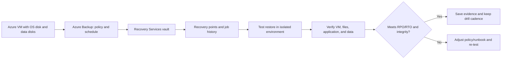

# Virtual Machine Backup and Verifying Data Recoverability

> **Chapter:** Reliability and Disaster Recovery  
> **Module:** `CLOUD_PROVIDERS_AZURE` — exploring Microsoft Azure from subscriptions, resource groups, and Microsoft Entra ID through virtual networks, compute, storage, and data; deploying, monitoring, securing, and controlling costs for Azure application architectures.

## Learning Objectives

After this lesson, learners will be able to:

1. Explain the purpose, scope, and limitations of **Azure VM Backup** in data protection and application recovery plans.
2. Design backup policies around **RPO**, **RTO**, data consistency levels, backup schedules, and retention periods.
3. Set up a **Recovery Services vault**, backup policy, and protect an Azure Virtual Machine via the Azure Portal or Azure CLI.
4. Inspect backup job history, recovery points, and alerts to verify **which backups are actually usable**.
5. Practice test restores on isolated resources, verify data, bootability, applications, and connectivity, and record RPO/RTO evidence.
6. Identify risks involving disks, databases, RBAC permissions, encryption, costs, Azure regions, and backup deletion actions.

## 1. Why Is "Backup Succeeded" Not Enough?

Suppose an order-management application runs on Azure VM `vm-orders-01`. The VM has an OS disk, a data disk holding files, and an order-processing service. One day, the OS breaks after an update; another day, an operator accidentally deletes a critical directory; in a worse case, the resource group suffers an outage or ransomware encrypts data.

The operations team turned on backups and sees **Completed** status. Yet that backup might lack the required directory, lack application-level consistency, or fail to restore within the business timeframe. A backup only has value once you **verify it can restore the right data, to the right point in time, within the required time window**.

### Distinguishing Protection Options

| Mechanism | What it helps solve | What it does not guarantee |
|---|---|---|
| **Azure VM Backup** | Creates recovery points for the VM and supported disks under a policy | Fine-grained application transaction recovery if the workload needs dedicated backup |
| **Azure VM restore** | Builds a new VM, restores disks, or recovers files per supported options | Automatically restoring external VM dependencies like DNS, identity, Key Vault, or other services |
| **Azure managed disk snapshot** | Captures a point-in-time disk image for targeted operations | Built-in long-term retention policy, scheduling management, or recovery verification |
| **Azure Site Recovery (ASR)** | Replicates and orchestrates failover to sustain service during major outages | Replacing long-term backup history or protecting against all logical deletes/edits |
| **Application-level backup** | Protects data/transactions with application awareness, e.g., SQL Server or native DB backup | Replacing all VM boot components and host configuration |

**Backup and disaster recovery are related but serve different purposes.** Backups preserve recovery history; ASR focuses on minimizing downtime via replication/failover. Many critical systems require both, alongside rehearsed restore procedures.

### Overall Flow



## 2. Defining RPO, RTO, and Data to Protect

**RPO (Recovery Point Objective)** is the maximum data loss the business accepts, measured as the time gap between an incident and the recoverable data point. **RTO (Recovery Time Objective)** is the maximum allowed time to return the service to a usable state after an outage.

Example at 14:00 on November 20:

- If the latest usable recovery point represents data from 12:00, recovery lag is **2 hours**. Against a **4-hour** RPO target, that meets RPO; against a **30-minute** RPO, it fails.
- If operations need 2 hours to provision the VM, 1 hour to validate data, and 30 minutes to bring networking/DNS online, total duration is **3 hours 30 minutes**. Against a **4-hour** RTO target, the plan can meet RTO if confirmed by real measurements.
- A daily backup schedule **cannot** meet a 1-hour RPO. Never judge by policy name or job start time instead of **the timestamp of the data actually restored**.

These targets must stem from data criticality, not Azure default settings.

### Example Policy Planning Table

| Workload | Target RPO | Target RTO | Protection direction to consider |
|---|---:|---:|---|
| VM hosting static site, data built from CI/CD | 24 hours for generated config | 2 hours | VM Backup or rebuild VM via IaC; store artifacts/config separately |
| VM processing internal documents | 4 hours | 4 hours | Backup schedule matching service capabilities; verify files post-restore |
| SQL Server storing order transactions | 15 minutes | 1 hour | Transaction-aware SQL backup plus HA/DR plan alongside VM protection if needed |
| Low-criticality lab VM | 24 hours | 1 day | Daily backup, short retention, periodic drills |

These figures are illustrative only. Feasibility depends on backup tier, region, workload, VM size, restore speed, networking, and the latest completed copy. Very tight RPOs require workload-native backups and HA/replication architectures.

### Inventory Before Selecting a Policy

Identify clearly **where critical data lives**:

1. Which OS, services, and configs reside on the OS disk?
2. Which files, databases, media, or logs reside on data disks? Are any disks excluded from backup?
3. Does the app also rely on Azure SQL, Storage Accounts, Key Vault, file shares, APIs, or external services?
4. Does recovery require transaction consistency, encryption keys, certificates, or credentials?
5. How long must data be retained for business, audit, or regulatory rules?

**Temporary disks** and disk types/configs unsupported by Azure VM Backup are never treated as protected data. Support also depends on VM type, disk type, OS, disk exclusion settings, and encryption configuration. Audit the actual disk inventory before signing off on backup scope.

## 3. How Azure VM Backup Works

For standard Azure VMs, **Azure Backup** uses a **Recovery Services vault** to manage backup items, policies, recovery points, and restore workflows. The service captures disk state, creates recovery points, and stores copies across tiers/schedules/retention supported by the policy. Snapshots enable faster restores in certain scenarios, while vault-tier copies serve longer retention needs per policy.

### Core Objects

| Object | Role |
|---|---|
| **Protected VM / backup item** | A VM linked to a vault/policy and tracked by Azure Backup |
| **Recovery Services vault** | Management boundary for protection and recovery points of supported workloads |
| **Backup policy** | Defines backup schedule, frequency, timing, retention, and protection options |
| **Backup job** | An execution record for backup, restore, or operational tasks, with status and error details |
| **Recovery point** | A recoverable snapshot/copy of data tagged with timestamp and consistency level |
| **Restore job** | A task restoring data from a selected recovery point |
| **Backup alerts/monitoring** | Failure signals, alerts, item health, and operational trends |

**Recovery Services vaults** serve scenarios like Azure VM Backup. Azure also provides **Backup vaults** for other workloads/services; never swap vault types interchangeably merely because both names contain "backup."

### Recovery Point Consistency Levels

| Type | Meaning | When to pay attention |
|---|---|---|
| **Application-consistent** | Backup coordinates with app/guest mechanisms where supported to reduce in-flight write inconsistency | Important for transactional apps; still test booting and app recovery |
| **File-system-consistent** | File-system writes are quiesced/flushed appropriately before snapshot | May still fall short of transactional database requirements |
| **Crash-consistent** | Disk state as of sudden power loss; may require journal replay/recovery on boot | Never assume application data is fully consistent |

On Windows, mechanisms such as **Volume Shadow Copy Service (VSS)** and workload compatibility affect consistency. On Linux, guest agents and pre/post-backup scripts may be needed for apps requiring coordinated write flushing. A **Completed** backup job does not prove every app on the VM is consistent; inspect the recovery point type and run restore tests.

### Reading Statuses Accurately

- **Backup configured/enabled:** the VM is registered for protection; does not yet prove a usable recovery point exists.
- **Backup job Completed:** the backup task finished; verify the recovery point exists, its timestamp, and its consistency level.
- **Backup job Failed/Warning:** inspect the error and RPO impact. Re-run after fixing under change approval.
- **Restore job Completed:** infrastructure restore finished; **does not yet prove the app boots or data is intact**.

## 4. Designing the Recovery Services Vault and Policy

### 4.1. Scope and Region

Typically, the **vault must reside in the same Azure region as the protected VM**. You may place the vault in a separate resource group within the same region if organizational policy permits. Choose subscriptions, resource groups, vaults, and admins carefully to limit blast radius.

Example naming:

- Subscription: `sub-training`.
- VM resource group: `rg-app-demo`; VM: `vm-orders-01`, region `southeastasia`.
- Backup management resource group: `rg-backup-demo`; vault: `rsv-orders-demo`, same region `southeastasia`.
- Backup policy: `pol-vm-orders-daily`.

### 4.2. Durability and Regional Recovery

The vault allows selecting **backup storage redundancy** such as LRS, ZRS, or GRS depending on region and service support. This configures fault tolerance of backup data, not a guarantee that the VM can automatically boot in another region.

- **LRS:** backup copies within a single local storage scope per service design.
- **ZRS:** spreads copies across availability zones within the region where supported.
- **GRS:** replicates asynchronously to a paired region to improve data survival during regional outages.
- **Cross Region Restore (CRR):** capability to restore in the secondary region when configuration and workload qualify; never assume GRS automatically grants unrestricted cross-region restores at all times.

**Lock in redundancy before protecting workloads**, since changing it later depends on vault state and platform support. For cross-region DR goals, drill actual cross-region restores rather than relying on the GRS label alone.

### 4.3. Schedules and Retention

Backup policies must balance recoverability and cost:

| Policy element | Question to answer | Lab example |
|---|---|---|
| Policy type | Does Standard or Enhanced fit the VM and frequency? | Pick the tier supported for the demo VM |
| Backup schedule | Daily or multiple times per day where supported? | 01:00 in the chosen time zone |
| Retention | How long to retain daily, weekly, monthly, yearly points? | 30 daily points or equivalent per real config |
| Instant Restore / snapshot | How long is fast snapshot recovery needed? | Choose per RTO and policy limits |
| Vault-tier retention | How long must older points remain accessible? | Based on data and audit requirements |
| Time zone | What time does backup run per portal/policy? | Convert UTC/local time clearly, accounting for DST if applicable |

A "daily backup" policy does not deliver a daily RPO if jobs fail. Configure alerts for **no new valid recovery point** within the target window and monitor actual job cadence.

### 4.4. Protecting Permissions and Deletion Paths

Because backups can be the last surviving copy of data, securing the vault is just as critical as securing the VM:

- Grant Azure RBAC with least-privilege roles and scopes for backup operators, readers, restore operators, admins, and CI/CD identities.
- Enable and verify **soft delete** per organizational policy, understanding retention duration and recovery steps if protection is stopped or backup data deleted.
- Evaluate **immutable vaults** and **Multi-User Authorization (MUA) / Resource Guard** for sensitive operations where supported by service, region, and account configuration.
- Restrict destructive actions, monitor policy/vault changes, and alert when backups are disabled, items unprotected, or deletions look anomalous.
- For encrypted VMs, confirm access to keys/secrets, Key Vault, and encryption settings needed for recovery; never assume disk copies alone suffice to bring up the app.

## 5. Configuring Azure VM Backup

### Prerequisites

To practice safely, assume an active test VM `vm-orders-01` exists with non-sensitive sample data and you hold permissions on the corresponding subscription/resource group/vault. **Never** practice on production VMs or real data without explicit approval.

Pre-checks: are the VM and vault in the same region; are the VM type, OS, and disks supported; do the agent/extensions/guest capabilities support the required consistency level; which disks are included vs. excluded; does the policy meet RPO/retention?

### 5.1. Creating the Vault in Azure Portal

1. Open Azure Portal, go to **Recovery Services vaults**, and create a new vault.
2. Select the target subscription, management resource group, and the same region as the VM.
3. In vault settings, confirm redundancy, soft delete, and protection options **before enabling backup**, checking each option's constraints.
4. Once created, open **Backup** for **Azure Virtual Machine**; create or choose a backup policy matching recovery targets.
5. Select the VM to protect, inspect its disks and support status, and enable backup.
6. Trigger **Backup now** for an initial recovery point if needed, monitor the job, and confirm the recovery point appears.

Portal labels may vary across UI updates; the core flow is **vault → policy → protected VM → job → recovery point**.

### 5.2. Azure CLI: Creating a Vault and Enabling Protection

The example below uses Bash in Azure Cloud Shell. Substitute your actual lab values; run step by step after checking your subscription and permissions. Do not run without an existing test VM.

```bash
# Illustrative values; set names and subscription for your lab environment.
SUBSCRIPTION_ID="<subscription-id>"
BACKUP_RG="rg-backup-demo"
VM_RG="rg-app-demo"
VAULT="rsv-orders-demo"
VM="vm-orders-01"
LOCATION="southeastasia"

az account set --subscription "$SUBSCRIPTION_ID"
az account show --query "{subscription:id,name:name}" --output table

# Use only if the vault resource group does not already exist.
az group create --name "$BACKUP_RG" --location "$LOCATION"

# Recovery Services vault for Azure VM Backup.
az backup vault create \
  --resource-group "$BACKUP_RG" \
  --name "$VAULT" \
  --location "$LOCATION"

# Inspect existing policies before selecting/customizing retention.
az backup policy list \
  --resource-group "$BACKUP_RG" \
  --vault-name "$VAULT" \
  --output table

# Retrieve the exact VM resource ID.
VM_ID=$(az vm show \
  --resource-group "$VM_RG" \
  --name "$VM" \
  --query id --output tsv)

# Select DefaultPolicy only after verifying its schedule and retention.
az backup protection enable-for-vm \
  --resource-group "$BACKUP_RG" \
  --vault-name "$VAULT" \
  --vm "$VM_ID" \
  --policy-name DefaultPolicy
```

**Explanation and caveats:**

- The vault may sit in a separate resource group, but **the region must match** the VM.
- `DefaultPolicy` is only a built-in sample policy name and **does not automatically satisfy** business RPO and retention. If unsuitable, create or pick a custom team policy.
- To change redundancy, soft delete, or protection locks, configure the vault intentionally before enabling backups. The commands above do not apply those security settings automatically.
- Enabling protection does not mean the initial backup point is complete. Verify the job and recovery point before closing out.

### 5.3. Checking Protected Items and Backup Jobs

Example inspection commands:

```bash
az backup item list \
  --resource-group "$BACKUP_RG" \
  --vault-name "$VAULT" \
  --backup-management-type AzureIaasVM \
  --workload-type VM \
  --output table

az backup job list \
  --resource-group "$BACKUP_RG" \
  --vault-name "$VAULT" \
  --output table
```

To inspect a specific item/recovery point, open **Recovery Services vault → Backup items → Azure Virtual Machine → VM → Recovery points** in the Azure Portal or query via Azure CLI using the exact container/item name returned by `item list`. Never guess `container-name` and `item-name` from the VM display name in production scripts, as ID formats can differ.

If an immediate backup is needed, trigger **Backup now** on the protected item, monitor the job, and log when the recovery point appears. The first backup can take time depending on disk size and system load.

## 6. Reading and Evaluating Recovery Points

**Having a recovery point does not prove recovery meets RPO/RTO.** Operators should record at least these attributes:

| Attribute | Why it matters |
|---|---|
| VM/resource ID, vault, policy | Confirms which resource and protection policy the point belongs to |
| Recovery point ID and timestamp | Enables choosing the exact pre-incident version |
| Recovery point type / consistency | Shows consistency level for OS, files, and applications |
| Tier / restore readiness | Affects restore speed and available restore options |
| Job status, duration, errors/warnings | Shows backup stability and items needing investigation |
| In-scope disks / data | Verifies alignment with the required data inventory |
| Latest restore drill outcome | Proves data and application actually work after recovery |

### Verifying RPO from Evidence

Suppose a simulated outage hits at **15:00**. The newest completed recovery point holds data up to **12:40**.

```text
Lag at incident time = 15:00 - 12:40 = 2 hours 20 minutes.
Application target RPO = 4 hours.
Timing verdict: 2 hours 20 minutes <= 4 hours => RPO MET on timestamp.
```

This evaluates **data timestamp**, not just when Azure logged job completion. If the backup omits key files or lacks transactional consistency, an RPO pass on paper does not prove real recoverability.

### Backup Health and Alerting

Set up monitoring and alerting for at least:

- Failed backup jobs or repeated warnings.
- Protected items missing a new recovery point within the RPO window.
- Disabled protection, modified policies, or non-compliant retention.
- Anomalous vault/protection changes or deletion attempts.
- Overdue restore tests, failed restore jobs, or failed data-integrity checks.

Use Azure Backup / Azure Monitor telemetry, Azure Backup Reports where appropriate, and your organization's incident system. Distinguish **backup succeeded** events from **verified restore** status on dashboards.

## 7. Test Restores: Choosing a Restore Method by Scenario

Azure VM Backup restore options depend on VM type, recovery point, permissions, and supported features. Common paths include:

| Option | When to use | Points to watch |
|---|---|---|
| **Create new virtual machine** | Verifying full VM rebuild without touching the original | Choose proper name, resource group, virtual network, subnet, IP, and RBAC; avoid hostname/IP collisions |
| **Restore disks** | Recovering OS/data disks for inspection or building a VM under custom config | Verify disk mapping, managed disks, boot config, encryption, and infra links |
| **Replace existing disks** | Restoring the original VM in supported scenarios | Risk of overwriting current state; use only after assessment and approval |
| **File recovery** | Recovering specific files/folders instead of the whole VM | Depends on OS, disk type, and support; app files may also need metadata/ACLs restored |

**Practice rule:** always start by **restoring to a new VM/resource group in an isolated network**, leaving the source VM untouched. Only overwrite a production VM under an approved recovery plan with full understanding of consequences.

### 7.1. Preparing an Isolated Test Zone

Before restoring, create or designate a drill resource group and virtual network/subnet. Ensure:

1. No public IP is assigned unless strictly needed; allow test access only via authorized admin channels.
2. No routing connects back to production networks, production load balancers, or production DNS.
3. The restored machine cannot send emails, run live scheduled jobs, process real orders, or connect accidentally to production databases.
4. Test accounts/groups have sufficient permissions to read data, view logs, and validate outcomes without leaking secrets.
5. Quotas, VM sizes, disks, networking, and temporary costs are accounted for.

**Restoring a VM with the same hostname, static IP, or active writer services** into a production network can cause collisions or corrupt live operations. Network and configuration isolation is mandatory for drills, not optional convenience.

### 7.2. Portal Walkthrough

1. Open the target **Recovery Services vault → Backup items → Azure Virtual Machine** and pick `vm-orders-01`.
2. Open **Recovery points**; choose a point matching the target timestamp, consistency, and availability tier.
3. Select **Restore VM** or a supported restore option; use **Create new VM** for this lab.
4. Specify the test resource group, new VM name, isolated virtual network/subnet, VM size, and required staging resources.
5. Review settings, start the restore, and monitor the **Restore job** to completion.
6. Verify VM boot, OS/data disks attached, service status, and app data. Log start time, app-ready time, and any manual fixes.
7. After verification, isolate or shut down the VM; clean up lab resources per procedure while preserving drill evidence.

Just because a restore option appears in the portal does not guarantee it fits every scenario. For encrypted VMs, non-standard disks, or external dependencies, verify service documentation before relying on that path.

### 7.3. Can You Verify Files Without Rebuilding the VM?

Consider **File recovery** if supported by the workload/recovery point and only specific files need restoration. However, retrieving one file does not prove the entire VM boots or the database recovers. Keep both **file-level tests** and **full-VM/application-level tests** in your drill plan.

## 8. Verifying Data Integrity After Restore

Backup recovery must be proven against checks with **expected answers** recorded prior to backup.

### 8.1. Capturing Pre-Backup Evidence

On the lab VM, create a sample file like `/srv/orders/checkpoint.csv` and record its SHA-256 hash. Store the hash, line count, app version, and timestamp in an evidence store **independent of the VM**, such as a change record or drill tracker.

```bash
# On the Linux lab VM before taking a backup:
sha256sum /srv/orders/checkpoint.csv
wc -l /srv/orders/checkpoint.csv

# Record results, timestamp, and app version outside the VM.
date -u +"%Y-%m-%dT%H:%M:%SZ"
```

On Windows, use PowerShell:

```powershell
Get-FileHash -Algorithm SHA256 'C:\Data\orders\checkpoint.csv'
(Get-Content 'C:\Data\orders\checkpoint.csv').Count
```

Never use a hash computed **right after restore** as the "expected answer" without an independent pre-backup baseline; that only checks the file against itself.

### 8.2. Post-Restore Verification

Inside the isolated restored VM, verify layer by layer:

| Layer | Check | Illustrative pass criterion |
|---|---|---|
| **Infrastructure** | VM boots, managed disks attach, NIC/IP match test env | VM runs stably without accidental production connectivity |
| **Operating system** | File systems mount, all volumes present, core services and event logs | No critical storage/OS errors |
| **Files** | Read sample file, SHA-256, line count, ACL/owner | Hash/line count match pre-backup record; permissions intact |
| **Application** | Service starts, health endpoint responds, read flow works | Returns expected output inside the test network |
| **Database** | Run engine-specific consistency checks, verify milestone row/transaction counts | Zero integrity errors; data loss within RPO window |
| **Security** | Test-env secrets/keys/certs and permissions work | Sufficient for testing; no paths back to production |
| **Operations** | Elapsed duration and manual steps recorded | Total time to serving state meets RTO target |

Example hash comparison post-restore on Linux:

```bash
sha256sum /srv/orders/checkpoint.csv
wc -l /srv/orders/checkpoint.csv
# Compare both outputs against the independently stored pre-backup record.
```

For SQL Server or transactional databases, checking a CSV checksum **does not** replace engine consistency checks, recovery log verification, locks, transaction boundaries, or business query tests. For multi-dependency applications, verify **whole-application recovery**, not just one VM.

### 8.3. Measuring RTO from Real Timestamps

```text
T0 = 09:00  Incident detected/simulated; RTO clock starts
T1 = 09:15  Recovery point chosen and restore approved
T2 = 10:05  Restore job completes; new VM created
T3 = 10:35  VM boots; disks/data verified
T4 = 11:00  Application passes smoke test and is ready to serve

Measured RTO = T4 - T0 = 2 hours.
If target RTO is 3 hours: PASS for this drill.
```

Restore speed varies by data volume, recovery point tier, region, quotas, permissions, networking, and operator execution. A 2-hour drill result **does not guarantee** every future recovery matches it; track per-step timings and keep safety margin.

### 8.4. What Belongs in a Drill Report?

| Field | Example entry |
|---|---|
| System / VM | `orders-api / vm-orders-01` |
| Executor and approver | Roles/teams per procedure |
| Vault, backup item, policy | Exact resource IDs and names |
| Recovery point | ID, timestamp, consistency |
| Simulated incident | File deletion, OS corruption, or VM loss |
| Restore method | Create new VM in isolated VNet |
| T0–T4 | Actual timestamps and time zone |
| Data verification | Hashes, record counts, queries, logs |
| Measured RPO/RTO | Comparison against approved thresholds |
| Gaps and remediation | Mount errors, missing keys, slow network, job failure |
| Test environment cleanup | List of deprovisioned resources and timestamps |

## 9. Common Failure Scenarios

| Symptom | Possible cause | Verified resolution |
|---|---|---|
| Cannot enable VM backup | Vault in different region, unsupported VM/disk config, wrong RBAC | Verify region/scope, VM/disk type, permissions, and exact error message |
| Backup job fails | Extension/guest issue, VSS/script failure, OS, network, or transient fault | Read job details; check VM health, agent/extension, and app consistency |
| VM shows "Protected" with no new points | Schedule hasn't run, jobs failing, or misconfigured policy | Check recovery points, job history, schedules, and alerts |
| Recovery point exists yet data is inconsistent | Crash/file-system point insufficient for transactional workload | Use app-aware backup, guest coordination, and consistency drills |
| Restore job finishes yet VM fails to boot | OS, boot config, disk mapping, encryption, or missing dependencies | Check boot diagnostics, console/logs, disks, keys, and restore limitations |
| Restored VM boots yet app fails | DB/logs, DNS, secrets, certs, external VM links | Review dependency map and app restore runbook |
| Cross-region restore unavailable | CRR prerequisites unmet or incompatible storage redundancy | Check GRS/CRR support, target region, feature settings, and recovery point |
| Cannot delete backup data or vault | Soft delete, immutable vault, MUA, RBAC, or active protected items | Identify active locks/protections; follow approved change procedure |
| Backup costs spike | Long retention, high data volume/churn, snapshot/vault storage, leftover test VMs | Audit policies, backup usage, and post-test cleanup; never cut retention blindly |

### During a Real Data-Loss Incident

Response must begin by **preserving evidence and limiting destructive changes**. Determine fault scope, suitable recovery point, projected data loss, and system dependencies. Test recovery in a safe environment if possible, then cut over traffic or replace production data per runbooks and organizational approvals.

Overwriting live data can erase transactions recorded after the recovery point. Agree beforehand on handling recent data, compensating updates, transaction log extraction, and cutover timing.

## 10. Security, Cost, and Long-Term Operations

### Backup Security

Backups hold copies as sensitive as the source system. Apply service-supported encryption, least-privilege RBAC, key management, separation of duties, and change auditing. Roles such as **Backup Reader / Backup Operator / Backup Contributor** or equivalents must be evaluated against the exact feature in use; verify effective permissions at scope rather than relying on role names alone.

Pay special attention to:

- Never storing secrets, SAS tokens, or DB credentials in backup logs or drill notes.
- Never allowing test-restored VMs to connect to production networks or services without explicit need and approval.
- Evaluating soft delete, immutable vaults, and MUA/Resource Guard against intentional or attacker-driven backup deletion.
- Auditing policy edits, protection stops, vault permissions, and privileged accounts.

### Cost and Retention

Costs typically reflect protected instances, stored backup size, storage tiers, snapshot/restore tiers, and redundancy options; exact pricing varies by configuration, region, and time. Retaining more recovery points for longer improves protection at higher cost. Arbitrarily slashing retention can break audit recoverability.

VMs restored for drills also incur compute, managed disk, network, and monitoring costs. Clean up test resources promptly once evidence is saved—but **never delete production vaults or backup data** merely to save money.

### Drill Schedule

Tailor drill cadence to workload criticality: rehearse after major architecture/OS/database changes, on audit cycles, or whenever RTO/RPO targets shift. Business-critical VMs need more frequent testing than lab VMs. Transactional systems often require combined drills covering DB backups, HA/DR, DNS, and dependency recovery.

## 11. Guided Hands-On Exercise

**Context:** Operations manages Linux VM `vm-files-01` on Azure holding `/srv/reports/monthly.csv`. Requirements: restore the file within **4 hours**, tolerating at most **24 hours of data loss**. Goal: prove accurate data recovery on an isolated test VM.

**Steps:**

1. Record the VM's region, resource ID, OS/data disks, and critical data directory. Confirm the directory is not on the temporary disk and is included in backup scope.
2. Create a Recovery Services vault in the same region, choose suitable redundancy/vault protections, and create or verify a daily backup policy. Document why the policy satisfies a 24-hour RPO when jobs succeed.
3. Create a sample data file with recognizable verification rows, saving its SHA-256 hash, line count, and timestamp independently. Enable VM Backup, run an initial backup, and confirm a completed recovery point.
4. Use a valid recovery point to **Create new VM** inside an isolated resource group and VNet. Log T0 when starting the drill; never overwrite the source VM.
5. Verify VM boot, volume mounts, file permissions and contents, matching hash/line count, and a successful file-read service health check. Log T4 on completion and compare against the 4-hour RTO.
6. Compare the recovery point's actual data timestamp against simulated failure time; calculate lag and compare against the 24-hour RPO.
7. Archive the drill report, evidence, issues found, and improvement actions; clean up test VM/disks/VNet per procedure once verified unnecessary.

**Pass criteria:** valid recovery point for the exact VM, verified restore, matching file checksum/record count, zero production impact, and measured RPO/RTO meeting targets. Without Azure deployment permissions, simulate the workflow and complete the expected report without touching a live subscription.

### Self-Check Questions

1. Why does "Backup job Completed" not guarantee "the application can definitely recover"?
2. Is daily VM backup enough for a 15-minute RPO on a transactional system? What else is needed?
3. How can a crash-consistent recovery point differ from an application-consistent one?
4. Why should you test **Create new VM** in an isolated VNet before overwriting a production VM?
5. When a restore job succeeds yet the database cannot be queried, what else must you check?
6. Should RTO measurement stop when Azure reports the restore job Completed, or when the application is ready to serve?
7. When backups contain critical data, how should you protect the vault from malicious and accidental deletion?

## 12. Key Takeaways

Azure VM Backup is a **verifiable process for protecting, retaining, and restoring data**, not simply a backup toggle. Recovery Services vaults, policies, and recovery points define *which data and versions can be restored*; backup jobs and monitoring detect schedule drift; and **restore tests** prove VMs, files, and applications actually work after an incident.

For reliable Azure architectures, derive RPO/RTO targets from business needs, protect the right OS/data disks and application workloads, restrict vault permissions, verify critical recovery points, rehearse isolated restores, and retain both timing and data-integrity evidence. Until those checks pass, a backup plan remains unfinished.
