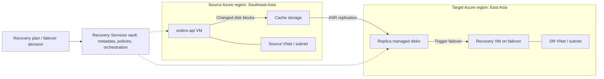
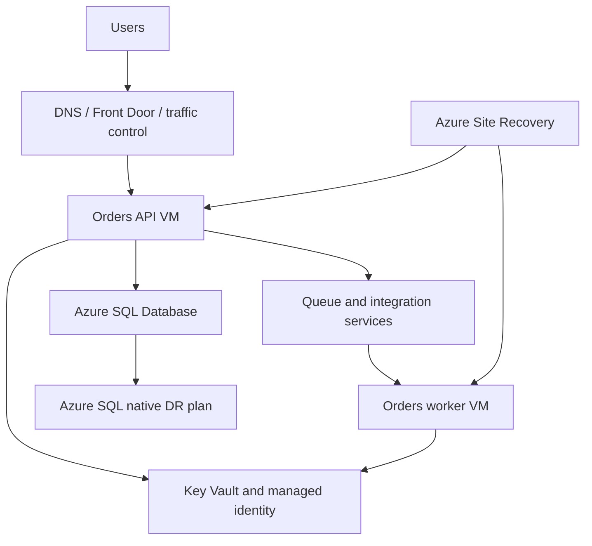
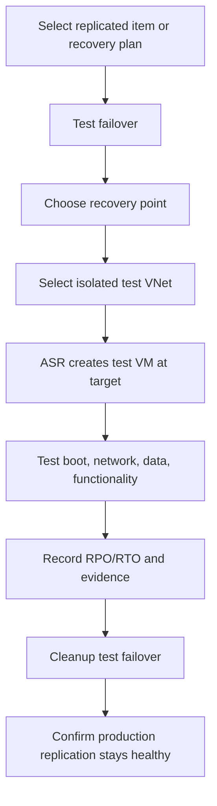
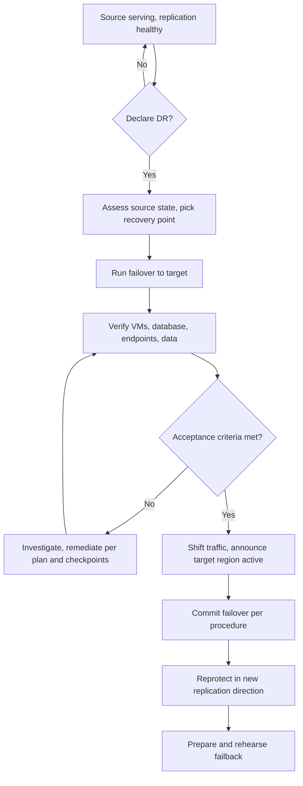

# Azure Site Recovery and Workload Replication for DR

## 1. From Stable Operations to Disaster Recovery Capability

An application on Microsoft Azure can run reliably for months and still go down when a deployment region suffers a major outage, a VM breaks, network configurations become unreachable, or an on-premises datacenter loses power. For systems with business continuity demands, deploying onto Azure solves only half the problem: operations also need the ability to **restore service in another location** with acceptable data loss and downtime.

**Disaster Recovery (DR)** is the set of designs, procedures, and tools used to recover an application after an outage exceeding normal self-healing capabilities. In the Azure ecosystem, **Azure Site Recovery (ASR)** helps **replicate and orchestrate recovery for supported workloads**—especially virtual machines—to shift operations from source to a recovery site. ASR can protect Azure virtual machines across regions, or protect certain on-premises workloads to fail over to Azure, per the current support matrix.

This lesson belongs to the **Reliability and Disaster Recovery** chapter of the Azure track, where resource groups, virtual networks, compute, data, monitoring, security, and cost all shape recoverability. The focus is understanding **which components ASR protects, how replication flows work, how to rehearse test failovers, how to cut over during an incident, and how to fail back to normal operations**.

### Learning Objectives

After this lesson, you will be able to:

1. Distinguish high availability (HA), backups, replication, and disaster recovery; identify ASR's proper role.
2. Explain ASR building blocks: Recovery Services vault, protected/replicated items, replication policies, recovery points, recovery plans, and target resources.
3. Design a VM replication model between two Azure regions with RPO/RTO targets, networking, permissions, and capacity.
4. Describe enabling replication, monitoring replication health, test failover, failover, commit, reprotect, and failback.
5. Structure recovery plans by application dependencies and verify data consistency after failover.
6. Analyze limitations, costs, security risks, and how ASR pairs with Azure Backup or data-service native DR mechanisms.

## 2. Concepts to Align Before Picking Tools

| Concept | Question it answers | Example |
| --- | --- | --- |
| **High Availability (HA)** | How does service keep running when a small component fails? | Multiple VMs behind a load balancer spread across Availability Zones |
| **Replication** | How is workload data/state copied to the target? | ASR replicates disk state for supported VMs |
| **Backup** | How do we restore data from an earlier point in time? | Azure Backup with retention policies to restore clean copies |
| **Disaster Recovery (DR)** | How do we run the app at a target site when the source is unusable? | Failing over VMs to another region, switching routing, and verifying data |
| **Business Continuity (BC)** | What does the business do to keep serving customers during an outage? | Declaring DR, stakeholder comms, manual fallback procedures |

**RPO (Recovery Point Objective)** is the maximum tolerable data loss, measured in time. With a 15-minute RPO, the business must design recovery so no more than 15 minutes of transactions are lost under agreed criteria. **RTO (Recovery Time Objective)** is the maximum duration from when service stops until it meets business requirements again.

Illustrative example:

- Incident starts at **10:00**; the newest recovery point holds data through **09:52**: observed data-loss lag is **8 minutes**.
- Users can actively use the app again at **10:42**: observed recovery duration is **42 minutes**, counting from 10:00 as outage start.
- With targets **RPO ≤ 15 minutes** and **RTO ≤ 60 minutes**, this drill meets both timing targets. The team must still verify business data rather than inferring from a VM timestamp that every transaction is consistent.

RPO and RTO are **design targets**, not automatic guarantees once ASR is enabled. Actual RPO depends on disk churn, bandwidth, replication health, and available recovery points; RTO depends on detection, decision-making, failover execution, app startup, DNS/traffic cutover, and acceptance testing.

## 3. What Azure Site Recovery Can and Cannot Do

ASR orchestrates recovery for supported scenarios. Common source types and recovery paths include:

| Workload source | Recovery direction | Key points to understand |
| --- | --- | --- |
| **Azure VM** | To a supported target Azure location, typically another region | ASR maintains replica disk data and recovery metadata; target VMs are created during failover |
| **On-premises VMware VM** | To Azure | Requires appliance/agent architecture matching supported VMware models and versions |
| **On-premises physical server** | To Azure | Depends on OS support, Mobility Service, and connectivity to replication infrastructure |
| **Hyper-V VM** | To Azure per still-supported scenarios | Verify exact host version, OS, agent, and current support matrix |

Each scenario has **distinct components, setup steps, and limits**. This lesson's primary hands-on flow covers Azure VM to another Azure region; never apply Azure-to-Azure instructions directly to VMware or Hyper-V.

**ASR is not a universal DR mechanism for every Azure service.** Appropriate choices by workload type include:

| Workload | DR mechanism to evaluate |
| --- | --- |
| Azure VMs running APIs, workers, or host-installed apps | ASR if VM size, disks, and OS are within supported scope |
| Azure SQL Database | Active geo-replication, failover groups, backup/restore per service requirements |
| Azure Storage | Redundancy strategy (e.g., GRS/RA-GRS/GZRS as needed), backups, and data recovery |
| Azure App Service | Multi-region architecture, App Service deployment/failover, separately protected backing data |
| AKS / Kubernetes | Recreating clusters from IaC and manifests, protecting persistent storage with compatible solutions |
| Microsoft Entra ID, DNS, Key Vault, third-party links | Component-specific continuity plans, permissions, endpoints, and change procedures |

You cannot drop a PaaS app into a vault and expect ASR to replicate all data and traffic flows. **DR must span the full dependency chain**: compute, networking, identity, databases, secrets, DNS, traffic routing, and external integrations.

### ASR vs. Azure Backup

ASR aims to **resume running workloads** in another location using recovery points and failover orchestration. Azure Backup aims to **restore data/resources from backup copies** with dedicated retention and protection policies. Accidental deletions or ransomware encryption can replicate to the ASR target; clean recovery then requires backups and clean-restore plans. For critical systems, organizations commonly combine **both DR replication and independent backups** with separate access controls and testing.

## 4. Azure-to-Azure Site Recovery Architecture

Example architecture protecting VM `vm-orders-api-01` running in `southeastasia` with recovery targeted to `eastasia`:



These two regions are **illustrative examples**; verify that the region pair, VM SKU, OS, disk types, quotas, and features are supported at deployment time. Some designs can target Availability Zones or alternate recovery scopes depending on ASR support, yet never treat every zone/region pairing as equivalent.

### Key Components

1. **Recovery Services vault:** manages Site Recovery objects, protection settings, replication status, recovery plans, and failover orchestration. A vault is not automatically an application backup store.
2. **Replication policy:** governs retention/recovery point characteristics and supported consistency-snapshot settings.
3. **Replicated/protected item:** represents a protected workload; exposes replication health, status, recovery points, and recovery actions.
4. **Source cache storage:** stages write changes during Azure-to-Azure replication.
5. **Target replica disks and recovery settings:** data maintained at the target; on failover, ASR creates/boots the target VM using the configured settings.
6. **Target resource group, network, subnet, and compute:** where the workload runs upon recovery.
7. **Recovery plan:** groups machines, boot sequencing, manual steps, and automation hooks for multi-tier applications.

The orchestration **control plane** lives within the Site Recovery service; the actual data-replication path and Azure connectivity must meet scenario requirements. Check firewalls, endpoints, and proxies so agents/extensions and ASR infrastructure run reliably.

### What Is and Is Not Replicated

ASR primarily protects disk state and VM configuration within supported boundaries. External DNS, partner endpoints, off-VM app configs, PaaS databases, and identity systems **do not automatically become part of a VM replica**. Furthermore, specific disk types, VM sizes, encryption setups, network topologies, or OS features may carry restrictions or extra setup steps. Always check the official support matrix before committing to formal RPO/RTO numbers.

## 5. Recovery Points: Crash-Consistent vs. Application-Consistent

While the source runs, ASR tracks supported changes and creates recovery points per policy. On failover, pick a **suitable recoverable point** rather than blindly assuming "latest is always best."

| Recovery point type | Meaning | When it fits |
| --- | --- | --- |
| **Crash-consistent** | Disk state matching sudden power loss, without guaranteeing all apps flushed in-flight transactions to disk | Workloads able to self-recover transaction logs after a crash |
| **Application-consistent** | Coordinates supported app/guest consistency mechanisms at snapshot time | Workloads requiring in-guest apps or services to quiesce before snapshot |
| **Processed / ready recovery point** | Pre-processed data reducing target VM creation wait time | Prioritizes shorter RTO when the timestamp meets data-loss goals |

Specific portal labels and availability vary by scenario, date, and service version. Never rely on a single recovery point choice to **guarantee transactional consistency across multiple VMs**. For instance, an independently replicated API VM and database VM can still capture skewed states at a given timestamp even if each VM boots cleanly.

For database-backed applications:

- Define the database's own recovery mechanism (transaction logs, DB backups, native replication, recovery process).
- Specify which recovery point matches consistency rules and validate with real business queries.
- Define startup ordering across database, message broker, API, and background workers.
- Maintain a rollback path if a restored replica contains corrupted data or mismatched schemas.

**ASR recovery point retention does not replace long-term backups.** Select retention windows and frequencies based on supported features, data churn, and storage cost.

## 6. Workload-Specific DR Design: Orders API

Consider a straightforward system:

- `vm-orders-api-01`: Azure VM running the Java Orders API.
- `vm-orders-worker-01`: Azure VM processing order queues.
- Azure SQL Database: stores order state, protected by **Azure SQL's own DR mechanisms**, not ASR.
- Azure Key Vault: supplies secrets/certificates via managed identity permissions.
- Azure Front Door or suitable DNS/traffic steering: routes users to the active serving region.

Dependency diagram:



Arrows from ASR to VMs show protected objects, not a claim that ASR replicates systems outside those VMs.

### Pre-Configuration Design Table

| Decision | Example for Orders API | What to verify |
| --- | --- | --- |
| Source region | `southeastasia` | Source VMs, services, network, and policies |
| DR region | `eastasia` | ASR support, data residency, network latency, and quotas |
| Target resource group | `rg-orders-dr-ea` | Role assignments, Azure Policy, tags, and naming |
| DR VNet | `vnet-orders-dr-ea` | IP CIDRs, NSGs, UDRs, DNS, Private Endpoints |
| Test failover VNet | `vnet-orders-dr-test` | Isolated from production to avoid IP collisions and live writes |
| ASR workloads | Two VMs: API and worker | OS/disk/extension supportability for each VM |
| Data DR | Dedicated Azure SQL strategy | RPO, failover order, permissions, and connection strings |
| Target RPO | 15 minutes | Cross-check replication health and test consistency |
| Target RTO | 60 minutes | Covers decision, execution, routing, and acceptance |
| Trigger authority | Authorized incident commander | Decides when to actually shift traffic |

Targets and resource names here are learning examples, not SLAs or claims that a real system will hit these numbers.

**Cold, warm, and hot DR** describe resource readiness at the recovery site. ASR fits models where disks/replicas stay maintained and target VMs spin up on demand. Very low RTOs may demand **pre-running active-active or active-passive** service architectures, because VM boot and traffic cutover still take time.

## 7. Pre-Replication Prerequisite Checks

### 7.1. Compatibility and Capacity

Before protecting VMs, check:

1. **Support matrix:** VM family/size, Gen 1/Gen 2, OS version, OS/data disks, encryption, source/target regions, and feature caveats.
2. **Target quotas:** vCPUs per VM family, NIC counts, managed disks, IP addresses, and resources created during failover.
3. **Data churn:** disk sizes, write rates, bandwidth limits, and latency; initial replication typically takes much longer than ongoing sync.
4. **Network boundaries:** overlapping CIDRs, DNS, outbound access to required endpoints, firewalls/proxies, Private Endpoints, and data connectivity.
5. **Security dependencies:** Azure RBAC, encryption keys, Key Vault permissions, identities, and target Azure Policy rules.
6. **Data constraints:** data sovereignty rules, replica placement restrictions, cost estimates, and audit requirements.

In particular, VMs using **ephemeral OS disks**, shared disks, certain encryption setups, or specialized compute features may be unsupported depending on the scenario. Never assume every VM in a subscription can enable ASR. Confirm against official compatibility docs first.

### 7.2. Pre-Designing the DR Network

ASR does not build an entire business network ecosystem automatically. Prepare:

- Target VNet/subnets with non-conflicting address spaces able to reach required dependencies.
- Matching NSGs, route tables, firewalls, NAT, DNS servers, and Private Endpoints.
- User/partner access paths to new endpoints; public IPs and DNS names can change during failover.
- An **isolated test network** for drills so test app replicas never send emails, process live orders, or write to production systems.
- Verified access from the DR region to Key Vault, Azure SQL DR endpoints, and monitoring systems.

If specific IP addresses must be preserved, verify how ASR maps target NICs/IPs and whether those addresses are available. Never assume source private/public IPs carry over automatically in every scenario.

### 7.3. Roles and Management Resources

Engineers configuring Site Recovery need permissions over the vault, source/target resources, and resources ASR creates; staff allowed only to run test failovers need narrower privileges. Organizations should separate **policy design/editing**, **monitoring**, and **production failover execution**. Roles like Site Recovery Contributor/Operator/Reader help divide duties, yet still require checking target network, resource group, storage, and identity permissions.

## 8. Setting Up Azure-to-Azure Replication via Azure Portal

The steps below outline the logical workflow. Menu names and button locations can shift across portal updates; consult current Azure Site Recovery guides during real execution.

### Step 1 — Create and Configure a Recovery Services Vault

Open Azure Portal, navigate to **Recovery Services vaults**, create a vault in your DR management subscription/resource group, and place it in a region **matching the protection scenario** with an independent failure boundary from the source. For Azure-to-Azure, the vault is normally placed in the recovery region rather than the source region; verify supported regional rules before creating.

Inside the vault, open **Site Recovery** to configure source and target. Unlike plain state storage in a storage account, the vault is ASR's orchestration and monitoring control point.

### Step 2 — Specify Source and Target

Choose to protect **Azure virtual machines** and specify:

1. Source subscription/resource group and region containing the VMs.
2. One or more VMs to replicate.
3. Target subscription/resource group, target region, VNet/subnet, and target resource settings.
4. Recommended or customized cache storage and replication policy.

Do not force every VM onto one default policy. A high-write workload with a tight RPO needs different treatment than a low-churn management VM.

### Step 3 — Enable Protection and Monitor Initial Replication

Run **Enable replication** for selected VMs; ASR provisions scenario components. Initial replication transfers baseline disk data and depends heavily on disk size, write churn, bandwidth, and disk types.

Do not declare DR ready until:

- Protected items reach healthy replication status with valid recovery points.
- Target regions, networks, provisioned resource specs, and RBAC scopes are verified.
- At least one test failover has succeeded; "replication healthy" proves only part of DR readiness.

### Step 4 — Inspect Protected Items

In the vault's **Replicated items** blade, review each VM:

| Attribute | Verification question |
| --- | --- |
| Replication health | Is replication healthy or showing warnings/errors? |
| Latest recovery point | What is the newest point's timestamp and type? |
| RPO / replication lag | Is observed lag within acceptable bounds? |
| Target VM properties | Do VM size, disks, availability settings, and NICs fit the DR region? |
| Replication policy | Do retention and app-consistent point intervals fit the workload? |
| Alerts / jobs | Are there failed jobs, extension errors, or unexpected changes? |

For on-premises VMware or physical servers, setup also includes a replication appliance, Mobility Service, and datacenter-to-Azure networking. **Never follow Azure VM source steps for on-premises servers while skipping appliances/agents.**

## 9. Test Failover: Mandatory Before Trusting DR

**Test failover** instantiates workloads from a recovery point at the target **without deliberately shifting production traffic**. It lets you verify bootability, data, and permissions without business disruption. Always select a pre-built isolated network when running a test failover.

### Test Flow



**Never attach test VMs directly to a production VNet or production DNS** if doing so could let two replicas run live business logic simultaneously, collide on IPs, or write to production stores. For an order-processing API, the test environment needs a cloned DB, test queues, mock integrations, or controls blocking real transactions.

### Checks After Test VM Boots

| Layer | Practical check | Pass criterion |
| --- | --- | --- |
| Compute | VM boots, agent/OS stable, CPU/RAM sized appropriately | OS and services start cleanly |
| Network | DNS, NSGs, firewalls, routes, internal endpoints | App connects to the isolated test environment |
| Application | Health endpoints, HTTP APIs, sample test request | Zero critical config or dependency errors |
| Data | Sample record reads, transaction logs, schema/version | Recovery point satisfies defined consistency criteria |
| Security | Managed identities, RBAC, Key Vault/certificates | Least-privilege test access; no live production secrets |
| Operations | Logs, metrics, alerts, dashboards | SRE can observe system state in DR |
| Cleanup | Remove test resources via ASR cleanup workflow | No orphaned test VMs accruing unexpected cost |

Test failover proves only what you actually test. Being able to ping a VM **does not** prove the ordering API works end to end. DR docs must capture evidence, timings, and unresolved gaps with remediation owners.

### Sample Drill Report Template

```text
Exercise ID: DR-ORDERS-2026-01 (example)
Workload: orders-api / orders-worker
Source: Southeast Asia
Target: East Asia, isolated test VNet
Recovery point timestamp: [record from portal]
Time detected / test started: [timestamp]
Time API ready: [timestamp]
Measured data loss: [minutes, per verified transactions]
Measured recovery time: [minutes]
RPO target / RTO target: [minutes]
Functional checks passed: [list]
Issues / follow-up / owner / due date: [specify]
Cleanup test failover: [PASS/FAIL]
Replication health after test: [PASS/FAIL]
```

Record timestamps in a uniform zone such as UTC for accurate comparison. Measuring only VM boot time while ignoring when the app can accept traffic understates true outage duration.

## 10. Real Failover: Timing, Commit, and Reprotect

When an incident renders the source region unusable, operations triggers the DR runbook. Failover alters live application and data state, requiring authorized operators, coordination across app and data teams, and clear gates before shifting traffic.

### Conceptual Recovery Lifecycle



**Note:** the exact ordering between acceptance, traffic cutover, and commit must follow your ASR scenario guide and organizational runbook. This diagram highlights control checkpoints rather than replacing portal steps.

### Distinguishing Operations

| Action | Purpose | Caution |
| --- | --- | --- |
| **Test failover** | Validate recovery in an isolated environment | Clean up test resources; prevent accidental production links |
| **Failover** | Bring up workloads at recovery site from chosen recovery point | Accept possible data loss; prevent dual active writers |
| **Commit** | Confirm failover outcome and finalize transition in ASR | Execute only after full verification, as recovery-point reselection may be locked out |
| **Reprotect** | Re-establish replication in the new direction while running at target | Needs source/target readiness, quotas, networking, policies, and healthy sync |
| **Failback** | Return workloads to the original region or designated primary | Plan for data written after failover and re-test before switching traffic |

Never treat `Commit` as a harmless UI confirmation button. Depending on the scenario, committing can lock out picking a different recovery point from the failover just run. Verify database consistency, app configs, and connectivity before committing.

### Avoiding Split-Brain and Duplicate Processing

Whenever two VM copies might run concurrently, **split-brain** threatens: both source and target process requests or write data independently. For Orders API, that could double-charge payments, double-allocate stock, or send duplicate notifications.

Runbooks must specify:

1. Who verifies the source region is no longer serving traffic or is isolated.
2. When to stop background workers, schedulers, consumers, and non-idempotent jobs.
3. When DR databases and queues may open for writes.
4. Exact conditions for updating DNS, Front Door origins, or routing.
5. How to verify each order executes once, using idempotency keys and transaction states where supported.

You cannot delegate distributed consistency entirely to ASR, because ASR only sees the specific workloads under its protection scope.

## 11. Recovery Plans and Multi-Tier Startup Ordering

Recovering VMs one by one manually risks missing dependencies. Site Recovery **Recovery plans** group workloads into ordered stages/steps that can combine manual actions and automation hooks where appropriate.

Example logical sequence for Orders API:

| Stage | Component | Gate to proceed |
| --- | --- | --- |
| 0. Decision | Incident commander, on-call, source region status | DR approved; source write paths blocked |
| 1. Foundation | Private DNS, links, Key Vault, monitoring, path to DR data | Target endpoints reachable |
| 2. Data | Activate Azure SQL DR plan, recover queues if needed | Schema, roles, endpoints, and data RPO verified |
| 3. API | Fail over `vm-orders-api-01` via ASR | API health checks and core flows pass |
| 4. Worker | Fail over `vm-orders-worker-01` | Test message processing succeeds with no duplicates |
| 5. Traffic | Shift Front Door / DNS / routing | Monitor error rates, latency, and transaction counts |
| 6. Sign-off | Business owner, SRE, security | Log timings, issues, commit decision, and reprotect plan |

Steps involving Azure SQL, Front Door, Key Vault, or queues need **separate automation or planned manual steps**. ASR recovery plans do not turn PaaS services into ASR protected items automatically.

Recovery plans can integrate Azure Automation runbooks or compatible automation for custom tasks. Scripts must use least privilege, timeouts, bounded retries, logging, and error handling. Never embed tokens in runbooks or incident messages; use managed identities or secure credential stores.

Avoid stuffing every VM into one giant recovery plan if app groups have different owners, dependency chains, and RTOs. Partitioning by **business recovery unit** keeps drills practical and limits blast radius.

## 12. Failback: Restoring Replication Direction and Returning to Steady State

Suppose Southeast Asia recovers after Orders API has run in East Asia for several days. During that time, users placed new orders and workers processed messages in East Asia. Never simply boot the old source VM and flip DNS back: source data is stale and dual processors will clash.

A proper failback procedure requires:

1. **Verify the original region is healthy:** infrastructure, quotas, networking, permissions, keys, and all dependencies are ready.
2. **Reprotect:** configure ASR to replicate back in the required direction per scenario requirements and support.
3. **Sync post-failover changes:** wait for healthy replication and current recovery points, and verify database/queue data paths outside ASR.
4. **Schedule cutback:** confirm decision-makers, application quiesce plan, duplicate-writer locks, and rollback path.
5. **Execute failback per runbook:** pick the recovery point, boot and validate apps, and switch traffic once criteria pass.
6. **Finalize and restore protection:** commit if required by workflow, restore normal replication direction, re-test, and update documentation.

Failback can be riskier than failover because the DR region now holds the **newest authoritative data**. Data owners—not solely VM operators—must govern authoritative writer decisions.

## 13. Monitoring Replication Health and Proving RPO/RTO

With ASR, never wait for an outage to open the vault. Operations must continuously monitor protected items, replication jobs, recovery points, alerts, and target readiness.

### Signals to Monitor

| Signal | Meaning | Expected response |
| --- | --- | --- |
| Degraded replication health | Workload lagging sync or agent/link issue | Investigate promptly and check latest recovery point |
| Stale recovery point | Observed RPO risks breaching threshold | Inspect disk churn, cache/network, and replication errors |
| Prolonged initial replication | Desired protection not yet established | Check volume/throughput and endpoint connectivity |
| Failed test failover / failover job | Recovery workflow broken | Inspect job details and re-run safely |
| Target VM fails to boot or app unhealthy | Data copied, yet business service failed to recover | Check OS, dependencies, disks, NSGs, DNS, secrets |
| Target quota or SKU changes | Cannot provision VMs during failover | Audit quotas regularly and review capacity plans |
| Azure Policy / RBAC anomalies | ASR blocked from creating/updating resources | Audit policies, role assignments, and governance changes |
| Rising replication costs | Higher churn or uncleaned drills | Track Cost Management; optimize disks/retention |

Integrate Recovery Services vault alerts with Azure Monitor / Action Groups as supported. Route alerts to on-call teams with links to the protected item, latest recovery point timestamp, affected VM, runbook, and severity.

**Business-level evaluation formulas:**

```text
Observed data loss (minutes)
  = incident timestamp - timestamp of last recoverable consistent business data

Observed recovery time (minutes)
  = timestamp service accepted as recovered - timestamp service stopped serving
```

Standardize how `incident timestamp` and recovery timestamps are captured; across multiple components, recoverable data timestamps can differ. Never treat "replication health = Healthy" alone as proof of whole-application RPO.

### SLOs and Periodic Drills

If policy demands a 15-minute RPO and 60-minute RTO, verify with real timed tests. For instance, if a test failover boots VMs in 18 minutes yet takes another 55 minutes to wire DNS and databases, **business RTO is 73 minutes**—missing the target despite fast VM boot.

Drills need schedules, owners, pass criteria, and remediation tracking. Any major change to VNets, NSGs, Azure Policy, databases, identities, or app architecture can silently invalidate an old runbook.

## 14. Security, Compliance, and Cost Control for DR

### Protecting Permissions and Replicated Data

- **Separate monitoring from DR activation rights:** not everyone allowed to view replication health should be allowed to trigger production failover.
- **Protect encryption/keys:** if VMs use specialized encryption or customer-managed keys, verify target support and Key Vault access.
- **Keep test networks isolated:** drills must never expose data or trigger live transactions.
- **Apply Azure Policy and tagging:** resources ASR creates during failover must still meet security and governance standards.
- **Verify data residency:** cross-region replication may require approval from data governance/compliance owners.
- **Retain audit trails:** declaration decisions, permission changes, failover jobs, acceptance tests, commits, and failback actions.

Never grant subscription-wide `Owner` just for DR operations when narrower Azure RBAC works. Test target identities and networks in drills, because a role assignment on paper does not prove an app can actually read secrets and connect to databases on recovery.

### Cost Categories to Expect

| Cost category | Why it arises |
| --- | --- |
| ASR protection fees | Protected instances billed per current policy and pricing |
| Replica storage and cache | Target replica disks, cache accounts, and recovery points |
| Cross-region data transfer | Replication traffic billed per Azure routing/pricing |
| Target region infrastructure | VNets, firewalls, IPs, supporting services; target VMs once created during test/failover |
| Periodic test failovers | Compute, disks, traffic, and logs consumed during drills |
| Monitoring, logs, extra backups | Azure Monitor, Log Analytics, Azure Backup, and related services |

Actual ASR costs depend on scenario and current pricing; use the Azure Pricing Calculator and Microsoft Cost Management with real sizing inputs. Never skip test failovers to save short-term money: untested DR fails when needed most. Conversely, clean up test resources immediately after gathering evidence.

## 15. Failure Scenarios and Troubleshooting Approach

| Symptom | Possible causes | Investigation steps |
| --- | --- | --- |
| VM missing from protection list | Unsupported VM/OS/disk, wrong subscription/region, missing RBAC | Check support matrix, vault scope, and permissions |
| Initial replication stalls | High data volume, extension/agent fault, cache/network, quota | Inspect replication jobs, throughput, endpoints, and VM health |
| Unusual recovery-point lag | Spike in disk writes, bandwidth bottleneck, replication pipeline error | Correlate I/O, alerts, cache, lag, and job history |
| Test failover VM fails to create | Target quota/SKU, Azure Policy, missing/blocked storage/disk/network | Read per-job error details and target provisioning limits |
| VM boots yet API fails | Wrong NSG/DNS/route, secrets, DB endpoint, or service dependency | Test inside isolated VNet with end-to-end health checks |
| Wrong subnet makes VM unreachable | Incorrect network mapping / target NIC config | Fix target network mapping and re-run test failover |
| Test VM hits production causing duplicates | Unisolated test network or hardcoded production app config | Disconnect immediately, remediate impact, redesign test isolation |
| Cannot fail back after failover | Missing reprotect, source unready, changed RBAC/disks/quotas | Check replication direction, status, and failback prerequisites |
| Recovery plan stalls on one step | Automation/runbook bug, timeout, or waiting on manual action | Check execution logs, permissions, and continuation gates |
| RPO/RTO missed despite healthy replication | Off-VM dependencies, manual DNS, inconsistent data | Time the full workflow, pinpoint bottlenecks, optimize architecture |

When troubleshooting, capture the exact protected item, job ID, timestamp, scenario, error code, and recent infra changes. Never blindly delete replication, force-commit a bad state, or remove recovery resources to "clear" errors before assessing recovery impact.

## 16. Hands-On Exercise: Building and Drilling DR for an Azure VM

**Goal:** design Azure-to-Azure Site Recovery for a test VM running a web server/API, enable replication if environment and permissions permit, inspect recovery points, and rehearse a safe test failover in an isolated VNet.

### Environment Prerequisites

Use an approved test subscription with budget clearance, an ASR-supported VM, two available regions, a target VNet/subnet, and an isolated test VNet. Assign owners, vault permissions, network rules, and required quotas. **This exercise never requires disrupting production workloads or running a live failover.**

### Step 1 — Define Scope and Targets

Complete a planning sheet:

```yaml
# Example planning document, NOT a direct Azure CLI config
application: orders-api-demo
source_region: southeastasia
target_region: eastasia
source_vm: vm-orders-demo
test_network: vnet-orders-dr-test
rpo_target_minutes: 15
rto_target_minutes: 60
critical_dependencies:
  - network_and_dns
  - identity_and_secrets
  - data_store_recovery
exercise_mode: isolated_test_failover
```

Both regions are reference placeholders; update per the support matrix and organizational policy. List required post-recovery capabilities: HTTP health endpoint, sign-in, synthetic read/write operations, and logs.

### Step 2 — Assess Readiness

In the portal, record VM size, OS, disk types, storage, region, subnet, NSGs, and identity. Confirm target quotas and networking without overlapping CIDRs. For off-VM data services, write a separate DR runbook rather than assuming ASR covers them.

### Step 3 — Create Vault and Enable Replication

Create a Recovery Services vault for the scenario, pick the test VM, and enable replication with the prepared target region/network. Monitor until the protected item turns healthy with valid recovery points. Capture **status and timestamp evidence** without recording sensitive data.

### Step 4 — Run Test Failover in Isolated VNet

In Site Recovery, run **Test failover** on the test VM or recovery plan; choose a suitable recovery point and the **isolated test VNet**. Once booted, verify:

1. OS starts cleanly and the web/API service is up.
2. VM gets expected network addresses with zero accidental production reachability.
3. Sample business requests succeed against test data.
4. App logs, alerts, and secret permissions behave properly.
5. Observed RPO/RTO align with agreed milestones.

### Step 5 — Cleanup and Record Results

Run **Cleanup test failover** from ASR, verify test resources are removed properly, and confirm source replication remains healthy. Update the Section 9 drill report; if DNS or a dependency failed, log remediation tasks and schedule a re-test.

### Step 6 — Tabletop Failover Decision Using the Runbook

No production cutover needed. Document in writing: who declares disaster, how source is isolated, how recovery points are selected, failover ordering across data/API/workers, traffic-shift gates, commit authority, and reprotect/failback timing.

### Exercise Completion Criteria

| Criterion | Passing condition |
| --- | --- |
| Compatibility | VM/OS/disks/regions match the support matrix |
| DR infrastructure | Vault, networking, RBAC, and quotas documented and verified |
| Replication | Healthy protected item and valid recovery points exist |
| Test isolation | Test VM never touches production systems |
| Recoverability | Test API/service runs cleanly after test failover |
| Data | Workload-appropriate consistency verification executed |
| RPO/RTO | Measured against real timestamps and compared to targets |
| Cleanup | Test resources cleaned up and replication remains healthy |
| Runbook | Covers failover, commit, reprotect, and failback |
| Evidence | Drill log, open issues, and assigned owners |

## 17. Self-Check and Interview Scenarios

1. Why does enabling replication successfully not prove an app can recover within RTO?
2. How does ASR differ from Azure Backup in protection goals and recovery approach?
3. How do crash-consistent and application-consistent recovery points differ? Why does neither automatically guarantee multi-VM consistency?
4. In the Orders API model, which components does ASR protect and which need separate DR mechanisms?
5. Why does test failover require an isolated network? What happens if two worker copies read and process production queues at once?
6. A VM failed over and ran in the DR region for three days. Why should you not just boot the old source VM and switch DNS back?
7. When replication health says healthy yet users cannot sign in after failover, which dependencies do you inspect?
8. A drill boots the VM in 10 minutes, but takes another 50 minutes for database config and 20 minutes to shift traffic. With a 60-minute RTO, did it pass?
9. If the newest recovery point holds ransomware-encrypted files, will ASR automatically restore a clean copy from months ago?
10. Why must DR quotas, NSGs, Azure Policy, and Key Vault permissions be planned upfront rather than waiting until failover?

**Reference notes:** (1) RTO also includes decisions, networking, dependencies, validation, and routing; (2) ASR recovers workload execution while Backup recovers retained data copies; (3) application-consistent coordinates with the guest, yet distributed business state still requires verification; (4) API/worker VMs use ASR while Azure SQL/Key Vault/DNS need dedicated plans; (5) prevents split-brain and duplicate transactions; (6) new data written in DR must sync back and reprotect; (7) DNS, identity, databases, TLS, secrets, and firewalls; (8) total 80 minutes, so missed; (9) no—clean recovery needs independent backups; (10) ASR needs full provisioning and connectivity immediately when an outage strikes.

## 18. Summary and References

Azure Site Recovery is a **vital tool in a DR strategy for supported VMs**, replicating workload disk state and orchestrating failover to a recovery site. Yet true recovery success must be judged at the **application and data level**, not merely VM status. Meeting RPO/RTO requires combining replication policies, target networking, quotas, identities, databases, traffic routing, recovery plans, and timed drills.

To build reliable Azure architectures, identify critical workloads and dependencies, pick suitable recovery regions, check the support matrix, write failover/failback runbooks, protect state with independent backups, monitor replication health, and **rehearse scheduled test failovers in isolated networks**. Update runbooks and acceptance criteria after every major application change so DR stays aligned with live infrastructure.

Official resources to consult during real deployments:

- [Microsoft Learn — Azure Site Recovery documentation](https://learn.microsoft.com/azure/site-recovery/)
- [Microsoft Learn — Azure-to-Azure disaster recovery overview](https://learn.microsoft.com/azure/site-recovery/azure-to-azure-overview)
- [Microsoft Learn — Support matrix for Azure VM disaster recovery](https://learn.microsoft.com/azure/site-recovery/azure-to-azure-support-matrix)
- [Microsoft Learn — Recovery plans in Site Recovery](https://learn.microsoft.com/azure/site-recovery/recovery-plan-overview)
- [Microsoft Learn — Azure Backup documentation](https://learn.microsoft.com/azure/backup/)
- [Microsoft Learn — Azure Reliability documentation](https://learn.microsoft.com/azure/reliability/)
