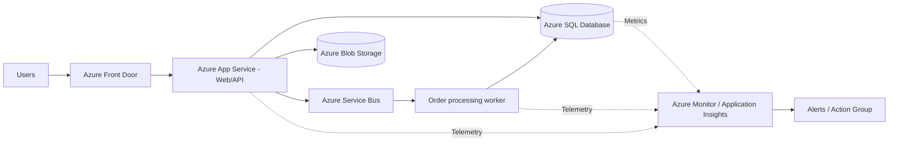
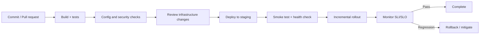

# Applying the Performance Efficiency and Operational Excellence Pillars of the Well-Architected Framework

## Lesson Objectives

In the **Microsoft Azure Well-Architected Framework (WAF)**, *Performance Efficiency* and *Operational Excellence* are two complementary pillars. A system can respond very quickly during testing and still fail in production if it lacks monitoring, safe deployment processes, and incident response capabilities. Conversely, strict operational processes cannot compensate for an architecture that hits resource bottlenecks as traffic grows.

After this lesson, you will be able to:

1. Distinguish the goals and responsibilities of the two pillars, and identify their impact on reliability, security, and cost.
2. Set measurable performance targets using SLIs/SLOs, define expected load, and identify bottlenecks with data.
3. Choose appropriate mitigations on Azure: application and data optimization, caching, asynchronous processing, resource scaling, and load testing.
4. Establish an operational foundation including telemetry, alerting, infrastructure as code, controlled deployments, runbooks, and post-incident improvements.
5. Evaluate an architectural change based on before-and-after evidence rather than looking only at CPU or server count.

This lesson uses familiar services in the Azure ecosystem such as App Service, Azure SQL Database, Azure Storage, Service Bus, Azure Monitor, and CI/CD tools. The examples are illustrative scenarios; final metrics and configurations must be validated by measurements on actual workloads.

## 1. What Questions Do the Two Pillars Answer?

WAF is an architectural decision-making guide structured around five pillars: **Reliability**, **Security**, **Cost Optimization**, **Operational Excellence**, and **Performance Efficiency**. These are not five isolated sets of goals: increasing replica count to improve speed can raise cost; changing cache policies can affect data consistency and security.

| Perspective | Performance Efficiency | Operational Excellence |
| --- | --- | --- |
| Primary question | Can the system meet processing time and throughput as demand changes? | Can the team observe, deploy, remediate, and improve the system safely and repeatably? |
| Desired outcome | Stable latency, sufficient processing capacity, appropriate resource utilization | Reliable changes, fast detection, procedural recovery, learning from incidents |
| Evidence | p95/p99 latency, requests/second, queue depth, query duration, saturation levels, load test results | Dashboards, alerts with assigned owners, deployment logs, post-release error rate, runbooks, recovery time |
| Example decision | Create an appropriate index for a slow query before increasing database size | Route the index change through a pipeline, test, deploy incrementally, and monitor post-deployment |
| Common failure | Scaling out instances when the actual bottleneck is in the database | Having dashboards with no one responsible for responding to alerts |

**Performance** does not mean every resource must run at minimum utilization. The goal is to meet user experience targets at defined load levels with a reasonable safety margin. **Operational excellence** is also not merely 24/7 on-call coverage; at its core, it is about reducing manual toil, standardizing how changes are made, and turning observability signals into action.

The remaining pillars place boundaries on decisions. For example, caching sensitive data requires access control and lifetime management; autoscale needs cost limits; good performance in one Azure region does not mean a disaster recovery plan is in place.

## 2. Running Scenario: An Order Platform on Azure

Suppose a development team operates an ordering application with product browsing, order creation, and status lookup features. The application experiences traffic spikes during promotional campaigns. Initial architecture:



**Responsibility boundaries:** the synchronous path for product browsing requests needs fast response times; operations such as sending confirmation emails or syncing with secondary systems can be moved to a queue. SQL Database handles transactional data; Blob Storage holds images/files; Azure Monitor aggregates signals for operations. The diagram simplifies the data path and does not fully depict private networking, identities, availability zones, or security configurations.

Initial assumptions for practice:

| Metric | Illustrative Target |
| --- | --- |
| Product browsing API | p95 response time ≤ 300 ms at target load |
| Order creation API | p95 ≤ 800 ms, no duplicate orders created on request retries |
| Server-side errors | HTTP 5xx rate under 0.5% within the agreed monitoring window |
| Load to serve | 250 requests/second during peak hours, with short-term burst capability |
| Background processing tasks | 99% of messages processed within 2 minutes |
| System changes | Ability to identify the running version, detect regressions, and roll back to a stable version |

These are **hypothetical targets**, not default specifications or service guarantees of Azure services. In real-world application, you must agree on the measurement scope: which APIs, where users are located, how much load, what data size, and how errors are counted. If a critical endpoint must call an external service, that service's wait time is also part of the end-to-end experience.

## 3. Turning Business Requirements into Measurable Metrics

### 3.1. Distinguishing SLI, SLO, and SLA

- **SLI (Service Level Indicator)** is a measurement, such as the p95 response time of the order creation API over a 5-minute window or the percentage of successful requests.
- **SLO (Service Level Objective)** is the target threshold for an SLI, such as at least 99.5% of order creation requests succeeding over 30 days, with a clear definition of success.
- **SLA (Service Level Agreement)** is a service level agreement that may carry consequences if not met. An application's internal SLO does not automatically become an Azure SLA or a contractual commitment.

Do not equate the *availability* of an Azure service with end-to-end transaction completion. A request can still fail even while App Service is running, due to a SQL query timeout or an external dependency returning an error.

### 3.2. Measuring from User Experience Down to Each Component

| Signal Group | Metrics to Observe | Questions to Answer |
| --- | --- | --- |
| Latency | Median, p95, p99 response times; SQL/HTTP dependency duration | Where and when are users experiencing slowdowns? |
| Traffic | Requests/second, concurrent users, transactions/second | Does actual load differ from the expected scenario? |
| Errors | HTTP 5xx, timeouts, business error rate, failed message count | Are any requests failing to complete even though the system still has resources? |
| Saturation | CPU, memory, connections, queue depth, resource limits, read/write throughput | Which component is approaching its capacity limit? |
| Data | Query duration, lock contention, query count, database resource utilization | Will scaling out API instances overload the database? |
| Worker | Unprocessed message count, message age, processing duration, dead-letter count | Are background tasks meeting committed completion times? |

**The p95 percentile** means roughly 95% of observed values do not exceed that threshold in the evaluated dataset; it differs from the average time. For example, 95 requests completing in 150–250 ms and 5 requests taking 3 seconds can still yield a relatively low average, while the tail group experience is very poor. When traffic changes sharply, break down metrics by endpoint, version, geographic region, and deployment timestamp; aggregated numbers easily mask localized errors.

A useful estimation when sizing capacity is **Little's Law** for a stable system:

\[
L = \lambda \times W
\]

Where `L` is the average number of requests in flight, `λ` is the average arrival rate, and `W` is the average time spent in the system. With 200 requests/second and an **average** end-to-end processing time of 0.25 seconds, the estimate is roughly 50 concurrent requests. The formula uses averages and assumes steady state; do not substitute p95 for `W`, nor use this result alone to determine instance count.

### 3.3. Establishing a Performance Budget

With a target p95 of 300 ms for the product browsing API, the team can set an initial **latency budget** as follows:

| Path Component | Illustrative Budget |
| --- | ---: |
| Network and ingress | 50 ms |
| In-application processing | 70 ms |
| Data query | 130 ms |
| Variance margin/other overhead | 50 ms |
| **Total** | **300 ms** |

This is a design budget, **not a sum of statistical percentiles**: the p95 of total time does not necessarily equal the sum of component p95s. You need to measure end-to-end latency directly and use distributed tracing to attribute causes.

## 4. Applying Performance Efficiency Through a Data-Driven Loop

A sustainable workflow follows **define load → measure baseline → find limits → make hypothesis-driven change → retest → observe in production**.

### Step 1 — Model Realistic Load

Separate activity groups: browsing product lists (read-heavy), creating orders (write and consistency-critical), loading images (static content), and background task processing. Describe their ratios, data growth over time, peak windows, user regions, and traffic ramp-up/ramp-down cycles. A test that only hits a single API with tiny payloads is unlikely to uncover lock contention or connection exhaustion.

In load testing, clearly define ramp-up, steady state, peak load, and ramp-down phases. Observe behavior both with a cold cache and a warm cache, and after scaling out instances. Use tools like k6 or Apache JMeter; the test environment must be sufficiently representative for results to be meaningful. Do not drive load against shared systems without controlling the impact on other users.

### Step 2 — Find the Bottleneck Before Scaling

For example, the dashboard shows the product browsing API has a p95 of 850 ms at 200 requests/second. App Service CPU is only 45%, but SQL dependency spans account for most of the duration. Query Store and the execution plan point to a query frequently scanning many rows in the product catalog:

```sql
-- Example table structure and hypothetical column names.
SELECT TOP (20)
    ProductId, Name, Price, UpdatedAt
FROM dbo.Products
WHERE CategoryId = @CategoryId
ORDER BY UpdatedAt DESC;
```

One option **that needs verification with the execution plan and real statistics** is creating an index aligned with the filter predicate and sort order:

```sql
CREATE INDEX IX_Products_CategoryId_UpdatedAt
ON dbo.Products (CategoryId, UpdatedAt DESC)
INCLUDE (ProductId, Name, Price);
```

Adding an index consumes storage and can slow down write operations; you must measure its impact with real data and load, check existing indexes, and plan deployment/rollback. If the root cause is connection exhaustion or transaction locking, the solution will be different. **Do not double the API instance count just because the API is slow** when the bottleneck resides in the database.

### Step 3 — Choose Mitigations by Load Pattern

| Mitigation | Appropriate When | Trade-offs to Check |
| --- | --- | --- |
| Optimize code, queries, and indexes | Redundant repeated queries, N+1 queries, poor execution plans | Implementation effort, correctness, and index write overhead |
| Cache read-heavy content | Product catalog/images change infrequently | TTL, cache invalidation, stale data, and authorization |
| Scale out App Service | API is mostly stateless and CPU/throughput is the limit | App Service Plan limits, instance startup time, backend database |
| Scale up | More CPU/RAM needed per instance, within service tier limits | Cost, size ceilings, and risk of single points of failure at dependency tiers |
| Offload work to Service Bus | Sending emails, generating reports, or work not needed inside synchronous requests | Eventual consistency, duplicate messages, ordering, dead-lettering |
| Optimize content delivery with Front Door | Images/static assets served to distributed users | Cache rules, invalidation, and policies against caching private data |

For caching, define the **cache key**, data owner, TTL, refresh strategy, and fallback behavior when the cache fails. Avoid using cache as the sole source of truth for transactions. With Service Bus, workers must handle messages **idempotently**: redelivering a message must not create another order or charge payment again. Monitor message age so you do not achieve a clean API p95 while background work piles up for hours.

For autoscale, choose metrics reflecting actual load: CPU may fit compute-bound apps; request count, queue depth, or custom signals may fit other workloads better. Set minimum/maximum bounds, evaluation periods, cooldowns, and cost caps. App Service runs on an App Service Plan, so understand shared resources among apps on the same plan and tier support requirements before enabling scaling rules.

### Step 4 — Prove Improvement with Repeatable Testing

Do not change multiple variables at once when your goal is causal attribution. Record configuration, application version, test data, endpoint ratios, user count, and run duration. An illustrative result after query tuning:

| Result | Before | After | Interpretation |
| --- | ---: | ---: | --- |
| Test load | 200 req/s | 250 req/s | Must state load clearly since two measurements under non-identical conditions are not directly comparable |
| Product browsing API p95 | 850 ms | 230 ms | Meets the illustrative 300 ms target at post-change load |
| HTTP 5xx rate | 1.2% | 0.2% | Must check both timeouts and business errors |
| App CPU | 45% | 58% | CPU rising as throughput rises is not necessarily bad |
| Message age p99 | 40 s | 45 s | No sign yet of workers falling far behind the 2-minute target |

The figures in the table are **solely for illustrating how to report results**, not Azure benchmark numbers. To confirm improvement, repeat under the same load, same dataset, and same configuration, measure p99 as well, and compare at peak load. After promoting a version, continue watching real telemetry to catch discrepancies between the test lab and production.

## 5. Applying Operational Excellence from Design to Incident Response

### 5.1. Building Observability from the Start

An observable system needs all three signal types: **metrics** to detect trends, **logs** to inspect specific events, and **distributed traces** to see how requests traverse components. On Azure, you can combine:

- **Azure Monitor** and a **Log Analytics workspace** to collect and query observability data as configured.
- **Application Insights** to track requests, dependencies, exceptions, and distributed traces for instrumented applications.
- **Azure Monitor Alerts** and **Action Groups** to route abnormal signals to the right channels and owners.
- **Azure Service Health** to stay informed of service/platform issues affecting Azure resources; this complements rather than replaces application monitoring.

Propagate `operation_Id`/trace ID or correlation ID end-to-end from the API through the worker and queue messages. Logs should include operation name, outcome, error code, application version, and duration, without containing passwords, tokens, or unnecessary personal data. Choose sampling and retention so root causes remain diagnosable at an acceptable cost. Sampling can affect count accuracy if queries do not account for the sampling mechanism.

Example KQL query in Log Analytics when using **workspace-based Application Insights tables named `AppRequests`**:

```kusto
AppRequests
| where TimeGenerated >= ago(1h)
| summarize
    Requests = count(),
    Errors = countif(Success == false),
    P95Ms = percentile(DurationMs, 95)
    by bin(TimeGenerated, 5m)
| extend ErrorRatePct = round(100.0 * Errors / Requests, 2)
| order by TimeGenerated asc
```

This query computes the duration percentile and the rate of requests with `Success == false` in 5-minute bins. **This rate does not automatically equal the HTTP 5xx rate**: the `Success` flag depends on how the app is instrumented. If you strictly need to count 5xx responses, filter explicitly on the status code matching your schema. For Application Insights using the `requests` view/table instead of `AppRequests`, field names and query syntax may differ; verify against the actual schema before adding to dashboards or alert rules.

A complementary query helps identify slow or failing dependencies:

```kusto
AppDependencies
| where TimeGenerated >= ago(1h)
| summarize
    Calls = count(),
    Failed = countif(Success == false),
    P95Ms = percentile(DurationMs, 95)
    by Target
| order by Failed desc, P95Ms desc
```

Results should be scoped by endpoint/operation or application version during investigation, avoiding blaming every slowdown on a high-volume dependency.

### 5.2. Designing Actionable Alerts

Not every fluctuation on a dashboard warrants waking up the on-call engineer. Tier alerts by impact:

| Severity | Illustrative Condition Example | Action |
| --- | --- | --- |
| Critical | Order creation failure rate continuously exceeds threshold with sufficient sample size | Page on-call, check recent changes and dependency health |
| Needs prompt attention | API p95 elevated across multiple evaluation windows; queue age steadily rising | Investigate processing capacity, load plan, and bottleneck indicators |
| Monitor/improve | CPU approaches threshold during peak hours without breaching SLO | Plan optimization and capacity testing before the next peak period |

Every alert should specify the service name, environment, impact level, dashboard link, runbook, responsible owner, and resolution criteria. Use an evaluation window long enough to avoid false positives, without setting thresholds so late that the SLO is severely breached before detection. For low-traffic metrics, enforce a minimum sample count or apply an appropriate measurement method.

### 5.3. Treating Deployment as a Repeatable Operational Process

For an ordering application, a small change such as adding an index or changing a timeout can affect the entire transaction flow. The pipeline should produce an **audit trail** from commit to the live serving version:



You can use **Bicep** or an appropriate Infrastructure as Code tool to manage resource configurations, and Azure DevOps Pipelines or GitHub Actions to execute controlled steps. Prefer authentication via managed identity or workload identity federation where supported, store secrets in an appropriate secret management mechanism, and restrict deployment account permissions. Separate environments by appropriate subscriptions/resource groups, manage permissions with Azure RBAC tied to Entra ID identities, and use tags/budgets to track operational spend. Control network connectivity between the application, database, and dependent services according to the workload's security requirements.

For App Service, deployment slots (if supported by the tier) let you validate a version before shifting traffic. A feature may also need feature flags or percentage-based rollout if the architecture supports it. Before releasing, define how to roll back **both application and data**: reverting code is usually simpler than reverting incompatible schema changes. Migrations should be designed to be backward-compatible through a transition phase when needed.

Release criteria are not just a green pipeline. After rollout, compare p95/p99, transaction errors, queue consumption rate, and saturation against the baseline. A release that increases throughput while corrupting order data must still be considered a failure.

### 5.4. Runbooks, Drills, and Learning from Incidents

Each critical service needs an owner, an on-call schedule or escalation path, a dependency map, dashboard links, and practiced remediation instructions. Example runbook for an alert where **order creation API p95 exceeds 800 ms for 15 minutes**:

1. **Confirm impact:** cross-check error rate, successful order count, request rate, and affected version/region scope. Verify telemetry is not missing data.
2. **Isolate scope:** check deployment/configuration change timestamps; analyze traces to separate App Service, SQL, and external service time; inspect CPU, connections, locks, and queues.
3. **Mitigate impact:** if tied to a new release, roll back to the stable version or disable the feature via a prepared feature flag; if load genuinely increased, use tested scaling mechanisms; if a dependency is failing, apply appropriate timeouts, bounded retries, and circuit breakers.
4. **Verify recovery:** confirm p95, error rate, order count, and queue depth return within thresholds; continue monitoring for an observation window to ensure no recurrence.
5. **Document and improve:** record the timeline, actual impact, tested hypotheses, root cause, and owners for preventive actions. Update runbooks, dashboards, tests, or pipeline guardrails.

When retrying, use **backoff and jitter** to prevent multiple clients from retrying simultaneously; bound total duration/attempt count, retry only appropriate transient errors, and ensure idempotency for writes. Unbounded retries can worsen an already overloaded dependency. Circuit breakers need clear open/close criteria and enough telemetry to show how many requests they are blocking.

Operational Excellence also includes an improvement cadence outside incidents: reviewing noisy alerts, repetitive manual tasks, configuration drift, dependency updates, and resource efficiency. A remediation procedure is only considered mature when another on-call engineer can execute it from the runbook without relying on one individual's tribal knowledge.

## 6. Bringing Both Pillars into One Decision Process

Suppose the team plans to scale App Service from 2 to 6 instances to address rising p95 latency. Ask questions in order:

1. **Which target is being violated?** Which endpoint's p95, at how many req/s, for how long, and what is the error rate?
2. **What is the evidence for the root cause?** High CPU, growing request queue, slow SQL, data locking, or connection limits?
3. **Which action directly addresses the root cause?** Query optimization, caching, scaling, offloading background work, or changing load distribution?
4. **Is the change safe and observable?** Are there a test environment, release criteria, an owner, dashboards, and rollback capability?
5. **Have the trade-offs been accepted?** Instance cost, stale cache data, SQL write impact, access permissions, and recovery objectives?

| Decision | Performance Check | Operations and Cross-Pillar Check |
| --- | --- | --- |
| Enable autoscale | Enough instances to hit p95 at peak load; rules react in time | Test rules, alert when hitting max, set cost caps; verify resilience during scale events |
| Add product cache | Hit rate, latency, before/after SQL load | Cache invalidation method, authorization, hit/miss telemetry, fallback when cache fails |
| Move order processing to queue | API response time drops, worker keeps up | Idempotency, dead-lettering, retries, order status tracking, end-to-end latency monitoring |
| Change SQL index | Query plan, logical reads, CPU/IO, query duration | Migration, index build time, write impact, rollback plan |
| Release new version | Are SLOs still met under expected load? | Smoke tests, canary monitoring, rollback, change log, regression explainability |

This is how the two pillars connect: **Performance Efficiency identifies and improves processing capacity; Operational Excellence ensures those improvements are safely deployed, measured, and sustained.**

## 7. Hands-On Exercise: From Bottleneck Discovery to Verified Operations

Set up a dedicated test environment for a simple Web API and sample database on Azure, or use a simulated workload with equivalent telemetry. You do not need to deploy the entire ordering architecture; the goal is to practice the decision loop.

**Part A — Define Targets and Baseline**

1. Choose one read endpoint and one write endpoint. Define target load, p95, error threshold, and measurement interval.
2. Instrument requests and dependencies with Application Insights; verify each request can be traced to its corresponding database calls.
3. Run load tests at low, medium, and target load. Record p50/p95/p99, errors, throughput, CPU, and query duration in a results table.

**Part B — Hypothesis-Driven Performance Improvement**

1. Select **only one** bottleneck backed by data; write a hypothesis in the form: "If we reduce SQL queries per request from N to M, p95 will decrease under the same load conditions."
2. Make one change in the test environment (for example, remove an N+1 query, add a verified index, or cache read-heavy data).
3. Re-run the exact same scenario and record side effects as well: CPU, write duration, cache hit ratio, or message age if applicable.

**Part C — Add Operational Capabilities**

1. Create a dashboard for p95, error rate, throughput, and the suspected bottleneck component; verify displayed data matches the underlying queries.
2. Configure a test alert with clear conditions and recipients; inject a controlled fault to verify the alert pipeline works.
3. Write a short runbook for the simulated fault, covering impact confirmation, analysis, mitigation, rollback, and post-recovery verification.
4. Record the change version, before/after results, and the decision to keep or roll back based on the stated targets.

**Completion criteria:** someone else can inspect the measurement table, understand why the optimization was chosen, reproduce the test, and handle the alert using the runbook. Screenshots showing only reduced CPU without end-to-end latency and transaction quality metrics are insufficient evidence.

## 8. Common Mistakes and How to Correct Them

| Mistake | Why It Is Dangerous | How to Correct It |
| --- | --- | --- |
| Looking only at average CPU | Misses p99, connection exhaustion, and slow queries | Combine latency, errors, throughput, saturation, and dependency tracing |
| Adding instances for every performance issue | Fails to fix bottlenecked databases/queues while raising costs | Verify the bottleneck before scaling |
| Treating a single test result as a permanent guarantee | Fails to reflect evolving data, config, and traffic | Retest repeatedly, keep baselines, re-evaluate after major changes |
| Caching everything | Can serve stale data, leak sensitive data, or be hard to invalidate | Define cacheable data, TTL, keys, and invalidation mechanisms |
| Alerting on every minor fluctuation | Noise causes on-call engineers to miss real incidents | Alert on impact, sustained conditions, and clear runbooks |
| Stopping once deployment finishes | Regressions often surface only under real traffic | Monitor post-release, define stop thresholds and rollback plans |
| Unbounded retries | Increases load on failing dependencies and causes duplicate writes | Bound retries, use backoff/jitter, and ensure idempotency |
| Undocumented cost/security trade-offs | Optimizes one metric while harming overall architecture | Evaluate across pillars and record architectural decisions |

## 9. Pre-Production Operational Readiness Checklist

Use this checklist as **required evidence to present**, not a box-ticking exercise for enabling services:

- [ ] Every critical business flow has SLIs/SLOs, a load definition, and an error-counting method.
- [ ] Baseline and test results exist for normal and expected peak load; p95/p99 and bottlenecks have been observed.
- [ ] A scaling plan, resource/cost caps, and awareness of the next component to bottleneck are in place.
- [ ] Logs, metrics, and traces correlate a transaction from API to dependencies/workers; sensitive data is controlled.
- [ ] Dashboards and alerts reflect user experience; alerts have owners and tested runbooks.
- [ ] Application, data, and infrastructure changes are tested and deployed through a repeatable process.
- [ ] Smoke tests, post-release monitoring, stop criteria, and recovery/rollback plans are reviewed.
- [ ] A review cadence exists for performance, cost, security, and post-incident action items with assigned owners.

## Connecting to the Remaining Pillars

As a workload grows, good design rarely maximizes a single metric in isolation. **Reliability** adds failover and fault tolerance; **Security** protects data, identities, and access paths; **Cost Optimization** helps right-size resources and avoid unnecessary spend. Performance Efficiency and Operational Excellence enable the team to *measure* those trade-offs and *execute* decisions in a real operational environment.

A well-managed Azure architecture must simultaneously answer three practical questions: **what quality of service are users receiving, where is the bottleneck, and how can the team safely change or recover the system?**
