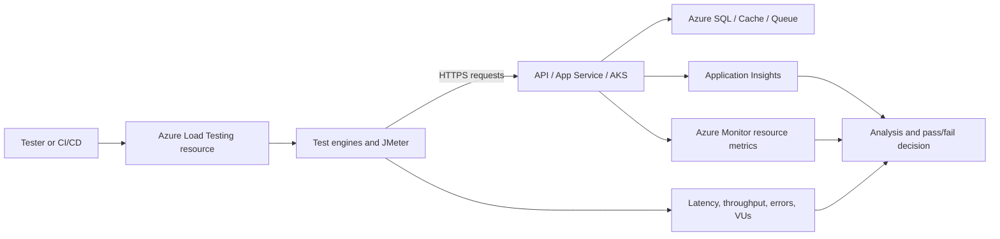
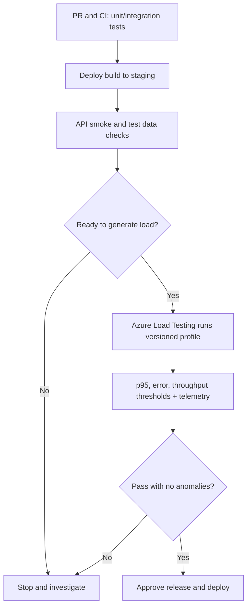

# Load Testing Applications with Azure Load Testing

> **Chapter:** Performance and Operations  
> **Module:** `CLOUD_PROVIDERS_AZURE` — exploring Microsoft Azure from subscriptions, resource groups, Microsoft Entra ID, virtual networks, compute, storage, and data services to deployment, monitoring, protection, and application cost control.

## Learning Objectives

After this lesson, you will be able to:

1. Explain why **load testing** is needed before and after deploying applications on Azure, and distinguish load, stress, spike, and soak tests.
2. Derive test objectives from **SLOs**, user counts, traffic rates, error rates, and **p95/p99** latency.
3. Create an **Azure Load Testing** resource, run URL-based or **Apache JMeter** script tests, and choose an appropriate number of test engines.
4. Read load-generator charts alongside system metrics from **Azure Monitor/Application Insights** to pinpoint bottlenecks.
5. Define pass/fail criteria, integrate load testing into CI/CD, and compare runs under consistent conditions.
6. Design safe tests: authorized environments, synthetic test data, cost/load limits, stop triggers, and evidence retention.

## 1. Real-World Problem: The App Works Correctly, But Can It Handle Load?

The development team deploys an ordering API to Azure App Service. During manual testing, `GET /api/products` responds in 150 ms. However, during peak hours, many users simultaneously search products, add items to carts, and check out. As request volume grows, latency can jump sharply due to CPU, database connections, downstream service limits, or queuing.

**One fast request does not prove an application scales under load.** Before deciding to release, you must measure behavior under a **predefined workload** and observe both the request-generating side and the receiving infrastructure.

**Azure Load Testing** is a managed service for generating load and measuring application performance. You can start with a URL-based test for simple scenarios, or use an **Apache JMeter test plan** when you need multi-step flows, parameterized input data, and complex user behavior. The service runs load across test engines, tracks results, and connects Azure resource metrics for root-cause analysis.

### Functional Testing and Load Testing Answer Different Questions

| Test Type | Primary Question | Example |
|---|---|---|
| Unit/integration | Does a function or component return the right result? | Order total is calculated accurately |
| End-to-end | Does a business flow work? | Sign in → pick item → create cart |
| **Load** | Does the app maintain speed, latency, and error rate at **expected load**? | 200 requests/second matching realistic traffic patterns |
| **Stress** | Where is the breaking point and how does it fail beyond capacity? | Gradually increase load until SLOs break |
| **Spike** | How does the app react to sudden surges or drops in load? | Traffic multiplies severalfold within minutes |
| **Soak/endurance** | Do faults emerge over extended runs? | Memory leaks or connection pool exhaustion after hours |

Load Testing measures **behavior observed during a specific test run**. It does not automatically guarantee all future peak periods behave identically, because data, network conditions, caches, instance counts, and dependencies can all change.

## 2. Testing Architecture on Azure

An Azure Load Testing run typically consists of:

- **Load Testing resource:** the Azure resource for organizing tests, storing configurations/run history, and managing permissions.
- **Test definition:** URL configuration or JMeter `.jmx` file, parameters, supporting data files, engine count, and run settings.
- **Load engines:** processes generating virtual users/requests toward the target endpoint. Engine count and virtual user count are not equivalent.
- **System under test (SUT):** the application being tested, such as App Service, AKS, VMs, or API Gateway along with backing databases/caches.
- **Telemetry and test results:** client-side call statistics plus server-side metrics from Azure Monitor/Application Insights when integrated.



There are two observation perspectives:

1. **Client-side:** virtual users, full round-trip response time from the engines, requests/second, error rate, timeouts, and latency percentiles.
2. **Server-side:** CPU, memory, request queues, autoscale events, HTTP 5xx, query duration, dependency calls, connection limits, and metrics relevant to the Azure resources in use.

If client-side p95 climbs while CPU stays low, slowdowns can still stem from the database, network, locks, rate limiting, or downstream dependencies. **Never conclude a root cause from a single chart.**

## 3. Defining Workload and Criteria Before Running

### 3.1. Starting from Business Requirements

Suppose the `orders-api` app has these flows:

| Business Flow | Expected Request Share | Priority | Expected Result |
|---|---:|---|---|
| `GET /api/products` | 60% | High | Accurate product list |
| `GET /api/products/{id}` | 25% | High | Product details |
| `POST /api/cart` | 10% | High | Test item added to cart successfully |
| `GET /api/orders` | 5% | Medium | Returns list scoped to proper permissions |

These ratios must come from telemetry, product analytics, or documented estimates; the numbers above are **illustrative only**. Never use a lightweight `/health` endpoint to represent full transactions involving databases and authentication.

### 3.2. SLIs, SLOs, and Pass/Fail Thresholds

- **SLI (Service Level Indicator):** an observable measurement, such as p95 latency, failed request ratio, or throughput.
- **SLO (Service Level Objective):** a specific target for an SLI under defined conditions and time windows.
- **Load profile:** load volume, ramp-up time, steady-state duration, environment, dataset, and system configuration.
- **Pass/fail criteria:** conditions determining whether a pipeline accepts or rejects a release.

Example objectives for a test **on staging at known load**, not a universal standard for all applications:

| Metric | Example Target | Meaning |
|---|---|---|
| `GET /api/products` p95 latency | At most 800 ms | Roughly 95% or more of valid samples have latency within this threshold |
| p99 latency | At most 1,500 ms | Catches slow tail behavior even when averages look good |
| Application error rate | Under 1% | Evaluates failed requests, including relevant status codes and timeouts |
| Achieved throughput | At least 150 requests/second | Confirms actual processing capacity, not just target demand |
| Steady-state duration | 20 minutes after ramp-up | Avoids deciding solely on the warm-up phase |

**Define how error rate is calculated.** A 404 caused by intentionally nonexistent test data differs from a 500 server error; an HTTP 200 with wrong business payload is still a functional failure. JMeter assertions help catch errors invisible to status codes alone.

### 3.3. Virtual Users Do Not Equal Requests/Second

A virtual user (VU) typically simulates a sequential workflow with wait times. In a simple closed-loop script, throughput is approximately:

\[
\text{Requests/second} \approx
\frac{\text{Number of virtual users}}{\text{Average response time}+\text{Think time}}
\]

With 100 VUs, if each iteration executes one request averaging 0.4 seconds and pauses 1.6 seconds, ideal throughput is around 50 requests/second. This is an **estimate**, not a guarantee: requests per transaction, ramp-up, generator limits, errors, network, and server behavior all alter the actual number.

Always inspect **actual measured throughput** and concurrency on dashboards rather than assuming "setting 500 VUs means 500 requests/second."

## 4. Designing a Repeatable Load Profile

For a meaningful measurement, specify the entire profile:

| Phase | Example Duration | Target Load | Purpose |
|---|---:|---|---|
| Baseline | 5 minutes | 10 VUs | Verify scripts, connectivity, data, and SUT |
| Ramp-up | 10 minutes | Gradually increase to 100 VUs | Observe autoscale, pooling, and transition behavior |
| Steady-state | 20 minutes | 100 VUs | Measure stable p95/p99, error rate, and resource usage |
| Ramp-down | 5 minutes | Decrease to 0 | Observe recovery without abruptly hanging load |
| Post-test | 5–10 minutes | Zero load | Check queues, memory, database, cost, and logs |

These values are for learning only; VU counts and durations must fit capacity, budget, test conditions, and system authorization. For multi-flow workloads, distribute requests by ratio with per-flow datasets and think times.

### Test Types to Distinguish

- **Smoke-load:** a few users for a short window to verify the `.jmx` file and connectivity before large runs.
- **Load test:** typical/predicted peak load to validate SLOs.
- **Stress test:** stepping past expected capacity to find saturation points and how the system sheds load.
- **Spike test:** authorized sudden surge/drop scenarios to inspect autoscaling, throttling, and queuing.
- **Soak test:** sustained load over hours to uncover leaks, connection pool exhaustion, cache growth, and time-dependent degradation.

Never run stress or spike tests outside authorized scope. High-volume requests against real APIs can disrupt service or incur charges across downstream dependencies.

## 5. Preparing the Azure Load Testing Environment

### 5.1. Prerequisites

Assume the team has:

- A subscription and resource group `rg-perf-lab` in an appropriate region.
- A test Azure App Service or API `orders-api-staging` at a controlled endpoint `https://orders-perf.example.test` (**hypothetical address**; replace with an authorized staging DNS name).
- User, product, and cart data **dedicated to testing**, containing no personal data.
- Appropriate permissions to create/configure Azure Load Testing resources and for test agents to reach the target.
- Azure Monitor/Application Insights collecting application telemetry, with synchronized clocks and understood sampling settings.

If the application resides in a private network accessible only via private endpoints or restricted IPs, configure **load engine** networking accordingly—such as VNet/private endpoint integration as supported by the service. Never expose private environments publicly just to run a test.

### 5.2. Creating the Resource in the Azure Portal

1. In the Azure Portal, search for **Azure Load Testing** and create a new resource.
2. Choose the subscription, resource group, a traceable name (for example `alt-orders-lab`), and a supported region.
3. Verify permissions for test authors, read-only viewers, and CI/CD identities. Apply least-privilege roles rather than subscription-wide Owner.
4. Once created, go to test creation. Choose **URL-based test** for simple tests or **JMeter-based** for multi-step scenarios.
5. Select or link Azure resources to monitor so server-side metrics appear during the run, if supported.
6. Confirm engine count, network settings, duration, test data, and estimated cost before starting.

The Azure Load Testing resource acts as the **test orchestrator**; load engines may run on separate infrastructure from App Service. Client-measured latency also reflects network path, DNS, TLS, and engine configuration.

### 5.3. Checking Access and Security

Before generating load, verify: the endpoint targets an authorized environment; domain and TLS certificates are valid; firewalls, WAF, IP restrictions, and authentication are configured; secrets live in a supported secret manager rather than `.jmx` files or repositories; and test accounts do not trigger real payment, email, or SMS services.

With Azure Key Vault or managed identities, configure access permissions for the test service's appropriate identity and verify secret retrieval as supported. **Never print tokens or passwords into JMeter result logs.**

## 6. Quick Start: Running a URL-Based Load Test

URL-based tests validate a single endpoint or simple request set without authoring a `.jmx` file upfront.

Portal workflow:

1. Select **Create test** and **URL-based test** if available in your environment.
2. Name the test, e.g., `orders-products-baseline`, add the staging HTTPS endpoint and `GET` method, and configure any required headers for authorized requests.
3. Configure VUs/request profile, ramp-up, duration, and engine count within service limits.
4. Set latency/error-rate pass/fail thresholds using the available options and save the test.
5. Run a small test first to verify host, DNS, TLS, permissions, and expected responses; scale up load only after smoke-load passes.
6. Review test charts, comparing p95/p99, throughput, errors, and Azure resource metrics.

**Limitations:** if you need stateful login, multi-step business flows, correlation, per-user dynamic data, or complex assertions, use JMeter. URL-based tests may not adequately simulate end-user flows.

## 7. Multi-Step Apache JMeter Tests

Azure Load Testing can execute tests authored with Apache JMeter. A `.jmx` file defines the test plan, thread groups, samplers, controllers, assertions, timers, and configuration elements. You can build and debug the file locally in JMeter before uploading.

### 7.1. Designing a Read Scenario

Suppose the API permits the following test requests:

```http
GET /api/products?category=books HTTP/1.1
Host: orders-perf.example.test
Accept: application/json
X-Test-Run: orders-load-lab
```

`orders-perf.example.test` is an illustrative hostname, not a live endpoint. Use a staging hostname you are authorized to test.

In the JMeter UI, configure the elements:

| JMeter Element | Sample Setting | Rationale |
|---|---|---|
| **Test Plan** | `Orders staging load` | Wraps the full scenario |
| **HTTP Request Defaults** | Protocol `https`, staging domain, appropriate port | Reduces host/port typos across samplers |
| **Thread Group** | Start with 10 users, 60 s ramp-up, short duration | Safe validation before scaling up |
| **HTTP Header Manager** | `Accept: application/json`, test-marker header | Identifies test traffic in logs |
| **HTTP Cookie Manager** | Enable only if the API uses sessions/cookies | Accurately simulates sessions |
| **HTTP Request** | `GET /api/products?category=books` | Calls the target endpoint |
| **Response Assertion** | Expect HTTP 200 and accurate payload content | Prevents counting HTTP 200 error pages as success |
| **Constant/Uniform Random Timer** | Realistic delay matching user behavior | Avoids unrealistically tight request loops |
| **CSV Data Set Config** | Reads test categories/product IDs | Prevents caching everything on a single URL |
| **Aggregate Report / View Results Tree** | Use only locally during development/debugging | Avoid heavy listeners under high load |

Example CSV dataset kept separate from test code, using **synthetic data**:

```csv
category,expected_marker
books,BOOKS
electronics,ELECTRONICS
home,HOME
```

In the HTTP Request, reference `${category}` from **CSV Data Set Config** (in the path or query parameters). Assertions should verify real API structure and values—such as an appropriate JSONPath—rather than matching a generic string that might appear on an error page.

### 7.2. Stateful Business Flows with POST

For login → browse products → add to cart flows, address these details:

1. **Correlation:** extract access tokens/session IDs from prior responses using an appropriate extractor and pass them to subsequent requests.
2. **Per-user isolation:** give each VU its own cart/test account to avoid overwriting or contending on a single database key.
3. **Think time and pacing:** mirror user reading/clicking pauses and intended transaction rates.
4. **Assertions:** validate HTTP status codes, JSON structure, expected records, and business errors.
5. **Cleanup:** delete generated test data or use TTLs; disable outbound emails/SMS/payments/webhooks outside the lab.
6. **Secret handling:** obtain tokens via an appropriate secret mechanism rather than hardcoding them in `.jmx` or committed CSV files.

A common design mistake: having 100 virtual users add items to **the exact same cart**. That primarily measures lock contention on one record rather than normal user behavior. Sometimes that is a deliberate stress-test goal, but the hypothesis must be stated explicitly.

### 7.3. Creating a Git-Versioned Test Configuration

Pipelines typically manage `.jmx` files, supporting data, and load configuration together. Example layout:

```text
tests/performance/
  orders-read.jmx
  categories.csv
  load-test-config.yaml
```

An **illustrative template** for an Azure Load Testing config YAML file when using the supported YAML config mechanism:

```yaml
version: v0.1
testId: orders-read-staging
testName: Orders read performance
description: Load test for the products API on staging
testPlan: orders-read.jmx
engineInstances: 1
failureCriteria:
  - p95(response_time_ms) > 800
  - percentage(error) > 1
```

Here the thresholds are **example criteria**: fail if p95 exceeds 800 ms or error rate exceeds 1%. Verify field syntax, metric functions, and schema version against your installed Azure Load Testing capability/extension before putting it in a pipeline. A standalone YAML file will not run valid load tests unless the `.jmx`, network config, dataset, and identities are also valid.

**Note:** 1 engine is a starting point for debugging; increase engine count only when more load-generation capacity is needed and after confirming the engine itself is not bottlenecked. Actual virtual users come from the workload configuration and how the service executes the test plan.

## 8. Running Tests, Observing, and Analyzing

### 8.1. Standard Test Run Workflow

1. Record commit, build, environment, instance count, SKU, seed data, and feature flags as baseline context.
2. Small test: verify TLS, authentication, assertions, response payloads, and request distribution.
3. Ramp load according to the defined profile, watching **concurrency** and achieved throughput.
4. During steady state, record p50/p95/p99, errors, timeouts, requests/second, per-sampler times, and server metrics.
5. Check the system after ramp-down: verify queues drain, CPU/memory subside, and no orphaned jobs/tests remain running.
6. Save run ID, version, UTC timestamp, test configuration, and links to dashboards/telemetry.

Never compare two runs where one used a single App Service instance and the other used three, or where datasets/caches/regions differed, without documenting the difference.

### 8.2. Client Metrics and Interpretation Traps

| Metric | How to Read It | What Else to Check |
|---|---|---|
| **Average response time** | Mean latency | Easily hides slow tail behavior |
| **p95/p99** | Latency percentiles | Require sufficient samples and per-endpoint breakdown |
| **Requests/s** | Actual achieved throughput | Can drop when the server saturates even as VUs rise |
| **Error rate** | Failed sample ratio per config/assertions | Separate 401/429/5xx, timeouts, and business errors |
| **Active virtual users** | Active load-generating threads over time | Not equal to requests/s |
| **Engine health** | Generator's ability to drive target load | Engine CPU/network/limits can create false ceilings |
| **Response size** | Payload byte size | Cached/empty responses can make results look artificially "fast" |

**p95 is not the average.** If p95 = 800 ms, roughly 95% of measured samples had latency at or below 800 ms; the remaining tail can be far slower. Taking a single average across an entire test also obscures poor latency during steady state or on critical endpoints.

### 8.3. Reviewing Azure Monitor and Application Insights Together

Depending on architecture, correlate:

- **App Service/AKS/VM:** CPU, memory, instance/replica counts, queues, thread pools, connections, and autoscaling events.
- **Azure SQL:** CPU/DTU/vCore, slow queries, blocking, connection pools, and resource limits.
- **Azure Cache for Redis:** throughput, latency, memory pressure, evictions, and connection counts where supported.
- **Application Insights:** server request duration, request success, dependency latency, exceptions, and distributed traces.
- **Azure Monitor Logs:** cross-reference test timestamps, deployments, scale events, and infrastructure errors.

If telemetry is stored in **Log Analytics** with the `AppRequests` table, this illustrative KQL query shows per-minute performance:

```kusto
AppRequests
| where TimeGenerated > ago(30m)
| where AppRoleName == "orders-api"
| summarize
    total = count(),
    failures = countif(Success == false),
    p95_ms = percentile(DurationMs, 95),
    p99_ms = percentile(DurationMs, 99)
    by bin(TimeGenerated, 1m)
| extend error_pct = round(100.0 * todouble(failures) / iff(total == 0, 1, total), 2)
| order by TimeGenerated asc
```

Table and column names may vary across classic, workspace-based, or custom-organized Application Insights schemas. Replace `orders-api` with the actual role name and scope the time range to the exact **test run**; verify sampling settings before using `total` to infer exact request counts.

**Do not expect client and server metrics to match identically.** Client-side includes network transit and load-engine processing; server-side measures in-app processing and is subject to sampling and instrumentation logic.

## 9. Identifying Bottlenecks Instead of Reading Only Pass/Fail

Suppose under 100 VUs, you observe:

| Checkpoint | Throughput | p95 | Error Rate | Server Signals |
|---|---:|---:|---:|---|
| Baseline 10 VUs | 20 req/s | 210 ms | 0% | Low CPU |
| Steady 50 VUs | 95 req/s | 450 ms | 0.2% | CPU and DB rising |
| Steady 100 VUs | 130 req/s | 1,400 ms | 4% | SQL throttling, slow DB calls |
| Post ramp-down | 15 req/s | 250 ms | 0% | Queues draining |

**Hypothesis:** the system shows saturation in the database or data-access path. From 50 to 100 VUs, throughput fails to scale proportionally while p95 and errors surge. Still, verify using SQL metrics, dependency traces, networking, and load-engine health before concluding.

### Investigation Workflow

1. **Pinpoint symptoms:** which requests slowed down, starting when, at what load; do errors correlate?
2. **Segment requests:** inspect `GET`, `POST`, and critical endpoints/transactions separately; app-wide aggregates hide differences.
3. **Read infrastructure at the same timestamps:** CPU, memory, autoscale, SQL throttling, connection limits, queue depth.
4. **Inspect distributed traces:** split duration across app code, database, cache, and HTTP dependencies.
5. **Form a testable hypothesis:** e.g., "the product table query lacks an index under concurrent reads."
6. **Fix one cause at a time and re-run the identical profile:** keep data, configuration, and engines consistent for comparison.
7. **Check side effects:** adding App Service instances may shift the bottleneck to the database; caching may speed up `GET` while introducing invalidation issues.

When the server returns many **HTTP 429** responses, check intentional service limits, API Management/WAF rules, and client retry behavior. Never disable rate limiting merely to make charts look "clean": if 429 is intentional protective behavior, distinguish expected throttling from business SLOs and adjust the workload properly.

## 10. Integrating Azure Load Testing into CI/CD

Full load tests rarely need to run on every commit. A practical pattern runs a lightweight smoke test frequently, reserving full load tests for pre-production releases, schedules, or significant performance changes.

### Illustrative Deployment Pipeline



Keep JMeter files, synthetic CSVs, and config files in the repository. Use an authorized **service connection**, scoped Azure RBAC on the Load Testing resource, and required telemetry/secret read permissions. Archive each run's results as release evidence linked to the build.

### Azure Pipelines Reference Example

If your organization uses Azure DevOps with the Azure Load Testing integration task installed, a stage can invoke the task to run the committed test configuration. Example:

```yaml
stages:
  - stage: PerformanceGate
    displayName: Validate staging performance
    dependsOn: DeployStaging
    condition: succeeded()
    jobs:
      - job: LoadTest
        displayName: Azure Load Testing
        pool:
          vmImage: ubuntu-latest
        steps:
          - checkout: self
          - task: AzureLoadTest@1
            inputs:
              azureSubscription: 'sc-loadtest-staging'
              loadTestConfigFile: 'tests/performance/load-test-config.yaml'
              resourceGroup: 'rg-perf-lab'
              loadTestResource: 'alt-orders-lab'
```

This is an **integration template**: verify task name/version, input syntax, and config schema installed in your Azure DevOps organization, as well as how the task reports failure when criteria are breached. `DeployStaging` is an assumed prior stage in a broader pipeline; this snippet will not run standalone without that stage, the test plan, and the service connection.

**Do not use p95 numbers without workload context to block every release.** Gates must pre-declare environment, profile, warm-up, thresholds, handling of missing telemetry, and engine bottlenecks. Consider separating hard gates for severe failures from warnings for minor regressions needing investigation.

## 11. Safety, Governance, and Cost

### 11.1. Testing Authorization and Blast-Radius Limits

Before running tests, the owner must confirm the target is within **authorized testing scope**, especially for production or third-party systems. Set schedules, maximum load, and stop criteria; notify SRE/DBA and security contacts when shared services could be affected.

Key guardrails:

- **Staging is the right default for heavy load tests**; never send stress/spike load to production without explicit plans and authorization.
- **Never use real accounts or customer data.** Seed synthetic products/orders/accounts, and isolate webhooks and notification channels.
- **Bound duration, VU/engine counts, and budget.** Abort or stop tests on critical errors, unexpected spend spikes, or out-of-scope impact.
- **Configure secrets and networking:** TLS, identities, Key Vault, private endpoints/VNets where needed, and proper source allowlists.
- **Clean up post-test:** generated data, test VMs/services, replayed webhooks/queues, caches, and lingering connections.
- **Never send load to arbitrary hostnames or external addresses** just because they return HTTP 200; verify ownership and authorization.

### 11.2. Cost Comes from Both Sides

Azure Load Testing incurs charges tied to load-generation capacity and service usage/duration under current pricing. **The tested application also incurs costs**: App Service/AKS autoscale, Azure SQL, Redis, egress, telemetry ingestion, and downstream calls. Measure total test cost across both engines and SUT, not just the Azure Load Testing bill.

Run a short test first to validate scripts, then scale up within approved limits. Tag owners and expiration dates on test data. Do not automatically run multi-hour soak tests in CI on every commit.

## 12. Troubleshooting Common Issues

| Symptom | Likely Cause | How to Check |
|---|---|---|
| Nearly all requests fail immediately | DNS/TLS, wrong host/port, proxy, firewall, authentication | Test manually from an equivalent environment; inspect connection, host, and cert errors |
| Mass 401/403 responses | Expired token, wrong identity/permissions, WAF/IP restrictions | Check token expiry, RBAC, headers, access restrictions, and logs |
| Test hits target VUs yet throughput is tiny | Large think time, slow requests, bottlenecked engine or network | Compare VUs, request rate, engine CPU/health, and server duration |
| p95 climbs while web CPU stays low | DB/queue/lock/dependency or network | Inspect Application Insights dependencies, SQL metrics, and traces |
| High 429 rate | Throttling/rate limits from API, gateway, or dependencies | Identify rate policies, retry patterns, and permitted throughput |
| p95 looks stable yet users report slowness | Non-representative scenario, omitted client rendering/flows, artificial caching | Audit workload and combine RUM/synthetic/end-to-end checks |
| Results vary widely across runs | Different engine regions, cache state, autoscale, data, VM/DB SKU, or background traffic | Standardize setup, log metadata, and repeat controlled runs |
| Pipeline task passes despite app errors | Missing/wrong failure criteria, weak assertions, ignored failed samples | Inspect config, test result/error logs, and task exit behavior |
| No server-side metrics | Unlinked resources, missing permissions, sampling, or wrong time range | Check Azure Monitor/Application Insights, role access, and clock alignment |
| Cost spikes after testing | Autoscale did not scale back, leftover test data, or telemetry surge | Check autoscale, ingestion/retention, cleanup, and budget alerts |

### When Should You Re-Run?

Re-run after fixing script/authorization bugs or changing a measurable performance hypothesis. If configuration, data, engines, and load remain identical yet results diverge sharply, investigate the measurement infrastructure before trusting numbers. A single run is usually insufficient to confirm a small regression.

## 13. Guided Hands-On Exercise

**Scenario:** A team runs `orders-api-staging` on Azure App Service. `GET /api/products` reads from Azure SQL. Management requires keeping **p95 under 800 ms** and **errors under 1%** across **20 minutes of steady load**, and the team wants to observe bottlenecks when ramping from 10 to 100 VUs.

### Implementation Steps

1. Confirm the staging endpoint and testing authorization. Seed a sufficiently varied synthetic dataset, disable real payments/email/SMS, and enable Application Insights.
2. Create an Azure Load Testing resource. Choose the right resource group/region, configure permissions, networking, and expected cost limits.
3. Start with a URL-based test to verify connectivity; then author a JMeter file `orders-read.jmx` with HTTP Request Defaults, Thread Group, timers, and assertions.
4. Configure three stages: 10-VU smoke; ramp up to 100 VUs; hold 100 VUs for 20 minutes. Provision enough engines to drive load without the generator becoming the bottleneck.
5. Set failure criteria for p95 and error rate. Explicitly note whether criteria apply to the full run or steady state, and how valid samples are counted.
6. Execute the test during the approved window. Monitor p95/p99, request rate, error count, App Service CPU/instances, and Azure SQL metrics.
7. Identify where latency starts rising. Use dependency traces to form a hypothesis; tune queries/indexes, connection pools, or caching, then re-run the **exact same profile**.
8. Compare the two runs, recording version/commit/SKU, dashboards, and differences. Clean up test data and confirm post-test system stability.

### Results Worksheet

| Item | Run A | Run B After Optimization |
|---|---|---|
| Build/commit and App Service SKU | … | … |
| JMeter file and VU profile | … | … |
| Throughput at steady state | … | … |
| `GET /api/products` p95/p99 | … | … |
| Error rate and error types | … | … |
| CPU, SQL, and dependency bottlenecks | … | … |
| Pass/fail criteria outcome | … | … |
| Conclusion and next actions | … | … |

**Completion criteria:** You can verify the test targeted an authorized endpoint, data and measured load matched the scenario, results include p95/errors/throughput alongside server telemetry, pass/fail is evaluated against pre-declared thresholds, and differences between runs are explained. If you lack Azure access, present the test design and clearly labeled illustrative mock numbers rather than testing unauthorized systems.

### Self-Check Questions

1. Why do 100 virtual users not equal 100 requests/second?
2. How do p95 and p99 differ from average response time when evaluating user experience?
3. Why are business assertions needed even when an API returns HTTP 200?
4. When p95 rises while App Service CPU stays low, which metrics should you inspect next?
5. What happens when load engines lack capacity to drive the target load?
6. Which conditions must remain fixed to compare two builds fairly?
7. Name three measures that prevent a load test from causing out-of-scope impact and unplanned cost.
8. Why is it important to catch throughput shortfalls, not just error-rate and p95 breaches?

## 14. Key Takeaways

Azure Load Testing simulates traffic to measure an **application's real capacity under a defined load condition**. Test design starts from business requirements and repeatable workloads; dashboards reveal latency, throughput, and errors; Azure Monitor/Application Insights help locate root causes in infrastructure and dependencies.

Trustworthy results require **representative scripts, safe synthetic data, verified load levels, clear thresholds, server-side telemetry, reproducible runs, and comparative evidence**. Integrated into CI/CD, load testing becomes a performance quality gate that catches regressions early before customers experience outages.
