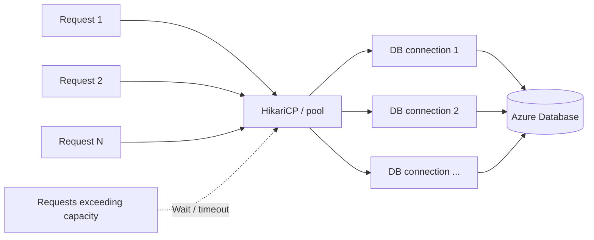

# Optimizing Connection Pools and Service Connection Reuse

> **Scope:** Microsoft Azure — **Performance and Operations** chapter. This lesson focuses on managing connection lifecycles from Java applications running on Azure App Service, Azure Functions, or Azure Kubernetes Service (AKS) to Azure SQL Database, Azure Database for PostgreSQL, Azure Blob Storage, Azure Service Bus, and HTTP services. The same principles apply to other languages and platforms.

## Learning Objectives

After this lesson, you will be able to:

1. Explain why continuously creating new connections increases latency, system load, and the risk of network port exhaustion.
2. Distinguish a database **connection pool** from **HTTP keep-alive**, **HTTP/2 multiplexing**, and **Azure SDK client** reuse.
3. Estimate pool limits based on application concurrency, autoscaled instance counts, and target service connection budgets.
4. Configure HikariCP for Java/Spring Boot, return connections to the pool properly, and reuse Azure clients across the application lifecycle.
5. Observe, test, and remediate pool exhaustion, stale connections after failover, timeouts, connection leaks, and SNAT port exhaustion.

## 1. Why Connection Lifecycle Affects Performance

Suppose an order-processing API runs on Azure App Service. Each request queries Azure Database for PostgreSQL, fetches a file from Azure Blob Storage, and emits an event via Azure Service Bus. If every request opens and tears down physical connections, the application repeatedly pays TCP, TLS, authentication, and session-setup overhead. Those steps cost far more time and resources than borrowing an idle connection from a pool.

Keep two concepts separate:

- **Physical connection:** the TCP/TLS session (and for databases, the DB session) maintained between the application process and the target service.
- **Logical connection:** temporary usage leased to a request or task. Calling `Connection.close()` on a HikariCP-managed connection typically **returns the connection to the pool**, rather than closing the underlying TCP session immediately.

A pool maintains a finite number of physical connections. A request borrows a connection when needed, uses it briefly, and returns it. When all connections are busy, requests wait until one is returned or the wait timeout expires.



Optimizing connections does not mean cranking `maximumPoolSize` to the max. Too small a pool causes queuing; too large a pool consumes DB resources, opens too many sessions, increases contention, and can make the system slower.

## 2. Choosing the Right Reuse Mechanism by Service Type

| Connection Type | Primary Mechanism | Object to Reuse | Key Boundary |
| --- | --- | --- | --- |
| JDBC to Azure SQL / PostgreSQL | Pool of DB sessions (e.g., HikariCP) | Shared `DataSource` / pool | Each operation borrows and returns a `Connection`; never share one `Connection` concurrently across threads |
| HTTP/HTTPS to APIs or Azure Blob Storage | TCP keep-alive, internal HTTP transport pool; HTTP/2 can multiplex requests on one connection | `HttpClient` and Azure SDK clients | Create new request objects per call, but never instantiate a new HTTP client per request |
| Azure Service Bus | AMQP connection and sender/receiver links | `ServiceBusSenderClient`, processor, or appropriate client | Initialize per application lifecycle; close on shutdown |
| Redis or cache | Client-library connection manager/pool | Shared client/factory, often supporting multiplexing | Do not assume every cache command needs its own connection |

**Distinguishing pools from multiplexing:** A JDBC pool holds multiple sessions capable of running concurrent transactions. HTTP/2 can carry multiple streams over a single TCP connection. Therefore, you cannot apply the same sizing formula or parameters across all clients.

In Spring Boot, the right scope is usually a **singleton bean**. In Azure Functions, declare clients at application/host scope so they are reused across invocations on the same instance; each scaled-out instance still maintains its own connections. In AKS, each Pod has its own pool.

## 3. Calculating the Connection Budget Before Tuning Pools

### 3.1. Concurrent Connections Actually Needed

Little's Law for a steady workflow lets you estimate:

```text
L ≈ λ × W

L = average number of operations holding a connection
λ = operations needing a connection per second
W = average seconds each operation holds a connection
```

For example, **one Pod** handling 60 DB operations/second, each holding a connection for 80 ms on average:

```text
L ≈ 60 × 0.080 = 4.8 busy connections on average
```

This is a **starting point**, not a configuration guaranteed for every load. Bursts, slow p95/p99 transactions, locks, multiple queries per request, and load imbalance across Pods can raise required connections substantially. Test with an 8–12 connection pool per Pod, measure pool wait time and end-to-end latency, then pick the final value.

Measure **actual connection hold time**, not the entire HTTP request duration. If code borrows a connection and then makes a 500 ms external HTTP call, the DB connection remains occupied for 500 ms even though the query ran in 10 ms. Shortening hold time is usually more effective than enlarging the pool.

### 3.2. Multiplying by Instance Count, Including Rollouts

Suppose an AKS service uses HikariCP with at most 12 connections per Pod:

```text
4 normal Pods × 12 connections = max 48 DB sessions
6 Pods during rolling update × 12 connections = max 72 DB sessions
```

With 15 sessions reserved for background jobs and admin tools, budget at least `72 + 15 = 87` sessions—while still leaving headroom for failovers, maintenance, and other services.

General budget formula:

```text
Total potential connections =
  Σ(max instances in each group × group max pool size)
  + connections from jobs, migrations, admin tools, and other apps
```

When counting instances, include autoscale caps, rolling update `maxSurge` Pods, standby instances, and other deployment regions. In App Service or Azure Functions, scaling out multiplies independent pools. Using multiple connection strings, databases, user identities, or tenants can cause the app to create **multiple pools**, all of which must be summed.

Actual session limits depend on the Azure SQL Database or Azure Database for PostgreSQL service tier and configuration. Check quotas/settings on the real target resource rather than copying a default number across tiers.

### 3.3. Key Parameters

| Parameter | Effect | Tuning Guidance |
| --- | --- | --- |
| `maximumPoolSize` | Ceiling on physical connections in one Hikari pool | Enough for measured load while staying inside the DB budget across **all instances** |
| `minimumIdle` | Idle connections the pool tries to keep open | Lower reduces unneeded sessions at high instance counts; higher cuts connection-creation delay after bursts |
| `connectionTimeout` | Max time waiting to borrow a connection | Fit within the request timeout budget; never let requests wait indefinitely |
| `idleTimeout` | Time before evicting idle connections above `minimumIdle` | Balances connection savings against recreation cost |
| `maxLifetime` | Maximum lifetime of a connection before replacement | Set shorter than any network/service connection lifetime limit if present; avoid cycling connections too aggressively |
| `keepaliveTime` | Periodic probe keeping idle connections alive | Enable/tune only when the environment drops idle connections; must be less than `maxLifetime` |
| Query / socket timeout | Caps execution time of a DB operation | Set per SLA; do not confuse with `connectionTimeout`, which applies only to **borrowing from the pool** |

A fixed-size pool (leaving `minimumIdle` aligned with max) can suit steady workloads. An elastic pool can save connection budget when Pod counts are large. Decide from measurements rather than tuning one parameter in isolation.

## 4. Java/Spring Boot Practice with Azure Database for PostgreSQL

Suppose an `orders-api` service runs on AKS or App Service using PostgreSQL Flexible Server and HikariCP (the default JDBC pool in many Spring Boot setups). The app receives its URL, username, and credentials from a managed environment; never place passwords in source code.

### 4.1. Pool Configuration

```yaml
# application.yml — illustrative values; load test before production
spring:
  datasource:
    url: ${DB_JDBC_URL}
    username: ${DB_USERNAME}
    password: ${DB_PASSWORD}
    hikari:
      pool-name: orders-db-pool
      maximum-pool-size: 12
      minimum-idle: 2
      connection-timeout: 3000
      validation-timeout: 1000
      idle-timeout: 600000
      max-lifetime: 1500000
      keepalive-time: 300000
```

Example Azure PostgreSQL TLS URL:

```text
DB_JDBC_URL=jdbc:postgresql://example.postgres.database.azure.com:5432/orders?sslmode=verify-full
```

`sslmode=verify-full` requires valid hostname and CA certificate verification in the runtime environment. These config variables are examples; use Managed Identity/Microsoft Entra ID when supported by your driver and token workflow, or supply secrets via Key Vault and an appropriate secret loader. For short-lived access-token authentication, ensure **a fresh token is fetched whenever the pool opens a new physical connection**; never pin an expiring token as a static password.

Meaning of the example values: at most 12 DB sessions/Pod; wait up to 3 seconds to borrow; keep at least 2 idle connections; recycle connection lifetimes after at most ~25 minutes. These thresholds are initial hypotheses to measure, not universal defaults for all Azure PostgreSQL deployments.

### 4.2. Borrow Briefly, Return Properly, and Close Everything

```java
import java.sql.Connection;
import java.sql.PreparedStatement;
import java.sql.ResultSet;
import java.sql.SQLException;
import java.util.Optional;
import java.util.UUID;
import javax.sql.DataSource;
import org.springframework.stereotype.Service;

@Service
public class OrderReader {
    private final DataSource dataSource;

    public OrderReader(DataSource dataSource) {
        this.dataSource = dataSource;
    }

    public Optional<String> findStatus(UUID orderId) throws SQLException {
        String sql = "SELECT status FROM orders WHERE id = ?";

        try (Connection connection = dataSource.getConnection();
             PreparedStatement statement = connection.prepareStatement(sql)) {

            statement.setObject(1, orderId);
            statement.setQueryTimeout(2); // Query execution timeout: 2 seconds

            try (ResultSet rows = statement.executeQuery()) {
                if (!rows.next()) {
                    return Optional.empty();
                }
                return Optional.ofNullable(rows.getString("status"));
            }
        }
        // Connection.close() -> returns connection to the HikariCP pool.
    }
}
```

`try-with-resources` runs even when exceptions are thrown, returning the connection to the pool. Never store a `Connection` in a static variable or singleton field; it represents a single-use handle carrying transaction state and is not safe for arbitrary concurrent sharing.

When using Spring `@Transactional`, the transaction manager usually controls borrow/return timing. Avoid wrapping slow HTTP calls, large file processing, or queue waits inside the same transaction. Longer transactions increase both busy connections and DB locking.

### 4.3. Never Create a New Pool per Request

The following snippet is an anti-pattern:

```java
// DO NOT DO THIS: creating a new DataSource/Hikari pool on every request.
public void handleRequest() {
    HikariDataSource temporaryPool = new HikariDataSource();
    // ... configure and execute query ...
}
```

Each new pool opens its own DB sessions; autoscale or traffic spikes will multiply sessions rapidly. Inject the Spring-managed `DataSource` into services and let the application container close the pool on shutdown.

## 5. Reusing Azure SDK Clients and HTTP Transports

### 5.1. One `BlobServiceClient` for the Application Lifecycle

Azure SDK for Java service clients are designed to be reused and are generally thread-safe across concurrent calls. Rebuilding clients, credentials, and HTTP transports per HTTP request creates redundant connection handshakes, token caches, and background resources.

```java
import com.azure.core.credential.TokenCredential;
import com.azure.identity.DefaultAzureCredentialBuilder;
import com.azure.storage.blob.BlobServiceClient;
import com.azure.storage.blob.BlobServiceClientBuilder;
import org.springframework.beans.factory.annotation.Value;
import org.springframework.context.annotation.Bean;
import org.springframework.context.annotation.Configuration;

@Configuration
public class AzureClientConfiguration {

    @Bean
    public TokenCredential tokenCredential() {
        return new DefaultAzureCredentialBuilder().build();
    }

    @Bean
    public BlobServiceClient blobServiceClient(
            TokenCredential credential,
            @Value("${app.azure.blob-endpoint}") String endpoint) {

        return new BlobServiceClientBuilder()
                .endpoint(endpoint)
                .credential(credential)
                .buildClient();
    }
}
```

`app.azure.blob-endpoint` takes the form `https://<storage-account>.blob.core.windows.net`. In request handlers, inject `BlobServiceClient` and obtain `BlobContainerClient`/`BlobClient` instances as needed. Never repeat `new DefaultAzureCredentialBuilder()` or `new BlobServiceClientBuilder()` per request.

Sharing an Azure SDK client **does not mean** every transaction or stream created from it is safe for concurrent use. Close streams once reads/writes finish, and close resource-owning clients/HTTP transports on shutdown when required by the library.

### 5.2. Azure Service Bus: Keep Senders/Processors Alive with the App

With Service Bus, repeatedly creating senders or processors drives heavy AMQP connection churn. Initialize one `ServiceBusSenderClient` per target queue/topic, reuse it across sends, and close it on application shutdown:

```java
import com.azure.core.credential.TokenCredential;
import com.azure.messaging.servicebus.ServiceBusClientBuilder;
import com.azure.messaging.servicebus.ServiceBusSenderClient;
import org.springframework.beans.factory.annotation.Value;
import org.springframework.context.annotation.Bean;
import org.springframework.context.annotation.Configuration;

@Configuration
public class ServiceBusConfiguration {

    @Bean(destroyMethod = "close")
    public ServiceBusSenderClient orderSender(
            TokenCredential credential,
            @Value("${app.azure.service-bus-namespace}") String namespace) {

        return new ServiceBusClientBuilder()
                .fullyQualifiedNamespace(namespace)
                .credential(credential)
                .sender()
                .queueName("orders")
                .buildClient();
    }
}
```

This example uses Microsoft Entra ID authentication; grant the application identity appropriate send permissions. Apply bounded retries, backpressure, and concurrency limits when publishing high event volumes; a shared sender still has finite throughput.

### 5.3. HTTP APIs: Keep One `HttpClient` and Limit Concurrency

In Java, `java.net.http.HttpClient` is designed for reuse across requests and internally manages HTTP connection pooling. Example bean configuration:

```java
import java.net.http.HttpClient;
import java.time.Duration;
import org.springframework.context.annotation.Bean;
import org.springframework.context.annotation.Configuration;

@Configuration
public class HttpConfiguration {
    @Bean
    public HttpClient outboundHttpClient() {
        return HttpClient.newBuilder()
                .connectTimeout(Duration.ofSeconds(2))
                .version(HttpClient.Version.HTTP_2)
                .build();
    }
}
```

Construct a fresh `HttpRequest` per call with an explicit **request timeout**, while sharing `HttpClient`. Use HTTP/2 only when supported by the server and network path; the application must handle negotiation or fallback to HTTP/1.1. Bound concurrent in-flight requests per downstream service, because connection reuse alone does not stop thousands of concurrent calls from overwhelming a target.

When using Reactor Netty, Apache HttpClient, or an Azure SDK HTTP transport, configure pool sizes and timeouts for that specific library. Do not assume HikariCP knobs apply to HTTP pools.

## 6. Azure-Specific Considerations

### 6.1. App Service and Outbound SNAT Port Exhaustion

Azure App Service can experience SNAT port exhaustion on outbound paths traversing SNAT-backed infrastructure, especially when opening and closing many new TCP connections to the same endpoint. Typical symptoms are intermittent connection errors or timeouts even when app CPU stays low.

Prioritize HTTP connection reuse, HTTP/2 where supported, and bounded outbound concurrency. Next, inspect the network topology: VNet Integration, Private Endpoints, NAT Gateway, or the outbound architecture suited to the traffic path. **NAT Gateway can expand SNAT capacity** where supported, yet it does not replace fixing code that continuously creates new connections. Diagnose the real traffic path before changing networking.

### 6.2. Azure Functions and Scale-Out

Functions instances handle multiple invocations, and the platform automatically scales out instances. Place SDK clients in scope preserved across invocations—such as safely initialized static fields or singleton dependency injection. Each instance still maintains its own clients and connection budget; sum across max scale-out. Avoid large default JDBC pools if Functions workloads burst sharply against a DB with tight session caps.

### 6.3. Azure SQL Database / PostgreSQL and Failover

During failovers, maintenance, or network shifts, pooled connections can become stale or broken. HikariCP can validate and recreate connections via the driver, yet the application must still handle **transient failures** for in-flight operations. Never pin old IP addresses permanently; respect DNS and driver reconnection, and tune connection max lifetimes to infrastructure policies and test results.

Configure explicit timeouts and bounded retries with exponential backoff and jitter at the appropriate layer. Retry only safe or idempotency-keyed operations; avoid stacking uncoordinated retry layers across SDK, driver, and service. Excessive retries can worsen pool-exhaustion incidents.

### 6.4. Managed Identity, Key Vault, and Auth Lifecycles

Reusing `TokenCredential` is beneficial because the identity library manages token acquisition and caching. For HTTP/SDK clients, the client refreshes tokens via the credential automatically. For JDBC using Entra ID auth, token injection into DB sessions must integrate properly with the driver/pool so new physical connections opened after an earlier token expires receive a fresh token. Never put a static token into a config file expecting the pool to refresh it.

## 7. Observing and Diagnosing Connection Bottlenecks

Use Micrometer + Spring Boot Actuator to export telemetry into Azure Monitor / Application Insights. Measure over aligned windows to separate pool, DB, and network bottlenecks.

| Observation | Signal | Interpretation and Check |
| --- | --- | --- |
| `hikaricp.connections.active` | Consistently near `maximumPoolSize` | Pool is saturated; inspect slow queries, long transactions, and concurrency |
| `hikaricp.connections.pending` | Climbs alongside p95/p99 response time | Requests waiting to borrow connections; check hold times and timeouts |
| `hikaricp.connections.timeout` | Spikes during traffic surges | Operations failed to acquire connections in time; check DB CPU/sessions |
| `hikaricp.connections.idle` | Stays high across many Pods | Pool may be holding excess unused sessions; review `minimumIdle` |
| Connection acquire time vs. usage time | Sudden spike | Separate pool queuing from slow queries/transactions themselves |
| Application Insights dependency duration/failures | Spikes for PostgreSQL, SQL, HTTP, or Service Bus | Identify the failing downstream service and error codes |
| Azure SQL/PostgreSQL metrics, query stats | High sessions, high CPU, locks, or slow queries | May need query/index tuning or lower concurrency instead of a bigger pool |
| App Service diagnostics / SNAT | Outbound timeouts, SNAT exhaustion signals | Check TCP connection churn, network path, and client reuse |

Available metric names depend on HikariCP/Micrometer versions, exporter config, and Azure resources. Verify actual metric names and labels before creating dashboards or alerts. A strong dashboard plots **request rate, instance count, pool active/idle/pending, acquire time, DB CPU, DB sessions, dependency latency, and error rate** on a shared timeline.

Two suggested SLO-aligned alerts: sustained pool borrow wait queue accompanied by rising p95 response time, or repeated pool acquisition timeouts. Do not alert solely on a momentary `active = max`: a pool briefly hitting full utilization for milliseconds during bursts can be normal.

### Quick Error Triage

| Symptom | Possible Cause | First Remediation Step |
| --- | --- | --- |
| Pool `pending` rises, DB CPU stays low | Transactions hold connections across external calls; connection leak | Inspect hold duration, thread dumps/traces; close resources and shorten transactions |
| Pool `pending` rises, DB CPU/locks high | Slow queries, lock contention, excessive concurrency | Tune queries/indexes, cap parallel requests, audit transactions |
| New connections fail across multiple Pods | Hit DB session cap or auth/TLS failure | Recalculate fleet-wide pools; check quotas, credentials, TLS, and logs |
| Errors appear after idle periods or failovers | Connections dropped by middleboxes/DB, DNS change | Check driver, validation, idle/max lifetime, and appropriate retries |
| Outbound HTTP timeouts, abnormal SNAT diagnostics | HTTP connections constantly opened without reuse | Share HTTP client, bound concurrency, review outbound networking |
| 429/503 errors despite idle pool | Downstream rate limit or overload | Tune backpressure, sensible retries, and service quotas; enlarging pools will not help |

When suspecting a JDBC leak, temporarily enable HikariCP `leakDetectionThreshold` in a diagnostic environment to log long-held connections. Setting it too low triggers false alarms on valid long queries; never treat it as a bug fix or automatic connection closer in place of proper code.

## 8. Verifiable Optimization Workflow

Follow this order in a production-like test environment:

1. **Establish baseline:** measure throughput, p50/p95/p99, error rate, connection acquire latency, active/pending/idle counts, transaction duration, DB sessions, and instance count. Confirm clients/pools follow proper lifecycle reuse.
2. **Eliminate long connection holds:** inspect code for HTTP calls inside transactions, unclosed streams, lock waits, and missing query timeouts. Fix root causes and retest before enlarging pools.
3. **Compute the budget:** factor max instances, rolling update surge, shared apps/jobs on the DB, and real DB session limits to choose a safe `maximumPoolSize`.
4. **Tune one parameter group at a time:** adjust `maximumPoolSize`, `minimumIdle`, and acquisition timeout; adjust keepalive/lifetime only when telemetry or network behavior warrants it. Record changes in latency, CPU, and timeouts.
5. **Load and scale testing:** use Azure Load Testing or an equivalent tool for steady, burst, autoscale, and rollout tests while monitoring both client and target.
6. **Fault testing:** simulate database failover or dropped connections in an authorized environment; verify reconnection, timeouts, retries, idempotency, and absence of connection storms.
7. **Operationalize:** standardize configuration, dashboards, and alerts; archive test results alongside the verified load ceiling for that app version.

**Common mistake:** jumping `maximumPoolSize` from 12 to 100 per Pod upon seeing pending requests. Across 10 Pods, the ceiling jumps from 120 to 1,000 sessions; if the DB lacks resources, requests slow down further and fail en masse. Investigate hold times, fleet totals, and DB load first.

## 9. Practice Exercise: Sizing `orders-api` on AKS

A hypothetical system has these parameters:

- 4 Pods normally; up to 6 Pods concurrently during rolling updates.
- Each Pod handles ~60 DB transactions/second with an average 80 ms connection hold time.
- 15 DB sessions are reserved for other tasks.
- The operational connection budget for the app and those tasks is **100 sessions** (an exercise number only).
- The candidate configuration is HikariCP `maximumPoolSize=12` and `minimumIdle=2` per Pod.

**Question 1:** On average, how many busy connections does each Pod need?

```text
L = 60 × 0.08 = 4.8 connections/Pod
```

**Question 2:** During a rolling update, what is the maximum configured session count?

```text
6 × 12 + 15 = 87 sessions
Headroom within hypothetical budget = 100 - 87 = 13 sessions
```

**Question 3:** Should we raise `maximumPoolSize` to 20 right away to cut wait times?

```text
6 × 20 + 15 = 135 sessions > 100-session budget
```

Do not apply that setting at this scale. If pending counts rise, first inspect p95/p99 hold times, slow transactions, locks, request skew, and instance count. Then test adjusted values under realistic load, or tune concurrency limits, DB capacity, or processing architecture.

**Question 4:** If HPA can scale to 8 Pods and rolling updates add 2 more Pods, does a pool size of 12 stay within budget?

```text
(8 + 2) × 12 + 15 = 135 sessions > 100 sessions
```

Therefore, the budget must use the **real scale-out ceiling**, not just the current Pod count. With a 100-session budget and 15 non-app sessions, if 10 Pods can run simultaneously, the theoretical ceiling per pool is `floor((100 - 15)/10) = 8`; you still need to trim further for reserve margin and validate with load testing.

## 10. Pre-Production Checklist

- [ ] `DataSource`/HikariCP, `HttpClient`, and Azure SDK clients are created once per app lifecycle, never per request.
- [ ] Every connection, statement, result set, and stream is closed/returned promptly; transactions do not wrap unnecessary slow I/O.
- [ ] Distinct timeouts exist for pool borrow, connect, query execution, HTTP requests, and overall request budget.
- [ ] `maximumPoolSize` accounts for autoscale, rolling updates, multiple pools, and all workloads sharing the DB.
- [ ] Pool saturation is distinguished from DB saturation, downstream rate limits, and SNAT exhaustion.
- [ ] Credentials and tokens are managed securely; reconnection and token refresh on new connections are verified.
- [ ] Retries are bounded with backoff/jitter and match operation idempotency.
- [ ] Dashboards and alerts surface pending/acquire timeouts, latency, throughput, DB sessions, and dependency errors.
- [ ] Load tests, burst/scale-out tests, and connection drop/failover tests have been executed.

## 11. Knowledge Check

1. Why does calling `close()` on a `Connection` borrowed from HikariCP usually not close the TCP connection?
2. If 7 Pods have `maximumPoolSize=16` and deployments add 2 extra Pods, how many DB sessions can the app consume at maximum, excluding other workloads? (**Answer:** `9 × 16 = 144`.)
3. Why can enlarging a connection pool worsen p99 latency even while queued pool waits drop?
4. When should you inspect App Service SNAT diagnostics, and how does sharing `HttpClient` help?
5. A transaction runs a 20 ms query but holds the DB connection for 2 seconds waiting on an HTTP response. Which part should you fix first?

## References

- [Azure App Service: Troubleshoot intermittent outbound connection errors](https://learn.microsoft.com/en-us/azure/app-service/troubleshoot-intermittent-outbound-connection-errors) — outbound connectivity and SNAT context.
- [Azure Functions: Manage connections](https://learn.microsoft.com/en-us/azure/azure-functions/manage-connections) — connection and client reuse at scale.
- [Azure Database for PostgreSQL Flexible Server: Limits](https://learn.microsoft.com/en-us/azure/postgresql/flexible-server/concepts-limits) — checking service limits by actual configuration.
- [HikariCP — Configuration](https://github.com/brettwooldridge/HikariCP#configuration-knobs-baby) — pool parameter definitions and bounds.
- [Microsoft Azure SDK for Java](https://learn.microsoft.com/en-us/azure/developer/java/sdk/overview) — practices for creating, authenticating, and reusing Azure clients.

**Key takeaway:** A connection pool is an intentional resource boundary. The best optimization is **reusing clients, keeping connection hold times short, measuring real load, and controlling session counts across all instances**, while preparing clean handling for connection faults in operations.
