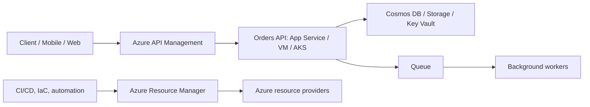
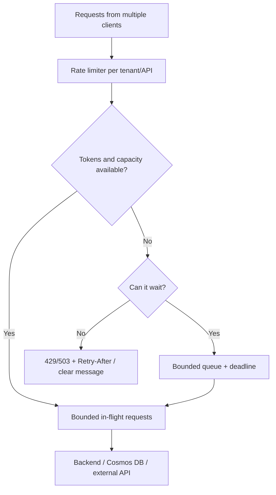
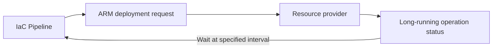
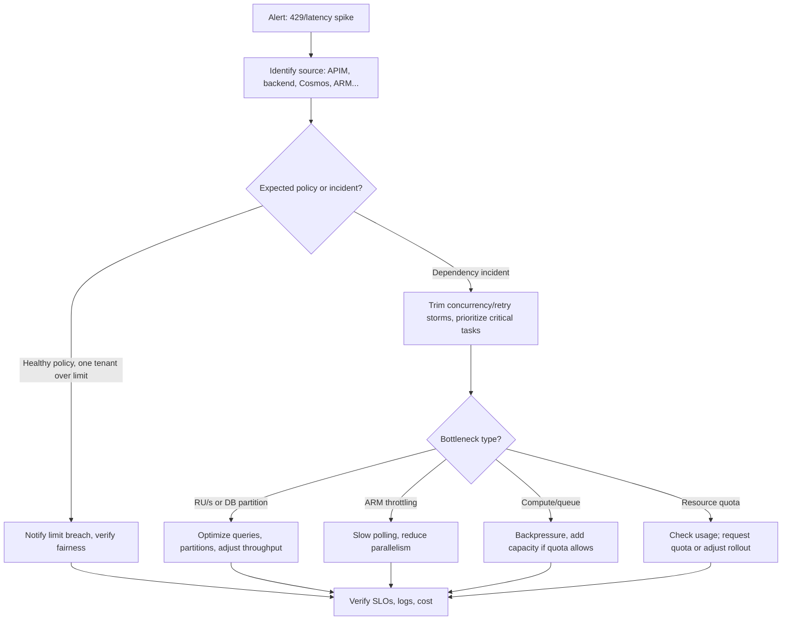

# Controlling Throttling, API Limits, and Quotas Under Load

## 1. Context: Scaling Load Is Not Just Adding Servers

An application running on Microsoft Azure may behave fine at 100 requests/second yet fail when traffic spikes. While the API returns HTTP `429 Too Many Requests`, operations may see VM CPU staying low. The cause is not necessarily the application's own compute capacity: a downstream dependency, API Gateway, Azure Resource Manager, storage account, database, or subscription-level quota may be rejecting requests.

Across the Azure ecosystem journey—from **subscriptions, resource groups, and Microsoft Entra ID** to networking, compute, storage, databases, deployment, monitoring, security, and cost control—limit management is a key part of the **Performance and Operations** chapter. This lesson shows how to distinguish limit layers, pinpoint where throttling originates, implement safe retries, and plan quotas as load grows.

Consider an **Orders API** application with Azure API Management (APIM) in front, a Java backend, Azure Cosmos DB storing orders, and a queue worker. During a promotional campaign, API call volume multiplies; meanwhile, a deployment pipeline calls Azure Resource Manager to update infrastructure. At least three distinct issues can occur:

- APIM returns `429` because a client exceeded its API call limit.
- Cosmos DB returns `429` for data requests when request unit consumption exceeds available capacity at that moment.
- Azure Resource Manager or a resource provider throttles management operations called too aggressively.

Even though all three relate to increased load, **each throttling source requires its own remediation**. Increasing VM size does not solve an ARM quota limit; raising VM quota does not automatically eliminate `429` responses from Cosmos DB.

### Learning Objectives

After completing this lesson, you will be able to:

1. Distinguish **throttling**, **rate limit**, **quota**, **concurrency limit**, and **capacity**.
2. Identify limits across the Azure control plane, data plane, API gateway, and application, and explain why a `429` code alone does not reveal the full cause.
3. Safely handle `Retry-After`, exponential backoff, jitter, retry budgets, timeouts, and idempotency.
4. Use API Management to enforce per-consumer policies and shape traffic with queues, rate limiters, and backpressure.
5. Identify bottlenecks in Cosmos DB, Azure Resource Manager, and compute quotas by resource type.
6. Build dashboards, alerts, capacity plans, and load tests proving the system sustains target traffic.
7. Establish an incident runbook for throttling spikes without letting costs or latency spiral out of control.

## 2. Five Easily Confused Concepts

| Concept | Meaning | Typical Example | What to Do |
| --- | --- | --- | --- |
| **Rate limit** | Cap on requests within a time window | Max 120 calls/minute per client at APIM | Throttle ingress, wait for window reset |
| **Throttling** | System actively slowing or rejecting requests to protect resources | HTTP `429`, or service-specific response | Read signals, back off, and retry with bounds |
| **Quota** | Allocated limit on resources or usage within a scope | vCPU limit per VM family in an Azure region | Check usage, request quota increase, or adjust design |
| **Concurrency limit** | Number of tasks processed simultaneously | Max 40 concurrent report-export jobs | Bound in-flight work, queue, or reject cleanly |
| **Capacity/throughput** | Actual processing capability over time or consumption units | Cosmos DB RU/s, backend API RPS | Measure load, optimize queries, partition, or scale |

**An unexhausted quota does not mean a service will not throttle.** A quota may govern total allocated resources in a subscription, while throttling may enforce per-minute API calls or the throughput of a single data partition. Likewise, raising a quota does not mean extra resources have been provisioned or throughput has increased.

### Burst vs. Sustained Load

A **burst** is a sharp, short-duration surge in requests; **sustained load** is high traffic held over time. Two systems with identical average traffic can experience very different throttling rates:

- 6,000 requests spread evenly across 60 seconds equals an average of 100 RPS.
- 6,000 requests arriving nearly simultaneously within a few seconds can overwhelm workers, connection pools, or short-window rate counters.

Therefore, when evaluating an API, observe at least **short-window RPS**, traffic per user/tenant, response times, concurrent requests, and rejection rates—not merely hourly call totals.

## 3. Where Does Throttling Occur on Azure?



Within the same system, the component returning errors can sit at any node in the diagram. A `429` returned by a gateway policy differs in **owner, counter, reset window, and remediation** from a `429` originating in Cosmos DB.

| Layer | Common Limit Source | Signal/Symptom | Priority Action |
| --- | --- | --- | --- |
| Client/SDK | Too many requests or synchronized retries | Actual requests exceed business volume | Client-side rate limiter, retry budget, jitter |
| APIM/API gateway | Rate limit or quota by key, subscription, tenant | Gateway actively returns errors to callers | Policies, limit headers/notices, tenant fairness |
| Compute/backend | Thread pools, connection pools, request queues, concurrency | Rising p95/p99, timeouts, or `503` | Backpressure, concurrency caps, appropriate scaling |
| Cosmos DB | Provisioned/autoscale RU/s, hot partitions | HTTP `429`, request charge/diagnostics | Optimize queries, distribute partitions, allocate RU/s |
| Azure Storage | Request/throughput/partition limits, account-level load | May return `503 Server Busy` or service-specific timeouts | Distribute keys, backoff, and tune access patterns |
| Azure Key Vault | Operation limits within time intervals | `429`, rising latency fetching secrets/keys | Cache, reduce polling, backoff, reduce call frequency |
| Azure Resource Manager (ARM) | Control-plane API throttling plus resource provider limits | `429` and limit headers when provided | Reduce polling, batch operations, handle long-running ops |
| Subscription/region | vCPU, VM family, or resource count quotas | Quota/capacity errors; not necessarily `429` | Check quotas, request increases, or switch region/SKU |

The **control plane** manages resource configurations (e.g., calling ARM to create VMs, update App Service, or list resource groups). The **data plane** handles business data/traffic (e.g., reading Cosmos DB documents, blobs, or calling the application). The two planes have separate limits, identities, endpoints, and monitoring mechanisms.

Some services enforce multiple concurrent limit types. For example, AI APIs can restrict requests/minute, tokens/minute, or deployment concurrency; compute resources can hit vCPU quotas and SKU allocation availability. Never infer fixed limit numbers solely from a service name: values vary by region, tier, subscription, operation type, and active configuration.

## 4. Running Scenario: Orders API Under Load

Suppose the system has this illustrative setup:

| Component | Lesson Assumption | Limit Type |
| --- | --- | --- |
| APIM | One API subscription allowed 120 calls/minute | Per-consumer rate limit |
| Orders API | Max 40 concurrent outbound external-service calls | Concurrency |
| Cosmos DB | 600 RU/s allocated for illustrative workload | RU throughput budget |
| `GET /orders/{id}` query | ~5 RU/request under test conditions | Per-request cost |
| Azure deployment | Pipeline continuously polls ARM status | Control-plane request rate |
| DR Azure region | Subscription nearly full on one VM family's vCPU quota | Resource quota |

**These numbers are learning assumptions only**, not default Azure or APIM limits.

If a data read consumes roughly 5 RU per request and all requests share a 600 RU/s budget, 150 queries/second demands roughly 750 RU/s. The system can receive `429` responses even while the Java API has plenty of idle CPU. In practice, partitions, document sizes, query complexity, and actual RU charges all vary, so this arithmetic serves only as an initial estimate.

If the API allows 120 calls/minute/subscription, a consumer sending 300 calls in a minute exceeds its own allowance. Raising Cosmos DB RU/s will not resolve an APIM rate limit; raising that threshold requires evaluating fairness policies, backend protection, and customer service tiers.

## 5. Diagnose the Exact Limit Source Before Fixing

When seeing `429`, do not immediately increase retry counts or scale every component. Trace a request's path:

1. **Identify who returned the response:** client SDK, APIM gateway, application, Cosmos DB, ARM, or an external service.
2. **Record timing and scope:** UTC timestamp, endpoint, region, subscription/tenant, API operation, and active load level.
3. **Capture status code and relevant headers:** `Retry-After`, correlation/request IDs, and service-specific headers if present.
4. **Correlate distributed logs:** gateway request IDs, trace IDs, backend logs, Cosmos diagnostics, Azure Activity Log, or HTTP logs.
5. **Inspect trends:** is throughput rising, 429 rate by endpoint/tenant, p95/p99, queue length, and quota utilization.
6. **Test one controlled change:** cap concurrency, adjust gateway limits, optimize queries, or add capacity in the right place.

A request crossing multiple tiers can have its **status code translated**. A gateway may return its own error or forward an upstream `429`. Thus, relying on status code alone to conclude "APIM is the cause" is insufficient; verify via logs and request correlation.

### HTTP Status Codes Are Not Uniform Across Services

| Status / Error Type | Typical Interpretation | What Not to Assume |
| --- | --- | --- |
| `429 Too Many Requests` | A counter, rate policy, or capacity limit throttled the request | Does not mean the subscription ran out of resource quota |
| `503 Service Unavailable` | Backend overloaded, maintenance, or temporary rejection | Not necessarily an APIM rate limit |
| `408 Request Timeout` or client timeout | Request did not finish in time | Does not prove whether the server processed it or not |
| `QuotaExceeded` / `OperationNotAllowed` | Cannot allocate more resources or hit a specific limit | Should not simply be retried repeatedly |
| `403 Forbidden` | Rejected due to permissions, policy, or service condition | Should not be "fixed" with blind retries |

Exact error codes and headers for each resource provider must be checked against that service's documentation.

## 6. Reading `Retry-After` and Limit Headers

HTTP may include **`Retry-After`** to indicate the earliest time to retry. This header has two valid formats:

```http
HTTP/1.1 429 Too Many Requests
Retry-After: 3
```

Here the caller should wait roughly **3 seconds** before retrying, if the overall timeout budget permits.

```http
HTTP/1.1 503 Service Unavailable
Retry-After: Fri, 20 Nov 2026 13:30:00 GMT
```

This is an **HTTP-date** example, meaningful only relative to a real-time clock. When parsing the header, handle both formats properly and never parse local time as a timezone-naive string.

Some APIs return headers indicating remaining allowance or reset timing; Azure services have service-specific headers, such as `x-ms-ratelimit-remaining-*` on certain management APIs or Cosmos DB diagnostic/retry-delay headers. **Not every endpoint returns the same header names or time units.** Never read milliseconds as seconds or assume `Retry-After` is always present.

Handling rules:

- If a valid `Retry-After` is present and retries are permitted, honor that delay first.
- If missing, use exponential backoff with jitter rather than retrying immediately.
- If the requested wait **exceeds the retry budget or request deadline**, fail cleanly, offload to a queue, or return an appropriate response rather than sleeping indefinitely.
- Never log `Authorization` headers, API keys, tokens, connection strings, or sensitive bodies solely to diagnose throttling.

## 7. Safe Retries: Exponential Backoff, Jitter, and Overall Budgets

A poorly implemented client can worsen an outage. Suppose 1,000 clients all receive `429` and simultaneously retry after exactly one second: the server gets slammed with 1,000 concurrent requests again, creating a **retry storm**. Combining exponential backoff with jitter spreads out retry attempts.

For retry attempts \(k = 1, 2, \ldots\), delay can grow exponentially:

\[
D_k = \min(D_{\max}, D_0 \cdot 2^{k-1})
\]

Add **full jitter** by picking a random wait in \([0, D_k]\) (or setting a small floor to prevent immediate retries). Values like `D0 = 200 ms`, `Dmax = 5 s`, and max 4 attempts below are **illustrative parameters**; production systems must tune to SLAs, deadlines, and API guidance.

### Java 17: HTTP GET with Bounded 429/503 Handling

The following example uses `java.net.http.HttpClient`, parses numeric or HTTP-date `Retry-After`, applies jitter when absent, and enforces an overall wait deadline. This illustrates a **safe-to-retry GET**; Azure SDKs typically include built-in retry policies that should be used when available.

```java
import java.io.IOException;
import java.net.URI;
import java.net.http.HttpClient;
import java.net.http.HttpRequest;
import java.net.http.HttpResponse;
import java.net.http.HttpTimeoutException;
import java.time.Duration;
import java.time.Instant;
import java.time.ZonedDateTime;
import java.time.format.DateTimeFormatter;
import java.time.format.DateTimeParseException;
import java.util.Optional;
import java.util.OptionalLong;
import java.util.concurrent.ThreadLocalRandom;

public final class ResilientGet {
    private static final int MAX_ATTEMPTS = 4;
    private static final long MAX_BACKOFF_MS = 5_000;
    private static final HttpClient CLIENT = HttpClient.newBuilder()
            .connectTimeout(Duration.ofSeconds(3))
            .build();

    public static HttpResponse<String> fetch(URI uri)
            throws IOException, InterruptedException {
        long deadline = System.nanoTime() + Duration.ofSeconds(20).toNanos();

        for (int attempt = 1; attempt <= MAX_ATTEMPTS; attempt++) {
            HttpRequest request = HttpRequest.newBuilder(uri)
                    .timeout(Duration.ofSeconds(5))
                    .GET()
                    .build();

            HttpResponse<String> response;
            try {
                response = CLIENT.send(
                        request, HttpResponse.BodyHandlers.ofString());
            } catch (HttpTimeoutException ex) {
                if (attempt == MAX_ATTEMPTS) {
                    throw ex;
                }
                sleepWithinBudget(jitterDelay(attempt), deadline);
                continue;
            }

            int status = response.statusCode();
            if (status != 429 && status != 503) {
                return response;
            }
            if (attempt == MAX_ATTEMPTS) {
                return response; // caller handles the final status
            }

            OptionalLong serverDelay = retryAfterMillis(
                    response.headers().firstValue("Retry-After"));
            long delay = serverDelay.isPresent()
                    ? serverDelay.getAsLong()
                    : jitterDelay(attempt);
            sleepWithinBudget(delay, deadline);
        }
        throw new IllegalStateException("Unreachable branch");
    }

    private static long jitterDelay(int attempt) {
        long upper = Math.min(
                MAX_BACKOFF_MS, 200L * (1L << (attempt - 1)));
        return ThreadLocalRandom.current().nextLong(50, upper + 1);
    }

    private static OptionalLong retryAfterMillis(Optional<String> value) {
        if (value.isEmpty()) {
            return OptionalLong.empty();
        }
        String raw = value.get().trim();
        try {
            long seconds = Long.parseLong(raw);
            if (seconds >= 0) {
                return OptionalLong.of(Math.multiplyExact(seconds, 1_000));
            }
        } catch (NumberFormatException | ArithmeticException ignored) {
            // May be HTTP-date format.
        }
        try {
            Instant target = ZonedDateTime.parse(
                    raw, DateTimeFormatter.RFC_1123_DATE_TIME).toInstant();
            long millis = Math.max(
                    0, Duration.between(Instant.now(), target).toMillis());
            return OptionalLong.of(millis);
        } catch (DateTimeParseException ignored) {
            return OptionalLong.empty();
        }
    }

    private static void sleepWithinBudget(long delayMillis, long deadline)
            throws IOException, InterruptedException {
        long remainingNanos = deadline - System.nanoTime();
        if (delayMillis < 0
                || remainingNanos <= Duration.ofMillis(delayMillis).toNanos()) {
            throw new IOException("Retry budget exhausted; try again later.");
        }
        Thread.sleep(delayMillis);
    }

    public static void main(String[] args) throws Exception {
        String endpoint = System.getenv("TARGET_URL");
        if (endpoint == null || endpoint.isBlank()) {
            throw new IllegalArgumentException("Missing TARGET_URL");
        }
        HttpResponse<String> response = fetch(URI.create(endpoint));
        System.out.println("Final HTTP status: " + response.statusCode());
    }
}
```

To run the demonstration against a test endpoint you control:

```bash
javac ResilientGet.java
TARGET_URL="https://example.test/api/orders/health" java ResilientGet
```

Replace the placeholder URL with a **valid test endpoint**; the command sets the environment variable using Bash syntax. The code intentionally performs no state-mutating operations and embeds no credentials. For authenticated APIs, pass tokens through your client/SDK's secure mechanism and never log them.

### Limitations of the Example

This is a teaching example for retry mechanics, not a full HTTP library. In production:

- Count **total connection, processing, and wait time** toward the business request deadline. Above, the deadline governs *retry sleep*; each in-flight request also has its own 5-second timeout.
- You may need circuit breakers, cancellation, caps on **total attempts**, per-endpoint error classification, and async HTTP client support.
- Never blindly retry all `4xx`/`5xx` codes. Handle `401`/`403` via auth/permissions; handle resource quota errors via capacity changes rather than repeating the identical call.
- Audit retry policies **already built into Azure SDKs** so SDK, service mesh, and application code do not stack retries and multiply request volume.

## 8. Idempotency: When Is It Safe to Retry?

Unsafe retries can create **duplicate orders, payments, or invoices**. A `POST /orders` request may already be processed by the backend while the response is lost; a client unaware of that and retrying could create a second record.

| Scenario | Safe to Retry Immediately? | Notes |
| --- | --- | --- |
| Read-only `GET` on a stable API | Usually yes, if deadline permits | Honor 429/`Retry-After` |
| `PUT` writing full resource state on an idempotent API | Yes, per contract | Check ETags/conditional updates and current state |
| `DELETE` defined as idempotent by the API | API-dependent; often safe with control | Some APIs return a different code once the resource is gone |
| `POST /orders` creating a new order | Not by default | Use an idempotency key and persist result per key |
| Sending payments, emails, incrementing counters | Never retry blindly | Requires deduplication, outbox/transaction, or status check |
| Accepted ARM long-running operation | Do not re-send creation just to check progress | Poll the status URL at the API's specified interval |

### Idempotency Keys for the Orders API

The client generates one unique key per **business intent** and reuses that key across retries:

```http
POST /orders HTTP/1.1
Content-Type: application/json
Idempotency-Key: 7fd2acb8-demo-order-001

{"customerId":"demo-customer","items":[{"sku":"book","qty":1}]}
```

`Idempotency-Key` in this example is an **application API convention**: Azure does not automatically enforce this header. The backend must validate the key scoped to the user/tenant, compare request contents, store the transaction/outcome, and return the stored response on replay. Design TTLs, race-condition locks, and avoid leaking customer data in the key.

With Azure SDKs, many operations define their own retry rules and sometimes support conditional requests. When unsure whether an operation is idempotent, prefer querying status by operation ID or request ID before retrying.

## 9. Client-Side Throttling: Rate Limiters, Concurrency, and Backpressure

**Exponential backoff** reacts to errors that already happened. **Rate limiters** and **backpressure** prevent errors from happening in the first place.



Three techniques are commonly combined:

1. **Token bucket:** each client receives an allocation of tokens; each request consumes a token, and tokens refill at a capped rate. Suits controlled short bursts.
2. **Semaphore/bulkhead:** caps concurrent in-flight operations to a dependency, e.g., at most 40 concurrent DB queries from one worker pool.
3. **Bounded queue:** buffers deferrable work with strict length caps, TTLs, and dead-letter handling. Unbounded queues merely convert CPU saturation into latency and memory exhaustion.

### Why Watch Latency When Setting Concurrency?

By Little's Law in steady state:

\[
\text{In-flight requests} \approx \text{Throughput (requests/s)} \times \text{Latency (s)}
\]

For example, 120 RPS averaging 0.25 seconds takes roughly **30 in-flight requests**. If latency climbs to 2 seconds while clients keep sending 120 RPS, in-flight requests jump toward **240**. Connection pools, thread pools, and memory can exhaust even though arrival rate did not change.

Therefore, enforce **concurrency limits and rejection/alerting mechanisms** rather than relying solely on autoscale. Requests waiting past client deadlines are usually wasted work; continuing to process them lowers throughput for requests that still have value.

### Per-Tenant Fairness

A global rate limit lets one noisy tenant consume all capacity. In multi-tenant SaaS systems, consider:

- Per-tenant or per-authenticated-subscription API budgets.
- Dedicated limits for expensive endpoints like exports, reports, and batch operations.
- A global concurrency cap protecting backend resources.
- Priority queues or reserved capacity for critical business flows with transparent criteria.

Do not use IP address as the primary tenant identifier when multiple users share NAT/proxies, because distinct customers can share one IP. Identifiers must also never expose secret tokens in logs or metric names.

## 10. Azure API Management: Gateway-Level Limiting

APIM can enforce key-based call rate limits and quotas at API/product/operation scopes depending on configuration. Two common policies:

- `rate-limit-by-key`: caps calls over a short window per key, returning a throttling response when exceeded.
- `quota-by-key`: enforces a usage quota over longer intervals per key.

The illustrative policy below assumes **APIM requires a subscription** and `context.Subscription.Id` is populated at evaluation time. Verify **tier/policy support** and exact APIM policy structure before deploying.

```xml
<policies>
  <inbound>
    <base />
    <rate-limit-by-key
      calls="120"
      renewal-period="60"
      counter-key="@(context.Subscription.Id)" />
    <quota-by-key
      calls="10000"
      renewal-period="86400"
      counter-key="@(context.Subscription.Id)" />
  </inbound>
  <backend>
    <base />
  </backend>
  <outbound>
    <base />
  </outbound>
  <on-error>
    <base />
  </on-error>
</policies>
```

Here `120` calls/60 seconds and `10,000` calls/24 hours are **illustrative thresholds chosen by the designer**, not Azure defaults. Counter accounting and immediate consistency across gateways depend on tier, gateway count, and deployment details. In particular, if APIM uses subscriptions at product, API, or other scopes, confirm `counter-key` accurately identifies the intended consumer.

### Policy Design Before Production

| Question | Decision Guidance |
| --- | --- |
| Who is being limited? | Authenticated tenant ID, subscription ID, or user ID |
| Which endpoints are expensive? | Separate limits for heavy reports/exports/searches |
| How much burst is allowed? | Size rate windows to real traffic and backend capacity |
| Are long-term quotas needed? | Align with service tiers, cost, and fairness |
| What is returned when exceeded? | Clear `429` response with retry timing guidance |
| How do customers track usage? | API analytics, quota dashboards, clear contracts |
| Are there multiple gateways/regions? | Check counter semantics and distributed behavior |
| Is the policy applied at the right scope? | Check policy order, inheritance, and `<base />` |

A gateway policy is an **ingress protection layer**, not a replacement for application rate limiters and database connection bounds. If APIM lets 1,000 RPS through while the backend only sustains 400 RPS, the system will still overload.

## 11. Cosmos DB: RU/s, HTTP 429, and Hot Partitions

Azure Cosmos DB for NoSQL measures operation cost in **Request Units (RUs)**; resources are provisioned with **RU/s throughput** or autoscale within configured bounds. When a request cannot be served immediately within the instantaneous budget, the service may return `429 RequestRateTooLarge`. Standard Cosmos DB SDKs include built-in retry logic for this error.

### Calculation Example

Suppose a container is provisioned at **600 RU/s** and a document read averages **5 RU** under test conditions. At 150 requests/s incoming load, theoretical demand is:

\[
150 \times 5 = 750\ \text{RU/s}
\]

This exceeds 600 RU/s. Still, that **does not mean every 121st request returns 429**: RU charges vary per request, partition distribution, exact timing, and SDK retries. To diagnose, inspect throughput, request charges, `429` diagnostics, normalized RU consumption, and per-partition metrics where available.

### Hot Partitions

If an application chooses a skewed partition key (for example, most orders belong to one popular tenant), a single logical/physical partition can overload even while overall RU/s remains underutilized. Raising total RU/s may help partially without fixing the underlying partition key model.

Ordered remediation steps:

1. Measure RU charge and request volume by query type.
2. Identify fan-out queries, cross-partition queries, and redundant reads.
3. Inspect partition keys, hot partitions, indexing policies, document sizes, and access patterns.
4. Use point reads when partition key and ID are known; cache cacheable data.
5. Configure RU/s or autoscale based on **load testing and real demand**, never blind increases.
6. Monitor SDK retries, end-to-end latency, and cost after changes.

**Do not wrap custom auto-retries around the Cosmos SDK without knowing how many times the SDK already retries.** If the SDK waits and retries internally, an outer retry loop multiplies calls and inflates latency dramatically.

## 12. Azure Resource Manager: Avoiding Control-Plane Throttling

Terraform, Bicep deployments, Azure CLI, Azure SDKs, the Azure Portal, and automation agents can all fire concurrent calls to **Azure Resource Manager (ARM)**. When scripts continuously list resources, poll status via `GET`, or bulk-modify resources concurrently, ARM or resource provider limits can trigger.

A sensible deployment flow:



Best practices:

- **Curb aggressive polling.** For long-running operations, follow the status URL and polling interval returned by the service rather than re-sending resource creation calls.
- **Limit parallelism** across pipelines, scripts, and jobs targeting the same subscription, region, and resource provider.
- **Use SDK defaults and built-in retry policies** designed for ARM, paired with timeouts and retry budgets.
- **Cut repetitive list queries**; cache where safe and consider Azure Resource Graph for large-scale inventory queries.
- **Never retry indefinitely** on quota, validation, policy, or authorization errors.
- **Watch the exact scope** (subscription, principal, tenant, region, resource provider) in the target API's throttling docs.

ARM sometimes returns headers indicating remaining requests. Header names, counters, and refresh behavior vary by operation and provider; never build a universal condition for all services around one specific header.

### Throttling vs. Resource Creation Quotas

A deployment failing because the subscription hit **regional total vCPUs** or **VM family vCPUs** is an allocation entitlement limit. Retrying 100 times unchanged wastes time and adds control-plane pressure. Conversely, if VM listing is being throttled, requesting a vCPU quota increase will not directly raise list-call limits.

## 13. Identifying and Planning Azure Resource Quotas

Quotas are crucial when preparing autoscale, multi-region deployments, and disaster recovery. For instance, if an autoscale rule tries to scale VMs from 8 to 20 while regional compute quota only has room for 4 more VMs, target scaling fails despite high CPU on existing VMs.

### Operational Quota Matrix

| Component | Questions to Check | How to Prepare |
| --- | --- | --- |
| Azure VM/VMSS | Total regional vCPUs, VM family quota, SKU availability | Check quota/usage by subscription and region; request increases before peaks |
| Public IP, load balancing | Resource limits and allocatable IP counts | Verify scale capacity against network design |
| Storage | Account limits, capacity, throughput, partitions | Distribute data/keys and size to workload type |
| Cosmos DB | RU/s, autoscale max, partitions, regions | Measure RU charge, load test, optimize partitions |
| API Management | Tier, capacity/gateways, policy counters | Verify tier characteristics, scale, and rate policies |
| Azure Functions/App Service | Scale options, instance/concurrency limits, dependency quotas | Bound concurrency, verify plan and region |
| Key Vault | Operation limits by operation type | Cache and batch; cut continuous secret fetches |
| Azure AI services | Quotas by model, deployment, region, limit type | Verify specific quota/usage before ramping traffic |

An Azure CLI command to inspect VM-related regional usage:

```bash
az login
az account set --subscription "<subscription-id>"
az vm list-usage --location southeastasia --output table
```

This requires a real subscription ID and read permissions; output, metric names, and values vary by subscription and region. Use **Azure Portal → Quotas** (or the service-specific quota blade) to inspect current levels and submit increase requests where supported. No single button raises every quota instantaneously; some requests require review and can be constrained by supply capacity, subscription type, or region.

### Headroom Formula

Let:

\[
H = Q - U
\]

Where \(Q\) is granted quota, \(U\) is current usage, and \(H\) is remaining quota headroom. However, **quota headroom does not guarantee available capacity**: specific SKU availability in that region, network limits, fault domains, and other dependencies still apply.

If planning to scale up to 30 VMs, calculate vCPUs for all desired VMs plus headroom for rolling upgrades and failovers if required. Also account for the **cost** of resources after a quota increase—permission to allocate more does not mean you should consume all of it.

## 14. Observing Throttling with Azure Monitor and Application Insights

You cannot tune a system by looking only at CPU charts. Operational dashboards should combine **ingress traffic, rejection rates, latency, and dependency utilization**.

### Metrics to Monitor

| Group | Metrics | Why Needed |
| --- | --- | --- |
| Traffic | RPS, requests/min, burst peaks, traffic per tenant/API | Reveals incoming load and top drivers |
| Outcomes | 2xx, 4xx, 429, 5xx; rejections at gateway vs. backend | Shows error rates and rejection source |
| Latency | p50, p95, p99, end-to-end timeouts | Exposes queuing and retry overhead |
| Retries | Attempts/request, `Retry-After`, retry success rate, exhausted budgets | Detects retry storms or unusual delays |
| Backend | CPU, memory, active connections, worker concurrency, saturation | Shows whether to optimize or scale compute |
| Cosmos DB | RU consumption, normalized RU, 429s, request charge, partition hotspots | Separates RU shortage from unoptimized queries/partitions |
| Queues | Queue length, oldest-message age, dead-letter count | Tracks backlogs and async processing health |
| ARM/quotas | Control-plane requests, throttling errors, quota utilization, failed deploys | Catches control-plane and resource limits |
| Cost | Compute, DB throughput, APIM tier, networking, logging | Tracks financial impact of scaling |

### KQL Example with Application Insights

In an Application Insights workspace using the `requests` table schema, group response codes per minute:

```kusto
requests
| where timestamp >= ago(1h)
| summarize
    total = count(),
    throttled = countif(resultCode == "429"),
    server_errors = countif(toint(resultCode) >= 500)
    by cloud_RoleName, bin(timestamp, 1m)
| extend throttle_rate_pct =
    iff(total == 0, 0.0, 100.0 * todouble(throttled) / total)
| order by timestamp asc
```

If telemetry lands in Log Analytics' **`AppRequests`** table, column names may be `TimeGenerated`, `ResultCode`, and `AppRoleName` instead. Adapt KQL to your actual table schema. This query also sees only requests reaching application instrumentation; if APIM rejects calls at the gateway, **the backend never receives them**, so querying app `requests` alone misses gateway-originated 429s. Always pair with APIM diagnostics/metrics.

### Correlating Across Layers

A log entry should include:

```json
{
  "timestamp": "2026-11-20T13:25:00Z",
  "service": "orders-api",
  "operation": "GET /orders/{id}",
  "status": 429,
  "source": "cosmos-db",
  "retry_attempt": 2,
  "retry_after_ms": 600,
  "tenant_hash": "demo-anonymized",
  "trace_id": "example-trace-id"
}
```

This is an illustrative schema. Never log tokens, subscription keys, order payloads, personal IPs, or user accounts unnecessarily. Hash or pseudonymize tenant IDs and restrict access per data policy.

### Alerting Guidance

Alert when 429 rates exceed **baseline-calibrated thresholds** over multiple minutes, factoring in p95 latency and retry frequency. Do not treat every 429 as an incident: APIM intentionally blocking an abusive client can be a **healthy policy working as designed**. Conversely, widespread 429s across tenants or Cosmos DB rejections breaking order completion require immediate investigation.

## 15. Load Testing to Find Real Bottlenecks and Limits

Ahead of promotions, do not test only at average traffic. Run test scenarios with clear objectives and bounded blast radius, preferring test environments whose quotas, datasets, and dependencies mirror production. Use **Azure Load Testing** or another suitable tool to generate controlled load while watching all tiers.

| Scenario | Objective | Questions to Answer |
| --- | --- | --- |
| **Baseline** | Measure normal load | What are baseline 429s, p95/p99, throughput, and RU usage? |
| **Step load** | Step up RPS gradually | At what threshold do latency and retries accelerate? |
| **Spike/burst** | Brief sharp surge | How do rate limiters, APIM, queues, and autoscale react? |
| **Soak** | Extended steady high load | Are there resource leaks, queue buildup, or quota errors? |
| **Hot partition** | Concentrate traffic on one tenant/partition | Does one partition saturate despite spare aggregate RU/s? |
| **Dependency throttling** | Simulate Cosmos/external API returning 429 | Does the client honor `Retry-After`, retry budgets, and deadlines? |
| **Quota boundary** | Test autoscale approaching quota | Do scale-out actions fail due to quota/region/SKU limits? |

### Staged Scenario Template

```text
00-05 min:  baseline load, record reference metrics
05-10 min:  double traffic volume
10-15 min:  short burst at assumed peak traffic
15-25 min:  sustain elevated load (short soak)
25-30 min:  ramp down, verify queue drain and recovery
```

Durations here only illustrate structure; real soak tests often run far longer. Constrain tests to authorized services and datasets; never fire heavy traffic at production or third-party systems without an approved plan.

### Example Success Criteria

1. **Business success rate:** valid order operations complete per defined SLOs.
2. **Latency:** p95/p99 stays within target under defined load.
3. **Intentional throttling:** APIM blocks contract-exceeding tenants while other tenants remain unaffected.
4. **Dependency throttling:** Cosmos/Key Vault 429 rates are measured and retries do not cause request storms.
5. **Backpressure:** threads/connections do not exhaust; queues stay bounded and drain post-burst.
6. **Quota headroom:** resources can scale to projected levels, including failover/rolling-upgrade reserve.
7. **Cost:** compute, RU/s, gateway, logging, and bandwidth stay within budget.

A system with "zero 429s" whose p99 hits tens of seconds, queues never drain, and costs multiply severalfold has failed its performance goals. Evaluate **user experience, stability, and cost** together.

## 16. Runbook for Sudden 429 Spikes

When dashboards report abnormal throttling, on-call responders should follow a concise decision flow suitable for a runbook:



**Step 1 — Scope:** record UTC start time, affected operations/tenants, HTTP status, request IDs, `Retry-After`, 429 rate, p95/p99, and before/after traffic.

**Step 2 — Protect the system:** engage rate limiters, lower concurrency, or pause low-priority batch jobs. If clients are retrying too aggressively, cut retry attempts, add jitter, and route deferrable work into bounded queues.

**Step 3 — Fix the actual cause:** inspect APIM policies, Cosmos RUs/partitions, ARM pollers, compute concurrency, or subscription quotas. When adding capacity, change one variable at a time and compare metrics rather than rewriting all policies blindly.

**Step 4 — Verify end-to-end:** execute representative business requests, confirm zero duplicate orders or lost data, and verify queue backlog, p95 latency, and error rate after recovery.

**Step 5 — Postmortem:** document root cause, impacted customer count, retry amplification, updated alert thresholds, capacity planning tasks, and action owners.

### When Should You Request a Quota Increase?

Only after confirming the bottleneck is an **increasable quota** or insufficient provisioned capacity, backed by demand forecasts and budget. Ahead of load events, submit quota requests early since many require approval lead time. If throttling stems from API request rates, simply requesting more VM vCPU quota will not help.

## 17. Hands-On Exercise: Protecting Orders API Under Load

**Objective:** design fair API limiting, controlled retries, and throttling dashboards for a test Orders API. You can use a dev environment with APIM and a sample backend, or a local mock test server returning 429s; no production resources are required.

### Step 1 — Build an Assumptions Table

| Component | Test Assumption |
| --- | --- |
| Endpoints | `GET /orders/{id}` and `POST /orders` |
| Gateway policy | 120 calls/minute per subscription |
| Cosmos DB query | ~5 RU/request average in tests |
| RU budget | 600 RU/s, illustrative only |
| Client retries | Max 4 attempts and 20-second deadline |
| Concurrent dependency calls | Max 40 in-flight requests |

Record baseline load and spike test targets. Specify that `GET` can retry per the Java example, whereas `POST` requires an idempotency key and backend result persistence.

### Step 2 — Add Limits in APIM or a Mock Gateway

If using a test APIM instance, apply `rate-limit-by-key` per Section 10 using a dedicated test subscription/key and observe where 429s originate. Without APIM, build a simple mock gateway/test server counting requests per key and returning `429` with `Retry-After` past the threshold. Do not generate heavy traffic against public services.

### Step 3 — Verify Client Retries

Compile `ResilientGet.java` and test against mock endpoints returning:

- `200` on first try: client does not retry.
- `429` with `Retry-After: 2`: client waits ~2 seconds and retries if within budget.
- `429` without `Retry-After`: client uses exponential backoff and jitter.
- Continuous `429`s: client stops at `MAX_ATTEMPTS` or exhausted retry budget.
- `429` with `Retry-After` exceeding deadline: client exits cleanly for app-level handling instead of sleeping indefinitely.

Log attempt counts, wait durations, and final HTTP status; never log credentials. Compare actual outgoing request counts with retries enabled vs. disabled.

### Step 4 — Simulate RU Exhaustion or Backend Saturation

If using a dev Cosmos DB, run load with test data and inspect RU charges/429s; otherwise, use a mock dependency returning `429` past a threshold. Gradually raise concurrency to observe p95/p99 and queue growth. Lower concurrent calls or optimize queries, then re-measure improvement.

### Step 5 — Check Azure Quotas Before Scaling

Inspect quotas/usage on your dev subscription and region, e.g., via `az vm list-usage` for compute. Fill in a table of `current quota – usage – headroom – forecast peak` for resources that must scale. For limits you lack permission to view or services unused in the lab, mark `unverified` rather than guessing numbers.

### Step 6 — Create Dashboards and Alerts

In Azure Monitor/Application Insights or a test metrics stack, graph RPS, 429s by source, p95 latency, retry attempts, queue depth, Cosmos RUs, and quota headroom. Configure an alert from your **measured baseline** and trigger controlled 429s to verify alert delivery.

### Step 7 — Write a Postmortem

Fill in the results:

```text
Run ID: LOAD-ORDERS-001
Environment: dev / isolated test
Load profile: baseline -> burst -> recovery
Peak RPS: [actual measured]
Gateway 429 rate: [value]
Backend/Cosmos 429 rate: [value]
P95/P99 latency: [value]
Retry attempts per request: [value]
Queue length / drain time: [value]
Quota headroom: [value or unverified]
Critical path / bottleneck: [specify]
Change made: [rate/concurrency/RU/query/scale]
Retest result: PASS/FAIL
Cost impact: [estimated/measured]
Owner and next review date: [specify]
```

### Completion Criteria

| Check | Passing Result |
| --- | --- |
| Error classification | Identifies whether APIM or dependency generated 429 with correlation evidence |
| Retries | Honors `Retry-After`, jitter, max attempts, and deadline |
| Business correctness | Zero duplicate orders created on client retries |
| Fairness | One over-limit tenant does not starve other tenants |
| Backpressure | Queues/concurrency remain bounded and recover post-burst |
| Cosmos/DB | Includes RU/request metrics or equivalent mock figures |
| Quotas | Documents usage/headroom by region and resource type |
| Observability | Dashboard shows 429s, p95, and retry metrics |
| Runbook | Separates handling for ARM, gateway, database, and quotas |
| Cost | Notes financial impact of scaling and logging |

## 18. Common Mistakes and How to Avoid Them

| Mistake | Consequence | Fix |
| --- | --- | --- |
| Retrying all `429/5xx` errors forever | Retry storms, inflated costs, duplicate requests | Retry budgets, jitter, idempotency, deadlines |
| Scaling CPU whenever seeing 429 | Fails to fix APIM/Cosmos/ARM bottlenecks | Identify throttling source via logs/headers |
| Using unbounded queues | Runaway backlogs and latency | Bounded queues, TTLs, dead-lettering, overload policies |
| Rate-limiting multi-tenant SaaS by IP | Users behind shared NAT throttle each other | Use authenticated tenant/subscription IDs |
| Monitoring only backend requests | Misses 429s blocked at the gateway | Combine APIM metrics with backend telemetry |
| Raising RU/s while ignoring hot partitions | Higher bill while one partition stays choked | Fix partition keys, queries, and RU distribution |
| Retrying deploys when VM quota is full | Generates more ARM errors and slows recovery | Check quotas, request increases, or shrink rollout |
| Stacking outer retries over SDK retries | Multiplies requests and stretches timeouts | Audit retry policies at every layer |
| Non-idempotent `POST` creations | Duplicate orders or charges | Idempotency keys, deduplication, transaction states |
| Raising API limits abruptly per customer request | Backend/DB overloads for every tenant | Capacity test and roll out gradually |
| Assuming high quota guarantees allocation | SKU capacity shortages or region/zone limits | Verify both quotas and actual availability |
| Ignoring cost after scaling | Budget overruns despite fewer errors | Use Azure Cost Management and cost guardrails |

## 19. Self-Check Questions

1. Distinguish rate limit, quota, concurrency limit, and throttling with one Azure example each.
2. Why do HTTP 429s from APIM, Cosmos DB, and ARM require different remediations?
3. What formats can `Retry-After` take? Why should you never always parse it as milliseconds?
4. How do exponential backoff and jitter prevent retry storms?
5. Why can an outer retry loop around a self-retrying SDK make an application slower?
6. `POST /orders` times out after sending. How do you retry without creating two orders?
7. At 600 RU/s and 5 RU per request, what issue can 150 requests/s cause? What real factors make this calculation only an estimate?
8. APIM allows 120 calls/min/subscription. If one subscription sends 300 calls/min, should you raise VM vCPU quota first? Why?
9. Does 100 remaining regional vCPU quota guarantee scaling 25 4-vCPU VMs?
10. When backend KQL logs show zero 429s while users receive 429s, where should you inspect telemetry?
11. Why are unbounded queues a poor strategy for absorbing bursts?
12. A deployment fails with `QuotaExceeded`. Why are `Retry-After` and exponential backoff usually insufficient?
13. What does the approximate relationship between throughput, latency, and in-flight requests imply when p99 spikes?
14. Which minimum metrics would you check to prove a rate limit or RU/s change actually improved experience?

**Answer hints:** (1) rate per window, total entitlement, in-flight cap, and active rejection; (2) distinct sources and counters; (3) integer seconds or HTTP-date, plus service-specific headers; (4) spreads retries over time to avoid synchronized bursts; (5) multiplies attempts across layers; (6) idempotency keys and transaction deduplication; (7) theoretical 750 RU/s demand, affected by partitions, queries, and SDK behavior; (8) no—APIM limits sit ahead of compute; (9) no—SKU/region/zone capacity and other limits apply; (10) APIM gateway and upstream layers; (11) backlog buildup, RAM consumption, and missed deadlines; (12) quota/capacity itself must be addressed; (13) in-flight requests climb proportionally with latency; (14) 429s by source, p95/p99, success rate, retries, RU/queue depth, and cost.

## 20. Conclusion and Official References

Controlling throttling on Azure begins with **locating the exact layer enforcing the limit**. Azure Resource Manager governs control-plane requests, API Management caps per consumer, databases and storage enforce their own throughput limits, and subscriptions hold regional/service resource quotas. None of these mechanisms replace one another. Building resilient capacity requires combining rate limiters, concurrency limits, backpressure, bounded/jittered retries, idempotency, observability, and capacity planning.

In operations, track **RPS, 429 rates by source, retry amplification, latency, queue depth, RU usage, quota headroom, and cost**. Use burst and sustained load tests to validate behavior before raising limits or scaling infrastructure. During incidents, shed pressure and restore business flows first, then address the root cause at the exact responsible service.

Official documentation for checking exact behavior and limits by version, tier, subscription, and region:

- [Microsoft Learn — Azure Resource Manager request limits and throttling](https://learn.microsoft.com/azure/azure-resource-manager/management/request-limits-and-throttling)
- [Microsoft Learn — Azure API Management policies](https://learn.microsoft.com/azure/api-management/api-management-policies)
- [Microsoft Learn — Azure Cosmos DB: request rate too large (429)](https://learn.microsoft.com/azure/cosmos-db/nosql/troubleshoot-request-rate-too-large)
- [Microsoft Learn — Azure subscription and service limits, quotas, constraints](https://learn.microsoft.com/azure/azure-resource-manager/management/azure-subscription-service-limits)
- [Microsoft Learn — Azure Load Testing](https://learn.microsoft.com/azure/load-testing/overview-what-is-azure-load-testing)
- [Microsoft Learn — Azure Monitor](https://learn.microsoft.com/azure/azure-monitor/overview)
