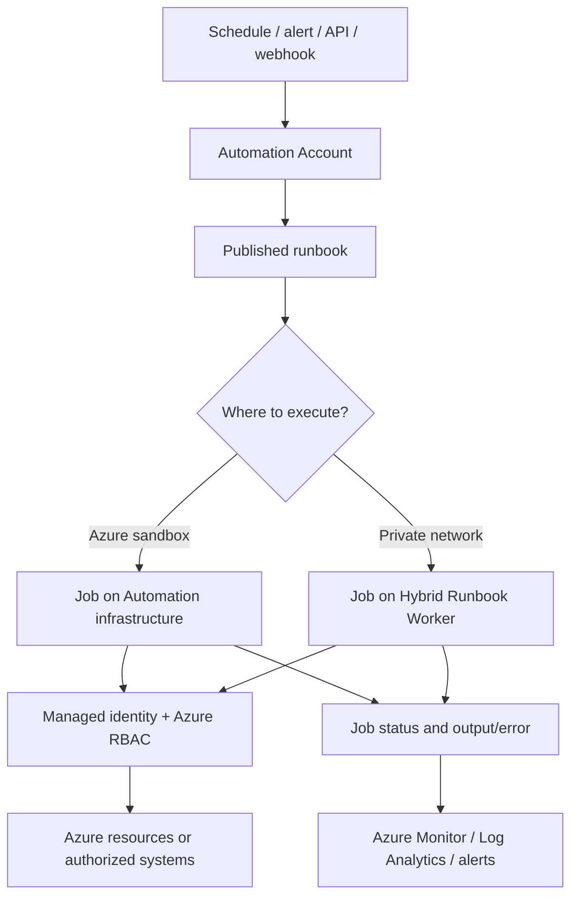

# Automating Operations with Azure Automation

## Lesson Objectives

After this lesson, you will be able to:

1. Explain which operational tasks Azure Automation solves and distinguish **runbook**, **job**, **schedule**, **Automation Account**, and **Hybrid Runbook Worker**.
2. Design secure access using **managed identities** and **Azure RBAC**, scoping accurately to subscriptions and resource groups.
3. Author, test, publish, and schedule a PowerShell runbook with condition checks, dry-run mode, and error handling.
4. Monitor outcomes via jobs, output/error streams, Azure Monitor, and Log Analytics, and recognize common failures.
5. Choose when to use Azure Automation, Azure Logic Apps, Azure Functions, Azure Policy, or Azure Update Manager for real requirements.

> **Context:** This lesson belongs to the **Performance and Operations** chapter of the `CLOUD_PROVIDERS_AZURE` track. When operating applications on Azure—beyond subscriptions, resource groups, Microsoft Entra ID, networking, compute, storage, and data—engineering teams repeatedly execute deployment, verification, recovery, and cost-control tasks. Azure Automation executes those tasks on a schedule, with scoped permissions and an audit trail.

## 1. Operational Problem and Role of Azure Automation

Suppose a team manages dozens of VMs for development and testing. Every evening, an engineer must find running VMs, verify which ones may be stopped, run commands, and inspect results. Doing this manually wastes time and risks stopping a production machine by mistake. A solid automated process knows the **target resources**, **authorization conditions**, **execution identity**, **schedule**, **results**, and **error-handling behavior**.

**Azure Automation** is an Azure service for executing and managing operational automation tasks, primarily via *runbooks*. Runbooks can control Azure resources through APIs or modules like `Az.Accounts` and `Az.Compute`, and can also call other systems when the execution environment has appropriate permissions, modules, and network connectivity. Examples:

- Starting or deallocating compute resources outside business hours to control costs.
- Periodically collecting resource states and generating operational reports.
- Responding to alerts with bounded remediation workflows, including approvals if needed.
- Orchestrating pre/post-maintenance checks, backups, or failovers.
- Running tasks against servers inside private networks via a Hybrid Runbook Worker.

Automation **does not decide on its own** whether an action is safe. The runbook must encode business rules, check state, and include observability and recovery plans. For example, stopping a VM can interrupt a running service or lose unsaved data even if the PowerShell command succeeds.

## 2. Components and Execution Flow

| Component | Responsibility | Example |
| --- | --- | --- |
| **Automation Account** | Management container for runbooks, jobs, schedules, identity, and shared assets. | `aa-ops-dev` inside a management resource group. |
| **Runbook** | Code or workflow describing the task, optionally accepting parameters. | `Stop-TaggedDevVMs`. |
| **Job** | A single execution of a runbook, with status, timestamps, and output/error streams. | Job triggered at 19:00 on a workday. |
| **Schedule** | Trigger schedule for a runbook, including parameters and time zone. | Daily at 19:00 Vietnam time. |
| **Runtime environment / modules** | Language runtime version and libraries used by the runbook. | PowerShell with `Az.Accounts` and `Az.Compute` modules. |
| **Managed identity + RBAC** | Passwordless identity and permissions on target resources. | Permission to stop VMs in `rg-dev-compute`. |
| **Hybrid Runbook Worker** | Machine or worker group executing runbooks in private networks or requiring local tools. | Worker connecting to internal servers over a corporate network. |
| **Job streams / diagnostics** | Captures output, warnings, and errors and exports telemetry. | Detecting a `Failed` job in Azure Monitor. |



Key distinction: a **runbook** is the task definition; a **job** is one execution of that definition. A single runbook can have multiple jobs started by schedules, manual **Start** clicks, or API calls. If two jobs modify the same resource concurrently, they can conflict; schedules do not automatically provide locking.

### Azure Sandbox or Hybrid Runbook Worker?

| Criterion | Azure Sandbox | Extension-Based Hybrid Runbook Worker |
| --- | --- | --- |
| Execution host | Infrastructure managed by Azure Automation. | Machine running the Hybrid Runbook Worker extension managed by you. |
| Best suited for | Calling Azure Resource Manager and cloud operations without private network dependencies. | Accessing internal networks, private endpoints, or locally installed software/tools. |
| Networking & dependencies | Subject to sandbox environment limits and endpoint reachability. | Depends on worker connectivity, DNS, compute resources, and maintenance. |
| Operations | Minimal host management. | Must monitor worker health, extension, permissions, and OS patches. |

For tasks that merely stop VMs through Azure APIs, start with the sandbox. If you must run commands inside a private network or reach on-premises systems, evaluate Hybrid Runbook Worker. For new deployments, use the **extension-based** model; older agent-based Hybrid Runbook Worker guides are obsolete.

## 3. Designing Permissions and Blast Radius Before Writing Code

A runbook may run unattended for months, so its permissions are part of the security architecture.

1. **Enable a managed identity** on the Automation Account. A system-assigned identity shares its lifecycle with the Automation Account; a user-assigned identity has an independent lifecycle and governance model.
2. **Assign Azure RBAC** to that identity at the narrowest feasible scope—preferring the target resource group or specific resources. Permissions for engineers authoring runbooks in the Automation Account are separate from the permissions the runbook holds over VMs.
3. **Grant only the actions required.** For stopping VMs, you need read/status access and deallocate permission. Built-in roles can be used for lab exercises; production should consider a custom role limited to the exact required actions. Never grant subscription-wide `Owner` or `Contributor` just to run a VM stop script.
4. **Check data-plane boundaries.** Azure Resource Manager RBAC does not automatically grant data access inside Storage, Key Vault, or databases; those services enforce separate data-plane permissions.
5. **Never embed passwords, secrets, webhook URLs, or access tokens in source code or logs.** Prefer managed identities; when a target system requires a secret, store it in Key Vault and control read permissions.

Example scope layout:

```text
Subscription: sub-workload
├── rg-automation
│   └── aa-ops-dev                (managed identity: mi-aa-ops-dev)
├── rg-dev-compute                (mi-aa-ops-dev has permission to stop VMs here)
│   ├── vm-dev-01  [AutoStop=true]
│   └── vm-dev-02  [AutoStop=false]
└── rg-prod-compute               (this identity has no permission to stop VMs here)
    └── vm-prod-01
```

Scope should never rely solely on VM names starting with `dev`. Use **resource groups** for access-layer isolation and **tags** to record explicit resource-owner consent. Those two independent checks reduce the risk of accidental actions. Remember that tags are operational metadata; anyone permitted to edit tags can alter which resources a runbook selects.

> **Authentication note:** Older documentation may reference **Automation Run As accounts** and certificate-backed service principals. Legacy Run As accounts are retired; for new runbooks, use managed identities and RBAC.

## 4. Hands-On: Automatically Deallocating Dev VMs by Tag

### 4.1. Requirements and Acceptance Criteria

Requirement: every evening, deallocate VMs in `rg-dev-compute` if the VM has tag `AutoStop=true` and is currently `running`. All other VMs must be skipped. The first run **only simulates**.

| VM | Resource Group | Tag `AutoStop` | Initial State | Expected Outcome |
| --- | --- | --- | --- | --- |
| `vm-dev-01` | `rg-dev-compute` | `true` | `running` | Listed in dry run; deallocated on live run. |
| `vm-dev-02` | `rg-dev-compute` | `false` | `running` | Skipped. |
| `vm-dev-03` | `rg-dev-compute` | `true` | `deallocated` | Skipped because already stopped. |
| `vm-prod-01` | `rg-prod-compute` | `true` | `running` | Not even queried because it is outside the target resource group. |

These names are examples; you do not need to create four VMs just to study the code. If practicing in a real subscription, use an authorized sandbox environment with disposable VMs and verify permissions beforehand. **Deallocating a VM interrupts the OS and running workloads**, even though persistent storage remains intact; require a maintenance window and workload-owner consent.

### 4.2. Preparation in the Azure Portal

1. Open **Automation Accounts** and create an Automation Account (e.g., `aa-ops-dev`) in an authorized subscription, resource group, and region. The actual name must satisfy Azure uniqueness rules at creation time.
2. Go to **Identity**, turn on **System assigned**, and save. After Azure creates the service principal, copy its **Object/Principal ID** for role assignments—avoid confusing it with Application/Client ID.
3. On the resource group holding the dev VMs, open **Access control (IAM)** and assign the appropriate role to the Automation Account identity. The person performing this step needs role-assignment permissions. In production, apply a custom role containing only VM read/status and `Microsoft.Compute/virtualMachines/deallocate/action` once verified for the APIs called.
4. Verify the Automation Account has a compatible PowerShell runtime and the **`Az.Accounts`** and **`Az.Compute`** modules. You may need to import/update modules in the target runtime environment; do not assume the host already has the libraries or versions you expect.
5. In the target resource group, add tag `AutoStop=true` to a test VM. Ensure subscription and resource group names are copied accurately.

The Microsoft Entra account used to sign into the Portal and assign roles **is not** the identity the job uses when `Connect-AzAccount -Identity` runs. Therefore, being able to view or stop a VM manually does not prove the managed identity has those permissions.

### 4.3. Creating the PowerShell Runbook

In the Automation Account, create a **PowerShell runbook** named `Stop-TaggedDevVMs`. Choose a runtime version supported by Azure Automation in your tenant and compatible with your prepared modules. Paste the code below into the editor.

```powershell
param(
    [Parameter(Mandatory = $true)]
    [ValidateNotNullOrEmpty()]
    [string] $SubscriptionId,

    [Parameter(Mandatory = $true)]
    [ValidateNotNullOrEmpty()]
    [string] $ResourceGroupName,

    # Safe default: log the plan only without modifying VMs.
    [bool] $DryRun = $true
)

$ErrorActionPreference = 'Stop'

try {
    Import-Module Az.Accounts -ErrorAction Stop
    Import-Module Az.Compute -ErrorAction Stop

    # Prevent inheriting Azure context from prior jobs in shared execution environments.
    Disable-AzContextAutosave -Scope Process | Out-Null

    # Job authenticates using the Automation Account's system-assigned managed identity.
    Connect-AzAccount -Identity -ErrorAction Stop | Out-Null
    Set-AzContext -SubscriptionId $SubscriptionId -ErrorAction Stop | Out-Null

    # Retrieve only VMs in the specified RG, along with power state.
    $vms = @(Get-AzVM -ResourceGroupName $ResourceGroupName -Status -ErrorAction Stop)
}
catch {
    throw "Initialization or VM query failed: $($_.Exception.Message)"
}

$eligible = 0
$deallocated = 0
$skipped = 0
$failures = @()

foreach ($vm in $vms) {
    # Never infer VM purpose from its name. Require an explicit approval tag.
    if ($null -eq $vm.Tags -or $vm.Tags['AutoStop'] -ne 'true') {
        $skipped++
        continue
    }

    $eligible++
    $isRunning = @($vm.Statuses | Where-Object {
        $_.Code -eq 'PowerState/running'
    }).Count -gt 0

    if (-not $isRunning) {
        Write-Output "SKIP name=$($vm.Name) reason=not-running"
        $skipped++
        continue
    }

    if ($DryRun) {
        Write-Output "DRY_RUN action=deallocate name=$($vm.Name) rg=$ResourceGroupName"
        continue
    }

    try {
        # Stop-AzVM deallocates by default; do not pass -StayProvisioned.
        Stop-AzVM -ResourceGroupName $ResourceGroupName -Name $vm.Name `
            -Force -ErrorAction Stop | Out-Null
        $deallocated++
        Write-Output "SUCCESS action=deallocate name=$($vm.Name) rg=$ResourceGroupName"
    }
    catch {
        $failures += $vm.Name
        Write-Error -Message "FAILED name=$($vm.Name) detail=$($_.Exception.Message)" `
            -ErrorAction Continue
    }
}

Write-Output "SUMMARY total=$($vms.Count) eligible=$eligible skipped=$skipped deallocated=$deallocated failed=$($failures.Count) dryRun=$DryRun"

if ($failures.Count -gt 0) {
    throw "Failed to deallocate VMs: $($failures -join ', ')"
}
```

**Explanation of key design choices:**

- `Disable-AzContextAutosave -Scope Process` stops a job from reusing saved Azure contexts in the Automation sandbox; `Connect-AzAccount -Identity` obtains a managed-identity token, and `Set-AzContext` pins the target subscription.
- `SubscriptionId` and `ResourceGroupName` parameterize the target. If one Automation Account serves multiple environments, tightly control permissions and schedule parameters because a wrong subscription ID could affect other resources the identity can manage.
- `Get-AzVM ... -Status` fetches power state. The tag acts as a business guard; only VMs with `AutoStop=true` **and** `PowerState/running` are selected.
- `DryRun` defaults to `true`, so test runs only print the plan. Once validated, pass `false` on the approved production schedule.
- `Stop-AzVM` requests deallocation by default, stopping compute billing once the VM reaches deallocated state; charges for disks, certain IP addresses, and related services may continue. `-Force` skips interactive prompts, making the earlier guard checks essential.
- `try/catch` isolates failures per VM so remaining VMs still get processed. If any fail, throwing at the end marks the job failed for monitoring systems. Never rely solely on scanning output lines for `FAILED` to infer job status.

In larger systems, checking state and issuing commands has a **race condition**: someone else could start/stop a VM in between. Critical operations need extra coordination such as resource locking, concurrency caps on jobs, and change-window policies. This pattern is a foundational lab exercise, not an orchestrator for interdependent multi-tier applications.

### 4.4. Testing, Publishing, and Scheduling

**Step 1 — Test pane:** run the runbook with example parameters:

```text
SubscriptionId  = <your-subscription-id>
ResourceGroupName = rg-dev-compute
DryRun          = true
```

Inspect the output. If `vm-dev-01` is running with the right tag, you will see lines like:

```text
DRY_RUN action=deallocate name=vm-dev-01 rg=rg-dev-compute
SKIP name=vm-dev-03 reason=not-running
SUMMARY total=3 eligible=2 skipped=2 deallocated=0 failed=0 dryRun=True
```

Total `skipped` can include both untagged VMs and already-stopped VMs. These numbers illustrate the hypothetical table; live output reflects actual resources when the job runs. Confirm `vm-prod-01` does not appear because the command queries only the dev resource group.

**Step 2 — Verify a live run:** with workload-owner approval inside a maintenance window, test against a disposable dev VM with `DryRun=false`. Watch the job and VM status in the Portal, confirming the VM reaches **Stopped (deallocated)**. If permission or connectivity errors occur, do not enable a recurring schedule until fixed.

**Step 3 — Publish:** save the draft and **Publish** the tested runbook. Schedules execute the **published** version; editing a draft does not alter active or scheduled jobs.

**Step 4 — Schedule:** create or link a schedule (for example, 19:00 daily in `Asia/Ho_Chi_Minh` if supported by the UI), supplying `SubscriptionId`, `ResourceGroupName`, and **`DryRun=false`**. Verify start date, time zone, recurrence, and Daylight Saving Time behavior where applicable; the Portal uses its own time-zone list.

**Step 5 — Re-run to verify repeatability:** a subsequent job running after VMs are already deallocated must skip them rather than failing or repeatedly mutating them. This demonstrates **process-level idempotency**: repeated runs converge to the same desired state within the problem scope.

> Before enabling a schedule across many VMs, agree on who may apply `AutoStop=true`, maintenance hours, restart procedures, and how to handle workloads with unfinished jobs. Deallocating a VM does not cleanly close database connections or flush in-memory application state.

## 5. Triggering Runbooks Outside Fixed Schedules

| Trigger Mechanism | When to Use | What to Control |
| --- | --- | --- |
| **Manual Start** | Testing or operator-owned maintenance actions. | Input parameters, starter RBAC, job logs. |
| **Schedule** | Daily/weekly/monthly recurring tasks. | Time zones, overlapping runs, runtimes exceeding intervals. |
| **API / PowerShell** | An authorized orchestrator creates jobs. | Caller identity, parameters, duplicate-job prevention. |
| **Webhook** | External systems send an HTTP request to trigger a job. | Secret token in URL, webhook lifecycle, payload validation; never publish the URL. |
| **Azure Monitor + Logic Apps** | Alerts requiring signal filtering, condition checks, or approvals before remediation. | Avoid alert → rerun → alert loops; enforce frequency and condition limits. |

Azure Automation webhooks rely on a secret URL as a bearer capability; anyone holding a valid URL can trigger the job. If a workflow demands strong authentication, payload validation, or approvals, place an intermediary such as Logic Apps or an API in front of Automation per organizational security standards.

Not every alert should automatically restart VMs or mutate config. For instance, high CPU might reflect legitimate traffic; runbooks should verify corroborating signals, compare baselines, limit retry counts, and escalate to on-call engineers.

## 6. Monitoring Jobs, Failures, and Operational Audit Trails

A scheduled runbook without monitoring turns silent failures into hidden outages. Every execution should answer: **which job**, **when it ran**, **which target**, **what it did**, **how many resources changed**, and **whether errors occurred**.

### Job Statuses and Streams

Open Automation Account → **Jobs** or the runbook → **Jobs** to inspect runs. Common statuses include `New`, `Activating`, `Running`, `Completed`, `Failed`, `Stopped`, and `Suspended`; exact statuses and transitions vary by runtime. Inspect **Output** for `DRY_RUN`, `SUCCESS`, and `SUMMARY`; inspect **Error** for exceptions; use Warning/Verbose/Progress streams as appropriate. `Completed` only proves the runtime exited normally—not that business goals succeeded if the script swallowed errors.

Logging tips:

- Use stable key-value formatting like `action=... name=...` for easy search, never logging bearer tokens or connection strings.
- Include correlation/job IDs when spanning systems; record UTC timestamps in machine logs and convert to local time in the UI.
- Fail the job explicitly when work truly fails; alerts work only when job status and logs accurately reflect outcomes.
- Log counts of targeted, changed, and failed resources to reconcile against expectations after every run.

### Shipping Logs to Log Analytics and Alerting

In the Automation Account, configure **Diagnostic settings** to send **JobLogs** and **JobStreams** to an appropriate Log Analytics workspace. Once data arrives, you can test a KQL query like this to track hourly job volume in the shared `AzureDiagnostics` table:

```kusto
AzureDiagnostics
| where ResourceProvider =~ 'MICROSOFT.AUTOMATION'
| where Category == 'JobLogs'
| summarize JobLogRecords = count() by bin(TimeGenerated, 1h)
| order by TimeGenerated desc
```

This query illustrates `AzureDiagnostics` mode. **Actual schema depends on target table mode and diagnostic log version**; if the workspace uses resource-specific tables, update table/column names to match Azure Monitor's schema. Before creating an alert, verify records appear and pick the exact column representing job status. Then create a log search alert when jobs fail or when a critical runbook **misses its expected schedule window**. Test the alert with a deliberate failure in a test environment.

Beyond `Failed` status, track run counts, start latency from trigger time, execution duration, VMs processed, and job restarts. Those metrics evaluate both operational performance and the capacity planning of the automation platform itself.

## 7. Designing Reliable Operations at Scale

### Idempotency and Safe Reruns

Triggers can be redelivered, jobs can abort mid-run, or the next scheduled run can start before the prior one ends. Every runbook should check current state, log progress, touch only eligible resources, and tolerate reruns. In our example, already-deallocated VMs are skipped. Tasks creating resources or sending notifications need idempotency keys or durable state tables to avoid duplicates.

### Limits, Retries, and Transient Errors

Azure Resource Manager and APIs can return `429 Too Many Requests` or transient errors. Use bounded retries with exponential backoff, jitter, and `Retry-After` compliance where provided; never write infinite retry loops. Distinguish **transient errors** (throttling/network) from **permanent errors** (`403 Forbidden`, missing resource, bad parameters). For large VM fleets, bound concurrency per subscription/region and respect job execution time limits, concurrent job limits, and service quotas.

### Change Management

Treat runbooks like application code: store source in version control, review PRs, separate dev/prod, validate parameters, test with dry runs, and verify in lower environments before publishing. If deploying via Bicep/Terraform or pipelines, manage permissions, runbooks, runtimes, schedules, and diagnostics as auditable configuration. Never edit production runbook code directly without version history and rollback plans.

### Cost and Lifecycle

Azure Automation bills by component and usage, Log Analytics bills for ingestion and retention, Hybrid Workers consume host compute, and invoked services may incur separate charges. Check current pricing for your region and setup. When stopping VMs to save money, verify **compute is deallocated**; an OS-level `Stopped` state while still allocated can continue incurring compute charges. Disk, backup, public IP, and data costs can still persist after deallocation.

## 8. When to Choose Another Service?

| Need | Typically Suitable Service | Rationale |
| --- | --- | --- |
| Running scheduled Azure admin scripts with PowerShell | **Azure Automation** | Built-in runbooks, schedules, identity, and job history. |
| Connecting multiple SaaS services, branching business workflows, approvals | **Azure Logic Apps** | Rich connectors, visual workflows, event integration. |
| Short event-, timer-, or HTTP-driven app functions | **Azure Functions** | Event-driven code runtime flexible for application logic. |
| Blocking non-compliant resource configs or auditing compliance | **Azure Policy** | Evaluates and enforces resource rules continuously without custom polling scripts. |
| Assessing and orchestrating OS patching across machines | **Azure Update Manager** | Purpose-built patch orchestration for Azure VMs and Arc-enabled machines. |
| Infrastructure deployment pipelines with plans, reviews, and rollbacks | **CI/CD + Bicep/Terraform** | Clean change control, plans, approvals, and environment promotion. |

Services often combine: Azure Monitor detects an issue → Logic Apps checks conditions/approvals → Azure Automation runs a runbook → job streams flow to Log Analytics → on-call receives an alert if remediation fails.

## 9. Common Errors and Troubleshooting

| Symptom | Possible Cause | How to Check or Fix |
| --- | --- | --- |
| `Connect-AzAccount -Identity` fails | Identity not enabled, or runtime/worker lacks support for the setup. | Confirm Identity is enabled and the job runs on the expected Automation Account/worker; inspect the Error stream. |
| `AuthorizationFailed` or `403` | Missing RBAC role or wrong principal/scope assigned. | Verify the identity's object ID and role assignment on the target RG; allow propagation time and retry. |
| `Get-AzVM` or `Stop-AzVM` not recognized | Missing module or incompatible runtime version. | Verify `Az.Compute` and `Az.Accounts` modules in the active runtime environment. |
| Job succeeds yet VM stays running | `DryRun=true`, wrong tag, VM already stopped, or wrong RG passed. | Check `SUMMARY`, tags, `PowerState`, and supplied parameters. |
| Manual run works, scheduled run does not | Runbook unpublished, schedule unlinked, schedule not due, wrong parameters. | Check publish state, schedules, time zone, and job history. |
| Job hangs or cannot reach private systems | Sandbox lacks private connectivity, DNS/firewall blocks, or worker offline. | Check network topology; use Hybrid Worker where needed and monitor extension/routes. |
| Multiple jobs hit the same resource | Overlapping schedules, duplicate API/webhook calls, no locking. | Inspect job history, add state guards, and limit concurrent runs. |
| API returns `429` | Service rate limit exceeded or polling too aggressively. | Inspect throttling source, add retry/backoff, and bound batch/concurrency. |
| No logs in Log Analytics | Diagnostic settings point to wrong workspace/category or no runs yet. | Verify destination, `JobLogs`/`JobStreams`, ingestion lag, and actual table schema. |

## 10. Reinforcement Exercises

**Exercise A — Scope Control:** modify the solution to act only on VMs carrying both `AutoStop=true` and `Environment=dev`. Explain why tag checks **still must be paired** with resource-group-scoped RBAC, and how you would verify production VMs are excluded from processing.

**Exercise B — Monitoring:** design an alert when a runbook completes yet at least one VM fails to deallocate. Compare two approaches: marking the job `Failed` and alerting on job status, vs. emitting structured metrics/logs with failed VM counts. Choose the approach that satisfies auditability while avoiding false positives.

**Exercise C — Operational Incident:** suppose the first job stops 4 of 5 VMs and hits a `429` error on the last VM. Describe how to rerun safely, a bounded retry policy, why infinite retries are harmful, and which log fields must exist to investigate a week later.

### Self-Check

1. What is the key difference between a **runbook** and a **job**? — A runbook defines the code/process; a job is one concrete execution with parameters and logs.
2. Why does a managed identity still require Azure RBAC? — Identity proves who the caller is; RBAC defines which resources and actions are permitted.
3. Why should a runbook include `DryRun` and state checks before `Stop-AzVM`? — Reduces unexpected changes and enables safe, repeatable reruns.
4. Why is a `Completed` job alone insufficient to prove operational goals? — A script might skip or silently drop resources without throwing; business outcome metrics are also required.
5. When should you use a Hybrid Runbook Worker? — When the script needs private network connectivity, local tools, or dependencies present only on the worker host.

## Microsoft Learn References

- [Azure Automation overview](https://learn.microsoft.com/azure/automation/overview)
- [Runbook types in Azure Automation](https://learn.microsoft.com/azure/automation/automation-runbook-types)
- [Use a managed identity in Azure Automation](https://learn.microsoft.com/azure/automation/enable-managed-identity-for-automation)
- [Manage schedules in Azure Automation](https://learn.microsoft.com/azure/automation/shared-resources/schedules)
- [Extension-based Hybrid Runbook Worker](https://learn.microsoft.com/azure/automation/automation-hybrid-runbook-worker)
- [Send Automation job logs to Azure Monitor Logs](https://learn.microsoft.com/azure/automation/automation-manage-send-joblogs-log-analytics)

In live deployments, verify runtime versions, available modules, quotas, features, and pricing in your target subscription and region as the Azure platform evolves continuously.
