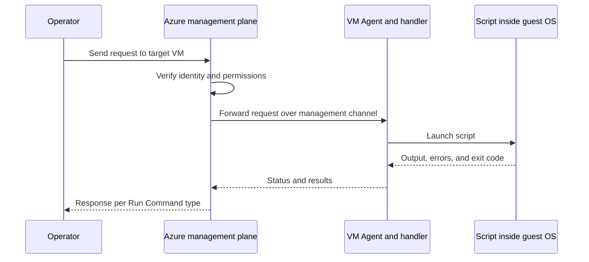
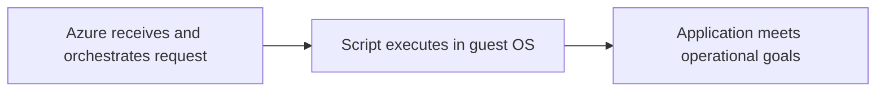

# Azure Run Command and Remote Administrative Operations

## Objectives and Context

Within the **Performance and Operations** chapter of the **CLOUD_PROVIDERS_AZURE** module, Azure Run Command is a tool for sending administrative scripts into a virtual machine through Azure's management plane. It is useful when inspecting OS state, verifying application health, or applying a controlled change.

An Azure application also depends on virtual networking, storage, data, identity, and monitoring. Therefore, "the command finished on the VM" must be distinguished from "the service has recovered." This lesson explains how to choose a Run Command type, verify prerequisites, run diagnostic examples on Linux and Windows, interpret outputs, and record operations.

VM names, GUIDs, services, and figures in the examples are hypothetical. Learners should substitute their assigned targets. The diagnostic examples do not intentionally alter application configuration; invoking Run Command is still an administrative action and can leave state, scripts, or execution logs on the VM.

## 1. Run Command Operates Through the VM Agent

Run Command uses the **Azure VM Agent** to execute scripts inside a Linux or Windows virtual machine. It is not an interactive terminal session. Azure offers two primary models: **Action Run Command** and **Managed Run Command**. See the [Azure Run Command overview](https://learn.microsoft.com/en-us/azure/virtual-machines/run-command-overview).

You can visualize the request flow as follows:



This diagram separates potential failure points: the request is rejected in Azure, the agent never picks it up, the script fails inside the guest OS, or results fail to return.

A VM that loses SSH/RDP connectivity has not necessarily lost its agent channel. Conversely, a VM visible in the Portal does not guarantee the agent and OS are healthy enough to run scripts.

## 2. When to Choose Run Command?

A typical use case is quickly inspecting disks, services, or network settings inside a VM when normal login sessions cannot be opened.

| Need | Tool Selection Guidance |
| --- | --- |
| Run a short, non-interactive diagnostic script | Action Run Command is usually appropriate |
| Manage scripts as deployment resources and track execution | Consider Managed Run Command |
| Need an interactive session for multi-step exploration | Use an organization-approved SSH/RDP channel |
| Install software or run templated post-deployment configuration | Consider Custom Script Extension or your team's deployment mechanism |
| Need recurring scheduled runs across many VMs | Use an orchestrator or scheduler; Run Command can serve as an execution step |
| Guest OS fails to boot or VM agent is unhealthy | Choose a recovery workflow suited to the VM state |

This table guides need analysis rather than guaranteeing every tool fits every VM. Microsoft describes Run Command and Custom Script Extension in [Run scripts in your Windows VM](https://learn.microsoft.com/en-us/azure/virtual-machines/windows/run-scripts-in-vm).

Run Command does not provide recurring schedules automatically simply because a script is saved as a Managed Run Command resource. Schedules, triggers, and error handling must still be designed.

## 3. Distinguishing Action and Managed Run Command

### 3.1. Action Run Command

Action Run Command suits short one-off executions, such as reading service status or gathering diagnostics. The typical CLI command is `az vm run-command invoke`; in Azure PowerShell, `Invoke-AzVMRunCommand`.

Limits to consider for Action on Linux include one active script at a time, no interactive input, no direct cancellation of a running script, a 90-minute maximum duration, and returned output truncated to the last 4,096 bytes. See [Action Run Command on Linux](https://learn.microsoft.com/en-us/azure/virtual-machines/linux/run-command).

### 3.2. Managed Run Command

Managed Run Command is represented as a child resource of the VM of type `Microsoft.Compute/virtualMachines/runCommands`. This model supports configurable timeouts, status tracking, parallel or sequential multi-script execution, and expanded output options.

Quick comparison:

| Aspect | Action | Managed |
| --- | --- | --- |
| Typical usage | Invoke a single execution | Create or update a Run Command resource |
| Common CLI verbs | `invoke` | `create`, `show`, `update` |
| Managed as an ARM resource | No child resource created for the invoke | Yes |
| Script duration | Fixed Action limits | User-configurable timeout |
| Multiple scripts | Subject to per-VM Action concurrency | Supports parallel or sequential execution |
| Tracking | Synchronous/operation call response | Execution status via instance view |

Refer to the model and usage in [Managed Run Command on Linux](https://learn.microsoft.com/en-us/azure/virtual-machines/linux/run-command-managed).

"Sequential execution" does not mean scripts automatically understand business dependencies. If script B relies on data produced by A, the workflow must wait and verify A's outcome before letting B proceed.

### 3.3. Similar CLI Group, Different Models

These two commands are not equivalent:

```text
az vm run-command invoke
    -> Sends an Action Run Command

az vm run-command create
    -> Creates or updates a named Managed Run Command
```

Never use `create` or `update` as a status-check command. To inspect an existing Managed Run Command, use a read operation such as `show`.

## 4. Checking Prerequisites Before Sending a Script

### 4.1. Identifying the Exact Target

A minimal target profile should include:

```text
Cloud:
Tenant ID:
Subscription ID:
Resource group:
VM name and resource ID:
Operating system:
Operation purpose:
```

VM names can collide across different subscriptions. In CLI examples, always pass `--subscription` and resource group explicitly rather than relying on the default subscription.

### 4.2. Checking the VM Agent and VM Status

Before diagnosing applications, verify the VM is running and the agent is in a healthy state. The Azure Windows VM Agent manages interactions between the VM and Azure fabric for extensions and similar operations; see the [Azure Windows VM Agent overview](https://learn.microsoft.com/en-us/azure/virtual-machines/extensions/agent-windows).

The examples below run on an admin workstation with **Azure CLI** using PowerShell syntax:

```powershell
$subscriptionId = '22222222-2222-4222-8222-222222222222'
$resourceGroup = 'rg-orders-prod'
$vmName = 'vm-orders-linux-01'

az account show --query "{subscription:id,tenant:tenantId,account:user.name}" --output json

az vm show --subscription $subscriptionId --resource-group $resourceGroup --name $vmName --query "{id:id,location:location,osType:storageProfile.osDisk.osType}" --output json

az vm get-instance-view --subscription $subscriptionId --resource-group $resourceGroup --name $vmName --output json
```

Read power state, agent status, and extension status in the instance view. If these inspection commands fail, resolve context, permissions, or VM state first; never treat an empty response as confirmation that the agent is healthy.

### 4.3. Checking Networking Along Both Agent and Data Paths

Run Command works even when SSH/RDP ports are closed, yet it still depends on the agent and outbound connectivity to return results. For Action on Windows, documentation notes HTTPS connectivity requirements to appropriate Azure endpoints; scripts may run without returning output if that path is blocked. An agent in `NOT READY` state also prevents Run Command from working. See [Action Run Command prerequisites and limits on Windows](https://learn.microsoft.com/en-us/azure/virtual-machines/windows/run-command).

Separate two network paths:

- **Control path:** agent receives the request and reports status/results.
- **Script data path:** downloading scripts, writing blob outputs, or calling business systems.

A script reading local service status might not need database access. A script testing database connectivity requires proper DNS, routes, and access rules. Never assume that because the agent channel works, every network target inside the script is reachable.

## 5. Azure Permissions and Guest Execution Account

### 5.1. Azure RBAC for Sending Operations

From the Compute operations catalog:

| Operation | Action to Verify |
| --- | --- |
| Invoke Action Run Command | `Microsoft.Compute/virtualMachines/runCommand/action` |
| Read Managed Run Command resource | `Microsoft.Compute/virtualMachines/runCommands/read` |
| Create or update Managed Run Command | `Microsoft.Compute/virtualMachines/runCommands/write` |
| Delete Managed Run Command resource | `Microsoft.Compute/virtualMachines/runCommands/delete` |

These are Compute resource provider operations, not a complete role definition for every workflow. Reading VMs, instance views, or command lists may require corresponding read permissions. Consult the [Azure permissions reference for Compute](https://learn.microsoft.com/en-us/azure/role-based-access-control/permissions/compute).

When granting access, scope to the specific VM or VM group managed. Permission to execute scripts carries far higher impact than reading resource configs; never treat it like routine read-only monitoring.

### 5.2. Caller Identity Differs from Script Execution Account

With Action, scripts execute under a privileged system account on the VM—`Local System` on Windows. That environment differs from an operator's RDP session: user profile, mapped drives, environment variables, and remote service permissions may all differ.

Microsoft highlights execution-context differences in [Troubleshoot Custom Script Extension and Run Command scripts](https://learn.microsoft.com/en-us/troubleshoot/azure/virtual-machines/windows/debug-customscriptextension-runcommand-scripts).

Practical implications:

- Use absolute file paths inside the guest.
- Never assume mapped network drives from a user login session exist.
- Print and verify the execution identity in diagnostic output.
- Local administrator rights do not automatically grant access to remote databases or storage.

Managed Run Command offers an option to run under a specified user. If used, that account and its permissions must be provisioned in the guest; never view it as bypassing access control.

## 6. Quick Execution from the Portal

For Action Run Command, open the VM in the Portal, navigate to **Run command**, and pick the OS-appropriate command:

- `RunShellScript` for Linux.
- `RunPowerShellScript` for Windows.

Paste a small script, double-check the target VM and contents, and execute under your assigned permissions. Start with read-only identity and status checks to confirm tool behavior before running mutating scripts.

When scripts are long or reused, version-controlling scripts helps audit exactly what ran. The Portal is handy for one-off actions; repeatable operations still require version names, parameters, timestamps, and archived results.

## 7. Linux Example: Inspecting a Service Without Changing Config

Suppose a Linux VM uses `systemd` and the backend runs as `orders-api.service`. The sample script checks timestamp, identity, root partition space, and service state. Substitute the actual service name if your architecture differs.

Contents of **`diag-linux.sh`** on the admin workstation:

```sh
#!/bin/sh
set -eu

printf 'run_id=diag-orders-001\n'
printf 'time_utc=%s\n' "$(date -u '+%Y-%m-%dT%H:%M:%SZ')"
printf 'host=%s\n' "$(hostname)"
printf 'execution_identity:\n'
id

printf 'root_filesystem:\n'
df -Pk /

if ! command -v systemctl >/dev/null 2>&1; then
    printf 'error=systemctl_not_available\n' >&2
    exit 3
fi

if systemctl is-active --quiet orders-api.service; then
    printf 'service_state=active\n'
else
    printf 'service_state=not_active\n'
    exit 2
fi

printf 'run_result=PASS\n'
```

The script uses POSIX shell syntax and requires no interactive input. Exit code 2 denotes the service check failed per this example's convention; exit code 3 indicates `systemctl` is unavailable. These codes are not standard Azure error codes.

From the **admin workstation running PowerShell with Azure CLI**, invoke:

```powershell
az vm run-command invoke --subscription $subscriptionId --resource-group $resourceGroup --name $vmName --command-id RunShellScript --scripts "@diag-linux.sh" --output json

if ($LASTEXITCODE -ne 0) {
    throw 'Azure CLI invocation failed; inspect the response.'
}
```

Azure CLI uses the `@file` syntax to read script contents from the admin machine; the file is not assumed to exist on the guest. In PowerShell, wrap `"@diag-linux.sh"` in quotes to pass the argument cleanly. See the [az vm run-command invoke reference](https://learn.microsoft.com/en-us/cli/azure/vm/run-command#az-vm-run-command-invoke).

Read the full result structure, including the message containing output/errors. `$LASTEXITCODE` here is the exit code of the CLI process on the admin machine, not automatically the business exit code of the guest script.

If the service is inactive, the next evidence to gather is bounded status and logs for that exact service. Do not restart blindly before checking whether it was stopped intentionally, misconfigured, or missing a dependency.

## 8. Windows Example: Running PowerShell Under the System Account

Suppose a Windows VM runs IIS with the `W3SVC` service. If your backend does not use IIS, substitute your workload's service name.

The following runs on an **admin workstation with the Azure PowerShell `Az` module**. Sign in and create a context targeting the tenant and subscription first:

```powershell
$tenantId = '11111111-1111-4111-8111-111111111111'
$subscriptionId = '22222222-2222-4222-8222-222222222222'

Connect-AzAccount -Tenant $tenantId -Subscription $subscriptionId -Scope Process -ErrorAction Stop
$context = Set-AzContext -Tenant $tenantId -Subscription $subscriptionId -Scope Process -ErrorAction Stop
```

Place the guest script inside a single-quoted here-string so PowerShell variables inside remain intact for the guest:

```powershell
$guestScript = @'
$ErrorActionPreference = 'Stop'

try {
    $service = Get-Service -Name 'W3SVC' -ErrorAction Stop

    [pscustomobject]@{
        RunId = 'diag-orders-win-001'
        TimeUtc = [DateTime]::UtcNow.ToString('o')
        Host = $env:COMPUTERNAME
        Identity = [Security.Principal.WindowsIdentity]::GetCurrent().Name
        Service = $service.Name
        ServiceStatus = $service.Status.ToString()
    } | ConvertTo-Json -Compress

    if ($service.Status -ne 'Running') {
        throw 'Service W3SVC is not in Running state.'
    }

    Write-Output 'run_result=PASS'
    exit 0
}
catch {
    Write-Error -Message $_.Exception.Message -ErrorAction Continue
    exit 2
}
'@

$result = Invoke-AzVMRunCommand -ResourceGroupName 'rg-orders-prod' -VMName 'vm-orders-windows-01' -CommandId 'RunPowerShellScript' -ScriptString $guestScript -DefaultProfile $context -ErrorAction Stop

$result.Value | Select-Object Code, Level, DisplayStatus, Message
```

`Invoke-AzVMRunCommand` supports `-ScriptString`, `-ScriptPath`, and `-DefaultProfile`; see the [Invoke-AzVMRunCommand cmdlet reference](https://learn.microsoft.com/en-us/powershell/module/az.compute/invoke-azvmruncommand).

`-ErrorAction Stop` on the admin workstation handles cmdlet errors; it does not replace reading the response body and guest script outcome. The sample script maps an unhealthy service state to a non-zero exit code.

The output object confirms host and execution identity, yet `Running` service status alone does not prove the website or transaction flow works. Business verification still requires application-level signals.

## 9. Managed Run Command Example: Creating the Resource and Reading Instance View

Managed Run Command fits scenarios where a script must be managed as a named resource with tracked execution status. This Linux example creates a command that simply prints UTC time to demonstrate lifecycle and observation.

On an admin machine running **PowerShell with Azure CLI**, reuse the Linux subscription, resource group, and VM variables from earlier. Query the VM's actual location:

```powershell
$vmLocation = az vm show --subscription $subscriptionId --resource-group $resourceGroup --name $vmName --query location --output tsv

if ($LASTEXITCODE -ne 0 -or [string]::IsNullOrWhiteSpace($vmLocation)) {
    throw 'Failed to read VM location.'
}

$runCommandName = 'diag-orders-managed-001'
```

Pick an unused name for this inspection run. If the name already exists, inspect its state and record before deciding whether to update it.

### 9.1. Creating a Managed Run Command

```powershell
az vm run-command create --subscription $subscriptionId --resource-group $resourceGroup --vm-name $vmName --name $runCommandName --location $vmLocation --script 'date -u' --timeout-in-seconds 120 --async-execution false --output json

if ($LASTEXITCODE -ne 0) {
    throw 'Managed Run Command request did not complete successfully on the CLI side.'
}
```

This command creates a Run Command resource and executes the script on the VM. The 120-second timeout is illustrative, not a universal recommended default.

Managed uses `--script`, unlike Action invoke's `--scripts`. Parameters `--timeout-in-seconds` and `--async-execution` are documented in the [az vm run-command create CLI reference](https://learn.microsoft.com/en-us/cli/azure/vm/run-command#az-vm-run-command-create).

### 9.2. Reading Status Without Resending the Script

```powershell
az vm run-command show --subscription $subscriptionId --resource-group $resourceGroup --vm-name $vmName --name $runCommandName --instance-view --output json
```

This example uses `--instance-view` per current CLI reference. If your installed CLI version has different syntax, check `az vm run-command show --help` before running.

In the response, inspect fields equivalent to:

```text
provisioningState
instanceView.executionState
instanceView.exitCode
instanceView.startTime
instanceView.endTime
instanceView.output
instanceView.error
```

For Managed Run Command, `provisioningState` reflects platform provisioning/orchestration, whereas `instanceView.executionState` and `exitCode` reflect guest script execution. Output and error strings in instance view are also size-bounded; configure persistent output storage when full logs are needed. See [how to read Managed Run Command results on Windows](https://learn.microsoft.com/en-us/azure/virtual-machines/windows/run-command-managed).

In workflows, treat the script step as passing only once execution state finishes successfully with an expected exit code. Unupdated states or empty fields must be treated as insufficient evidence.

### 9.3. Three Distinct Timing Concepts

| Concept | Distinction to Maintain |
| --- | --- |
| Admin client wait timeout | How long the CLI, terminal, or job waits for a response |
| Script execution timeout | Time limit for the script per Run Command type |
| Incident resolution deadline | Operational target for verification and recovery |

`--no-wait` tells the CLI not to block waiting for completion; it does not cancel the script if the terminal closes. `--async-execution` governs whether provisioning waits for script completion; it is not an application health result.

If your terminal disconnects or times out, read the resource/execution status first. Immediately resending a mutating command risks executing changes twice.

### 9.4. Resource Lifecycle Management

Name Managed Run Command resources after their purpose and run ID or script version per team conventions. Define a cleanup policy after archiving needed results to avoid accumulating stale diagnostic resources.

Deleting an actively running Managed Run Command resource can terminate execution per service mechanics; it does not roll back changes the script already performed. See [Managed Run Command lifecycle on Linux](https://learn.microsoft.com/en-us/azure/virtual-machines/linux/run-command-managed#delete-runcommand-resource-from-the-vm).

## 10. Interpreting Results Across Three Tiers

An administrative operation has at least three distinct outcome tiers:



| Tier | Evidence to Check | What Cannot Yet Be Inferred |
| --- | --- | --- |
| Management plane | API/cmdlet response, operation status | Script satisfied all business conditions |
| Guest execution | Execution state, exit code, output/error | Users can access the application normally |
| Application | Health checks, metrics, logs, synthetic transactions | Issue is durably resolved without ongoing monitoring |

For instance, a script exiting 0 after printing `service_state=active` confirms only what the script checked. If the backend cannot reach its database, users will still experience failures.

### Do Not Mask Failures with a Trailing Success Line

A script must surface errors through its final exit code. Native commands and cmdlets differ in error-reporting rules, so handle errors explicitly in the chosen language.

Logic pattern:

```text
Execute required step
If that step fails:
    Log bounded error details
    Exit with non-zero code
If all conditions pass:
    Log final summary
    Exit with code 0
```

In shell scripts, never let a trailing `echo` or `printf` mask a critical step's failing exit code. In PowerShell, decide which errors should be terminating errors and check `$LASTEXITCODE` after native executables.

A `"done"` or `"success"` line in stdout never replaces execution state and verification checks.

## 11. Designing Controllable Administrative Scripts

### 11.1. Non-Interactive

Scripts sent via Run Command must supply all inputs upfront without prompting or requiring GUI interaction.

For instance, before sending an installation script, define behavior if the package manager asks for confirmation, if a config file already exists, or if a service requires a reboot. If those cases are unhandled, move to a proper deployment mechanism.

### 11.2. Check State Before Modifying

A remediation script should follow this structure:

```text
Verify exact host and applicability conditions
Read current state
If state is already correct:
    Return no-change result
If change is needed:
    Record before-state
    Apply only the authorized change
    Verify after-state
    Return result with evidence
```

**Idempotency** means re-running produces no side effects beyond the desired state. For example, checking a configuration key and setting it accurately is safer than appending the same line to a file on every run.

Even so, idempotency alone does not solve concurrent runs or mid-script interruptions. Shared-resource operations still need proper coordination.

### 11.3. Small Blast Radius and Rollback Path

Before making a change, define:

- Exactly which files, services, or settings may be modified.
- Conditions under which to skip or abort.
- Before-state that must be preserved.
- How to verify the result and how to roll back if checks fail.

Never bundle unrelated steps into one script just to reduce invocations. During a remote-login outage, editing firewall rules, changing routes, and restarting multiple services at once makes root-cause isolation and rollback far harder.

### 11.4. Avoid Disrupting the Control Channel

If a script modifies routes, DNS, proxies, or the VM agent, it can sever the very channel delivering results. Establish an alternate verification method before running such changes.

Reboots, stopping the agent, or network changes should never be treated as harmless trailing steps. When genuinely required, separate them into conditional management steps with independent VM lifecycle tracking.

## 12. Parameters, Secrets, and Script Sources

### 12.1. Inputs Must Be Tightly Validated

If service names, paths, or endpoints are passed into a script, validate them against an allowlist. Never concatenate unvalidated strings into shell commands.

For example, a script managing a known set of services can accept a logical key `orders-api` and map it internally to a fixed service name. That is far safer than accepting arbitrary command fragments via parameters.

### 12.2. Never Mix Secrets into Output

Managed Run Command provides protected parameters and run-as user options. Those features do not stop a script from printing sensitive values to stdout, stderr, or application logs.

When scripts need credentials, design credential delivery securely for the target system. Keep tokens, passwords, and SAS URLs out of script bodies, public parameters, terminal history, and diagnostic outputs.

Keep two permissions separate:

- The Azure identity authorized to invoke Run Command.
- The guest account or identity authorized to access target systems.

Never assume the Azure caller identity is the identity a database command inside the guest will use.

### 12.3. Verify Script Sources

When fetching scripts from a URI, use a managed source, traceable versions, and tightly scoped read permissions. A script-download URI should never grant broader storage access than necessary.

In operational logs, record the reviewed version or content hash. A URL pointing to `"latest"` may not reproduce what actually ran later on.

## 13. Large Outputs and Diagnostic Data

Long output can be truncated, losing critical header lines or error details. For simple operations, format output as a compact summary:

```text
run_id
start/end timestamps
host and execution identity
before/after conditions
result code
location of detailed evidence if any
```

With Managed Run Command, output and error streams can be directed to blobs. Documentation requires output/error blobs to use **AppendBlob** with permissions matching the chosen access method. See [Configure output for Managed Run Command](https://learn.microsoft.com/en-us/azure/virtual-machines/linux/run-command-managed).

When designing evidence storage, define:

| Item | Required Decision |
| --- | --- |
| Script source | Who may read it, which version is used |
| Output | Does it contain sensitive data, who has access |
| Error | Does it leak endpoints, paths, or credentials |
| Retention | How long to keep per operational goals |
| Volume and size | Cap diagnostic volume and storage cost |

Do not dump entire application logs or all environment variables merely because output can write to Storage. Scope strictly to the diagnostic question and timeframe needed.

Use per-run storage locations or strict naming conventions to avoid mixing data across incidents. Always know which execution produced the output you are reading—not just the VM name.

## 14. Tracking and Auditing Operations

Azure Activity Log records control-plane resource management operations. It helps correlate caller identity, timestamp, operation, and management outcome. See [Azure Monitor Activity Log](https://learn.microsoft.com/en-us/azure/azure-monitor/fundamentals/activity-log).

Activity Log does not replace script stdout/stderr or proof that the application recovered. An operational record should link every layer:

```text
Incident or change ID
    -> Azure identity and operation
    -> VM resource ID
    -> Script version/hash and non-sensitive parameters
    -> Timestamp, execution state, and exit code
    -> Application verification results
```

If Activity Log is exported to an appropriate Log Analytics workspace, you can use an illustrative query:

```kusto
AzureActivity
| where TimeGenerated > ago(24h)
| where ResourceProviderValue =~ "MICROSOFT.COMPUTE"
| where OperationNameValue contains "runCommand"
| project TimeGenerated, Caller, OperationNameValue,
          ActivityStatusValue, ResourceId, CorrelationId
| order by TimeGenerated desc
```

This query filters operations containing `runCommand`; narrow `ResourceId` and time range to the real incident. It does not assert that every run emits a single record. Columns in this example are documented in the [AzureActivity table schema](https://learn.microsoft.com/en-us/azure/azure-monitor/reference/tables/azureactivity).

If Activity Log export to that workspace is not configured, do not expect the query to return full subscription history. Verify log sources and collection scope first.

## 15. Layered Error Diagnosis

| Symptom | Layer to Inspect | Remediation Direction |
| --- | --- | --- |
| Permission denied | Azure identity and RBAC | Identify caller, operation, and scope; check exact permissions |
| VM not found | Context or resource ID | Verify tenant, subscription, resource group, and resource ID |
| VM stopped or agent not ready | VM and guest agent | Inspect instance view, power state, and appropriate recovery steps |
| Script appears to run with no output | Return path or output target | Check status, agent, outbound access, and output storage |
| Action reports a task already running | Execution coordination | Locate prior run; do not spam additional invocations |
| Timeout | Script, dependency, or return channel | Verify actual side effects before retrying |
| Works manually, fails via Run Command | Guest account and environment | Check execution user, PATH, profile, and remote permissions |
| Managed provisioning succeeds yet script fails | Guest execution | Read instance view, exit code, and error stream |
| Script returns 0 yet users still see errors | Application verification | Check health, data, and transaction flows |
| Output missing beginning or expected tail | Size limits and output handling | Use concise summaries or persistent output storage |

For Action, documentation lists common diagnostic log paths:

- Linux: `/var/log/azure/run-command/handler.log`.
- Windows: `C:\WindowsAzure\Logs\Plugins\Microsoft.CPlat.Core.RunCommandWindows\<version>\RunCommandExtension.log`.

Cross-check exact paths and steps with [Action troubleshooting on Linux](https://learn.microsoft.com/en-us/azure/virtual-machines/linux/run-command#action-run-command-linux-troubleshooting) and [Action troubleshooting on Windows](https://learn.microsoft.com/en-us/azure/virtual-machines/windows/run-command#action-run-command-windows-troubleshooting). Do not assume every Managed version uses these exact paths.

### When Timeouts Happen or Execution Is Uncertain

An appropriate sequence:

1. Preserve the request ID, Managed Run Command name if any, and send timestamp.
2. Read current status; for Managed, inspect instance view.
3. Check evidence inside the guest or observability tools via another working channel.
4. Determine whether changes ran completely, partially, or not at all.
5. Decide on re-running only after understanding replay impact and preconditions.

A timeout does not automatically roll back data or config to its prior state. A non-idempotent script can cause duplicate side effects if re-sent.

## 16. Walkthrough: Handling a Failing Service

Suppose dashboards show backend errors spiking and SSH to a Linux VM fails. The sequence below illustrates diagnostic reasoning, not instructions to run blindly on live systems.

**Step 1 — Scope the issue.** Check VM, subscription, error onset timestamp, and recent changes. Determine whether errors affect one VM or the whole backend pool.

**Step 2 — Confirm the management channel.** Read power state and VM Agent status. If the agent is not ready, switch to an appropriate VM recovery workflow rather than repeating Run Commands under the same assumption.

**Step 3 — Short diagnostic.** Run a script checking service status and root disk space. Suppose the service is inactive while disk has free space; that narrows the search, without proving a restart is the right fix.

**Step 4 — Find the failure condition.** Read bounded logs around when the service stopped and inspect related configs or dependencies. If a recent config change is confirmed as the root cause, apply an authorized rollback/fix within scope.

**Step 5 — Verify and close out.** Re-check the service, health endpoint, and backend error rate. Archive results with evidence, then codify any lasting change in official configuration/deployment pipelines.

That final step prevents **configuration drift**: a manual fix on a VM can disappear when the VM is reprovisioned from old config. Run Command helps handle the immediate operational task; durable state must still live in the system's deployment workflow.

## 17. Minimal Record for Remote Administration

A concise record should let anyone see what was done and how thoroughly it was verified:

```text
Purpose and incident/change ID:
Cloud, tenant, and subscription:
VM resource ID and OS:
Action or Managed Run Command:
Caller and permission scope:
Script version/hash:
Non-sensitive parameters:
Guest execution account:
Start/end timestamps:
Management plane status:
Execution state / exit code / output:
Changes performed:
Application verification results:
Evidence location and retention:
Follow-up required in official deployment config:
```

Using Run Command effectively requires targeting the right VM, verifying a healthy agent and connectivity, running tightly scoped scripts, and validating results across Azure, guest OS, and application layers. Post-action evidence is the basis for concluding an operational issue is resolved.
