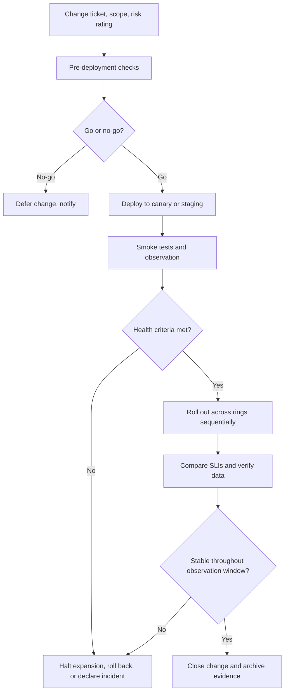

# Designing Maintenance Windows and Safe Change Deployments

A system running on Microsoft Azure still needs frequent changes: code releases, OS patching, AKS upgrades, network tuning, database migrations, or certificate rotations. Even if you pick a low-traffic hour and click deploy, a small change can trigger cascading outages. Designing a **maintenance window** means deciding in advance *when* changes are permitted, *what conditions* allow starting, *how to bound blast radius*, *when to stop or roll back*, and *what evidence* proves the system is stable.

This lesson belongs to the **Performance and Operations** chapter within the Azure ecosystem—spanning subscriptions, resource groups, Entra ID, virtual networks, compute, storage, data, monitoring, security, and cost management. The primary example is an API on Azure App Service; corresponding principles for Azure Virtual Machines, Azure Kubernetes Service (AKS), and data services are covered separately.

## Learning Objectives

After this lesson, you will be able to:

1. Distinguish approved change windows, expected downtime, and Azure-managed maintenance schedules.
2. Choose maintenance timing based on load profiles, system dependencies, SLOs, and time zones.
3. Build a change plan with an owner, blast radius, pre-checks, success criteria, stop triggers, and recovery options.
4. Select appropriate risk-reduction mechanisms for App Service, VMs, AKS, Infrastructure as Code, and databases.
5. Execute a sample runbook with health checks and observability via Azure Monitor/Application Insights.

## 1. Understanding Maintenance Windows Properly

A **maintenance window** is an agreed time interval for operations teams to *execute and verify a change*. It does not equal the amount of time the service is permitted to be down. An application may deploy within a two-hour window while still maintaining a zero-user-impact objective.

Distinguish four concepts:

| Concept | Meaning | Example |
| --- | --- | --- |
| Change window | Time span when changes are authorized | Saturday 00:00–02:00 (Vietnam time) |
| Expected downtime | Forecasted and communicated outage window, if any | Up to 5 minutes restarting a single-instance service |
| Maintenance schedule | Schedule configured for a specific maintenance mechanism | Guest OS patching schedule via Azure Update Manager |
| Change freeze | Period restricting changes to protect business operations | Period-close days, promotional sales, or peak seasons |

An application maintenance window chosen by the app team does not automatically control platform maintenance schedules for every Azure service. Depending on the resource, Azure offers different notification, scheduling, or preferred-window controls. **Azure Service Health** tracks maintenance advisories and incidents affecting your subscription; **Resource Health** reports individual resource status. Never assume every PaaS service lets you defer Microsoft platform maintenance or guarantees an exact start minute.

For SLOs, planned downtime still affects user experience. Exclude it from SLO calculations only if your organization's SLI/SLO definitions and service agreements explicitly specify that; never assume "we sent a notice" grants an automatic exemption.

## 2. Choosing Windows Based on Data and Dependencies

Suppose a payments application serves users in Vietnam, running on App Service, Azure SQL Database, and Azure Cache for Redis, integrated with an external payment gateway. Operations needs to deploy an API update and subsequently patch several background-worker VMs.

Before locking in a schedule, collect **at least several representative usage cycles** from Azure Monitor and Application Insights: request traffic, error rates, p95/p99 latency, queue depths, scheduled jobs, database connections, payment reconciliation windows, and day-of-week peaks. Combine this with business calendars, accounting closes, backup schedules, security events, and partner dependencies. Low HTTP traffic is not automatically safe if batch jobs or data reconciliations are running.

A sample schedule:

| Attribute | Sample Decision | Rationale |
| --- | --- | --- |
| Window | Saturday 00:00–02:00, `Asia/Ho_Chi_Minh` time zone | After core transaction hours, with on-call coverage |
| UTC equivalent | Friday 17:00–19:00 UTC | Prevents date confusion when configuring UTC-based tools |
| Rollout cutoff | Finish traffic cutover before 01:00 | Reserves remainder for verification and rollback |
| Recovery reserve | 45–60 minutes within the same window | Checking, restoring, and communicating if issues occur |
| Deferral criteria | Active high-severity incident, failed backups, partner maintenance, abnormal SLOs | Avoid adding risk to an already unstable system |

Vietnam does not observe Daylight Saving Time, though business units or providers in other time zones may. Record **IANA/named time zones** in change tickets and verify how each Azure service interprets schedules (UTC vs. selected time zone). For recurring schedules in DST-observing zones, verify transition dates.

For multi-region systems, windows must consider global user flows, traffic failover capability, replication lag, and standby locations. Never perform simultaneous maintenance on both primary and secondary regions if the architectural goal is preserving regional fault tolerance.

## 3. Classifying Changes and Assessing Risk

A strong plan starts with **one controllable unit of change**. Describe what will differ post-deployment, which resources are touched, and who could be impacted.

| Change Type | Typical Risks | Priority Mitigations |
| --- | --- | --- |
| API update on App Service | Startup failure, misconfiguration, 5xx spike | Deployment slots, warm-up, health probes, version rollback |
| Guest OS patching on Azure VMs | Required reboots, package conflicts, lost capacity | Azure Update Manager, ringed rollouts, reboot checks, spare capacity |
| AKS / node pool upgrade | Pod evictions, deprecated API versions | Planned maintenance, surge, readiness, PodDisruptionBudget, compatibility checks |
| Networking / identity change | Broad access loss, broken integrations | IaC `what-if`, least privilege, scoped rollout, access-flow validation |
| Azure SQL schema change | Incompatibility with old code, long migrations, data loss | Expand–migrate–contract, backups/PITR, testing on representative clones |

Assess risk by failure probability, business impact, **blast radius** (how wide impact can spread), and recoverability. A change may touch few lines of code yet carry high risk if it alters Entra ID policies, network routes, or database columns shared across applications.

Grouping resources into **rings** limits blast radius: test environment → small production slice → remaining production. For VMs, use tags such as `environment=prod`, `patch-ring=canary`, and `patch-ring=batch-2`; for AKS, use node pools or workloads designed for rolling upgrades; for HTTP, use slots or traffic splitting where supported. Canaries must receive enough representative traffic to surface defects.

## 4. Required Change Record Contents

A change ticket or deployment record should contain at minimum:

- **Change identity:** ticket ID, rationale, version/artifact, commit link, and accountable owner.
- **Scope:** subscription, resource group, resource IDs, environment, dependencies, and potentially impacted user groups.
- **Schedule:** start/end times with time zone; go-forward/rollback decision deadline; on-call contacts and communication channels.
- **Risk profile:** expected impact, SLOs/SLIs to protect, remaining capacity, ring sequence.
- **Preconditions:** required approvals, healthy baseline state, verified backups/restores, tested artifacts, proper deployment permissions.
- **Runbook:** commands or execution steps, expected outputs, verification criteria per milestone.
- **Go/no-go and rollback:** metric thresholds, who holds stop authority, expected recovery time, how to verify data consistency.
- **Evidence and communication:** before/after dashboards, Azure Activity Log records, any resulting incidents, and completion notice.

**RTO** is the target recovery time after an incident; **RPO** is the maximum tolerable data loss measured in time. Verify that backups, restores, replication, and regional failover actually meet RTO/RPO rather than merely writing numbers into a ticket. Rolling back application code does not automatically undo committed transactions or destructive schema changes.

Small teams may combine roles, yet each responsibility must be explicit: the change owner who coordinates and decides, the implementer running actions, the observer watching metrics/logs, the data owner validating migrations/restores, and the business representative approving impact and receiving updates. Avoid having the person typing commands also judge every anomaly and decide whether to extend the window.

## 5. Choosing the Right Azure Maintenance Mechanism

### 5.1. Azure Virtual Machines: Scheduled OS Patching

**Azure Update Manager** handles assessment and installation of guest OS updates for Azure VMs and Azure Arc-enabled servers. For recurring patching, teams can configure a **Maintenance Configuration** scoped to *in-guest patching*, with recurrence, maintenance duration, patch classifications/selections, and reboot policies, then assign it to target machines. Exact support and prerequisites depend on machine type, OS, and patch orchestration mode.

Safe workflow:

1. Check machine inventory and update assessment status; confirm agent/extension health, patch orchestration mode, and permissions required by Azure Update Manager.
2. Select schedule, execution duration, and tags/rings. When using **dynamic scoping**, double-check subscription, resource group, region, and tag filters; newly added VMs will be picked up in future runs.
3. Run on the canary ring first; verify applications, filesystems, DB connections, reboot state, and installed patches.
4. Proceed through subsequent rings with adequate spare capacity. For stateful workloads, follow application cluster/failover procedures before rebooting.
5. Verify installation results, failed machines, remaining updates, and SLI impact; remediate failed machines individually.

Never treat "patch command ran" as sufficient proof of success. A patch may require a reboot; actual job duration, dependent patches, and fitting within the window must be verified in practice. Guest patching schedules do not replace Azure platform maintenance notifications.

### 5.2. AKS: Maintenance Windows Do Not Replace Safe Upgrades

AKS offers **planned maintenance configurations** for service-supported operations such as scheduled control-plane or node OS maintenance/upgrades per the configured mechanism. Configure schedules for the exact operation type and AKS version in use; do not assume an AKS maintenance window schedules manual container deployments.

When scheduling upgrades, prepare:

- Check Kubernetes version, deprecated APIs, add-ons, and manifest compatibility.
- Ensure node pools hold spare capacity; configure rolling upgrades and surge within quotas, IP limits, and max node counts.
- Run multiple replicas with `readinessProbe`, `livenessProbe`, and `startupProbe` tuned to app behavior, plus an appropriate **PodDisruptionBudget** (PDB).
- Verify drain/termination grace periods, open connections, stateful volumes, and active jobs; PDBs do not guard against every disruption cause.
- Monitor rollouts pool by pool or workload by workload; halt if replicas fail readiness, app errors spike, or capacity drops below thresholds.

Maintenance windows prevent upgrades during peak traffic; actual availability still rests on replicas, zones, storage, probes, and rollout discipline.

### 5.3. App Service: Staging Releases with Deployment Slots

On App Service tiers supporting **deployment slots**, deploy the new build to a `staging` slot, validate health endpoints and configuration, and then **swap** into `production`. Slots let you prepare and warm up the application before switching versions, cutting startup disruption risk.

Before swapping, audit which app settings and connection strings are **slot settings** (sticky to a slot), along with identities, hostnames, private networking, databases, and authentication. Where traffic routing is used, roll out percentage-wise incrementally if appropriate; swapping 100% of traffic is not a canary rollout.

Swapping back provides a fast rollback for **application code and compatible configuration**; it cannot undo mutated data or incompatible schema migrations. Design database changes to support both old and new versions during the transition phase.

### 5.4. Infrastructure as Code and Data

With Bicep/ARM, run `what-if` before deploying to spot created, modified, or deleted resources. With Terraform, inspect `plan` output and check state/locks; never apply a stale plan after the environment changed. Carefully gate RBAC, firewall, route table, private endpoint, and DNS changes because they can sever access for both users and recovery tools.

For Azure SQL Database, follow **expand–migrate–contract**:

1. **Expand:** add backward-compatible tables, columns, or indexes while keeping legacy APIs working.
2. **Migrate:** deploy code reading/writing compatibly; backfill in batches and validate data.
3. **Contract:** drop legacy schema elements only after verifying zero clients depend on them—typically in a later change window.

Verify retention policies, point-in-time restore (PITR), or appropriate recovery mechanisms before risky migrations. Restoring a database usually requires evaluating writes occurring after the backup timestamp; never blindly roll back an entire system without verifying data consistency.

## 6. Designing Deployment Control Gates

A safe workflow enforces explicit *gates*:



**Go** criteria may include: zero active high-severity incidents; normal baseline dashboards; sufficient replica/node/zone capacity; verified backups; green CI pipelines; checksummed or immutable artifacts; on-call staff ready; and deployment credentials scoped with least-privilege Azure RBAC. **No-go** criteria must have real teeth: if checks fail, defer the change even if the window has arrived.

At each ring, inspect both **technical** and **business** signals: request success, p95 latency, CPU/memory, timeouts, connection pools, queue lag, payment success rate, and anomalous order counts. Base limits on the application's own baseline. Illustrative example:

| Signal | Hypothetical Baseline | Post-Cutover Gate |
| --- | --- | --- |
| HTTP error rate | 0.2% | Does not exceed 1.0% across two consecutive 5-minute windows |
| p95 request latency | 300 ms | Does not sustainably exceed 450 ms |
| Payment success rate | 99.5% | Does not drop below 99.0% with sufficient sample size |
| Healthy instances | 3/3 | Always meets SLO capacity; never loses all replicas together |
| Queue age | 20 seconds | Does not climb continuously past agreed processing threshold |

These are **illustrative thresholds**, not default Azure recommendations. Adjust for seasonality, traffic volume, SLOs, calibrated alert thresholds, and statistical variance. At low request counts, percentages swing sharply; combine sample counts with end-to-end functional checks.

If a signal hits a stop threshold, the change owner must halt expansion first, verify whether the change caused it, and then decide to roll back, roll forward with a verified fix, or escalate to incident response. Always set a **hard time cutoff** to avoid pushing deployments close to the window's end with no time left to recover.

## 7. Sample Runbook: Releasing an API on Azure App Service

**Scenario:** The `payments-api-prod` API in resource group `rg-payments-prod` has `production` and `staging` slots on a slot-capable App Service Plan. The API exposes `/health/ready` checking critical dependencies plus a safe transactional smoke-test suite. The release package is a CI-built ZIP file, and database migrations are backward-compatible and pre-tested in a production-like environment.

The commands below are **illustrative with sample variables**, run in Bash/Azure Cloud Shell or an authorized runner. Substitute real values and ensure the health endpoint is reachable from where commands run; if using private endpoints, run checks from an authorized network. Never embed passwords in scripts; pipelines should use managed identities or workload identity federation.

### 7.1. T–7 Days to T–1 Day: Preparation

Confirm impact/risk, timing, on-call roster, and rollback plan. Complete build tests, integration tests, smoke tests, slot setting audits, data checks, and backups. Rehearse rollback in staging if possible. Create or verify Azure Monitor alerts and confirm Application Insights receives telemetry. If infrastructure changes include Bicep, preview the diff:

```bash
az account set --subscription "$SUBSCRIPTION_ID"
az deployment group what-if --resource-group rg-payments-prod --template-file main.bicep --parameters @prod.parameters.json
```

`what-if` is only meaningful if the repo uses those two Bicep/parameter files. The owner must review expected changes—especially deletions or changes to permissions and networking—before approving IaC deployment. Do not treat `what-if` as proof of runtime behavior.

### 7.2. T–30 Minutes: Go/No-Go Verification

The on-call engineer checks the 30–60 minute baseline, active slot health, database connectivity, Service Health, open alerts, spare capacity, and payment partner status. Record the old release ID, new release ID, config version, and timestamp. Freeze unrelated changes during deployment.

Example query in **Application Insights Logs using the `requests` schema** (for workspace-based schemas, use the corresponding table/columns such as `AppRequests`):

```kusto
requests
| where timestamp > ago(30m)
| summarize
    requests = count(),
    errorRatePct = 100.0 * countif(success == false) / count(),
    p95Latency = percentile(duration, 95)
  by bin(timestamp, 5m)
| order by timestamp asc
```

Save the baseline output and check business flows. If telemetry is missing or preconditions fail, declare **no-go**.

### 7.3. T0: Deploy to Staging and Verify

Assuming the `staging` slot exists, is configured properly, and `release.zip` passed CI:

```bash
RG="rg-payments-prod"
APP="payments-api-prod"
PACKAGE="./release.zip"

az webapp deploy --resource-group "$RG" --name "$APP" --slot staging --src-path "$PACKAGE" --type zip

STAGING_HOST=$(az webapp show --resource-group "$RG" --name "$APP" --slot staging --query "defaultHostName" -o tsv)
curl --fail --show-error --silent "https://$STAGING_HOST/health/ready"
```

Proceed with safe read/write API smoke tests, auth checks, integration flows, and negative cases; inspect staging logs, startup duration, and database connections. A single HTTP 200 does not prove the change works—verify application behavior and concrete metrics.

### 7.4. Swap Versions and Monitor

Swap only after staging passes all checks:

```bash
az webapp deployment slot swap --resource-group "$RG" --name "$APP" --slot staging --target-slot production

PROD_HOST=$(az webapp show --resource-group "$RG" --name "$APP" --query "defaultHostName" -o tsv)
curl --fail --show-error --silent "https://$PROD_HOST/health/ready"
```

Annotate the swap timestamp on dashboards. Across at least two or more agreed observation windows, compare p95, 5xx errors, request rate, dependency failures, queue processing time, and payment metrics against baseline and real traffic. Check active user sessions, background jobs, and newly written records. If percentage-based traffic routing is available, step through canary levels and verify each per its own runbook.

### 7.5. Rollback Criteria and Execution

Suppose post-swap error rates breach thresholds, no backward-incompatible data writes have occurred, and the `staging` slot still holds the prior version. The change owner triggers rollback:

```bash
az webapp deployment slot swap --resource-group "$RG" --name "$APP" --slot staging --target-slot production
curl --fail --show-error --silent "https://$PROD_HOST/health/ready"
```

After rolling back, verify the **actual serving version** in production, cross-check metrics, and run smoke tests. Never blindly repeat the swap command if slot states changed unexpectedly; check first to avoid swapping the wrong direction. If a migration broke backward compatibility, execute the approved data-recovery or roll-forward plan rather than assuming swapping back is safe.

If the decision deadline passes or SLOs are impacted, escalate to severity-appropriate incident management, prioritizing service restoration and stakeholder updates. Preserve logs, deployment history, Activity Log entries, and release metadata for root-cause investigation.

### 7.6. T+30 to T+60 Minutes: Closing the Window

The on-call engineer and change owner jointly confirm: metrics and business flows returned within thresholds; no new errors appear; backlogs drained; resource, replica, and connection states are healthy; and scheduled jobs run normally. Record the outcome (succeeded, rolled back, or deferred), step timestamps, final version, dashboard evidence, and incident links if any. Extend monitoring after the window if delayed failures are possible.

## 8. Operation Timeline and Recovery Budget

A sample two-hour window timeline:

| Vietnam Time Milestone | Activity | Gate to Proceed |
| --- | --- | --- |
| 23:30–00:00 | Health checks, go/no-go approval, on-call confirmation | Zero blockers, backups and monitoring ready |
| 00:00–00:15 | Staging deploy and smoke tests | Health, config, and business flows pass |
| 00:15–00:30 | Version swap / canary | No blocking signals observed |
| 00:30–01:00 | Observation and controlled expansion | SLIs within bounds, sufficient sample size |
| 01:00 | **Deployment cutoff** | Abort/roll back if not passing; reserve recovery time |
| 01:00–01:45 | Extended verification or rollback/recovery | Adequate time to validate stable version |
| 01:45–02:00 | On-call handoff confirmation, ticket update, comms | Clear final status |

Recovery reserve must be sized to **measured rollback time**. If rollback actually takes 90 minutes, a two-hour window with a 01:00 cutoff does not work. Either extend the window, shrink the change scope, or design a faster traffic-switching mechanism. Never write "completes in a few minutes" if it has never been rehearsed.

## 9. Failure Modes to Watch For

**A schedule without fault tolerance.** Rebooting three VMs behind a load balancer simultaneously causes an outage even during off-peak hours. Patch in rings, verify health probes and capacity, and never break stateful cluster quorum.

**Mismatched Azure and application schedules.** AKS maintenance configurations or guest patch schedules do not automatically synchronize with app deployment pipelines. Owners must check every schedule, including Service Health advisories and third-party provider windows.

**Assuming slot swap undoes everything.** If the new version drops a SQL column, rotates encryption keys, or writes data unreadable by the old code, swapping back to the old artifact can worsen the outage. Use backward-compatible migrations, feature flags, snapshots/backups, and tested data-recovery plans.

**Delayed failures.** Memory leaks, cache expirations, cron jobs, and queue backlogs may not surface in the first 5 minutes. Post-release observation must span key operational cycles; extend observation windows or run longer canaries when warranted.

**Missing permissions during rescue.** An on-call engineer who can deploy yet lacks permissions to read logs, change routes, or restore backups slows recovery. Verify Azure RBAC, temporary elevation workflows, runbooks, and out-of-band access before the window opens.

**Emergency maintenance.** Critical vulnerability patching may not wait for regular windows. Still assess blast radius, obtain exception approval per process, back up, roll out in small rings, and capture clear telemetry; document why out-of-window action was needed in a postmortem.

## 10. Hands-On Exercise

An ordering application runs across three VMs in two availability zones, with one primary database and queue-processing workers. All three VMs need guest OS updates. Dashboards show lowest HTTP traffic at 01:00, yet DB backups run 01:00–01:30, and one of the three VMs is the sole worker running reconciliation jobs.

Draft a change ticket covering appropriate timing, ring layout, go/no-go criteria, verification gates, cutoff time, and recovery plan. Answer:

1. Why is 01:00 not automatically a good choice despite low HTTP request volume?
2. Before rebooting the reconciliation worker, what must be verified regarding queues, idempotency, and job reruns?
3. Which signals force halting between rings?
4. If VM patching succeeds yet successful order processing drops, can the change be marked complete?

**Reference hints:** the window must avoid backup and reconciliation conflicts or establish explicit controls; patch lower-risk VMs first; preserve sufficient capacity at every step; monitor VM, business, queue, and data signals together; halt whenever health gates fail; close the change only after the system stabilizes against defined criteria.

## 11. Operational Readiness Checklist

- [ ] Scope, owner, dependencies, risks, and time-zone-explicit schedule are defined.
- [ ] Baselines from Azure Monitor/Application Insights and critical business hours are reviewed.
- [ ] Backups, restores, RTO/RPO, permissions, and communication channels are verified.
- [ ] Appropriate Azure mechanism selected per resource: Update Manager, AKS planned maintenance, App Service slots, or IaC pipelines.
- [ ] Immutable artifacts, smoke tests, canaries/rings, health gates, and no-go criteria are prepared.
- [ ] Rollback duration is rehearsed or measured with sufficient recovery reserve inside the window.
- [ ] Schema/data impact and prior-version backward compatibility are verified.
- [ ] Independent monitoring, dashboards/alerts, and threshold-based stop decisions are assigned.
- [ ] Final status, final version, telemetry, timeline, and any incident lessons are recorded.

A well-designed maintenance window ensures operations knows **when to start, when not to proceed, and how to recover**, while preserving concrete evidence of performance, availability, and business impact after every change on Azure.
