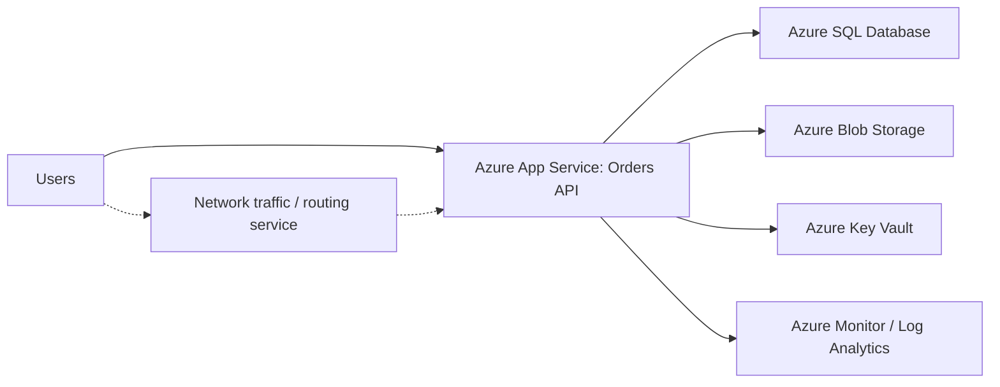
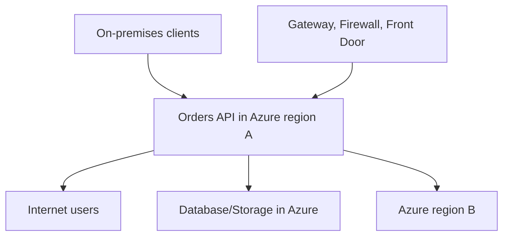
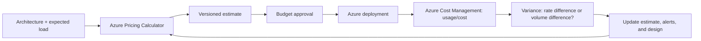

# Estimating Costs with the Azure Pricing Calculator

## 1. Why Estimate Costs Before Deploying to Azure?

An application deployed on Microsoft Azure typically uses multiple resources simultaneously: subscriptions and resource groups for organization, virtual networks for connectivity, App Service or virtual machines to run code, databases to store information, Azure Storage for files, Key Vault for secrets management, and Azure Monitor for observability. Every service configuration affects **operating costs** and system capacity. A seemingly minor choice, such as enabling an extra Availability Zone or extending log retention, can alter the monthly estimate.

The **Azure Pricing Calculator** is an online tool for building **pre-deployment estimates** by selecting Azure services, deployment regions, configurations, purchasing models, and usage assumptions. The output is an **estimate based on input assumptions**, not a binding invoice, price SLA, or guaranteed forecast. Public unit prices, configuration options, and discounts can vary by time, region, subscription type, and the organization's purchasing agreement.

This lesson is part of the **Cost Management** chapter in the Azure learning track. The goal is to turn an application design from an architecture diagram into an estimate table that can be explained, verified, and updated as demand grows. You will examine compute, storage, data, networking, backup, and monitoring costs alongside commercial factors like usage commitments, currency, and taxes.

### After This Lesson, You Will Be Able To

1. Distinguish the Azure Pricing Calculator from Azure Cost Management, the TCO Calculator, and contract quotes.
2. Gather the required inputs before estimating: region, SKU, instance count, runtime hours, storage capacity, operations, bandwidth, availability level, and environments.
3. Operate the Pricing Calculator to add individual services, adjust parameters, and aggregate monthly estimates.
4. Cross-check costs using unit price times usage quantity formulas and spot omitted assumptions.
5. Compare baseline, peak-load, staging, and disaster recovery estimates; apply appropriate contingency buffers for uncertainty.
6. Understand the applicability of pay-as-you-go, reservations, savings plans, Azure Hybrid Benefit, and contract discounts.
7. Reconcile estimates against actual usage data and establish a post-deployment estimate update workflow.

## 2. Which Tool Answers Which Question?

| Tool | Primary Question | When to Use |
| --- | --- | --- |
| **Azure Pricing Calculator** | Given a hypothetical configuration and volume, how much might Azure resources cost? | Pre-deployment; when designs change; when evaluating scaling |
| **Azure Cost Management** | What actual and forecasted costs are running resources generating? | During operations, analysis, allocation, and budgeting |
| **Azure TCO Calculator** | How does total cost of ownership on-premises compare to migrating to Azure? | When building an infrastructure migration business case |
| **Azure Advisor** | What cost-saving, performance, or operational improvements exist for running resources? | When optimizing an already-deployed environment |
| **Organization's Azure price sheet / contract** | Which unit rates and discounts actually apply at billing time? | Before budget approval and during invoice reconciliation |

The Pricing Calculator builds estimates **before resources are created**; Cost Management analyzes costs already recorded or accruing. Even for the same Azure services, the two outputs may differ due to actual usage, billing adjustments, discounts, credits, currency, and data scope.

The common access URL is [Azure Pricing Calculator](https://azure.microsoft.com/pricing/calculator/). Button labels, layout, and export/share capabilities may change with UI updates; anchor on product names and pricing concepts rather than relying strictly on button placement.

## 3. Cost Calculation Model: Unit Price, Volume, and Scope

Conceptually:

\[
\text{Estimated cost}=\sum_i \left(\text{Unit price}_i\times\text{Billable quantity}_i\right)+\text{Surcharges/other costs}
\]

This is a general formula. Azure may use **pricing tiers, free allowances, varying units, usage commitments, or progressive pricing**, so not every meter simply multiplies a flat unit price across the entire volume.

### Common Units

| Meter/Unit | How to Interpret It | Example |
| --- | --- | --- |
| Instance-hour or vCPU-hour | One instance/vCPU billed per hour per service rules | App Service plan, virtual machines, database compute |
| GB-month | Stored capacity across a month per service pricing model | Azure Blob Storage, disks, database storage |
| GB of data transferred | Data volume crossing a billable transfer path | Outbound from Azure to the Internet or between regions |
| Operation count | Number of transactions/requests or request batches billed | Blob operations, Key Vault operations |
| RU/s or provisioned throughput | Data processing capacity allocated over time | Azure Cosmos DB |
| GB of ingested log data | Billable telemetry pushed into observability services | Azure Monitor Logs / Log Analytics |
| Requests, execution-time, or GB-second | Consumption based on executions and resource usage | Certain serverless plans, Azure Functions |
| Protected instances and backup storage | Protected objects plus backup data | Azure Backup, Site Recovery by scenario |

### Three Scope Layers Often Overlooked

**Resource scope:** region, SKU, OS, licensing, availability, replication, and storage redundancy. Two VMs with the same vCPU count can still have different unit rates based on family, region, and licensing.

**Usage scope:** hours, peak traffic, read/write volume, data growth, retention, API request count, and data transfer. A system running 730 hours/month differs significantly from a batch job running only 100 hours.

**Billing scope:** currency, purchasing agreement, reservations, savings plans, Azure Hybrid Benefit, taxes, and non-Azure fees. Public retail estimates may not match actual rates on a company subscription.

## 4. Preparing Inputs Before Opening the Calculator

Consider an `orders-api` application serving users in Southeast Asia. Illustrative architecture:



The diagram is used to **enumerate all cost-generating components**; it does not assert that a specific network service is already deployed. When the actual system uses Front Door, API Management, Application Gateway, or Load Balancer, add that exact product to the estimate.

### Baseline Assumptions Table for Production

| Attribute | Hypothetical Value | Why You Need to Know |
| --- | --- | --- |
| Azure region | Southeast Asia (`southeastasia`) | Unit prices and service availability vary by region |
| Uptime | 24/7, using 730 hours/month for estimation | Used for hourly-billed compute |
| App Service | One plan with 2 running instances | Calculates instance-hours |
| Database | One Azure SQL Database, provisioned compute | Requires compute, storage, backup/HA per selection |
| SQL data | 100 GB initial | Basis for storage and growth |
| Blob Storage | Hot access tier, LRS, 500 GB | Unit price depends on tier and redundancy |
| Blob transactions | Monthly read/write activity | Requires corresponding operations/retrieval meters |
| Logs | 50 GB billable data/month | Drives ingestion and retention cost |
| Network | 300 GB billable outbound/month | Must check network path and any free allowances |
| Other environments | Development, staging, DR | Do not assume production represents the entire budget |
| Growth rate | +15% storage/month in growth scenario | Compounds over multiple billing cycles |

**730 hours** is a standard monthly budgeting average (365 days × 24 hours ÷ 12), not the exact hour count of every calendar month. If a service bills by actual usage, use actual workload hours or duration.

### Follow-Up Architecture Questions

Before entering numbers into the Calculator, clarify:

1. Does App Service run Windows or Linux? Is zone redundancy, multiple instances, autoscale, or a staging slot required?
2. Does the database use vCore or DTU, provisioned or serverless; what are the service tier, compute size, storage, backup retention, and HA settings?
3. Which Blob tier applies (Hot/Cool/Cold/Archive), with LRS/ZRS/GRS or another option? What are the read/write rates, retrievals, and data lifecycle?
4. Where are users located? Does traffic go to the Internet, cross-region, over VPN/ExpressRoute, NAT Gateway, or through a gateway/WAF?
5. How many GB of telemetry are ingested, how long is retention, and is sampling or data export used?
6. Does the system use Key Vault, Defender for Cloud, Azure Backup, Site Recovery, DNS, certificates, API Management, Front Door, or paid support plans?
7. Do resources run 24/7 or business hours only? Is there an actual mechanism to stop/deallocate them?
8. Does purchasing use pay-as-you-go or the organization's dedicated pricing program and licenses?

Missing inputs should be marked **unverified** in the estimate rather than silently filled with `0`.

## 5. Azure Pricing Calculator Workflow

### Step 1 — Open the Calculator and Create an Estimate

Visit [azure.microsoft.com/pricing/calculator](https://azure.microsoft.com/pricing/calculator/). In the Calculator UI, locate the controls to add products/services and the estimate summary panel. Some save, share, or export features may require signing in or an appropriate account; creating a public retail estimate can usually begin directly in the web interface.

Document the estimate metadata in your team notes, for example:

```text
Estimate: orders-api | production | Southeast Asia | PAYG | rev-01
Date captured: [YYYY-MM-DD]
Architecture revision: [commit or design doc]
Currency: [displayed currency]
Region: Southeast Asia
Term/payment model: Pay-as-you-go (assumed)
Owner/reviewer: [responsible person]
```

The capture date matters because results can change as Azure updates pricing or introduces new options.

### Step 2 — Select Compute Products

Search for **Azure App Service** and add it to the estimate. Adjust available fields to match the service model:

- Deployment region.
- OS/platform and pricing tier (e.g., Basic, Standard, Premium, or current compatible tiers).
- Plan/instance size, instance count, uptime hours, or units requested by the UI.
- Prepayment/discount options if supported by the Calculator and genuinely applicable.

Match the Calculator configuration to the **App Service plan**, not the number of web apps hosted on the plan. Multiple web apps can share one plan's resources; adding another app to the same plan does not necessarily create a new billable plan. Conversely, **stopping a web app does not stop App Service plan charges** if paid instances remain provisioned.

### Step 3 — Add Database Services

Search for **Azure SQL Database** and specify the actual purchasing model and configuration:

1. Region and appropriate deployment model (single database, elastic pool, and managed instance are distinct models).
2. Purchasing model, service tier, and compute/vCore or DTU as selected.
3. Provisioned compute or serverless if supported, along with duration/auto-pause behavior if applicable.
4. Storage, backup retention, geo-redundant backup, and additional HA/DR features.
5. Azure Hybrid Benefit, reserved capacity, or applicable discounts if eligible.

Do not pick serverless compute assuming all query-free time is automatically free. Auto-pause thresholds, minimum vCore, storage, and feature compatibility must be checked first.

### Step 4 — Add Storage and Data Operations

Search for **Storage Accounts/Azure Blob Storage** per the displayed product catalog. Choose region, redundancy, access tier, capacity, read/write operations, retrieval, and other meters matching the workload.

If the application uses managed disks for VMs, add the **Managed Disks** product separately: provisioned capacity, disk type, snapshots, and transactions can follow different billing rules than Blob Storage. Blob, disk, and database storage cannot share a single GB-month rate.

### Step 5 — Add Bandwidth and Networking Services

Search for **Bandwidth** or the relevant data transfer product to estimate billable traffic. Clearly identify:

- Data entering Azure, leaving to the Internet, or crossing regions.
- Whether routes are free, have free tiers, or follow tiered contract pricing.
- Whether Azure Front Door, Application Gateway, Azure Firewall, NAT Gateway, VPN Gateway, ExpressRoute, Public IP, or DNS are used.

Networking fees are the item most frequently omitted in diagrams showing only compute and databases. Do not multiply **all internal traffic GB** by Internet egress rates; each path follows its own policy.

### Step 6 — Add Logging, Security, and Resilience

Evaluate each genuinely used service in turn:

- **Azure Monitor/Log Analytics/Application Insights:** ingestion, retention, export, commitment tier, and auxiliary meters per configuration.
- **Azure Key Vault:** secret/key/certificate operation counts, enabled features, and applicable tier.
- **Azure Backup:** protected instances, backup storage, redundancy/retention type.
- **Azure Site Recovery:** protected instances, replica storage, network transfer, and resources spun up during drills or failover.
- **Defender for Cloud** or other paid security services if enabled.

Not every UI toggle has a separate fee, yet **not seeing a price line** does not prove a component is free. For hard-to-model configurations, add a supplemental cost line and cite the verification source.

### Step 7 — Set Currency, Payment Terms, and Review Totals

Select the currency and pricing model supported by the UI, verifying that every product uses the right region, unit, and duration. Calculator rates may be **estimated retail prices**; enterprise agreement discounts, provider programs, credits, or taxes can change the final billed amount.

### Step 8 — Export and Save an Auditable Record

Where supported by the UI, use **save, share, or export** to archive the estimate and send it to reviewers. If export formats change or access is limited, save the product table, parameters, total, and capture date in project documentation. Do not rely on a shared link remaining immutable forever: also record **revision, assumptions, and architecture decisions**.

**Principle:** Every estimate line must answer four questions: *which service, which region and configuration, how many billable units, and based on which pricing source?*

## 6. Computing Compute: Instance Count, Uptime Hours, and Autoscale

For plans billed per **instance-hour**, the basic sanity check is:

\[
C_{\text{compute}}=N_{\text{instances}}\times H_{\text{per instance}}\times P_{\text{instance-hour}}
\]

Pure math example: two instances running 730 hours/month at a hypothetical rate of **0.12 USD/instance-hour** yield compute cost:

\[
2\times730\times0.12=175.20\ \text{USD/month}
\]

**0.12 USD is strictly a hypothetical unit price for calculation practice, not the current price of any Azure SKU.** For real estimates, substitute the rate shown by the Calculator for the exact region, OS, tier, and terms.

### Autoscale Does Not Mean Every Hour Runs at Peak Capacity

Suppose a baseline of 2 instances runs continuously, plus 2 extra instances for 4 hours every day across 30 days:

```text
Base instance-hours  = 2 × 730             = 1,460
Extra instance-hours = 2 × 4 × 30          =   240
Total instance-hours = 1,460 + 240         = 1,700
Assumed unit price   = 0.12 USD/hour
Compute estimate     = 1,700 × 0.12        = 204.00 USD
```

The incremental cost in this scenario is **28.80 USD/month** compared to 2 always-on instances. This is a simple linear model; if the SKU/tier, autoscale behavior, or billing unit differs, recalculate from actual meters.

### Specific Considerations by Compute Type

| Compute Type | Estimation Details to Watch |
| --- | --- |
| Azure Virtual Machines | VM size, OS license, hours, disks, network; a **stopped (allocated)** VM can still incur compute charges, whereas **deallocated** usually stops compute while disk/IP charges remain |
| App Service plan | Plan tier and provisioned instance count; stopping individual web apps usually does not stop plan charges |
| Azure Functions Consumption/Flex or other plans | Requests, execution duration, memory/compute, baseline/always-ready per plan; do not use a 730-hour VM formula blindly |
| AKS | Node VM charges, disks, load balancer, network, and management tier/configuration fees if applicable |
| Container Apps | May bill by CPU/memory consumption, requests, and provisioned capacity depending on profile |
| Batch jobs | Concurrent machine count, time from allocation to release, disks/network, and queues |

**Do not compare hourly rates alone.** A cheaper SKU that requires twice as many machines, runs slower, or causes timeouts can raise both total cost and cost per transaction.

## 7. Calculating Database Costs: Compute, Data, and Resilience

A database typically has multiple cost sources:

\[
C_{\text{DB}}=C_{\text{compute}}+C_{\text{storage}}+C_{\text{backup/HA/DR}}+C_{\text{other operations}}
\]

For **Azure SQL Database**, vCore/DTU choices, provisioned/serverless mode, service tier, data storage, and backup retention all affect the estimate. With provisioned compute, allocated hours may be near 24/7; with serverless, consumption/auto-pause must be modeled realistically.

For **Azure Cosmos DB**, provisioned or autoscale throughput can be a major cost component alongside storage and regional/replication options. When distributing across multiple regions, check both the throughput model and data replication fees; never multiply one region's RU/s rate naively and treat it as a global total.

For example, Orders API uses provisioned SQL in the illustrative table in Section 11. If the database switches to an HA model or deploys read replicas, add those corresponding resources rather than only increasing data storage.

**A common mistake:** having only 100 GB of data while provisioning oversized database compute all month. Shrinking storage will not solve most of the bill when compute dominates.

## 8. Storage: GB-Month, Redundancy, Transactions, and Lifecycle

For data in Blob Storage, inspect at least:

| Factor | Impact on Estimate |
| --- | --- |
| Average capacity (GB-month) | Steady or growing rapidly during the month? |
| Access tier | Hot/Cool/Cold/Archive carry different access costs and properties |
| Redundancy | LRS/ZRS/GRS or compatible options; protection cost scales with durability requirements |
| Transactions | Read, write, list, and other operations may bill across meter groups |
| Retrieval/rehydration | Reading data from colder tiers can incur fees and latency |
| Lifecycle/retention | Tier transitions, deletions, snapshots, versioning, and minimum retention fees |
| Data transfer | Copying/moving data between regions or out of Azure |

Simplified approximation:

\[
C_{\text{blob}}\approx G_{\text{avg}}\times P_{\text{GB-month}}+
C_{\text{transactions}}+C_{\text{retrieval}}+\cdots
\]

Suppose an average of 500 GB is stored in Hot LRS, using **0.022 USD/GB-month** as a **hypothetical** unit price. The capacity portion equals \(500\times0.022=11\) USD/month. With an assumed 2 USD in operations charges, total Blob spend is 13 USD/month, **excluding all real-world fee variations**.

In a continuously growing system, do not use **end-of-month** capacity as the average capacity if you want an accurate estimate. For instance, linear growth from 500 GB at month start to 650 GB at month end averages roughly 575 GB for that month, assuming steady growth.

When moving data to Cool/Archive, weigh **minimum retention durations, access frequency, and retrieval fees**. A lower per-GB storage price does not save money if the data is read frequently.

## 9. Network: Outbound, Regions, Gateways, and Security

Network costs are error-prone because data travels across **many different paths**:



Unit rates can depend on path, service, region, tier, volume, and pricing brackets. Never assume every arrow costs the same per GB. Intermediary networking services may also add **hourly uptime, request, rule processing, data processing, and logging fees**.

Practical estimation steps:

1. Measure or estimate total monthly response volume to the Internet.
2. Separate intra-region, inter-region, cross-zone, and on-premises traffic where applicable.
3. Identify what the Calculator covers under **Bandwidth** versus what belongs in other gateway/network products.
4. Check free tiers/allowances and actual billable GB measurement; avoid double-counting traffic passing through two services if one quote already accounts for part of it.
5. Separately account for peak traffic spikes, data replication, and backup/DR.

Illustrative example of 300 **billable** outbound GB at a hypothetical 0.09 USD/GB:

\[
300\times0.09=27\ \text{USD/month}
\]

This rate **does not represent current Azure egress pricing**; in the Calculator, use the exact path, region, and applicable tier.

## 10. Logs, Monitoring, Security, and Hidden Costs

Applications require logs for operations and security, but unmanaged logging can exceed compute costs.

### Azure Monitor/Log Analytics

At 50 GB of **billable** logs per month and a hypothetical unit price of **2.50 USD/GB**, ingestion is 125 USD/month. This is purely a sample calculation. Real estimates must evaluate:

- Which data types and data plans are ingested.
- Free retention vs. paid retention where applicable.
- Sampling levels, debug log filtering, and ingestion-time transformations.
- Exports and integrations with external services.
- Workspace commitment tiers/discounts if eligible.
- Log volume surges during traffic spikes, retries, or exception storms.

If application exception logs scale with traffic, modeling logs as a static monthly constant can be overly optimistic.

### Security and Recovery

Review these costs if used by the architecture:

- Key Vault secret/key/certificate operations or related protection tiers/modes.
- Microsoft Defender for Cloud plans.
- Backup protected instances, backup storage, long-term retention, and data restores.
- Azure Site Recovery protected instances, replica storage, network transfer, and VMs spun up during failover/test failover.
- Traffic filtering/WAF, Azure Firewall, and DDoS Protection depending on requirements.
- Health monitoring, alerting tools, and log export to external systems.

**Zero in a table does not mean zero on the invoice.** If an estimate is missing for a service, record `TBD: needs confirmation` and list the missing inputs.

## 11. Numerical Exercise: Building a Production Estimate from Assumptions

This section presents a **purely hypothetical arithmetic model** using made-up unit rates to practice checking estimates. **No figure in this table is confirmed as a current Azure retail price.** When deploying, replace all unit rates with Calculator outputs or applicable contract price sheets.

Assume resources operate nearly 24/7:

| Component | Volume Assumption | *Hypothetical* Unit Price (USD) | Hypothetical Amount (USD/month) |
| --- | --- | --- | ---: |
| App Service plan | 2 instances × 730 hours | 0.12/instance-hour | 175.20 |
| Azure SQL compute | 1 × 730 hours | 0.40/hour | 292.00 |
| Azure SQL storage | 100 GB-month | 0.12/GB-month | 12.00 |
| Blob Storage Hot LRS | 500 GB-month | 0.022/GB-month | 11.00 |
| Blob operations | Hypothetical transaction volume | Illustrative flat figure | 2.00 |
| Azure Monitor log ingestion | 50 billable GB | 2.50/GB | 125.00 |
| Network outbound | 300 billable GB | 0.09/GB | 27.00 |
| **Total of modeled lines only** | | | **644.20** |

Verify the sum:

```text
App Service            2 × 730 × 0.12 = 175.20
Azure SQL compute      1 × 730 × 0.40 = 292.00
Azure SQL storage      100 × 0.12     =  12.00
Blob storage           500 × 0.022    =  11.00
Blob operations                       =   2.00
Log ingestion          50 × 2.50      = 125.00
Outbound transfer      300 × 0.09     =  27.00
-------------------------------------------------
Subtotal                               = 644.20 USD/month
```

This is a **seven-line subtotal**, not the **total production cost**. For example, it excludes full Key Vault, backup, DR, support, gateways, WAF, DNS, other transaction fees, retention surcharges, taxes, and meters triggered when specific features are enabled. Never submit `644.20 USD` alone as an application's budget commitment.

### Reconciling the Table Against the Calculator

When entering real parameters:

1. Select the exact product, region, tier, OS, and purchasing model for each component.
2. Verify usage/hour/GB/request units. If the Calculator already applies 730 hours for an always-on setup, **do not multiply by 730 a second time** in your table.
3. Check what SQL compute includes and whether storage is billed separately.
4. Read the Calculator total, then compare it against your independent spreadsheet check.
5. If they differ, trace back meters, free allowances, tiered pricing, hours, redundancy, and discounts.
6. Add any missing lines before submitting for cost approval.

## 12. Scenario Comparison: Baseline, Peak Load, and Growth

A solid estimate requires more than a single total. Let's reuse the **hypothetical unit prices from Section 11**—not for forecasting real Azure rates.

### Scenario A — Baseline

App Service has 2 instances running 730 hours and other components match the table above:

\[
C_A=644.20\ \text{USD/month (hypothetical)}
\]

### Scenario B — Peak Load Scaling

Keep 2 instances running continuously and add 2 more instances for 4 hours per day over 30 days. Compute portion:

\[
C_{\text{app},B}=(2\times730+2\times4\times30)\times0.12=204.00
\]

Increase over baseline: \(204-175.20=28.80\). If **all other meters remain constant**, the model total is:

\[
C_B=644.20+28.80=673.00\ \text{USD/month (hypothetical)}
\]

In reality, higher load can simultaneously raise **database RU/compute, log ingestion, outbound bandwidth, transactions, and cache**. Thus, adding 28.80 is only a single-variable sensitivity check, not a complete model for a promotional campaign.

### Scenario C — Doubled Log Volume

If billable logs rise from 50 to 100 GB/month with other assumptions unchanged:

\[
\Delta C_{\text{log}}=(100-50)\times2.50=125.00
\]

The model total becomes \(644.20+125=769.20\) USD/month. This illustrates how a system's bill can jump solely due to **telemetry** without changing compute SKUs.

### Scenario D — Staging, Development, and DR

Never multiply production × 3 when environments have different schedules and configurations. Build separate tables:

| Environment | Billing Assumptions | Omission Risks |
| --- | --- | --- |
| Development | Fewer instances; some resources may be stopped/deallocated off-hours | Disks and always-on services still incur charges |
| Staging | Near-production architecture, periodic tests, synthetic data | Load testing generates log/network/DB costs |
| Production | 24/7, HA, full monitoring and backups | Resilience and HA often account for most of the cost |
| Disaster Recovery | Replication, storage, standby or failover per plan | Failover drills, cross-region transfer, and DR resources |

If environments use different products or pricing tiers, create separate estimates per environment. Shared costs (e.g., hub network, centralized logging) should specify an allocation rule to prevent double counting.

## 13. Commitment and Discount Scenarios: Fair Comparison

The Calculator may offer different purchasing options depending on product and region:

| Model | Meaning | Questions Before Selecting |
| --- | --- | --- |
| Pay-as-you-go | Pay per usage and applicable unit rate | How much does the workload vary seasonally? |
| Reserved capacity / Reservations | Term commitment for eligible resource types | Will usage remain continuous and steady across the term? |
| Azure Savings Plan for Compute | Term commitment on eligible hourly compute spend | Which resources and compute types actually qualify? |
| Azure Hybrid Benefit | Apply eligible license rights to reduce the license component | Does the organization hold qualifying licenses? |
| Contract / purchasing program rates | May differ from public list prices | What are the billing account, offer, discount, and price visibility? |

**Do not stack discount percentages arbitrarily.** Covered services, application rules, priority, licensing requirements, and unused-commitment handling differ by program. A compute discount does not automatically make outbound bandwidth or storage cheaper.

### Evaluating Commitment Usage

Suppose a workload requires steady 24/7 compute. A commitment option can lower the applicable unit rate; however, if 6 months later the service is shut down, migrated to another resource type, or re-architected, remaining commitment obligations can wipe out the savings. Therefore, compare:

1. Pay-as-you-go estimate for the exact same workload and timeframe.
2. Commitment estimate, including upfront or recurring payments if any.
3. Expected minimum baseline usage vs. variable capacity.
4. Costs outside the discount scope.
5. Exchange/refund constraints, scope transfers, licensing rights, and governance responsibilities.

Never call illustrative discount percentages current market rates without verifying against actual price sheets and agreements.

## 14. Currency, Taxes, Contracts, and Invoice Variance

Prices may appear in USD or a supported local currency. Converting USD to VND using an arbitrary exchange rate is only a **financial approximation**, not necessarily equal to the exchange rate or currency rules applied by Azure or a reseller on the invoice.

Questions to confirm before submitting a budget:

- What currency is shown in the Calculator? What is the billing account's settlement currency?
- Does the quote include or exclude applicable taxes?
- Is the subscription purchased direct, under an enterprise agreement, or via a Cloud Solution Provider (CSP)?
- Do unit prices carry contract-specific discounts, benefits, or credits?
- Which billing scope, subscription, and resource group actually bear the cost?
- Are there SaaS services, external non-Azure licenses, team operating costs, or support fees?

**A resource group itself is not a fixed compute charge**, though resources inside it emit multiple meters. Good resource group organization aids management and allocation, but does not by itself guarantee low costs.

### Estimate, Budget, and Invoice Are Three Distinct Concepts

An **Estimate** is an input scenario created by an architect. A **Budget** is an approved spending target that is tracked and can emit alerts when thresholds are reached. An **Invoice** is the actual billing document governed by accounting rules and applied rates. Budget alerts help detect issues early, but **they do not automatically stop Azure from accruing charges** in every case.

## 15. From Pricing Calculator to Azure Cost Management Post-Deployment

Once the application is live, reconcile the estimate against actual cost data in Cost Management within your authorized scope:



### Monthly Reconciliation Workflow

1. Confirm the exact **billing scope**, subscription, resource group, tags, and date range.
2. Compare actual costs by service, resource, meter, and region against each estimated line.
3. Inspect newly appearing lines: storage snapshots, log retention, data transfer, gateways, backups, public IPs.
4. Separate **price variance** (unit price differs from assumption) from **usage variance** (hours, GB, requests, or instances increased).
5. Review adjustments from discounts, reservation benefits, credits, currency, and taxes if applicable.
6. Update the workload profile, baseline, peak scenarios, and budget contingency.

Example:

```text
Forecasted log ingestion = 50 billable GB
Observed log ingestion   = 90 billable GB
Difference               = +40 GB (+80%)

Root-cause candidates:
  - API traffic increased
  - Exception logs spiked abnormally
  - Sampling was disabled
  - Additional log source added from gateway

Action:
  - Measure log share by source and category
  - Tune sampling/retention appropriately
  - Update next month's estimate
```

Do not delete security or audit logs solely to hit a cost target. Optimization must preserve operational and compliance requirements.

### Tags, Budgets, and Ownership

Apply tags such as `environment`, `application`, `owner`, and `costCenter` where appropriate to support allocation. Not all costs allocate cleanly via tags; shared resources, subscription-level fees, and untagged records require separate allocation rules.

Set budgets and alerts per environment/application where permissions and features support them. Remember cost data has reporting latency; alerts do not replace instance caps, quotas, autoscale limits, or infrastructure change approvals.

## 16. Checking Estimate Accuracy: Review and Sensitivity Analysis

A strong estimate makes explicit **what is known for certain, what is assumed, and what is excluded**.

### Review Checklist

| Category | Question |
| --- | --- |
| Architecture | Are all components included from users through data, logs, and backups? |
| Region | Does every line select the right region? |
| SKU/Tier | Any mix-up between Standard/Premium, provisioned/serverless, or OS? |
| Capacity | Do instance count, vCPU, database tier, and redundancy match the design? |
| Duration | Are always-on hours and autoscale schedules modeled accurately? |
| Storage | Are transactions, retrieval, snapshots, backups, and redundancy included? |
| Network | Are outbound traffic and gateway/WAF/traffic-steering services included? |
| Observability | Are ingestion, retention, exports, and telemetry from all environments included? |
| Security/DR | Are optional add-on services fully costed? |
| Billing | Are currency, purchasing model, discounts, and taxes clearly noted? |
| Growth | Are high-load, data growth, and new environment scenarios included? |
| Documentation | Are date, revision, link/export, and owner recorded? |

### Sensitivity and Sources of Uncertainty

Pick the highest-impact variables: instance count, runtime hours, database size, log volume, data transfer, and backup retention. Vary one variable to estimate impact:

\[
\Delta C=\Delta \text{Usage}\times \text{Unit Price}
\]

Linear math works well as a **quick sanity check** when rates do not cross pricing tiers, change SKUs, or trigger discount rules. Crossing a tier boundary or switching billing models requires re-running the Calculator estimate.

Some teams prepare **base / expected / peak** estimates and add a **contingency** matching uncertainty. Contingency is an organizational budget-governance buffer, **not a fixed Azure surcharge**.

## 17. Common Estimation Mistakes and How to Avoid Them

| Mistake | Impact | Fix |
| --- | --- | --- |
| Looking only at the total without saving config | Calculation cannot be reproduced | Record SKU/region/usage/currency/revision |
| Selecting the wrong region | Wrong unit rates and availability | Verify region against design and data residency rules |
| Pricing App Service by app count instead of plan | May double-count or undercount instance-hours | Model by App Service plan and instance configuration |
| Assuming stopping an app stops all charges | Underestimated budget | Verify billing behavior; VM deallocation differs from App Service |
| Forgetting disks, backups, snapshots | Long-term storage gaps | List data persistence services separately |
| Ignoring outbound/cross-region traffic | Surprise network bills | Draw a data-flow diagram and measure GB per path |
| Using end-of-month storage instead of average | Wrong GB-month | Use time-weighted average and growth |
| Skipping Azure Monitor log ingestion | Observability exceeds estimate | Estimate telemetry by source and event volume |
| Assuming all discounts stack additively | Unrealistically low forecast | Verify purchasing program and meter eligibility |
| Treating list price as the final invoice | Billing/tax/currency variance | Reconcile with contract price sheets |
| Modeling production only | Missing dev, staging, and DR | Separate estimates by environment |
| Modeling average load only | Missing peak/autoscale and headroom | Run sensitivity and peak scenarios |
| Buying reservations for brief peaks | Unutilized commitments | Analyze steady baseline utilization |
| Treating a budget alert as a cost-stop button | Services continue accruing charges | Pair budgets with technical limits and approvals |

## 18. Hands-On Lab: Creating an Estimate for Orders API

**Objective:** From a multi-component application diagram, build and present a reviewable estimate in the Azure Pricing Calculator. This lab uses only **prices displayed at the time you run it** and does not require creating Azure resources or incurring charges.

### Step 1 — Define the Workload

Choose `southeastasia` and the `production` environment. Record assumptions: 2 App Service instances 24/7, one Azure SQL Database, 100 GB SQL data, 500 GB Blob Hot LRS, 50 GB billable logs/month, and 300 GB billable outbound/month. Confirm whether the target SKU/tier is offered in the selected region.

### Step 2 — Enter Each Product

In the Calculator, add **App Service**, **Azure SQL Database**, **Storage**, **Bandwidth**, and **Azure Monitor** where available; configure the proper meters and region. If the Calculator groups Log Analytics under a different product/category, select by meter description rather than name alone.

### Step 3 — Audit Missing Items

Create a `TBD` list for Key Vault, backup, DR, WAF/API Management/Front Door, licensing, support, and unquantified services. Do not silently default these to zero.

### Step 4 — Save the Estimate with Assumptions

Record:

```text
Estimate ID: ORDERS-AZ-PRICE-001
Date: [YYYY-MM-DD]
Architecture version: [revision]
Region: [region]
Currency: [currency]
Purchase model: [PAYG/reservation/other]
Source: Azure Pricing Calculator
Subtotal modeled services: [amount]
Additional services still TBD: [list]
Environment: production
Reviewer: [person]
```

If the UI supports export/share, save the link or file alongside your assumptions document. Never embed Azure access tokens or sensitive billing details in screenshots or publicly shared files.

### Step 5 — Manually Recalculate One Line

Pick a line with a clear unit price and unit, such as instance-hour or GB-month. Multiply rate by volume and compare against the Calculator. If they differ, check pricing tiers, hour counts, rounding, free allowances, and bundled meters.

### Step 6 — Create Two Scenarios

**Peak load scenario:** Scale from 2 instances to 4 instances for 4 hours/day over 30 days; adjust hours or instance counts to match the UI and compare. If the Calculator cannot represent a complex schedule in one line, add supplemental lines or an annotated supporting table.

**Log surge scenario:** Increase from 50 to 100 billable GB/month while holding other assumptions constant. Compare before/after totals and identify which service drove the increase.

### Step 7 — Build Multi-Environment Estimates

Create staging and development scenarios with realistic sizing, uptime, and retention. Document the DR strategy, then add dedicated costs once concrete replication/backup designs exist. Check shared resources to avoid double counting.

### Step 8 — Evaluate Commitment Purchasing

If a service offers commitment pricing in the Calculator, save an additional estimate and compare it against PAYG. Conclude on savings only after checking applicability scope, licensing rights, expected utilization, and commitment term.

### Step 9 — Propose Cost Operations

Propose tags, budget alerts, and a post-go-live Cost Management reconciliation schedule. Specify who owns updating the estimate when traffic grows, regions change, database replicas are added, or new services launch.

### Completion Criteria

| Criterion | Expected Output |
| --- | --- |
| Resource list | Covers all core Orders API components and supporting services |
| Configuration | Region, SKU, usage duration, and quantities verified |
| Math check | At least one line cross-checked manually |
| Total | Subtotal clearly stated with remaining `TBD` items listed |
| Scenarios | Baseline, peak load, log surge, dev/staging/DR |
| Purchasing model | Comparison of PAYG vs. eligible discounts where applicable |
| Shareability | Date, revision, currency, link/export, and reviewer included |
| Post-deployment | Plan for Cost Management reconciliation and budgets |

## 19. Self-Check Questions

1. How do the Azure Pricing Calculator and Azure Cost Management differ in data type and purpose?
2. Why should an estimate never be treated as a guaranteed final invoice?
3. Two web apps share a single paid App Service plan. Which unit must be checked before summing compute costs?
4. Is a VM in the stopped (allocated) state guaranteed to waive compute charges like a deallocated VM?
5. Why can't 500 GB of Blob Hot LRS and 500 GB of Archive or GRS use the same unit price?
6. With 2 instances, 730 hours, and a **hypothetical** rate of 0.12 USD/instance-hour, what is the compute cost?
7. If you add 2 extra instances on top of 2 baseline instances for 4 hours/day over 30 days, how many extra instance-hours and hypothetical dollars are added?
8. Which service can generate unexpected new charges when business traffic is flat but debug logging is enabled broadly?
9. Do traffic between two Azure regions, Internet egress, and traffic to on-premises always share the same rate?
10. Why shouldn't discount percentages from reservations, savings plans, and Azure Hybrid Benefit be added straight together?
11. In an estimate table, when is `TBD: Key Vault and backup costs` better than entering `0`?
12. Does increasing a subscription quota mean the Azure bill increases immediately?
13. If Cost Management comes in 30% above estimate, how do you separate **price variance** from **usage variance**?
14. Why does a budget alert not guarantee services will stop accruing charges?
15. Should staging/dev be estimated as production times three, or modeled from their own schedules and workloads?

**Answer key:** (1) Calculator estimates pre-deployment, Cost Management measures/analyzes operating costs; (2) configurations, rates, and actual usage can change; (3) instance count and configuration of the App Service plan; (4) no; (5) access tiers and redundancy have distinct pricing/meters; (6) 175.20 USD; (7) 240 extra instance-hours and 28.80 USD at the hypothetical rate; (8) Log Analytics/Azure Monitor; (9) no; (10) eligibility rules and overlapping scopes differ; (11) whenever verified data is not yet available; (12) no—quota is an allocation limit, while cost depends on usage; (13) compare unit rates and quantities meter by meter; (14) alerts notify and do not halt usage by default; (15) according to each environment's actual profile.

## 20. Summary and References

The Azure Pricing Calculator turns architectural decisions into an **explainable cost estimate**. Reliable estimates require choosing the right region, SKU, purchasing mode, and billing units; modeling runtime hours, average storage, data transfer, logs, security, backups, and auxiliary environments. Any subtotal that omits services must be explicitly labeled a subtotal.

Effective cost management is an iterative loop: **estimate → architecture review → deploy → Cost Management reconciliation → update assumptions and optimize**. An estimate only holds value when operators know where the numbers came from, the capture date, who owns them, and what causes them to change.

Official resources to consult when working with live accounts and current price sheets:

- [Azure Pricing Calculator](https://azure.microsoft.com/pricing/calculator/)
- [Microsoft Learn — Azure Pricing Calculator](https://learn.microsoft.com/azure/cost-management-billing/costs/pricing-calculator)
- [Microsoft Learn — Cost Management and Billing](https://learn.microsoft.com/azure/cost-management-billing/)
- [Microsoft Learn — Azure Retail Prices API](https://learn.microsoft.com/rest/api/cost-management/retail-prices/azure-retail-prices)
- [Azure pricing overview](https://azure.microsoft.com/pricing/)
- [Azure bandwidth pricing](https://azure.microsoft.com/pricing/details/bandwidth/)
