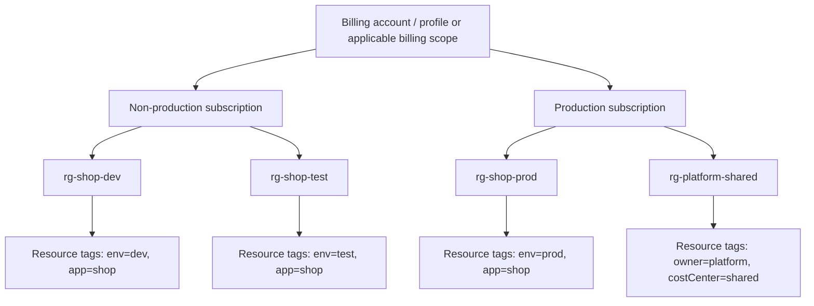
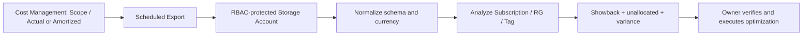

# Cost Analysis by Subscription, Resource Group, and Tag

## 1. The Problem to Solve

An application on Microsoft Azure may run steadily while the monthly bill climbs steadily. Looking only at the **total cost**, operations teams struggle to answer: which subscription is growing, which environment costs the most, which application's cost belongs to which team, and where unallocated spend resides. **Cost Management** turns resource usage data into reports you can analyze across multiple dimensions.

In the **Cost Management** chapter of the `CLOUD_PROVIDERS_AZURE` module, we analyze costs across three layers: **subscription → resource group → tag**. This is an essential practical step across the Azure ecosystem—from subscriptions, resource groups, and Microsoft Entra ID to virtual networking, compute, storage, data, operations, and application budget control.

After this lesson, you will be able to:

- Define the cost-viewing **scope**, cost type, and time period to compare reports accurately.
- Read Cost Analysis by subscription, resource group, and tag; understand the difference between **filter** and **group by**.
- Identify charges **without a resource group** or **without tags**, and handle cases that cannot be allocated immediately.
- Design a tagging convention for showback/chargeback, govern tags with Azure Policy, and monitor tag coverage.
- Query data using the **Cost Management Query REST API**, while distinguishing live figures from illustrative examples.
- Establish a reporting workflow to inspect cost variance and assign actionable follow-ups to clear owners.

**Running scenario:** An engineering team operates the `Shop API` system. Dev and test environments run in a non-production subscription; production uses a separate subscription. Shared resources handle logging, networking, and security. Management wants to know the monthly cost per environment, owning team, and shared platform pool.

## 2. Before Analyzing: Clarify Concepts and Data Sources

### 2.1. Three Analysis Dimensions and Their Roles



| Dimension | Meaning | Best Suited For Questions Like | Limitations |
|---|---|---|---|
| **Subscription** | Boundary for management, RBAC, and billing/cost recording per agreement model | How much does each subscription cost? What share is production? | One subscription may host multiple apps, environments, and owners |
| **Resource group** | Resource lifecycle grouping within a subscription | How much did `rg-shop-prod` grow? | Some charges lack a resource group; one group can serve multiple teams |
| **Tag** | Key–value pair attached to supported resources or objects | How much does `env=prod` cost? Who is the owner? | Many charge types lack tags; missing tags and tag history can skew allocation |

**A resource group is a management boundary**, not an independent invoice; **a tag is classification metadata**, which does not automatically grant permissions or cap spend. Tags on a resource group **do not automatically propagate to all resources inside it**. Using group tags for cost allocation requires resource-level tagging, inheritance policies, or **Cost Management tag inheritance** where eligible.

### 2.2. Cost-Viewing Scope Is Not Tagging Scope

In the Azure Portal, **Cost Management** can be opened at a subscription, resource group, or billing scope depending on agreement and permissions. Viewing at a resource group typically shows data only for that group; viewing at a subscription lets you compare resource groups within it. Viewing multiple subscriptions simultaneously may require selecting an appropriate higher-level management/billing scope with sufficient permissions.

Do not assume a **management group** or **billing profile** aggregates costs, permissions, and charge types identically across every Azure agreement. Microsoft Customer Agreement (MCA), Enterprise Agreement (EA), Microsoft Online Services Program, and other agreements differ in supported scopes and visibility. Verify the active scope and which subscriptions actually appear before comparing numbers.

**Azure RBAC and cost-viewing permissions:** An identity with read access to resources cannot necessarily view all billing data; conversely, viewing cost reports does not grant permission to modify VMs. Common roles like **Cost Management Reader** grant cost access at the assigned scope; viewing costs at certain billing scopes also depends on dedicated billing roles and policies. Apply least-privilege access.

### 2.3. Actual Cost, Amortized Cost, and Invoices

| Concept | What It Reflects | When to Use |
|---|---|---|
| **Actual cost** | Charges recorded per billing/cost data rules for the period, including purchase/adjustment timing per agreement model | Reconciling recorded charges and spending trends |
| **Amortized cost** | Spreads certain upfront commitments—such as eligible Reservations/Savings Plans—over usage time to reflect consumption | Comparing utilization efficiency across days, teams, or workloads |
| **Forecast** | Projected cost based on historical data and service modeling, where available | Spotting budget overrun risks; not a finalized charge |
| **Invoice / billed amount** | Amount payable per invoice and contract terms, potentially including taxes, credits, adjustments, or other fees | Financial reconciliation against billing |

When analyzing, record the **cost type**, currency, billing period, data freshness timestamp, and which fees are included or excluded. Never compare actual cost totals in one chart against amortized cost totals in another and conclude money is "missing." Amortization changes **time distribution**, not the committed dollar amount.

Displayed prices may be in billing currency and exclude final taxes, credits, or support; some charges have no resource ID, resource group, or tag. Cost Management data has **ingestion latency** and can continue adjusting after usage occurs. Therefore, "today's" cost or current-month figures are usually incomplete.

## 3. Setting Up a Reliable Comparison

Before opening charts, write down a concrete question:

> In the most recently closed month, what was the total actual cost across both subscriptions for `Shop API`, broken down by resource group and `environment`, and how much remained unallocated?

Follow a consistent procedure:

1. **Choose the period:** Prefer closed months for financial reporting; when inspecting the current month, note the latest data timestamp.
2. **Choose the scope:** A single subscription for drill-down; an appropriate parent scope when comparing multiple subscriptions. Confirm subscription IDs to avoid mixing up similarly named subscriptions.
3. **Choose the cost type:** Actual or amortized depending on purpose, and use the **same** type across comparisons.
4. **Choose units and conventions:** Display currency, daily/monthly granularity, and whether taxes or non-resource charges are included.
5. **Set a baseline:** Prior-month equivalent period, matching day counts, accounting for calendar month length, release events, and seasonal peaks.
6. **Filter and group:** Change one dimension at a time to avoid omissions; always retain the unknown/untagged bucket when present.
7. **Reconcile totals:** Grouped sums must match the total for the same scope, period, cost type, and charge set; if not, check filters, credits, or missing data.

**Filter** restricts which records enter the query. **Group by** splits the filtered records by an attribute. If you filter to `env=prod` only, the chart cannot tell you total spend across all environments. To measure **tag coverage**, never exclude untagged rows from the denominator.

## 4. Azure Portal Workflow: From Subscription to Tag

UI layouts evolve, but the core **Cost Management → Cost analysis** workflow consists of selecting scope, date range, cost type, chart view, filters, and grouping.

### 4.1. Step 1 — Break Down by Subscription

At a billing/management scope authorized across multiple subscriptions, select the period and cost type, then **group by Subscription** or filter per subscription where supported. Record a summary table:

| Subscription | ID/Internal Reference | Cost | Notes |
|---|---|---:|---|
| Non-production | Subscription A | Per chart | Dev/test may share services |
| Production | Subscription B | Per chart | Prioritize monitoring growth and commitments |
| Unspecified/Other | Verify scope | Per chart | May be unallocated fees or outside selected scope |

Inside a single subscription, there is no need to group by Subscription: selecting that subscription already filters to it. Without parent-scope access, open each subscription using the **exact same period, cost type, and currency**; sum amounts only when reporting rules and currencies match.

### 4.2. Step 2 — Drill Down by Resource Group

In the target subscription, choose **Group by → Resource group**. Inspect groups such as `rg-shop-dev`, `rg-shop-test`, `rg-shop-prod`, `rg-platform-shared`, and charges without a resource group. Select any spiking group and inspect **Service name**, **Resource**, or **Meter** where available.

For example: `rg-shop-prod` rises from 480 to 660 currency units in one month. The 180 increase could stem from additional App Service instances, SQL transactions, storage fees, or network egress. Resource group shows **where cost concentrated**; you must break down further by resource/service and check usage metrics to confirm the cause.

Never delete a resource group simply because a chart shows it is expensive: identify its resources, owner, reservations, dependencies, and blast radius before proposing changes.

### 4.3. Step 3 — View by Tag

Return to a scope broad enough to capture all target charges. Under **Group by**, select **Tag** and choose `environment` or `costCenter` (display labels vary by portal and data). Compare `dev`, `test`, `prod`, and `shared` alongside the **untagged / no tag / unavailable** bucket.

You may add a filter such as `app=shop`, provided you explicitly state that all charges lacking the `app` tag were excluded from the filtered set. For the `owner` tag, compare across teams, then drill down to resource groups and services. If a service does not support grouping by a given tag, check permissions, tag data, scope, charge type, and UI/API capabilities rather than assuming cost is zero.

**Purpose of this sequence:** Subscription answers **where the money comes from**, resource group answers **which resource bundle incurred it**, and tags help answer **who/which environment it serves**. These are cuts of the **same dataset**, not independent ledgers to add together.

## 5. Numerical Example: Three-Dimensional Reconciliation

Below are **hypothetical figures** for a closed month, using a single `ActualCost` type and an illustrative currency unit; they do not represent real Azure prices or invoices.

| Subscription | Resource group or non-RG portion | `environment` | `owner` | Cost |
|---|---|---|---|---:|
| Non-production | `rg-shop-dev` | dev | shop | 120 |
| Non-production | `rg-shop-test` | test | qa | 80 |
| Non-production | No RG | none | none | 30 |
| Production | `rg-shop-prod` | prod | shop | 600 |
| Production | `rg-platform-shared` | shared | platform | 200 |
| Production | No RG | none | none | 70 |
| **Total** | | | | **1,100** |

From this table we build three views:

- **By subscription:** non-production = 120 + 80 + 30 = **230**; production = 600 + 200 + 70 = **870**. Total 1,100.
- **By resource group:** dev 120; test 80; shop production 600; platform shared 200; **no RG 100**. Total 1,100.
- **By `environment` tag:** dev 120; test 80; prod 600; shared 200; **untagged 100**. Total 1,100.

**Never add 230 + 870 + 120 + 80 + ...** because the same 120 appears in multiple views. A dashboard can show multiple charts, yet only one total spend sum exists.

Share of charges untagged for `environment` in the example:

```text
Untagged cost rate = cost missing environment / total cost
                   = 100 / 1,100 ≈ 9.09%

Tagged cost coverage = (1,100 - 100) / 1,100 ≈ 90.91%
```

This is **cost coverage**, which differs from **resource count coverage**. You might have 99% of resources tagged while the untagged 1% consumes most of the budget; track both.

### 5.1. When Cost Has an RG but No Tag

Suppose a storage account inside `rg-shop-prod` costs 50 but has no tags. A resource group report still places 50 in `rg-shop-prod`, whereas an `environment` report may leave 50 in the unallocated bucket. **Do not automatically infer `prod` solely from the group name** without an approved allocation rule; doing so hides broken tag hygiene or shared costs.

### 5.2. When a Charge Belongs to No Resource

Items such as support fees, commitment purchases, adjustments/credits, or billing-level charges may have no resource group and no tags. How they appear depends on the agreement and cost type; never fabricate a nonexistent `resourceId`. Label them **shared**, **central**, or **unallocated** per allocation policy while documenting the basis of the rule.

## 6. Designing Tags for Cost Management

### 6.1. Minimum Tag Set

A practical convention might include:

| Key | Example Value | Purpose | Responsible Party |
|---|---|---|---|
| `application` | `shop` | Identify workload/product | Application owner |
| `environment` | `dev`, `test`, `prod` | Separate lifecycle and budget | Deployment team |
| `costCenter` | `cc-042`, `shared-platform` | Map to paying business unit | FinOps/Finance |
| `owner` | `team-shop`, `team-platform` | Assign investigation for cost anomalies | Team lead |
| `managedBy` | `bicep`, `terraform` | Trace management tooling | Platform team |

Standardize on **one canonical key set** with allowed values documented in governance standards. Avoid mixing `env`, `environment`, `Environment`, `Prod`, and `production`; variants fracture groupings or complicate aggregation. When authoring policies, automation, and reports, check how Azure handles case sensitivity for tag keys and values in each context and enforce consistency at the application layer.

**Never store sensitive data** such as passwords, tokens, personal emails, or confidential contract numbers in tags, since tags are metadata exposed in APIs, audit logs, and reports. Tags aid analysis; they do not replace Azure RBAC, Azure Policy, or Azure Budgets.

### 6.2. Applying Tags with Bicep

Example Bicep snippet creating a storage account inside an existing resource group:

```bicep
targetScope = 'resourceGroup'

param storageName string
param location string = resourceGroup().location

@allowed([
  'dev'
  'test'
  'prod'
])
param environment string

param application string = 'shop'
param costCenter string
param owner string

resource storage 'Microsoft.Storage/storageAccounts@2023-05-01' = {
  name: storageName
  location: location
  sku: {
    name: 'Standard_LRS'
  }
  kind: 'StorageV2'
  tags: {
    application: application
    environment: environment
    costCenter: costCenter
    owner: owner
    managedBy: 'bicep'
  }
  properties: {
    allowBlobPublicAccess: false
    supportsHttpsTrafficOnly: true
    minimumTlsVersion: 'TLS1_2'
  }
}
```

Pass `environment`, `costCenter`, and `owner` during IaC deployment; store canonical values in per-environment parameter files. This example applies to one tag-supporting resource type; **not every Azure resource type, child resource, or charge supports tagging identically**.

If using Resource Group tags, remember **group tags do not automatically copy onto the storage account**. An application group may share one resource group while cost records remain untagged until resources or billing data receive proper metadata.

### 6.3. Azure Policy and Tag Automation

Azure Policy offers effects such as **audit**, **deny**, and **modify** (depending on definition and resource support) to detect missing tags, block non-compliant deployments, or apply/inherit tags on supported resources. A sound rollout sequence:

1. **Audit first:** Measure untagged resource count and untagged spend; identify workload exceptions, owners, and unsupported resource types.
2. **Standardize:** Define approved keys/values and authoritative sources for owner or cost center metadata.
3. **Selective modify/deny:** Apply appropriate policies for new resources, ensuring the **managed identity and permissions** required if policies modify resources.
4. **Remediation** for existing resources where supported; validate before-and-after diffs to avoid overwriting valid metadata.
5. **Periodic review:** Audit unallocated charges, malformed values, and newly emerging gaps.

**Do not assume policies retroactively rewrite past invoices.** Adding tags today generally does not backfill tags onto historical cost records. Already-incurred costs must usually be handled using historical records or documented allocation rules.

### 6.4. Tag Inheritance in Cost Management

Azure Cost Management supports **tag inheritance** on certain eligible billing agreements/scopes, allowing subscription or resource group tags to enrich cost allocation for resources within that scope. This feature must be explicitly enabled with appropriate permissions and is subject to agreement eligibility rules. It is **not equivalent** to writing tags onto every Azure resource itself.

Distinguish clearly:

- **Resource tag:** Actual metadata on the resource, read via resource APIs and used for operations/policy.
- **Resource group/subscription tag:** Metadata on the parent container; does not automatically propagate to child resources.
- **Cost Management inherited tag:** Metadata applied to **cost records** per supported billing features and rules.

When enabling inheritance, verify the effective date, precedence when parent and resource tags collide, eligible charge types, and agreement boundaries. Validate before and after in the next month's report rather than assuming full historical backfill.

## 7. Analyzing via Cost Management Query REST API

The Azure Portal UI works well for manual investigation. For repeatable reporting, the **Cost Management Query API** queries cost data by scope, timeframe, and dimensions or tags. Below is an example using an authorized subscription.

### 7.1. Authentication and Scope Selection

First identify the target subscription ID, confirm `Cost Management Reader` or equivalent access, and sign in via Azure CLI:

```bash
az login

SUBSCRIPTION_ID="<subscription-id>"
az account set --subscription "$SUBSCRIPTION_ID"
az account show --query '{subscription:id,name:name}' --output json
```

The typical REST endpoint is:

```text
POST https://management.azure.com/subscriptions/{subscriptionId}/providers/Microsoft.CostManagement/query?api-version=2023-11-01
Authorization: Bearer <Azure Resource Manager access token>
Content-Type: application/json
```

The API version is illustrative; verify the current REST API version, permissions, scopes, and contract-supported metric fields before production use. Tokens must be obtained securely—never hardcode them in source code or logs.

### 7.2. JSON Query by Resource Group

Here is an illustrative **request body** for a custom date range using `ActualCost`, summing `PreTaxCost`, grouped by resource group:

```json
{
  "type": "ActualCost",
  "timeframe": "Custom",
  "timePeriod": {
    "from": "2026-10-01T00:00:00Z",
    "to": "2026-11-01T00:00:00Z"
  },
  "dataset": {
    "granularity": "None",
    "aggregation": {
      "totalCost": {
        "name": "PreTaxCost",
        "function": "Sum"
      }
    },
    "grouping": [
      {
        "type": "Dimension",
        "name": "ResourceGroup"
      }
    ]
  }
}
```

Timestamps are illustrative, not live query results. In production, verify API date-boundary inclusivity rules and align periods with Cost Analysis reports.

Typical responses return `properties.columns` describing columns and `properties.rows` containing values. **Do not hardcode column positions** in code; always parse `columns` by name along with the returned `currency`. Large queries may require pagination or hit rate limits; handle responses per API documentation rather than assuming page one holds all rows.

### 7.3. Switching Grouping to a Tag

Keep `type`, `timeframe`, `timePeriod`, and `aggregation` unchanged, replacing only `grouping`:

```json
"grouping": [
  {
    "type": "Tag",
    "name": "environment"
  }
]
```

At runtime, supported tag queries and behavior can vary by API/scope. Empty tags may appear under a distinct unspecified value; **do not drop that row** in coverage analyses. Use `type: AmortizedCost` to inspect commitment amortization over time, and rebuild all comparison charts using the same cost type.

### 7.4. Calling REST with Azure CLI

Save the request body as `cost-by-rg.json` in your working directory, then run:

```bash
az rest \
  --method post \
  --uri "https://management.azure.com/subscriptions/$SUBSCRIPTION_ID/providers/Microsoft.CostManagement/query?api-version=2023-11-01" \
  --headers "Content-Type=application/json" \
  --body @cost-by-rg.json \
  --output json
```

`cost-by-rg.json` holds the JSON from Section 7.2; the `@` prefix in `--body` tells Azure CLI to read from a file. This command uses your CLI login context; the user needs cost-viewing permissions at that scope. A `403` response indicates missing billing/cost permissions; `429` signals throttling requiring exponential backoff retries instead of rapid polling.

**Note on time and currency:** `PreTaxCost` is an example API metric; available columns and cost calculations may vary by contract. Never assume the returned metric automatically equals the final billed invoice.

## 8. From Reporting to Showback and Chargeback

Cost analysis serves two organizational maturity levels:

- **Showback:** Publishing costs by team/app/environment to build awareness and drive optimization, without necessarily transferring funds between units.
- **Chargeback:** Billing allocated amounts to business units under approved rules, typically requiring stricter financial governance and auditable methodologies.

In practice there are **shared costs**: a multi-app Log Analytics workspace, network hub, Firewall, Bastion, monitoring, backups, or centralized support. These generally cannot be allocated accurately using tags alone.

### 8.1. Choosing a Shared Cost Allocation Rule

Suppose `rg-platform-shared` costs 200 currency units. Three apps share the platform:

| Workload | Requests in Period (Hypothetical) | Share | Allocated Shared Cost |
|---|---:|---:|---:|
| Shop | 600,000 | 60% | 120 |
| Catalog | 300,000 | 30% | 60 |
| Admin | 100,000 | 10% | 20 |
| **Total** | **1,000,000** | **100%** | **200** |

This is a **hypothetical rule**, valid only if request count correlates meaningfully with the shared service's cost drivers. For log ingestion, ingested GB per app makes more sense than requests; for network egress, consider bytes; for shared clusters, use normalized requested/used CPU-memory. Avoid forcing a single universal metric across all services just for convenience.

Some Azure environments support **Cost allocation rules** in Cost Management at eligible billing scopes. Verify feature support, eligible charge types, and effective timing before enabling; otherwise implement rules in an external reporting layer. **Reallocation is strictly internal reporting and does not alter the underlying Azure invoice.**

### 8.2. Avoiding Double Counting

When distributing 200 of shared spend across three applications, each application's cost report becomes:

```text
Direct cost (application)
+ Allocated shared cost (allocated exactly once)
= Fully loaded cost
```

Once the 200 is allocated, do not add the 200 a second time into the fully loaded grand total. Keep **direct** and **allocated** columns separate alongside the unallocated original total for reconciliation and traceability.

## 9. Spotting Variances and Turning Them into Action

Suppose `rg-shop-prod` jumps 35% month-over-month. Before flagging an anomaly, check:

1. **Are day counts equal?** Partial current months skew against full closed months; cost ingestion also lags.
2. **Is the cost type identical?** Actual vs. amortized changes when commitment costs appear.
3. **Were there architecture changes?** Extra VM/App Service Plan instances, SKU upgrades, Azure SQL tier bumps, new private endpoints, or higher outbound network traffic.
4. **Did usage rise or did unit price change?** Inspect quantity, meter, service name, pricing/commitments, and reservation coverage where visible.
5. **Are there costs outside the resource group?** Commitment purchases, Marketplace, support, or non-resource charges cannot be investigated via RG alone.
6. **Who owns investigation?** Use owner tags, deployment logs, tickets, and team directories to assign verification—never blame a team solely from a resource name.

Example variance report template:

| Field | Example |
|---|---|
| Scope | Production subscription |
| Timeframe | Closed month vs. prior closed month |
| Cost type | Actual |
| Dimensions examined | Resource group → Service name → Resource |
| Variance | +35% |
| Hypothesis | Higher egress or instance count post-release |
| Evidence to gather | Usage quantity, meters, traffic metrics, change logs, scaling timestamps |
| Owner | Team Shop |
| Action | Compare before/after; optimize target service |
| Outcome | Post-change cost and SLO, risks, verified savings |

**Never cut costs by disabling security, backups, or monitoring without risk assessment.** The goal is right-sizing spend to match SLOs, reliability, security, and real business demand.

## 10. Scheduled Reporting, Budgets, and Exports

### 10.1. Budgets and Alerts

Azure Budgets can be created at appropriate scopes such as subscriptions or resource groups, with spending thresholds and notifications per supported features. Budgets provide **alerting** and tracking; a budget itself is **not a hard cap that stops resources**. Automating shutdowns after an alert requires a separate, tightly controlled workflow to prevent accidental production outages.

Example production subscription budget: target 2,000 currency units/month, alerting at 50%, 80%, and 100% per supported Azure threshold types. Recipients need **scope, period, actual/forecast status, top contributors**, and investigation runbooks. Budget amounts must match the scope's currency.

### 10.2. Exports and Historical Archiving

For scheduled reporting, use **Cost Management Exports** to export supported datasets to Azure Storage, then process them with analytics tools like Power BI or data pipelines. Exports carry schema versions, period settings, cost types, and creation timestamps; manage schema versioning, access control, storage costs, and idempotent reruns.

Reference pipeline:



Do not use cost exports as a substitute for operational telemetry: diagnosing why Azure SQL costs rose requires SQL usage/query/metric data. **Restrict access** to cost export data, as it reveals subscription topology, workloads, and internal spending details.

### 10.3. Minimum Monthly Report Contents

A strong monthly report typically includes:

- Metadata: period, scope/subscription, cost type, currency, data refresh timestamp, and author.
- Total spend, comparison vs. prior month/forecast, and unallocated cost.
- Breakdown tables by subscription, top resource groups, top services/resources, and top `environment`/`costCenter` tags.
- Tag coverage by **cost** and by **resource count**, plus an action list of owners to remediate gaps.
- Shared cost: original pool, allocation methodology, weighting metrics, and allocated outputs.
- Explanations of top variances and action items: owner, due date, and how impact will be measured.

## 11. Common Analysis Pitfalls

| Symptom | Possible Cause | How to Check |
|---|---|---|
| Tag total is lower than subscription total | Untagged charges, unsupported tags, or active filters | Remove tag filters, keep untagged group, verify cost type/scope |
| RG total is lower than subscription total | Charges without RG or recorded at another scope | Compare direct total vs. no-RG rows and inspect charge types |
| New tags missing in historical data | Tags applied after usage date, ingestion lag, or inheritance not retroactive | Verify tag edit date, charge period, and inheritance rules |
| `Prod` and `prod` split into separate groups | Inconsistent tag keys or values | Standardize conventions and remediate; avoid altering history arbitrarily |
| Two reports show different totals | Actual vs. amortized, currency, period, scope, filter, or refresh time | Record full metadata and rerun with identical parameters |
| Cannot see subscription/team costs | Missing Cost Management/billing role or wrong scope | Verify role and agreement-specific scope |
| Current month missing today's costs | Cost ingestion latency | Check latest data timestamp; do not treat as 0 |
| Budget alerted but VMs still running | Budgets only monitor/alert | Build approved automation if shutdown action is required |
| App totals sum too high | Direct cost + shared cost double-counted | Reconcile pre/post-allocation totals against the same source |
| Resource group cost jumped without CPU rise | Storage, backups, data transfer, reservations, or rate changes | Drill down by service/meter/usage and check relevant metrics |

## 12. Hands-On Exercises

### Exercise A — Cost Analysis in the Portal

Suppose you have read access to two subscriptions. Pick a closed month, lock a consistent cost type, and record:

1. Total cost per subscription and across the combined scope.
2. Top five resource groups by cost, explaining why non-resource-group charges appear.
3. Totals by `environment` tag and the untagged bucket; calculate **cost coverage**.
4. Drill down into one fast-growing resource group by Service name and Resource.
5. Write one hypothesis listing the evidence needed before proposing an optimization.

### Exercise B — Tag Governance

Design `application`, `environment`, `costCenter`, and `owner` tags for a system with dev/test/prod. Show how tags are injected via Bicep, how Azure Policy detects missing tags, one exception for tag-unsupported resource types, and how charges lacking a resource ID are reported. Explain why tagging today does not automatically fix last month's report.

### Exercise C — Shared Cost Allocation

Using the illustrative numbers from Section 5, suppose 200 in shared cost is allocated across Shop/Catalog/Admin at 60%/30%/10%. Compute each application's share, prove allocated totals equal 200, and show how to present **direct + allocated** without double counting.

### Exercise D — Automation

Draft a Cost Management Query JSON request body grouped by resource group for a custom period; switch `grouping` to the `environment` tag and explain why both queries must share identical scope, cost type, and period. Describe how to store results, verify currency, and handle untagged rows before charting.

**Completion criteria:** Learners can analyze the same spend across three dimensions without double counting; recognize charges lacking resource groups/tags; distinguish actual vs. amortized; define an owner-backed tagging standard; state the limits of policy, inheritance, APIs, and budgets; and produce a reconciled report with concrete follow-up actions.

**Self-assessment questions:**

1. Why doesn't grouping by resource group guarantee every subscription cost falls into a named group?
2. Do tags on a resource group automatically apply to every child resource?
3. Is 95% resource-count tag coverage sufficient to conclude cost coverage is healthy?
4. Why shouldn't this month's `ActualCost` be compared directly against last month's `AmortizedCost`?
5. Does Cost Management tag inheritance modify metadata on individual Azure resources?
6. Does exceeding 100% of a budget automatically shut down production VMs?
7. Should fully allocated shared costs be added back into the grand total a second time?

## 13. References

- Microsoft Learn — [Cost analysis in Azure Cost Management](https://learn.microsoft.com/azure/cost-management-billing/costs/quick-acm-cost-analysis).
- Microsoft Learn — [Understand Cost Management data](https://learn.microsoft.com/azure/cost-management-billing/costs/understand-cost-mgt-data).
- Microsoft Learn — [Tag inheritance for cost analysis](https://learn.microsoft.com/azure/cost-management-billing/costs/enable-tag-inheritance).
- Microsoft Learn — [Cost Management exports](https://learn.microsoft.com/azure/cost-management-billing/costs/tutorial-export-acm-data).
- Microsoft Learn — [Azure Cost Management Query REST API](https://learn.microsoft.com/rest/api/cost-management/query/usage).
- Microsoft Learn — [Azure Policy definition structure](https://learn.microsoft.com/azure/governance/policy/concepts/definition-structure-basics).

When applying these practices in live environments, verify support under your billing agreement, API version, dimension/tag naming, permissions, and data refresh status. Cost data becomes actionable governance when reports preserve **scope, cost type, period, currency, unallocated items, and documented follow-up evidence**.
