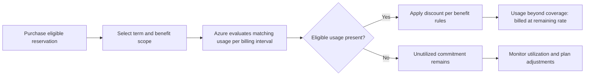
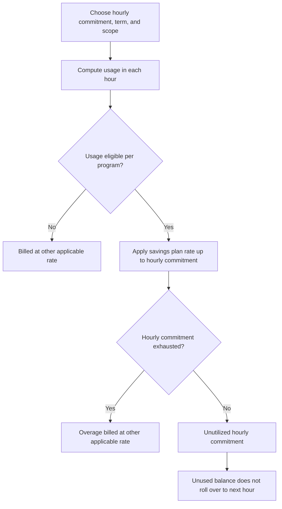
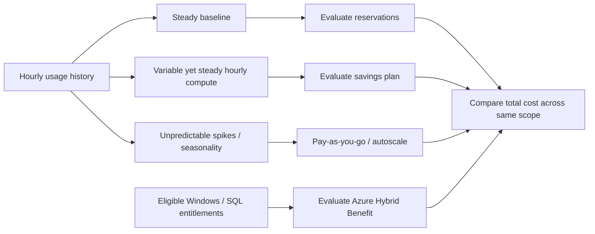
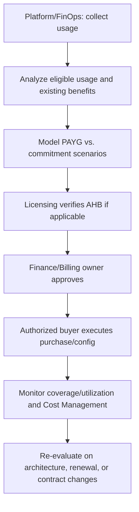

# Reservations, Savings Plans, and Azure Hybrid Benefit

## 1. Why Are Commitment Mechanisms Important When Running Azure Applications?

An application architecture on Microsoft Azure typically spans multiple layers: **subscriptions**, **resource groups**, virtual networks, virtual machines or App Service, databases, storage, security with Microsoft Entra ID/Key Vault, monitoring, and backups. During early experimentation, teams may pay standard consumption rates to stay flexible. Once an application runs continuously with steady load data, **compute and licensing costs** often become a major savings opportunity.

In the **Cost Management** chapter, three mechanisms to understand are:

- **Azure Reservations:** Committing to purchase a pricing discount for an eligible usage/resource scope over a fixed term. For VM compute, learners commonly encounter *Reserved Virtual Machine Instances*.
- **Azure Savings Plan for Compute:** Committing to a fixed **hourly spend amount** for eligible compute to receive savings plan rates, offering greater flexibility when compute services or configurations change.
- **Azure Hybrid Benefit (AHB):** Applying **existing eligible software license rights** to reduce the licensing fee component of supported Azure services, such as Windows Server or SQL Server/Azure SQL under applicable terms.

These three mechanisms can apply to the same workload yet **mean completely different things**. Reservations and savings plans are **financial commitments on eligible usage**; Azure Hybrid Benefit is a **license entitlement** requiring proof of eligibility. Raising subscription quotas, adding tags, or reorganizing resource groups does not automatically grant any of these three benefits.

> **Lesson scope:** Rates, discount percentages, covered products, exchange/cancellation policies, and licensing terms depend on timing, region, account type, contract, and service. All numerical prices in this lesson are **hypothetical for calculation practice**, not current Azure quotes. Before purchasing or activating benefits, verify the official price sheet and terms governing your organization's account.

### Learning Objectives

After this lesson, you will be able to:

1. Compare pay-as-you-go, Reservations, savings plan for compute, and Azure Hybrid Benefit across nature, scope, flexibility, and risk.
2. Identify which workloads with steady baselines, variable loads, seasonality, or licensing needs fit each mechanism.
3. Interpret **term**, **scope**, **eligibility**, **utilization**, **coverage**, **hourly commitment**, and upfront/periodic payments.
4. Manually calculate workload costs with and without commitments, including scenarios with unused commitments.
5. Distinguish cash outlays from periodic cost amortization in Azure Cost Management.
6. Combine benefits in a controlled manner without stacking discount percentages improperly.
7. Establish governance for license verification, approvals, utilization monitoring, and adjustments when architecture evolves.

## 2. Four Perspectives on Azure Spend

| Mechanism | Nature | Commitment / Benefit Unit | Best Fit When | Primary Risk |
| --- | --- | --- | --- | --- |
| **Pay-as-you-go (PAYG)** | Pay per eligible usage at applicable rates | Hours, capacity, requests, service units | Unpredictable load, testing, short-term projects | Higher unit rates than committed options |
| **Reservations** | Pre-purchase a pricing benefit for defined usage per product | Eligible capacity/meter units over term, per product | Steady baseline, stable configuration | Over-buying, changing SKUs/regions outside covered scope |
| **Savings Plan for Compute** | Commit to eligible compute spend per hour | **Dollars/hour** over term | Fairly steady compute spend despite changing configs | Unused hourly commitment, usage outside eligible service list |
| **Azure Hybrid Benefit** | Apply existing eligible software license rights | Entitlement/licenses and usage rights per terms | Organization holds qualifying Windows Server/SQL licenses | Ineligibility, over-allocating entitlements, expired coverage |

**A reservation differs from a capacity reservation.** A Reserved VM Instance is a **billing discount benefit** on matching usage; it does not automatically reserve physical VM capacity in a region or zone. When guaranteed VM allocation is needed for supported scenarios, evaluate **On-demand Capacity Reservations** separately alongside quotas and regional availability. Likewise, a reservation does not start VMs, provision new instances, or alter running machine specs.

### Architecture-Level Example

The `orders-api` application has:

- Two Azure VMs running the API 24/7 on a relatively stable VM family.
- Workers autoscaling with order volume that may switch instance sizes or move to another compute service.
- One continuously running Azure SQL Database.
- Azure Storage, Key Vault, network egress, and Log Analytics.
- Several Windows VMs potentially eligible for the organization's Windows Server licenses.

Here, the team can **evaluate reservations for the baseline VMs**, a **savings plan for flexible compute**, and **Azure Hybrid Benefit for eligible license rights**, while Blob operations, networking, logs, and other meters remain billed under their own rules. Never apply a compute discount percentage across the entire Azure invoice.

## 3. Standardizing Discount and Commitment Vocabulary

| Term | Practical Meaning |
| --- | --- |
| **Term** | Commitment duration; many products offer 1-year or 3-year options, subject to specific offer terms |
| **Billing scope** | Account/billing unit scope governing permission to purchase and manage benefits |
| **Benefit scope** | Subscription, resource group, management/subscription group, or shared scope eligible to receive the discount, per product and agreement |
| **Eligibility** | Matching usage attributes: service, region, SKU, OS, purchasing model, scope, and other rules |
| **Utilization** | Share of the commitment/benefit actually consumed during the measurement window |
| **Coverage** | Share of eligible usage covered by the benefit; distinct from utilization |
| **Hourly commitment** | Dollar compute spend committed per hour under a savings plan |
| **Upfront / monthly payments** | Payment schedule for the commitment; does not imply different benefit durations |
| **Actual cost / amortized cost** | Accounting views showing cash billing vs. period-allocated benefit economics |
| **Pay-as-you-go overage** | Usage exceeding committed levels/eligibility, billed at remaining applicable rates |

A VM in the right family running in a region or subscription outside the benefit scope may **not receive the reservation discount**. Even an eligible VM might receive no benefit if existing reservations are already consumed by other workloads during that hour.

### Utilization and Coverage Are Not the Same Number

Suppose you hold a reservation for **1 equivalent VM running 24 hours per day**:

- A matching VM runs 24/24 hours: ideal reservation utilization is roughly 100%.
- A matching VM runs only 12/24 hours: utilization is roughly 50%; the other half of the commitment goes unused.
- You run 10 matching VMs all day with only one reservation: that benefit achieves 100% utilization, yet **coverage is only about 10%** of VM hours in this simplified scenario.

Actual figures are computed by Azure per billing unit and instance size flexibility rules; rely on official reservation utilization/coverage reports rather than guessing from VM name lists.

## 4. How Reservations Work

**Azure Reservations** is the umbrella term for term-based discount commitments across **eligible services**, not just VMs. Depending on the product, a reservation can cover compute, database capacity, or other services with distinct meter definitions. For **Azure Reserved VM Instances**, matching VM usage receives the benefit per purchase terms; **managed disks, network egress, backups, monitoring, and software licenses not covered by the reservation** must still be accounted for separately.

### Pricing Benefit Flow



Key facts to keep in mind:

1. **Discounts only apply when usage matches.** Not every VM in a subscription automatically receives a discount.
2. **Reservations do not provision resources.** Scaling, quotas, and physical capacity remain independent.
3. **The term continues when VMs stop.** Shutting down a VM or switching products reduces utilization without canceling the commitment obligation.
4. **Licenses and ancillary fees remain separate.** Always distinguish base compute from Windows/SQL licensing.
5. **Modification rules vary across reservations.** Scope moves, exchanges, refunds, cancellations, renewals, and usage caps must be checked at purchase time under your contract.

### Common Attributes to Select

| Attribute | Question Before Purchasing |
| --- | --- |
| Product/type | Is this a VM reservation or reserved capacity for another service? |
| Region | Which region will the VM/workload stay in for most of the term? |
| VM series/SKU/size | Are there plans to resize or migrate instance families mid-term? |
| Instance size flexibility | Does this reservation type support it and is the right mode enabled? |
| Quantity | How many billable units represent the steady operating baseline? |
| Term | Will the workload definitely run for 1 or 3 years? |
| Scope | Which subscription/resource group/shared scope can draw the benefit? |
| Billing plan | Upfront or monthly payment; who is the billing owner? |
| Auto-renew | Should we review before expiration to prevent unwanted renewal? |

**Instance size flexibility** lets VM benefits apply across eligible sizes within the same supported flexibility group using conversion ratios. It does not allow free switching across arbitrary VM families, regions, or operating systems. Dedicated Hosts, SQL reserved capacity, and other reservation types follow entirely different product rules.

## 5. Sizing Reservations to Baseline, Not Peak Load

A workload with 2 always-on VMs plus 4 extra VMs running a few hours a day has a **baseline of 2 VMs** and a peak of 6 VMs. Buying reservations for all 6 VMs merely because promos hit that peak leaves commitments idle during off-peak hours and can raise total cost.

Rough baseline guideline:

\[
H_{\mathrm{eligible}}=\sum_{\text{eligible VMs}} \text{running hours}
\]

\[
\text{Equivalent baseline} \approx
\frac{H_{\mathrm{eligible}}}{H_{\mathrm{period}}}
\]

Over a hypothetical 30-day month, \(H_{\mathrm{period}}=720\) hours. With 2,100 total instance-hours, the equivalent baseline is \(2,100/720\approx2.92\) instances. This average ratio is strictly a discussion aid; it **does not guarantee** buying 2 or 3 reservations is optimal, since hourly distribution, matching rules, rates, and regional usage can change the outcome.

### When Should You Hold Off on Purchasing?

When an application is still experimental, undecided between VMs and containers/serverless, preparing to change regions, frequently changing VM families, or lacking sufficient usage history, refine forecasts and observe actuals first. A savings plan may merit study if compute configurations shift while total hourly spend stays relatively steady; if load itself is highly erratic, pay-as-you-go remains appropriate for the variable portion.

## 6. How Azure Savings Plan for Compute Works

**Azure Savings Plan for Compute** lets buyers commit to a **fixed hourly spend amount** on eligible compute services over a term. As Azure records matching usage, it receives **savings plan rates** up to that hour's committed spend. Eligible usage beyond the hourly commitment, or ineligible usage, is billed at other applicable rates per terms.

Unlike reservations tied more tightly to specific meter/service attributes, savings plans are designed for greater flexibility when users **change VM sizes, families, regions, or eligible compute services** within program boundaries. **Do not assume every Azure product is covered**: verify current eligible services, SKUs, and account eligibility rules.



### Four Core Characteristics

- **Dollar-per-hour commitment:** e.g., an agreed USD/hour level confirmed in the portal.
- **Evaluated hour by hour:** The commitment applies every hour even when usage dips; unused commitment never rolls over to future hours.
- **Broad eligible compute coverage:** Broader flexibility than specific reservations, bounded by program rules.
- **Term and payment obligations bind:** Monthly billing instead of upfront payment does not turn a commitment into a cancel-anytime daily contract.

### What to Check Before Setting an Hourly Commitment

1. Total **eligible compute spend net of existing benefits** per hour over recent history.
2. Day/night, weekend, and seasonal swings plus planned scale-up/scale-down events.
3. Existing reservations, their utilization, expiration dates, and upcoming config changes.
4. Services/scopes that are **ineligible** or already covered by other discounts.
5. Plans to migrate workloads to PaaS or serverless that could alter commitment consumption.
6. Purchasing, management, and benefit-sharing constraints at your billing scope.

**Never divide the total cloud invoice by monthly hours** to pick a savings plan commitment. Invoices also include storage, ineligible database meters, networking, logs, licensing, support, and taxes.

## 7. Reservation vs. Savings Plan: Which to Choose?

| Criterion | Reservation | Savings Plan for Compute |
| --- | --- | --- |
| Commitment form | Benefit on specific product/meter and quantity | Hourly spend commitment across eligible compute |
| Best fit | Steady usage with stable configuration across term | Compute configs/services may shift while total hourly demand stays steady |
| Flexibility on VM changes | Subject to matching and instance size flexibility | Subject to eligible compute list, generally broader |
| Region/SKU sensitivity | Typically higher for specific VM reservations | Governed by program rules and scope |
| Underutilization | Missed benefit over term | Unused hourly spend does not carry over |
| Savings potential | Depends on product, term, matching, and actual rates | Depends on eligible usage, hourly commitment, and rates |
| Capacity guarantee | Does not reserve physical capacity | Does not reserve physical capacity |
| Governance | Track utilization per reservation/SKU | Track hourly commitment utilization and coverage |

Choose using **real data and forecasts**—never assume "3-year always saves the most" or "savings plans always beat reservations." A deeply discounted reservation at low utilization can underperform a flexible option; an oversized savings plan likewise creates stranded hourly spend.

### Three-Tier Layered Strategy

For Orders API:

1. **Very steady baseline:** Evaluate reservations for always-on eligible VMs.
2. **Flexible compute with steady hourly spend:** Evaluate a savings plan on remaining usage **after accounting for existing benefits**.
3. **Short, unpredictable bursts:** Rely on pay-as-you-go or well-tuned autoscaling.

Here, Azure Hybrid Benefit is evaluated separately as a **license entitlement**, not treated as a "fourth discount layer" where arbitrary percentages stack onto every meter.

## 8. Azure Hybrid Benefit: Using License Rights Properly

**Azure Hybrid Benefit (AHB)** enables eligible customers to apply existing software license entitlements to supported Azure services. The two best-known categories are **Windows Server** and **SQL Server/Azure SQL**; rules vary by product, workload type, edition, core counts, licensing agreements, and Software Assurance or qualifying subscription coverage.

AHB eligibility is never established merely because "the company owns a Windows or SQL key." You must:

- Confirm **license type, core count/rights, edition**, and agreement terms.
- Confirm **active Software Assurance or qualifying subscription licensing** where required by the program.
- Verify concurrent on-premises and Azure dual-use rights during migration windows; never assume indefinite parallel use.
- Verify how AHB applies to **Azure VMs, Azure SQL Database, Managed Instance, or SQL Server on Azure VMs**, as steps and terms differ.
- Assign an owner responsible for tracking entitlements and compliance when adding VMs or upgrading SQL editions.

### Impact on Price Structure

Conceptual flow:

```text
Azure VM running Windows Server:
  Related total costs may include:
    + base compute/infrastructure portion
    + Windows license portion when benefit is not applied
    + disks / networking / backup / monitoring / other charges

When eligible and Azure Hybrid Benefit is applied:
  Eligible license fee portion is adjusted per program rules;
  compute and ancillary meters still bill separately.
```

This illustrates the concept and does not assert every SKU's invoice literally splits into "base compute" and "Windows license" lines. Windows Server, SQL Server, and Azure SQL use distinct meters and pricing structures.

### AHB Does Not Replace Security or Azure Governance

AHB is strictly a **licensing/billing mechanism**; it is not managed identity or Azure RBAC, does not harden VMs automatically, and provides no disaster recovery. Using AHB on Azure SQL still requires paying for compute, storage, high availability, backups, data transfer, and multi-region resources.

## 9. AHB for Windows Server VMs, Azure SQL, and SQL Server on VMs

### Windows Server on Azure Virtual Machines

A Windows VM's rate may include an OS licensing component. When your organization holds valid Windows Server AHB rights, configure the VM so Azure recognizes the **Windows Server license benefit** as supported. With read access and verified guidance, the Azure VM `licenseType` property is one inspectable configuration signal:

```bash
# Illustrative read-only command; makes no changes to the VM.
az vm show \
  --resource-group rg-orders-prod \
  --name vm-orders-api-01 \
  --query "{name:name,licenseType:licenseType,size:hardwareProfile.vmSize}" \
  --output table
```

This runs only if the resource group/VM exist and your identity holds read access. Valid `licenseType` values, benefit eligibility, and core rules must be verified against official Windows Server service documentation. Never treat a single attribute query as a substitute for a formal license compliance audit.

### Azure SQL Database and Azure SQL Managed Instance

Eligible Azure SQL offerings provide a choice between **License included** and applying Azure Hybrid Benefit under applicable vCore/service models. Designers must verify:

- Whether the chosen service and purchasing model support AHB.
- Whether license core counts and editions match the Azure deployment.
- Whether rights are simultaneously used on-premises, on other Azure VMs, or on other SQL resources beyond allowed limits.
- What other reservations/benefits exist and their actual billing application order.

Do not assume DTU-based and vCore-based Azure SQL Databases handle AHB identically. Pick the exact model in the Azure Pricing Calculator or portal before comparing.

### SQL Server Running Inside an Azure VM

SQL Server on a VM can involve **two licensing layers**: the Windows Server OS (if using Windows) and SQL Server itself. Verify each entitlement independently; enabling AHB for Windows does not automatically authorize AHB for SQL Server. When scaling vCPUs, switching editions, or adding VMs, re-check core entitlements.

### License Control Workflow

| Evidence | Verifier | Example Records to Retain |
| --- | --- | --- |
| Eligible license inventory | Licensing/Procurement | Product, edition, core count, agreement, and expiration |
| Workloads using AHB | Cloud platform/FinOps | Subscription, resource ID, VM/SQL type, environment |
| Migration and dual-use rights | Licensing/Legal as needed | Terms, time limits, and usage restrictions |
| Azure config state | Cloud operations | AHB/license setting verified on target resources |
| Before/after cost | FinOps | Meters, usage, contract rates, actual/amortized |
| Periodic audits | License owner | Changes in cores, editions, VMs, or agreements |

## 10. Combining Benefits: Pricing Caution

**AHB can be combined with reservations or savings plans in certain eligible scenarios** because they address different cost components. Still, exact eligibility, application priority, and rate structures must be verified against product and contract terms. Never compute `PAYG Price × (1 - %RI) × (1 - %SP) × (1 - %AHB)` and present it as the bill Azure will charge.

Conceptual example:

```text
Workload: Eligible Windows Server VM

1. Identify current baseline cost of base compute and license components.
2. Check if a reservation matches.
3. Check if remaining usage qualifies for a savings plan.
4. Verify eligible Windows Server AHB rights and configuration.
5. Keep disk, network, monitoring, backup, and data transfer lines intact.
6. Verify net effect in Azure Pricing Calculator / Cost Management.
```

Discounts follow **platform-defined matching and priority rules**; never assume two commitments stack onto the exact same compute-hour. With overlapping benefits, inspect **usage details/benefit reports** to explain which lines were covered, which billed at residual rates, and which commitments went unused.

## 11. Exercise 1: Baseline Reservations and Over-Buying Risk

All unit prices below are **hypothetical numbers for calculation practice** and do not represent any live Azure VM SKU or discount rate.

Suppose an eligible VM has:

- Hypothetical PAYG rate: **0.20 USD/instance-hour**.
- Equivalent amortized reservation rate: **0.13 USD/instance-hour** for the chosen term.
- Hypothetical month of **30 days = 720 hours**.
- One VM running **24/7**, and a second VM running **10 hours per day**.

Actual demand:

```text
Baseline VM:       1 × 720             = 720 instance-hours
Supplemental VM:   1 × 10 × 30         = 300 instance-hours
Total usage:                           1,020 instance-hours

Without benefits:
  1,020 × 0.20                         = 204.00 USD/month
```

Buying **one** reservation matching the baseline VM:

```text
Amortized cost of 1 reservation: 720 × 0.13 = 93.60 USD
Supplemental VM at PAYG:         300 × 0.20 = 60.00 USD
Model total:                                  153.60 USD
Savings vs. PAYG:                204 - 153.60 = 50.40 USD
```

Suppose instead you buy **two** identical reservations covering all 720 hours in the month:

```text
Amortized cost of 2 reservations:  2 × 720 × 0.13 = 187.20 USD
Actual usage:                              1,020/1,440 instance-hours
Unused entitlement (simplified):                   420 hours
Compared to 1 reservation + PAYG:     187.20 - 153.60 = 33.60 USD more expensive
```

Here, two reservations still beat pure PAYG, yet **sizing to peak wasted 33.60 USD in potential savings** compared to one reservation. This is a theoretical amortized model to illustrate utilization; live Azure matching evaluates hourly intervals, size flexibility, other in-scope workloads, and term rules.

### Operational Question

If the team brings a compatible VM from another subscription into the allowed benefit scope, the second reservation achieves higher utilization. However, scope changes must comply with purchasing governance, billing/benefit scope rules, and policy. Never shift scope merely to "boost utilization" if it steals benefits from priority workloads or breaks budget attribution.

## 12. Exercise 2: Savings Plan with Hourly Commitment

In this **independent** example, assume:

- PAYG rate for one eligible compute unit: **0.20 USD/hour**.
- Equivalent savings plan covered rate: **0.14 USD/hour**.
- Savings plan commitment: **0.14 USD/hour** across 720 hours.
- One baseline eligible workload running 24/7.
- One supplemental compute unit at the same assumed rate running 300 hours/month.

Each hour with the baseline workload consumes the full illustrative commitment. The supplemental workload runs only part-time and, **assuming zero remaining hourly commitment**, bills at PAYG:

```text
Savings plan commitment:           0.14 × 720       = 100.80 USD
Uncovered supplemental compute:    0.20 × 300       =  60.00 USD
Model total:                                        = 160.80 USD
Pure PAYG:                  (720 + 300) × 0.20      = 204.00 USD
Theoretical savings:                                =  43.20 USD
```

This is not a price sheet and cannot prove savings plans are universally cheaper or pricier than reservations. Savings plans excel when **eligible compute types change** while total hourly spend remains steady enough to fill the commitment.

### Illustrating Unused Commitment

Suppose the same 0.14 USD/hour commitment sees **zero eligible compute during 100 hours** (with no other eligible workloads in scope):

```text
Total commitment over 720 hours:      0.14 × 720 = 100.80 USD
100 hours with zero eligible usage:   0.14 × 100 =  14.00 USD
Corresponding unused commitment:                    14.00 USD
```

That 14.00 USD does not roll over to offset burst hours the following day. Sizing a commitment therefore requires examining **hourly usage distributions**, not just monthly spend totals.

### Caution When Comparing

Section 11's reservation and Section 12's savings plan use different hypothetical rates and are independent exercises. For a real project decision, feed **the exact same workload, billing period, scope, license entitlements, and live price sheet** into your account's estimation tools.

## 13. Exercise 3: Calculating License Benefits with AHB

For calculation practice, assume:

- A comparable Windows VM has a total PAYG rate of **0.20 USD/hour**, of which we model **0.04 USD/hour** as the eligible license portion waived under AHB.
- The remaining **0.16 USD/hour** represents base compute in this simplified model.
- The VM runs 720 hours and the organization **holds valid license entitlements**.

Theoretical result:

```text
Without AHB benefit:    720 × 0.20 = 144.00 USD
With valid AHB:         720 × 0.16 = 115.20 USD
Azure invoice delta:                  28.80 USD
```

**0.04 USD/hour is a hypothetical license share**, not an official Azure price breakdown for every Windows VM. From a TCO standpoint, you must still account for **purchase, renewal, and management costs of owned licenses** if not already captured in your financial model. AHB likewise does not make disks, networking, or backups free.

To layer reservations or savings plans, obtain **effective post-benefit unit rates** from official tools/billing and model each meter. Never take this "28.80 savings" and multiply it by arbitrary extra discount percentages.

## 14. Modeling Baselines, Bursts, and Architecture Roadmap

Minimum data to assemble before purchasing benefits:

| Data Group | Orders API Example | Purpose |
| --- | --- | --- |
| Region/SKU | `southeastasia`, specific VM family | Check reservation eligibility/matching |
| Operating hours | 24/7 API VMs, shift workers | Estimate baseline and hourly spend |
| Workload type | Windows VMs, Linux, containers, Azure SQL | Confirm compute/product eligibility |
| Billing scope | Production subscription, staging subscription | Define where benefits apply |
| Existing benefits | Active reservations, savings plans, AHB | Prevent double-committing |
| License rights | Windows/SQL entitlements and contract end dates | Validate AHB eligibility |
| Planned changes | VM resizing, AKS migration, region moves | Project utilization if architecture shifts |
| Other costs | Disks, networking, logs, backups, DR | Avoid misstating whole-invoice savings % |

Split into three layers:



**Future roadmaps outweigh historical averages** whenever teams plan to move VMs to App Service, switch regions, or break a monolith into microservices. Buying a 3-year benefit for a workload slated for retirement turns "unit-rate savings" into stranded unused commitments.

### Quantifying Uncertainty

When usage projections are uncertain, build three scenarios:

- **Low case:** 30% drop in eligible usage after optimization and migrations.
- **Expected:** Flat baseline or modest growth per product roadmap.
- **High case:** Higher peaks, additional regions, or expanded eligible services.

These percentages are exercise parameters, not Azure forecasts. Estimate spend by hour or hourly bands; if you only have monthly totals, gather hourly profiles before locking in a large hourly commitment.

## 15. Building Estimates in the Azure Pricing Calculator

The **Azure Pricing Calculator** helps compare **purchasing options for identical architecture and configuration**. Open [Azure Pricing Calculator](https://azure.microsoft.com/pricing/calculator/) and:

1. Add target services: Azure Virtual Machines, Azure SQL Database, or other supported services to compare.
2. Specify **region, SKU, OS, instance count, hours, capacity, storage, and networking**. Save all assumptions.
3. Build the **pay-as-you-go** baseline; distinguish compute from storage/networking/licensing.
4. Where the UI offers **reservation** options, pick matching terms and payment models, verifying eligible services/SKUs.
5. Where products/UI show **savings plan** options, check commitment tiers and requirements; if the Calculator cannot model hourly spend across diverse compute services, supplement with an hourly usage profile spreadsheet.
6. Enable **Azure Hybrid Benefit** only if your organization holds verified qualifying entitlements, picking the exact licensing option.
7. Keep all non-compute lines identical across comparisons so architectural differences aren't misattributed to commitment discounts.
8. Record capture date, currency, billing offer, configuration, and revision. Cross-check against contract price sheets if available.

There is no single checkbox that applies Reservations, savings plans, and AHB together across every service. Options absent from the UI must be verified in product documentation and/or benefit purchase blades rather than assumed supported.

### Proposal Comparison Table

| Criterion | PAYG | Reservation | Savings Plan | AHB / Valid Combination |
| --- | --- | --- | --- | --- |
| Workload assumptions | Identical | Identical | Identical | Identical |
| Eligible compute cost | PAYG rate | Applicable reservation rate/meter | Hourly committed compute rate | Per license rules and actual compute |
| Unused commitment | N/A | Must model | Must model hourly | Does not replace license audits |
| License cost | Default model | Check separately | Check separately | Per verified entitlement |
| Disk/network/logs | Full cost | Full cost | Full cost | Full cost |
| Term and lock-in | No commitment | Per contract | Per contract | Per license agreement |
| Architecture change risk | Low purchasing lock-in | Matching may drop | Eligible spend may drop | Core/edition/entitlement rules may shift |

## 16. Inspecting Benefits in Azure Portal and Cost Management

Depending on billing account and subscription permissions, inspect:

| Blade / Source | What to Collect |
| --- | --- |
| **Azure Portal → Reservations** | Active reservations, term, scope, expiry, utilization, and recommendations where available |
| **Azure Portal → Savings plans** | Hourly commitment, utilization, scope, term, and recommendations |
| **Azure Advisor** | Usage-based savings suggestions; verify assumptions and eligibility |
| **Cost Management → Cost analysis** | Costs by service, resource, meter, actual/amortized, period, and scope |
| **Usage details/Exports** | Meters, pricing model/benefit mapping, usage, and charges to explain attribution |
| **Azure Pricing Calculator** | Modeled pricing across configurations and purchasing options |
| **Internal license portal** | Windows/SQL entitlements, expirations, and usage rights |

**Having `Contributor` on a resource group does not grant permission to buy reservations or view all billing data.** Billing permissions and resource Azure RBAC have distinct boundaries; engage authorized billing owners whenever purchase/read access is restricted.

### Actual Cost vs. Amortized Cost

A reservation can be paid upfront or on a schedule, while discounted usage spreads across subscriptions/resources over time. Therefore:

- **Actual cost** shows entries as billed by the cost engine, potentially placing reservation or savings plan purchases in a different period than usage.
- **Amortized cost** spreads commitment spend across usage periods to measure application/team TCO more accurately.

Reconciliations must pick **one consistent view**, matching billing scope and period. Adding a full upfront purchase together with amortized allocations **double-counts the same commitment**.

### Utilization, Coverage, and Savings

Suppose a reservation shows 100% utilization yet only 20% VM coverage: you might evaluate buying more for the baseline after verifying pricing and stability. Conversely, 40% utilization signals existing benefits are underused; do not buy more merely because other VMs run PAYG in non-matching families/regions.

For savings plans, inspect **unused hourly commitment**, because monthly averages can mask many low-usage hours. For AHB, audit **both entitlements and VM/SQL configurations**; low Azure cost alone does not prove licensing compliance.

## 17. Permissions and Approval Workflow for Purchasing Commitments

Reservations and savings plans are financial decisions creating **multi-period obligations**. Workflows should clearly separate who proposes, analyzes, approves, and monitors.



### Pre-Purchase Checklist

1. Workload and business owner confirmed.
2. Billing scope, subscription, resource group, and tenant verified.
3. Representative **usage history** collected, including day/night, weekend, and seasonal cycles.
4. All existing reservations/savings plans audited to avoid duplicate commitments.
5. SKU/region/term/scope and matching criteria reviewed.
6. Roadmap checked for app migrations, VM resizing, region shifts, or database changes during the term.
7. Total cost and unused-commitment scenarios compared—not discount percentages alone.
8. Upfront vs. periodic payment and accounting treatment approved by Finance.
9. AHB confirmed by licensing team across edition/cores/SA/subscription agreements.
10. Owner assigned to track utilization, expiration, renewal, and unused capacity remediation.

### Post-Purchase

Never treat purchase day as "optimization complete." Monitor and review regularly; when an app retires, moves regions, or changes SKUs, verify which other workloads in scope can absorb the benefit. Scope changes, turning off auto-renew, cancellations, or exchanges must follow product and contract rules active at that time.

## 18. Aligning with Azure Access Control, Governance, and Resilience

Cost reductions must never undermine **security, reliability, and operations**.

| Scenario | Risk of Optimizing on Discount Alone | How to Evaluate |
| --- | --- | --- |
| Moving VM to a cheaper SKU to match a reservation | Insufficient RAM/CPU or SKU unavailable in DR region | Load test, check quotas, and verify failover capacity |
| Cutting 24/7 VM count | Loss of fault-domain tolerance or peak headroom | Check SLAs, autoscale speed, and Availability Zones |
| Buying commitments in current region | Architecture plans region move for residency/latency | Review roadmap before committing |
| Enabling AHB on SQL | Core/edition mismatch or license violation | Confirm with licensing/finance |
| Buying reservations at shared scope | Benefit shifts to other apps, muddying cost attribution | Enforce consistent showback/chargeback rules and owners |
| Sizing commitments for low-load DR standby | Unused reservations during normal operations | Weigh standby vs. failover costs and RTO targets |
| Optimizing compute rates while ignoring other tiers | Disks, logs, egress, and backups keep climbing | Evaluate full-architecture TCO |

Reservations never bypass vCPU quotas or guarantee physical VM capacity for failover. DR architecture decisions must rest on recovery objectives, regional/SKU support, and failover drills independently of discount purchases.

## 19. Hands-On Lab: Selecting a Cost Strategy for Orders API

**Objective:** Design a compute and licensing optimization plan for an illustrative Azure application without buying live benefits, deploying resources, or altering subscriptions.

### Lab Dataset

Assume the product runs the following workloads:

| Workload | Hypothetical Config / Load | Question |
| --- | --- | --- |
| `orders-api-windows` | 1 Windows VM 24/7 | Are reservations and AHB appropriate? |
| `orders-worker` | 1 VM or eligible compute running 10 hours/day | Should you buy a full-month reservation? |
| `orders-batch` | Compute shifting across service types with steady active hours | Is a savings plan a better fit? |
| `orders-sql` | Continuously running vCore Azure SQL Database | Do reserved capacity or AHB apply? |
| `orders-logs` | 50 GB ingested per month | Why don't compute discounts apply to Log Analytics? |
| `orders-storage` | 500 GB Blob storage | Which products/meters need separate estimation? |

Do not attach savings percentages to any line before checking real eligibility and price sheets.

### Step 1 — Gather Inputs

Pick one **Azure region and consistent billing currency**. Document VM size/family, OS, instance counts, daily hours, database specs, subscription relationships, and current licensing terms. Where live data is absent, use the lab's hypothetical inputs labeled `SAMPLE_ONLY`.

### Step 2 — Build the PAYG Baseline

In the Pricing Calculator, create a pay-as-you-go estimate for eligible compute and all other components. Record date, region, SKU, hours, database config, storage, logs, and any free grants/offers. Hold this architecture constant across comparisons.

### Step 3 — Map Baseline and Peak Profiles

Create a **24-hour × workload group** table:

```text
Hour UTC | Baseline API VM | Extra Worker | Eligible Batch | Total Eligible Usage
00-07    |        1        |      0       |       ?        |          ?
08-17    |        1        |      1       |       ?        |          ?
18-23    |        1        |      0       |       ?        |          ?
```

With live data, replace question marks using measured usage/billing meters. Never assume batch or new services automatically qualify on the savings plan eligible list.

### Step 4 — Evaluate Reservations

Using the VM hour profile and Section 11's calculation, evaluate **0, 1, or 2 reservations** for matching resources. Note utilization and risks if VMs resize, migrate, or stop. When inspecting a live portal, read recommendations/usage only—**make no purchases** in this lab.

### Step 5 — Evaluate a Savings Plan

Take the **remaining eligible compute after existing benefits**. Estimate hourly spend under hypothetical or portal-reported savings plan rates. Test several hourly commitment levels, computing unused commitment in low hours and overage in peak hours.

### Step 6 — Audit AHB

Build a Windows Server/SQL license checklist: agreement, active Software Assurance/subscription eligibility, edition, core counts, concurrent usage elsewhere, and sign-off authority. Where license data is missing, record **`AHB: unverified`**; never use assumed licenses to approve savings.

### Step 7 — Financial Comparison

Build a comparison table:

```text
Scenario                       Compute + license   Other meters   Unused commitment   Total
PAYG                           [amount]            [amount]       0                   [amount]
1 reservation + PAYG           [amount]            [amount]       [amount]            [amount]
Savings plan + PAYG            [amount]            [amount]       [amount]            [amount]
Reservation + AHB eligible     [amount]            [amount]       [amount]            [amount]
Mixed (if supported)           [amount]            [amount]       [amount]            [amount]
```

Never count `unused commitment` twice if already included in purchase/amortized totals. State your calculation method and billing view clearly.

### Step 8 — Recommend and Set Monitoring Criteria

Select an option based on **valid total cost, projected utilization, architecture-change risk, license rights, and reliability requirements**. Propose utilization alert thresholds, review cadence, expiration alerts, purchase/renewal owners, and post-deployment actual/amortized cost reconciliation steps.

### Lab Completion Criteria

| Criterion | Required Deliverable |
| --- | --- |
| Usage profile | Runtime hours and eligible spend per resource group |
| PAYG baseline | Same-region rates/configs with capture date |
| Reservations | Quantity, scope, term, and utilization analysis |
| Savings plan | Hourly commitment, unused spend, and overage modeled |
| AHB | Verified license rights or marked unverified |
| Stacking rules | No arbitrary percentage multiplication/addition |
| Full architecture | Includes disks, networking, storage, logs, and DR if used |
| Billing views | Distinguishes actual vs. amortized without double counting |
| Approvals | Names owner, approver, and review schedule |

## 20. Common Pitfalls

| Mistake | Consequence | Fix |
| --- | --- | --- |
| Sizing reservations to peak VM count | Low utilization during off-peak hours | Buy for equivalent baseline; inspect hourly usage |
| Assuming reservations reserve physical VM capacity | DR/autoscale fails due to quota or SKU shortage | Evaluate quotas / On-demand Capacity Reservations separately |
| Sizing savings commitment from total Azure bill | Commitment exceeds eligible compute spend | Filter strictly to eligible compute net of existing benefits |
| Assuming unused savings commitment rolls over | Overstated savings projections | Evaluate hour by hour; quantify unused hours |
| Applying compute % discount to disks, network, logs | Unrealistically low forecasts | Separate covered meters from ineligible meters |
| Stacking multiple % discounts on one compute-hour | Double-counted savings | Verify application order using live billing data |
| Enabling AHB just because a VM runs Windows/SQL | License compliance risk | Verify agreement, SA/subscription rights, and cores |
| Looking only at upfront cash outlays | Unclear which apps actually consume commitments | Reconcile actual and amortized views at proper scope |
| One subscription captures shared benefits while another pays | Unfair internal chargeback | Enforce consistent owner, scope, and allocation rules |
| Ignoring scheduled downtime/off-hours | Over-committed capacity | Factor in run schedules, weekends, shutdowns, and roadmaps |
| Auto-renewing benefits without re-evaluation | Locked into commitments for outdated architectures | Track expirations and mandate renewal reviews |
| Treating cost savings as the sole business KPI | Savings paired with outages or high latency | Validate SLAs, capacity, security, and DR |

## 21. Self-Check Questions

1. How do reservations and savings plans for compute differ in their **commitment unit**?
2. Why doesn't a Reserved VM Instance guarantee VM capacity in a DR target region?
3. What does 100% reservation utilization combined with 20% coverage indicate?
4. If a VM stops running mid-term, does the reservation obligation automatically pause?
5. Why must a savings plan commitment be analyzed **hour by hour** rather than via monthly spend totals?
6. Which non-compute services/meters in Orders API must still be estimated separately?
7. When is Azure Hybrid Benefit valid, and why is merely possessing a product key insufficient?
8. Can DTU-based Azure SQL Databases automatically use AHB identically to vCore models?
9. If a Windows VM uses AHB, can you multiply the license savings directly by reservation/savings plan discount percentages?
10. At 0.20 USD/hour PAYG and a hypothetical 0.13 USD/hour reservation rate, how much does one VM running 720 hours save in the model?
11. In Section 11's reservation exercise, how much more expensive is buying 2 reservations instead of 1?
12. With a 0.14 USD/hour savings plan commitment and 100 hours of zero eligible usage, what is the unused commitment?
13. Why can Actual cost and Amortized cost differ in the month an upfront reservation is purchased?
14. When migrating an app from Azure VMs to containers, what must you check before buying more commitments?
15. Who in an organization should verify AHB entitlements, and who should approve long-term commitment purchases?
16. Why might a 24/7 workload still fail to receive an existing reservation benefit?

**Suggested answers:** (1) Reservations commit to eligible meters/quantities; savings plans commit to dollars/hour; (2) pricing benefits do not reserve physical capacity; (3) the benefit is fully consumed while most eligible usage remains uncovered; (4) no; (5) unused hourly commitment does not carry forward; (6) disks, storage, data transfer, logs, backups, Key Vault, and other services; (7) valid agreement/edition/cores/SA or subscription rights verified against entitlement records; (8) no; (9) never stack discounts arbitrarily; (10) \(720\times(0.20-0.13)=50.40\) USD; (11) 33.60 USD more expensive; (12) 14.00 USD; (13) one records purchase cash flow, the other amortizes over time; (14) eligibility, scope, usage profile, and migration timeline; (15) licensing/finance alongside cloud owners; (16) different region, SKU/family, scope, OS/eligibility, benefit already consumed, or matching rules.

## 22. Summary and Official References

Reservations, Azure Savings Plans for Compute, and Azure Hybrid Benefit optimize **distinct slices** of an Azure bill. Reservations fit **steady baselines on specific meters**; savings plans suit **fairly steady hourly compute spend across shifting workloads**; AHB requires **valid license entitlements** to offset eligible software fees. All three demand careful checks of eligibility, term, scope, and real usage data.

A sound decision workflow starts with **hourly usage and architecture diagrams**, audits existing benefits, builds a PAYG baseline, models commitment/unused scenarios, verifies licensing, secures financial approval, and tracks utilization throughout the term. Re-evaluate immediately whenever workloads change regions, SKUs, instance counts, databases, or compute platforms, and always include networking, disks, storage, backups, logs, monitoring, and security when reporting whole-architecture savings.

Official resources to verify live pricing and terms at decision time:

- [Microsoft Learn — Azure reservations](https://learn.microsoft.com/azure/cost-management-billing/reservations/)
- [Microsoft Learn — Azure savings plans for compute](https://learn.microsoft.com/azure/cost-management-billing/savings-plan/)
- [Microsoft Learn — Azure Hybrid Benefit](https://learn.microsoft.com/azure/virtual-machines/windows/hybrid-use-benefit-licensing)
- [Microsoft Learn — Azure Hybrid Benefit for Azure SQL Database](https://learn.microsoft.com/azure/azure-sql/database/azure-hybrid-benefit)
- [Microsoft Learn — Cost Management](https://learn.microsoft.com/azure/cost-management-billing/costs/)
- [Azure Pricing Calculator](https://azure.microsoft.com/pricing/calculator/)
- [Azure pricing overview](https://azure.microsoft.com/pricing/)
