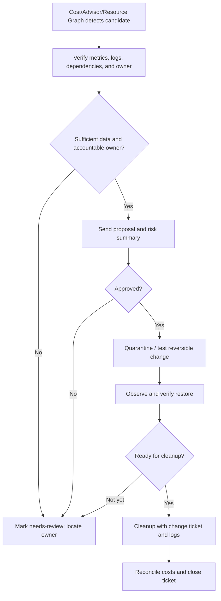

# Scheduling Environment Shutdowns and Handling Idle Resources

## 1. Practical Problem and Learning Objectives

In the **Cost Management** chapter of the **CLOUD_PROVIDERS_AZURE** module, we apply knowledge of subscriptions, resource groups, Microsoft Entra ID, virtual networking, compute, storage, data, monitoring, protection, and cost control to day-to-day operations of an Azure application architecture.

One engineering team needs a `dev` environment during business hours, yet VMs run all night and through weekends. Another team deleted test VMs while leaving behind managed disks, public IPs, or snapshots. All of these can accrue charges without delivering corresponding value. However, a low-CPU VM might run month-end batch jobs; an unattached disk might hold a recovery copy; a nearly idle database might be a critical failover standby.

Therefore, **handling idle resources** is a disciplined workflow: discovery, purpose verification, owner confirmation, action selection, approval, controlled execution, and outcome measurement. The goal is not deleting as many resources as possible, but **eliminating waste while preserving data safety, reliability, and developer productivity**.

After this lesson, you will be able to:

- Classify idle candidates using Azure Cost Management, Azure Advisor, Azure Monitor, and Azure Resource Graph.
- Use tags, allowlists, schedules, and exceptions to automate dev/test environments safely.
- Distinguish `stopped` vs. `deallocated` VMs and explain residual charges that continue after stopping a VM.
- Design start/stop schedules using Azure VM Auto-shutdown and Azure Automation with managed identities.
- Read, test, and adapt PowerShell runbooks featuring Preview mode, tag checks, idempotency, and postconditions.
- Distinguish stopping/downsizing from **deletion** and establish a cleanup approval workflow.
- Calculate avoided compute hours and verify actual savings with real billing data.

**Running scenario:** A test API VM named `vm-dev-api-01` sits in `rg-shop-dev`; the team needs it from 08:00 to 19:00 on weekdays in Vietnam time. Resource names, tags, prices, and times are learning examples; all operations on live resources must use your organization's authorized subscriptions, scopes, and permissions.

## 2. Defining "Idle" Using Multiple Evidence Sources

A resource is an **optimization candidate** when it incurs significant cost relative to low utilization. Before acting, inspect simultaneously:

1. **Actual utilization:** CPU, memory, disk I/O, network, requests, job runs, and connection counts over a sufficient window.
2. **Business purpose:** Dev/test, staging, production, standby/DR, training, backup, compliance, or batch processing.
3. **Owner:** Team, cost center, approver, and environment expiration date.
4. **Dependencies:** CI build agents, databases, Key Vault, IP allowlists, backups, monitoring, external integrations, and maintenance windows.
5. **Recoverability:** Is the action reversible, how long does recovery take, and could data or endpoints be lost?

| Initial Signal | What to Verify | Potentially Appropriate Action |
| --- | --- | --- |
| Dev/test VM unused off-hours | Work schedule, nightly builds, owner, backups | Schedule deallocate and start |
| Production VM with low CPU for weeks | P95/peak load, RAM, I/O, HA, SLOs, periodic batch | Rightsize or autoscale if permitted |
| Unattached managed disk | Recovery data, migrations, snapshots, retention | Queue for owner review; delete only after approval |
| Unassociated public IP | DNS records, allowlists, active deployments | Release after network verification |
| Old snapshots or backups | Retention policy and legal/compliance obligations | Appropriate lifecycle/retention policy |
| App Service receiving almost no requests | App Service plan, other apps sharing the plan | Rightsize/scale plan; stopping an app does not stop plan fees |
| Test database with few queries | SKU, jobs, backups, serverless/auto-pause support | Pause/stop/resize only if service and tier support it |
| Expired temporary environment | Owner, data, recent activity | Quarantine, notify, then clean up with approval |

**Never use a single static CPU threshold as a deletion rule.** Monthly batch servers or DR standby resources show low load while remaining essential. For periodic workloads, pick an observation window covering at least one meaningful business cycle.

## 3. Finding Candidates: Cost Management, Advisor, Monitor, and Resource Graph

### 3.1. Check Costs Before Picking Optimization Targets

In **Azure Cost Management → Cost analysis**, select an authorized subscription or scope. Filter and group by resource, resource group, service, and tags like `environment` and `costCenter`. Compare multi-week cycles, weekdays vs. weekends, and major charge categories.

To measure accurately:

- Distinguish **actual cost** and **amortized cost**; reservations and Savings Plans alter apparent "savings" relative to list VM rates.
- Record baseline, capture timestamp, currency, SKU, region, and charge type.
- Use budgets/forecasts to spot rising spend, without treating budgets as an hourly consumption blocker.
- Check charges that continue after a VM is deallocated: managed disks, snapshots, backups, networking/public IPs, and logs.

Cost Management tells you **where money is going**, while telemetry tells you whether a resource actually needed to be running during those hours.

### 3.2. Reading Azure Advisor Properly

Azure Advisor can recommend downsizing underutilized VMs/resources or other savings options depending on service type and available data. Treat recommendations as **inputs for review**, not deletion orders. Inspect observation windows, load peaks, supported SKUs, downtime risk, affordability, and existing price commitments.

For example: a dev VM sits under 5% CPU most of the day yet runs one heavy 1-hour build every morning. Downsizing could slow builds down; **off-hours deallocation** is often a better fit.

### 3.3. Combining Azure Monitor and Application Activity

For VMs, inspect `Percentage CPU`, disk I/O, network traffic, heartbeats, and application logs. Guest memory or per-process metrics may require the **Azure Monitor Agent** and Data Collection Rules; never assume platform metrics capture everything out of the box.

Verify:

- P95/P99 peaks, not just averages.
- CI/CD run windows, backup schedules, batch jobs, overnight tests, and users in other timezones.
- Azure Activity Log history, VM power state transitions, and recent jobs.
- Seasonality: month-end/quarter-end jobs mean 7 days of data is often insufficient.

### 3.4. Azure Resource Graph: Inventory, Not Deletion Proof

This **read-only** Resource Graph query finds unattached managed disk candidates:

```kusto
Resources
| where type =~ 'microsoft.compute/disks'
| extend diskState = tostring(properties.diskState)
| where diskState =~ 'Unattached'
| project id, name, subscriptionId, resourceGroup,
          location, diskState, skuName = tostring(sku.name), tags
| order by resourceGroup asc
```

Cross-check results against live resource state; schemas/properties can vary by provider. **An `Unattached` disk may still hold critical recovery data.** Never wire this query directly into a deletion script.

List VMs and tags to identify scheduling candidates:

```kusto
Resources
| where type =~ 'microsoft.compute/virtualmachines'
| project id, name, resourceGroup, location,
          environment = tostring(tags.environment),
          owner = tostring(tags.owner),
          schedule = tostring(tags.schedule),
          automation = tostring(tags.automation),
          doNotStop = tostring(tags.doNotStop)
| order by resourceGroup asc
```

Resource Graph reflects point-in-time inventory; it does not replace **time-series metrics**. Combine queries with Cost Management, Azure Monitor, and owner confirmation before proposing changes.

## 4. Tagging Policies, Schedules, and Exceptions

Suggested tag schema for a multi-subscription organization:

| Tag | Example Value | Purpose |
| --- | --- | --- |
| `environment` | `dev`, `test`, `staging`, `prod` | Classification and guardrails |
| `owner` | `team-commerce` | Approver / contact |
| `costCenter` | `CC-042` | Cost allocation |
| `schedule` | `office-hours-vn` | Attaches schedule policy |
| `automation` | `allowed` | Opt-in flag for runbooks |
| `doNotStop` | `true` | Override blocking scheduled stop |
| `expiresOn` | `2026-12-31` | Mandatory review date |
| `criticality` | `noncritical` | Impact assessment |

Enforcement rules:

1. Allow automation scripts only inside a **resource group allowlist** and on VMs with `environment=dev` or `test`.
2. Require both `automation=allowed` and `schedule=office-hours-vn`. Missing tags mean **not opted in**.
3. `doNotStop=true` takes precedence to block shutdowns. Exceptions must record owner, rationale, expiration date, and approver.
4. Tags are **guard logic only**. Anyone permitted to edit tags/runbooks can alter targets; Azure RBAC must strictly scope the Automation identity.
5. When the owner is unknown, place the resource into an investigation queue—never auto-delete because a tag is missing.

Azure Policy can help enforce tags and governance rules, provided you verify policy assignments at the target scope and avoid assuming all resources inherit tags automatically.

## 5. Choosing the Right Scheduling Option per Service

### 5.1. Azure VM Auto-Shutdown

For standalone dev/test VMs, **Auto-shutdown** in the Azure Portal is often the simplest way to set a daily shutdown time and notifications per supported options. Verify timezone, execution window, and impact on active jobs.

Auto-shutdown is **not a full environment orchestrator**: it does not start VMs back up in the morning by default, check databases, or handle complex application exceptions. When two-way start/stop schedules, tag-based rules, and multi-VM coordination are needed, use Azure Automation.

### 5.2. Azure Automation with PowerShell Runbooks

An **Automation Account** holds runbooks; **schedules** trigger runbooks with parameters; each execution creates a **job** with an ID, status, and output/error streams. A system-assigned managed identity granted **Azure RBAC** can call Azure Resource Manager without storing long-lived client secrets.

Proposed schedules:

| Schedule | Time in Vietnam Time (UTC+07:00) | Action |
| --- | --- | --- |
| `dev-start-workday` | 08:00 Monday–Friday | `Start` |
| `dev-stop-evening` | 19:00 Monday–Friday | `Stop` |
| `idle-review-weekly` | Weekly | Candidate inventory report, **read-only** |

Vietnam does not observe Daylight Saving Time (DST), yet you should still verify timezone and **Next run time** in the Portal. For distributed teams across timezones, base schedules on actual usage hours.

### 5.3. Not Every Service Shuts Down Like a VM

| Service | Approach to Consider | Limitations |
| --- | --- | --- |
| Azure VM | Deallocate when unused | Disks, backups, public IPs, networking still bill |
| VM Scale Sets | Scale down per config and availability needs | Account for dependencies, capacity, and SLOs |
| AKS | Manage workloads and right-sized node pools; scale down where safe | System pools and baseline services have floors; scaling pods alone may not drop costs |
| Azure App Service | Rightsize and scale App Service plan | Stopping a web app does not stop App Service plan billing |
| Azure SQL | Select appropriate tier, serverless auto-pause where eligible | Not all tiers auto-pause; storage/backups still bill |
| Storage Account | Lifecycle management, tiering, and retention | No "stop button" to pause storage capacity fees like a VM |
| Managed disks / snapshots | Audit attachment, backups, retention before cleanup | Wrong deletion causes irreversible data loss |
| Public IP / network resources | Verify associations, DNS/allowlists, then clean up | Zero traffic does not mean zero dependencies |

Multi-tier environments should shut down in **dependency order**, e.g., stopping workers and apps before databases where supported; on startup, ensure networking/databases are ready before starting apps and workers. Never treat a VM stop command as a universal Azure shutdown pattern.

## 6. Sample PowerShell Runbook: Safe VM Start/Stop

Example PowerShell runbook for `vm-dev-api-01` in `rg-shop-dev`. It uses a **system-assigned managed identity**, `Az.Accounts` and `Az.Compute` modules, defaults to Preview mode, checks tags, restricts resource groups, and verifies post-execution state.

```powershell
param(
    [Parameter(Mandatory = $true)]
    [string] $SubscriptionId,

    [Parameter(Mandatory = $true)]
    [string] $ResourceGroupName,

    [Parameter(Mandatory = $true)]
    [string] $VMName,

    [Parameter(Mandatory = $true)]
    [ValidateSet('Start', 'Stop')]
    [string] $Action,

    [ValidateSet('Preview', 'Execute')]
    [string] $Mode = 'Preview'
)

$ErrorActionPreference = 'Stop'
$allowedGroups = @('rg-shop-dev')

if ($ResourceGroupName -notin $allowedGroups) {
    throw "BLOCKED: Resource group is not in allowlist."
}

try {
    Disable-AzContextAutosave -Scope Process | Out-Null
    Connect-AzAccount -Identity -ErrorAction Stop | Out-Null
    Set-AzContext -SubscriptionId $SubscriptionId -ErrorAction Stop |
        Out-Null

    $target = @{
        ResourceGroupName = $ResourceGroupName
        Name = $VMName
        ErrorAction = 'Stop'
    }
    $vm = Get-AzVM @target

    if (-not $vm.Tags -or
        $vm.Tags['environment'] -notin @('dev','test') -or
        $vm.Tags['automation'] -ne 'allowed' -or
        $vm.Tags['schedule'] -ne 'office-hours-vn' -or
        $vm.Tags['doNotStop'] -eq 'true') {
        throw "BLOCKED: VM does not meet tag conditions."
    }

    $view = Get-AzVM @target -Status
    $state = ($view.Statuses |
        Where-Object { $_.Code -like 'PowerState/*' } |
        Select-Object -First 1).Code

    if (-not $state) {
        throw 'Unable to retrieve PowerState; aborting operation.'
    }

    Write-Output ("TARGET sub={0} rg={1} vm={2}" -f
        $SubscriptionId, $ResourceGroupName, $VMName)
    Write-Output ("PLAN mode={0} action={1} current={2}" -f
        $Mode, $Action, $state)

    if ($Action -eq 'Stop') {
        if ($state -eq 'PowerState/deallocated') {
            Write-Output 'SKIP: VM is already deallocated.'
            return
        }
        if ($state -notin @('PowerState/running',
                           'PowerState/stopped')) {
            throw "BLOCKED: VM is in state $state."
        }
        $expected = 'PowerState/deallocated'
    }
    else {
        if ($state -eq 'PowerState/running') {
            Write-Output 'SKIP: VM is already running.'
            return
        }
        if ($state -notin @('PowerState/stopped',
                           'PowerState/deallocated')) {
            throw "BLOCKED: VM is in state $state."
        }
        $expected = 'PowerState/running'
    }

    if ($Mode -eq 'Preview') {
        Write-Output 'PREVIEW: no changes made to VM.'
        return
    }

    if ($Action -eq 'Stop') {
        Stop-AzVM @target -Force | Out-Null
    }
    else {
        Start-AzVM @target | Out-Null
    }

    # Check final state with a bounded retry loop.
    $actual = $null
    for ($i = 1; $i -le 12; $i++) {
        $after = Get-AzVM @target -Status
        $actual = ($after.Statuses |
            Where-Object { $_.Code -like 'PowerState/*' } |
            Select-Object -First 1).Code
        if ($actual -eq $expected) { break }
        Start-Sleep -Seconds 10
    }

    if ($actual -ne $expected) {
        throw "FAILED: expected $expected, actual $actual."
    }

    Write-Output ("SUCCESS: VM={0}, state={1}" -f
        $VMName, $actual)
}
catch {
    Write-Error ("FAILED: {0}" -f $_.Exception.Message)
    throw
}
```

### 6.1. Safeguard Layers in the Script

**Managed identity and RBAC.** `Connect-AzAccount -Identity` avoids storing client secrets. The identity needs permission to read VM/PowerState and run `start`/`deallocate` at the allowed scope. Design a narrow custom role; never grant subscription-wide Owner just to bypass an access error. `Set-AzContext` pins the subscription, and `Disable-AzContextAutosave` prevents leaking context across jobs.

**Allowlist and tags.** Only `rg-shop-dev` is allowed; VMs must opt in via tags and lack `doNotStop=true`. In production operations, normalize tag formatting (including casing) and restrict tag write access. Tags never replace Azure RBAC.

**Idempotency.** Calling Start on an already running VM or Stop on an already deallocated VM simply logs `SKIP`. VMs in transitional or unknown states are blocked. Concurrent jobs still require external concurrency/locking controls.

**Preview.** `Mode=Preview` is read-only and prints the execution plan. **The Test pane still executes live code**, so a runbook lacking a Preview guard can trigger mutating API calls during testing.

**Stop/deallocate and postconditions.** `Stop-AzVM` here omits `-StayProvisioned` so it deallocates the VM. Afterward, the script polls `PowerState` with bounded retries. On failure, it throws an error for operator review rather than assuming success.

**Scope limit:** This is a single-VM learning example. Do not apply it blindly to production VMs, VM Scale Sets, VMs with uncommitted data jobs, or whole resource groups. Check backups, dynamic IPs, quotas, startup dependencies, SLAs, and module versions before running.

### 6.2. Distinguishing `stopped` vs. `deallocated`

| PowerState | Meaning | Billing Impact |
| --- | --- | --- |
| `PowerState/running` | VM is running | Typically bills compute and related resources |
| `PowerState/stopped` | Guest OS shut down, compute may stay allocated | **May still incur compute charges** |
| `PowerState/deallocated` | VM compute released | Usually stops VM compute charges, while disks/backups/IPs/network/logs may still bill |
| `starting/stopping/deallocating` | Transitional state | Incomplete; do not count as realized savings |

Never write "VM is off so cost is zero" in FinOps reports. Reconcile all charge types in Cost Management.

## 7. Configuring the Automation Account and Schedules

### 7.1. Setup and Testing

1. Create an **Automation Account** in a management resource group (e.g., `rg-ops-automation`) and enable its **system-assigned managed identity**.
2. On `rg-shop-dev`, assign the minimal required role to the **Automation Account's principal ID**. Scope permissions tightly; isolate production identities separately when needed.
3. Choose compatible PowerShell runtime and `Az.Accounts` / `Az.Compute` modules; create runbook `rb-manage-dev-vm`.
4. In the **Test pane**, run `Mode=Preview` with `Action=Stop` against a properly tagged test VM. Inspect `TARGET`, `PLAN`, and `PREVIEW`, confirming the VM stays untouched.
5. On an authorized VM, run `Mode=Execute` under supervision; confirm `PowerState/deallocated`. Re-run Stop to verify `SKIP`, then run Start to confirm the VM reaches running.
6. **Publish** the reviewed version; record runbook version, principal ID, resource scope, and job IDs.

### 7.2. Linking Schedules

Create two schedules in Azure Automation:

- `dev-start-workday`: 08:00 weekdays, parameters `Action=Start` and `Mode=Execute`.
- `dev-stop-evening`: 19:00 weekdays, parameters `Action=Stop` and `Mode=Execute`.

Both pass `SubscriptionId`, `ResourceGroupName=rg-shop-dev`, and `VMName=vm-dev-api-01`. When linking schedules, confirm timezone, recurrence, start date, enabled state, and **Next run time**. Account for holidays, maintenance, overnight CI tests, and teammates outside Vietnam time.

**Operational procedure:** Monitor the first scheduled runs, alert if Stop fails to deallocate or Start fails to reach running, maintain an approved manual override, and document fallback steps if Automation Account/jobs are unavailable.

## 8. Process for Handling Idle and Orphaned Resources

Distinguish **deallocate** from **delete**. VMs can be started again; deleting disks, snapshots, databases, or resource groups can be irreversible without backups.



### 8.1. Risk Levels

| Action | Reversibility | Preconditions |
| --- | --- | --- |
| Adjust dev/test VM schedule | Reversible if data is intact | Owner sign-off, check jobs/backups and schedules |
| Resize VM or plan | May affect performance or cause brief downtime | Load baseline, testing, and rollback plan |
| Scale down workers/node pools | Depends on quorum/SLO/queues | Verify capacity and business impact |
| Change storage tier/retention | Retrieval lag/fees, or data loss on delete | Data owner, lifecycle, and retention rules |
| Release unattached IP/NIC | May break external endpoints/configs | Network owner, DNS/allowlists, observation |
| Delete managed disk/snapshot | Irreversible data loss risk | Verify backups, restore test, retention, owner |
| Delete entire resource group | Very wide blast radius; deletes all scoped resources | Inventory, dependency graph, senior approval |

### 8.2. Unattached Disk Workflow Example

1. Detect candidate disk via Resource Graph, then verify live state directly in Azure.
2. Inspect Activity Logs, deployment/change records, and owner metadata; check if the disk belonged to a recently deleted VM or an active migration.
3. Notify the owner proposing keep/snapshot/delete with a response deadline and recovery path.
4. If retention is required, create and verify a recovery copy per policy; record backup ID and location.
5. Only after approval, execute under a change ticket. **Re-check attachment state immediately before deleting** in case status changed.
6. Log executor, timestamp, resource ID, outcome, and verify Cost Analysis in the next cycle.

If no owner is found, move to `owner-review-needed` for subscription/FinOps admins to decide. Never use missing tags as justification for auto-deletion.

## 9. Measuring Savings: Theory vs. Reality

For VMs, rough calculation:

\[
H_{\text{avoided}} = H_{\text{baseline}} - H_{\text{allocated after schedule}}
\]

\[
S_{\text{estimated compute}} = H_{\text{avoided}} \times P_{\text{effective compute/hour}}
\]

Hypothetical 30-day month example where a VM previously ran 24/7, then runs 10 hours/day across 22 workdays:

| Metric | Calculation | Result |
| --- | --- | ---: |
| Baseline compute hours | `30 × 24` | 720 hours |
| Scheduled compute hours | `22 × 10` | 220 hours |
| Avoided compute hours | `720 − 220` | 500 hours |
| Hypothetical compute rate | `0.20 USD/hour` | — |
| Theoretical savings | `500 × 0.20` | 100 USD/month |

**100 USD is illustrative only**, not guaranteed invoice reduction. Savings Plans, reservations, disks, backups, IPs, logs, actual usage, and hours the VM was already turned off can alter realized savings.

KPIs to track:

- Share of eligible VMs covered by valid schedules.
- Actual deallocated hours, not just scheduled stop hours.
- Share of jobs passing the **PowerState postcondition**, not merely `Completed` status.
- Count of `doNotStop` exceptions with valid owners and expiration dates.
- Before/after compute and total costs, separating rate effects from usage effects.
- Incidents or CI failures caused by schedules or cleanups.
- Count of orphaned resources confirmed by owners and properly resolved.

## 10. Monitoring, Security, and Common Errors

In the Automation Account, monitor **Jobs**, Output/Error/Warning streams, and safe inputs. Enable Diagnostic settings to route supported job logs to Log Analytics, Storage, or Event Hub as needed. Alert on job failures, missed schedules, VMs failing to deallocate after stop time, or failing to reach running at shift start.

| Symptom | Possible Cause | Resolution |
| --- | --- | --- |
| Job never runs on schedule | Schedule unlinked, runbook unpublished, wrong timezone, or disabled | Check Next run time and job history |
| `Connect-AzAccount -Identity` fails | Identity disabled, incompatible worker/module, or network block | Check Identity, runtime, and connectivity |
| HTTP `403 AuthorizationFailed` | Role missing action/scope, propagation lag, or deny assignment | Inspect principal ID, role assignments, and scope |
| Job Completed yet VM still running | Errors swallowed, Stop only shut down guest OS, or missing postcondition | Check PowerState and script; enforce deallocate |
| VM deallocated but didn't start in morning | Start schedule failed, quota/capacity issue, or dependency | Inspect error stream, Azure Health, and manual recovery |
| VM stopped mid-CI test | Schedule ignored real workload or lacked owner sign-off | Adjust schedule, add maintenance/exceptions, and review |
| IP changed after start | Dynamic IP or fragile endpoint dependency | Review network design and DNS |
| Query flagged `Unattached` disk that's critical | Disk reserved for backup, restore, or migration | Halt cleanup; verify owner, retention, and data |
| High estimated savings but flat invoice | Reservations/Savings Plans, disks/IPs persist, or schedule inactive | Compare Cost Analysis, PowerState, and usage |
| Concurrent jobs hit HTTP 429 | Throttling and API contention | Bound concurrency, add backoff retries and timeouts |

**Permissions:** Anyone able to publish runbooks or edit schedules/tags can impact live infrastructure. Version runbooks in Git, peer-review changes, tightly scope Automation and Azure RBAC permissions, and never log tokens, secrets, or webhook URLs. When orchestrating multiple VMs, add locking against overlapping runs and cap parallelism.

## 11. Hands-On Lab

**Scenario:** An Azure subscription has dev/test VMs and one production VM. Engineering wants dev machines started at 08:00 and deallocated at 19:00 on workdays; meanwhile, one `Unattached` managed disk and one unassociated public IP need review.

1. Inventory the 3 VMs, disk, and IP: Resource ID, owner, tags, recent cost, utilization, and dependencies.
2. Use Cost Management, Azure Monitor/Advisor to confirm which VMs qualify for scheduling; leave production untouched unless governed separately.
3. Apply Section 4 tags to the dev VM and place `rg-shop-dev` on the allowlist.
4. Create an Automation Account with a system-assigned managed identity; grant least-privilege RBAC on the dev resource group.
5. Create the runbook from Section 6 and run `Mode=Preview`. Confirm zero write calls occur while verifying exact target selection.
6. Run `Mode=Execute` **on an authorized lab VM**, confirming Stop moves it to `deallocated`. Re-run Stop to verify `SKIP`.
7. Start the VM, confirm `running` and dev app health; record job IDs and recovery steps.
8. Create 08:00 and 19:00 schedules, verify timezone and Next run time, and configure alerts if postconditions fail.
9. For the disk/IP, gather evidence and owner sign-off, propose review deadlines, snapshots/retention/approvals—do not auto-delete.
10. Calculate avoided compute hours and plan post-change verification across a representative usage period.

**Pass criteria:** Documented evidence covering owner, tags, RBAC, Preview/Execute outputs, PowerState, schedules, job logs, disk/IP review findings, and actual costs. If simulated only, explicitly note it was not executed against a live subscription.

## 12. Self-Check Questions

**1. Does consistently low CPU automatically mean a VM should be deleted?**  
No. It could be a standby, periodic batch runner, or failover node. Verify owner, purpose, peaks, and data first.

**2. How do `PowerState/stopped` and `PowerState/deallocated` differ?**  
Stopped may keep compute allocated and still incur compute charges; deallocated releases compute, though disks, backups, networking, and logs can still incur fees.

**3. Does VM Auto-shutdown automatically start the VM back up the next morning?**  
Never assume so. When two-way start/stop scheduling and input validation are needed, use Azure Automation or an equivalent supported mechanism.

**4. Why don't tags replace RBAC?**  
Tags are mutable metadata. Azure RBAC strictly governs which identities can invoke which actions on which scopes.

**5. Can an `Unattached` disk be deleted immediately after one Resource Graph query?**  
No. It may hold recovery backups or migration data; owner confirmation, backups, retention checks, and approval are required.

**6. A job shows `Completed` yet the VM remains running after stop time; was the goal achieved?**  
No. The postcondition is VM deallocated, verified via PowerState and logs.

**7. Does an Azure Advisor estimate equal realized cash savings?**  
No. It is an estimate; inspect post-change usage/cost data, effective rates, and ongoing residual charges.

**8. When shutting down a multi-resource environment, why shouldn't everything stop simultaneously?**  
Applications have dependencies; drain write workloads, stop workers/apps in order, and on startup verify data/network health followed by smoke tests.

## 13. Official References to Consult

- Microsoft Learn — **Azure Cost Management / Cost Analysis** and **Azure Well-Architected Cost Optimization**.
- Microsoft Learn — **Azure Advisor Cost recommendations**.
- Microsoft Learn — **Azure Monitor metrics and logs**, plus guest metrics guidance.
- Microsoft Learn — **Azure Resource Graph overview** and inventory queries.
- Microsoft Learn — **Azure Virtual Machines power states and billing**; **Auto-shutdown for VMs**.
- Microsoft Learn — **Azure Automation overview**, **Runbooks**, **Schedules**, and **Managed identities**.
- Microsoft Learn — **Azure Policy / Resource tags** and **Azure Storage lifecycle management**.

Stop/pause/scale capabilities, pricing, and runtime limits vary by service, SKU, region, and time. Before broad rollout, check official documentation, permission scopes, live data, and postconditions; **cost savings must always go hand in hand with reliability and owner control**.
