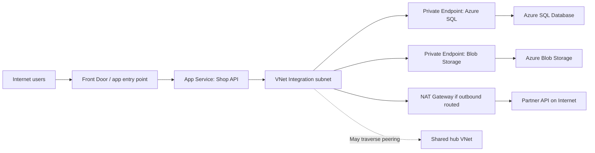
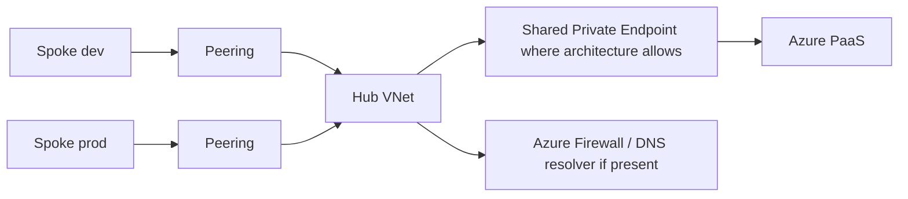

# Calculating Data Transfer, Networking, and Private Endpoint Costs

## 1. Learning Objectives and Real-World Problem

An application deployed on Microsoft Azure may optimize CPU, memory, and storage capacity yet still see rising bills as user traffic grows. The cause often lies in **data transfer**, hourly charges for networking resources, and data **processed by connectivity services** such as Private Endpoints, NAT Gateway, Azure Firewall, or VNet peering. These items can bill across **multiple distinct meters** even while serving a single connection flow.

In the **Cost Management** chapter of the `CLOUD_PROVIDERS_AZURE` module, this lesson explains how to map network traffic flows, estimate costs, inspect Azure billing records, and optimize an application architecture. It connects subscriptions, resource groups, Microsoft Entra ID, virtual networks, compute, storage, data, monitoring, security, and cost control.

After this lesson, you will be able to:

- Classify traffic by **source, destination, region, availability zone, and path** instead of simply summing total GB.
- Distinguish **bandwidth/data transfer charges**, **data processing fees**, **hourly network resource fees**, and **destination service charges**.
- Explain why **a Private Endpoint does not mean free connectivity**, and when DNS, peering, cross-region, or other network fees apply.
- Build an estimate table covering endpoint counts, uptime hours, directional traffic, and hypothetical unit prices.
- Locate and reconcile charges in Azure Cost Analysis, Cost Management Query/Exports, and metric/flow telemetry.
- Propose cost optimizations without compromising security, availability, or user experience.

**Running scenario:** The `Shop API` system includes Azure App Service, Azure SQL Database, Azure Storage, and a worker inside an Azure Virtual Network (VNet). Security requires accessing SQL/Storage over **Private Link**, while the application also calls partner APIs on the Internet. The system uses two subscriptions (`non-production` and `production`), with some shared components running in a hub VNet. FinOps must answer: which cost categories arise along each path, and what data is needed to calculate them?

> **Core principle:** There is no single "Azure network price per GB" applicable to every path. Unit rates vary by region, region pair, direction, service/SKU, contract type, usage tier, timing, and any free allowances. All monetary figures in exercises are **illustrative assumptions**, not Microsoft quotes or commitments.

## 2. Seeing the True Picture: Where Does Data Go and Through What?

### 2.1. Classify Traffic Before Calculating Costs

For each data flow, write down **source → destination → path → direction → volume → duration**. One HTTP request can trigger multiple flows: client sends request to app, app calls SQL/Storage, app sends response back to the Internet. Each flow has different billing points.

| Example Flow | What to Verify First | Potentially Related Fee Groups |
|---|---|---|
| Internet → Azure app | Where is the client, and which public endpoint receives the request? | Inbound Internet bandwidth often follows different pricing than outbound; gateway/CDN/WAF still have their own meters |
| Azure app → Internet | Source region, actual outbound GB, path through NAT/firewall? | Internet egress bandwidth; NAT/firewall/LB/public IP if used |
| VM/app → SQL or Storage **same region** | Same VNet, different VNet, Private Endpoint/peering present? | Private Link processing + endpoint hours; peering/gateway or target service if applicable; do not assume Internet egress |
| VNet A ↔ VNet B | Regional or global peering? Both directions and region pair? | VNet peering data transfer across applicable meters/directions |
| Azure region A → region B | Between which regions and via which services? | Inter-region bandwidth; extra network/destination layers if any |
| Across availability zones | Specific service, deployment mode, and traffic path? | Verify current inter-zone data transfer policy; do not assume "same region" means always free |
| Azure ↔ on-premises | VPN Gateway, ExpressRoute, circuit type, metered/unlimited? | Hourly or plan-based gateway/circuit fees; outbound/metered transfer depending on setup |
| Storage/SQL → app | Reads, transactions, backups, replication, or storage tiers? | Beyond networking, **data service charges** apply for requests/operations, compute, storage, replication |

**Data is not billed twice just because we draw two arrows**, yet a single flow can trigger **multiple independent meters**: for example, Private Link processing plus peering charges when traffic crosses both. When reconciling invoices, group by **billed meters and resources**—never multiply one GB figure by multiple rates if the real path bypasses those services.

### 2.2. Network Flows in `Shop API`



This diagram is an **analytical model**; it does not assert every flow necessarily traverses NAT or a hub. App Service Regional VNet Integration primarily handles **outbound** traffic into the virtual network; Internet routing, route-all, DNS, and NAT depend on configuration. A Private Endpoint places a network interface with a **private IP in the VNet** pointing to a Private Link-enabled service; the destination service retains its standard identity and API.

To estimate accurately, clarify:

1. Which **regions** host App Service and SQL/Storage?
2. Which **subnet/VNet** hosts each Private Endpoint, is the connection approved, and does DNS resolve to the private IP?
3. Is there VNet peering or a hub firewall in the path?
4. Does partner API traffic actually traverse NAT Gateway, or exit via default outbound?
5. Are payloads compressed or uncompressed, and what are total GB in each direction?

### 2.3. Distinguishing Three Easily Confused Concepts

- **Private Endpoint:** A network interface resource with a private IP used by a client network to reach an Azure Private Link-supported service. Billing can include **endpoint hours** and **data processed** per pricing terms.
- **Private Link Service:** The **provider-side** mechanism exposing a service over Private Link—not the same resource or price sheet as the consumer-side Private Endpoint.
- **Private DNS Zone:** Manages private domain names for endpoints. DNS resolves the right IP; **DNS does not create a Private Endpoint** and may carry separate zone/query charges.

`Azure Key Vault` stores keys and secrets; it is not a network vault. Azure Storage with `publicNetworkAccess: Disabled` may still need a private endpoint or another supported access path; simply toggling "private" does not guarantee DNS, routing, and data permissions work.

## 3. Common Azure Networking Cost Components

| Component | Cost Unit to Check | When Incurred | Common Pitfall |
|---|---|---|---|
| **Internet outbound data transfer** | Billable data by GB/tier/region | Traffic leaving to Internet or destinations per bandwidth pricing | Assuming inbound/outbound cost the same or every GB bills from byte 1 |
| **Inter-region data transfer** | GB by source/target region and service | Moving data between Azure regions | Confusing with intra-region traffic |
| **Cross-zone data transfer** | Per service terms and current price sheet | Traffic between availability zones | Applying one blanket rule to all SKUs/regions |
| **VNet peering** | GB by direction and regional/global peering | Traffic crossing a peering link | Counting only one side or overlooking peering type |
| **Private Endpoint (Private Link)** | Endpoint count × hours; data processed by GB/tier | Endpoint exists and traffic traverses it | Thinking private IPs carry zero data processing fees |
| **NAT Gateway** | Resource hours, GB processed by NAT; possible public IP fees | Subnet routes outbound through NAT Gateway | Thinking NAT only bills GB, or VNet Integration always uses NAT |
| **Azure Firewall** | Deployment hours/SKU and GB processed, plus related services | Traffic routed through firewall | Omitting firewall fees when comparing hub-spoke vs. direct |
| **Application Gateway / Load Balancer** | By SKU, hours, capacity/rules, or data processed depending on service | Gateway/load balancer actively serving traffic | Confusing gateway charges with Internet egress alone |
| **VPN Gateway / ExpressRoute** | Gateway/circuit hours or plan; metered/unlimited bandwidth by type | Azure connected to on-premises or private circuits | Applying Internet GB rates to all ExpressRoute plans |
| **Public IP** | By SKU, region, duration, or pricing policy | Public IP resource allocated | Forgetting standalone IP fees alongside NAT/LB where applicable |
| **Azure Private DNS** | Zones/duration and query counts per plan | Private zones and DNS lookups per config | Assuming DNS zones are free because endpoints use private IPs |
| **Network telemetry** | Log ingestion, retention, storage, queries, or monitoring features | Flow logs/diagnostics/Log Analytics enabled | Treating logging costs as production traffic transfer fees |

**Pricing policies can change and certain meters include free tiers or volume discounts.** This table identifies where to check price sheets, not guaranteed charges. Destination service fees—such as Azure SQL compute, Storage transactions, or CDN egress—may be **independent** of network meters.

## 4. Private Endpoint: How Is It Billed?

### 4.1. Two Primary Components

Estimation model for **applicable Private Endpoint meters**:

```text
Private Endpoint cost
  = Sum(active endpoints × billable hours × price per endpoint-hour)
  + Sum(GB data processed × price per GB per meter/direction/tier)
```

Notes:

- **Hourly charge** depends on the endpoint's billable lifetime/existence, regardless of whether requests occur. An idle endpoint can still generate charges.
- **Data charge** depends on actual bytes traversing Private Link and meter direction/tier rules. Never use **stored** database size or blob capacity as the GB transferred through the endpoint.
- **Multiple endpoints** multiply the hourly portion. Storage may require separate endpoints per **subresource** like `blob`, `file`, or `dfs` depending on use case; do not assume one endpoint serves every storage type.
- **Regional and contract rates** may differ, with tiered pricing; separate each meter rather than multiplying all GB by one flat rate.

**Illustrative example:** Production uses two endpoints: one for Azure SQL and one for Blob Storage. Assume a 730-hour reporting period, a hypothetical rate of **0.010 USD/endpoint-hour**, total metered traffic across both endpoints of **600 GB**, a hypothetical processing rate of **0.010 USD/GB**, and no other tiers or free allowances.

| Line Item | Formula | Hypothetical Cost |
|---|---|---:|
| Two endpoints | 2 × 730 h × 0.010 USD/h | 14.60 USD |
| Private Link data processing | 600 GB × 0.010 USD/GB | 6.00 USD |
| **Private Endpoint subtotal** | 14.60 + 6.00 | **20.60 USD** |

These **are not current Azure rates**, just an arithmetic exercise. This subtotal **excludes** Azure SQL compute, Storage operations, VNet peering, cross-region transfer, NAT, DNS, backups, and logs. When separate directional meters or tiers apply, adjust the formulas and reconcile against Cost Management.

### 4.2. Private Link Secures the Path; It Does Not Erase Other Costs

A flow `App Service (VNet A) → peering → Private Endpoint (VNet B) → Azure SQL` can involve:

1. **Hourly endpoint fee**, because the endpoint resides in the client-facing target VNet.
2. **Private Link data processing fee** per meter as data traverses the endpoint.
3. **VNet peering fee** if traffic actually crosses a billable peering link.
4. **Inter-region fee** if source and destination reside in different regions on a billable path.
5. **SQL compute/I/O fees** from database workload execution, independent of Private Link.

Do not conclude all five apply in every environment: inspect **actual topology**, pricing rules, and invoice meters. If App Service and the Private Endpoint sit in the same VNet/region with no peering, **do not add peering fees**. If partner APIs use NAT while SQL uses a Private Endpoint, **do not multiply SQL GB by NAT rates**.

### 4.3. Watch Out for DNS and Subnets

Private Endpoints require resolving service hostnames to the **private IP**. For instance, Azure SQL commonly uses a private DNS zone under `privatelink.database.windows.net`, and Blob Storage uses `privatelink.blob.core.windows.net`. Broken DNS can send traffic over public endpoints or break connectivity, impacting both security and cost estimates.

Private DNS Zones may charge per hosted zone and per query volume. Linking zones to VNets, hub DNS resolvers, and forwarding paths must be verified alongside network policy. Multi-region or multi-tenant designs may add DNS Private Resolvers or other DNS services with separate meters. Private Endpoints also consume subnet IP addresses; plan IP ranges accordingly, while **not assuming a separate per-private-IP fee** just because the IP is private.

### 4.4. Cost Is Not the Only Criterion

Keeping Private Endpoints may be mandatory for data protection, regulatory compliance, or disabling public network access. Never "optimize" by deleting endpoints and exposing Azure SQL/Storage publicly just to save hourly fees. Weigh IAM/Entra ID, network policies, DNS, logging, HA, operational burden, and data-leak risk before changing designs.

## 5. Data Transfer: Pricing by Region, Direction, and Path

### 5.1. Internet Ingress and Egress

**Ingress** is data entering Azure from outside per meter measurement; **egress** is data leaving Azure. Bandwidth policies for ingress and egress usually differ: some forms of Internet ingress incur no separate bandwidth fee, whereas outbound typically carries regional/tiered pricing and free allowances. Always verify the **receiving/sending service** and actual path rather than assuming every inbound byte is free at every processing layer.

Example: clients upload 20 GB of images to Blob Storage, then users download 200 GB of images from Blob over the Internet. You cannot calculate cost simply from a combined 220 GB: **Internet reads** may hit outbound meters distinct from uploads, alongside **Storage read/write transactions**. With CDN/Front Door, check whether responses serve from cache or origin and review CDN pricing models.

### 5.2. Same Region, Cross-Zone, and Cross-Region

Paths to separate explicitly:

- **Same VNet, same region:** Do not blindly apply Internet egress rates. However, Private Link, Load Balancers, firewalls, service requests, or other meters can still charge if traversed.
- **Different VNets connected via peering:** Check **regional** vs. **global peering**, peering volume, and billing on both sides. Peering never waives Private Endpoint or destination service fees.
- **Cross-availability-zone:** Verify service-specific pricing rules and exceptions. Never assume all intra-region traffic carries the same price.
- **Cross-region:** Can incur **inter-region data transfer charges**, even over private networks. The Azure backbone or Private Link does not automatically make cross-region traffic free.

For every flow, log **source region, destination region, and billable direction**. If an API receives 10 GB of small requests and returns 90 GB of responses, bytes are asymmetric across directions; apply the right meter/direction to each.

### 5.3. VNet Peering and Hub-Spoke

In a **hub-spoke** topology, spoke application subnets may reach DNS, firewalls, or Private Endpoints in the hub over VNet peering. Avoid confusing "a shared hub reduces endpoint count" with "a hub is always cheaper": centralization can trim some hourly fees while increasing peering, firewall appliance, or inter-region traffic.



**Security caution:** Never collapse all environments into one Private Endpoint if it breaks access isolation, creates DNS collisions, crosses subscription boundaries improperly, or weakens auditing. Compare **per-environment endpoints** against **controlled shared endpoints** across cost, operations, and security.

## 6. Supplemental Connectivity Costs: NAT, Firewall, VPN, ExpressRoute

### 6.1. NAT Gateway

NAT Gateway handles **outbound Internet** flows from associated subnets when routing sends traffic through it. Pricing typically includes **NAT Gateway uptime hours** and **data processed**, plus related resources like public IPs if billable. Internet outbound bandwidth may be a **separate** charge.

```text
NAT subtotal
  = NAT-hours × hourly unit price
  + NAT processed GB × applicable processing unit price
  + applicable public-IP charges

Total outbound path cost may additionally include Internet egress bandwidth.
```

NAT does not automatically apply to every flow merely because an app uses VNet Integration. Verify subnet association, routes, `route-all` settings, and path. Traffic to Azure SQL via a Private Endpoint does not necessarily traverse NAT; **never lump NAT bytes and Private Link bytes together**.

### 6.2. Azure Firewall and Gateways

**Azure Firewall** typically bills by deployment hours/SKU and GB of data processed; paths through the firewall can add fees for public IPs, logging, or related components. SKUs and configurations also vary in capacity and limits. **VPN Gateway** charges by gateway SKU and uptime hours, and may incur data transfer fees. **ExpressRoute** offers metered and unlimited models across circuits, providers, and routing types; never apply Internet egress rates blindly to all on-premises traffic.

When using Application Gateway, Azure Front Door, or Load Balancer, consult each service's own price sheet (fixed/capacity/processed-data/rules/requests depending on SKU). **Security and operational appliance costs** can outweigh pure data transfer fees, yet they remain essential when comparing full architectures.

## 7. Building an Auditable Network Cost Estimate Table

### 7.1. Input Dataset

Normalize inputs before calculating:

| Field | Example | How to Verify |
|---|---|---|
| Billing period | 730 hours (assumed) | Analysis window, resource creation/deletion dates |
| Source / destination | App Service → Private Endpoint → SQL | Network diagram, resource IDs, subnets, DNS, routes |
| Subscription / RG / owner | `sub-prod`, `rg-shop-prod`, `team-shop` | Azure Resource Manager, tags, ownership |
| Source–target region/zone | `southeastasia`, same-region or cross-region | Resource metadata, live topology |
| Endpoints / active hours | 2 endpoints, 730 h each | ARM inventory, change history, billing meters |
| Directional GB | 600 GB meter-normalized | Azure cost usage, service/flow metrics, traffic model |
| Rate per meter | e.g., 0.010 USD/unit | Azure Pricing Calculator/Price Sheet and contract terms |
| Free allowances/tiers/commitments | Per contract | Applicable price sheet, consumption/discounts |
| Currency and units | USD, GB/hours | Billing/cost exports and meter schemas |

**GB and GiB are not identical.** 1 GB (decimal) = 1,000,000,000 bytes; 1 GiB (binary) = 1,073,741,824 bytes. Telemetry tools may report bytes or GiB while billing meters report GB per product specification. When converting, follow **documented billing units and rules** rather than simply relabeling columns.

### 7.2. General Formula

```text
Network & connectivity cost
  = Σ(data transfer GB by path/direction/tier × rate)
  + Σ(private endpoint active hours × rate)
  + Σ(private link processed GB × rate)
  + Σ(peering traffic by side/direction × rate)
  + Σ(NAT, firewall, gateway, load balancer, public IP charges)
  + Σ(private DNS and monitoring charges, if included in scope)
  - applicable discounts/allowances/credits (under agreed accounting rules)
```

Do not include lines that **do not exist in your topology**; conversely, do not omit distinct meters just because the same bytes were already counted on another service. Distinguish the **network connectivity subtotal** from **total application cost**, since compute, SQL, and Storage follow separate pricing.

### 7.3. Complete Illustrative Calculation Example

Suppose `Shop API` incurs the following meters **actually active in a hypothetical model**, using USD and made-up unit prices solely for arithmetic practice:

| Illustrative Meter | Billable Quantity | Hypothetical Unit Price | Formula | Result |
|---|---:|---:|---|---:|
| Private Endpoint-hours | 2 × 730 h | 0.010 USD/h | 1,460 × 0.010 | **14.60 USD** |
| Private Link processed data | 600 GB | 0.010 USD/GB | 600 × 0.010 | **6.00 USD** |
| Peering meter (source side) | 250 GB | 0.012 USD/GB | 250 × 0.012 | **3.00 USD** |
| Peering meter (target side) | 250 GB | 0.012 USD/GB | 250 × 0.012 | **3.00 USD** |
| NAT Gateway-hours | 730 h | 0.045 USD/h | 730 × 0.045 | **32.85 USD** |
| NAT processed data | 300 GB | 0.045 USD/GB | 300 × 0.045 | **13.50 USD** |
| Internet outbound metered | 100 GB | 0.050 USD/GB | 100 × 0.050 | **5.00 USD** |
| Private DNS Zone | 1 zone-period | 0.50 USD/period | 1 × 0.50 | **0.50 USD** |
| **Hypothetical connectivity subtotal** | | | 14.60 + 6.00 + 3.00 + 3.00 + 32.85 + 13.50 + 5.00 + 0.50 | **78.45 USD** |

**How to interpret:** The 600 GB of Private Link, 250 GB of peering, and 300 GB of NAT **are not necessarily three disjoint streams or parts of a single 1,150 GB total**. They are three meter datasets that may overlap on certain flows while reflecting distinct provisioned services. The table assumes each row represents **an actual billed meter on the invoice**. If SQL paths avoid peering or NAT does not process that traffic, update the GB inputs accurately rather than guessing from paper diagrams.

**Excluded items:** Taxes, FX fluctuations, Azure SQL/Storage operation fees, additional security services, support, backups, log ingestion, and any real-world free tiers or tiered pricing. **78.45 USD is not a forecast for any real Azure customer's bill.**

### 7.4. Comparing Two Architecture Options

Suppose you are choosing between placing private endpoints in each spoke vs. sharing a centralized endpoint in the hub:

| Question | Dedicated Endpoint per Spoke | Centralized Endpoint in Hub |
|---|---|---|
| Endpoint-hours | Likely higher | Likely lower |
| Peering traffic | Likely lower within same VNet | May rise if accessed over peering |
| Firewall/DNS costs | Depends on routing and design | May add centralized components |
| Network isolation and governance | Cleaner per-workload boundaries | Requires careful access and DNS controls |
| Availability and blast radius | Better fault isolation | Central hub can widen blast radius |

Evaluate based on **total end-to-end flow cost** plus governance and reliability costs. Comparing "3 endpoints × hourly rate" against "1 endpoint × hourly rate" alone can mislead by ignoring peering and firewall spend.

## 8. Reconciling with Azure Cost Management

### 8.1. Azure Portal: Locating the Right Meters

In **Azure Portal → Cost Management → Cost analysis**, at an authorized cost-viewing scope:

1. **Select scope:** Choose the appropriate subscription or billing scope. Across two subscriptions, verify read access to both and matching currency/cost type.
2. **Select date range:** Prefer a closed period for reconciliation; the open month typically has **ingestion latency**.
3. **Select cost type:** Use `Actual cost` for period-recorded charges; `Amortized cost` handles commitment amortization where supported. Never mix both in one sum.
4. **Group by** `Service name`, `Resource group`, `Resource`, or `Meter`/meter groups where supported; locate lines tied to Virtual Network/Private Link, Bandwidth, NAT Gateway, Firewall, VPN/ExpressRoute, DNS, Network Watcher, and monitoring.
5. **Filter and drill down** into resource IDs or resource groups for each endpoint/NAT/peering. Inspect **meter name, usage quantity, unit, effective price, location, and currency** where available.
6. **Preserve unallocated items:** Some data transfer charges may lack endpoint, resource group, or tag attribution depending on period and billing rules. Hold them in `unallocated` rather than hiding them.
7. **Reconcile totals** across identical scope/period/cost type: meters in your analysis scope should explain your chosen network subtotal; do not force the subtotal to equal the whole subscription invoice since other services exist.

**Service/meter names do not always mirror architecture names.** Outbound bandwidth may post under a service or network meter outside the "Private Endpoint" resource group you expected. Search by **resource ID, meter, and charge category**, and verify how actual cost exports represent rows.

### 8.2. Tag Analysis and Untagged Portions

Suggested tagging convention:

```text
application = shop
environment = prod
owner = team-shop
costCenter = cc-042
networkRole = private-endpoint | nat | hub | spoke
```

Tag **tag-supporting resources**, such as Private Endpoints or NAT Gateways, and audit related components. Keep in mind:

- **Resource group tags do not automatically copy to child resources**; use Azure Policy or contract-supported tag inheritance.
- **Resource tags do not guarantee every bandwidth/peering/data-processed row carries that tag.** Some charges lack resource IDs/tags for direct attribution.
- Keep tag keys/values consistent; never store secrets or PII in tags.
- Shared hub/firewall costs require a transparent **showback/allocation rule**; never dump 100% onto one app simply because the firewall lives in its subscription.

Unallocated network spend can be split by per-app traffic GB or an approved utilization proxy when backed by reliable metrics and rules. Always record **data source, weights, period, owner, and residual balance** to avoid double counting.

### 8.3. Actual Cost, Amortized Cost, and Late-Arriving Data

Cost Management can update figures after usage occurs; monthly reporting should record **data freshness**. Public Retail Prices may differ from contract rates due to commitments, currency conversions, tiers, credits, or custom terms. Never multiply **public list prices × total monitored GB** to claim an invoice is wrong without checking actual billed quantities and meters.

## 9. Cost Management Query REST API and Exports

### 9.1. Querying Costs via API

One automation option calls the **Cost Management Query API** on an authorized subscription:

```text
POST https://management.azure.com/subscriptions/{subscriptionId}/providers/Microsoft.CostManagement/query?api-version=2023-11-01
Authorization: Bearer <ARM access token>
Content-Type: application/json
```

Illustrative JSON request for a **closed period**, `ActualCost`, grouped by `ServiceName`:

```json
{
  "type": "ActualCost",
  "timeframe": "Custom",
  "timePeriod": {
    "from": "2026-10-01T00:00:00Z",
    "to": "2026-11-01T00:00:00Z"
  },
  "dataset": {
    "granularity": "None",
    "aggregation": {
      "totalCost": {
        "name": "PreTaxCost",
        "function": "Sum"
      }
    },
    "grouping": [
      {
        "type": "Dimension",
        "name": "ServiceName"
      }
    ]
  }
}
```

Dates, API version, and `PreTaxCost` are **examples**; verify supported schemas/fields for your scope and agreement before production use. If `ServiceName` is too coarse to split Private Link and peering charges, drill into **`MeterCategory`/`MeterSubCategory`/`MeterId`** via Cost Details/Exports or supported API groupings.

Sign in with CLI, save the JSON above as `cost-network-query.json`, and run:

```bash
az login

SUBSCRIPTION_ID="<subscription-id>"
az account set --subscription "$SUBSCRIPTION_ID"

az rest \
  --method post \
  --uri "https://management.azure.com/subscriptions/$SUBSCRIPTION_ID/providers/Microsoft.CostManagement/query?api-version=2023-11-01" \
  --headers "Content-Type=application/json" \
  --body @cost-network-query.json \
  --output json
```

The account needs **cost-reading permissions** at the target scope. Never hardcode bearer tokens; `az rest` uses your Azure CLI login session. Queries may face throttling, pagination, or latency; handle `403` by checking role permissions and `429` with backoff retries instead of rapid loops.

**Purpose of the Query API:** Aggregating recorded costs. When you need **usage quantities by `MeterId`, `ResourceId`, unit price**, and detailed charge breakdowns, use Cost Management **Cost Details/Exports** matching your agreement schema. Parse `columns`/field names dynamically—never hardcode column indices or assume every meter carries a `ResourceId`/tag.

### 9.2. Inspecting Endpoint Inventory and Topology

In an authorized lab/production environment, run read-only Azure CLI commands:

```bash
SUBSCRIPTION_ID="<subscription-id>"
RG_NAME="rg-shop-prod"
PE_NAME="pe-shop-sql"

az account set --subscription "$SUBSCRIPTION_ID"

# Private Endpoints in the resource group:
az network private-endpoint list \
  --resource-group "$RG_NAME" \
  --output table

# Inspect connection type, subnet, target resource, and approval state:
az network private-endpoint show \
  --resource-group "$RG_NAME" \
  --name "$PE_NAME" \
  --output json

# NAT Gateway and private DNS zones, if any:
az network nat gateway list --resource-group "$RG_NAME" --output table
az network private-dns zone list --resource-group "$RG_NAME" --output table

# Related VNets and peering links:
az network vnet list --resource-group "$RG_NAME" --output table
az network vnet peering list \
  --resource-group "$RG_NAME" \
  --vnet-name "<vnet-name>" \
  --output table
```

This returns **configuration inventory**, not billed GB. Seeing a Private Endpoint in `list` does not prove traffic actually flows through it. Verify client-side DNS resolution, routing, Private Link connection status, application logs, and traffic/flow telemetry.

## 10. Measuring Real Traffic and Linking It to Cost

### 10.1. Data Sources for Measurement

| Source | What It Measures | What Cannot Be Inferred Directly |
|---|---|---|
| **Azure Cost Management / Cost Details** | **Billable meter** quantities, subtotals, currency where present | Latency or application cause of traffic spikes |
| **Azure Monitor Metrics** | Bytes, requests, NAT/Firewall/Storage/network metrics supported by providers | That all GB share identical billing rates |
| **Application Insights / distributed tracing** | Request rates, response sizes if instrumented, dependencies, errors, latency | Exact Private Link or VNet peering meters without direct alignment |
| **Virtual Network flow logs / Network Watcher** | Flows/routes/source-destination/volumes per supported features and config | Exact final invoice after free tiers, brackets, and contract rates |
| **Storage/SQL diagnostics** | Requests, ingress/egress, transactions, and data load | Full NAT or VNet peering costs without topology context |
| **Architecture/ARM inventory** | Private Endpoints, VNets, NAT, peering, DNS, regions, subscriptions | Historical billable hours and processed data from current state alone |

**Note:** Flow logs and diagnostics incur collection/storage charges, contain sensitive network metadata, and vary by service support. Enable them purposefully with scoped retention/RBAC and verify currently supported Azure flow logging types—never assume logging is free.

### 10.2. Examples with Metrics Explorer and Azure CLI

In the Azure Portal, open **Monitor → Metrics** for the target resource, match the timeframe to your cost analysis window (or a recent spike window), and inspect bytes processed/ingress/egress, request counts, connections, or throughput where supported.

Discover **exact metric names supported by the resource provider**:

```bash
RESOURCE_ID="<full-azure-resource-id>"

az monitor metrics list-definitions \
  --resource "$RESOURCE_ID" \
  --output table

# Replace <metric-name-supported> only with an actual metric from list-definitions:
az monitor metrics list \
  --resource "$RESOURCE_ID" \
  --metric "<metric-name-supported>" \
  --interval PT1H \
  --aggregation Total \
  --output json
```

Not every resource type exposes directional byte metrics, and `Total` is not valid for every metric. If a metric uses `Average` or reports event counts, inspect its definition to choose the right aggregation and unit conversion. **Never invent metric names to evaluate costs.**

### 10.3. Reconciliation Workflow

1. Identify the spiking resource/meter in Cost Management using consistent scope, time window, and currency.
2. Record **quantity, unit, and meter**, not just dollar amount.
3. Inspect the architecture to trace source/destination, Private Endpoints, NAT, peering, regions, and target services.
4. Correlate growth against traffic/requests, bytes, deployments/releases, and data volume multipliers.
5. Check for **retry storms**, data-sync loops, cross-region backups, cache misses, repeated file downloads, or routing changes.
6. Estimate remediation using the same meter types and timeframe, factoring in security and SLO impacts.
7. Monitor post-change invoices; archive **before–after** evidence and avoid claiming savings before delayed cost data settles.

## 11. Safe Path-Based Cost Optimization

| Measure | When Helpful | Check Before Applying |
|---|---|---|
| **Co-locate compute near data** | Cuts unnecessary cross-region traffic/latency when separated needlessly | Data residency, disaster recovery, availability, migration risk |
| **Cache data near users** | Cuts repeated origin reads/egress and backend requests | CDN/Front Door costs, cache invalidation, PII/sensitive data |
| **Compress payloads, paginate, delta sync** | Reduces bytes over Internet, peering, or Private Link | Compression CPU overhead, complexity, compatibility |
| **Curb uncontrolled retries** | Prevents data-transfer and request explosions on dependency failures | Backoff/jitter/circuit breakers and idempotency |
| **Consolidate redundant Private Endpoints** | Multiple idle or duplicate endpoints | Environment isolation, DNS, subresource rules, availability, RBAC |
| **Compare direct peering vs. hub-spoke** | High peering/firewall fees relative to simpler topologies | Security inspection, routing, segmentation, centralized ops |
| **Rightsize NAT/firewall SKUs and topology** | Light actual load or traffic not needing expensive inspection tiers | Preserve required logging/inspection and scalability |
| **Use connection pooling/keep-alive** | Frequent short-lived outbound connections, SNAT exhaustion, retries | Connection TTL, DNS refresh, thread safety, partner caps |
| **Monitor DNS and log costs** | Zone/query/log ingestion surges after architecture changes | Never disable audit, security, or incident telemetry |

**Anti-patterns:** Replacing Private Endpoints with public endpoints solely to drop hourly fees; collapsing everything into one region to skip cross-region charges at the expense of DR; or disabling WAF/firewall logging without compliance review. Cost optimization is only valid when **preserving security, privacy, RPO/RTO, latency, and operability**.

## 12. Common Analysis Errors

| Misconception | Why It Fails | Fix |
|---|---|---|
| "Private IPs transfer data for free" | Private Link has endpoint-hour and data-processing meters | Check Private Link meters and actual paths |
| "Just sum Internet egress GB" | Ignores NAT, peering, firewall, DNS, and private endpoint hours | Catalog every active meter |
| "One Storage PE covers blob, file, and dfs" | Separate subresources can need separate Private Endpoints/DNS | Check access types, subresources, and configs |
| "A PE exists so all traffic runs privately" | DNS, routing, approval state, or public access can bypass it | Verify client DNS, routes, and connection state |
| "All same-region traffic is free" | Peering, Private Link, firewalls, and services can still charge | Classify by service/path rather than region alone |
| "VNet Integration means all outbound hits NAT" | Requires matching subnet routing and NAT Gateway association | Inspect route tables, route-all, and NAT links |
| "Total Azure Monitor GB equals billable GB" | Differs by data type, meter rules, units, sampling, and free tiers | Use Cost Details as the billable quantity source |
| "Website rates equal contract unit prices" | Tiers, regions, currencies, agreements, and discounts apply | Use actual price sheets/effective prices where available |
| "No PE under a tag means zero cost" | Some meters lack resource tags/IDs | Group by meter/service and keep an unallocated bucket |
| "Multiply volume by price and match this month's live bill" | Ingestion lag, prorated hours, tiers, and credits distort open months | Pick a closed period and match cost type/currency |
| "Peering and Private Link are the same" | Peering links VNets; Private Link exposes services privately | Map VNet links and service endpoints separately |
| "Remove the firewall for guaranteed savings" | Firewalls may be mandatory security controls | Weigh cost, risk, and compliant alternatives |

## 13. Capstone Practice

### Exercise A — Path Mapping

For `Shop API` with App Service, Azure SQL, Blob Storage, and a partner API:

1. Trace client → App Service → SQL/Blob → client; separate outbound partner calls.
2. Label region, VNet, subnet, peering, NAT, and Private Endpoint on each arrow.
3. List potentially applicable meters per flow; mark **unverified** wherever routing is uncertain.
4. For each meter, name the quantity measurement source and the real unit-price source.
5. Explain why SQL/Storage operation fees are not called "Private Endpoint charges."

### Exercise B — Illustrative Cost Calculation

Using the numbers in Section 7.3:

- Verify the **78.45 USD** total by summing every line.
- If both endpoints remain active while processed data drops from 600 to 450 GB at the same hypothetical rate, how much does **Private Link processing** drop? Do endpoint-hour charges change?
- If peering is removed from the topology and the 250 GB bidirectional peering meters disappear, how much hypothetical peering cost is eliminated? What security/routing checks are required before claiming net savings?
- If NAT ran only 360 hours instead of 730 hours, recalculate the hourly portion (holding other rate and traffic assumptions constant). In live Azure, what resource lifecycle conditions determine NAT hourly billing?

**Self-check hints:**

```text
Processing reduction: (600 - 450) × 0.010 = 1.50 USD
Endpoint-hours unchanged: 2 × 730 × 0.010 = 14.60 USD
Hypothetical bidirectional peering: 3.00 + 3.00 = 6.00 USD
NAT 360 hours × 0.045 = 16.20 USD
```

Calculations are meaningful only when the revised topology genuinely eliminates those meters. Specifically for NAT, "zero requests" does not stop hourly billing; billing depends on resource provisioning lifecycle.

### Exercise C — Azure Reconciliation

In a lab subscription where you have read access:

1. Run `az network private-endpoint list`, `show`, `nat gateway list`, and `vnet peering list` to build an inventory.
2. In Azure Cost Analysis, pick one closed period and `Actual cost`; group by service/meter and filter to relevant networking categories.
3. Record **Meter, Quantity, Unit, Cost, Currency, Resource/Scope, and Tag coverage** where available.
4. Identify at least one charge **without resource tags** or a hard-to-attribute network meter and propose an allocation rule.
5. Correlate usage/traffic shifts with monitoring and architecture; propose one optimization, one risk, and how to verify results.

### Completion Criteria

Learners accurately explain ingress/egress, cross-region/peering, and Private Endpoints; distinguish hourly, processed-GB, and bandwidth charges; compute a unit-consistent estimate table; avoid double-counting overlapping meters; account for DNS/NAT/firewalls and destination service fees; use Azure Cost Analysis/Exports for verification; and preserve security, HA, and DR constraints when optimizing.

**Self-assessment questions:**

1. Can a Private Endpoint with zero traffic for a week still incur charges? Why?
2. With a SQL Private Endpoint in a hub VNet, why can spoke traffic still trigger VNet peering charges?
3. Can `App Service → Internet API` and `App Service → SQL private endpoint` share the same NAT path? What must you check?
4. Why do 1 GiB and 1 GB differ when converting units for an estimate table?
5. Can you prove 600 GB of Private Link processed data is identical to 600 GB of Internet outbound solely from two summary tables?
6. If the app and SQL reside in the same region, is the Private Link fee zero? Why or why not?
7. Why can't you multiply flow-log bytes by a single flat rate to claim an Azure invoice is incorrect?

## 14. References

- Microsoft Learn — [Azure Private Endpoint](https://learn.microsoft.com/azure/private-link/private-endpoint-overview).
- Microsoft Learn — [Private Endpoint DNS configuration](https://learn.microsoft.com/azure/private-link/private-endpoint-dns).
- Microsoft Learn — [Azure Virtual Network peering](https://learn.microsoft.com/azure/virtual-network/virtual-network-peering-overview).
- Microsoft Learn — [Azure NAT Gateway](https://learn.microsoft.com/azure/nat-gateway/nat-overview).
- Microsoft Learn — [Cost Analysis in Azure Cost Management](https://learn.microsoft.com/azure/cost-management-billing/costs/quick-acm-cost-analysis).
- Microsoft Learn — [Cost Management Query REST API](https://learn.microsoft.com/rest/api/cost-management/query/usage).
- Azure Pricing — [Private Link](https://azure.microsoft.com/pricing/details/private-link/), [Bandwidth](https://azure.microsoft.com/pricing/details/bandwidth/), [Virtual Network](https://azure.microsoft.com/pricing/details/virtual-network/), [NAT Gateway](https://azure.microsoft.com/pricing/details/nat-gateway/).

**Conclusion:** To calculate data transfer and Private Endpoint costs responsibly, first map the **actual network paths**; next list **hourly, per-GB, and service-level meters**; finally reconcile Cost Management with telemetry. This approach avoids misdirected optimizations, explains invoices clearly, and protects the security, reliability, and performance of your Azure applications.
