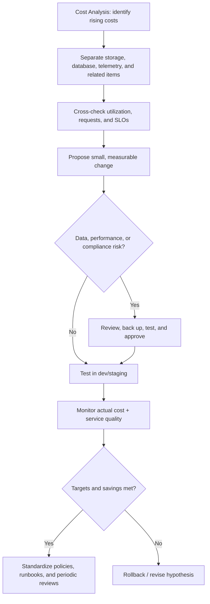
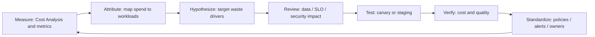

# Optimizing Storage, Database, and Telemetry Costs

> **Chapter:** Cost Management  
> **Module:** `CLOUD_PROVIDERS_AZURE` — exploring Microsoft Azure from subscriptions, resource groups, Microsoft Entra ID, and virtual networking to compute, storage, and data services; learning to deploy, monitor, protect, and control costs of an application architecture.

## Learning Objectives

After this lesson, you will be able to:

1. Break Azure costs down into **capacity, utilization, transactions, data transfer, retention, and availability**, instead of looking only at the invoice total.
2. Use **Azure Cost Management**, Azure Monitor, and application metrics to identify the exact resource, meter, or workload driving cost increases.
3. Choose suitable tiers and lifecycle policies for **Azure Blob Storage**, while evaluating managed disks, snapshots, Azure Files, and backup data costs.
4. Optimize **Azure SQL Database, Azure Database for PostgreSQL, and Azure Cosmos DB** based on workload, performance, scalability, and data-protection requirements.
5. Control **Application Insights, Log Analytics, and telemetry** costs via signal design, sampling, source-side filtering, retention, and storage tier options.
6. Formulate savings hypotheses, pre-estimate net impact, test safely, measure post-change results, and enforce SLO, RPO/RTO, security, and audit guardrails.

## 1. The Problem: Costs Are Rising Without a Clear Cause

An `orders-api` application on Azure uses Blob Storage for invoices, Azure SQL Database for orders, and Application Insights/Log Analytics for observability. Initially user traffic is low, but after a few months total monthly spend climbs sharply. Common symptoms:

- Blobs hold old, rarely accessed files while sitting in a high-storage-cost tier.
- Databases run oversized compute 24/7 even though traffic peaks only for a few hours.
- Every request, health check, and dependency call emits verbose telemetry, including data with little diagnostic value.
- Snapshots, backups, log records, and test resources outlive their usefulness.
- Infrastructure changes reduce one cost line while raising transactions, access latency, or recovery fees.

**The goal of cost optimization is lowering the total cost of an agreed service level.** Cutting spend at the expense of lost data, rising app errors, or failed audit requirements fails the goal.

### General Formula

One analytical breakdown separates components:

\[
C_{\text{month}} =
C_{\text{storage}} +
C_{\text{database}} +
C_{\text{telemetry}} +
C_{\text{network}} +
C_{\text{related ops}}
\]

Within each component, cost typically depends on usage quantity multiplied by unit price, plus potential transaction fees, retention capacity, replication, or data retrieval. **Actual unit prices vary** by region, service type, redundancy, contract terms, volume, and time. All hypothetical numbers in this lesson illustrate calculations only; before making real decisions, check the Azure Pricing Calculator and your subscription's Cost Management data.

### Decision Flow Diagram



## 2. Establishing a Cost Baseline Before Changing Configuration

### 2.1. Define Measurement Scope

First pick a consistent boundary: subscription, resource group, application tag, or a set of resource IDs. If a workload shares a database, Log Analytics workspace, or network with other apps, establish a clear **cost allocation rule**. Never attribute 100% of a shared resource's cost to one app simply from a similar tag or name.

In **Azure Portal → Cost Management + Billing → Cost Management → Cost analysis**, inspect:

1. Select the exact **scope** and a 7/30/90-day window or a range spanning before and after the cost jump.
2. Group costs by **Service name**, **Resource**, **Resource group**, **Meter**, or useful account-supported tags.
3. Distinguish **actual** vs. forecasted costs; note currency, taxes, discounts/adjustments, reservations, or commitments where visible.
4. Correlate against deployments, traffic growth, retention edits, replication, scaling, and logging changes.
5. Spot resources incurring spend while serving zero load: unattached disks, aging snapshots, 24/7 dev databases, or workspaces with abnormal ingestion.

**Cost Management data has reporting latency**, so never conclude a change made minutes ago saved money immediately. Watch usage metrics first, then verify against billing data after sufficient settle time.

### 2.2. Pair Technical Metrics with Dollar Metrics

| Group | Cost Metrics | Paired Technical Metrics |
|---|---|---|
| Blob Storage | GB-month by tier, read/write/list operations, retrieval, egress | Object age, read frequency, latency, and capacity |
| Managed disks/Azure Files | Disk capacity/tier, provisioned throughput/IOPS, snapshots, backup | Actual IOPS, throughput, queue/latency, free space |
| Azure SQL | Compute/DTU/vCore, storage, backups, HA/replicas | CPU, I/O, storage, connections, Query Store, p95 |
| PostgreSQL | Compute tier, storage/IOPS, backups, HA | CPU, active connections, query latency, cache hit |
| Cosmos DB | Provisioned/autoscale RU/s or consumed RUs, storage, regions | RU/request, 429s, latency, partition distribution |
| Azure Monitor | Ingestion GB, retention, billed queries/exports by type | Event count, signal types, alert coverage, time-to-diagnose |

A helpful metric to normalize for business growth:

\[
\text{Cost per 1,000 successful transactions}
= \frac{\text{Workload-allocated cost}}{\text{Successful transaction count}} \times 1000
\]

As customer volume grows, total bills can rise while **cost per transaction drops**. Separate these two effects so you do not cut resources in the wrong place.

### 2.3. Budgets and Alerts

Configure **Azure Budgets** and alerts at the right scope, e.g., at 70%, 90%, and 100% thresholds. Assign alert recipients and response runbooks. **Budget alerts are not automatic hard spending caps**; any automated resource shutdown must be engineered separately to avoid service outages.

Azure Advisor and savings recommendations provide good hypotheses, yet every suggestion must be verified against real workloads, data protection settings, and live performance before applying.

## 3. Optimizing Azure Blob Storage by Data Access Patterns

### 3.1. Distinguishing Access Tiers

Azure Blob Storage provides access tiers aligned to read frequency and latency needs. Tier availability depends on account type, region, redundancy, and supported features.

| Tier | Characteristics | When to Consider |
|---|---|---|
| **Hot** | Optimized for frequent access; higher storage cost than colder tiers | Popular product images, active transaction files, frequently read app assets |
| **Cool** | Lower storage cost than Hot, with different access and minimum-retention rules/fees | 1–3 month old invoices, infrequently read files |
| **Cold** | Optimized for very rarely accessed online data; check retrieval and minimum-duration terms carefully | Logs or records rarely queried yet still needing online access |
| **Archive** | Offline data; lowest storage rate but requires **rehydration** before reading, with retrieval time and fees | Multi-year compliance archives with rare access and tolerant RTO |

**Lower storage price does not guarantee lower total cost.** Accessing cold tiers triggers read, retrieval, tier-transition, rehydration, minimum-retention, or cross-region/Internet egress fees that can make cold storage more expensive overall.

Never place data needed immediately by business workflows or tight-RTO recovery into Archive if the app cannot tolerate rehydration delays. With Blob versioning, soft delete, and snapshots, **retained versions/copies can keep incurring charges** even after the active blob is deleted.

### 3.2. Worked Calculation for a Tier Transition

Suppose you hold **1,000 GB** of files, all currently in Hot. Measured telemetry shows 400 GB are read frequently, while 600 GB see almost no reads.

**Hypothetical rates for illustration, not Azure pricing:** Hot 0.020 USD/GB-month and Cool 0.010 USD/GB-month.

| Option | Storage Formula | Illustrative Monthly Cost |
|---|---|---:|
| All Hot | 1,000 × 0.020 | 20 USD |
| 400 GB Hot + 600 GB Cool | 400 × 0.020 + 600 × 0.010 | 14 USD |
| Difference **before surcharges** | 20 − 14 | **6 USD** |

The 6 USD figure reflects storage capacity alone in this example. **Net savings** must subtract read/retrieval fees, transactions, early-deletion minimums, tier-change operations, and other charges. Evaluate across a full month's access pattern, not a few quiet days.

### 3.3. Lifecycle Management

**Azure Blob Lifecycle Management** uses policy rules to automatically transition tiers or delete blobs based on conditions such as age since last modification, prefix, or blob index tags. Policies run natively on the storage account rather than as fragile manual deletion scripts.

Example layout:

- `app-current/`: active application data kept in Hot as needed.
- `app-logs/`: application logs governed by retention policy; transition from Hot to Cool after an approved window.
- `audit-records/`: subject to mandatory retention; **do not** apply short deletion rules or offline tiers that break retrieval SLAs.
- `temp-exports/`: temporary exports with clear owners and expiration; delete only after confirming no dependencies remain.

An **illustrative policy JSON that only transitions tiers without deleting data**:

```json
{
  "rules": [
    {
      "enabled": true,
      "name": "tier-old-app-logs-to-cool",
      "type": "Lifecycle",
      "definition": {
        "filters": {
          "blobTypes": ["blockBlob"],
          "prefixMatch": ["app-logs/"]
        },
        "actions": {
          "baseBlob": {
            "tierToCool": {
              "daysAfterModificationGreaterThan": 45
            }
          }
        }
      }
    }
  ]
}
```

Save this in `lifecycle.json` for your lab exercise, then **after verifying scope and securing approval** apply via Azure CLI:

```bash
az account show --query "{subscription:id,name:name}" --output table

az storage account management-policy create \
  --resource-group rg-cost-lab \
  --account-name stcostlabexample \
  --policy @lifecycle.json

az storage account management-policy show \
  --resource-group rg-cost-lab \
  --account-name stcostlabexample \
  --output json
```

Resource names here are hypothetical, not pre-existing live resources. **The `create` command mutates live configuration** when run on an authorized subscription; validate the policy file, storage account name, Azure CLI version, and org policies beforehand. Lifecycle rules may not transition every blob instantaneously; monitor status and billing across subsequent cycles.

**Verify before enabling auto-deletion:** data ownership, snapshots/versions, soft delete, legal holds/immutability, retention rules, and recovery procedures. Never shorten legal retention periods merely to cut costs.

### 3.4. Redundancy, Transactions, and Data Transfer

Beyond access tier, total cost depends on:

- **Redundancy:** LRS, ZRS, GRS, GZRS, and read-access variants carry different rates and durability; choose based on RPO/RTO and DR needs.
- **Operations:** Reads, writes, listings, tier transitions, and other requests; apps reading millions of tiny objects can rack up steep operation charges.
- **Network:** Internet egress and certain cross-region transfers; check multi-region architectures and CDNs.
- **File size and access pattern:** Batching small files or caching where suitable cuts request counts; avoid repacking formats if apps require random reads.
- **Encryption, private endpoints, and security:** Optimize configurations without weakening data protection.

Switching from GRS to LRS lowers unit rates at the cost of losing regional disaster redundancy. Decide based on data criticality, real recovery capability, and corporate policy.

## 4. Managed Disks, Snapshots, and Azure Files

Blob Storage is only one piece of storage spend. Virtual machines and shared file systems follow distinct pricing rules.

### 4.1. Azure Managed Disks

Disk types such as Standard HDD, Standard SSD, Premium SSD, and higher-performance tiers match different IOPS/throughput profiles. On several disk types, charges depend on **provisioned capacity or performance**, even if only partly utilized.

Optimization workflow:

1. Identify high-cost disks and match against attached VMs, provisioned size, IOPS, throughput, disk latency, and queue depth.
2. Confirm whether each disk serves a database, OS, app data, or sits unattached after a VM deletion.
3. If utilization stays low continuously across days, evaluate smaller SKUs/sizes that still meet bursts and SLOs.
4. Apply changes during maintenance windows; shrinking provisioned disk capacity or switching some SKUs cannot happen in-place and requires data migration.
5. Post-change, watch `throttling`, IOPS, throughput, latency, errors, and cost.

**Do not confuse free filesystem space with instantly shrinkable disk billing.** Downsizing provisioned disks often requires creating a new disk and migrating data. Deleting an "unattached" disk also requires verifying ownership, snapshots/backups, and recovery plans.

### 4.2. Snapshots and Backups

Snapshots and Azure Backup protect recoverability while incurring storage/retention charges. Before deleting:

- Identify which backup, migration, or recovery policy owns the snapshot.
- Check restore points, encryption keys, dependencies, and retention rules.
- Distinguish temporary pre-deployment snapshots from official backups.
- Cross-check current backup reports and get owner confirmation.

Never trade away retention to the point where usable backups vanish during an incident.

### 4.3. Azure Files

Azure Files billing depends on share/tier type and provisioned capacity/performance. Measure **used capacity, IOPS, throughput, latency, snapshots, and transactions**, checking whether your share uses provisioned or pay-as-you-go pricing.

Shared data may fit Azure Files, Blob, or Managed Disks depending on access semantics. Never migrate solely for a lower per-GB price if apps rely on SMB/NFS, file locking, ACLs, or shared file concurrency.

## 5. Databases: Optimizing Compute, Storage, and Queries

Database optimization starts with the **workload**: read/write ratio, concurrency, latency, data size, peak windows, and HA/DR needs. Downsizing SKUs purely from average CPU risks peak-hour outages.

### 5.1. Azure SQL Database

Options like provisioned compute, serverless (where supported by tier/config), elastic pools, and service tiers follow different billing models.

| Scenario | Option to Evaluate | Trade-offs |
|---|---|---|
| Single database with steady daytime/24x7 load | Rightsize provisioned capacity and check commitments/offers | Must keep headroom for peaks and incidents |
| Dev/test used only during work hours | Serverless/auto-pause where supported, or governed stop/scale schedules | Auto-resume warm-up latency, compatibility, ongoing storage fees |
| Multiple databases with staggered peaks | Elastic pool to share compute | Must monitor aggregate concurrency and overlapping peaks |
| Heavy I/O and low-latency database | Match service tier to required I/O and HA | Never pick a cheaper tier that violates latency SLOs |
| Long-term data and backup growth | Tune indexing, retention, archiving, and long-term backup policy | Purging data/backups affects auditing and recovery |

**Before cutting compute**, inspect peak-hour CPU, data I/O, log writes, memory, connections, deadlocks, Query Store, and query latency.

Illustrative **read-only** SQL query for Azure SQL Database to inspect recent pressure; permissions and data depend on the database:

```sql
SELECT TOP (20)
    end_time,
    avg_cpu_percent,
    avg_data_io_percent,
    avg_log_write_percent
FROM sys.dm_db_resource_stats
ORDER BY end_time DESC;
```

Percentage columns reveal resource pressure over time, though they are not billing reports. Use **Query Store** and execution plans to locate expensive queries before scaling vCores up or down.

### 5.2. Optimize Queries Before or Alongside SKU Changes

A missing index or full-table scan can overload a database. Typical steps:

1. Identify top queries by CPU, duration, reads/writes, or execution count.
2. Inspect execution plans and diagnose blocking, lock contention, and parameter skew.
3. Test index or query fixes on representative data, accounting for write and index-maintenance overhead.
4. Compare before/after p95/p99 latency, CPU, I/O, deadlocks, and throughput.
5. Downsize compute only after load tests pass under peak conditions with rollback ready.

Query tuning often saves more than tier changes because it shrinks actual work. However, new indexes increase storage and write I/O—measure net impact.

### 5.3. Azure Database for PostgreSQL

For Azure Database for PostgreSQL Flexible Server, evaluate compute tier, vCores, storage, IOPS, backups, high availability, and stop/start support for non-continuous environments. A **stopped** server does not eliminate storage/backup charges; stop/start also has maximum stopped-duration limits and platform auto-restart behavior.

- For dev/test, schedule uptime where supported with an owner and alerts if servers stay stopped during work hours.
- For production, size compute/HA for peak latency, failover, and RTO; never turn off HA on price alone.
- Diagnose slow SQL, table stats, connection pooling, indexes, autovacuum, and table bloat before scaling up.
- Preserve backup policies and test restores, especially when purging old rows or resizing storage.

### 5.4. Azure Cosmos DB

Cosmos DB costs center on **request units (RUs)**, throughput mode (provisioned/autoscale/serverless per config), storage, regional replication, and add-on features.

| Symptom | Hypothesis | Investigation Path |
|---|---|---|
| High RU burn despite low request volume | Unoptimized queries, hot partitions, broad indexing, or large payloads | RU/request, query metrics, partition keys, indexing policy |
| High 24/7 provisioned RU/s for brief spikes | Over-provisioned relative to load profile | Evaluate autoscale or another workload-fit model |
| Frequent 429 responses | Hit throughput cap or hot partition | Inspect retries, latency, hot partitions, and provisioned RUs |
| Storage growing despite short-lived data | Missing TTL or unpurged old records | Verify retention rules and TTL/cleanup impact |
| Cost jumped after adding a region | Multi-region replication and throughput charges | Review HA/latency needs and actual topology |

**Never treat every HTTP 429 as an emergency requiring higher RUs.** Cosmos DB SDKs automatically retry transient throttling; evaluate end-to-end failure rate, latency, and SLOs. Conversely, cutting RU/s too aggressively increases throttling and retry overhead.

## 6. Telemetry Costs: Application Insights and Log Analytics

### 6.1. Which Telemetry Delivers Value?

Applications emit several signal types:

- **Metrics:** Time-series summaries suited for alerting on CPU, memory, request latency, queues, etc.
- **Traces/spans and dependencies:** Trace request flow across services and measure inter-component latency.
- **Logs:** Detailed event records for root-cause debugging, auditing, and forensics.
- **Availability/synthetic tests:** External uptime signals from the user perspective.

Azure Monitor ingests multiple sources; **Application Insights** supports application observability and commonly stores logs in a **Log Analytics workspace**. Costs depend not on dashboard count, but on ingested GB, retention, table/plan type, queries, exports, and enabled features.

**Identify which data is mandatory for SLOs, incident detection, security forensics, and legal retention** before filtering or cutting retention.

### 6.2. Breaking Telemetry Down by Source

| Source | Cost Warning Sign | Investigation Approach |
|---|---|---|
| Request logs | Logging repetitive health probes | Filter noise at source while retaining availability/failure metrics |
| Dependency traces | Single requests emitting excessive spans | Tune instrumentation and sampling |
| Debug/verbose logs | Printing full payloads or repeated stack traces | Adjust log levels; never log sensitive data |
| Custom events | Events emitted repeatedly by loops or retries | Fix emission logic and standardize event schemas |
| Infrastructure diagnostic logs | Enabling all log categories blindly | Keep only categories needed for alerts, audits, and debugging |
| Workspace retention | Holding every table under one long retention rule | Tier retention by data class and query needs |

### 6.3. Three Layers of Telemetry Cost Reduction

**Layer 1 — Prevent unnecessary data from being emitted.** Set environment-appropriate log levels and drop excessive debug payloads; never emit secrets, PII, or unneeded user payloads.

**Layer 2 — Filter or sample prior to ingestion.** Depending on SDK and source, use Application Insights sampling or **Data Collection Rules (DCR) transformations** on supported streams. Trim billable volume while preserving vital signals after verifying compatibility, effectiveness, and data policy.

**Layer 3 — Pick suitable storage/query tiers.** Evaluate table plans, analytics retention, long-term retention, exports, or archives where supported. Table plans differ in query speed and alerting support; never move urgent incident-triage logs into hard-to-query archives solely for a lower per-GB price.

**Never sample security/audit events or rare failures indiscriminately.** Sampling suits high-volume routine traces but can erase critical forensic evidence. Likewise, never cut retention below legal or investigative mandates.

### 6.4. KQL to Spot Top Ingesting Data Groups

In a **workspace-based Application Insights Log Analytics workspace** containing the corresponding tables, run a preliminary check of records marked billable:

```kusto
union withsource=SourceTable
    AppRequests,
    AppDependencies,
    AppTraces,
    AppExceptions
| where TimeGenerated >= ago(7d)
| where tostring(_IsBillable) == "true"
| summarize ApproxGiB = round(sum(todouble(_BilledSize)) / 1073741824.0, 2)
    by SourceTable
| order by ApproxGiB desc
```

**Query caveats:** Tables may not exist, or column names and permissions may vary by workspace/source; adjust the table list to your live schema. `_BilledSize` is an **estimate** of record size and does not replace the Azure invoice (tiers, free grants, discounts, commitments, and meter rounding can differ). This query also omits tables outside those four.

Once you find the largest table, break it down by `AppRoleName`, `OperationName`, `SeverityLevel`, or actual dimensions to pinpoint noisy apps. Never drop an entire table if it holds incident-detection logs.

### 6.5. Sampling and Its Effect on Metrics

Suppose HTTP request telemetry emits 1,000 events/second before sampling; 10% sampling captures roughly 100 events/second on eligible streams. Ingestion cost **can drop**, though actual savings depend on SDK behavior, telemetry mix, retries, volume, and unsampled streams.

Some instrumentation frameworks record item-count metadata to extrapolate totals from sampled telemetry, yet you should never run `count()` on a sampled log table and treat it as exact traffic. **Critical SLIs and alerts** should rely on verified metrics or unsampled error tracking so vital failures are never missed.

### 6.6. Daily Caps and Commitments

- **Daily caps** act as an operational safety valve for certain ingestion streams, yet hitting the cap creates **observability blind spots**. Never treat a daily cap as your primary savings tool or an absolute billing ceiling.
- **Commitment tiers** or volume discounts help steady, high-volume ingestion, provided you validate contracts, utilization, and lock-in risk.
- **Retention** extensions vary in unit rate and availability across table plans. Match retention to audit and query needs using live pricing and feature rules.

## 7. Modeling Costs and Net Savings Value

### 7.1. Calculate Net Savings, Not Single-Line Cuts

Basic formula:

\[
\text{Net savings}
=
\text{Current cost}
-
\text{Post-change cost}
-
\text{Transition costs incurred}
\]

Transition costs include retrieval fees, egress, data migration, higher transaction counts, testing effort, operational hours, and business impact if latency rises or SLOs slip.

### 7.2. Monthly Simulation Example

Suppose a workload tests three hypotheses (**all rates and costs are purely hypothetical**, not live quotes):

| Measure | Before | After | Preliminary Savings |
|---|---:|---:|---:|
| Move 600/1,000 GB Blob from Hot to Cool | 20 USD | 14 USD | 6 USD |
| Rightsize database after load testing | 300 USD | 240 USD | 60 USD |
| Cut low-value telemetry from 40 to 30 GB/day at hypothetical 2 USD/GB, 30 days | 2,400 USD | 1,800 USD | 600 USD |
| **Preliminary subtotal** | **2,720 USD** | **2,054 USD** | **666 USD** |

This table **excludes** tier-transition fees, blob reads, migration/downtime, backups, commitments, log queries, new index overhead, and shared costs. Never use these illustrative numbers to forecast an actual bill.

### 7.3. When a "Cost-Saving" Decision Fails

Suppose moving customer invoices to Archive saves 100 USD/month in storage, yet restoring one violates committed RTOs and incurs steep retrieval charges. That change **fails** overall objectives.

Similarly, cutting vCores when average CPU is 20% despite periodic 95% peaks can trigger throttling; aggressively dropping Application Insights request traces can blind engineers during rare production outages.

Evaluate instead:

\[
\text{Decision value}
=
\text{Expected savings}
-
\text{Added costs}
-
\text{Quantified risk impact}
\]

In practice, risk impacts cannot always be reduced to a clean dollar number; list **non-negotiable constraints** explicitly alongside savings.

## 8. Guardrails: Preserving Performance, Reliability, and Security

| Guardrail | Example Before/After Condition |
|---|---|
| **Application latency** | Orders flow p95/p99 stays within SLO under equivalent load test |
| **Data recoverability** | Latest backups and restore drills still meet RPO/RTO |
| **Legal/audit records** | Retention, legal holds, and evidence retrieval remain intact |
| **Availability** | HA/zone/region redundancy matches approved architecture |
| **Database** | No abnormal rise in 429s/timeouts, deadlocks, or CPU/IO saturation |
| **Observability** | Critical alerts, error traces, and security events stay operational |
| **Data security** | RBAC, encryption, private endpoints, soft delete/immutability intact |
| **Cost** | Actual savings verified in Cost Management after a full usage cycle |

Never cut authentication/security logs, enable auto-delete, or alter backup permissions without data-owner sign-off. If a guardrail fails, trigger **rollback** immediately rather than tolerating degradation to hit a short-term budget target.

## 9. Iterative FinOps Optimization Workflow

### 9.1. A Repeatable Loop



Run monthly or after major shifts in load, data growth, or regions. For every change, log:

1. Resource ID, subscription, and owner.
2. 7/30-day cost baseline with billing units and meter sources.
3. Hypothesis, estimated usage change, and assumed unit rate.
4. Target configuration, SLO/RPO/RTO bounds, and affected data classes.
5. Backup confirmation, restore test, rollout sequence, and rollback plan.
6. Before/after workload metrics and cost outcomes, plus keep/revert decision.

### 9.2. Codifying Optimization in IaC and CI/CD

In Bicep/Terraform and deployment pipelines, govern:

- Appropriate storage redundancy, lifecycle policies, and retention.
- Per-environment database tiers/compute, autoscale, and service configs.
- Diagnostic settings, Data Collection Rules, and application-side log sampling.
- Tags such as `application`, `owner`, `environment`, and `cost-center` (noting not every charge supports tags).
- Policies preventing unapproved configs or workflows that could delete data.

**Never let a CI/CD pipeline automatically delete storage buckets/blobs/backups solely because a budget alert fired.** Data-impacting changes demand human review and post-change verification.

## 10. Common Optimization Mistakes

| Symptom | Likely Cause | How to Verify |
|---|---|---|
| Storage GB dropped yet bill stayed flat | Transaction/egress/retrieval fees, leftover snapshots/versions, or billing lag | Check Cost Analysis meters, blob access patterns, retained versions |
| Cool/Archive tier cost more than Hot | Frequent reads, rehydration fees, or early-deletion minimums | Measure request volume, retention duration, and total tier TCO |
| Downsizing DB slowed the app | Traffic spikes or poor queries masked by average CPU | Load test, check Query Store, CPU/IO/log writes, p95/p99 |
| Serverless DB never auto-pauses | Unsupported tier/config or background sessions/jobs keeping it awake | Check auto-pause rules and active background connections |
| Cosmos DB still throws 429s after raising RUs | Hot partitions, bad queries, or client retry storms | Inspect RU/request, partition metrics, retries, and latency |
| Log Analytics spend dropped but error logs vanished | Aggressive sampling/filters dropped failures or audit events | Test alerts, error traces, and security events in staging |
| Daily cap enabled yet charges kept accruing | Other meters/workspaces unaffected as expected | Check cost scopes and source metrics; caps aren't hard billing freezes |
| Budget alert didn't stop resources | Budgets only emit notifications | Build separate governed actions/runbooks if shutdowns are needed |
| Deleting snapshots broke restore | Snapshots lacked ownership/retention classification | Audit backup inventory, restore requirements, and change history |
| Cannot prove net savings | Traffic/region/price shifts or incomplete invoice posting | Normalize by cost per transaction and wait for settled billing cycles |

## 11. Hands-On Lab: Finding Three Cost Optimization Targets

**Scenario:** A team manages `orders-api` in `rg-orders-lab` using Blob Storage, Azure SQL Database, and Application Insights in a Log Analytics workspace. Budget is tight, yet p95 transaction latency must stay within SLO, backup/restore must remain intact, and security logs must never be lost.

### Execution Steps

1. **Measure baseline:** In Cost Analysis, filter to the exact scope and a 30-day window, group by service/resource/meter, and record the total plus top three drivers. Without live Azure access, use the hypothetical table in Section 7.
2. **Audit Blob:** Group blobs by prefix, age, and access frequency; evaluate Hot/Cool/Cold/Archive, retrieval patterns, and retention. Propose a **tier-only** policy for infrequently read lab data—no deletion.
3. **Audit database:** Inspect hourly CPU/IO/latency, Query Store, and peak windows. Propose one rightsizing or query-tuning option and list non-negotiable guardrails.
4. **Audit telemetry:** Run Section 6.4's KQL where supported to find the largest ingesting table. Spot noisy health checks, debug logs, or repetitive traces and define sampling/filtering that preserves errors, security, and audits.
5. **Estimate net cost:** Calculate savings from explicit assumptions, adding retrieval, migration, backups, retained logs, and operational effort.
6. **Verify impact:** In staging or an authorized lab, apply lifecycle/DB/sampling changes one at a time. Monitor p95/p99, errors, data integrity, and alerts.
7. **Reconcile before/after:** Record load profile, timeframe, SKUs, ingestion, storage operations, and projected vs. actual spend once settled; roll back if any guardrail fails.
8. **Document decision:** Record go/no-go choice with financial, technical, and security rationale plus approver sign-off.

### Results Worksheet

| Item | Baseline | Proposal | Post-Test Measurement |
|---|---|---|---|
| Blob GB by tier and read counts | … | … | … |
| Storage + retrieval + operation costs | … | … | … |
| SQL tier, CPU/IO, p95 | … | … | … |
| Database and backup costs | … | … | … |
| Log Analytics GB/day and top tables | … | … | … |
| Errors/alerts/traces still observable | … | … | … |
| Total cost and cost/1,000 transactions | … | … | … |
| Mandatory guardrails | … | … | … |

**Pass criteria:** Learners pinpoint concrete cost drivers, propose at least one action per category, compute net savings with stated assumptions, avoid arbitrary data deletion, and verify SLOs, recoverability, and telemetry integrity. Without write permissions on a live Azure account, execute completely on simulated data and label it clearly as a simulation.

### Self-Check Questions

1. Why can moving Blobs from Hot to Archive raise total cost despite a lower per-GB storage price?
2. Why must access patterns and retention rules be checked before creating a lifecycle policy?
3. Is 15% average database CPU proof enough to cut vCores? Which other metrics must you check?
4. Does serverless auto-pause eliminate 100% of database costs during idle periods?
5. When do Cosmos DB autoscale or serverless fit better than fixed provisioned RU/s?
6. Which telemetry streams can safely be sampled, and which must be kept complete for forensics/audits?
7. Does an Azure Budget automatically block invoices from exceeding the target?
8. Why compare cost per 1,000 transactions alongside total invoice spend?
9. If costs drop while p99 latency breaches SLO, should you keep the new configuration?
10. Why must Cost Management reports be reconciled against actual meters and usage telemetry?

## 12. Key Takeaways

Optimizing Azure costs across **storage, databases, and telemetry** means aligning capacity, compute power, and observability volume to **what the application genuinely requires**.

For **storage**, match access tiers to read behavior, automate safely with lifecycle policies, and account for retrieval, operations, and retention. For **databases**, measure peak load and queries before rightsizing compute, evaluate serverless/elastic pools/RUs, and never sacrifice HA or backups. For **telemetry**, protect signals required for SLOs, troubleshooting, and audits; curb noise at the source, apply targeted sampling/filtering, and tier retention purposefully.

Every change must be proven by **measured net savings, intact SLOs, verified data recoverability, and active alerting**. Sustainable FinOps is a continuous loop—measure → explain → test → verify → standardize—run at the right scope with clear ownership.
