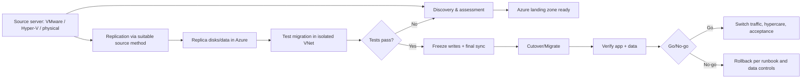
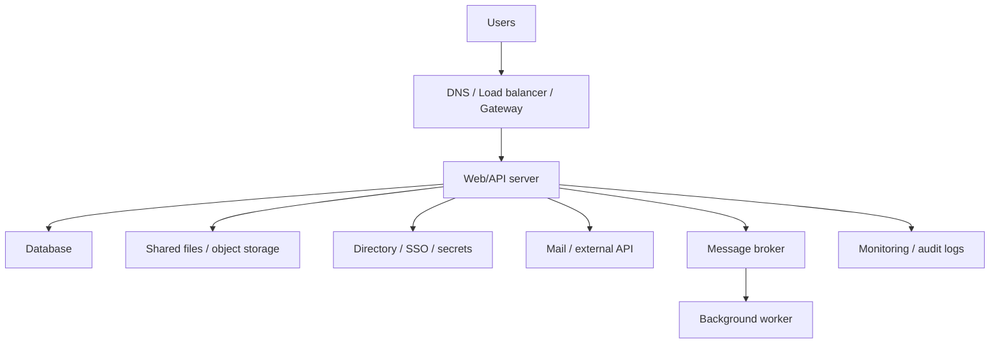
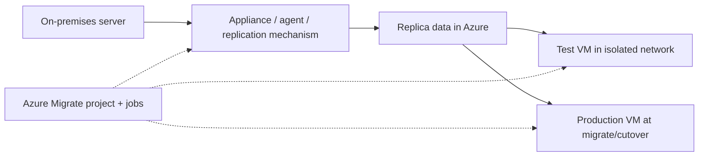
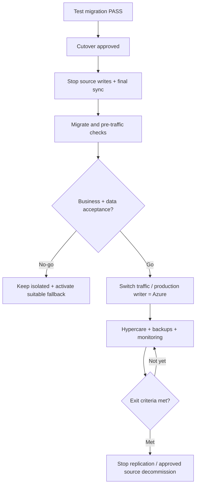

# Migrating Servers to Azure and Post-Cutover Verification

## 1. The Problem: Moving Where It Runs While Preserving the Service

An enterprise runs an ordering application on servers in a private data center. The application includes web/API servers, background job workers, databases, an uploaded files directory, and integrations with authentication, email, and payment systems. The organization wants to move these servers to **Microsoft Azure** to increase agility, reduce hardware dependency, and leverage monitoring, backups, resilience, and cost management.

Copying server disk images to Azure **does not automatically mean the application has migrated successfully**. After the target virtual machine boots, the application must still connect to its database, authenticate users, fetch secrets, process transactions, serve traffic via its domain name, and emit alerts to the right place. A misconfigured DNS change or allowing both source and target machines to write data concurrently can cause lost orders even while the UI returns HTTP 200.

In the **Hybrid Cloud and Migration to Azure** chapter, this lesson focuses on **server migration** using the appropriate approach, **executing a controlled cutover**, and **performing end-to-end post-cutover verification**. It builds on Azure ecosystem fundamentals from subscriptions, resource groups, and Microsoft Entra ID through virtual networks, compute, storage, data, deployment, monitoring, security, and cost.

### Learning Objectives

After completing this lesson, you will be able to:

1. Distinguish discovery, assessment, replication, test migration, cutover, hypercare, and decommissioning.
2. Select an appropriate server migration method for VMware, Hyper-V, physical machines, and other workloads without confusing it with database migration or PaaS application replatforming.
3. Inventory dependencies, assess compatibility, sizing, deployment region, networking, access permissions, licensing, and costs.
4. Explain the Azure Migrate workflow from discovery, assessment, replication, and testing to production migration.
5. Design a cutover runbook with **go/no-go** criteria, write freeze windows, delta data handling, traffic switching, and a rollback plan.
6. Verify OS, networking, databases, application functionality, data integrity, performance, security, backups, monitoring, and billing after migration.
7. Produce an acceptance sign-off report with RTO/RPO metrics, evidence, and accountable owners.

## 2. Terminology and Boundaries of a Migration Wave

| Term | Meaning | Required Evidence |
| --- | --- | --- |
| **Discovery** | Discovering servers, configurations, applications, and dependencies | Inventory and dependency map |
| **Assessment** | Evaluating readiness, sizing, costs, and pre-migration risks | Compatibility report, VM recommendations, and cost estimate |
| **Rehost / lift-and-shift** | Moving workloads to Azure VMs with minimal application changes | Target VM running equivalent application |
| **Replatform** | Changing part of the platform, such as moving a database to a managed service | Separate application and data transition plan |
| **Replication** | Copying system/data changes from source to target | Replication health, recovery point/lag |
| **Test migration** | Spinning up a test instance on Azure to validate without switching production | Test results inside an isolated network |
| **Cutover** | Shifting production workloads and live traffic to the target | Approval decision, sync checkpoint, traffic switch |
| **Rollback / fallback** | Returning to a safe serving state if cutover fails | Triggers, approvers, handling of newly written data |
| **Hypercare** | Intensive post-cutover monitoring period | Dashboards, incident log, acceptance checks |
| **Decommission** | Stopping, deleting, or reclaiming source systems after acceptance | Sign-off record and appropriate retention evidence |

**Cutover** is not merely a portal button. It is the moment business serving authority shifts from source to target and requires explicitly deciding **which system is the authoritative data writer**.

### Time Targets: RTO, RPO, and Downtime

- **RTO (Recovery Time Objective):** maximum target duration of service unavailability after an outage. During planned migrations, teams often set a similar **downtime window** and target cutover time, though the concepts are not identical.
- **RPO (Recovery Point Objective):** acceptable data loss limit in a recovery scenario. For a controlled production cutover, the target is usually **zero loss of confirmed transactions**, requiring proper write quiescing and final sync.
- **Replication lag:** delay between source data and target replica. Low lag **does not by itself prove** application-level or multi-server data consistency.
- **Cutover downtime:** elapsed time during which users cannot complete business operations during a planned transition.

For example, a 45-minute maintenance window does not mean Azure Migrate guarantees the application will be back within 45 minutes. You must budget for the cutover decision, delta sync, service startup, testing, routing updates, and observation.

## 3. Choosing the Right Tool and Strategy

No single Azure tool automatically migrates every workload. Distinguish the following options:

| Option / Tool | Primary Role | Do Not Expect |
| --- | --- | --- |
| **Azure Migrate: Discovery and assessment** | Inventory, dependency capture, readiness assessment, sizing, and cost estimation | Does not migrate all apps from a single report |
| **Azure Migrate: Server Migration** | Replicates and migrates supported servers to Azure VMs | Does not fix app logic, DNS, licensing, or external data services outside the VM |
| **Azure Site Recovery (ASR)** | Maintains replicas and orchestrates failover for **disaster recovery** in supported scenarios | Not equivalent to a migration project with cutover acceptance/risk mitigation |
| **Azure Database Migration Service and data tools** | Migrates/cuts over databases per supported engine, source, and target | Does not replace OS, web server, and network dependency migration |
| **Azure Storage Mover / AzCopy and file tools** | Moves file/object data appropriately | Does not replace moving full server state |
| **Bicep, ARM, or Terraform** | Provisions landing zones, networks, resources, and infrastructure configs | Does not carry data and applications from source to target |
| **Rebuild from image/CI/CD** | Rebuilds servers/apps from source code and standard configs | Does not preserve unmanaged state or ad-hoc customizations automatically |

In this lesson, **the primary flow is rehosting on-premises servers to Azure VMs with Azure Migrate** within environmental support boundaries. VMware, Hyper-V, and physical servers may use **different discovery mechanisms, appliances, agents, and replication paths**. Never copy one click-path verbatim across all sources; always check the current support matrix, appliance requirements, OS support, and feature capabilities before deploying.

### Choosing Between Rehost and Replatform

Rehost is often sensible when speed is critical, applications are not ready for major changes, or legacy software must be preserved. Replatform fits when reducing operational toil—such as moving a database to Azure SQL and an app to App Service. You can choose **rehost first, optimize later**; however, you must still plan VM costs, backups, OS patching, and resilience after moving.

## 4. End-to-End Model of a Migration Wave



A single server may participate in multiple data flows. For example:



Separate components that **reside on the server disk** from those **accessed over the network**. Moving `WEB`'s disk does not guarantee `DB`, `FILE`, `ID`, or `MAIL` already work in Azure.

## 5. Discovery: Building an Inventory Before Assessing

Before enabling replication, catalog each machine with its owner and actual specifications:

| Attribute | Example `orders-api-01` | Why It Is Needed |
| --- | --- | --- |
| Business owner | Orders product team | Approves acceptance and downtime |
| Source | On-premises VMware VM | Selects the matching Azure Migrate method |
| OS/architecture | Windows Server/Linux, exact version | Azure guest support, drivers, kernel, licensing |
| CPU/RAM | 4 vCPU / 16 GiB | Target Azure VM sizing |
| Disks | OS 128 GiB, data 500 GiB | Sizing, replication speed, disk types |
| IP/DNS | `10.10.20.15`, `orders.internal` | NAT/routing/hostname and TTL planning |
| Ports | TCP 443 to clients, 1433 to SQL | NSGs, firewalls, Private Endpoints, dependencies |
| Services | API, scheduled jobs, local cache | Identifies processes to start/stop |
| Authentication | AD/LDAP/Entra, service accounts | Preserves permissions and updates endpoints |
| Data owner | DBA and application team | Owns consistency, write freeze, and backups |
| Performance | CPU p95, RAM, disk IOPS, network throughput | Right-size instead of blindly copying legacy specs |
| Maintenance window | e.g., max 60 minutes | Cutover schedule and checkpoints |
| Compliance | PII, retention, encryption | Region, policies, Key Vault, audit |
| Recovery | Backup, DR, RTO/RPO | Post-migration protection |

### Collecting Dependencies (Dependency Mapping)

Analyze at minimum:

1. Inbound and outbound connections, IPs/ports, DNS, proxies, load balancers, firewalls.
2. Database connections, queues, SMB/NFS shares, file uploads, and processing schedules.
3. Service accounts, domain joins, Kerberos/SPNs, certificates, secrets, license servers.
4. Peak hours, batch tasks, backup windows, maintenance jobs, and data close schedules.
5. Other resources that must move in the same wave so the application does not lose dependencies.

Azure Migrate supports **discovery/assessment** and dependency analysis in supported scenarios, yet tool output must be validated with owners. Short-window network captures can miss connections that only run at month-end.

## 6. Assessment: Compatibility, Sizing, and Cost

### 6.1. Ability to Run on Azure

An assessment should evaluate per machine:

- **OS and release:** is it supported on Azure VMs and by the chosen migration method?
- **Boot/firmware/partition:** machine generation, BIOS/UEFI, Gen 1/Gen 2, OS disk layout compatibility?
- **Disks and encryption:** sizes, partitions, filesystems, disk encryption, disk types, snapshots, shared disks, and related limits.
- **Drivers/agents:** requirements for Azure VM Agent, extensions, mobility service, or the method's replication appliance.
- **Applications and licensing:** hardcoded MAC/IPs, hardware-locked licenses, dongles, proprietary drivers, or kernel/hypervisor dependencies.
- **Networking:** can it reach domain controllers, DNS, databases, and external services from Azure?
- **Readiness:** does allowed downtime fit final sync duration, boot time, and acceptance testing?

**Never assume an old server qualifies just because it runs on VMware.** An EOL OS, data on specialized disk layouts, or hardware-bound services may require upgrades, refactoring, or controlled exceptions.

### 6.2. Performance-Based Right-Sizing

Select Azure VMs from **utilization history** rather than copying vCPU/RAM allocations verbatim. If an old host has 16 vCPUs but p95 CPU is only 20%, a smaller SKU may fit—provided you check memory peaks, thread concurrency, disk IOPS, throughput, latency, and HA layout.

Example:

| Source Metric | Hypothetical Value | Action |
| --- | --- | --- |
| CPU p95 | 35% of 8 vCPUs | Evaluate a smaller Azure VM, still benchmark |
| Peak RAM | 24 GiB | Avoid SKUs with RAM below required working set |
| Disk read/write | 3,000 IOPS peak | Verify managed disk limits and VM IOPS ceilings |
| Network egress | 200 GB/month | Estimate network charges along the path |
| OS | Older Linux release | Verify support/drivers and patching plan |
| Backup | Daily | Design Azure Backup and restore testing |

Azure Migrate assessments suggest sizing and costs; estimates must still be cross-checked against the **Azure Pricing Calculator, licensing, storage, backups, monitoring, networking, HA zones, and ancillary costs**. A recommended SKU does not guarantee capacity or quota at deployment time.

### 6.3. Organizing into Waves

Do not move every server overnight. Group by **application dependencies** and risk:

| Wave | Illustrative Contents | Purpose |
| --- | --- | --- |
| 0 | Non-critical test servers | Validate migration pipeline and Azure networking |
| 1 | Low-dependency internal apps | Standardize runbooks, monitoring, and rollback |
| 2 | Orders API + worker + related data | Migrate as a dependency group |
| 3 | Higher-criticality business apps | Proceed only after earlier waves pass acceptance |

Each **wave** needs its own owner, schedule, go/no-go gates, open risks, and acceptance record. Never split an app with latency-sensitive DB calls across waves if interim hybrid connectivity cannot meet latency targets.

## 7. Preparing the Azure Landing Zone so Target Machines Can Serve

Before enabling replication, confirm the target landing zone is ready across networking, permissions, and governance. The table below outlines a minimal landing zone for our example app.

| Azure Component | Pre-Migration Requirement |
| --- | --- |
| Subscription/resource group | Environment isolation, naming, tags, cost center, and policies |
| Region/Availability Zone | Matches data residency, latency, quota, SKUs, and HA design |
| VNet/subnets | Non-overlapping address space for hybrid connectivity, NSGs, and routes |
| DNS | Internal/external resolution, DNS forwarders, and TTL plan |
| Hybrid connectivity | VPN/ExpressRoute or appropriate link, bandwidth, and routing |
| Identity | Azure RBAC roles, domain join/Entra, service accounts |
| Storage/disks | Managed disks, encryption, performance tiers, quotas, and backups |
| Security | Azure Policy, Defender, patching, Bastion/JIT, Key Vault |
| Observability | Azure Monitor Agent, logs, dashboards, alert action groups |
| Resilience | Azure Backup, Availability Zones/sets, and DR plan if needed |
| Cost | Budgets, tags, licensing/Azure Hybrid Benefit, and test cleanup schedule |

### Design Networking First—Do Not Wait Until Cutover

Suppose on-premises uses `10.10.0.0/16` and the planned Azure VNet uses `10.40.0.0/16`. Verify subnets, BGP/UDR routes, NSGs, Azure Firewall, NAT, DNS, and domain controller reachability. **Never pick an IP range simply because nothing seems to use it locally**: it may belong to another network plan or cause overlaps over VPN/ExpressRoute.

If legacy apps hardcode private IPs in configuration files, those addresses **are not automatically preserved** after migration. You may need to update connection strings, firewall rules, load balancer backends, DNS, and monitoring. Public VM IPs are also not automatically retained across regions or cloud boundaries.

### Permissions and Access Requirements

Migration engineers need permissions on the Azure Migrate project, replication resources, target resource groups, VMs/disks/networks, and supporting tools. Manage access using **least-privilege Azure RBAC** and dedicated pipeline identities; avoid assigning subscription-wide `Owner` just for testing.

Azure control-plane permissions do not grant guest OS, database, Active Directory, or Key Vault permissions. Cutover requires both **infrastructure access paths** and **application-level permissions**.

## 8. Azure Migrate: Discovering and Assessing Source Machines

Illustrative sequence using Azure Migrate:

1. Create an **Azure Migrate project** in a subscription and region meeting service rules.
2. Select the source environment type: VMware, Hyper-V, physical/other matching the actual source.
3. Deploy the required **discovery appliance or discovery component** for that source; grant read permissions to source infrastructure and approved credentials.
4. Let discovery collect inventory and performance over a representative window.
5. Group machines by application and dependencies; supplement rarely used flows via owner interviews.
6. Create assessments for Azure readiness, VM sizing, disks, costs, and migration strategy.
7. Review warnings/unsupported configurations; adjust Azure architecture and remediation plans before starting replication.

Azure Portal labels vary by version. Consult official documentation for your **exact source platform and replication method** before configuring production.

### When Not to Trust an Assessment Blindly

If the system saw light load during observation but runs heavy month-end batches, sizing may be too small. If legacy hosts carry per-socket/core software licenses, an assessment cannot replace licensing team verification. If apps use raw devices, clusters/shared disks, or obsolete OSes, consult the support matrix and handle exceptions.

## 9. Replicating Servers with Azure Migrate: Server Migration

Once assessment passes, choose **Server Migration** and the replication workflow matching your source:

1. Select approved servers within a wave.
2. Specify subscription, resource group, target region, VNet/subnet, disks, and target VM options.
3. Configure the appliance/agent/credentials/replication per the appropriate method. VMware may offer an **agentless** path in eligible environments; other sources may require components on machines or hosts.
4. Verify network paths, endpoints, replication capacity, and permissions to create target resources.
5. Enable replication and monitor initial copy until recovery points/healthy status are reached.
6. Monitor delta replication while the app continues running on source; track lag, errors, and jobs.
7. Only admit machines into a cutover window after test migration passes and the runbook is approved.



**The replication path and staging storage depend on the source type and migration method version.** This diagram is a logical model, not a detailed network design for every VMware/Hyper-V/physical scenario.

### Signals to Monitor

| Signal | Meaning | Response |
| --- | --- | --- |
| Initial replication still running | No usable replica yet for cutover | Check bandwidth, disk sizes, jobs |
| Replication unhealthy / high lag | Deltas are falling behind source churn | Check logs, agent/appliance/network, and throughput |
| Invalid target VM size/disk | Cannot provision required machine | Fix target settings and re-assess/re-test |
| OS not Azure-boot-ready | Driver/kernel/boot/config issue | Remediate per OS/migration tool guidance |
| Source continues writing data | Cutover point unstable | Schedule write quiesce and final sync |
| Insufficient target quota/SKU | Cutover risks failing VM allocation | Verify quotas and capacity before migration window |

**Healthy replication is not proof the application can serve traffic.** A VM may boot yet fail to reach the domain, database, licensing server, or DNS.

## 10. Test Migration: Rehearsing on an Isolated Network

**Test migration** is a mandatory risk-reduction step for critical workloads. Its purpose is to spin up a test VM in Azure from replicated data **without shifting production authority**.

### Procedure

1. Prepare a **test VNet/subnet** with controlled NSGs, DNS, and routing.
2. Select eligible replicated servers or groups in Azure Migrate.
3. Run **Test migration**, picking the test network and supported parameters.
4. Verify VM boot, NICs, IPs, drivers, guest agent, disk mounts, services, and application startup.
5. Test dependencies against suitable sandbox/test data; prevent background jobs from emailing customers, issuing invoices, or writing to production.
6. Record results, timings, and errors; fix root causes and re-test.
7. **Clean up test migration** through the tool workflow; confirm test VMs/disks are not incurring unintended spend and production replication remains healthy.

### What Never to Do

- Never attach test VMs to the same network where source servers are still serving if doing so causes hostname/IP collisions or domain trust conflicts.
- Never let both instances read and **ack** the same production queue; never run schedulers, cron jobs, batches, or payment jobs on both sides simultaneously.
- Never rely on a crash-consistent test snapshot to prove database transactional consistency without database-level checks.
- Never treat “VM running” as test PASS; verify HTTP/API endpoints and user workflows.

Some systems depend on domains, license servers, databases, or live integrations. When connectivity is required, create **mocked environments/data copies** or an owner-approved controlled test path; never punch holes from the test network to production just to “make it work.”

### Result Record Template

```text
Test ID: MIG-ORDERS-TEST-001
Machine: orders-api-01
Source: VMware on-premises
Target: Azure Southeast Asia (example)
Test VNet: vnet-migrate-test
Recovery point / data timestamp: [from tool]
VM boot time: [UTC]
App ready time: [UTC]
Checks passed: OS / network / DNS / DB / API / auth / jobs / logs
Issues: [description + owner + priority]
Cleanup performed: PASS/FAIL
Replication after cleanup: HEALTHY/UNHEALTHY
Business approval: [approver]
```

## 11. Preparing Cutover: Write Freeze, Final Sync, and Decision Authority

Cutover requires a **runbook with ordered steps, checkpoints, and stop conditions**, not verbal coordination.

### Minimum RACI Roles

| Role | Responsibility |
| --- | --- |
| Incident/change commander | Coordinates execution, go/no-go decision, opens/closes window |
| Azure/cloud engineer | Replication, target VMs, resource groups, VNet, NSGs, cloud jobs |
| Network/DNS owner | VPN/ExpressRoute, firewalls, DNS, traffic routing |
| OS/application owner | Stops/starts services, app config, health checks, background jobs |
| DBA/data owner | Data freeze, final consistency check, data recovery/rollback |
| Security/IAM owner | Entra/AD, accounts, certificates, secrets, RBAC, and auditing |
| Business owner | Validates business flows and accepts downtime |
| Monitoring/on-call | Monitors SLOs, alerts, and post-cutover hypercare |

### Mandatory Readiness Package

1. **Inventory source of truth:** exact servers, addresses, OS, service owners, application owners.
2. **Test migration evidence:** test VM ran and met minimum criteria.
3. **Backup/restore:** independent backups and tested restores, not replication alone.
4. **Final sync plan:** who stops writes, where, how in-flight transactions/queues and final snapshot/delta are verified.
5. **Traffic plan:** DNS TTL, gateway/load balancer, firewalls, endpoints, and authorized operators.
6. **Go/no-go gates:** time budgets, data lag limits, checksum/consistency checks, and business tests.
7. **Rollback/fallback:** how to isolate Azure, restore source traffic, and handle **new data written on target** if writes opened.
8. **Communications:** stakeholders, bridge call, user notifications, escalation, and acceptance sign-off.

**Rollback is not simply switching DNS back to source.** If users created new transactions in Azure, the old source lacks that data. Define the cutoff time while rollback is still “simple,” and after which falling back requires a DBA-approved reverse-sync or data recovery plan.

### DNS Timing and Active Sessions

Lowering DNS TTL beforehand speeds up cutover propagation but does not guarantee all clients switch immediately: recursive caches, resolvers, long-lived TCP/WebSocket sessions, and hardcoded IPs still persist. Plan load balancer health probes, reverse proxies, certificates, and client retries during the transition.

## 12. Production Cutover Runbook in Safe Sequence

Illustrative runbook for Orders API (one web/API VM and one worker, with the database managed under its own coordinated plan). Minute marks below **are hypothetical practice timings**, not Azure Migrate SLAs.

| Phase | Example Mark | Tasks and Evidence |
| --- | --- | --- |
| T-7 days | Preparation | Confirm assessment, target, quotas, test migration, backups, owners |
| T-1 day | Preflight | Recheck replication, DNS, TLS, secrets, alerts, maintenance schedule |
| T-30 min | Open bridge | Verify on-call staffing and dashboards; announce maintenance |
| T0 | Quiesce | Block new write traffic, pause cron/workers/queue consumers, drain in-flight work |
| T+5 | Data checkpoint | DBA confirms committed logs/transactions, backup, and final sync |
| T+10 | Final replication | Monitor delta/tool until required sync state is reached |
| T+20 | Migrate/cutover | Run migrate task on exact VMs; apply network/OS adjustments |
| T+30 | Validation gate | Boot, services, data, security, and health endpoints |
| T+40 | Traffic switch | Switch gateway/DNS/routing once approved |
| T+50 | Business acceptance | Run test transactions, monitor metrics, sign go/no-go |
| T+60 | Close / contingency | Announce service restoration or trigger fallback |

**Never treat T+ marks as blind orders to press ahead.** If replication is not ready at T+10, pause and evaluate against no-go criteria; never “speed up” by skipping data verification.

### Checkpoint Details

**Checkpoint A — Before Stopping Source**

- Target VM size/SKU/disks, subnet, and subscription match approval.
- Azure Migrate jobs show no errors, replication is healthy, storage/region quotas have headroom.
- Service stop/start commands were rehearsed in test.
- Backups are verified; rollback runbook has a named decision-maker and valid cutoff window.

**Checkpoint B — Write Freeze and Final Sync**

- Display maintenance page or enable read-only/equivalent mode.
- Pause schedulers, workers, queue consumers, and side-effecting batches.
- Drain in-flight transactions and flush app/DB buffers per technology specifics.
- Capture verification markers: last order ID, UTC timestamp, queue offsets, matching row counts.
- After final sync, guarantee **no unintended writers remain on source**.

**Checkpoint C — Executing Migration**

Run the **Migrate** action in Azure Migrate for the supported source scenario, selecting source shutdown per tool guidance when aligned with the runbook. If the platform does not handle controlled shutdown for a given workload, operators must quiesce/shut down properly on their own. Never assume every migration path shares the same UI options, states, or automatic database quiescing.

**Checkpoint D — Pre-Traffic Verification**

- OS boots cleanly, disks mount with expected sizes, application services are healthy.
- Database/data store transitioned per runbook; data and schema are valid.
- Internal dependencies, AD/Entra, Key Vault, TLS, DNS, and endpoints all work.
- Safe idempotent canary checks or sandbox tests execute cleanly.

**Checkpoint E — Opening Traffic and Acceptance**

Update gateways/load balancers/DNS per plan. Watch request success rates, p95 latency, error rates, database connections, queue lag, and transaction consistency. Have the business owner confirm core flows before ramping traffic further if the architecture supports gradual rollout.

## 13. Go/No-Go and Rollback: Preventing Split-Brain Writes

Cutover decisions require pre-agreed thresholds:

| Criterion | Go When | No-Go When |
| --- | --- | --- |
| Replication | Data checkpoint and final sync verified | Unresolved lag or inconsistency |
| VM/OS | Target VM boots; drivers, disks, and agent healthy | Boot failure, filesystem errors, or missing disks |
| Networking | DNS, firewalls, DB routes, TLS operational | Essential dependencies unreachable |
| Data | DBA signs off on integrity and consistency | Missing, stale, or duplicate data |
| Application | Login, ordering, reads, workers pass | Core business flows fail |
| Security | Identity, permissions, logging, admin access secure | Privileged account/secret/certificate failure |
| Deadline | Enough window remains to validate safely | Insufficient time and rising risk |
| Rollback | Write state and fallback point clearly known | No plan to handle newly written data |

### Case 1: Azure Has Not Yet Accepted Live Writes

If the target app has not opened to production and no new transactions exist, you can halt migration, keep traffic at source (or restore source services), fix defects, and reschedule. Still have the DBA confirm source data is intact, reset test jobs, and guarantee the target is not writing.

### Case 2: Azure Has Already Accepted Live Transactions

The old source may lack new data. Never leave both systems active and let users hit either randomly. Instead:

1. Freeze writes to establish a single clear source of truth.
2. Collect transaction IDs/offsets/timestamps to quantify divergence.
3. Execute a **reverse sync, database restore, transaction replay, or roll-forward fix on Azure**, depending on system architecture and capabilities.
4. Re-open traffic only after the data owner confirms zero lost or duplicated transactions.

**When data rollback is infeasible, the safest choice may be rolling forward on Azure** rather than reverting to a stale source. Discuss this threshold before the cutover window opens.

## 14. Post-Cutover Infrastructure Verification: Azure VMs, Disks, and Networking

Once servers are in Azure, verify both the **control plane** (resources exist) and the **guest plane** (OS/application works). A VM showing `PowerState/running` can still lack a route to its database or have a stopped application service.

### Read-Only Azure CLI Examples

```bash
# Sign in and select the correct subscription before inspecting.
az login
az account set --subscription "<subscription-id>"

# Verify VM, location, size, and power state.
az vm show \
  --resource-group "rg-orders-prod" \
  --name "vm-orders-api-01" \
  --show-details \
  --query "{name:name,location:location,vmSize:hardwareProfile.vmSize,powerState:powerState,privateIps:privateIps}" \
  --output json

# List NICs and network details from the resource group.
az network nic list \
  --resource-group "rg-orders-prod" \
  --query "[].{name:name,id:id,ipConfigs:ipConfigurations[].privateIPAddress}" \
  --output json

# List managed disks to verify target storage resources.
az disk list \
  --resource-group "rg-orders-prod" \
  --query "[].{name:name,location:location,sizeGb:diskSizeGb,sku:sku.name}" \
  --output table
```

Replace resource group, VM, and subscription names with actual values. These commands **only read metadata** and do not create or migrate servers. JSON fields/output can vary by Azure CLI version, permissions, and resource type; verify against the portal or direct queries when needed.

### OS and Disk Checklist

| Check | Expected Result |
| --- | --- |
| OS boot and recovery mode | Not stuck in bootloader, not in emergency mode |
| Drivers/agent | OS-compatible agent/extensions in healthy state |
| CPU/RAM | Matches sizing, no working-set starvation |
| Disks | Expected volumes, mount points, filesystems, permissions, and encryption |
| Time sync | NTP/Windows time working, no clock skew |
| Hostname | Matches plan, no name/domain collision |
| Networking | Correct private IP, DNS, gateway, NSG, UDR, routes |
| Administration | Bastion/JIT/SSH/RDP per policy, no ad-hoc public Internet exposure |
| Patch/security | OS support, patching, antimalware/Defender per policy |

### Linux Guest Inspection Commands (Example)

```bash
hostnamectl
ip -br address
ip route
lsblk -f
df -h
free -h
systemctl --failed
systemctl status orders-api --no-pager

# Only call internal/sandbox endpoints you are authorized to test.
curl -fsS --max-time 5 http://127.0.0.1:8080/health
```

Not every VM uses systemd or a service named `orders-api`; adapt to the real OS/distro and app. On Windows Server, use **Get-Service**, **Get-Volume**, **Get-NetIPConfiguration**, **Resolve-DnsName**, and **Test-NetConnection** from PowerShell inside the guest:

```powershell
Get-Service | Where-Object {$_.Status -ne 'Running'} | Select-Object -First 15
Get-Volume | Select-Object DriveLetter,FileSystem,Size,SizeRemaining
Get-NetIPConfiguration
Resolve-DnsName orders.internal.example
Test-NetConnection orders-db.internal.example -Port 1433
```

Do not treat every `Stopped` service as an error; many Windows services are trigger-started rather than continuously running. Hostnames shown are placeholders—substitute valid endpoints.

## 15. Post-Cutover Application and Data Verification

Split verification into **smoke tests**, **integration tests**, and **business acceptance**:

| Test Layer | Question | Suggested Evidence |
| --- | --- | --- |
| Health | Does `/health` return 200 and are essential dependencies reachable? | Health/readiness endpoints and logs |
| Authentication | Can authorized test roles sign in and refresh tokens? | Actions from test accounts |
| Read path | Do historical orders, attachments, and history load properly? | Known pre-cutover record IDs |
| Write path | Can test orders be created/updated safely? | Idempotency key, order ID, transaction logs |
| Background jobs | Do workers process messages exactly once? | Queue offsets, dead-letter queues, job logs |
| Integration | Do email, payment sandbox, webhooks, and partners work? | Event/correlation IDs and external responses |
| Database | Are data, schemas, indexes, and connection pools healthy? | Consistency checks, query latency |
| File/data share | Does the app access expected paths, ACLs, and contents? | Sample hashes/checksums, read/write permissions |
| TLS/DNS | Do clients reach the right endpoint with a valid cert? | DNS lookups, certificate chain, HTTPS requests |
| Audit/monitoring | Do logs/traces land in the right workspace and alerts fire? | Dashboards and test alerts |

### Do Not Rely Only on Row Counts

Matching `COUNT(*)` values do not guarantee consistency: column values may differ, recent transactions may be missing, or rows may be duplicated. Better validation techniques include:

- Comparing unique **business keys**, transaction IDs, and row counts per partition/date.
- Comparing hashes/checksums on **controlled sample datasets** after normalizing formats and permissions.
- Verifying the last confirmed commit timestamp on source and first new commit on target.
- Reconciling monetary totals, valid order counts, and payment statuses at the business level.
- Checking sequences/identity counters, stored procedures, users/permissions, scheduled tasks, and connections.
- Verifying replay/dedup behavior in case queued messages are redelivered.

For databases using transactional replication/CDC or native migration tools, verify the **exact data cutover mechanism**. Cloning a VM containing database files does not make it safe to run two active writable databases simultaneously.

### Sample Acceptance Tests for Orders API

```text
CHECK-01: GET /health -> 200; verify dependencies
CHECK-02: Sign in with test account in expected role
CHECK-03: GET /orders/{known-id} -> pre-cutover data matches
CHECK-04: POST /orders with idempotency key -> creates exactly 1 test order
CHECK-05: Replay same idempotency key -> no duplicate order created
CHECK-06: Worker processes test message and updates status once
CHECK-07: Download test attachment -> hash matches, ACLs accurate
CHECK-08: Send notification to sandbox, never real customers
CHECK-09: Inspect audit logs and trace IDs in Azure Monitor
CHECK-10: Re-check at 15/30/60 minutes for latency, errors, queues
```

Endpoints and checks are examples; map them to actual product contracts. For financial transaction systems, use approved test accounts, payment sandboxes, or synthetic data.

## 16. Checking Performance, Monitoring, Security, and Cost

A functionally working migration can still cause **service degradation** if Azure VM sizing, disk throughput, or database latency is inadequate.

### Before/After Comparison

| SLI or Cost | Source Baseline | Post-Cutover | Acceptance Threshold |
| --- | --- | --- | --- |
| Request success rate | [measured] | [measured] | Meets application SLO |
| p95 API latency | [ms] | [ms] | Within owner-approved threshold |
| DB query p95 | [ms] | [ms] | Matches connection path |
| Disk latency/IOPS | [ms/IOPS] | [ms/IOPS] | Within VM and disk SKU limits |
| CPU/memory | [level] | [level] | No sustained saturation |
| Queue age/backlog | [count] | [count] | Drains within criteria |
| Authentication failures | [rate] | [rate] | No abnormal spike |
| Backup job/restore | [status] | [status] | New protection active and restore tested |
| Security alerts | [count] | [count] | Zero unresolved critical alerts |
| Cost/day | [estimate] | [actual/forecast] | Within approved budget |

### Items to Configure in Azure

1. Enable **Azure Monitor** and appropriate agents/diagnostic settings pointing logs/metrics to a governed workspace.
2. Wire action groups to on-call; configure alerts for SLOs, heartbeats, CPU, disk, network, and business KPIs.
3. Configure **Azure Backup**, retention, policies, and restore tests. Migration replication **does not replace backups**.
4. Configure patching, Defender for Cloud, vulnerability management, Key Vault/certificates, and OS hardening.
5. Verify least-privilege role assignments, managed identities, and data access paths.
6. Define DR: zone redundancy, cross-region recovery, Site Recovery, or architecture-appropriate solutions.
7. Tag `environment`, `application`, `owner`, `costCenter`; set budget alerts and track VM, disk, IP, bandwidth, log, and backup spend.

**Never delete legacy monitoring and backups before equivalent capabilities are working in Azure.** During hypercare, both source and target may need observation for comparison, while keeping clear which side serves traffic and avoiding duplicate incident paging.

## 17. Hypercare, Rollback Window, and Closing the Migration

### Hypercare After Traffic Cutover

Hypercare is an intensive observation period lasting hours or days depending on criticality—not a fixed interval imposed by Azure.

- Inspect health dashboards more frequently than normal.
- Monitor canary requests and controlled live transactions.
- Watch regional latency, queue backlogs, database locks, disk I/O, and memory pressure.
- Check logs for anomalies in logins, certificates, DNS caching, firewalls, and integration endpoints.
- Log incidents, owners, severity, and rollback triggers per approved change control.
- Verify the first scheduled backup, first alert test, and actual burn rate once running.

### When Can Replication Be Stopped and Source Reclaimed?

Only after:

1. The business owner signs off on functionality and data.
2. Security/OS owners confirm the Azure baseline and access controls.
3. Azure backup and restore procedures have been tested.
4. Monitoring, alerts, logging, and support handoff are active.
5. No active rollback plan depends on source state, or an alternative recovery path is approved.
6. Data retention, legal hold, compliance, and license contracts are reviewed.
7. Authorized approvers sign off on stopping replication, shutting down source, and ordered decommissioning.

**Never delete source VMs or sever all on-premises links right after seeing HTTP 200.** A month-end batch, legacy file share, or integration job might not have triggered during a short hypercare window.

### Decision Timeline



Once writes open in Azure, **rollback must account for new target data**; never simply turn the old source back on to accept transactions.

## 18. Phase-by-Phase Troubleshooting

| Symptom | Common Causes | How to Investigate |
| --- | --- | --- |
| Machine missing in discovery | Appliance/credentials/network or unsupported machine type | Check source, permissions, connectivity, and support matrix |
| Assessment flags unsupported | Incompatible OS/boot/disks/applications | Evaluate upgrade, supported workaround, or alternate strategy |
| Slow initial replication | Large disks, high write churn, limited bandwidth | Analyze throughput, job details, and replication lag |
| Test VM fails to boot | Boot config, drivers, disk type, OS compatibility | Inspect boot diagnostics and migration job errors |
| Test VM boots but fails domain join | DNS, routes, firewalls, AD sites, clock skew | Check DNS/domain controllers/ports and time sync |
| App starts but returns HTTP 500 | Missing connection string, secret, database/schema | Inspect logs, Key Vault access, and DB connectivity |
| Users see certificate warnings | Wrong hostname/SAN, TLS cert, gateway termination | Inspect certificates and endpoint settings |
| DNS updated but clients still hit source | Caches, TTL, persistent connections, hardcoded IPs | Check resolvers, routing, proxies, and connection draining |
| Background jobs run twice | Both source and target active | Stop unauthorized writer, check deduplication |
| DB missing post-cutover transactions | Bad final sync, unquiesced source, replication lag | Halt writes, compare checkpoints, recover per DBA |
| p95 latency spikes on Azure | VM/disk SKU, network RTT, database in another region | Compare against baseline, check IOPS/latency and topology |
| Backups/alerts not firing | Agent/policy/workspace/permissions unlinked | Check protection status and run test restore/alert |
| Costs exceed estimate | 24/7 VMs, unbudgeted disks/network/logs/backups | Reconcile Cost Management by resource/meter |

During rollback incidents, **prioritize preventing data loss** over reverting DNS quickly. Never delete disks, snapshots, staging data, or old sources without data owner approval.

## 19. Hands-On Exercise: Orders API Migration and Verification Plan

**Context:** `orders-api-01` is a Linux VM in the data center running an API on port 8080. Workers run on another machine; the database uses an on-premises SQL Server that must not be assumed to move alongside the API VM. The objective is to move the API server to an Azure VM, validate hybrid dependencies, and prepare cutover inside a maintenance window. This is a **paper or approved lab exercise**; no production migration is required.

### Sample Inputs

```yaml
# Illustrative design sheet, NOT a direct Azure Migrate config.
application: orders-api-demo
source_platform: VMware
source_machine: orders-api-01
target_subscription: "<subscription-id>"
target_region: southeastasia
target_resource_group: rg-orders-migration-lab
target_vnet: vnet-orders-lab
target_subnet: snet-app
test_vnet: vnet-orders-migrate-test
database_dependency: sql-onprem.example.internal
authentication_dependency: ad.example.internal
planned_downtime_minutes: 60
validation_owner: orders-product-team
data_owner: orders-dba
rollback_trigger: business-check-failed
```

Values are examples; verify real names, supported regions, quotas, and permissions before enabling replication.

### Step 1 — Inventory and Dependency Map

Fill in OS, RAM, CPU, disks, network, ports, credentials, licensing, and owners. List flows to SQL, AD, email, and background jobs. Explicitly note **the database has not moved**, so Azure-to-on-prem SQL connectivity requires adequate latency and reliability.

### Step 2 — Assessment and Target Design

Plan Azure VM size, disk SKU, region, subnet, NSG, routes, and DNS. Check OS/boot/replication support for the VMware source and appliance placement permissions. Estimate VM, disk, outbound, VPN/ExpressRoute, Monitor, and backup costs.

### Step 3 — Write a Test Migration Plan

Prepare an isolated test VNet, health endpoints, non-destructive read/write tests, and cleanup steps. Determine whether domain/SQL tests are permitted in the lab or require mocked dependencies.

### Step 4 — Simulate Replication and Final Sync

On paper, trace `initial replication -> incremental sync -> test migration PASS -> quiesce source -> final sync -> migrate`. Record data checkpoints and verifiers. If using a real Azure Migrate lab, use the **exact supported method** and deploy only inside an authorized subscription.

### Step 5 — Build a Timeline Runbook

Populate the T-7, T-1, T0, T+10, T+20, T+30, T+40, and T+60 table from Section 12; assign owners, commands/actions, expected results, and stop conditions per step. Specify when workers stop at source and start at target.

### Step 6 — Post-Cutover Verification

Verify OS, disks, IPs, routes, DNS, AD/Entra, database connectivity, health endpoints, GET/POST tests, logs, and performance. Reconcile data by business key/transaction ID, not just VM ping.

### Step 7 — Rehearse No-Go

Suppose `GET /health` returns 200, yet **the API cannot read SQL** after cutover. Decide not to open traffic, check DNS/routes/NSG/SQL firewall, and proceed only with DBA confirmation. If insufficient window remains, execute the approved fallback ensuring source stays the sole writer.

### Step 8 — Create Sign-Off Report and Hypercare Plan

```text
Migration ID: MIG-ORDERS-WAVE-02
Change window UTC: [start] -> [end]
Application owner: [name/team]
Source machine(s): [list]
Target Azure resource IDs: [list]
Discovery/assessment result: PASS / exceptions
Test migration result: PASS / exceptions
Replication final checkpoint: [timestamp/status]
Source writes stopped at: [UTC]
Cutover started / completed at: [UTC]
Production traffic switched at: [UTC]
Data consistency: [proof, owner, timestamp]
OS/network/app/identity checks: [result]
Business acceptance: PASS/FAIL
Downtime observed: [minutes]
Rollback activated: YES/NO
Monitoring and backup confirmed: PASS/FAIL
Hypercare owner and end date: [values]
Source retirement approved: YES/NO
Open issues + owners: [list]
```

### Passing Criteria

| Criterion | Condition |
| --- | --- |
| Preflight | Machines and dependencies inventoried, assessed, and reviewed |
| Azure landing zone | Network, quotas, RBAC, disks, DNS, security, and cost ready |
| Replication | Verified checkpoints without ignoring lag |
| Test migration | App booted in isolated network and cleaned up completely |
| Cutover runbook | Includes freeze/final sync, owners, go/no-go, and deadline |
| Data | Transaction reconciliation and single authoritative writer |
| Business | API, auth, DB, workers, files, and essential integrations pass |
| Observability | Logs, dashboards, alerts, backups, and restore procedures active |
| Rollback | Distinguishes before vs. after new writes in Azure |
| Handover | Sign-off record, hypercare, ownership, and decommission decision |

## 20. Self-Check Questions

1. Why does healthy replication not prove production cutover will succeed?
2. How does Azure Migrate: Discovery and assessment differ from Server Migration?
3. Do VMware, Hyper-V, and physical servers always use the exact same appliance/agent?
4. When is rehost preferable before replatform? What ongoing VM operational risks remain?
5. A server moves to Azure while still calling an on-premises database. Which network metrics must be checked?
6. Why must the test migration network be isolated rather than running test alongside production in the same subnet?
7. Test migration booted the VM, but the test worker emailed real customers. Where was the design gap?
8. Why must background jobs be paused, writes quiesced, and transaction checkpoints captured before final sync?
9. If new orders were already written in Azure after cutover, can you roll back merely by pointing DNS back to source?
10. Why does lowering DNS TTL before migration still not guarantee all users switch to Azure immediately?
11. What checks beyond HTTP 200 are needed to accept Orders API?
12. A source VM has 8 vCPUs but low p95 CPU. Should you copy the same SKU or check additional factors?
13. Why do resource groups and Azure RBAC not replace domain/SQL/Key Vault permissions inside the guest/application?
14. How do backup and restore tests differ in purpose from migration replication?
15. A week after cutover, a month-end batch is discovered untested. Which governance step was missed?
16. If the Azure VM boots but API latency doubles, which components should be investigated?
17. When may replication be stopped and the source decommissioned?
18. Which costs are commonly overlooked when moving VMs to Azure?

**Hints:** (1) OS/app/network/data/business validation still needed; (2) discovery/assessment vs. replicating and migrating; (3) no, depends on scenario; (4) minimal changes, yet still manage OS/patching/backups/DR; (5) DNS, RTT, bandwidth, packet loss, routing, firewalls; (6) avoid IP/writer/job collisions; (7) missing sandbox and side-effect blocks; (8) ensure data consistency; (9) no, not without handling new writes; (10) caches and long-lived connections; (11) auth, DB, data, queues, TLS, logs, performance; (12) RAM, disk IOPS, throughput, peaks, HA; (13) permissions on separate planes; (14) independent data recovery vs. relocating runtime; (15) missing dependency/business-cycle coverage; (16) disk SKU, VM size, network RTT, DB endpoint; (17) after acceptance, new protection active, rollback no longer needed, with approval; (18) disks, egress, gateways, logs, backups, licensing, DR.

## 21. Summary and References

Migrating servers to Azure is a lifecycle of **discovery → assessment → landing zone preparation → replication → test migration → controlled cutover → business and data verification → hypercare → approved decommissioning**. Azure Migrate streamlines the technical mechanics, but success hinges on understanding data flows, access permissions, networking, synchronization, and business owner acceptance.

The safest principle is **never allowing two concurrent data writers**, capturing checkpoints prior to final sync, validating end-to-end before and after switching traffic, and maintaining a clear data handling plan for fallback. Post-cutover, the Azure environment must have full Azure Monitor, backups, security, operations, and cost controls; only retire legacy sources once risks and retention obligations are resolved.

Check official documentation matching your exact source type, product, region, and tool version at deployment time:

- [Microsoft Learn — Azure Migrate documentation](https://learn.microsoft.com/azure/migrate/)
- [Microsoft Learn — Azure Migrate: Discovery and assessment](https://learn.microsoft.com/azure/migrate/migrate-services-overview)
- [Microsoft Learn — Azure Migrate: Server Migration](https://learn.microsoft.com/azure/migrate/migrate-services-overview)
- [Microsoft Learn — Azure Migrate support matrices](https://learn.microsoft.com/azure/migrate/migrate-support-matrix)
- [Microsoft Learn — Azure Well-Architected Framework](https://learn.microsoft.com/azure/well-architected/)
- [Microsoft Learn — Azure Backup](https://learn.microsoft.com/azure/backup/)
- [Microsoft Learn — Azure Monitor](https://learn.microsoft.com/azure/azure-monitor/overview)
- [Azure Pricing Calculator](https://azure.microsoft.com/pricing/calculator/)
