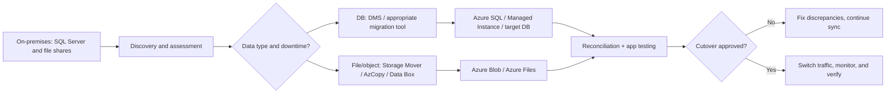

# Migrating Data and Databases with Migration Services

> **Chapter:** Hybrid Cloud and Migration to Azure  
> **Module:** `CLOUD_PROVIDERS_AZURE` — from subscriptions, resource groups, Microsoft Entra ID, and virtual networks to compute, storage, and data services; deploying, monitoring, protecting, and managing costs for application architectures on Microsoft Azure.

## Learning Objectives

After this lesson, learners will be able to:

1. Classify **file/object data** and **transactional databases**, identifying dependencies, owners, RPO/RTO targets, and permitted downtime.
2. Choose the right service among **Azure Migrate**, **Azure Database Migration Service (DMS)**, service-integrated migration flows, **Azure Data Factory**, **Azure Storage Mover**, **AzCopy**, and **Azure Data Box**.
3. Distinguish **offline**, **online/incremental**, bulk transfer, change synchronization, and **cutover**; understand how to prevent data loss or duplicate writes.
4. Design networking, identity, permissions, data protection, and costs during migration from on-premises/hybrid to Azure.
5. Plan a pilot, monitor progress, reconcile integrity, test applications, and roll back using a verifiable runbook.
6. Apply a file and database migration example, knowing what must be checked before shifting traffic to Azure.

## 1. Real-World Scenario: Moving Data Alongside Applications

A company operates an `orders` system in a private data center. A Java application calls a SQL Server storing orders, an SMB file share holds PDF invoices, and a reporting service reads nightly CSV exports. The company wants to move the system to Azure, using Azure SQL Managed Instance or an appropriate data target, and Azure Storage for documents.

Moving compute or redeploying the app alone does not solve the problem. If the database moves first while the app keeps writing to the old source, data diverges. If files are copied without ACLs or metadata, users lose access. If connection strings flip before synchronization completes, recent transactions can be lost. Even when migration tasks report `Succeeded`, the app can still fail due to SQL version differences, collation, timezone, certificates, networking, or permissions.

**Migration is a controlled process covering discovery, assessment, data transfer, synchronization, reconciliation, cutover, and post-verification.** Migration services automate portions of the work; deciding which data store is the source of truth, when to freeze writes, and when to cut over remains the operations team's responsibility.



## 2. Classifying Data Before Choosing a Service

### 2.1. Inventorying Data and Dependencies

Before creating any migration job, build a list:

| Attribute | Questions to Answer | Example |
|---|---|---|
| **Data source** | SQL Server, PostgreSQL, MySQL, Oracle, NFS/SMB, object storage, or filesystem? | SQL Server 2019 on local VM |
| **Desired target** | Azure SQL Database, Managed Instance, PostgreSQL Flexible Server, Azure Files, Blob, or other? | Azure SQL Managed Instance |
| **Scale** | Current size, growth rate, object/file count, data change rate? | 600 GB SQL + 200 GB PDF |
| **Dependent apps** | Who reads/writes, batch jobs, linked servers, triggers, ETL, reports, APIs? | Java app + end-of-day reports |
| **Downtime requirement** | How long can writes pause? Are continuous reads needed? | Max 30 minutes |
| **RPO/RTO** | Acceptable data loss and outage duration? | Near-zero RPO at cutover |
| **Data sensitivity** | PII, financial data, encryption, keys, and data residency? | Invoices with customer data |
| **Permissions & metadata** | ACLs, owners, timestamps, collation, timezone, data types, indexes? | Preserve SMB ACLs if possible |
| **Recovery & rollback** | Tested backup/restore? How to fall back to old source? | Full + log backups, runbook |
| **Operational staffing** | Who approves, monitors, and has authority to freeze writes? | DBA + SRE + app owner |

**Never choose a tool solely by service name.** The right tool for a 100 TB file share differs completely from what migrates a 500 GB transactional database needing transaction logs preserved.

### 2.2. Distinguishing Data Transfer from Semantic Transfer

- For **files/objects**, verify bytes, paths, names, metadata, ACLs, file locking, and whether apps use SMB/NFS or HTTP object APIs. Blob Storage is **not** an SMB filesystem equivalent to Azure Files.
- For **databases**, preserve schemas, data types, primary/foreign keys, indexes, constraints, stored procedures, users/roles, jobs, timezones, and app compatibility. Copying table rows is not migrating a DBMS.
- For **multi-source systems**, you may need a consistent transactional boundary or snapshot across databases, files, and message queues. Two tools independently reporting `Succeeded` do not prove data aligns at the same point in time.

A `CreatedAt` column stored in local time rather than UTC can corrupt report ordering. A source database using SQL Server Agent jobs or linked servers may need redesign if targeting Azure SQL Database. Always include a **compatibility assessment and application remediation** phase alongside data copying.

## 3. Map of Migration Services on Azure

| Tool / Service | Primary Role | When Appropriate | Limits / Things to Verify |
|---|---|---|---|
| **Azure Migrate** | Discovers, assesses, and plans infrastructure/workload migrations, with migration capabilities for supported scenarios | Server inventory, dependencies, sizing, and planning | Not a copy tool replacing all DBs, files, and objects |
| **Azure Database Migration Service (DMS)** and integrated migration flows | Orchestrates database migrations across supported source/target pairs, online/offline where available | SQL Server or other DBMS to matching Azure database target | Must check compatibility matrix, method, and exact scenario limits |
| **Azure Data Factory (ADF)** | ETL/ELT pipelines, Copy activity, mappings, and scheduled orchestration | Moving/appending data across connector-supported sources/targets | Standalone Copy activity does not guarantee multi-table DB transactional consistency or automatic CDC |
| **Azure Storage Mover** | Orchestrates file data migrations from supported sources to Azure Storage | Large NFS/SMB file shares to Blob/Azure Files in supported models | Check protocols, ACL/metadata fidelity, path mapping, agents, and target capabilities |
| **AzCopy** | High-performance copy utility for supported Azure Storage services | Moving files/objects to Blob/ADLS, copying between supported stores, job retries | Does not convert DB schemas; verify permissions, metadata, and job status |
| **Azure Data Box** | Physical data transfer appliance for large volumes when network is insufficient | Initial seeding of multi-TB datasets over limited WAN | Logistics, encryption, shipping workflow; post-copy changes require follow-up sync |
| **Azure Storage Explorer** | GUI tool for managing/copying storage data | Small tests, inspecting containers and objects | Not a DB cutover manager or enterprise-scale orchestrator |
| **Engine-specific schema/migration tools** | Assessment, schema conversion, incompatibility fixes, native backup/restore/replication | Cross-engine migrations or engine-specific features | A schema tool alone may omit data, users, or jobs |

**Whether DMS or an integrated migration tool is used depends on product version, source, target, region, networking, and online/offline support at execution time.** In the Azure Portal, check the target service's migration blade and official docs for current requirements. Do not assume every source/target pair supports online migration just because DMS is named.

### Choosing by Need

- **SQL Server → Azure SQL Managed Instance:** assess instance-level features, schemas, and dependencies; consider Azure-supported SQL MI migration paths with sync tracking and cutover.
- **SQL Server → Azure SQL Database:** check traditional SQL Server features absent from the database-as-a-service model; may require schema, SQL job, linked server, or authentication changes.
- **PostgreSQL/MySQL → Azure Database for PostgreSQL/MySQL:** check engine/version-appropriate migration services, extensions, encoding, networking, and online support if needed.
- **SMB file share → Azure Files:** review SMB/ACL support, identity, and share permissions; use Storage Mover or appropriate sync tooling instead of assuming Blob replaces SMB.
- **Image/PDF folders → Azure Blob/ADLS Gen2:** evaluate AzCopy, Storage Mover, or ADF; use Data Box for massive initial transfers over constrained WANs.
- **Multi-source data with transformations:** ADF Copy activity, mapping/transforms, or appropriate data tools, followed by per-batch reconciliation.

## 4. Offline, Online, and Change Synchronization Techniques

### 4.1. Offline Migration

A typical offline approach:

1. Pick a maintenance window and notify users.
2. Stop or lock write paths at source; take a consistent snapshot/backup.
3. Export a backup/dump or data copy.
4. Transfer and load into target; build schemas/permissions and validate.
5. Switch app configs to target and reopen writes.

**Pros:** simpler sync state and consistency guarantees. **Cons:** downtime scales with data volume, restore time, validation, and app switchover.

### 4.2. Online / Near-Online Migration

An online approach when supported by the tool and source/target pair:

1. Copy the **initial baseline data** while the source stays live.
2. Use an appropriate mechanism—**change data capture (CDC), transaction logs, replication, or incremental sync**—to stream ongoing changes.
3. Monitor **replication lag / change backlog** and sync errors.
4. At cutover, **stop source writes**, let remaining deltas drain to target, and reconcile consistency.
5. Switch apps to target, run business checks, then reopen writes.

Online migration reduces downtime but **does not automatically imply zero downtime or zero data loss**. Consistency and cutover depend on the migration mechanism, application, network, backlog size, and write-freeze discipline.

**Never run two databases as active writable primaries simultaneously** unless the system is explicitly built for conflict resolution. Rolling connection strings gradually without coordination can create **split-brain**: some new transactions land on source, others on target.

### 4.3. Bulk Copy vs. Delta Copy

For files that may change while copying:

- **Bulk copy** moves the initial dataset.
- **Delta copy** syncs created/modified/deleted files per tool capabilities and policy.
- **Final scan/freeze** ensures the source stops mutating before declaring the target complete.

Some tools copy new and modified files without deleting files removed on source; other sync modes can delete at target. **Delete propagation must be reviewed explicitly**, especially for folders holding legal records.

## 5. Estimating Time, Bandwidth, and Downtime

A minimum lower bound for transferring data over the network:

\[
T_{\text{ideal}} =
\frac{\text{Data size (bits)}}{\text{Throughput (bits/second)}}
\]

Suppose you need to transfer **1 TB (decimal)** (1,000 GB) over a sustained **100 Mbps** link:

\[
T = \frac{1{,}000 \times 10^9 \times 8}{100 \times 10^6}
\approx 80{,}000\;\text{seconds} \approx 22.2\;\text{hours}
\]

This is only the **ideal payload transfer time**. Real transfers add protocol overhead, small-file count overhead, retries, throttling, encryption, disk I/O, import speed, service quotas, and bandwidth shared with production traffic.

| Component | How to Estimate |
|---|---|
| Initial copy | Size / measured throughput from a small trial |
| Delta backlog | Source change rate minus sync apply rate |
| Schema/restore | Index builds, log imports, permission setup, and validation |
| Cutover downtime | Freeze writes + final delta sync + verification + connection switch + smoke tests |
| Rollback window | Period allowed to revert before target accumulates irreversible writes |

Design cutover around measurements from a representative **pilot**. If source churn is 50 GB/hour while sync only applies 30 GB/hour, the backlog grows indefinitely and cutover can never converge by “just waiting longer.”

## 6. Migrating Files/Objects with Azure Storage

### 6.1. Choosing Azure Files vs. Blob

| Application Requirement | Target to Evaluate | Issues to Verify |
|---|---|---|
| SMB access, paths, and file locking | **Azure Files** | Authentication, share ACLs/permissions, SMB networking, latency |
| Images, PDFs, logs via object API/HTTP | **Azure Blob Storage** | Containers, object naming, metadata, lifecycle tiers, SAS/RBAC |
| Analytics data with hierarchical namespace | **ADLS Gen2** (Storage feature) | ACLs, hierarchical namespace, connectors, and access |
| Large on-prem volume, slow WAN | **Data Box** + final network delta sync | Shipping tracking, ingest, deltas after offline snapshot |

**Switching from an SMB file share to Blob may require application changes.** Copying files cleanly does not mean open/rename/locking/ACL semantics match.

### 6.2. AzCopy: Example Copying Files to Blob

Suppose an intermediate Azure VM has a **managed identity** granted `Storage Blob Data Contributor` on the target container or appropriate scope, with valid network reachability to Storage. Container `import` on storage account `storderslab` already exists. Run in an authorized lab environment:

```bash
# Run on an Azure VM whose managed identity has Blob permissions.
azcopy login --identity

# Directory /data/export/ contains non-sensitive sample data.
azcopy copy '/data/export/' \
  'https://storderslab.blob.core.windows.net/import' \
  --recursive=true

# After completion, check history and the corresponding job ID.
azcopy jobs list
```

These commands are examples: the Azure VM, storage account, container, DNS, RBAC roles, and data must exist. Check your AzCopy version, target paths, and prefix structure after copying; do not run this against real data without authorization.

**Success criteria:** zero failed files in the job, file/object counts and total bytes match source, sampled files match SHA-256 checksums, required metadata is preserved within tool capabilities, and the app reads them post-migration.

Never commit long-lived SAS tokens into source control or logs. On on-premises hosts without managed identity, pick an organization-approved authentication model and protect credentials accordingly.

### 6.3. Azure Storage Mover

For large file shares, Storage Mover manages jobs and agents to migrate from supported file sources to Azure Storage. A typical workflow:

1. Verify source type (SMB/NFS), target type (Azure Files/Blob), and supported pairs.
2. Create a Storage Mover resource and deploy an **agent** with network access to source and Azure.
3. Configure source/target endpoints, credentials, and exact paths; govern permissions on both sides.
4. Create a **migration project/job definition** per current UI and service version.
5. Test with a small dataset: filenames, Vietnamese diacritics, timestamps, ACLs, symlinks/metadata if any, and read access.
6. Run bulk copy, inspect results/errors, and execute supplemental sync passes per service behavior.
7. Perform final reconciliation and only cut application read/write over once evidence is complete.

**Never assume every SMB/NFS attribute is preserved.** Check the ACL/metadata fidelity matrix and test with actual end-user permissions at target.

### 6.4. Azure Data Box

When datasets reach many terabytes over constrained WAN links, evaluate Data Box appliances per currently supported configurations and procedures. The flow covers ordering the device, copying and encrypting data, shipping, Azure ingest into the Storage account, validation, and running **delta sync** for changes occurring after the offline copy.

Data Box solves the **initial transfer problem**; it does not handle database transaction consistency, app cutover, or rollback.

## 7. Migrating Databases with DMS and Appropriate Tools

### 7.1. Why Databases Need a Dedicated Process

Databases carry schema and transactional state. Alongside rows, verify schemas, indexes, constraints, stored procedures, sequences/identity columns, user permissions, collation, timezones, extensions, replication settings, and application compatibility.

A migration job that copies table data while omitting SQL Agent jobs, login mappings, or a stored procedure can break the app the moment connection strings switch. Across heterogeneous engines, **schema conversion** is a separate workstream alongside data copy.

### 7.2. SQL Server to Azure SQL Managed Instance Workflow

Suppose an organization runs SQL Server on-premises and targets Azure SQL Managed Instance (MI) to minimize code changes relative to another platform.

1. **Assessment:** gather SQL version, database size, workload, blocking, dependencies, linked servers, SQL Agent jobs, CLR, collation, authentication, and HA/DR needs. Check which features MI supports.
2. **Prepare target:** subscription, VNet/subnet per MI requirements, endpoints/DNS, capacity, storage, security, backups, and on-prem connectivity via VPN/ExpressRoute per architecture.
3. **Select migration path:** choose Azure-supported Azure SQL migration/DMS flows or native backup/restore matching the source–target pair; confirm online/offline support.
4. **Initialize:** run backup or initial copy; track DB objects, restores, and data load.
5. **Continuous sync if supported:** monitor log/CDC/replication progress and lag; check source/target health.
6. **Controlled cutover:** stop source writes, finish draining final changes, verify target readiness, update connection strings/app routing.
7. **Validation and post-checks:** app connects using Entra ID/SQL auth per design; test reads/writes, query latency, jobs, backups, alerts, and close migration after the observation window.

Detailed steps—especially backup/restore permissions, MI networking, and online support—**depend on the exact source–target pair and tool version**; check the wizard and compatibility matrix at execution time.

### 7.3. Azure SQL Database Differs from Azure SQL Managed Instance

Azure SQL Database follows a different management model than a full SQL Server instance. Instance-level tasks, SQL Server Agent, or cross-database queries may require redesign or alternatives. **Never pick a target solely by price or the name “Azure SQL.”** Evaluate application changes, feature gaps, licensing, SLAs, and operability.

### 7.4. PostgreSQL / MySQL

For PostgreSQL/MySQL, verify:

- Engine version, extensions/plugins, collation/character set, and data types.
- Whether replication/CDC or the migration service supports online mode for the source–target pair.
- DDL changes during sync, sequence/current values, triggers, views, roles, and privileges.
- Timezone, UTF-8 encoding, prepared statements, transaction isolation, and connection behavior.
- Data protection, workload benchmarks, and rollback if online cutover fails.

In some scenarios, the target Azure database platform offers **built-in migration** in its own blade rather than a separately provisioned DMS resource. Follow guidance for the exact service and version rather than applying SQL Server steps blindly to PostgreSQL/MySQL.

## 8. Azure Data Factory for Orchestrated Copy and Incremental Loads

**Azure Data Factory** provides standard building blocks:

| Component | Role in Migration |
|---|---|
| **Linked service** | Defines connection details and authentication for source/target |
| **Dataset** | Metadata describing structure/location of copied data |
| **Copy activity** | Reads source data and writes to target via supported connectors |
| **Pipeline** | Orchestrates copy, validation, retries, and dependencies |
| **Integration runtime (IR)** | Data movement compute; **self-hosted IR** typically reaches private-network sources |
| **Trigger** | Schedule or event initiating pipeline execution |
| **Monitoring** | Activity runs, row counts, throughput, duration, retries/failures |

ADF fits multi-format/multi-connector copies, transformations, data warehouse loads, or incremental ingestion. However, **ADF Copy activity does not automatically provide a multi-table transactionally consistent database snapshot while the source keeps writing**, unless you explicitly design snapshots, transaction boundaries, or CDC.

### Incremental Watermark Example (Logical Pattern)

Suppose source table `dbo.Orders` has an advancing `UpdatedAtUtc` column and primary key `OrderId`. A scheduled pipeline:

1. Reads the **durably stored** watermark `W_old` from the previous successful run.
2. Computes a safe upper watermark `W_new` (optionally subtracting a safety delay to avoid uncommitted transactions).
3. Reads rows in `(W_old, W_new]` into a target staging table.
4. Executes an **idempotent upsert** by primary key, with explicit handling for updates/deletes.
5. Verifies row counts, rejected records, and changes; updates `W_old = W_new` only after the full batch succeeds.

Source pseudo-SQL:

```sql
SELECT OrderId, CustomerId, TotalAmount, UpdatedAtUtc
FROM dbo.Orders
WHERE UpdatedAtUtc > @OldWatermark
  AND UpdatedAtUtc <= @NewWatermark;
```

**Warning:** watermarks on `UpdatedAtUtc` can miss hard-deleted rows, late-committing transactions, updates that do not bump timestamps, or boundary timestamp ties. For strict transactional data, prefer CDC/transaction logs or equivalent supported mechanisms; always test updates, deletes, late arrivals, and idempotency.

## 9. Post-Migration Data Verification Process

A job reporting `Completed` only means the tool finished according to its internal criteria. Business acceptance criteria must be written **before** migration.

### 9.1. File/Object Reconciliation

- Compare **file/object counts**, total bytes, and any skipped/failed items in job logs.
- Compare sample **SHA-256** or normalized content checksums between source and target; watch for metadata or encryption differences.
- Check Unicode filenames, deep paths, special characters, metadata, permissions, and required timestamps.
- Open/read files through the **actual application path**: SMB share or Blob API depending on target.
- Run a delta scan after freeze time to confirm zero pending un-synced changes.

Example for a sample file on Linux (run where valid source and downloaded target copies exist):

```bash
sha256sum /data/source/sample-invoice.pdf
sha256sum /data/verified-target/sample-invoice.pdf
```

Matching hashes prove **contents of the sampled file** match—not that the entire object collection, metadata, and permissions are correct.

### 9.2. Database Reconciliation

For SQL Server, run verification queries against the **same snapshot/consistency point** on source and target:

```sql
SELECT
    COUNT_BIG(*) AS RowCount,
    MIN(OrderId) AS MinOrderId,
    MAX(OrderId) AS MaxOrderId,
    MAX(UpdatedAtUtc) AS LatestChange
FROM dbo.Orders;
```

Also verify: row counts per partition/date, foreign-key violations, null rates, business aggregates (daily order totals), modified/deleted record counts, identity/sequence values, permissions, and sampled rows. **Equal row counts do not prove accurate data**: row contents can differ while counts match.

For large databases, use **partitioned reconciliation**, normalized data checksums/hashes, and proper snapshot consistency. Never force `DBCC CHECKDB` or engine-specific tools onto targets that do not support them.

### 9.3. Application Checks

| Layer | Check | Passing Criterion |
|---|---|---|
| Connectivity | App picks up new DNS, firewall, certs, auth, and connection strings | Stable connections, no leaked credentials |
| Reads | API reads historical orders and sample invoice PDFs | Accurate content and permissions |
| Writes | Create one **test** order and read it back | Does not write to old source, no key collisions |
| Transactions | Updates, rollbacks, concurrency, and background jobs | Matches design |
| Performance | p95/p99, request rate, DB CPU/IO, and query plans | Within SLO |
| Observability | Azure Monitor/Application Insights, migration job logs | Metrics and cutover alerts working |
| Recovery | Target backups, restore points, and DR | Meets committed RPO/RTO |

**Cutover is complete only when application and business evidence passes**, not when connection strings are swapped.

## 10. Cutover and Rollback Runbook

### 10.1. Pre-Cutover Window Preparation

1. Lock down the inventory of application writers, batch jobs, schedulers, ETLs, background workers, and webhooks capable of mutating source.
2. Confirm tested backups/restores, permission recovery steps, and working network paths.
3. Verify initial copy and lag; prepare baseline reconciliation numbers and transaction markers.
4. Put app switchover settings in versioned config/secret storage with rollback readiness.
5. Identify the **go/no-go** approver, network/DNS operator, DBA, SRE, application owner, and incident bridge channel.
6. Finalize write-freeze time, outage scope, pass criteria, abort timeout, rollback method, and the point after which simple rollback expires.

### 10.2. Example Conditional Cutover Schedule

| Relative Time | Action | Evidence / Decision |
|---|---|---|
| T−60 min | Check migration jobs, backups, metrics, scripts/permissions | All entry prerequisites met |
| T−30 min | Notify stakeholders, stop non-essential batches, lower DNS TTL if applicable | All writers accounted for |
| T0 | **Set app to read-only or stop source writes** | Proof no rogue writers remain |
| T+5 | Run final delta, wait for log/CDC sync to catch up | Zero lag, zero job errors |
| T+10 | Reconcile counts/hashes/business checks, verify target connectivity | DBA + app owner sign-off |
| T+15 | Switch app config/traffic to target | Single authoritative writer |
| T+20 | Run read/write smoke tests, APIs, reports, permissions | Core functions and SLOs pass |
| T+30 onward | Monitor closely, confirm cutover closure | Go/no-go change closure |

This is a **hypothetical timeline**, not an Azure SLA. Real durations depend on pilot measurements, writer count, and observed sync lag.

### 10.3. Rollback Is Harder Than Reverting DNS

If failures occur **before writes are permitted at target**, reverting to source is straightforward per runbook while source remains intact with zero target writes.

Once users write new transactions in Azure, pointing connection strings back to the old source **can lose those new transactions**. A pre-designed strategy is required:

- Pause writes at target immediately to stop further divergence.
- Evaluate post-cutover data; decide on reverse synchronization, business transaction replay, or log-based recovery where supported.
- Reopen writes only after establishing **a single source of truth** and reconciling deltas.
- If no safe reverse path exists, choose controlled forward-fix incident response rather than ad-hoc rollback.

**Never run two concurrent writers** “just in case” unless the architecture has verified bidirectional sync and conflict resolution.

## 11. Networking, Identity, and Security

### Connectivity

- For on-prem data, verify VPN/ExpressRoute or authorized connectivity, DNS, routing, and bandwidth. Private links still require RBAC and monitoring.
- For Azure SQL Managed Instance and certain target DBs, VNet/subnet, NSG, and endpoint requirements differ. Test reachability from self-hosted IR/DMS to exact sources and targets.
- For Azure Storage, apply private endpoints/firewalls/network rules per policy. Storage Mover agents and AzCopy must reach required paths.
- Never open all public IPs, disable TLS, or grant broad admin accounts just to bypass a migration error.

### Identity and Sensitive Data

- Use **Microsoft Entra ID, managed identities, narrowly scoped service principals, or appropriate source auth**; store secrets in a vault like Azure Key Vault where supported.
- Grant least-privilege Azure RBAC/data-plane and DB permissions; separate job operators, cutover approvers, and target system admins.
- Encrypt data in transit and at rest, verify certificates, and never log connection strings or passwords in pipeline outputs or docs.
- Restrict test data, protect PII, and enforce data residency and retention—including temporary copies, dumps, and backups.
- Audit Azure Activity Logs, migration tool logs, and database config changes. Define where logs live and who can read them.

### Migration Costs

Costs may include parallel Azure DB/Storage runtime, VMs/self-hosted IR, networking/egress, migration services, snapshots/backups, log ingestion, and staff time. Running source and target in parallel during validation incurs **temporary duplicate spend** by design; never shut down the source before the rollback window closes solely to save money.

## 12. Monitoring Migration and Handling Errors

### Metrics to Watch

| Category | Metrics |
|---|---|
| Progress | Bytes/rows completed, file count, percentage, duration, data scanned |
| Quality | Failed/skipped objects, rejected rows, schema errors, checksum mismatches |
| Synchronization | Change backlog, log position, last applied change, replication lag |
| Infrastructure | CPU, disk IOPS, DB connections, throttling, network throughput, retries |
| Application | p95/p99, HTTP errors, timeouts, DB query performance, sample business flows |
| Security | Access failures, permission changes, secret rotations, audit events |
| Cost | Parallel compute/storage, egress, migration tooling, and observability |

### Common Failures

| Symptom | Common Causes | Remediation |
|---|---|---|
| Cannot connect to source/target | DNS, firewall, NSG, routing, VPN, TLS, or permissions | Trace hop-by-hop and inspect agent/IR logs; grant least privilege |
| DMS reports incompatibility | Engine/version, schema, unsupported SQL features | Run assessment, adjust schema/target, or pick another method |
| Copy activity finishes with missing rows | Non-consistent snapshot, flawed watermark, unhandled deletes/late arrivals | Reconcile checkpoints; improve reliability with CDC/idempotency |
| Slow file transfer | Many small files, low bandwidth, slow disks, throttling | Batch work, benchmark tuned parallelism, consider Data Box |
| Files copied but app cannot open them | SMB vs. Blob semantics, ACLs, paths, encoding, or identity | Test as real user/app; fix permission and path mappings |
| Lag never shrinks | Source write rate exceeds target apply throughput | Tune throughput, reduce source load, widen sync window |
| Target has duplicate rows | Non-idempotent retries, bad upsert key, uncheckpointed re-runs | Enforce primary keys, transaction boundaries, and verified dedup |
| App fails post-cutover | Connection strings, certs, DB users, query compatibility, background jobs | Test from app network, smoke tests, and dependency checks |
| Data divergence after rollback | Writes occurred at target and fallback lacked reverse sync | Halt writes, confirm single writer, reconcile, and forward-fix/replay |
| Costs exceed plan | Long parallel runtime, high logs/egress, undeleted staging copies | Audit cost meters and clean up once rollback window ends |

**Retries are not always safe.** Some data copy jobs are idempotent, whereas re-running a transaction or creation API may insert duplicates. Design watermarks, retries, checkpoints, idempotent writes, and restart procedures before failures happen.

## 13. Guided Practice Exercise

**Lab context:** Operations has `/data/export` holding sample PDF invoices and an `OrdersLab` SQL Server database in a test environment. Targets are Azure Blob Storage and Azure SQL Managed Instance **or an Azure SQL Database validated by assessment**. Constraints: copy no real PII; source may continue changing during bulk phase; assumed max downtime 30 minutes.

### Step 1 — Build the Inventory

Record sample figures: sizes, file counts, table counts, transactions/hour, schemas/dependencies, source/destination, RPO/RTO, and owners. Document why Blob was chosen over Azure Files for invoices if the app reads via object APIs.

### Step 2 — Choose Tools per Stream

- For `/data/export`, pick **AzCopy** (or Storage Mover if source is a large file share with an agent). Start with a small folder.
- For `OrdersLab`, run an assessment and choose **the Azure-supported migration/DMS path for that exact SQL Server–Azure SQL target pair**; describe online/offline conditions.
- If scheduled CSV report imports need transformations, optionally add an **ADF Copy activity** with self-hosted IR—without treating it as a substitute for transactional DB sync.

### Step 3 — Define Acceptance Criteria Before Running

| Item | Example Criterion |
|---|---|
| Files | Total file count, bytes, and 20 sampled SHA-256 hashes match; zero failed files |
| Database | Per-table/per-day counts, key ranges, and business aggregates match at same checkpoint |
| Delta | Zero backlog before opening target writes |
| Application | 5 core read/write flows succeed on test data |
| Performance | p95 and error rate within agreed SLO |
| Security | Azure RBAC, DB roles, and private networking work |
| Rollback | Clear decision path for failures before vs. after target accepts writes |

### Step 4 — Rehearse

1. Copy 10 sample files with AzCopy; record job ID, hashes, and target prefix.
2. Run DB assessment and list incompatibilities. Pick a small table to demonstrate count/key-range reconciliation.
3. Simulate bulk + delta; intentionally modify one file and insert one source row, then observe how the pipeline captures changes.
4. Execute a simulated cutover: lock source writes, run final sync, reconcile, and switch connection strings in lab.
5. Read an invoice, create a test order, and query it back; inspect Azure Monitor/DB metrics.
6. Log start/recovery timestamps, issues, and the go/no-go decision.
7. Clean up lab resources per ownership once evidence is archived; preserve recovery backups.

### Report Template

| Field | Value to Record |
|---|---|
| Source → target | Database/file paths, resource IDs, and region |
| Migration service | Tool and version, online/offline mode |
| Scale | GB, tables, file count, churn rate |
| Throughput / timing | Initial copy, lag, cutover, measured downtime |
| Reconciliation | Rows, sums, hashes, mismatches, and resolution |
| App validation | Reads/writes, error rate, latency, permissions |
| Security | Identity, networking, secret handling |
| Decision | Go/no-go, approver, and rollback status |
| Post-cutover | Backups, alerts, owner, source decommission schedule |

**Passing criteria:** pick the right service per data stream; explain online/offline and design a single-writer cutover; provide evidence-based data reconciliation and a rollback plan that prevents split-brain. Without live Azure resources, simulate result tables and commands on paper; never access environments outside authorized permissions.

### Self-Check Questions

1. Which distinct parts of migration do Azure Migrate, DMS, ADF, and AzCopy each solve?
2. Why is copying SQL table rows insufficient to migrate an entire database and its application?
3. What roles do bulk copy and change sync play when downtime is capped at 30 minutes?
4. Why cannot matching `COUNT(*)` values serve as the sole proof of integrity?
5. What happens if an app writes concurrently to source SQL Server and target Azure SQL?
6. When does Data Box outperform transferring everything over the WAN, and what work remains afterward?
7. Why cannot Azure Files and Blob Storage drop-in replace every SMB workload?
8. If rolling back after the Azure target accepted new transactions, what must be handled before switching connections back to source?
9. What metrics must be monitored during online migration beyond a `Succeeded` job status?
10. Can a migration service automatically resolve every schema change, app connection, DNS update, permission, and compliance requirement?

## 14. Key Takeaways

Migrating to Azure requires choosing tools by **data type and business requirements**. Azure Migrate handles discovery/assessment, Database Migration Service and corresponding migration flows handle databases, Azure Data Factory orchestrates copies/transforms, Azure Storage Mover and AzCopy handle files/objects, and Data Box addresses massive volumes over inadequate links.

A reliable lifecycle follows **inventory → assessment → pilot → bulk transfer → delta sync → source freeze → cutover → reconciliation and testing → monitoring and controlled decommissioning**. Operators must enforce a single authoritative writer, verify data with hard metrics rather than job status alone, safeguard permissions and secrets, measure actual downtime, and prepare rollback before exposing Azure targets to live applications.
