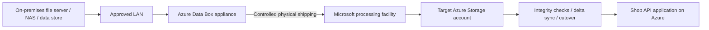
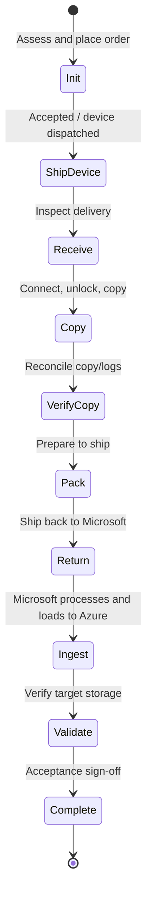
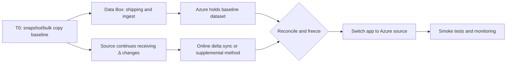

# Migrating Large Datasets with Azure Data Box

## 1. Problem Statement and Learning Objectives

When an enterprise moves systems from an on-premises data center to Microsoft Azure, Internet or private WAN links may be insufficient to upload tens to hundreds of terabytes on schedule. Continuous multi-week network transfers are also subject to shared bandwidth contention, latency, link errors, transfer costs, and compliance requirements. **Azure Data Box** addresses a class of these scenarios by moving data **offline** using a controlled physical appliance instead of sending the entire baseline dataset over the WAN.

In the **Hybrid Cloud and Migration to Azure** chapter of the `CLOUD_PROVIDERS_AZURE` module, this lesson covers selecting, preparing, and operating a **large-scale data import** using Azure Data Box. The material connects to subscriptions, resource groups, Microsoft Entra ID, networking, Azure Storage, permission management, data protection, monitoring, and cost for an Azure application architecture.

After this lesson, you will be able to:

- Distinguish Azure Data Box from **AzCopy**, **Azure Storage Mover**, **Azure Migrate**, and network-based transfer methods.
- Estimate transfer times from volume, effective bandwidth, and overhead; determine when shipping an appliance makes sense.
- Inventory sources, select suitable Azure Storage targets, and build manifests for data reconciliation.
- Describe the lifecycle: **order → receive device → configure/copy → prepare to ship → Microsoft ingests data → verify**.
- Structure Azure RBAC permissions, protect unlock credentials, control shipping custody, and handle sensitive data.
- Verify counts, sizes, directory/namespace layout, integrity, and application status post-import.
- Build a **delta sync and cutover** plan to avoid losing changes generated during transit.

**Running scenario:** A company holds 60 TB of product images, documents, and logs in its data center. The target `Shop API` application will run on Azure, reading images from Azure Blob Storage and certain shared files from Azure Files. The project team has a 200 Mbps cap for cloud uploads, yet needs the baseline dataset in place faster than WAN upload allows. The team must choose an approach, plan safely, and validate after data ingestion.

> **Service note:** SKU names, usable capacities, supported delivery countries, supported target services, import/export features, Azure regions, and pricing can change. Before placing a live order, verify the Azure Data Box catalog and current limits; never select purely from capacity figures in older documentation.

## 2. What Azure Data Box Is—and Is Not

**Azure Data Box** is a physical appliance data transfer service for moving large datasets into or out of Azure through a supported workflow. In an **import** scenario, Microsoft ships an appliance to your site; data is copied onto it over local networking; then the appliance is shipped back so Microsoft can ingest the data into your designated Azure Storage account. The process includes status tracking, device protection, and Microsoft-side ingestion.



This is **offline data migration**, not a continuous network connection between on-premises and Azure. Data Box **does not automatically**:

- Migrate VM configurations, identities, firewalls, DNS, database engines, or entire applications.
- Provide real-time replication or sync changes occurring after the initial copy.
- Replace backups, disaster recovery, or data protection on source or in Azure.
- Guarantee file metadata/ACL/application semantics transfer intact across every source–target combination.
- Meet RPO/RTO targets of a live system without a freeze, delta sync, and cutover plan.

### 2.1. Product Options and Alternatives

| Solution | Transport Method | When Appropriate | Key Differences |
|---|---|---|---|
| **Azure Data Box** and currently offered appliance/disk variants | Offline via physical hardware | Very large datasets, constrained WAN, baseline data seeding | Involves logistics, delivery/return lead times, chain of custody, and post-return ingest |
| **AzCopy** | Online over network | Azure Storage-compatible source/target with sufficient bandwidth | Command-line upload/sync; requires connection and credential management |
| **Azure Storage Mover** | Online, orchestrated file migration from supported sources | File share migrations needing multiple runs and progress tracking | Not an offline appliance; verify source–target/metadata support |
| **Azure Migrate** | Discovery, assessment, and migration of supported workloads | Higher-level server, VM, database, or app migrations | Does not replace bulk Data Box copying of huge file repositories |
| **VPN/ExpressRoute + copy tools** | Online over Azure links | Gradual, continuous, or scheduled synchronization | Subject to bandwidth caps, link costs, and network operations |
| **Azure Import/Export** if still supported for SKU/region | Offline using customer-supplied drives per service terms | Alternative where requirements and support permit | Media prep, security, scope, and support differ from Data Box |

Within the Data Box family, names such as **Data Box**, **Data Box Disk**, and **Data Box Heavy** may appear in product literature. **Never assume every SKU is orderable in every country or supports every target.** Select based on *usable* capacity, orderability, regional support, and real data volume—not SKU name alone.

## 3. Time Calculations: When Is an Offline Appliance Justified?

### 3.1. Estimating Network Upload Time

Given `D` bytes to transfer and effective throughput `R` bits/second:

```text
Theoretical minimum (seconds) = D (bytes) × 8 / R (bits/second)

Approximate duration (days)
  = D × 8 / [nominal bandwidth (bits/second) × effective utilization factor] / 86,400
```

The **effective utilization factor** reflects idle gaps, shared contention, protocol overhead, throttling, retransmissions, and file characteristics. It is a **project assumption** that must be measured—not an Azure SLA.

Example: **60 TB (decimal)** (`1 TB = 10^12 bytes`), **200 Mbps** nominal bandwidth, assumed **60%** effective utilization:

```text
D = 60 × 10^12 bytes
R = 200 × 10^6 bits/second × 0.60 = 120 × 10^6 bits/second

T = (60 × 10^12 × 8) / (120 × 10^6)
  = 4,000,000 seconds
  ≈ 46.3 days
```

With a dedicated **1 Gbps** link at **60%** efficiency, the same volume takes roughly **9.3 days**. That is transfer time alone, **excluding** validation, delta sync, retries, and application testing.

| Example Volume | Nominal Bandwidth | Assumed Efficiency | Approx. Theoretical Online Time |
|---|---:|---:|---:|
| 60 TB | 200 Mbps | 60% | 46.3 days |
| 60 TB | 1 Gbps | 60% | 9.3 days |
| 60 TB | 10 Gbps local LAN | 50% | 1.1 days |

The LAN row **does not mean** a Data Box migration finishes in 1.1 days: the appliance has write limits, shipping lead times, prep steps, and ingestion processing time at Microsoft. **Millions of tiny files** or complex directory trees can perform significantly worse than raw byte math predicts.

### 3.2. Comparing End-to-End Timelines

```text
Online end-to-end
  = source preparation time
  + WAN upload (including retries/throttling)
  + verification + delta sync + cutover

Data Box end-to-end
  = order approval and device delivery wait
  + LAN copy from source to appliance
  + log inspection + prepare-to-ship
  + return shipping + Azure processing/ingest
  + target verification + delta sync + cutover
```

Local copy speeds can be very high, yet **shipping and ingestion are not instantaneous**. Build schedules with buffer around actual carrier transit and processing times—never promise a completion date from LAN speed alone. When deadlines are tight and data mutates continuously, a hybrid pattern (*offline bulk + online delta*) is often worth evaluating.

### 3.3. Verify Usable Capacity and Device Count

**Used space on a NAS** does not always equal bytes to transfer: snapshots, hard links, sparse files, storage formats, compression, temp files, and deduplication alter actual copy size. If one device lacks sufficient **usable capacity**, split into multiple orders/batches or prune approved unnecessary data.

Before ordering, gather at minimum:

- Logical vs. actual data needing transfer; size per share/container.
- File count and size distribution (many tiny files vs. few huge files).
- Open files, high-churn files, long paths, special characters, sparse files, and file types.
- Copy protocol (SMB/NFS or SKU-specific tools), LAN speed, permitted ports/links, and source server headroom.
- Data Box support for your Azure Storage account type and target service in the **actual region**.

## 4. Target Architecture: Design Before Ordering

### 4.1. Choosing Subscription, Region, and Storage Type

`Shop API` has two data classes: product images best served as objects, and shared files still requiring file protocols. Initial mapping:

| Source Data | Suggested Azure Target | Purpose | Pre-Checks |
|---|---|---|---|
| Static images/documents | **Azure Blob Storage** | Object access, CDN, cloud apps | Blob type, container/namespace, object names, metadata, upload behavior |
| Shared folders needing file shares | **Azure Files** | SMB/NFS shares within supported capabilities | Share type, quota, ACLs, UID/GID, SMB/NFS version, app needs |
| Database exports | Blob staging or dedicated target per migration plan | Backup/export or tool-specific import | Consistency, format, restore engine, schemas, transaction logs |
| VM disk images/VHDs | Staging target aligned with supported workflow | Disk import/recovery via separate plan | Format and support terms; raw file copy is not VM migration |

Do not treat Data Box as a way to turn **a live running database** into Azure SQL Database simply by copying data directories. Active databases require **application-consistent** backups/exports, restoration via appropriate database tooling, and post-snapshot change synchronization.

**Target checklist:** Azure subscription ID, resource group, storage account, region, account kind, containers/shares, replication/redundancy, quotas, access control, network rules, encryption, tagging, cost, and retention. Confirm Data Box supports **the exact source–target combination** before placing an order. If identically named objects already exist at target, define overwrite behavior and versioning/backup policies.

### 4.2. Data Regions and Permissions

For production systems:

- Choose a region satisfying data residency, latency, disaster recovery, and product availability.
- Define who may **create orders**, manage appliances, pick storage accounts, view connection credentials, and read/write/restore data.
- Use **Microsoft Entra ID** and least-privilege **Azure RBAC** at subscription/resource group and Storage data-plane scopes; exact roles depend on Data Box/Storage workflows.
- Separate **order operator**, **source data owner**, **Azure storage admin**, **security/compliance**, and **application tester**.
- Never store unlock passwords, access keys, SAS tokens, or share credentials in repositories, public chats, or unprotected logs.

Permission to manage an Azure resource does not automatically grant permission to read **blob/file contents**. Azure Storage separates control-plane and data-plane permissions, which directly affects post-import testing.

### 4.3. Network Path to the Appliance Differs from Path to Azure

During offline copying, source hosts transfer over your **on-premises LAN to the Data Box appliance**, avoiding uploading 60 TB over the Internet. However, admin workstations still need access to the Azure Portal/management endpoints to place orders, configure, and track status; certain features/SKUs have specific network requirements.

Once data resides in Azure Storage, target apps may connect via controlled public endpoints or **Private Endpoint/VNet integration**. That is a **post-migration app connectivity design**, not proof that Data Box uses Private Endpoints to ingest data. For storage accounts restricting public network access, verify the service's import path and supported network rules before ordering.

## 5. Source Preparation: What Decides Migration Quality

### 5.1. Inventory and Classification

Build a source table like this:

| Dataset | Source Path | Hypothetical Size | File Count | Daily Churn | Target | Owner |
|---|---|---:|---:|---|---|---|
| `product-images` | `/srv/shop/images` | 38 TB | 12 million | Moderate | Blob container `images` | Shop Team |
| `documents` | `/srv/shop/docs` | 17 TB | 3 million | Low | Blob or Azure Files as needed | Shop Team |
| `shared-reports` | `/srv/reports` | 5 TB | 350 thousand | High | Azure Files share `reports` | Finance/Operations |
| **Total** | | **60 TB** | **15.35 million** | | | |

These are **hypothetical figures**. Millions of small files increase filesystem metadata overhead and inventory duration; you may need multiple copy batches segmented by directory/business unit and track progress by file count rather than % bytes alone.

Verify:

1. **Ownership and business value:** which data can be purged under approved retention, and which must be retained for compliance.
2. **Consistency:** are files actively written during copy? Databases/transactional data require consistent snapshots/backups rather than ad-hoc hot copies.
3. **Namespace:** long paths, case-normalization collisions, illegal target characters, case sensitivity, zero-byte files, symlinks, and hard links.
4. **Metadata/security:** POSIX/NTFS ACLs, owners, timestamps, extended attributes, encryption, sparse files; never assume all survive moving to Blob.
5. **Sensitive data:** PII, secrets, documents requiring encryption and controlled deletion/retention.
6. **Evidence:** file counts, byte totals, checksum samples, manifests, exception logs, and log storage locations.

### 5.2. Creating Manifests and Checksums

A **manifest** lists expected objects with relative paths, sizes, object types, checksums where appropriate, and copy status. It distinguishes:

- Source files approved but not yet copied.
- Files that failed or were skipped copying to Data Box.
- Files missing or mismatched in content once in Azure.
- Files modified after the data freeze that must enter delta sync.

Example on **Linux**, run on a quiescent data tree with proper permissions and GNU utilities:

```bash
cd /srv/shop/images

# Summarize size and file count: valid only at scan time.
du -sh .
find . -type f -print | wc -l

# Save SHA-256 manifest in a protected location outside the copied directory.
# Run only when data is quiescent or against a consistent snapshot.
find . -type f -print0 \
  | sort -z \
  | xargs -0 -r sha256sum \
  > /secure-manifests/shop-images.sha256
```

**Warning:** `find ... -print | wc -l` miscounts filenames containing newlines and scans can take a long time; treat it as a rough check only. Manifest checksums detect bit-level drift, but hashing millions of files consumes heavy CPU/I/O. In production, use consistent snapshots, newline-safe inventory tools, and secure manifest storage; choose full hashing or risk-based sampling based on verification goals. **Never store sensitive information inside widely shared manifests.**

The paths above are examples; no real source data is altered in this lesson. If source data mutates mid-scan, counts/hashes no longer reflect a consistent point-in-time snapshot.

### 5.3. Test Copy on a Representative Sample

Pick a sample covering large files, tiny files, deep directories, Unicode names, special permissions, and actual application file types. Test transferring and verifying **both contents and how the application accesses them**. This catches object naming/ACL/SMB issues before a massive copy run gets underway.

## 6. Data Box Ordering Workflow

Menu labels may vary by Azure Portal version or agreement type; the logical sequence is typically:

1. **Sign in to Azure Portal** with an authorized identity, locate **Azure Data Box**, and start a **new order** using the available workflow.
2. **Choose transfer type:** import into Azure. Do not confuse with exporting data from Azure back on-premises.
3. **Select subscription, resource group, and target region**; specify origin/destination country/region and verify device availability.
4. **Describe workload/scenario:** select device type/SKU based on usable capacity, file counts, volume, and current target support.
5. **Select target storage account and containers/file shares** supported by the order workflow; verify permissions, account kind, service, and region compatibility.
6. **Enter shipping address, contact person, and carrier details**; use only organization-approved addresses, factoring customs/shipping rules if applicable.
7. **Review terms and fees**: rental/usage duration, order fee, shipping, late fees, or extra-order charges if any; never rely on outdated pricing sheets.
8. **Submit order and track status** in the portal, recording the order reference ID and accountable owner.



**This diagram is a conceptual lifecycle**, not exact API/Portal state names. A live order can hit waiting, failed, canceled, or reprocessing states and varying shipping steps per SKU. Never declare completion when the carrier picks up the box; verify data landed at target and the application can read it.

## 7. Receiving the Device and Preparing Local Copy

### 7.1. Physical Security and Chain of Custody

Upon delivery:

- Inspect order ID, shipping labels, serial/identifier numbers, and packaging integrity; if any damage or tampering is visible, halt and contact support.
- Log timestamp, recipient, physical location, and authorized operators. Place the device in an access-controlled area; keep unauthorized staff away.
- Provide power, cooling, network ports, and safety conditions matching the delivered SKU's instructions.
- Assign LAN IP/routing/DNS per device requirements; open only required SMB/NFS/management ports from approved copy hosts.
- Retrieve **unlock passwords/credentials via the order's secure workflow**; never screenshot or paste plaintext into unprotected tickets.

Azure Data Box enforces device encryption/protection per product family and service docs. **Never claim a device is “impossible to lose data from” or “end-to-end encrypted”** without verifying the exact protection, key management, and handling model of your SKU. Include shipping and sensitive-data regulations in your risk assessment.

### 7.2. Connecting and Testing Share Access

The appliance provides a management interface/workflow and **copy shares** using supported protocols—typically SMB/NFS choices matched to the Data Box model and target type. Derive share names, access details, and permissions from the appliance UI/workflow—**never guess them** from Azure container names.

Test with a few non-sensitive files:

1. Source host reaches the appliance IP over the authorized network.
2. Shares unlock and mount using proper credentials.
3. Files written to the share are accepted with no path/format errors.
4. Copy logs and validation reports show zero missing items or unexpected errors.
5. Source host performance and load remain healthy without disrupting live services.

### 7.3. Copying Data in Batches

**Windows** example once the SMB share is mounted/authorized and placeholders reflect device values:

```powershell
$Source = 'D:\ShopAssets'
$Target = '\\<data-box-host>\<assigned-share>\ShopAssets'
$Log = 'D:\MigrationLogs\shop-assets.log'

# Do not use /MIR here because /MIR can delete destination files.
# Test with a small batch first; tune thread count for source and appliance.
robocopy $Source $Target /E /Z /R:2 /W:5 /MT:16 /TEE "/LOG:$Log"

# Robocopy uses specific exit codes; values < 8 usually do not indicate fatal copy failure.
# Inspect the summary, failed/skipped files, and reconcile against the manifest.
```

**Linux** example when the share is mounted at a valid path with supported filesystem/protocol:

```bash
# Example on source host only; mount and device permissions must be configured beforehand.
rsync -a --partial --info=progress2 \
  /srv/shop/images/ \
  /mnt/databox/assigned-share/shop-images/
```

**Critical limitation:** `rsync -a` or default `robocopy` behavior **does not guarantee** source metadata/ACLs/owners/timestamps survive transfer into Azure Blob or Azure Files. Test your real source–target pair, review Data Box documentation on metadata mapping, valid characters, and protocol limits. For millions of files, cap concurrency, batch work, and avoid saturating the NAS with too many parallel processes.

Never include source-deletion flags like `--remove-source-files` or auto-cleanup scripts in the copy workflow. **Keep source data intact** at least until Azure acceptance sign-off and an approved retention plan exist.

### 7.4. Logging and Error Handling

For every batch, record:

| Field | Example | Why It Is Needed |
|---|---|---|
| Batch ID | `shop-images-001` | Trace back to source/target |
| Snapshot or data mark | `t0` | Identify exact point-in-time version |
| Source/target | NAS path → Data Box share | Diagnose route and mapping errors |
| Expected file/byte count | Manifest | Reconciliation |
| Copied file/byte count | Logs + inspection | Track progress |
| Failed/skipped files | Exception list | Plan re-copy |
| Duration and throughput | Measured on LAN | Forecast deadlines and overload |
| Verifier | Data owner/operator | Sign off quality before returning device |

If filenames, quotas, permissions, or copy timeouts fail, **do not recklessly alter original data**. Log issues in an exception tracker, perform documented mapping/renaming, and keep an audit trail linking old names to new names.

## 8. Preparing Return Shipment and Azure-Side Import

After copying completes:

1. **Stop new writes to device shares** per procedure; wait for all copy tasks to finish.
2. Review **copy logs and validation/error logs** provided by the appliance/SKU. Check file counts, bytes, and error lists; re-copy missing items while within schedule.
3. Store manifests, summary metrics, and exception lists **off-device** in a protected location.
4. Run **prepare-to-ship/shutdown** per Data Box/SKU guidance; never power off abruptly or unplug while writes are active.
5. Complete shipping labels and return steps specified by Microsoft; maintain **chain of custody** and carrier tracking numbers.
6. Monitor order status in the Azure Portal. Once the device is received and processed, the service **ingests data into the target Azure Storage account** per workflow.
7. Inspect ingestion reports, failed/invalid files, error codes, and completion timestamps. Engage support if issues require attention.

**Do not delete source data** when shipping the appliance back. Transit can be delayed, import jobs can partially fail, or objects can be rejected for naming/format/permission issues; remove source data only after acceptance and retention rules allow.

## 9. Verifying Data After Import into Azure Storage

### 9.1. What Must Be Verified?

**Order completed status** and **resource existence** are necessary signals, but insufficient for go-live. Reconcile:

- **Coverage:** which datasets landed, how many files/objects, how many bytes, and whether any failed or were skipped.
- **Namespace:** container/share/path mappings, object names, Unicode characters, folder hierarchy, collisions, versioning/overwrites.
- **Integrity:** file contents verified via hashing/sampling as required, sizes, readability, and independent manifest checksums.
- **Metadata/permissions:** timestamps, owners, ACLs, file share permissions, object metadata, content types, and app readability.
- **Security:** Azure RBAC/data-plane permissions, network access, private endpoints/DNS where required by target apps, and audit logs.
- **Consistency:** whether related datasets align at the same snapshot/mark, and whether subsequent transactions were captured by delta sync.

Prefer **full manifest reconciliation** at the data layer where tooling and budget allow. If full hashing is infeasible, design risk-based sampling and explicitly document acceptance limitations.

### 9.2. Example Verifying an Azure Blob

On a machine authorized to reach Azure Storage, using Azure CLI and an identity with **Storage Blob Data Reader** or equivalent data-plane role:

```bash
az login

SUBSCRIPTION_ID="<subscription-id>"
STORAGE_ACCOUNT="<storage-account-name>"
CONTAINER="images"
BLOB_NAME="products/sample-001.jpg"

az account set --subscription "$SUBSCRIPTION_ID"

# Verify target object, name, content length, and published metadata.
az storage blob show \
  --account-name "$STORAGE_ACCOUNT" \
  --container-name "$CONTAINER" \
  --name "$BLOB_NAME" \
  --auth-mode login \
  --query '{name:name,size:properties.contentLength,contentType:properties.contentSettings.contentType}' \
  --output json

# Download a sample object to a properly secured verification directory.
mkdir -p ./verify
az storage blob download \
  --account-name "$STORAGE_ACCOUNT" \
  --container-name "$CONTAINER" \
  --name "$BLOB_NAME" \
  --file "./verify/sample-001.jpg" \
  --auth-mode login

# Compare against the SHA-256 of the exact matching source version.
sha256sum ./verify/sample-001.jpg
```

**These commands illustrate checking one object**, not validating 60 TB. Never rely on Content-MD5 metadata if the service did not populate it; never assume Blob ETags equal content hashes. Across millions of objects, use paginated inventory/reconciliation tools with retries and logging—never assume a single `list` call returns everything.

For **Azure Files**, validate against the file share using the application's actual protocol (SMB/NFS); never use blob commands to conclude file share permissions are intact. Check the exact metadata attributes the workflow preserves and test opening/writing as real user roles.

### 9.3. Finalizing Acceptance

An acceptance record should include:

| Item | Evidence | Passing Condition |
|---|---|---|
| Dataset catalog | Source and Azure inventories/manifests | All mandatory datasets present |
| Size/file count | Source–target totals minus explained deltas | Zero unapproved gaps |
| Integrity | Full hashes or designed sampling | Zero unresolved mismatches |
| Permissions/metadata | App/SMB verification results | Meets requirements within accepted limits |
| Import errors | Data Box/Azure logs and tickets | Zero unresolved critical errors |
| Application smoke test | Read/write tests on Azure | Meets business criteria |
| New delta data | Delta sync journal/plan | Execution and reconciliation path ready before cutover |

## 10. Delta Sync, Source Freeze, and Cutover

### 10.1. Why One Data Box Trip Is Not a Complete Migration

Suppose the team copies data at `T0`, ships the appliance back over three days, and Azure finishes ingest at `T1`. Meanwhile, on-premises kept receiving new product images, editing docs, and deleting files. The Data Box import reflects only what **was on the device at copy time**; new changes do not appear in Azure automatically.



Never let two independent processes **write to the same dataset concurrently** during transition without a conflict-resolution policy. Files deleted after `T0` may require **intentional deletion in Azure**, but never enable sync-delete before verifying manifests, permissions, and recovery procedures.

### 10.2. Sample Cutover Runbook

1. **Before T0:** lock baseline scope, normalize names, permissions, and keep/delete rules; capture snapshot/manifest with ID.
2. **T0 → T1:** copy to Data Box; source continues serving while tracking mutations (*change journal, snapshot diff, verified timestamps*).
3. **Post-import:** reconcile baseline contents and resolve all exceptions within acceptable thresholds.
4. **Online delta:** use AzCopy/Storage Mover or an appropriate source/target tool to sync created and updated objects; handle deletes/renames from a controlled list.
5. **Final freeze:** put source in temporary read-only or stop writes during the approved cutover window; run final delta, finalize manifest, and verify.
6. **Switch application:** update connection configs, Storage data-plane permissions, private DNS/endpoints, and test reads/writes.
7. **Post-cutover observation:** monitor errors, latency, throughput, logs, costs, and permission issues; retain rollback path/source data for the agreed window.
8. **Acceptance:** business and operations owners sign off before decommissioning legacy infrastructure.

**RPO/RTO:** offline bulk import cannot meet near-zero RPO or zero-disruption cutover if source continues changing without supplemental sync. Calculate RPO/RTO at the application layer and prove it through rehearsal, not copy speed alone.

## 11. Costs and Contingency Planning

### 11.1. Items to Budget

| Line Item | What to Verify | Notes |
|---|---|---|
| **Data Box order/SKU** | Device type, service fee, device count, usage terms | Take strictly from current country/region pricing/quotes |
| **Shipping/logistics** | Carrier fees if applicable, addresses, lead times, delay/damage handling | Varies by country and service terms |
| **Overtime or extra orders** | Usage days, additional orders, device return policy | Budget buffer; never assume free extensions |
| **Copy hosts and LAN** | NAS read IOPS, hash CPU, 10/40 GbE where supported, operator shifts | Adds load to source systems |
| **Azure Storage** | Capacity, redundancy, tier, write/list/read transactions | Accrues post-import per target type; separate from shipping fees |
| **Online delta sync** | Source bandwidth, tooling, transfers/transactions, network paths | May incur related service charges |
| **Monitoring, security, verification** | Logs, hash checks, recovery, permissions, testing | Budget through final acceptance |
| **On-prem rollback/retention** | Keeping legacy data/infrastructure alive | Never delete source before full confirmation |

**Never apply a fixed flat USD/TB rate** across all Data Box orders: total cost varies by product, region, duration, order count, and terms. Inbound data transfer **to Azure** may have different bandwidth pricing than **egress**, yet that does not make migration free—storage, transactions, and ongoing services still apply.

### 11.2. Comparing Offline vs. Online Economics

```text
Relative online cost
  = operational effort
  + extra connectivity/bandwidth (if any)
  + compute/migration tooling/transactions
  + opportunity cost of an extended cutover

Relative Data Box cost
  = actual order and logistics fees
  + LAN copy/verification effort
  + Azure storage/transaction fees
  + delta sync, risk, and transit wait time
```

For example, if a 200 Mbps WAN link delivers only **120 Mbps effective**, 60 TB takes roughly **46.3 days** just to upload. While Data Box copies over LAN faster, you still wait for delivery, return shipping, and ingest—so compare **total calendar time**, not link speed alone. For a huge repository growing several TB daily, delta sync itself can become the new bottleneck; factor churn rate in from day one.

### 11.3. Risks Requiring Contingency Plans

- Device arrives late, ships to the wrong address, or lacks SKU support at the delivery site.
- Source overloads during scanning/hashing/copying, slowing live applications.
- Data Box usable capacity falls short due to mismeasurement; tiny files stretch copy times.
- Filename/path/permission errors block part of the dataset from ingesting.
- Incompatible storage account/quota/region/permissions delay import.
- Data Box is in transit while source churn outpaces the delta sync window.
- Missing recovery tests if data is accidentally overwritten or deleted post-migration.

Every risk needs an **owner, early warning signal, mitigation action, and decision date**. Planned buffer days are a business planning assumption, not a delivery SLA guaranteed by Azure.

## 12. Common Issues and Diagnostics

| Symptom | Possible Cause | Sensible Action |
|---|---|---|
| Cannot order Data Box in chosen country or region | SKU/service unavailable for that logistics route or target | Check support catalog and online/alternative options; never change regions against data residency rules |
| Target storage account missing from picker | Wrong subscription/region/account kind, insufficient permissions, or unsupported | Verify scope/permissions, data type, and order prerequisites |
| Cannot access device share | Device locked, wrong LAN/DNS/ports, bad credentials, or unsupported protocol | Check SKU guide, IP config, device state, and share settings |
| Copy painfully slow despite fast network | Low source IOPS, millions of small files, hash CPU bottleneck, device limits, or bad concurrency | Measure source/LAN/device throughput; batch and tune carefully |
| Files rejected or missing | Invalid names/chars/paths, open files, quotas, or copy errors | Read validation logs, build exception list, and traceably remap names |
| Metadata/permissions lost reading from Azure | Blob does not preserve filesystem semantics; Azure Files config mismatch | Check ACL/metadata requirements; choose right target/tool or reapply permissions cleanly |
| Device returned yet Azure has no data | Order still in transit/processing or ingest incomplete | Check portal order status and upload/import logs; do not cut over early |
| Fewer Azure objects than source | Partial ingest, skipped files, source changed post-manifest, counting differences | Compare snapshot manifest, import logs, exceptions, and namespace rules |
| Sample hash mismatch | Source changed, wrong object mapping, truncation/corruption, or read method mismatch | Verify snapshot/version, re-download, trace copy logs, restore from source |
| App gets 403/timeout reading Azure Storage | Data-plane RBAC, private endpoint, DNS, firewall, or bad connection string | Debug permissions and network path independently of import status |
| Missing data discovered after cutover | Incomplete delta sync or mishandled renames/deletes | Return to manifest/journal, recover from source/backup, halt conflicting writes |

**Troubleshooting rule:** prioritize logs and evidence from the exact phase. Failures copying onto the device differ from Azure ingest failures and post-cutover app issues. Never re-run all 60 TB or wipe target data before pinpointing the scope of divergence.

## 13. Security, Auditing, and Data Lifecycle Management

### 13.1. Responsibility Model

| Role | Responsibility |
|---|---|
| **Data owner** | Confirms inventory, retention, sensitive data rules, acceptance criteria |
| **Migration operator** | Manages device, LAN, batch copies, logs, and manifests |
| **Cloud administrator** | Manages subscription, Azure Storage, quotas, data-plane access, target networking |
| **Security/compliance** | Approves shipping, encryption, chain of custody, credentials, and auditing |
| **Application owner** | Runs data tests, delta sync, cutover, and rollback |
| **FinOps** | Tracks order, storage, operations, and dual-environment overlap spend |

### 13.2. Control Checkpoints

- **Before ordering:** data classification, residency rules, approval for physical transport.
- **Before copying:** limit who receives credentials and device access; safeguard manifests/records.
- **During copying:** log errors without leaking secrets; control downloads of sensitive files from source.
- **Upon return:** witness handoff, record tracking numbers, never post label/credential photos in insecure channels.
- **Post-import:** confirm Azure Storage encryption, access policies, private networking, and target app backups/retention per design.
- **Source disposal:** delete only after acceptance, formal approval, and policy-compliant sanitization.

Data Box encryption **does not replace** Azure Storage protection, backups, Azure RBAC, auditing, or access revocation on-premises. If a device suffers a security incident or goes missing, trigger incident response and contact Microsoft support immediately—never guess data impact.

## 14. Practice Exercise: Planning a 60 TB Migration

**Problem:** A company needs to move 60 TB from an on-premises NAS to Azure over a 200 Mbps WAN at ~60% effective utilization. 38 TB of images target Blob, while 17 TB of documents and 5 TB of reports need evaluation for Blob vs. Azure Files. The source continues adding data daily, so the team needs a cutover plan.

### Exercise A — Strategy Decision

1. Recompute the **46.3-day** upload time and explain how changing effective bandwidth affects it.
2. List at least five factors **beyond copy speed** to compare Data Box vs. AzCopy.
3. Identify cases where Data Box is **unsuitable** despite large size (e.g., high continuous churn, unsupported logistics, or minute-level cutover constraints).
4. Propose order/device count **only after** checking usable capacity and current product limits; never guess from nominal marketing specs.

### Exercise B — Inventory and Security

Design a manifest for `product-images`: relative path, byte count, SHA-256 where appropriate, snapshot ID, copy batch, and exception status. Describe how to handle special filenames, protect unlock credentials, and verify chain of custody from receipt through return.

### Exercise C — Acceptance and Delta Sync

Suppose Data Box successfully ingests 59.8 TB, whereas the manifest expected 60 TB:

- Can you immediately conclude **0.2 TB is missing**? Check unit differences (TB vs. TiB), deduplication, logical vs. physical bytes, renames, and invalid files.
- Which logs and file subsets must be inspected before accepting?
- If 300 GB changed after snapshot time and 15 GB were intentionally deleted, outline a delta/cutover plan that **does not accidentally delete** valid Azure data.
- When is it safe to delete the source NAS or reduce retention?

### Exercise D — Application Testing

Write a smoke-test runbook covering Entra ID/Managed Identity sign-in, reading sample images from Blob, accessing the file share via the right protocol, verifying private DNS/endpoints, writing a test object with granted permissions, and inspecting error logs. State the rollback plan if the app hits HTTP 403 or inconsistent data.

**Completion criteria:** learners justify choosing Data Box, pick the right storage types, calculate realistic duration/cost, cover end-to-end logistics and security, verify via manifests/logs, include delta sync/cutover, and distinguish **import complete** from **application migration complete**.

**Self-Assessment Questions:**

1. Why does Data Box not mean “data is continuously synced to Azure”?
2. Do a 200 Mbps WAN link and 60 TB dataset alone tell you the exact migration duration? Which variables are missing?
3. If Azure Portal shows the order completed but Blob file counts are short, what should you do before cutover?
4. Why can copying open database files directly fail to produce a consistent restore?
5. Are NTFS or NFS metadata/ACLs automatically preserved when moving into Blob object storage?
6. Why must source data be retained after shipping the device back?
7. What distinguishes **bulk import**, **delta sync**, and **final freeze/cutover**?

## 15. References

- Microsoft Learn — [Azure Data Box documentation](https://learn.microsoft.com/azure/databox/).
- Microsoft Learn — [Azure Data Box overview](https://learn.microsoft.com/azure/databox/data-box-overview).
- Microsoft Learn — [Order and set up Data Box](https://learn.microsoft.com/azure/databox/data-box-deploy-ordered).
- Microsoft Learn — [Copy data to Data Box](https://learn.microsoft.com/azure/databox/data-box-deploy-copy-data).
- Microsoft Learn — [Prepare Data Box to ship](https://learn.microsoft.com/azure/databox/data-box-deploy-picked-up).
- Microsoft Learn — [Azure Storage and AzCopy](https://learn.microsoft.com/azure/storage/common/storage-use-azcopy-v10).
- Microsoft Learn — [Azure Storage Mover overview](https://learn.microsoft.com/azure/storage-mover/service-overview).
- Microsoft Learn — [Azure Storage Blob and Files](https://learn.microsoft.com/azure/storage/common/storage-introduction).

Before real deployment, re-verify **available Data Box types/SKUs**, countries/regions, usable capacity, supported source–target pairs, protocol limits, security controls, and current pricing. Migration quality is measured by **accurate data, accurate permissions, working applications, controlled cutover duration, and recoverability**—not merely terabytes shipped.
