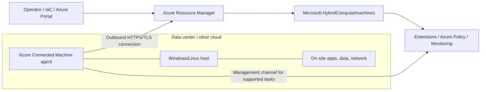
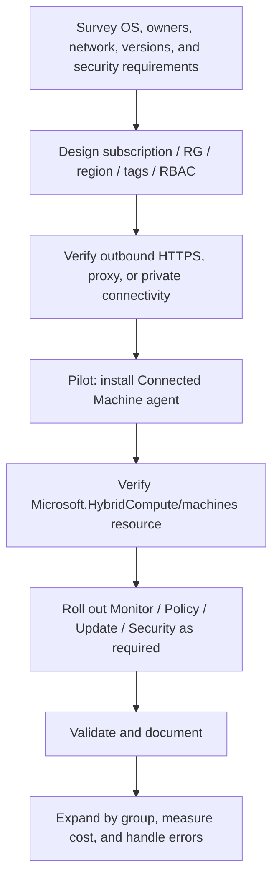
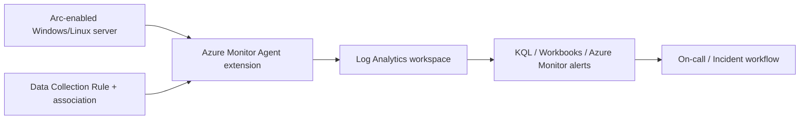

# Azure Arc-Enabled Servers and Governing Non-Azure Servers

## 1. The Hybrid Cloud Challenge and Learning Objectives

In the **Hybrid Cloud and Migration to Azure** chapter of the **CLOUD_PROVIDERS_AZURE** module, we explore how enterprises manage an architecture spanning Azure and systems running outside Azure. Skills across subscriptions, resource groups, Microsoft Entra ID, networking, compute, storage, data, monitoring, security, and cost control remain essential, yet not every server can or should move into Azure immediately.

For example, an enterprise operates:

- A **Windows Server** running an accounting application in an on-premises data center.
- Two **Linux** servers running API services on VMware infrastructure.
- A test VM running on another cloud provider.

Operations wants centralized inventory, consistent tagging, configuration compliance tracking, monitoring rollout, and patch management **without migrating the OS or application into Azure**. **Azure Arc-enabled Servers** addresses much of this governance need by projecting Windows/Linux servers outside Azure into the **Azure control plane** as Azure resources.

After this lesson, you will be able to:

1. Distinguish **Azure Arc-enabled** servers from Azure VMs and from server migration services.
2. Describe the roles of the **Azure Connected Machine agent**, the `Microsoft.HybridCompute` resource provider, and Azure connectivity.
3. Plan onboarding for on-premises, VMware, or multi-cloud servers, covering prerequisites, networking, permissions, and security.
4. Verify connection status, build inventories via the Azure Portal and Azure Resource Graph, and use tags/resource groups properly.
5. Integrate Azure Policy/Machine Configuration, Azure Monitor Agent, Azure Update Manager, and Microsoft Defender for Cloud within supported scope.
6. Build auditable operating procedures for disconnected machines, agent updates, offboarding, and cost control.
7. Practice designing governance for non-Azure servers while understanding Azure Arc's technical boundaries.

**Scope:** Windows/Linux servers Arc-enabled via the Connected Machine agent. Server names, resource groups, subscriptions, and regions in this lesson are illustrative examples; installing the agent in practice requires OS admin privileges and system owner approval.

## 2. What Azure Arc-Enabled Servers Is—and Is Not

Azure Arc-enabled Servers registers **physical or virtual Windows/Linux servers running outside Azure** into Azure Resource Manager. Once onboarded, a machine appears in the Azure Portal as a `Microsoft.HybridCompute/machines` resource with a resource ID, subscription, resource group, tags, connection status, and supported management capabilities.

| Question | Azure Arc-Enabled Servers | Azure Virtual Machines |
| --- | --- | --- |
| Where is the server running? | On-premises, VMware, another cloud, or supported environment outside Azure | Compute provisioned and operated by Azure |
| Who manages the host/hypervisor? | Current system owner or hosting provider | Azure manages physical infrastructure; user manages guest OS |
| Must data/OS move to Azure? | **No** | Typically requires deploying or migrating workloads to Azure |
| Resource type in ARM | `Microsoft.HybridCompute/machines` | `Microsoft.Compute/virtualMachines` |
| Can Azure tags, RBAC, Policy apply? | Yes, within Arc-supported scope and features | Yes, with full Azure VM capabilities |
| Does it gain Azure VM PowerState/Start/Stop? | **No**; Arc does not turn an external host into an Azure VM | Provides VM control-plane power operations |
| Can supported management extensions install? | Yes, via the Arc/Connected Machine agent subject to support terms | Yes, via Azure's VM extension platform |
| Who bills the underlying compute? | Provider/team operating the server outside Azure | Azure VM billing and associated resources |

**Three misconceptions to avoid:**

1. **Arc is not a migration service.** An Arc-enabled server continues running where it lives; storage, IPs, domain membership, OS, hypervisor, and app networking do not move to Azure automatically.
2. **Arc is not default remote desktop/SSH.** Registering a resource does not open inbound ports or create OS admin accounts. Remote access features, if used, require separate supported mechanisms, permissions, and configuration.
3. **Arc is not one single tool for every machine class.** Azure Arc-enabled Kubernetes, Arc-enabled VMware vSphere, and Arc-enabled Servers are distinct capability sets. This lesson covers only **servers onboarded via the Connected Machine agent**.

## 3. How It Works: Azure Control Plane, Workloads on Site



Key parts:

- **Windows/Linux server:** keeps running apps and data at its original location, operated by the OS/network team or host cloud provider.
- **Azure Connected Machine agent:** software installed on the host establishing identity/connectivity to Azure, sending metadata/heartbeats, and enabling supported management features.
- **Azure Resource Manager (ARM):** where operators inspect resources, apply tags, enforce Azure RBAC, and manage centralized policies.
- **Azure service extensions/agents:** as needed, deploy Azure Monitor Agent, Machine Configuration/Policy extension, or supported security/inventory extensions.
- **Microsoft Entra ID identity:** handles registration and resource authentication; paired with Azure RBAC, it controls who can act on the Azure resource.

A server can report **Connected** while its application is broken; conversely, it can keep serving its application if the agent link to Azure drops and Arc status shows **Disconnected**. Arc connection state **never replaces** OS health checks, app monitoring, or data recovery validation.

### 3.1. The Arc Resource's Azure Location Differs from Physical Host Location

During onboarding, you select a supported **Azure region** to store Arc management metadata/resources. The Arc resource's `location` field indicates the Azure control-plane resource location—**it does not mean** the physical host sits in that region.

For example, a server located in Hanoi can be registered as an Arc resource with `location=southeastasia` if governance design and service availability permit. The organization must still evaluate metadata storage, residency, data governance, and network policies.

## 4. When Should You Deploy Azure Arc-Enabled Servers?

Good-fit scenarios:

- **Hybrid inventory:** standardize server inventory by subscription/resource group/tags and query across environments.
- **Configuration governance:** evaluate OS baselines and compliance via Azure Policy/Machine Configuration for supported OSes and scenarios.
- **Centralized monitoring:** deploy Azure Monitor Agent on Arc hosts and use Data Collection Rules to route telemetry to Log Analytics.
- **Patch management:** assess and schedule patching with Azure Update Manager when hosts/OSes meet prerequisites.
- **Security:** enable supported Microsoft Defender for Cloud/Defender for Servers capabilities for risk assessment and threat detection.
- **Multi-team governance:** delegate RBAC by subscription/resource group, audit changes, and enforce cost/ownership tags.

Scenarios **not solved by Arc alone**:

- Migrating VMs or databases intact from on-premises into Azure.
- Provisioning private network paths from hosts to Azure resources; VPN/ExpressRoute or dedicated connectivity is still needed when workloads require it.
- Replacing hypervisors, Active Directory, backup tools, HA/DR, or local firewalls.
- Providing **Azure Compute VM** start/stop/resize control over non-Azure machines.
- Guaranteeing an OS is patched or secure just because the agent is installed and Connected.

## 5. Sample Enterprise Deployment Architecture

Suppose an organization governs 100 servers across three groups:

| Machine Group | Runtime Environment | Azure Management Group | Example Tags | Priority |
| --- | --- | --- | --- | --- |
| `onprem-fin-01` | Windows Server in data center | `rg-arc-prod` | `environment=prod`, `owner=finance` | Security, update compliance, change control |
| `vmware-api-01` | Linux VM on VMware | `rg-arc-prod` | `environment=prod`, `owner=platform` | Monitoring, machine baseline |
| `cloud-test-01` | Linux in another cloud | `rg-arc-nonprod` | `environment=test`, `owner=app-team` | Inventory, patch scheduling, cost control |

**Resource groups do not have to mirror on-premises network topology.** They are Azure management scopes. Structure subscriptions/resource groups by owner, environment, permission boundary, compliance scope, and chargeback model while keeping naming and tags consistent.

A sound onboarding rollout starts with a **small pilot**, validates dependencies, and scales incrementally:



## 6. Prerequisites Before Connecting Machines

### 6.1. Verify OS, Host, and Local Privileges

- Host runs a **Windows Server/Linux release supported by the Connected Machine agent**; check exact distribution, kernel/OS version, CPU architecture, and support lifecycle in current docs.
- Hold appropriate **local administrator/root** privileges to install the agent and manage host services.
- Machine has working network/DNS paths and accurate system clock synchronization for TLS/token validation.
- Antivirus, EDR, firewalls, proxies, and software installation policies permit the agent/extensions to run.
- If using a proxy, configure it properly for both the agent and each extension; never assume every extension inherits proxy settings identically.
- Establish owner, CMDB/inventory entry, and test/rollback plan in case installing the agent affects the OS.

### 6.2. Verify Azure Tenant, Subscription, Resource Group, and Region

- Active subscription and target resource group exist or are created by an authorized identity.
- Required resource providers (especially `Microsoft.HybridCompute` and providers for add-on services) can be registered as needed.
- The onboarding user or service principal has proper **Azure RBAC** to create/register Arc-enabled server resources at the target scope. A dedicated Arc onboarding role is preferable to subscription-wide Contributor.
- Selected Azure region supports Azure Arc-enabled Servers and meets residency/audit rules.
- Resource naming, tagging, environment, owner, cost center, and extension approval policies are defined.

### 6.3. Verify Networking and Endpoints

The Connected Machine agent normally **initiates outbound HTTPS on TCP 443** to Azure endpoints. Inbound RDP/SSH from the Internet is never required for basic Arc registration and operation. Before onboarding, check:

1. DNS resolution and reachability to Microsoft Entra ID, Azure Resource Manager, and required Arc endpoints.
2. TLS 1.2 or higher, time sync, trusted root certificates, proxy/firewall rules, and compatible TLS inspection policies.
3. If using **Azure Arc Private Link Scope**, verify Private Endpoint, private DNS, routing, regional/scope support, and **ancillary endpoints that still need separate handling**. Private Link does not automatically route every Azure dependency privately.
4. Azure Monitor Agent, Defender, Update Manager, or other extensions carry **their own endpoint lists and network prerequisites**; allowlist only what is actually needed.
5. Prepare an operating plan for Internet outages, proxy failures, or private DNS issues without conflating Arc disconnect with application downtime.

**Security principle:** never disable TLS verification or open all outbound/inbound traffic just to “make a test work.” Use official endpoint allowlists in coordination with network/security teams.

## 7. Onboarding a Server via Azure Portal: Step-by-Step

This walkthrough assumes **a server approved by its owner**; it does not instruct installing agents on a learner's personal workstation.

### 7.1. Preparation in Azure Portal

1. Select the subscription, management resource group such as `rg-arc-nonprod`, and a supported Azure region.
2. Open **Azure Arc → Machines → Add/Create** (exact menu wording may vary).
3. Choose single-server or multi-server onboarding. For a manual pilot, generate the appropriate **onboarding script** for Windows/Linux.
4. Select OS, subscription, resource group, region, connectivity/proxy mode, and tags.
5. Choose the policy-approved auth mechanism: interactive admin login or a **dedicated onboarding service principal** with tightly scoped permissions and protected secrets. Prefer identities without long-lived secrets where supported.
6. Review the Portal-generated script: agent download source, tenant, resource group, location, network flags, and requested permissions.

**Never paste onboarding scripts containing credentials or tokens into Git, public tickets, group chats, or study notes.** Service principal secrets (where actually required) must be stored and transferred via a secure secret manager, given short lifetimes, and revoked once onboarding finishes.

### 7.2. Execution on the Non-Azure Machine

1. Sign in to the host via an approved internal admin channel with software installation privileges.
2. Confirm the host has the expected hostname/OS and is not already onboarded elsewhere; check network/proxy settings.
3. Run the **Azure Portal-generated script** from a trusted source per OS instructions.
4. Monitor installation of the **Azure Connected Machine agent** and resource registration. On failure, preserve logs rather than retrying multiple scripts across different tenants/resource groups.
5. On the host, run the agent's status/diagnostic command to verify:

```bash
# The command below only reads Azure Connected Machine agent status.
azcmagent show
```

`azcmagent` is installed on the machine alongside the agent. Executable path and required privileges may differ across Windows/Linux; run from an appropriate shell. Inspect subscription, resource group, tenant, resource name, and **Agent Status** in actual agent output.

6. In the Azure Portal, open **Azure Arc → Machines** and confirm the new resource appears with expected connection status, correct subscription/resource group, and tags. Allow a moment for status sync right after onboarding.
7. Cross-check against CMDB/resource ID, owner, timestamp, and OS; archive pilot evidence.

### 7.3. Understanding the Onboarding Parameters—Do Not Copy Blindly

Once the agent is installed, registration typically supplies parameters such as those below. **Exact syntax and authentication flow must come from the Azure-generated script for your environment**—never copy a snippet lacking authentication context:

```text
TenantId         = <MICROSOFT_ENTRA_TENANT_ID>
SubscriptionId   = <AZURE_SUBSCRIPTION_ID>
ResourceGroup    = rg-arc-nonprod
AzureRegion      = <SUPPORTED_ARC_RESOURCE_REGION>
MachineName      = <AGREED_RESOURCE_NAME>
Authentication   = <INTERACTIVE_OR_APPROVED_ONBOARDING_PRINCIPAL>
```

This is a **descriptive parameter table**, not an executable command. For bulk onboarding, add secret protection, unique naming, tagging, bounded retries, and connected-state verification.

## 8. Verifying the Arc Resource and Investigating Disconnected Status

### 8.1. Checking on Host and in Azure

Compare two sources of truth:

- **On the host:** `azcmagent show`, agent service health, platform/version log files, and agent connectivity diagnostics such as `azcmagent check` where supported.
- **In Azure:** the `Microsoft.HybridCompute/machines` resource, `status`, identity, extensions, and Activity Log.

To list via Azure CLI (requires subscription read permission), run general ARM queries:

```bash
az login
az account set --subscription "<SUBSCRIPTION_ID>"

az resource list \
  --resource-group "rg-arc-nonprod" \
  --resource-type "Microsoft.HybridCompute/machines" \
  --query "[].{name:name,id:id,location:location}" \
  --output table
```

**Note:** This command only lists resources present in ARM. It does not prove the host is healthy, applications are running, or Azure Monitor/Policy are configured.

### 8.2. Azure Resource Graph: Multi-Subscription Inventory

Read-only **example query** for Resource Graph Explorer with appropriate permissions:

```kusto
Resources
| where type =~ 'microsoft.hybridcompute/machines'
| extend arcStatus = tostring(properties.status),
         osName = tostring(properties.osName),
         osVersion = tostring(properties.osVersion)
| project name, id, subscriptionId, resourceGroup,
          location, arcStatus, osName, osVersion, tags
| order by resourceGroup asc, name asc
```

`properties.status` and OS fields may vary across API/inventory versions; if empty, check status in the Azure Portal/Resource API and agent-reported data. Resource Graph reflects management state **at a point in time**; it does not replace application heartbeats or OS metrics.

Example triage guide:

| Signal | Action |
| --- | --- |
| Resource `Connected` | Verify Monitor/Policy/Update/Defender independently |
| `Disconnected` after proxy change | Check DNS, outbound access, certificates/TLS, agent service |
| Resource missing from group | Check subscription/tenant, RBAC, region, and whether script completed |
| Resource exists after host agent uninstalled | Follow lifecycle/offboarding process; avoid deleting audit data prematurely |
| Two resources for one host | Coordinate with owner to clean duplicate registration carefully |
| Missing monitoring heartbeat while Arc Connected | Inspect Azure Monitor Agent, DCRs, and Log Analytics endpoints separately |

### 8.3. Distinguishing Three Types of “Health”

| State | Verification Source | What It **Cannot** Conclude |
| --- | --- | --- |
| **Arc connection** | Connected Machine agent and HybridCompute resource | Does not guarantee app or DB health |
| **Monitoring telemetry** | Azure Monitor Agent, Data Collection Rules, workspace, ingested rows | Does not prove Arc/RBAC/Policy are compliant |
| **Business availability** | Synthetic tests, SLOs, user journeys, DB transactions, networking | Does not prove the agent can receive management configs |

Only when all three layers pass operating thresholds should service and governance both be declared healthy.

## 9. Centralized Governance with Azure Policy and Machine Configuration

Azure Policy can evaluate Azure Arc-enabled Servers by **scope** and supported policy definitions. **Azure Machine Configuration** (formerly called Guest Configuration in older docs/tools) audits in-guest OS settings for Arc machines on supported releases and OSes.

For example, security might verify:

- Every host carries an owner/environment tag and active monitoring.
- OS baselines: password policies, service/security settings, and supported audit rules.
- Required monitoring/management extensions are installed per policy.
- Arc resources carry required tags, locations, and belong to expected management groups.

**Do not equate policy assignment with remediation:** an `audit` policy only flags noncompliance; `deny` blocks matching ARM requests, yet cannot block every **local OS** change on a non-Azure host. Effects like `deployIfNotExists` or `modify` require managed identities/roles and specific prerequisites. Compliance scans can also lag.

### 9.1. Controlled Policy Rollout Workflow

1. Identify targets: Arc-enabled Windows/Linux, exact OS versions, and Machine Configuration support.
2. Pick a proven Azure Policy definition/initiative and assign it at the right resource group or management scope.
3. Review effect, parameters, exclusions/exemptions, and potential host impact.
4. Start in **audit/evaluation** mode for a pilot; investigate false positives and prerequisites.
5. If deploying extensions/remediation, check assignment identity permissions and host impact.
6. Inspect compliance state after an evaluation cycle, separating **Not started/Unknown** from **Compliant**.
7. Record noncompliance owners, remediation deadlines, and time-bound exemptions.

**Example:** a policy requires a monitoring extension across Arc-enabled Servers, but a host is powered down for maintenance. The resource may report noncompliant or unassessed due to disconnect rather than missing configuration.

## 10. Azure Monitor: Deploying the Agent, DCRs, and Verifying Data

**Azure Monitor Agent (AMA)** can be deployed to Arc-enabled Servers via a supported extension to collect OS/log telemetry defined by **Data Collection Rules (DCRs)** and Data Collection Rule Associations (DCRAs). Depending on data type, destinations include Log Analytics workspaces and corresponding endpoints.



### 10.1. Step-by-Step Deployment

1. Pick workspace, region, retention, RBAC, and network transport—especially for hosts on private networks.
2. Confirm the Arc resource is **Connected** and the OS supports AMA/extensions.
3. Deploy the AMA extension via Azure Portal, ARM/IaC, or policy per approved process.
4. Create a **DCR** collecting only required metrics/logs (e.g., Windows Event Logs, Syslog, performance counters); avoid ingesting noisy unnecessary logs.
5. Create associations linking the DCR to exact Arc-enabled machines.
6. Verify extension provisioning status, heartbeats, and live records in Log Analytics.
7. Configure alerts for missing host telemetry, app errors, or threshold breaches.

**Having the AMA extension installed does not guarantee data arrives:** the DCR might lack an association, network paths may block ingest, the workspace may be wrong, or streams may be unselected. Always verify recent timestamps in the workspace before declaring monitoring healthy.

Sample Log Analytics query to check latest heartbeats (subject to table collection and workspace permissions):

```kusto
Heartbeat
| summarize LastSeen = max(TimeGenerated) by Computer
| extend MinutesSinceLastSeen = datetime_diff('minute', now(), LastSeen)
| order by MinutesSinceLastSeen desc
```

This query inspects only the `Heartbeat` table. Missing rows can indicate unconfigured ingestion, missing agents, or pipeline failure—not necessarily a powered-off OS. Scope alerts to your authoritative host inventory and time window rather than assuming every machine emits identical heartbeats.

## 11. Patch Management with Azure Update Manager

**Azure Update Manager** assesses and orchestrates OS patching for Azure VMs and Arc-enabled Servers across supported scenarios and OSes. For external hosts, verify agent/extension requirements, guest admin rights, network reachability to patch repositories, and organizational maintenance windows.

Standard operational workflow:

1. **Inventory and grouping:** OS, owner, environment, criticality, uptime needs, and reboot tolerance.
2. **Assessment:** inspect missing patches and last scan status. `Disconnected` machines will show stale assessment data.
3. **Maintenance configuration:** configure schedules per group, timezone, recurrence, update classifications, and reboot behavior.
4. **Pilot:** patch a non-critical group first; verify applications and rollback/restore readiness.
5. **Broad rollout:** require approvals per tier; stagger by rings/canaries to limit blast radius.
6. **Verification:** check patch results, reboots, OS version, service health, backups/monitoring, and non-compliant holdouts.
7. **Reporting:** track owners, deadlines, time-bound exemptions, open vulnerabilities, and remediation progress.

**Important:** Update Manager does not replace every update source or automatically provide network access to patch repos. For Windows, account for WSUS/Windows Update policies; for Linux, ensure package managers, repos/mirrors, and OS privileges work. Machines still need backups, rollback plans, and availability protection.

**Distinguish from legacy tooling:** avoid building new designs on deprecated **Azure Automation Update Management** guides; follow current Azure Update Manager documentation for Arc hosts.

## 12. Microsoft Defender for Cloud and Securing Arc Servers

**Microsoft Defender for Cloud** extends security posture assessments and workload protection to Azure Arc-enabled Servers under supported plans/features, such as Defender for Servers options. Individual capabilities may require specific agents/extensions, configs, permissions, or licenses.

Defense-in-depth responsibility layout:

| Layer | Controls | Responsible Team |
| --- | --- | --- |
| On-prem / other cloud | OS hardening, existing EDR, firewalls, backups, host IAM | Infrastructure and security teams |
| Arc control plane | RBAC, tags, policies, resource locks, Azure Activity Log | Cloud platform / governance |
| Monitoring | AMA, DCRs, workspaces, alerts, log retention audits | SRE / operations |
| Defender | Supported workload protection plans, security recommendations | Security operations |
| Patching | Update Manager and verification schedules | OS owner / patch manager |
| App / data | Secrets, encryption, network ACLs, database audits, DR | App / data owner |

**Never equate Arc connection with security:** a Connected Arc server can still be unpatched, missing security extensions, or exposed internally. Proactively enable and audit required security controls.

## 13. Identity, Permissions, and Governance Responsibilities

### 13.1. Distinct Identities

- **Onboarding identity:** administrator or service principal authorized to register Arc resources in the target subscription/resource group.
- **Arc machine identity post-onboarding:** an Arc resource can use a managed identity for compatible scenarios—which does not grant OS Administrator/root rights.
- **Azure management identity:** admins/pipelines controlling extensions, Azure Policy, Monitor, or Update Manager via Azure RBAC.
- **Local OS identity:** local accounts, domain users, sudoers, and host authorization remain managed by the organization.

The `Azure Connected Machine Onboarding` role is tailored for registering Arc machines; managing resources, extensions, or monitoring may require different permissions. Always check exact required scope/actions and current role definitions. **Never assign subscription-wide Owner just to get an agent connected.**

### 13.2. Limiting Blast Radius

If one onboarding identity or service principal holds overly broad permissions across 100 servers, a mistake or leaked secret impacts the entire fleet. Recommendations:

1. Separate resource groups by production/nonproduction, team, and compliance boundary.
2. Scope onboarding permissions tightly with expiration dates on credentials where secrets are used.
3. Separate who can **register servers** from who can **deploy extensions, edit policies, and read monitoring data** where required by process.
4. Enforce MFA/Conditional Access/PIM for operators where feasible; use secretless identities for automation where supported.
5. Govern host root/admin rights; Azure RBAC never replaces local OS privilege controls.
6. Retain Activity Logs, diagnostic logs, and deployment/extension audit trails.
7. Periodically audit permissions, exemptions, stale disconnected hosts, and ownerless resources.

## 14. Agent Lifecycle, Extensions, and Offboarding

### 14.1. Version and Change Management

Keep the Connected Machine agent and extensions compatible with host OSes and Azure services:

- Track agent versions, OS support lifecycles, and update advisories.
- Test upgrades on a pilot group first; avoid upgrading every critical server simultaneously.
- Ensure proxy/private DNS/endpoint changes do not sever outbound Azure connectivity.
- Post-change checks: `azcmagent show`, Connected resource status, extension provisioning states, AMA ingestion, policy evaluation, and application health.
- Alert on agent uninstallation, certificate/auth failures, failed extensions, or prolonged disconnects.

Do not install new extensions just because they appear in the Portal; every extension executes host code, consumes CPU/memory, generates egress, and may add cost.

### 14.2. Safe Offboarding

When a machine is retired, moved to another tenant, or leaves Azure Arc scope, follow an **offboarding runbook**:

1. Confirm exact physical/virtual host, resource ID, subscription, owner, and change approval.
2. Check monitoring data, compliance history, patch records, Defender findings, and retention obligations.
3. Remove dependent extensions/associations as required; never delete application data inadvertently.
4. Run the **agent disconnect/uninstall** steps matching the OS, privileges, and agent version; verify clean removal on the host.
5. Delete the Arc resource in Azure once approved; clean up stale role assignments, alerts, dashboards, policies, or automation referencing the old ID.
6. Update the CMDB and revoke associated onboarding credentials if no longer needed.

**Never delete only the Arc resource in Azure and assume the host agent was uninstalled**, or vice versa. Both sides of the lifecycle must be reconciled; if a host is offline, plan cleanup for orphaned state if it ever reconnects.

## 15. Costs: Arc Control Plane and Add-On Services

Azure Arc-enabled Servers brings Azure management capabilities to external hosts, yet **never converts an external server's compute bill into an Azure VM bill**.

Relevant cost drivers:

| Component | What to Evaluate |
| --- | --- |
| Azure Arc-enabled Servers core registration | Check current pricing for core control-plane features and regions; basic capabilities may carry no separate Arc fee |
| Azure Monitor / Log Analytics | Ingestion, retention, query/alert charges, and network data transfer |
| Azure Update Manager | Feature pricing/entitlements for Arc machines per supported program or license model |
| Microsoft Defender for Servers | Plan tiers, pricing, and add-on security extensions/services |
| Azure Policy Machine Configuration | Pricing/licensing terms if applicable per feature/entitlement |
| Private Link / networking | Private endpoints, DNS, VPN/ExpressRoute, outbound data transfer, and related services |
| Underlying host infra | Compute, storage, OS licensing, networking, and backups remain billed by the existing host operator |

**Never assume a single flat unit price across all hosts, regions, or plans.** Consult the **Azure Pricing Calculator**, official pricing pages, organizational entitlements, and Cost Management data per scope. Connecting a machine to Arc does not incur monitoring or security charges until those services are enabled—budget them explicitly.

### 15.1. Balancing Operational Value and Cost

Suppose an enterprise governs 100 servers across multiple sites. Value comes from faster inventory, standardized patching, and broader monitoring/security coverage—while costs can balloon if verbose logs are ingested from all 100 servers, retention is set too long, or an oversized Defender plan is chosen.

Track KPIs:

- Percentage of targeted servers actually Connected with confirmed owners.
- Percentage of servers with compliant tags, RBAC, and policy baselines.
- Heartbeat/telemetry latency, extension error count, and agent recovery time.
- Patch compliance rate by OS/criticality tier and aging exceptions.
- Monthly Azure monitoring/security/update cost per server.
- Number of workload incidents caused by agents/extensions/updates and time to recover.

## 16. Troubleshooting Common Issues

| Symptom | Possible Cause | Triage Direction |
| --- | --- | --- |
| Agent installs but fails to connect | Cannot reach Entra/ARM/Arc endpoints, DNS/proxy/firewall/TLS, or wrong tenant/subscription | Check endpoint allowlists, system clock, agent logs, and registration parameters |
| Resource absent from Azure Portal | Incomplete registration, wrong scope/region, missing read RBAC, or unregistered provider | Check subscription/RG, ARM Activity Log, permissions, and agent output |
| `AuthorizationFailed` / HTTP 403 | Onboarding principal lacks required actions on target resource group | Inspect principal, role assignment, and scope; do not blindly grant Owner |
| Agent Disconnected while app runs | Outbound path lost, proxy changed, agent service stopped, or host offline | Check OS service, network, certs/TLS, version, and last-seen time |
| Duplicate resource / renamed host | Repeated registration with new name or mismatched resource ID | Reconcile host identity/CMDB and run approved cleanup |
| Extension install fails | Unsupported OS, missing runtime/dependency, local perms, or blocked extension endpoint | Read extension provisioning errors, agent logs, and network matrix |
| Azure Policy shows NonCompliant | Unmet rule, delayed audit scan, or Machine Configuration not ready | Inspect definition, assignment, effect, exemptions, and agent data |
| Arc Connected yet zero AMA logs | Missing AMA/DCR association, blocked workspace endpoint, or unconfigured stream | Check extension, DCR, destination, workspace, and live ingestion |
| Update Manager shows stale scan | Host offline, unhealthy extension, or broken OS update source | Check Arc link, patch agent, OS repo/WSUS, and maintenance config |
| Host slows down after extension | Agent/module CPU/disk overhead or overly broad collection config | Compare baseline, narrow scope, apply controlled change/rollback |
| Agent healthy yet remote RDP/SSH fails | Arc connection does not open remote network access automatically | Check networking and dedicated remote access setup |
| Azure Cost Management spikes post-onboarding | Log ingestion, Defender/Update/Policy plans, or new network services | Break down charges by service/plan; review telemetry scope and retention |

**Troubleshooting discipline:** identify host, resource ID, OS, agent version, and exact failure point; classify into **onboarding/auth**, **network**, **Arc agent**, **extension/service**, or **application workload**. Never disable TLS inspection, turn off antivirus, or grant subscription-wide Owner as an unverified shortcut.

## 17. Practice Exercise: Onboarding and Governing Three Non-Azure Machines

**Scenario:** IT has one on-premises Windows Server, one Linux VM on VMware, and one Linux VM on another cloud. The goal is to bring all three into Azure inventory and apply governance without disrupting running apps.

### Phase A — Design

1. Pick subscription, `rg-arc-nonprod` for pilot, management Azure region, and tags `owner`, `environment`, `costCenter`, `datacenter`.
2. Tabulate OS version/architecture, patch window, agent support, network route, proxy, and local admin/root owners per host.
3. Design RBAC: tightly scoped onboarding identity; separate monitoring/update/security operators; OS admins do not become Azure Owners.
4. Assess outbound HTTPS 443 endpoints, DNS, TLS, and Private Link needs if the enterprise mandates private networking.
5. Define pilot success baseline: Connected + accurate resource ID + tags + zero application impact.

### Phase B — Single-Machine Pilot

1. Generate an onboarding script in the Azure Portal under the approved subscription/RG/region; inspect script and auth method.
2. Install the Connected Machine agent on an **authorized lab host** and run the script; never commit credentials to a repo.
3. Verify `azcmagent show` on host; open Arc Machines in the Portal and confirm Connected status, tenant, resource group, and tags.
4. Run the Resource Graph query from Section 8; verify the resource appears. Record hostname and Azure resource ID in internal inventory.
5. If anything fails, gather diagnostics, network checks, and Activity Logs; classify per Section 16 before retrying.

### Phase C — Expand Governance Capabilities

1. Pick **one** capability such as OS log collection: deploy AMA, DCR, and association, and confirm rows in Log Analytics.
2. Assign an audit-only Azure Policy/Machine Configuration suitable for the host; wait for evaluation and review compliance plus finding owners.
3. Evaluate onboarding a test group to Azure Update Manager: verify patch repos, maintenance windows, and rollback plan.
4. If Microsoft Defender for Servers is required, review licensing/pricing, plans, and prerequisites before fleet-wide enablement.
5. Measure CPU/memory/network overhead on the host after deploying extensions.

### Phase D — Operations and Reporting

1. Build dashboards/lists tracking Arc connection, monitoring telemetry, and patch compliance without conflating the three health layers.
2. Define alerting and ownership workflows for Disconnected agents with resolution SLAs.
3. Estimate Monitor/Update/Defender and networking costs for 3 hosts and extrapolate to 100 hosts.
4. Write an offboarding checklist to uninstall the agent and delete the Azure resource under change control at end-of-life.

**Passing criteria:** documented topology and permissions, evidence of Connected agent, accurate metadata/resource IDs, one verified governance service working, a Disconnected-agent runbook, and a cost estimate. Without an authorized host/subscription, document steps and expected outputs on paper; **never run agent onboarding scripts on production servers**.

## 18. Self-Check Questions

**1. After Azure Arc-enabling an on-premises Linux VM, does it become an Azure VM?**  
No. The machine keeps running on its existing infrastructure. Azure only manages a projected resource and supported management capabilities via the agent.

**2. Why does `location=southeastasia` in the Azure Portal not prove the physical server sits in Singapore?**  
That is the Azure region storing the Arc control-plane resource, not the physical location of the host.

**3. Does an Arc Connected status prove the application and Log Analytics are healthy?**  
No. You must separately verify application SLIs/SLOs and AMA/DCR ingestion. Arc connection represents only one governance layer.

**4. Does onboarding the agent require opening inbound RDP/SSH from the Internet?**  
Not for basic registration. The agent initiates outbound HTTPS/TLS to supported Azure endpoints; remote access is a separate requirement.

**5. Why can the Reader role on a resource group be insufficient for onboarding?**  
Onboarding creates/registers an Arc resource, requiring appropriate write actions. Use a scoped onboarding role instead of granting subscription-wide Owner.

**6. If Azure Policy flags Machine Configuration as NonCompliant, does that mean the policy automatically modified the OS?**  
No. Evaluation/audit and remediation are distinct; remediation requires the right effect, identity, extension, supported OS, and approval process.

**7. An Arc host shows zero AMA logs despite reporting Connected. What should you check first?**  
AMA extension, DCR association, target workspace, network/endpoints, and actual ingestion records. The Arc agent and AMA are distinct layers.

**8. Does deleting the Arc resource in Azure delete the physical server or uninstall the agent software?**  
No. You need a two-sided offboarding process covering both the host/agent and the Azure resource, with owner approval and auditing.

**9. Can enabling Defender/Update/Monitor across the entire fleet increase costs?**  
Yes. Add-on services have separate plans, ingestion volumes, licensing, and retention charges; verify pricing and actual spend.

## 19. Official References

- Microsoft Learn — **Azure Arc-enabled Servers overview**: scope, architecture, and management capabilities.
- Microsoft Learn — **Prerequisites for Azure Arc-enabled Servers** and **Connected Machine agent requirements**: OS, networking, TLS, proxy, and RBAC.
- Microsoft Learn — **Connect hybrid machines to Azure from the Azure portal** and **Azure Connected Machine agent CLI reference**.
- Microsoft Learn — **Azure Arc Private Link Scope / network requirements** when using private connectivity.
- Microsoft Learn — **Azure Policy Machine Configuration** and policies applicable to Arc-enabled Servers.
- Microsoft Learn — **Azure Monitor Agent on Azure Arc-enabled Servers**, **Data Collection Rules**, and **Log Analytics**.
- Microsoft Learn — **Azure Update Manager overview** for Azure VMs and Arc-enabled Servers.
- Microsoft Learn — **Microsoft Defender for Servers** and **Microsoft Defender for Cloud pricing**.
- Microsoft Learn — **Azure Arc-enabled Servers pricing** and **Azure Well-Architected Framework** on Security, Operational Excellence, and Cost Optimization.

OS/region support, runtime/extension management, network endpoints, and pricing can change over time. Before production rollout, verify official documentation for your exact servers, subscriptions, clouds, Connected Machine agent version, and chosen service plans. **Azure Arc is a hybrid governance layer—not a workload migration action or a guarantee that external machines are fully secured and recoverable.**
