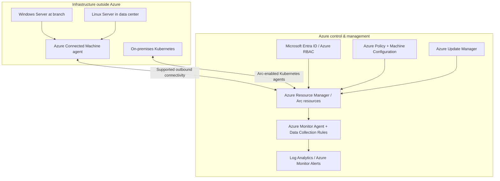
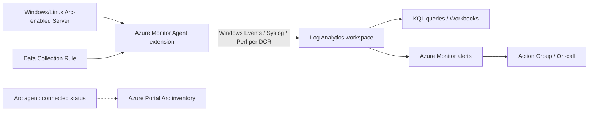
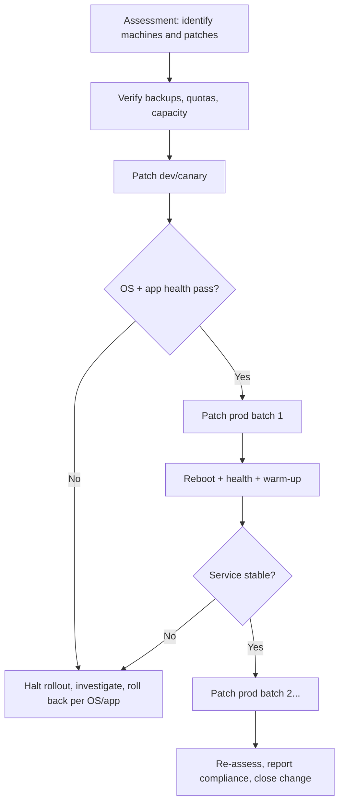

# Applying Policies, Monitoring, and Updates to Azure Arc Resources

## 1. From Hybrid Infrastructure to Unified Governance on Azure

An enterprise runs `orders-api` on Microsoft Azure, while still operating Windows and Linux servers in a private data center, servers in branch offices, and a Kubernetes cluster in a factory. Each site uses separate patching, security configuration, and monitoring tools. When operations asks **which machines lack tags, which stopped sending heartbeats, or which are overdue for patches**, manually pulling data across multiple systems is slow and error-prone.

**Azure Arc** extends select Azure governance capabilities to resources **running outside Azure**. An on-premises server connected as an **Azure Arc-enabled server** gets a projected resource in Azure Resource Manager; from there, the organization can group by subscription/resource group, apply tags, enforce Azure RBAC, evaluate Azure Policy, attach monitoring extensions, or use supported update management services. Azure Arc does not move the server into Azure and does not replace on-site management software, networking, or the OS.

This lesson belongs to the **Hybrid Cloud and Migration to Azure** chapter in the Azure ecosystem track: from subscriptions, resource groups, and Microsoft Entra ID through networking, compute, storage, data, monitoring, security, and cost control. The focus is organizing **three interlocking control loops**:

1. **Policy:** define required configuration/governance rules and report drift.
2. **Monitoring:** collect telemetry, observe machine health, and fire actionable alerts.
3. **Updates:** assess missing patches, schedule updates by ring, and verify post-maintenance health.

### Learning Objectives

After this lesson, you will be able to:

- Distinguish Azure Arc-enabled Servers, Azure Arc-enabled Kubernetes, and related management services, identifying capability limits for each.
- Establish a secure Azure Arc resource model with resource groups, tags, managed identities, extensions, and Azure RBAC.
- Apply Azure Policy to Arc resources and distinguish **Azure metadata policies** from **in-guest OS checks** via Machine Configuration.
- Use Azure Monitor Agent (AMA), Data Collection Rules (DCRs), Log Analytics, metrics, logs, and alerts to monitor Arc-enabled servers.
- Plan patch assessment/installation with Azure Update Manager by machine group, maintenance window, reboot policy, and acceptance criteria.
- Design staged rollouts, measure compliance, minimize application disruption, and analyze hybrid operating costs.
- Run a verifiable evidence-based lab without making unapproved changes to production servers.

## 2. Which Resource Types Does Azure Arc Manage?

Azure Arc is not a VM SKU. It is a suite of capabilities connecting and governing multiple resource classes:

| Resource Type | Azure Resource Representation | Core Capabilities | What Never to Assume |
| --- | --- | --- | --- |
| **Arc-enabled Servers** | e.g., resource type `Microsoft.HybridCompute/machines` | Inventory, metadata, extensions, Azure Policy, and supported monitoring/patching services | Does not convert on-prem servers to Azure VMs; creating an Azure resource does not grant guest admin rights |
| **Arc-enabled Kubernetes** | e.g., `Microsoft.Kubernetes/connectedClusters` | Cluster inventory and governance, select extensions, GitOps, and supported policy/monitoring | Never apply Windows/Linux VM Azure Update Manager workflows directly to Kubernetes nodes |
| **Arc-enabled data services** | Service-specific resources/control planes | Managing supported data services in hybrid environments | Does not equate to automatic database replication or backups |

**The main hands-on focus** of this lesson is **Arc-enabled Windows/Linux servers**, since Azure Update Manager and Azure Monitor Agent provide structured server management workflows. Arc-enabled Kubernetes is contrasted separately so extensions, policies, and node patching methods are never confused.

An Azure Arc resource existing in a subscription does not prove the source machine is online or fully protected. You must inspect agent status, extensions, policy evaluations, and live telemetry.

## 3. Azure Arc Governance Architecture



This diagram illustrates **governance relationships**, not that all telemetry flows through ARM. Azure Monitor Agent telemetry travels via separate DCR ingestion pipelines to supported Azure Monitor endpoints. Azure Update Manager coordinates assessment/patch installation on machines via the scenario's required extensions/components.

### Two-Plane Governance Model

| Plane | Data / Controls | Examples |
| --- | --- | --- |
| **Azure control plane** | Resource ID, tags, location metadata, policy assignments, RBAC, extension deployments | Audit servers missing `environment` tag; deploy AMA extension |
| **Guest OS / cluster plane** | Installed packages, Windows/Linux services, TLS settings, local accounts, kernel, update jobs | Machine missing security patches; service fails to start after reboot |

Azure Arc bridges both planes via agents/extensions and management services. **Azure Policy cannot arbitrarily modify every OS setting by default**; each built-in policy or Machine Configuration rule requires support, the right agent/extension, and proper privileges.

## 4. Real-World Context: Orders Platform Operations Team

Suppose an enterprise runs 30 servers outside Azure:

| Group | Count | Environment | Illustrative Operating Policy |
| --- | ---: | --- | --- |
| Windows API servers | 8 | `prod` | 24/7 monitoring; patch during approved maintenance windows |
| Linux workers | 10 | `prod` | Rolling batch updates to avoid simultaneous downtime |
| Windows file/application servers | 6 | `stg` | Validate patches ahead of production |
| Linux development servers | 6 | `dev` | Frequent updates, lighter permissions and alerting |

The team wants consistent `environment`, `application`, `owner`, and `patchRing` tags, verified telemetry ingestion, and ringed patching (`dev → stg → prod`). Names and counts here are **hypothetical learning figures**, not Azure service limits.

Governance targets might look like:

```text
Inventory coverage      >= 95% of in-scope machines connected to Arc
Required tags           100% of Arc resources have environment + owner
Heartbeat monitoring    Alert when a critical machine loses signal beyond threshold
Patch assessment        Fresh assessment data within approved schedule
Patch window            Adheres to change calendar with post-reboot validation
Critical patch SLA      Per internal security policy, not inferred from Azure
```

These thresholds are **organization-defined targets**. High compliance percentages do not replace checking disconnected or un-onboarded machines: the denominator must include servers **not yet visible in Azure**.

## 5. Prerequisites Before Onboarding Azure Arc-Enabled Servers

### 5.1. Supported Infrastructure and Platforms

Before registering:

1. Check that Windows/Linux OS, CPU architecture, and release appear in the **Arc-enabled Servers support matrix**.
2. Confirm machines reach Azure Arc, Microsoft Entra ID, and add-on service endpoints per current networking docs.
3. Prepare required **outbound HTTPS 443** connectivity; verify proxies, TLS inspection, DNS, firewalls, and private network paths if used.
4. Pick subscription, resource group, and **metadata region for the Arc resource** aligned with data residency. Metadata region does not alter the server's physical location.
5. Prepare privileges for operators, onboarding identities, and extensions; avoid long-lived high-privilege accounts where managed service principals or supported auth methods apply.
6. Inventory existing security agents, proxies, EDR, or patch tools on hosts to avoid conflicting update schedules.
7. Assign accountable owners for OS ops, apps, costs, and incident response.

### 5.2. Permissions That Must Be Kept Distinct

| Permission | Scope | Example |
| --- | --- | --- |
| **Azure RBAC** | Arc resources, policies, DCRs, workspaces, maintenance configs | Extension operator has access on assigned Arc resources |
| **Guest OS privilege** | Agent install, services, patching, and OS reboots | Administrator/root or delegated host management tool |
| **Data-plane / monitoring access** | View logs, metrics, or workspace data | Permission to query Log Analytics and configure alerts |
| **Billing / FinOps** | View spend and service terms | Appropriate Cost Management scope |

Never assume resource-group `Contributor` grants Linux root access or permission to read logs in every workspace.

### 5.3. Onboarding the Connected Machine Agent

The **Azure Connected Machine agent** installs on external servers and registers them as Arc resources. In most guides, the local CLI utility **`azcmagent`** inspects and manages the agent connection.

Example checks **on the machine with the agent installed**:

```bash
# Linux terminal (or equivalent command on Windows with appropriate privileges)
azcmagent show
azcmagent check
```

`show` prints connection status and agent metadata, while `check` tests connectivity to required endpoints depending on agent version. Confirm flags, endpoint lists, and output format for your deployed agent release. Never share access tokens or sensitive details from command output.

Azure Portal onboarding workflows generate tailored scripts per Windows/Linux and authentication method. **Never copy commands containing client secrets or service principal credentials into public docs**; use secure secret storage and approved onboarding flows.

## 6. Verifying Azure Arc-Connected Machines

In **Azure Portal → Azure Arc → Machines** (or current menu name), check machine name, resource group, subscription, metadata region, connection status, OS, tags, and extensions.

Read-only **Azure CLI metadata query** example after signing in and selecting the subscription:

```bash
az login
az account set --subscription "<subscription-id>"

# May require the "connectedmachine" CLI extension depending on CLI version.
az connectedmachine show \
  --resource-group "rg-arc-orders-prod" \
  --name "orders-worker-01" \
  --query "{name:name,id:id,status:status,location:location}" \
  --output json
```

CLI commands/extensions evolve with product updates; if a command is unavailable, check your Azure CLI version and official docs. Never treat a single `status: Connected` check as proof of continuous health—monitor across time.

### Tags and Inventory

Example tags:

```text
environment = prod
application = orders
owner       = platform-team
patchRing   = prod-wave-1
costCenter  = it-ops
```

Tags help filter inventory, scope policies, group maintenance waves, and allocate costs where supported. Tags **must never contain sensitive data**, credentials, PII, or secret configs; Azure resource tags are readable metadata for anyone with read permissions.

If a server stays offline for days, investigate **agent, DNS, proxy, firewall, certificates, and the source host** before assuming it remains properly governed.

## 7. Azure Policy: Definitions, Assignments, and Compliance

**Azure Policy** evaluates resources against **policy definitions** via assignments scoped to management groups, subscriptions, or resource groups. An **initiative** bundles multiple definitions to track a set of governance goals. Evaluation produces **compliant/non-compliant** states according to each policy's supported scope and effect.

| Concept | Role | Example for Arc |
| --- | --- | --- |
| Policy definition | Rule logic and effect | Audit Arc servers missing the `environment` tag |
| Policy assignment | Binds rule to a scope with optional params/exemptions | Assigned to the resource group holding Arc prod servers |
| Initiative | Group of policies | Mandatory tags, agent tracking, OS baseline |
| Policy effect | Behavior such as audit/deny/modify/deployIfNotExists when supported | Start with `audit` to measure |
| Compliance state | Evaluation output | Resource flagged for missing tag or extension |
| Remediation task | Applies fixes for policies supporting remediation | Deploy extension where policy/identity allows |
| Exemption | Controlled exception with rationale and expiration | Legacy host not yet supporting a specific extension |

**Watch effect applicability:** a definition must **support the exact resource type, aliases, and effect**. Not every Azure VM policy applies to Arc-enabled Servers. `deployIfNotExists` or `modify` may need a **policy assignment managed identity and RBAC roles** to remediate. Never turn on broad scope or auto-remediation across all production before testing impact.

### Metadata Compliance Differs from Guest Compliance

**Example A — Auditing resource tags:** Azure Policy reads metadata on `Microsoft.HybridCompute/machines` without inspecting OS registries or files to know `environment` is missing.

**Example B — Auditing in-guest configuration:** policies checking password rules, audit settings, or OS parameters require **Machine Configuration** and its corresponding extension. A Connected Arc resource does not automatically evaluate all guest settings.

**Example C — Deploying agents:** certain built-in policies deploy extensions/associations on eligible machines; verify identity, RBAC, and networking. A policy assignment cannot push extensions onto an offline host.

## 8. Hands-On: Creating a Tag-Audit Policy for Arc-Enabled Servers

To prevent unintended mutations, the first exercise uses **Audit**, not `Deny` or auto-remediation.

### 8.1. Example Policy Definition JSON

This JSON illustrates the logic to **audit Arc-enabled server resources missing the `environment` tag** in Azure Policy. It is a **structural sample** for learning policy logic; when creating a real policy, verify current API/schema, scope, and permissions.

```json
{
  "properties": {
    "displayName": "Audit Arc-enabled servers without environment tag",
    "description": "Audit the environment tag on Arc-enabled servers",
    "policyType": "Custom",
    "mode": "All",
    "metadata": {
      "category": "Tags"
    },
    "policyRule": {
      "if": {
        "allOf": [
          {
            "field": "type",
            "equals": "Microsoft.HybridCompute/machines"
          },
          {
            "field": "tags['environment']",
            "exists": "false"
          }
        ]
      },
      "then": {
        "effect": "audit"
      }
    }
  }
}
```

`mode: "All"` evaluates across resource types broadly; the `type` condition narrows it to Arc-enabled servers. `tags['environment']` inspects Azure resource metadata, not OS process environment variables.

**This policy does not add tags automatically.** To standardize tags at scale, design parameterized policies with appropriate effects and separate reviewed remediation. Never confuse an `audit` policy with auto-remediation.

### 8.2. Steps in the Portal

1. Go to **Azure Policy → Definitions** and create a custom policy in an authorized scope, or pick a built-in supporting Arc resources.
2. Go to **Assignments** and select the management group/subscription/resource group holding your test Arc servers.
3. Pick the policy, configure parameters if any, and fill in description and owner details.
4. Start with **Audit**, making zero changes to guest machines.
5. Wait for evaluation or trigger an on-demand scan where supported; inspect **Compliance** and non-compliant resources.
6. Add `environment=dev` to an authorized test machine through approved workflow; observe compliance re-evaluate.
7. Record results and verify the policy properly ignores VMs or non-Arc resources as intended.

Compliance updates may **not appear instantaneously** after editing tags due to scan cycles and reporting lag. Never assume the policy is broken before checking the last evaluation timestamp.

### 8.3. Scoping and Exemptions

If Arc servers span multiple subscriptions, centralized governance can assign policies higher up and filter via parameters/resource selectors. For legacy systems not yet ready, grant time-bound exemptions with **rationale, owner, and review date** rather than disabling policy across an entire subscription.

Crucially: **resource metadata policies only see Arc-onboarded machines**. Unconnected on-premises servers must still be tracked from CMDB/discovery into your coverage dashboard.

## 9. Machine Configuration: Auditing Settings Inside the OS

**Azure Machine Configuration** (formerly associated with *Guest Configuration*) audits supported Windows/Linux in-guest settings against supported definitions. For Azure Arc-enabled Servers, verify agent, extension, and specific policy prerequisites.

| Goal | Control Layer | Example |
| --- | --- | --- |
| Does the machine have `patchRing` tag? | Azure metadata | Tag audit policy |
| Does it have the AMA extension? | Azure resource/extension | Extension policy or inventory query |
| Does an OS setting match baseline? | Guest OS | Machine Configuration audit |
| Is the machine missing security patches? | Patch assessment | Azure Update Manager |
| Did scheduled maintenance succeed? | Update job/results | Update Manager + logs |
| Is the app healthy after reboot? | Application monitoring | Health probes, logs, and business checks |

### Steps to Design In-Guest OS Compliance

1. Pick a **built-in Machine Configuration policy** supporting your OS, Arc, and target check.
2. Verify prerequisites: Arc agent, Machine Configuration extension, outbound connectivity, identity/permissions, and OS version.
3. Assign the policy to a **canary group** first; wait for evaluation and check extension health.
4. Confirm whether the policy is audit-only or supports enforce/remediate; many OS baselines require separate remediation workflows.
5. Collect evidence, define time-bound exemptions, and assign remediation owners.
6. When OS changes are required, use approved configuration management tools and change control, then re-verify compliance.

Never assume Machine Configuration can **remediate every Linux/Windows setting**. Audit/remediation support and available definitions depend on OS, rule definition, and current capabilities. For hardening, ensure baselines remain app-compatible: altering firewalls, TLS, or password policies can break live workloads.

## 10. Arc-Enabled Kubernetes: Separate Policy and Monitoring Paths

Arc-connected Kubernetes clusters use a distinct resource type and are managed via **Kubernetes agents/extensions** rather than the Arc-enabled server Connected Machine agent. Governance capabilities include:

- **Azure Policy for Kubernetes** uses supported policy add-ons/extensions to evaluate Kubernetes constraints, typically tied to admission control and mechanisms such as OPA Gatekeeper in the service design.
- **GitOps/Flux** applies cluster/app manifests from repositories where extensions and versions are supported.
- **Container/cluster monitoring** requires configuring cluster-specific collectors, workspaces, permissions, and telemetry pipelines.
- **Cluster/node upgrades** follow the Kubernetes distribution lifecycle, node vendor tooling, and dedicated orchestration—never assume Azure Update Manager for Arc-enabled Servers upgrades entire Kubernetes clusters.

| Aspect | Arc-Enabled Server | Arc-Enabled Kubernetes |
| --- | --- | --- |
| Managed object | OS machine | Kubernetes cluster and Kubernetes objects |
| Example policies | Tags, missing extensions, OS baselines | Restrict privileged containers or require Pod labels per supported policies |
| Monitoring | AMA, DCRs, Windows Events/Syslog/Perf | Container/cluster metrics and logs per supported solution |
| Patching/updates | Windows Update / Linux package repos via Update Manager | Kubernetes/node image/OS upgrades per cluster runbook |

This table clarifies **boundaries**, not a promise that every feature runs on every distro/cluster. Verify the extension, region, and Kubernetes version support matrix before applying.

## 11. Azure Monitor for Arc-Enabled Servers: Agent, DCRs, and Workspaces

Azure Arc lets external machines be managed as Azure resources to deploy monitoring extensions. For Arc-enabled Servers, **Azure Monitor Agent (AMA)** collects supported telemetry defined in **Data Collection Rules (DCRs)** and sends it to Log Analytics or supported destinations.



### Role of Each Component

| Component | Responsibility | What It Cannot Replace |
| --- | --- | --- |
| Arc Connected Machine agent | Maintains registration and Azure governance link | Does not automatically collect app logs or all perf metrics |
| Azure Monitor Agent | Collects supported guest telemetry and ships per config | Does not enable patching |
| Data Collection Rule | Defines data sources, filters/transforms, and destinations | Not the storage workspace itself |
| DCR association | Links a DCR to eligible machines | Does not prove the agent is healthy |
| Log Analytics workspace | Stores/queries logs per data plan and retention | Not a backup store or CMDB by default |
| Azure Monitor alerts | Evaluates alert conditions and fires notifications | Does not self-heal apps without automation |

**A DCR is not the same as diagnostic settings on an Azure PaaS resource.** On Arc-enabled servers, guest OS telemetry flows through AMA and DCRs; platform signals like agent connection state come from the Azure resource/status or other monitoring channels.

### Data Worth Collecting

- **Windows:** policy-relevant System/Application event logs, CPU/memory/disk/network counters, heartbeats.
- **Linux:** Syslog facilities/severities, performance counters, and heartbeats per DCR.
- **Applications:** `orders-api` app logs need an explicit collection design (supported log stream/file collection or OpenTelemetry/Application Insights); never assume AMA reads arbitrary app log files without configuration.
- **Security:** security/audit logs carry dedicated RBAC, retention, and regulatory rules.

Ingesting excessive debug logs drives **high ingestion bills and extra local disk I/O**. Filter for high-value logs and set retention deliberately before broad rollout.

## 12. Setting Up Monitoring Step by Step

### Step 1 — Create or Select a Log Analytics Workspace

Choose a workspace meeting region/data residency, access control, retention, and budget rules. Never send unapproved test noise into a sensitive production workspace.

### Step 2 — Define Data Sources and Data Collection Rule

Create a DCR selecting the right sources: Windows Event Logs or Linux Syslog plus necessary performance counters. Pick supported streams/destinations, tune polling intervals, and avoid noisy low-value counters.

One DCR **can serve many machines sharing monitoring requirements**. Still, separating by OS or criticality prevents sending Windows rules to Linux hosts and keeps ingestion costs bounded.

### Step 3 — Deploy the AMA Extension

On target Arc-enabled Servers, deploy the AMA extension via the Portal, supported Azure Policy, or IaC/automation tools. Verify extension provisioning status and machine state.

Some setups require a **Data Collection Endpoint (DCE)** or dedicated private-link networking depending on telemetry paths. Never assume Arc, AMA, Update Manager, and workspaces share a single endpoint allowlist.

### Step 4 — Attach DCR Associations

Associate the DCR to scoped machines, verify the association, and allow time for telemetry to arrive. Across multiple subscriptions, verify DCR/workspace permissions, regions, and support limits.

### Step 5 — Query and Confirm

In Log Analytics, check for `Heartbeat`, `Event`, `Syslog`, or `Perf` rows matching the OS and DCR. Available tables/columns depend on agent type, workspace config, and current data pipeline—never blame the machine if your query targets the wrong table.

Example KQL checking recorded heartbeats:

```kusto
Heartbeat
| where TimeGenerated >= ago(2h)
| summarize LastSeen = max(TimeGenerated) by Computer, _ResourceId
| extend MinutesSinceLastSeen = datetime_diff('minute', now(), LastSeen)
| order by MinutesSinceLastSeen desc
```

This query **shows only machines that emitted a heartbeat within the last two hours**. Completely silent machines drop out of the results instead of showing `0`. To detect silent machines fleet-wide, **join against your expected inventory** of Arc resources and alert by server role rather than querying `Heartbeat` alone.

Illustrative KQL for Linux error events (applies only if the DCR actually collects Syslog):

```kusto
Syslog
| where TimeGenerated >= ago(1h)
| where SeverityLevel in ("err", "crit", "alert", "emerg")
| summarize Count = count() by Computer, Facility, SeverityLevel
| order by Count desc
```

Actual `SeverityLevel` values vary by schema/source; adjust to ingested logs. Never substitute ad-hoc queries for periodic end-to-end test alerts.

## 13. Designing Alerts: Disconnects, Resource Saturation, and Business Health

| Signal | Detected Via | Action |
| --- | --- | --- |
| Abnormal Arc connected status | Arc resource health/status, governance checks | Check machine, agent, proxy, and network path |
| Missing scheduled heartbeats | Azure Monitor logs joined with expected inventory | Check AMA, DCR, network, and OS |
| CPU/memory/disk saturation | Collected performance counters/metrics | Inspect processes, disk, capacity |
| Windows critical events | DCR-collected Event logs | Triage OS/app and escalate |
| Linux syslog errors | DCR-collected Syslog events | Investigate services and OS |
| Stale patch assessment | Azure Update Manager and audit reports | Ensure agent and update sources work |
| Failed patch maintenance | Update Manager job/results | Open incident, investigate, controlled retry |
| Unhealthy API or worker | Application telemetry / health probes | Prioritize business service recovery |

Good alerts include **resource ID, environment, owner, severity, last seen, runbook link, and routing channel**. A missing-telemetry alert does not prove the machine is off: AMA can fail while Arc remains Connected, or vice versa.

### Preventing Alert Storms

If a branch loses Internet, dozens of machines can miss heartbeats simultaneously. Configure **site/network-dependency alerting** and alert grouping/deduplication rather than paging dozens of duplicate incidents. Differentiate severity across dev, staging, and production.

## 14. Azure Update Manager: Goals and Mechanics

**Azure Update Manager** assesses update compliance and orchestrates patching across supported Azure VM and Arc-enabled server scenarios. For Arc-enabled Servers, it lets operations coordinate patching from Azure even though physical servers live elsewhere.

### Two Distinct Operations

**Periodic assessment / update checks:** identifies missing updates and applicability from OS update sources. It does not install patches.

**Patch installation:** schedules or runs selected updates on machines, potentially requiring reboots. Job-level success must still be verified against package state, reboot completion, and application health.

| Component | Role |
| --- | --- |
| Arc-connected machine | Azure object representing a governable host |
| Azure Update Manager | Patch inventory, assessment, install scheduling, and job history |
| Maintenance configuration | Defines schedule, maintenance window, and supported update settings |
| Dynamic scoping / target groups | Selects fleet subsets by subscription/resource group/tags and filters |
| OS update source | Valid Windows Update/WSUS or Linux package repositories |
| Reboot policy | Controls reboot behavior within supported options |
| Monitoring / health checks | Proves services actually recover post-patching |

**Azure Update Manager does not host all Windows/Linux patch packages itself.** Machines still need reachability to valid update sources, OS permissions, trusted repos, disk space, and safe reboot handling.

### Windows vs. Linux Nuances

Windows is often governed by Group Policy, WSUS, or local Windows Update settings. Linux depends on distribution, package managers (`apt`, `dnf`, `yum`), repositories, GPG keys, and package holds. Missing patches may indicate a broken repo or EOL OS rather than an Update Manager bug.

Before enrolling legacy OSes in automated schedules, verify the **support matrix**, update classifications, reboot handling, and licensing/Extended Security Updates eligibility where applicable.

## 15. Designing Patch Rings and Maintenance Windows

To lower risk for Orders API, define three update rings:

| Ring | Machine Group | Purpose | Example Schedule |
| --- | --- | --- | --- |
| **Ring 0 — Dev** | Lab/dev servers | Catch package conflicts and reboot issues early | Runs ahead of prod; observe 24–48 hours |
| **Ring 1 — Staging/Canary** | Staging plus 1 non-critical prod host | Validate real workload compatibility | Business owner confirms |
| **Ring 2 — Production** | Remaining servers | Roll out in batches, avoiding simultaneous outage | Approved maintenance window, HA/backups ready |

The 24–48 hour bake windows are **illustrative canary intervals**; adjust for risk appetite, business cycles, patch release cadence, and vulnerability severity.

### Patching HA Workloads Safely



Suppose `orders-api` runs 4 servers behind a load balancer. Never patch all 4 simultaneously:

1. Drain one server from the load balancer and wait for in-flight requests to finish.
2. Confirm supported backups/snapshots and recovery plans are ready.
3. Let the maintenance configuration/Update Manager patch that server on schedule.
4. Reboot if needed per runbook; verify OS, services, `GET /health`, data access, and error rate.
5. Return the server to the load balancer pool after warm-up.
6. Repeat for remaining servers; halt immediately if SLO thresholds breach.

For primary/secondary databases, quorum clusters, or failover-coordinated systems, **never apply a naive sequential server-patching loop** if vendor docs require strict ordering. Follow technology-specific runbooks with consistency and recovery checks.

## 16. Creating Maintenance Configurations and Patch Schedules

### Step 1 — Check Machine Readiness

In Azure Portal, open **Azure Update Manager** and select in-scope test Arc-enabled servers. Confirm each machine is supported, connected, assessed, and able to reach its update source.

### Step 2 — Assess Missing Updates

Run or inspect **assessment** per service workflow. Record missing update counts, classifications, metadata fetch errors, and assessment timestamp. A machine with no recent assessment **must never be counted compliant simply because the dashboard shows zero missing patches**.

### Step 3 — Define Targets and Schedule

Create a **maintenance configuration** for the supported type/scope; choose patch classifications or update selections, schedule, timezone, maintenance window duration, and reboot setting. Scope machines statically or via dynamic tag queries:

```text
environment = dev
patchRing   = ring-0
```

**Dynamic scopes automatically pull in future machines matching the tags.** Review filters, exclusions, and target previews before enabling a schedule; one mistyped tag can drag a production server into a dev patch window.

### Step 4 — Execute Inside Approved Change Windows

Get schedule approval, notify owners, and confirm backups and rollback. Never click **Install updates** ad-hoc on production servers outside approved change windows just because the Portal button exists.

### Step 5 — Verify and Document

After execution:

- Read per-machine **patch installation results**, not just overall summary counts.
- Verify whether machines rebooted, whether pending reboots remain, and whether guests are online.
- Inspect OS packages/versions/KBs and remaining missing patches after a fresh assessment.
- Run application health checks and smoke tests.
- Confirm AMA heartbeats, DCR telemetry, and alerts still work.
- Log exceptions, failed KBs/packages, owners, and retry schedules.

A control-plane `Succeeded` job **does not prove every desired patch installed** or that business services are healthy. Individual updates can be inapplicable, superseded, held, or awaiting reboot.

## 17. Local Post-Update Verification

Read-only **example commands** inside test machines after maintenance:

**Linux:**

```bash
# Adjust for actual distro and permissions.
uname -r
cat /etc/os-release
systemctl --failed
df -h
date -u
azcmagent show

# Check only services/endpoints you own.
systemctl status orders-worker --no-pager
curl -fsS --max-time 5 http://127.0.0.1:8080/health
```

**Windows PowerShell:**

```powershell
# Read-only commands inspecting machine and service state.
Get-CimInstance Win32_OperatingSystem |
  Select-Object Caption, Version, LastBootUpTime
Get-Service | Where-Object Status -eq 'Running' |
  Select-Object -First 20 Name, Status
Get-HotFix | Sort-Object InstalledOn -Descending |
  Select-Object -First 10
Get-Volume | Select-Object DriveLetter, SizeRemaining
```

`Get-HotFix` does not necessarily list all Windows update types; confirm patch compliance using Windows Update/Update Manager and OS inventory. `systemctl status orders-worker` applies only if your real app runs under that service name.

**Never run package installs, file deletions, or reboots in a lab just to generate screenshots** if the machine is not authorized for changes.

## 18. Securing Azure Arc and Separating Operational Duties

Because Azure Arc links external servers to the Azure control plane, secure both the Azure governance channel and the source OS.

### Principles

1. **Least privilege:** separate inventory readers, policy assigners, extension/DCR editors, patch approvers, and guest OS admins.
2. **Short-lived onboarding credentials:** use approved registration flows, rotation, and secure secret vaults.
3. **Minimal outbound networking:** allow only endpoints required by Arc agent, AMA, Update Manager, and active services; verify proxy and TLS behavior.
4. **Arc resource managed identity:** use where supported by features/extensions; never assume it grants local root/admin rights.
5. **Extension governance:** extensions can alter guest software or configuration; deploy only with approval, inventory tracking, and policies.
6. **Auditing:** retain Azure Activity Logs plus audit trails of policy assignments, maintenance jobs, operators/identities, and change records.
7. **Data governance:** Windows/Linux logs and app traces can carry sensitive data; bound collection, retention, query access, and sharing.

### Anti-Patterns to Avoid

| Mistake | Risk |
| --- | --- |
| Granting subscription-wide Owner to read-only Arc viewers | Excessive resource and RBAC mutation rights |
| Storing onboarding secrets in Git | Exposes resource creation/management access |
| Enabling fleet-wide policy remediation immediately | Unexpected production extension/config changes |
| Shipping all security logs to an overly permissive workspace | Data exposure and runaway costs |
| Scheduling simultaneous reboots across all API servers | Total application outage |
| Assuming Arc agent blocks malware | Lacks real EDR, hardening, and backups |
| Putting tokens, passwords, or PII in tags | Metadata readable by anyone with read permissions |

## 19. Disconnection Limits and Responsibility Boundaries

Azure Arc is a hybrid governance model relying on connectivity to Azure to receive policies/extensions and report signals. If a branch loses Internet:

- Management/assessment/extension tasks may stall or fail.
- Azure Monitor telemetry may drop depending on agent buffering and link recovery.
- Azure Policy may display **stale** results; never treat stale compliance as proof of current compliance.
- Scheduled update jobs may skip machines failing prerequisites; inspect actual per-machine results.
- On-premises apps **do not necessarily stop running just because Arc disconnects**; measure business health independently.

Separate clearly:

**Cloud governance plane:** policies, inventory, logs, patch orchestration, compliance reporting.

**Site operations plane:** local OS access, backups, update sources, LAN, domain controllers, databases, and apps. When cloud management connectivity drops, site operations still need working local runbooks.

## 20. Costs and Fleet Scaling Plans

Connecting resources to Arc and enabling management services can carry **varying pricing models**. Never assume every Arc/Update Manager/Machine Configuration/Monitoring feature is free or priced identically.

| Category | What to Check When Budgeting |
| --- | --- |
| Arc-enabled Servers resource | Current pricing terms for core connectivity per current docs |
| Azure Update Manager | Per-Arc-server pricing, exemptions/benefits if eligible, and contract terms |
| Machine Configuration | Pricing/entitlement terms per resource and feature |
| Log Analytics | GB ingested, retention, archive, queries/exports per data plan |
| Azure Monitor alerts | Rule count, evaluation frequency, and signal types |
| Defender for Servers | Plan tiers, entitlements, covered machine scope |
| Networking | Proxies, Internet/private links, egress, and related network resources |
| Operations | Engineering time for patch reviews, incident response, and app verification |

If an entitlement or security bundle alters management fees, verify **eligibility at the exact account and resource scope** rather than assuming fleet-wide zero cost.

### Simple Estimate Calculation

Suppose 30 machines each generate **0.3 GB of billable logs per day** over a 30-day month:

\[
V_{\mathrm{logs}}=30\times0.3\times30=270\ \mathrm{GB/month}
\]

Using a **purely illustrative unit rate** of 2 USD/GB ingested, ingestion equals:

\[
C_{\mathrm{ingest}}\approx270\times2=540\ \mathrm{USD/month}
\]

This is **not current Log Analytics pricing** and excludes retention, alerts, Update Manager, Machine Configuration, Defender, or free allowances/discounts. It demonstrates how increasing logging across 30 machines adds up quickly. Pull real estimates from the Azure Pricing Calculator, regional/offer price sheets, and post-deployment Azure Cost Management.

## 21. Designing Rollouts at Scale

Pushing policies, DCRs, and patch schedules to hundreds of servers simultaneously risks alert storms, log cost spikes, and support overload. Use **deployment rings** with promotion gates:

| Ring | Example Scale | Activities | Exit Criteria to Next Ring |
| --- | ---: | --- | --- |
| Pilot | 2 dev servers | Onboard, Audit tag policy, AMA + DCR, patch assessment | Agent, telemetry, queries, and cost measured |
| Canary | 3 staging servers | Test Machine Configuration, trial maintenance schedule | OS/app health and patch results pass |
| First production ring | 5 low-risk servers | Route alerts to owners, batch patching | SLOs, backups, and post-checks pass |
| Broad production | Remaining servers | Roll out policy/monitoring; ringed updates | Zero unresolved critical blockers |

### Rollout Quality KPIs

- **Arc enrollment coverage:** connected machines / total CMDB machines.
- **Policy coverage:** machines assigned the right initiative / total in-scope machines.
- **Policy compliance:** compliant machines / evaluated machines, also reporting machines lacking fresh evaluations.
- **Telemetry freshness:** percentage of machines reporting recent records in the target workspace.
- **Patch assessment freshness:** age of latest assessment and missing updates by severity/classification.
- **Patch installation success:** machines with clean patch jobs AND passing app health / total machines in batch.
- **Reboot impact:** actual downtime and business incident count.
- **Monthly management cost:** ingestion, policy/update/Defender, and scoped meters.

Never track only total Arc machines visible. Real success means **inventoried machines, verified compliance, reliable logs, timely patching, and healthy applications**.

## 22. Common Troubleshooting Runbook

| Symptom | Possible Causes | Diagnosis and Fix |
| --- | --- | --- |
| Arc machine shows `Disconnected` | Agent stopped, proxy/DNS/outbound lost, clock/certificate error | Run `azcmagent show/check`, check agent logs, network, and OS health |
| Policy lacks fresh results | Out of scope, scan hasn't run, bad assignment, or offline machine | Check assignment/scope, timestamp, resource type, and prerequisites |
| OS policy reports non-compliant | Broken Machine Configuration extension, mismatched baseline, or misconfigured OS | Inspect compliance details, extension, and OS policy applicability |
| DCR association exists but zero logs | AMA extension not running, bad DCR source/destination, blocked network | Check extension state, DCR, workspace, and OS-matching table query |
| One machine logs heavily while another shows none | Differing data sources or missing policy/association | Compare DCRs and OSes; check agent health |
| Heartbeat query omits offline machines | Query only reads ingested table rows | Left-join against expected inventory to surface missing rows |
| Update Manager skips assessment | Broken OS/repo/WSUS networking or unmet agent/extension prerequisites | Check update source, local errors, and Arc connection |
| Patch job succeeds yet app fails | Service failed to start after reboot or package conflict | Follow rollback runbook, health checks, and service logs |
| Maintenance config hits prod accidentally | Flawed dynamic scope/filter/tags | Halt rollout, fix target tags, enforce approvals and previews |
| Entire branch stops sending telemetry | WAN/proxy/Internet outage | Aggregate alert at site level; check local business health |
| Log Analytics bill spikes unexpectedly | Excessive debug/Perf counter collection or long retention | Tune DCR, filter/transform, and inspect Cost Management |

**Never “fix” errors by granting broad Owner, disabling policies, wiping logs, or rebooting every machine.** Isolate a single canary and measure impact before expanding changes.

## 23. Guided Practice: Governing Two Arc-Enabled Servers

**Objective:** onboard two lab Windows/Linux servers into Azure Arc inventory, assign a tag-audit policy, enable AMA/DCR monitoring, run a **patch assessment**, and design a **trial maintenance schedule**. No production updates or critical reboots are required.

### Simulated Lab Inputs

```yaml
# Lab worksheet, NOT a direct deployment template.
subscription: "<subscription-id>"
resource_group: rg-arc-orders-lab
arc_region: southeastasia
machines:
  - name: arc-win-lab-01
    os: Windows Server (supported version)
    environment: dev
    patchRing: ring-0
  - name: arc-linux-lab-01
    os: Linux (supported distro)
    environment: dev
    patchRing: ring-0
log_analytics_workspace: law-arc-orders-lab
policy: audit-missing-environment-tag
monitoring: AMA + DCR
patch_plan: assessment first; schedule only after approval
```

All names are hypothetical. Deploy only in authorized subscriptions and lab machines after verifying OS/region support matrices.

### Step 1 — Prepare Resources and Permissions

Select subscription/resource group, identify role owners, network proxies/endpoints, test hosts with admin/root privileges, and OS update sources. Capture baseline app health and recovery steps before OS changes.

### Step 2 — Onboard and Verify Connectivity

Use the official Windows/Linux Azure Arc onboarding workflow. After registration, inspect Arc Machines, resource IDs, and agent health, and apply `environment=dev`, `owner=lab-team`, `patchRing=ring-0`. If a machine fails to connect, fix connectivity before deploying extensions.

### Step 3 — Assign Audit Policy

Create/select the tag-audit policy from Section 8 and assign it to the lab resource group. Temporarily remove `environment` on an authorized test machine, observe compliance change, then restore the tag. Record **actual re-evaluation delay**; never enable auto-remediation.

### Step 4 — Enable AMA and DCR

Create a lab workspace and minimal DCR:

- Windows: select useful System events and performance counters.
- Linux: error Syslog entries and key performance counters.
- Heartbeats per supported agent mechanics.

Deploy the AMA extension, attach DCR associations, and query the tables after an adequate interval. Save evidence with timestamps, resource IDs, and workspace name.

### Step 5 — Configure Alerts

Design an alert when a host misses recent heartbeats relative to inventory; verify action groups/owners and suppress false alarms during planned maintenance. Test alerting in lab using approved triggers without disrupting production.

### Step 6 — Inspect Azure Update Manager

Inspect patch assessments for both machines; record missing update counts and timestamps. Verify repos/WSUS, privileges, and host status. **Draft** a dev maintenance configuration with classifications, window, and reboot policy; **do not run install** without authorization.

### Step 7 — Post-Change Verification

If the lab allows maintenance execution, patch one machine and run local health checks, logs, Arc status, and post-patch assessment. If execution is not permitted, walk through expected checks on a checklist without touching live machines.

### Step 8 — Complete the Report

```text
Lab ID: ARC-ORDERS-GOV-001
Date/UTC: [timestamp]
Subscription/Resource group: [values]
Expected machines: 2
Arc Connected: [count] / 2
Tags complete: [count] / 2
Policy scope/definition/effect: [details]
Policy compliance & evaluation time: [values]
AMA extension health: [machine-by-machine]
DCR association and workspace: [values]
Heartbeat / Syslog / Event evidence: [timestamps]
Update Manager assessment age: [values]
Missing updates: [count + class]
Maintenance schedule: [draft + owner]
Patching executed: NO / approved LAB ONLY
Application health: [checks]
Known issues / owners / deadlines: [list]
Cost estimate: [usage assumptions]
Reviewer: [name/team]
```

### Completion Criteria

| Criterion | Evidence |
| --- | --- |
| Inventory | Both machines have resource IDs, region, RG, and owner |
| Agent | `Connected` plus matching local diagnostics |
| Policy | Right-scoped assignment, evaluation proof, and missing-tag handling |
| Monitoring | AMA extension/DCR emitting rows to the right workspace |
| Alerting | Routing channel and runbook for missing telemetry |
| Patching | Assessment completed, trial schedule, and reboot policy |
| Safety | Zero unauthorized production OS modifications |
| Cost | Log ingestion and management service estimate |
| Handover | Owners, results, exceptions, and next steps recorded |

## 24. Self-Check Questions

1. How does an Azure Arc-enabled Server differ from an Azure VM in compute location and Azure resource type?
2. Why can a machine appear in a resource group yet still not be fully governed by Azure Monitor or Update Manager?
3. Can an Azure tag policy prove the local Windows/Linux firewall inside the OS meets baseline?
4. When is Azure Machine Configuration needed, and what prerequisites must be checked first?
5. How do `audit`, `deny`, `modify`, and `deployIfNotExists` differ in risk and impact?
6. Why should auto-remediation not be enabled across all of production immediately?
7. What distinct roles do AMA, DCR, DCR association, and a Log Analytics workspace play?
8. Does `Heartbeat | where TimeGenerated > ago(2h)` list machines that have been silent for three days?
9. An Arc machine reports `Connected` yet has zero Syslog rows in Log Analytics. What do you inspect first?
10. When a branch loses Internet, do local apps stop running automatically just because Arc shows disconnected?
11. How does Azure Update Manager `assessment` differ from `patch installation`?
12. Why must WSUS/Linux repos still be checked even with Azure Update Manager enabled?
13. What risk does dynamic scoping via the `patchRing` tag introduce?
14. Across 4 load-balanced API servers, how do you design a patch window to minimize downtime?
15. Why is a succeeded patch job insufficient for business owner sign-off?
16. Can Arc-enabled Kubernetes use the exact same server patching workflow to upgrade an entire cluster?
17. Distinguish policy compliance, telemetry freshness, and patch compliance.
18. Which cost meter spikes sharply if DCRs ship excessive logs from 30 machines?
19. Does Azure RBAC Contributor automatically grant local OS root/admin privileges?
20. Does a built-in Azure Policy targeting `Microsoft.Compute/virtualMachines` automatically apply to `Microsoft.HybridCompute/machines`?

**Hints:** (1) compute stays on source, Arc creates a distinct management resource; (2) missing agents/extensions, DCRs, networking, update prerequisites; (3) no; (4) audits in-guest settings and requires extension/OS/support; (5) audit-only, block, mutate, deploy add-on when supported; (6) broad blast radius and downtime risk; (7) agent collects, DCR specifies, association binds, workspace stores/queries; (8) no, join against expected inventory; (9) DCR, AMA, OS Syslog, destination, network, permissions; (10) no; (11) scanning missing updates vs. installing them; (12) OS still needs update sources; (13) mistagging pulls wrong hosts into scope; (14) drain/patch/reboot/health check in batches; (15) app health and remaining missing patches still matter; (16) not by default; (17) Azure rules, monitoring data, and OS patches are three separate measurements; (18) Log Analytics ingestion/retention; (19) no; (20) no, verify applicability and aliases.

## 25. Summary and References

Azure Arc lets organizations bring **consistent Azure governance** to servers and clusters outside Azure. Effective governance, however, goes beyond resource registration: you must verify agents, separate **Azure metadata policies** from **guest configuration**, deploy AMA/DCR telemetry thoughtfully, manage OS update sources and app-aware patch windows, and continuously track compliance, availability, and cost.

A safe workflow follows **inventory → onboard → Audit tag policy → monitoring pilot → patch assessment → canary maintenance → staged production rollout → OS and app verification → reporting and refinement**. For Azure Arc-enabled Kubernetes, follow dedicated cluster, policy, and upgrade workflows per official support rather than copying server runbooks.

Check official documentation at deployment time, as OS support, extensions, regions, quotas, pricing, and policy definitions evolve:

- [Microsoft Learn — Azure Arc-enabled servers overview](https://learn.microsoft.com/azure/azure-arc/servers/overview)
- [Microsoft Learn — Azure Arc-enabled servers prerequisites](https://learn.microsoft.com/azure/azure-arc/servers/prerequisites)
- [Microsoft Learn — Azure Arc-enabled Kubernetes](https://learn.microsoft.com/azure/azure-arc/kubernetes/overview)
- [Microsoft Learn — Azure Policy overview](https://learn.microsoft.com/azure/governance/policy/overview)
- [Microsoft Learn — Azure Machine Configuration](https://learn.microsoft.com/azure/governance/machine-configuration/overview)
- [Microsoft Learn — Azure Monitor Agent](https://learn.microsoft.com/azure/azure-monitor/agents/azure-monitor-agent-overview)
- [Microsoft Learn — Data Collection Rules](https://learn.microsoft.com/azure/azure-monitor/data-collection/data-collection-rule-overview)
- [Microsoft Learn — Azure Update Manager](https://learn.microsoft.com/azure/update-manager/overview)
- [Azure Pricing Calculator](https://azure.microsoft.com/pricing/calculator/)
