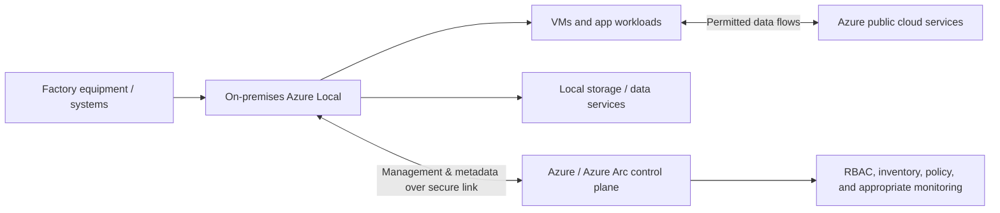
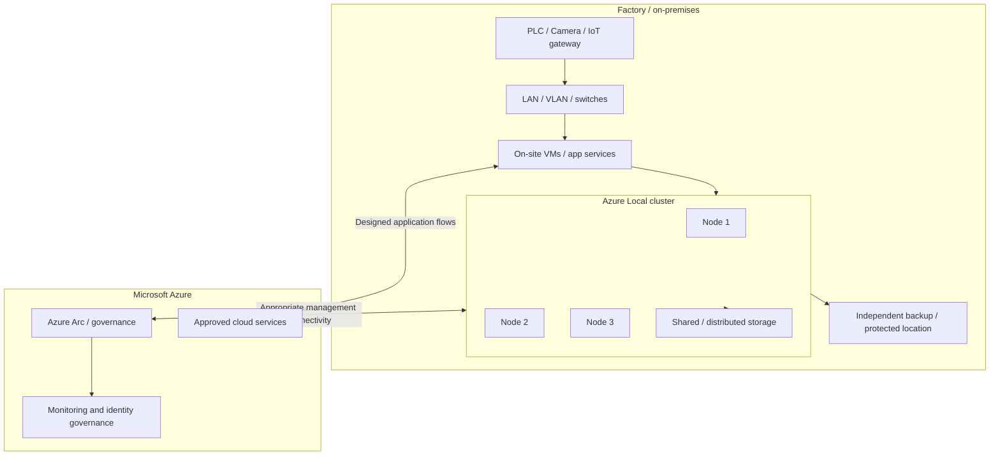

# Azure Local and On-Premises Hybrid Infrastructure Choices

> **Chapter:** Hybrid Cloud and Migration to Azure  
> **Module:** `CLOUD_PROVIDERS_AZURE` — exploring the Microsoft Azure ecosystem from subscriptions, resource groups, and Microsoft Entra ID to virtual networks, compute, storage, and data; learning how to deploy, monitor, protect, and control costs for application architectures on Azure.

## Learning Objectives

After this lesson, learners will be able to:

1. Explain **Azure Local** (the new name for the platform formerly called **Azure Stack HCI**) and the relationship between on-premises hardware, virtualization platform, **Azure Arc**, and the Azure control plane.
2. Compare Azure Local against **Azure Virtual Machines on public cloud**, **Azure Arc-enabled servers**, traditional on-premises virtualization, and other hybrid products to avoid picking the wrong architecture.
3. Identify qualifying requirements across **latency, data locality, network connectivity, validated hardware, node count, storage, availability, access permissions, and cost**.
4. Describe the process to plan, prepare, deploy, register, govern, and operate an Azure Local system hosting supported VM or Kubernetes workloads.
5. Design security boundaries, backup/DR plans, monitoring, updates, and handover documentation for hybrid infrastructure.
6. Analyze real-world scenarios and build a **decision matrix** proving why Azure Local should or should not be chosen.

## 1. The Problem: When Can an Application Not Run Entirely on Azure Public Cloud?

A manufacturing enterprise operates a factory in Binh Duong. Production line control systems read sensor data, process video/images, and write to an internal database. Business requirements may include:

- Processing loops requiring **low, deterministic latency** between shop-floor equipment and applications.
- A subset of data required to stay on-site under organization-approved policies.
- Applications needing to sustain certain local factory functions during brief WAN outages.
- Operations still wanting **management, monitoring, and standardization practices** aligned with Azure.
- Infrastructure that cannot move to public cloud all at once due to equipment, OS, and network dependencies.

Running the entire application on Azure public cloud can raise round-trip latency and WAN dependency. Keeping traditional on-premises virtualization alone leaves operations managing fragmented, separate tooling. Azure Local is **one option for running compute and storage on-premises paired with Azure-connected management**.

That does **not** mean every factory workload belongs on Azure Local. Distinguish genuine latency, data locality, and local continuity requirements from habit (“we own servers so keep servers”).

### Simple Hybrid Model



**Boundary to remember:** workloads and data run on local equipment per your configuration; management info, registration, health, telemetry, and data emitted by integrated services **may communicate with Azure**. Never assume “runs on-premises” means “zero data leaves the site.”

## 2. What Is Azure Local?

**Azure Local** is Microsoft's hybrid infrastructure platform running on **validated/supported on-premises hardware**, typically as a hyperconverged infrastructure (HCI) system. It provides a runtime for supported workloads such as **virtual machines**, and in suitable configurations, **Kubernetes via Azure Kubernetes Service (AKS) enabled by Azure Arc**. It connects to Azure to integrate management, resource governance, monitoring, and capabilities offered for that version/deployment model.

The name **Azure Stack HCI** appears widely in older documentation, commands, and resource types; Azure Local succeeds that product line. **Azure Local is not Azure Stack Hub**: the two platforms differ in scope, architecture, and service delivery model.

### Three Layers to Keep Distinct

| Layer | Components | Responsibility |
|---|---|---|
| **On-prem physical infrastructure** | Servers, CPU/RAM, NICs, drives, switches, power, racks, cooling | Availability, maintenance, firmware, physical space, and physical security |
| **Azure Local platform** | OS and supported cluster/virtualization/storage/networking stack | Hosting VM/container platforms, resource pooling, intra-cluster availability |
| **Azure management plane** | Azure subscription, Azure Arc/integration, identity, RBAC, inventory, monitoring | Cloud-connected management within supported scope; requires connectivity and permissions |

In many Azure Local releases/architectures, underlying platform components build on Windows Server Hyper-V, failover clustering, and software-defined storage such as **Storage Spaces Direct**, combined with Azure management components. **Never build a cluster by piecing together unsupported components**, even if you know Hyper-V well.

### What Azure Local Does Not Automatically Provide

- Does not turn all of Azure public cloud into an identical replica inside your data center.
- Does not mean every Azure PaaS service runs on-premises.
- Does not provide complete backup/DR just because a cluster has multiple nodes and local storage replication.
- Does not replace application design, downtime handling, networking, identity, or compliance work.
- Does not guarantee completely **disconnected** operation from Azure in every release or offering.

Support for specific VMs, Kubernetes, Azure Virtual Desktop, and Azure Arc services **depends on Azure Local version, hardware model, region, configuration, and licensing terms**. Always check current documentation and support matrices for your chosen solution before live deployment.

## 3. Comparing Azure Local Against Alternatives

| Solution | Where Workloads Run | Strengths | What Never to Misunderstand |
|---|---|---|---|
| **Azure Virtual Machines** | Microsoft-operated data centers on Azure public cloud | Scale and operate cloud resources without owning physical servers | Depends on Azure connectivity for on-site apps |
| **Azure Local** | Supported hardware operated on-premises/edge by the org | Local latency, place workloads/data per policy, Azure-tied hybrid governance | Still requires buying/operating hardware and meeting connectivity/version rules |
| **Azure Arc-enabled Servers** | Existing servers (physical or VMs on other platforms) | Connects inventory, policy/monitoring, and select Azure management features | **Does not** convert a server into Azure Local or supply a hypervisor/storage cluster |
| **Hyper-V or traditional virtualization** | Organization's data center | Flexible when existing processes and hardware fit | Does not inherently include Azure Local integration/lifecycle |
| **Azure Stack Hub** | Dedicated appliance/infra per its product model | Distinct hybrid service set/behavior for specialized requirements | Not synonymous with Azure Local / Azure Stack HCI |
| **Azure Stack Edge** | Supported edge hardware appliance | Processes and transfers edge data/workloads within device scope | Not a general substitute for an Azure Local cluster |
| **Full cloud migration** | Azure public cloud | Eliminates on-premises hardware operations | May fail strict latency, connectivity, or data locality constraints |

**Rule of thumb:** if the goal is solely **governing existing servers** through Azure, evaluate Azure Arc-enabled Servers first. Only when you need to **procure and deploy a new on-premises compute/virtualization platform under the Azure Local model** is Azure Local the direct candidate.

### Preliminary Decision Examples

- Public web app able to run in a nearby Azure region without on-prem constraints → evaluate Azure public cloud first.
- Real-time factory equipment app with site-processing rules and a team ready to run supported hardware → evaluate Azure Local.
- 300 existing VMs on VMware/Hyper-V needing unified governance/inventory without swapping hardware → evaluate **Azure Arc** and migration tools.
- System required to run **with zero cloud connectivity for extended periods** → carefully check official disconnected-operations support for exact versions/solutions; never assume standard Azure Local fits by default.

## 4. Architecture Decision Matrix

Before choosing, list mandatory disqualifiers and comparison criteria. A straightforward model:

| Criterion | Verification Question | Impact on Choice |
|---|---|---|
| **Latency** | What is the max p95 latency from equipment to app? | If WAN exceeds target, local execution adds real value |
| **Data locality** | What policy forces data to stay on-site or in a specific jurisdiction? | Must design data flows, logs, backups, and telemetry—not just VM placement |
| **WAN/Internet** | Availability, outage durations, and Azure outbound connectivity needs? | If product connectivity rules aren't met, adjust architecture |
| **On-site ops capability** | Is there staff for hardware/firmware, racks, power, networking, on-call? | Lack of ops staff inflates Azure Local risk and cost |
| **Scalability** | Predictable growth or sudden traffic spikes? | Public cloud fits rapid elasticity without hardware procurement |
| **Availability/DR** | Tolerable node/site failures, RPO, and RTO? | Must design fault domains, backups, and independent recovery |
| **Licensing & TCO** | Total 3–5 year purchase/operating cost? | Compare full CAPEX+OPEX, not just VM unit rates |
| **Workload compatibility** | Are OS, VMs, AKS, networking, storage, and peripherals supported? | Disqualify options lacking official support |
| **Security** | Identity, separation of duties, patching, encryption, auditing? | Needs both cloud RBAC and local/guest controls |
| **Solution lifecycle** | Clear update, replacement, and support roadmap? | Avoid designs tied to soon-to-be-unsupported hardware/versions |

**Disqualifying constraints** must be checked before scoring. For instance, if hardware is not on the supported catalog or a strictly air-gapped site violates product requirements, a “cheaper” score cannot save the option.

## 5. Factory Azure Local Reference Architecture

A typical conceptual architecture includes:

1. **Azure Local nodes** on validated/supported hardware, wired via switches and management/storage networks per design.
2. **Cluster virtualization and storage**, delivering VM capacity and internal fault tolerance based on node count and data resiliency settings.
3. **Local workload network**: VLANs/subnets, DNS, DHCP/static IPs, gateways/firewalls, and links to shop-floor equipment.
4. **Azure/hybrid connectivity**: endpoints/routes required by Azure Local and Azure Arc, via proxy/firewall where supported.
5. **Azure management**: subscription, resource group, identities, roles, inventory, policies/monitoring, and resource operations within feature scope.
6. **Backup/DR**: independent copies in another fault domain or approved site, with periodic restore drills.
7. **Applications**: Windows/Linux VMs, databases, or AKS-enabled workloads per product capabilities and compatibility.



This diagram shows **logical roles** only; it omits full NIC layouts, storage fabrics, RDMA networks, and VM placement across nodes. Real designs must follow supported Azure Local hardware and deployment architectures.

### Data Plane vs. Management Plane

- **Data plane:** VMs, disks, sensor reads, databases, and application traffic. When apps run locally, traffic between equipment and VMs stays on the factory LAN.
- **Management plane:** registration, cluster/resource management, updates, telemetry, and Azure/Arc operations. This requires outbound connectivity policies and RBAC.
- **Application flows to Azure:** a separate design choice, such as shipping aggregated analytics to the cloud. Never conflate app traffic with platform management traffic.

Certain local workloads continue running during brief WAN drops, **yet how long and which capabilities survive disconnected mode depends on the exact services, architecture, and Azure Local release**. Test and verify official constraints—never promise infinite offline capability.

## 6. Hardware, Node Count, and Capacity

### 6.1. Validated / Supported Systems

Never deploy Azure Local arbitrarily onto random servers just because their CPUs support virtualization. Select configurations from **vendor/Microsoft-validated hardware and solution catalogs**, covering:

- Server models, CPUs, RAM, disk controllers, SSDs/NVMe, drives, NICs, and firmware levels.
- Cluster topology, minimum/maximum node counts, and expansion rules.
- Switches, port types, speeds, RDMA configs, and storage networks where required.
- Supported drivers, BIOS, firmware, and integrated update workflows.
- Clear support ownership across OEM, Microsoft, and internal ops.

**Single-node vs. multi-node** setups carry different support rules. Never assume a single “standard” node count fits every edge site or release. A single node lacks node-level hardware fault tolerance compared to multi-node clusters; factor recovery SLAs into that choice.

### 6.2. Capacity Sizing Under Node Failure

**Illustrative** math (not a SKU recommendation):

- 3 nodes, each with 32 cores and 512 GB RAM.
- Total raw capacity: 96 cores, 1,536 GB RAM.
- To survive losing one node, at most 64 cores and 1,024 GB RAM remain across two nodes—**before subtracting hypervisor overhead, reserved capacity, affinity rules, and practical utilization limits**.

Never allocate workloads so tightly that they only fit when all three nodes are healthy.

| Capacity Category | Buffer Needed For |
|---|---|
| CPU/RAM | Peak VM demand, node-failure headroom (N−1), hypervisor overhead, growth |
| Storage | Active data, mirror/parity copies, rebuild/rebalance reserve, snapshots, growth |
| Network | East-west traffic, storage traffic, latency, and Azure uplink bandwidth |
| VM capacity | VMs-per-node limits, anti-affinity, live migration, and failover |
| Data services | IOPS/throughput, backup windows, query latency, and consistency |

**Usable storage capacity does not equal raw capacity.** Mirror/parity resiliency, fault domains, metadata, and rebuild reserve all reduce usable space. Saying “3 nodes × 10 TB = 30 TB usable” is almost always wrong when storage replicates for fault tolerance.

### 6.3. Physical Networking and Network Fabric

An Azure Local design must verify:

- Traffic separation across **management**, **storage**, and **VM/application** flows per supported topology.
- Switch configs, VLANs, IPs, DNS, NTP/time sync, MTU, and routing.
- Storage fabric throughput and latency; if RDMA is required, confirm NIC/switch/driver compatibility.
- Management and firmware update paths while production networks/workloads carry load.
- Redundancy across a failed NIC, switch, or port matching target fault tolerance.

Technologies such as **Network ATC** and intent-based host networking may be supported on specific Azure Local releases. Never improvise custom network topologies outside supported solution guidance.

## 7. Azure Connectivity, Identity, and Access Permissions

### 7.1. Management Connectivity Is Not VM SSH/RDP

In Azure-connected deployments, prepare:

1. Subscription and resource group authorized to manage Azure Local.
2. Microsoft Entra ID identities and roles required to create, register, view, or operate Azure resources.
3. Compliant **outbound connectivity** from infra/management hosts to required Azure endpoints; configure proxies, DNS, and TLS inspection per support rules.
4. Time synchronization and domain/Active Directory services required by that release/deployment model.
5. Network segmentation across management, guest VMs, storage, and apps; enforce firewall rules by **specific destination and port** instead of wide-open rules.

Never assume “having the Azure Portal” eliminates local network engineering. If outbound networking breaks, Azure resource views and live local cluster state can diverge.

### 7.2. Identity Domains Must Stay Separate

| Domain | Authentication & Permissions | Example |
|---|---|---|
| **Azure control plane** | Entra ID + Azure RBAC at target scope | Who views/manages Azure Local resources and Arc-enabled VMs |
| **Cluster / host** | OS/cluster admin rights per supported model | Who performs emergency actions on nodes, networking, or storage |
| **Guest VM** | Windows/Linux local accounts, AD DS/Entra integration per architecture | Who logs into VMs and installs apps |
| **Workload / database** | Service identities, DB roles, secrets, certificates | Who can read/write order data |
| **Hardware / network** | BMC/OOB, switch, and firmware management | Who can power cycle hosts or alter boot order/VLANs |

**Azure RBAC does not automatically replace guest OS, Active Directory, or BMC permissions.** Maintain clear permission matrices, owners, and break-glass escalation procedures, especially for incidents.

### 7.3. How Does Azure Arc Relate?

Azure Arc is the family of capabilities projecting external resources into the Azure management model. In supported Azure Local scenarios, Azure Arc and integrated components enable:

- Surfacing resources with metadata and resource IDs in Azure.
- Managing lifecycles of **Arc-enabled virtual machines** via appropriate UI/APIs.
- Integrating supported policies, tagging, monitoring, or security services.
- Running Kubernetes/AKS-enabled workloads where configured and supported.

**Azure Arc-enabled Servers** on an existing VM or host does not turn it into an Azure Local node; **Azure Local** is a dedicated infrastructure platform requiring validated hardware, clustering, and governance.

## 8. Workloads: VMs, Kubernetes, and On-Site Data

### 8.1. Virtual Machines

For Windows/Linux VMs, plan:

- Supported OS images and guest releases.
- vCPU, memory, disk sizing, logical/virtual networks, static/DHCP IPs, and DNS.
- Azure Arc or the VM management components matching your Azure Local version.
- Permissions to create, start/stop, snapshot/back up, and manage guests.
- Quotas/overcommit, anti-affinity, failover, and maintenance windows.

Never assume every **Azure public cloud VM** operation has identical APIs, SKUs, or behavior on Azure Local VMs. Many Azure Local workloads still rely on local tooling alongside specific Arc integration capabilities.

### 8.2. AKS Enabled by Azure Arc on Azure Local

Certain Azure Local deployments support managed Kubernetes clusters via **AKS enabled by Azure Arc**, suited for containerized edge workloads. Before selecting, verify:

- Supported Azure Local release and AKS integration version.
- Networking, IP pools, DNS, image registries, and pull secrets.
- Storage classes/persistent volumes and backup mechanisms for stateful workloads.
- Supported upgrade paths for clusters, control planes, and worker nodes.
- Identity, RBAC, container registries, image policies, and telemetry.

**Never place a critical stateful database inside an on-prem Kubernetes cluster merely because AKS is installed.** Evaluate storage durability, consistency, backups, and operational expertise first.

### 8.3. Splitting Workloads Between Azure Local and Azure Public Cloud

A sensible split example:

- **On-site:** camera processing, machinery interfaces, ultra-low-latency event APIs, local buffering queues.
- **In Azure:** aggregated reporting, long-term analytics, archival storage, public-facing services, multi-site fleet management.

Design WAN data sync (batch/stream), retries, idempotency, event ordering, offline buffering, and retention policies. Minimize synchronous WAN calls on latency-critical local execution paths.

## 9. Azure Local Preparation and Deployment Workflow

Portal screens, wizards, config schemas, and APIs evolve across Azure Local versions. Below is an **architecture-level runbook**, not copy-paste commands for all hardware.

### Phase A — Discovery and Design

1. Inventory workloads, OSes, capacity, database dependencies, networking, backups, licensing, and owners.
2. Define latency SLOs, RPO/RTO, data locality, availability targets, and maintenance windows.
3. Decide between Azure Local vs. Azure VMs/Arc/alternatives using Section 4's matrix.
4. Select **validated hardware/solutions** and align with the OEM on node counts, SSDs/NICs, switches, firmware, and support.
5. Design IP addressing, VLANs, DNS, proxies, AD DS/identity, and Azure endpoint reachability.
6. Size for node fault tolerance (N−1), usable storage, IOPS, backup space, and 3–5 year growth per enterprise policy.

### Phase B — Subscription and Infrastructure Preparation

1. Verify subscription, resource group, Entra ID/Azure RBAC permissions, tagging policies, and log destinations.
2. Rack, power, wire uplinks, out-of-band management, switching, and IP addressing per approved diagrams.
3. Validate health, firmware, BIOS, NICs, storage, and networking per OEM and support guides.
4. Confirm outbound DNS/TLS/routing to required endpoints, plus AD DS and time synchronization.
5. Prepare maintenance runbooks, backup/DR, emergency accounts, approvers, and deployment rollback plans.

### Phase C — Deployment and Registration

1. Follow the version-appropriate **Azure Local** deployment flow via Azure Portal or supported automation.
2. Specify resource names, subscription, resource group, management location, and cluster nodes in the deployment workflow.
3. Supply validated host, network, and storage parameters; let pre-deployment validation complete cleanly.
4. Deploy/register required Azure/Arc integration components.
5. Verify deployment health, individual nodes, virtual disks, cluster resources, identity, and Azure connectivity.
6. Configure workload networks, VM images, and VM/AKS provisioning **within environment-supported features**.

**Never bypass validation failures by muting warnings to force deployment through.** Minor storage or network mismatches often surface as severe outages during node failure or firmware updates.

### Phase D — Acceptance

Completion criteria:

- Cluster health is green; zero critical nodes, disks, or network paths degraded.
- A test VM provisions, boots, attaches network/storage properly, and a demo app meets latency SLOs.
- Azure management permissions match the right people/scope, and Azure inventory matches physical cluster reality.
- Monitoring, alerting, logs, and backups are configured; restore at least one sample workload.
- Failover/maintenance scenarios are rehearsed per supported config.
- Costs, OEM support contacts, and update schedules are handed over to operations.

## 10. Read-Only Operational Inspection Commands

Use the Azure Portal to view registered Azure Local resources and integrated health. With Azure CLI, a **read-only listing** inside your active subscription looks like:

```bash
az login
az account show --query "{subscription:id,name:name}" --output table

# Cluster resource type commonly seen in Azure Local / Azure Stack HCI releases.
az resource list \
  --resource-type "Microsoft.AzureStackHCI/clusters" \
  --query "[].{name:name,resourceGroup:resourceGroup,location:location}" \
  --output table
```

**Limitation:** resource types and fields vary by Azure Local version/registration; Azure listings never replace physical cluster health checks. Never conclude “Azure resource says Succeeded” means every disk and VM is healthy.

On an **authorized** Windows host or management station with the required modules, read-only PowerShell status checks may include:

```powershell
# On a management machine with FailoverClusters module and proper permissions.
Get-Cluster
Get-ClusterNode | Select-Object Name, State

# Storage cmdlets: inspect status only, DO NOT modify pools/virtual disks.
Get-StoragePool | Select-Object FriendlyName, HealthStatus, OperationalStatus
Get-VirtualDisk | Select-Object FriendlyName, HealthStatus, OperationalStatus

# Networking and VMs where corresponding cmdlets exist in the management environment.
Get-NetAdapter | Select-Object Name, Status, LinkSpeed
Get-VM | Select-Object Name, State, CPUUsage, MemoryAssigned
```

These commands are **read-only examples**—they do not deploy or modify clusters. Available cmdlets and outputs depend on node, role, module, and release; **never alter networking/storage directly outside supported Azure Local management workflows**.

### Signals to Monitor

| Layer | Example Signals | When to Investigate |
|---|---|---|
| Node/hardware | Health, CPU, RAM, thermals, firmware, power | Node degraded, ECC/disk errors, overheating |
| Cluster/storage | Resiliency health, free capacity, rebuilds, latency, IOPS | Insufficient fault headroom, prolonged rebuilds |
| Network | Link state, congestion, packet loss, storage fabric | Rising latency, lost redundant path |
| VM | Power state, CPU ready/pressure, memory, disk latency, guest health | VM fails to start/failover, SLO breach |
| Azure/Arc | Registration, agent/integration health, policy/monitoring availability | Stale inventory, broken management link |
| Application | p95/p99, error rates, DB queries, queues, business transactions | Infra looks green yet app stops responding |
| Backup/DR | Recovery point age, job failures, restore-test evidence | RPO/RTO missed |

Azure Monitor, Azure Arc, Defender for Cloud, and related services surface only what is **configured and supported**. Never interpret silence/zero alerts as proof every local component is healthy.

## 11. Security and Shared Responsibility

### 11.1. Hybrid Shared Responsibility Model

| Responsibility | Primary Owner |
|---|---|
| Power, physical site, switches, racks, firmware, hardware maintenance | Organization / OEM per contract |
| Azure Local config, networking, clustering, update orchestration | Authorized platform team using supported tooling |
| Azure subscription, Entra ID, RBAC, policies, integrated monitoring | Cloud governance / security team |
| Guest OS, applications, data, secrets, app patching | Workload team |
| Backups, DR, restore testing, retention governance | Workload owner with platform/security |
| Support and escalation | Operations + Microsoft/OEM per contract scope |

Never assume a hardware vendor will **recover your entire application** simply because they sold the servers.

### 11.2. Essential Security Controls

- Separate Azure subscription/resource-group RBAC, cluster/host admin rights, guest VM access, AD DS privileges, and BMC admin accounts.
- Enforce **least privilege**, role-appropriate approval/PIM, and prohibit shared local admin accounts.
- Harden outbound management, DNS, TLS, network segmentation, firewalls, and routing; allowlist only required destinations.
- Encrypt data at rest and in transit per supported config; govern encryption keys and app secrets.
- Track vulnerabilities/patches across OS, firmware, guests, and apps; secure VM/container image supply chains.
- Audit changes to Azure RBAC, cluster configs, hosts/VMs, workload permissions, backups, and emergency break-glass actions.
- Review **supported** Azure Policy/Defender/Arc monitoring coverage—verify actual applicability instead of assuming every public-cloud Azure Policy applies to Azure Local.

### 11.3. Data Residency Requirements

When bound by “data stays on-premises” rules, inspect at minimum: data disks, backups, snapshots, logs, traces, metadata, crash dumps, update diagnostics, Azure Arc/monitoring configs, and app sync paths. Certain metadata/telemetry flows to Azure for management; contracts and configurability must be vetted by security/legal.

**Never leak sensitive data into diagnostic logs or Azure tags/resource names** just because it is outside a database.

## 12. High Availability, Backup, and Disaster Recovery

**Cluster HA is not backup or DR.** A cluster can survive certain node/disk failures, yet cannot recover accidental deletions, ransomware encryption, app bugs, total server-room loss, or site-wide power failure.

| Incident | Controls to Evaluate |
|---|---|
| Single disk/NIC/node failure | Storage/network/cluster resiliency, failover, post-failure capacity |
| Host OS/firmware updates | Supported rolling maintenance/updates and health checks |
| Accidental deletion or DB corruption | Independent backups, retention/immutability, restore tests |
| Entire site loss | Off-domain/off-site replicas or backups, DR runbook |
| WAN / management link loss | Local app acceptance, incident handling, exact disconnected rules |
| Application logic error | Versioned artifacts, DB consistency, transactional restore and rollback |

### RPO/RTO Remain Application-Level Targets

- **RPO:** maximum acceptable data loss, e.g., 15 minutes.
- **RTO:** maximum acceptable outage, e.g., 2 hours.

Having three nodes and distributed storage **does not prove 15-minute RPO or 2-hour RTO** if the entire site goes down. Define backup locations, replication methods, consistency levels, VM/DB startup times, and failback feasibility.

### Backup / DR Checklist

1. Inventory every VM, database, file store, secret, certificate, and off-cluster dependency.
2. Pick backup/replication **supported by the vendor for your Azure Local release and workload**; never assume every Azure Backup/ASR feature behaves identically to public Azure VMs.
3. Isolate backup copies from the same failure domain and enforce access control, retention, and immutability.
4. Rehearse restoring files, VMs, and app data into an isolated environment; measure real restore times.
5. Test networking, identity, DNS, certificates, databases, and dependent apps during site failover.
6. Document and maintain a runbook with go/no-go thresholds, rollback, and accountable owners.

## 13. Updates and Lifecycle Operations

Deploying Azure Local does not end when the first VM boots. It is a **physical system with an ongoing lifecycle**:

- Manage platform, driver, firmware, and Azure integration updates via **supported solution/OEM workflows**.
- Read release notes, check compatibility, back up, and verify cluster health before updating.
- Schedule around application SLAs, ensuring capacity headroom before draining a node into maintenance.
- Monitor health during/after updates and confirm failover/network/storage health.
- Never force manual firmware or network stack updates outside the support matrix, even if a tweak appears to “fix” something quickly.
- Plan for unrecoverable node hardware failure: spare parts, replacement, warranty, escalation, and revalidation.

### When Azure / Arc Reports Connection Errors

Investigate in order:

1. Are the local cluster, nodes, and workloads still running?
2. Did DNS, system clock, certificates, proxies, or outbound firewalls/routes change?
3. Are all Azure endpoints required by your release still reachable?
4. Are Arc integration/agents and resource registration showing errors or expired conditions?
5. Is there an Azure-side incident/maintenance or a change to tenant/subscription/role assignments?

Never open wide public inbound access or disable firewalls just to “test faster.” Use minimal vendor-supported connectivity tests and log every change for rollback.

## 14. Costs and Total Cost of Ownership (TCO)

Azure Local typically combines hardware **CAPEX** with on-site **OPEX**. When comparing against public cloud, compare total cost over the same horizon and SLO—never compare a cloud VM hourly rate against bare server hardware without power, staff, and backups.

Reference formula:

\[
\begin{aligned}
TCO_{\text{Local}} ={}&
C_{\text{hardware + maintenance}} +
C_{\text{software/license/subscription}}\\
&+ C_{\text{power + cooling + rack}}+
C_{\text{network/WAN}}\\
&+ C_{\text{backup + DR}}+
C_{\text{operations/security}}+
C_{\text{refresh}}
\end{aligned}
\]

Azure Local billing often scales with **physical cores** and subscription/benefit terms, while Windows Server/SQL Server/AKS/AVD or add-on services may carry separate licensing and fees. Verify **current pricing, Azure Hybrid Benefit, guest OS licensing policies, and enterprise agreements**—never assume an Azure Local license covers all application software rights.

### 3–5 Year Comparison Template

| Line Item | On-Premises Azure Local | Azure Public Cloud |
|---|---|---|
| Base compute/storage | Server/disk/switch CAPEX, OEM support | Azure VM SKUs, storage, and resource meters |
| Licensing | Azure Local plus eligible guest/workload licenses | OS/DB/VM/managed service licensing per option |
| Power and space | Power, cooling, racks, physical facility | Indirectly baked into cloud service rates |
| Operations | Hardware, cluster, update, and security staff | Cloud, governance, and workload staff |
| Scaling | Procure additional hardware, verify cluster limits | Scale within cloud quotas/capacity and policy |
| Networking | LAN/storage/WAN, Azure connectivity | VPN/ExpressRoute/egress and data transfer |
| DR/backup | Secondary site/replicas/appliances or supported services | Backups/replication/secondary region per design |
| Risk | Hardware failure, refresh cycles, parts shortages | SKU/price shifts, regional and network dependency |

### Hypothetical Economic Example

A 24/7 factory workload with steady CPU/RAM demand, heavy LAN bandwidth, and strict equipment latency favors Azure Local for **latency and local operational control**, at the cost of hardware, staffing, and OEM support. Conversely, a batch workload running a few hours a week favors **on-demand cloud compute** if WAN bandwidth suffices.

Never declare either option cheaper without hard numbers on **actual workloads, utilization, data transfer, licensing, downtime, and hardware refresh cycles**.

## 15. Selection Scenarios and Counter-Examples

### Scenario A — Production Line Requiring Local Processing

**Conditions:** cameras and industrial devices require LAN-level processing; software runs on supported VMs; on-site IT exists; aggregated transaction summaries sync to Azure.

**Candidate:** Azure Local hosting VMs or containers/Kubernetes per product support. Must verify real latency, WAN-outage design, validated hardware, storage, HA, backups, and cost.

**Not automatically qualified:** requirements for prolonged total air-gapped operation, safety-critical PLC control loops, or uncertified specialized hardware. Those require separate engineering evaluation.

### Scenario B — Company Only Wants to Govern 100 Existing Servers

**Conditions:** many VMs on an existing hypervisor running smoothly; primary needs are inventory, governance, security visibility, and centralized logs.

**First candidate:** Azure Arc-enabled Servers and appropriate governance services—do not buy Azure Local prematurely. If a full virtualization refresh arises later, evaluate Azure Local in its own project.

### Scenario C — New App with Highly Variable Traffic

**Conditions:** web/API has low off-peak load, no local equipment dependency, and data is permitted in Azure.

**Candidate:** App Service, AKS, Azure Container Apps, or Azure VMs in public cloud depending on architecture. Investing in an Azure Local cluster fits poorly due to fixed hardware capacity and physical ops overhead.

### Scenario D — Site Prohibited from Connecting to Internet/Azure

**Conditions:** facility sits in an air-gapped zone forbidden from cloud connectivity by policy—not merely experiencing brief WAN drops.

**Assessment:** do not assume standard connected Azure Local works. Only consider officially supported disconnected offerings matching exact version, hardware, and architecture rules; otherwise choose a local platform with explicit offline support.

## 16. Practice Exercise: Designing an Azure Local Plan for a Branch Warehouse

**Prompt:** A retail chain operates a regional hub warehouse needing local barcode scanning and inventory processing, connected to Azure public cloud for central aggregation. The WAN drops briefly a few times per month; local core operations must continue. Warehouse data has backup and retention requirements.

### Step 1 — Build the Requirements Table

| Requirement | Hypothetical Lab Value | Evidence to Collect |
|---|---|---|
| Barcode read latency | p95 under 20 ms on LAN | Real measurement from scanner to app |
| VM / workload count | 12 VMs, 2 container services | Compatibility and per-service sizing |
| Storage | 8 TB data growing 20%/year | Usable capacity and storage resiliency math |
| WAN | Connected to Azure with brief outages | Uptime logs and WAN-loss testing |
| Availability | Survive single-node failure | N−1 capacity, network/storage, and failover tests |
| Backup | 1-hour RPO, 4-hour RTO for critical apps | Tested backup/restore plan |
| Security | Zero public inbound exposure to hosts | Segmentation, identity, logs, patching |
| Lifecycle | 3-year TCO estimate | Quotes for hardware, software, support, power, staff |

These figures are **exercise samples**, not minimum Azure Local specs or performance guarantees.

### Step 2 — Compare Three Options

Complete the following matrix comparing **Azure Local**, **Azure public cloud**, and **keeping existing hypervisor + Azure Arc**:

| Criterion | Azure Local | Azure Public Cloud | Hypervisor + Arc |
|---|---|---|---|
| Latency and WAN dependency | … | … | … |
| Data locality / telemetry | … | … | … |
| Hardware investment | … | … | … |
| Ops team capability | … | … | … |
| VM/K8s compatibility | … | … | … |
| Backup and RPO/RTO | … | … | … |
| 3-year cost | … | … | … |
| Disqualifying constraints | … | … | … |

### Step 3 — Architect the Solution

1. Pick a supported hardware class **matching requirements**; never label a specific SKU “validated” without checking the official catalog.
2. Diagram management network, storage fabric, workload VLANs, WAN routes, and Azure egress paths.
3. Specify Azure subscription/resource group, Azure RBAC, cluster rights, guest rights, and owners.
4. Pick one demo app VM; document vCPU/RAM/disk/network, SLOs, and latency measurement steps.
5. Design independent backups and rehearse restoring a sample warehouse record.
6. Define governance during Azure disconnects and verify **supported maximum disconnect tolerances**.
7. Estimate TCO, noting assumptions for licensing, support, power, racks, and bandwidth.

### Step 4 — Test and Acceptance

If an authorized lab environment is available:

- Inspect cluster and node health with supported tools; never break production fault domains for tests.
- Deploy a demo VM or workload via supported workflows.
- Measure latency and availability under normal load; watch CPU, storage latency, link errors, and app metrics.
- Rehearse failover in the authorized lab, confirming N−1 headroom.
- Simulate **WAN loss in lab per approved procedure**, observing which local functions stay up and which Azure services degrade; never guess purely from theory.
- Run backup/restore on demo data and record measured RPO/RTO.

Without deployment permissions for Azure Local, deliver a **written architecture design and simulated runbook**; never touch systems outside your authority.

### Passing Criteria

The exercise passes when an option is chosen with **verifiable rationale** satisfying hardware/connectivity/latency constraints; covers networking, identity, availability, backup, operations, and TCO; and lists assumptions requiring pre-production validation.

### Self-Check Questions

1. Why does Azure Local differ from Azure Arc-enabled Servers even though both appear in the Azure Portal?
2. Does running workloads on-premises mean zero metadata or telemetry ever leaves the facility?
3. What conditions favor Azure public cloud over Azure Local?
4. Why cannot all RAM across three nodes be allocated if the cluster must survive a single-node failure?
5. If storage is already replicated across nodes, why are backups and DR drills still mandatory?
6. Does Azure RBAC automatically allow an admin to manage Windows guest VMs and physical network switches?
7. During a WAN outage, can you claim every Azure Local capability runs indefinitely without Azure? Why or why not?
8. Name the cost categories required when comparing Azure Local TCO against Azure VMs.
9. What prerequisites must be checked before deploying AKS enabled by Azure Arc?
10. What are the four most critical signal groups during Azure Local acceptance testing?

## 17. Summary

**Azure Local** brings supported compute/virtualization capabilities into **the enterprise's own premises**, paired with Microsoft Azure's governance model and ecosystem. It fits when **local processing, latency, data locality, and hybrid operations** justify on-premises hardware and site operations.

Sound selection starts not with a product name, but with constraints across **workloads, data, connectivity, supported hardware, availability, backups, security, and TCO**. Compare against Azure public cloud, Arc-enabled Servers, and existing virtualization; validate with a pilot and complete operational design before scaling to production. A cluster booting VMs is only the start—a dependable hybrid system demands access governance, monitoring, patching, tested recovery drills, and clear ownership.
